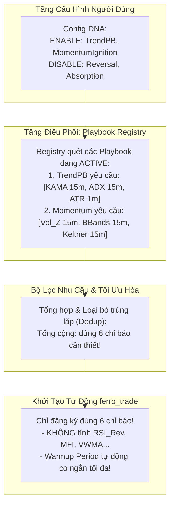

# 🏛️ ĐẶC TẢ KIẾN TRÚC TƯƠNG LAI: DEMAND-DRIVEN PLAYBOOK REGISTRY
> **Phân hệ:** `strategies_backtests/helios/src/strategy/core_v3/`  
> **Trạng thái:** 💡 Thiết kế định hướng tương lai (Future Architecture RFC / Blueprint)  
> **Thời điểm lập:** 2026-09-29  
> **Mục tiêu:** Chuyển đổi từ mô hình đường ống nguyên khối (Monolithic Pipeline) sang kiến trúc cắm-rút hướng nhu cầu (Plug-and-Play Capability Pattern).

---

## 🧭 1. ĐỘNG LỰC & THỰC TRẠNG KIẾN TRÚC HIỆN TẠI

### 1.1 Khớp Nối Cứng Nguyên Khối (Monolithic Coupling)
Trong phiên bản Helios V3.3 hiện tại:
- Tại `core_v3/mod.rs:init()`: Hệ thống khởi tạo cứng toàn bộ 15 cảm biến (`KAMA, NATR, MFI, ADX, BBands, Keltner, RSI Trend, RSI Rev, RSI Mom, Stoch Trend, VWMA, ZScore, VolZScore, ATR`).
- Tại `core_v3/matrix.rs:from_sensors()`: Ma trận tính toán trước toàn bộ 15 trường dữ liệu cho cả chiều dài lịch sử nến.
- Sau đó, `HeliosArbiter` mới đăng ký cố định 4 Scanner (`TrendPB, MomentumIgnition, Reversal, Absorption`).

### 1.2 Những Hệ Lụy Tiêu Cực Của Kiến Trúc Cũ
1. **Lãng phí Chu kỳ CPU & RAM:** Khi một Playbook (ví dụ `Reversal`) bị vô hiệu hóa qua cấu hình, cảm biến `rsi_reversal` vẫn bị đăng ký và tính toán trong `init()`.
2. **Bẫy Lây Nhiễm Warmup (Warmup Contagion):** Nếu một Playbook đòi hỏi chỉ báo đa khung thời gian lớn (ví dụ KAMA 4h cần 12,000 nến warmup), thì **dù Playbook đó có bị tắt**, toàn bộ hệ thống vẫn bị ép phải chờ 12,000 nến warmup mới được phép giao dịch.
3. **Khó Mở Rộng / Sửa Đổi (High Friction):** Mỗi khi muốn bổ sung hoặc gỡ bỏ một Playbook, lập trình viên phải sửa đổi xuyên suốt 5 tầng: `Config -> InitContext -> Sensors -> Matrix -> Arbiter`.

---

## 🏗️ 2. BẢN THIẾT KẾ: KIẾN TRÚC CẮM-RÚT HƯỚNG NHU CẦU (DEMAND-DRIVEN)

Kiến trúc tương lai áp dụng nguyên lý **Inversion of Control (IoC)** và **Capability Pattern**:  
*"Chỉ báo kỹ thuật không tự sinh ra, mà chỉ được khởi tạo khi và chỉ khi có ít nhất một Playbook đang hoạt động yêu cầu nó!"*



---

## 🧩 3. ĐẶC TẢ KỸ THUẬT CHI TIẾT (TECHNICAL SPECIFICATION)

### 3.1 Trait `TacticalPlaybook` Tự Khai Báo Nhu Cầu
Mỗi Playbook là một module khép kín (Self-contained Module):

```rust
pub trait TacticalPlaybook: Send + Sync {
    /// Định danh duy nhất của Playbook
    fn id(&self) -> PlaybookId;

    /// Kiểm tra Playbook có đang được bật trong cấu hình hay không
    fn is_enabled(&self, config: &HeliosConfigV3) -> bool;

    /// Tự khai báo danh sách các chỉ báo bắt buộc phải có để hoạt động
    fn declare_dependencies(&self, config: &HeliosConfigV3) -> Vec<IndicatorRequest>;

    /// Đánh giá tín hiệu tại nến hiện tại dựa trên Context đã được chuẩn bị
    fn evaluate(&self, ctx: &TacticalEvaluationContext) -> Option<TacticalSignal>;
}
```

### 3.2 Cấu Trúc Yêu Cầu Chỉ Báo (`IndicatorRequest`)
```rust
#[derive(Debug, Clone, PartialEq, Eq, Hash)]
pub struct IndicatorRequest {
    pub name: String,
    pub timeframe: Timeframe,
    pub indicator_type: IndicatorType,
    pub lookback: usize,
    pub params: Vec<OrderedFloat<f64>>,
}
```

### 3.3 Quy Trình Điều Phối Tại `HeliosArbiter`
1. **Bước 1 (Harvesting):** Khi gọi `init()`, Arbiter duyệt qua danh sách các Playbook:
   ```rust
   let mut unique_requests = HashSet::new();
   for playbook in &self.playbooks {
       if playbook.is_enabled(&self.config) {
           for req in playbook.declare_dependencies(&self.config) {
               unique_requests.insert(req);
           }
       }
   }
   ```
2. **Bước 2 (Dynamic Binding):** Chỉ đăng ký các `unique_requests` vào `InitContext`.
3. **Bước 3 (Warmup Minimization):** `warmup_period` của hệ thống được tính toán động dựa trên tập chỉ báo tối thiểu thực sự chạy, giúp bot khởi động cực nhanh và không bị nuốt nến oan uổng.

---

## 💎 4. LỢI ÍCH ĐỊNH LƯỢNG KHI NÂNG CẤP

1. **Hiệu Năng Vượt Trội:** Giảm $30\% - 50\%$ thời gian tính toán backtest và tối ưu hóa di truyền (GA Optimizer) khi chạy các kịch bản thử nghiệm từng Playbook đơn lẻ.
2. **Khả Năng Thử Nghiệm Module Độc Lập (Isolated Sandboxing):** Cho phép các nhà nghiên cứu Quant cắm thêm Playbook mới (ví dụ: `LiquiditySweep`, `FundingRateArbitrage`) mà không cần chạm vào mã nguồn của các Playbook cũ hay ma trận tổng thể.
3. **Miễn Nhiễm Hoàn Toàn Với Bẫy Warmup Lây Nhiễm:** Tắt các chiến thuật dùng timeframe lớn (1h/4h) sẽ lập tức đưa warmup về cấp độ nến 5m/15m, giúp bot giao dịch ngay lập tức khi khởi động.

---

## 🗺️ 5. LỘ TRÌNH TRIỂN KHAI (FUTURE ROADMAP)

- [ ] **Giai Đoạn 1 (Hiện tại):** Ổn định toàn bộ hệ thống Helios V3.3 hiện hữu, hoàn thành kiểm toán `audit_01` (`TASK-MAT-06` đến `TASK-MAT-10`), bịt kín các lỗi toán học và quản trị rủi ro SL/TP.
- [ ] **Giai Đoạn 2 (Kiểm Chứng Thực Nghiệm):** Chạy Paper Trading và Walk-Forward liên tục trong 1-2 tháng để xác nhận kỳ vọng toán học dương ($EV > 0$).
- [ ] **Giai Đoạn 3 (Đại Phẫu Kiến Trúc):** Triển khai `Demand-Driven Playbook Registry` theo đặc tả tài liệu này, nâng cấp hệ thống thành nền tảng Modular Quant Trading hoàn chỉnh.
