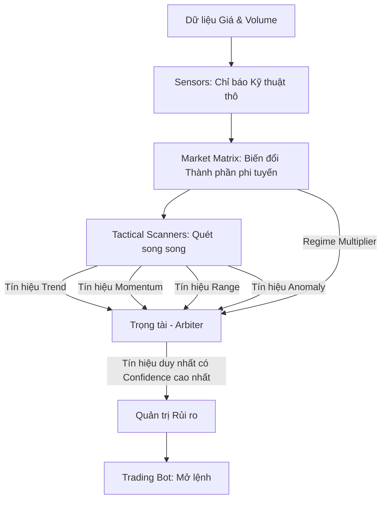

# Tổng quan Kiến trúc Helios V3: Mô hình Signal-First

## 1. Giới thiệu: Sự chuyển mình từ V2 (Regime-First) sang V3 (Signal-First)
Trong kiến trúc V2, Helios hoạt động theo mô hình **Phễu Lọc (Funnel / Regime-First)**: Môi trường (Environment) -> Thế trận (Regime) -> Chiến thuật (Tactical). Thiết kế này bảo vệ tài khoản tốt, nhưng lại tạo ra **Nút thắt cổ chai**. Nếu một Regime không đạt điểm cao nhất, toàn bộ tín hiệu của chiến thuật đó bị hủy bỏ, dẫn đến việc bỏ lỡ các cơ hội (False Negatives) và bot có "khoảng trống thời gian" rất lớn.

Helios V3 khắc phục điểm yếu này bằng mô hình **Quét Tín hiệu Song song (Signal-First)**. V3 tách bạch vai trò của người tìm kiếm cơ hội (Scanners) và người ra quyết định (Arbiter). 

## 2. Các Thành phần Cốt lõi (V3 Pipeline)

### 2.1. Sensors (Giác quan) & Market Matrix (Nhận thức)
- **Giữ nguyên sức mạnh từ V2**: Tái sử dụng 100% logic đo đạc của V2. Thay vì dùng trực tiếp RSI hay MACD, Helios đưa chúng vào Ma trận (Matrix) để quy đổi thành các "Lực" (Force) có cùng thang đo (0.0 đến 1.0). (Xem chi tiết tại `logic_core/01_Market_Perception_Math.md`).

### 2.2. Tactical Scanners (Đội Đặc Nhiệm Quét Tín hiệu)
Thay vì chờ lệnh từ cấp trên (Regime) như V2, V3 cho phép các đội SWAT (Scanners) **liên tục quét thị trường 24/7**.
- Mỗi Scanner (Trend, Momentum, Range, Absorp) hoạt động độc lập.
- Khi tìm thấy cơ hội khớp với khuôn mẫu toán học (Pattern), Scanner sẽ nộp một `Proposal` (Đề xuất vào lệnh) bao gồm: `Loại lệnh (Long/Short)`, `Độ rõ nét của Pattern (Raw Pattern Score)`.

### 2.3. The Arbiter (Trọng Tài)
Đây là trái tim của V3. Trọng tài nhận tất cả các `Proposals` từ các Scanners tại cùng 1 nến.
1. **Tính toán Hệ số Thế trận (Regime Multiplier):** Dựa trên cấu trúc thị trường hiện tại (Trend mạnh hay yếu, Volatility cao hay thấp).
2. **Chấm điểm Niềm tin (Confidence Score):** `Confidence = Raw Pattern Score * Regime Multiplier`.
3. **Phân xử:** Nếu chỉ có 1 tín hiệu đạt mức `Min Confidence`, Trọng tài duyệt. Nếu có nhiều tín hiệu, Trọng tài duyệt tín hiệu có `Confidence` cao nhất. Nếu không có tín hiệu nào đủ tự tin, Trọng tài "Đứng ngoài".

### 2.4. Risk Management & Execution (Quản trị Vốn)
Sau khi Trọng tài duyệt tín hiệu, `RiskManager` sẽ tính toán khoảng cách Stoploss và kích thước lệnh lý tưởng (`Ideal Position Size`). Trách nhiệm kiểm tra giới hạn Notional Value của sàn được giao lại cho Trading Bot bên ngoài. (Xem `02_Execution_and_Risk.md`).

## 3. Lợi ích của Kiến trúc V3
- **Tối đa hóa Cơ hội (High Frequency Capability):** Bot không bị "ngủ đông" vô lý vì màng lọc Regime.
- **Tính công bằng & Khách quan tuyệt đối:** Ở V2, do thiết kế dạng "Phễu", một số Playbook bị "con ghẻ", không bao giờ được gọi đến dù thị trường có tín hiệu của chúng. Với V3, **mọi Scanner đều có cơ hội trình bày Proposal của mình trên bàn Trọng tài** ở mỗi cây nến. Arbiter chỉ dựa vào `Confidence Score` để chọn ra kẻ giỏi nhất, không thiên vị bất kỳ trường phái nào.
- **Dễ dàng Tối ưu hóa bằng Thuật toán Di truyền (GA):** GA không cần phải cố gắng làm sai lệch thông số Range để ép Trend thắng. Mỗi chiến thuật tự tối ưu ngưỡng Pattern của riêng nó.
- **DRY (Don't Repeat Yourself):** Kiến trúc này đóng gói từng Scanner thành các module độc lập. Khi muốn thêm chiến thuật mới (VD: Volume Profile Scanner), ta chỉ cần viết thêm 1 file Scanner cắm vào Arbiter mà không làm hỏng logic của các chiến thuật cũ.
