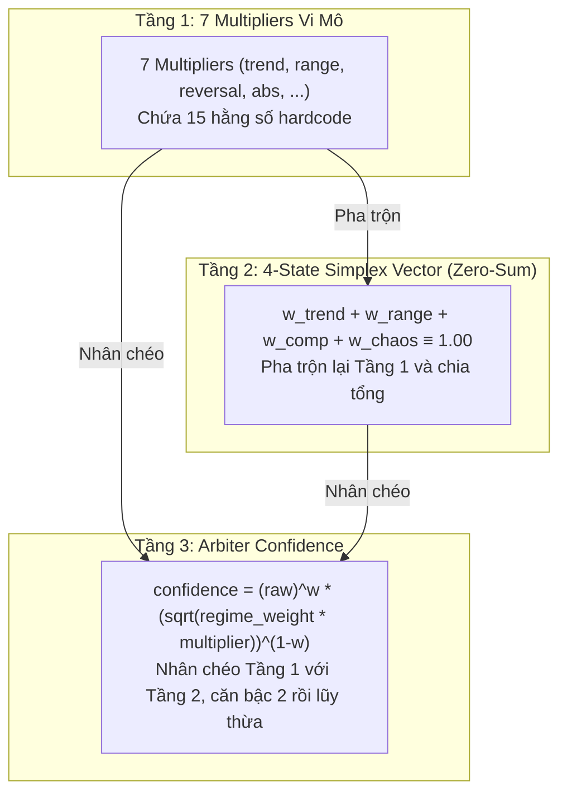

# 📋 BÁO CÁO KIỂM TOÁN: MÓN NỢ KIẾN TRÚC & SỰ OVER-ENGINEERING TRONG `matrix.rs`

---

## 🎯 1. BỐI CẢNH VÀ NGUYÊN NHÂN CỐT LÕI
Trong các bài kiểm thử Walk-Forward gần đây (`WFSS_ETH_FLAW-REG.10.log` vs `WFSS_ETH_TRENDPB.log`), hệ thống bộc lộ sự mong manh (fragility) nghiêm trọng:
- Khi tinh chỉnh KAMA slope (`/ 0.08`) cho `TrendPB`, hiệu suất của hệ thống sụt giảm từ **+27.37%** (7 lệnh, Win Rate 85.7%) xuống **-5.63%** (6 lệnh, Win Rate 33.3%).
- Nguyên nhân không nằm ở bản thân `trend_pb.rs` (vốn vào lệnh Long hòa vốn -$0.00 an toàn), mà nằm ở **sự over-engineering và liên kết phi tuyến 3 tầng trong `matrix.rs` và `arbiter.rs`**, gây ra phản ứng dây chuyền làm triệt tiêu các Playbook khác (cụ thể là `Reversal`).

---

## 🔍 2. DANH MỤC 15 HẰNG SỐ HARDCODED TRONG `matrix.rs`

Rà soát chi tiết mã nguồn [`matrix.rs`](file:///e:/Projects/Automations/trading_backtest/strategies_backtests/helios/src/strategy/core_v3/matrix.rs) phát hiện hơn 15 hằng số và tỷ lệ pha trộn cứng:

| Dòng Code | Hằng Số Cứng | Mục Đích Hiện Tại | Tác Hại Định Lượng Đối Với Đa Tài Sản |
| :--- | :---: | :--- | :--- |
| **L.61** | `/ 100.0` | Chia tỷ lệ phần trăm NATR | Chuyển đổi đơn vị (hợp lệ). |
| **L.80** | `adx - 20.0` | Tâm phân phối chuẩn hóa ADX | Cố định mốc 20.0 (chỉ đúng với coin biến động trung bình; sai với BTC và Altcoin). |
| **L.92** | `s / 0.50` | Chuẩn hóa độ dốc KAMA | Ép chia 0.50 tuyệt đối $\to$ coin giá to và giá nhỏ bị méo mó. |
| **L.103** | `scale = 0.5` | Độ nhạy Volume Z-Score | Cố định độ co giãn volume không theo DNA. |
| **L.107** | `0.5*Vol + 0.5*MFI` | Trọng số Volume Force | Ép tỷ lệ 50%-50% cảm tính giữa Z-Score và MFI. |
| **L.130** | `slope / 0.08` | Độ nhạy KAMA Slope | Chia 0.08 quá nhỏ $\to$ slope nhích nhẹ đã phóng đại trend lên sát 1.0. |
| **L.141** | `bb_slope / 0.10` | Hệ số phẳng BB Middle | Ngưỡng phẳng cứng 0.10. |
| **L.148** | `0.5*Z + 0.5*Chaos` | Trọng số Anomaly Multiplier | Ép tỷ lệ 50%-50% cảm tính. |
| **L.151** | `t_mul > 0.80 ? 0.20` | Ngắt cành Reversal Multiplier | Cắt tỉa nhị phân cứng 0.80 và áp sàn 0.20. |
| **L.155** | `0.5*Sqz + 0.5*Vol` | Trọng số Absorption | Ép tỷ lệ 50%-50% cảm tính. |
| **L.160** | `0.5*Chaos + 0.5*Vol`| Trọng số Vol Expansion | Ép tỷ lệ 50%-50% cảm tính. |
| **L.168** | `slope / 0.10` | Độ nhạy dốc Trend Simplex | Lại một mốc 0.10 khác cho Trend. |
| **L.174** | `0.70*Chaos + 0.30*Z`| Trọng số Bão Whipsaw | Ép tỷ lệ 70%-30% không qua tối ưu hóa. |
| **L.181** | `(1-t)*(1-c)*(1-s)*f`| Nhân 4 bậc Range Simplex | Hàm phi tuyến bậc 4 dìm điểm Range về gần 0. |
| **L.181** | `.max(0.05)` | Sàn tối thiểu của Range | Hardcode 5% trọng số chết. |

---

## 🌪️ 3. BẪY PHI TUYẾN 3 TẦNG (THE 3-TIER COUPLING TRAP)

Hệ thống hiện tại mắc sai lầm kinh điển trong thiết kế kiến trúc phần mềm: **Các thành phần không trực giao (Non-orthogonal), phụ thuộc chéo lẫn nhau**:

### Hậu quả toán học:
1. **Trò chơi Zero-sum triệt tiêu (Simplex Zero-Sum Cannibalization):**
   Vì $\sum w_i \equiv 1.0$, khi một chỉ số được buff lên (như Trend tăng do KAMA slope dốc), thì tổng trọng số của các chế độ khác **bắt buộc bị bóp nghẹt**.
2. **Triệt hạ nhầm Playbook Reversal:**
   Trong `arbiter.rs`, `ClimaxReversal` bị gán nhầm vào $w_{\text{chaos}}$. Khi $w_{\text{trend}}$ tăng cao, $w_{\text{chaos}}$ bị nén về $\approx 0.05$. Đồng thời `reversal_multiplier` bị dìm $< 0.15$ nên bị **Veto thẳng thừng tại dòng 158 của `arbiter.rs`**. Kết quả: Reversal thắng 4/4 lệnh trước đó bị câm lặng 100%!

---

## 🧬 4. VẤN ĐỀ PHANTOM DNA TRONG `ArbiterConfig`
Trong `config.rs`, `ArbiterConfig` chứa 5 gen DNA:
- `min_confidence_trending`
- `min_confidence_ranging`
- `min_confidence_compression`
- `min_confidence_chaos`
- `min_multiplier_veto`

Khi hệ thống Simplex và Multipliers bị lỗi hoặc bị vô hiệu hóa, 5 gen này trở thành **Phantom DNA (Gen ma)**: Chúng vẫn tồn tại trong không gian tìm kiếm của thuật toán Latin Hypercube Sampling (LHS) và Genetic Algorithm (Prospector), ngốn 30% tài nguyên tính toán nhưng không mang lại giá trị thực tế cho việc cải thiện PnL.
