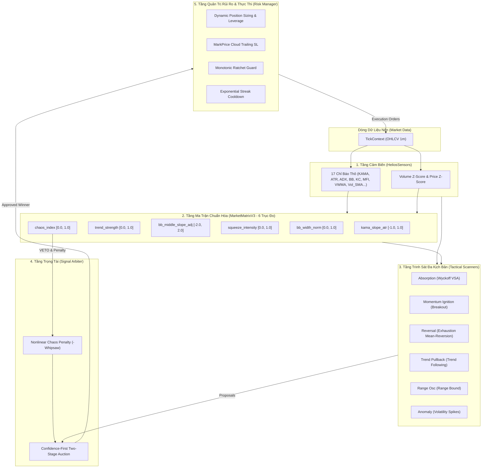

# Helios V3: Tổng Quan Phần Mềm & Kiến Trúc Mô-đun Đa Trạng Thái (Software Specification)

---

## 🏛️ 1. Giới Thiệu & Triết Lý Thiết Kế (System Overview)

**Helios V3** là chiến lược giao dịch định lượng thích ứng toàn năng (Universal Adaptive Multi-Regime Strategy) được viết bằng **100% Rust thuần**. Hệ thống được thiết kế để loại bỏ hoàn toàn các yếu tố cảm tính và các mẫu hình nến chủ quan của retail trading, vận hành hoàn toàn dựa trên:
1. **Xác suất thống kê & Đại lượng phi thứ nguyên:** Mọi chỉ báo đều được chuẩn hóa (Z-Score, Percentile, CLV, Tanh scaling, ATR scaling) để thích ứng với mọi loại tài sản (Asset-Agnostic) và mọi khung thị giá.
2. **Kiến trúc phân tầng bất khả xâm phạm (Strict Separation of Concerns):**
   - **Tầng Cảm Biến (`sensors.rs`):** Thu thập dữ liệu nến thô và tính toán các chỉ báo kỹ thuật gốc.
   - **Tầng Ma Trận Trực Giao (`matrix.rs`):** Chuẩn hóa các trục vật lý thị trường độc lập.
   - **Tầng Chiến Thuật (`scanners/`):** Quan sát và đề xuất tín hiệu theo từng kịch bản thị trường (Playbooks).
   - **Tầng Trọng Tài (`arbiter.rs`):** Phân xử xung đột, chấm điểm tự tin phi tuyến và chọn đề xuất tối ưu.
   - **Tầng Quản Trị Rủi Ro (`risk.rs`):** Độc quyền quản lý vị thế, SL/TP động, Trailing Stop và bảo toàn vốn.
3. **Thích ứng tiến hóa qua DNA (`DnaMappable`):** Mọi ngưỡng nhạy cảm được tối ưu hóa liên tục bởi thuật toán di truyền GA (`Prospector`) mà không làm suy yếu các chốt chặn an toàn cốt lõi.

---

## 🔄 2. Sơ Đồ Luồng Dữ Liệu Toàn Cục (Global Data Lineage)

---

## 🎯 3. Phân Định Ranh Giới 5 Trụ Cột Trạng Thái Thị Trường

Để đảm bảo dữ liệu không bị ô nhiễm chéo (*No Cross-Pollution*), Helios V3 phân tách rõ 5 chiều không gian vật lý:
1. **Xu Hướng (Trend):** Chiều và độ bền vững của vector giá.
2. **Biến Động (Volatility):** Độ nén năng lượng và biên độ dao động thực tế.
3. **Động Lượng (Momentum):** Tốc độ dịch chuyển và vị trí đóng nến tức thời.
4. **Thanh Khoản & Khối Lượng (Liquidity & Volume):** Nỗ lực dòng tiền và sự tham gia của tổ chức (Smart Money).
5. **Hỗn Loạn & Nhiễu (Chaos & Noise):** Mức độ bất định và bão giật Whipsaw để tự động rút lui.

Chi tiết dòng dữ liệu và bảng ánh xạ từng Playbook được trình bày tại [01_market_state_pillars_and_data_lineage.md](file:///e:/Projects/Automations/trading_backtest/strategies_backtests/helios/docs/09_software_specification/01_market_state_pillars_and_data_lineage.md).
