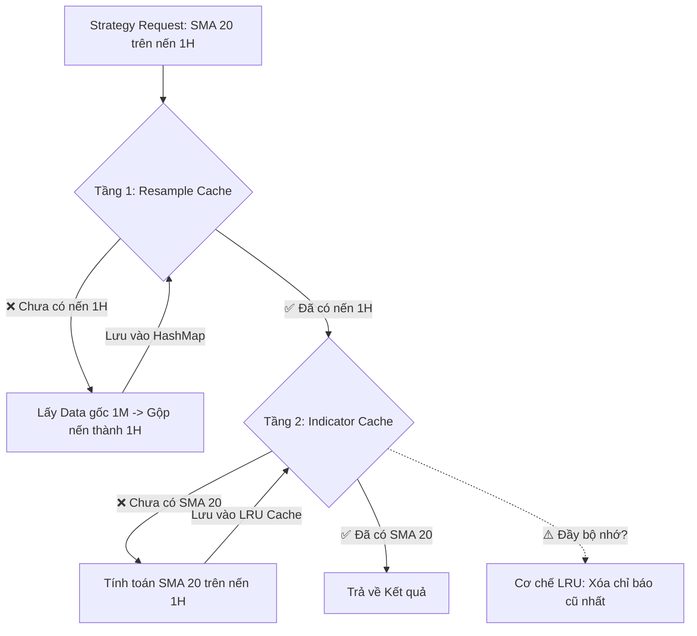

# Phân tích Chiến lược & Hỏi đáp chuyên sâu cho Helios/Dymate

Tài liệu này được tạo ra để ghi lại và trả lời một cách có hệ thống các câu hỏi chiến lược và kiến trúc cốt lõi của hệ thống trading. Mục tiêu là đảm bảo logic của chúng ta không chỉ mạnh mẽ về mặt kỹ thuật mà còn vững chắc về mặt lý thuyết và triết lý giao dịch.

---
---

## PHẦN I: TRIẾT LÝ GIAO DỊCH & KIẾN TRÚC HỆ THỐNG

### **Câu hỏi 1:** Hệ thống Dymate hiện tại có phản ánh triết lý "Tấn công - Phòng thủ - Phát triển" (Attack - Defend - Develop) hay không?

**Trả lời sơ bộ:**

**CÓ, hệ thống Dymate được thiết kế với một triết lý phản ứng tương tự, mặc dù nó được thể hiện qua các thuật ngữ kỹ thuật.** Đây là cách chúng ta có thể ánh xạ tư duy của bạn vào kiến trúc hiện tại:

1.  **"Phát triển" (Develop / Scout):**
    *   **Hành động:** Hệ thống liên tục "trinh sát" thị trường bằng cách sử dụng `IndicatorManager` để thu thập dữ liệu và `MarketAnalyzer` để "diễn giải" dữ liệu đó.
    *   **Kết quả:** Đầu ra là một bản báo cáo tình báo toàn diện - `MarketStateInfo`. Nó cho chúng ta biết đối thủ (thị trường) đang ở trạng thái nào: `TRENDING` (đang di chuyển có hướng), `RANGING` (đang đi ngang), hay `SQUEEZE` (đang nén lại, chuẩn bị cho một động thái lớn). Đây chính là hành động "phát triển" hay "scouting the opponent" trong Starcraft.

2.  **"Phòng thủ" (Defend):**
    *   **Hành động:** Đây là vai trò cốt lõi và không thể thiếu của `RiskManager`. Bất kể chúng ta quyết định "tấn công" như thế nào, `RiskManager` luôn là tuyến phòng thủ đầu tiên và cuối cùng.
    *   **Cơ chế:**
        *   **Tính toán Ngân sách Rủi ro:** Xác định xem ta sẵn sàng mất bao nhiêu cho giao dịch này (`base_risk_percent` & `confidence_score`).
        *   **Xác định Điểm Dừng lỗ (Stop Loss):** Đặt ra một "bức tường" bảo vệ vốn. Nếu giá chạm đến đây, lệnh sẽ được đóng ngay lập tức. Đây là hành động phòng thủ cơ bản nhất.
        *   **Quản lý Kích thước Lệnh:** Đảm bảo rằng ngay cả khi bị dừng lỗ, thiệt hại cũng nằm trong tầm kiểm soát.

3.  **"Tấn công" (Attack):**
    *   **Hành động:** Đây là nhiệm vụ của `StrategyEngine`. Sau khi có "báo cáo tình báo" từ `MarketAnalyzer`, nó sẽ quyết định xem có nên "tấn công" hay không, và nếu có thì "tấn công" bằng chiến thuật nào.
    *   **Cơ chế:**
        *   **Logic Phản ứng:** Hệ thống thực hiện logic "Nếu B... thì A...":
            *   **Nếu** thị trường `TRENDING` (B đang tấn công có hướng) => **thì** A chọn `TRENDING_PLAYBOOK` để tấn công thuận theo hướng đó (ví dụ: `TrendPullback`, `TrendContinuation`).
            *   **Nếu** thị trường `RANGING` (B đang phòng thủ/đi ngang) => **thì** A chọn `RANGING_PLAYBOOK` để thực hiện các cuộc "tấn công" nhỏ, thăm dò (ví dụ: `MeanReversion`).
            *   **Nếu** thị trường `SQUEEZE` (B đang "phát triển" năng lượng) => **thì** A chọn `SQUEEZE_PLAYBOOK` để chuẩn bị cho một cuộc "tấn công" lớn khi B phá vỡ.
    *   **Kết luận:** Hệ thống hiện tại có một logic phản ứng rõ ràng. Nó không tấn công một cách mù quáng mà luôn dựa trên trạng thái của thị trường.

**Điểm cần cải thiện:** Logic "phản ứng" hiện tại đang được mã hóa cứng (hard-coded) trong các Playbook. Tầm nhìn của Helios là làm cho logic này trở nên linh hoạt hơn, có thể tự học hoặc tự tối ưu hóa cả "Playbook" chứ không chỉ các tham số.

--------------------------------------------------

### **Câu hỏi 2:** Logic phát hiện của từng `MarketState` (Squeeze > Trending > Ranging) có hợp lý không? Ưu và nhược điểm của nó là gì?

**Trả lời chi tiết:**

Logic phát hiện `MarketState` theo thứ tự ưu tiên `Squeeze > Trending > Ranging` là một phương pháp luận **vững chắc và hợp lý** về mặt chiến lược giao dịch. Nó hoạt động như một "cái phễu" (funnel), lọc ra các trạng thái thị trường từ rõ ràng nhất đến ít rõ ràng nhất.

Hãy cùng mổ xẻ chi tiết:

#### **A. Phân tích Logic Phát hiện**

Hệ thống không kiểm tra các trạng thái một cách song song, mà theo một **chuỗi ưu tiên (hierarchical cascade)**:

1.  **▶️ Bước 1: Kiểm tra `SQUEEZE_ANTICIPATION`**
    *   **Điều kiện:** Dải Bollinger Bands nằm hoàn toàn **bên trong** Kênh Keltner (Keltner Channels) VÀ mức biến động (`volatility_level`) phải ở mức `Low` hoặc `VeryLow`.
    *   **Logic:** Nếu điều kiện này đúng, hệ thống **ngay lập tức** xác định trạng thái là `SQUEEZE` và dừng lại. Nó không cần xét đến `Trending` hay `Ranging` nữa.

2.  **▶️ Bước 2: Kiểm tra `TRENDING`**
    *   **Điều kiện:** Chỉ được thực hiện nếu **KHÔNG** phải là `SQUEEZE`. Hệ thống kiểm tra: Hướng xu hướng (`trend_direction`) phải khác `None` (tức là có hướng lên hoặc xuống rõ ràng) VÀ Sức mạnh xu hướng (`trend_strength`) phải là `Strong` hoặc `Moderate`.
    *   **Logic:** Nếu điều kiện này đúng, hệ thống xác định là `TRENDING` và dừng lại.

3.  **▶️ Bước 3: Kiểm tra `RANGING`**
    *   **Điều kiện:** Chỉ được thực hiện nếu **KHÔNG** phải `SQUEEZE` và **KHÔNG** phải `TRENDING`. Hệ thống kiểm tra: Sức mạnh xu hướng (`trend_strength`) là `Weak` hoặc `None` VÀ Mức biến động (`volatility_level`) đủ lớn để giao dịch (`Medium` hoặc `High`).
    *   **Logic:** Đây là trạng thái "bắt-tất-cả" (catch-all) cho các thị trường không có hướng đi rõ ràng nhưng vẫn có đủ biến động.

4.  **▶️ Bước 4: `UNDEFINED`**
    *   **Logic:** Nếu không rơi vào bất kỳ trường hợp nào ở trên, thị trường được coi là không thể xác định, thường là do biến động quá thấp hoặc các chỉ báo mâu thuẫn nhau.

---

#### **B. ✅ Ưu điểm của Phương pháp này**

1.  **🎯 Tính Quyết đoán & Không mơ hồ (Decisive & Unambiguous):**
    *   Tại bất kỳ thời điểm nào, thị trường chỉ có thể thuộc về **một và chỉ một** trạng thái. Logic phân cấp này loại bỏ hoàn toàn sự mơ hồ, giúp `StrategyEngine` có thể chọn một `Playbook` duy nhất để hành động. Điều này cực kỳ quan-trọng cho một hệ thống tự động.

2.  **🧠 Mô phỏng Kinh nghiệm của Chuyên gia (Expert Heuristics):**
    *   Thứ tự ưu tiên `Squeeze > Trend > Range` chính là cách một nhà giao dịch chuyên nghiệp suy nghĩ. Họ luôn tìm kiếm các cơ hội có xác suất thành công cao nhất trước tiên. Một cú phá vỡ từ vùng nén (`Squeeze`) thường là tín hiệu mạnh mẽ và có tiềm năng lợi nhuận lớn nhất.

3.  **⚡ Hiệu quả về mặt Tính toán (Computationally Efficient):**
    *   Toàn bộ logic chỉ là một chuỗi các phép so sánh `if/else` đơn giản. Nó cực kỳ nhanh, tiêu tốn rất ít tài nguyên máy tính, là yếu tố sống còn khi chạy tối ưu hóa trên hàng triệu lần thử (iterations).

4.  **🔍 Dễ Hiểu và Gỡ lỗi (Transparent & Debuggable):**
    *   Logic này không phải là một "hộp đen". Nếu hệ thống phân loại sai một trạng thái, chúng ta có thể dễ dàng truy vết lại từng bước so sánh để hiểu chính xác tại sao nó lại đưa ra quyết định đó.

---

#### **C. 🔴 Nhược điểm và Hướng Cải tiến**

1.  **🧱 "Độ Cứng" của Ngưỡng (Rigidity of Thresholds):**
    *   **Nhược điểm:** Logic này phụ thuộc nhiều vào các ngưỡng cứng (ví dụ: `ADX > 75th percentile`). Một thị trường có thể chỉ thiếu một chút để đạt ngưỡng "Trending" và bị phân loại nhầm thành "Ranging", khiến hệ thống bỏ lỡ cơ hội hoặc chọn sai chiến lược.
    *   **Hướng cải tiến (Helios v2.0):** Thay vì phân loại nhị phân (có/không), `MarketAnalyzer` có thể trả về một **phổ trạng thái** hoặc **điểm tin cậy cho từng trạng thái**. Ví dụ: `{ "trending_score": 0.7, "ranging_score": 0.2, "squeeze_score": 0.1 }`. Điều này cho phép `StrategyEngine` ra quyết định một cách linh hoạt hơn.

2.  **🚦 Bỏ qua Vùng Chuyển tiếp (Ignoring Transition Zones):**
    *   **Nhược điểm:** Thị trường không chuyển từ `Ranging` sang `Trending` ngay lập tức. Nó có một vùng "chuyển tiếp" màu xám. Mô hình hiện tại, do tính quyết đoán của nó, có thể hơi chậm trong việc nhận ra sự thay đổi chế độ vừa mới bắt đầu.
    *   **Hướng cải tiến (Helios v2.0):** Sử dụng các mô hình có khả năng nhận diện sự chuyển đổi, chẳng hạn như **Mô hình Markov ẩn (Hidden Markov Models - HMM)**. HMM được thiết kế để suy ra các "trạng thái ẩn" (chính là các `MarketState` của chúng ta) từ "dữ liệu quan sát được" (các indicators) và nó có thể tính toán xác suất chuyển đổi giữa các trạng thái (ví dụ: xác suất từ `Ranging` sang `Trending` là bao nhiêu).

3.  **🤔 Thiếu "Trí nhớ" về Trạng thái (Stateless Nature):**
    *   **Nhược điểm:** Việc phân loại chủ yếu dựa trên cây nến hiện tại và một cửa sổ lịch sử ngắn. Nó không có một "trí nhớ" dài hạn về việc thị trường đã ở trong trạng thái `Trending` bao lâu. Một xu hướng đã kéo dài 200 nến có thể có hành vi khác với một xu hướng chỉ mới bắt đầu 20 nến.
    *   **Hướng cải tiến (Helios v2.0):** Bổ sung các "meta-features" vào `MarketStateInfo`, ví dụ: `duration_in_current_regime` (số nến đã ở trong trạng thái hiện tại). `StrategyEngine` có thể sử dụng thông tin này để điều chỉnh hành vi, ví dụ: thận trọng hơn với các xu hướng đã quá "già".

--------------------------------------------------

### **Câu hỏi 3:** Với vai trò là một nhà giao dịch thuật toán, một nhà toán học, một chiến lược gia, bạn đánh giá các logic này như thế nào?

**Trả lời chi tiết:**

Đây là một đánh giá đa chiều về logic phát hiện trạng thái và lựa chọn chiến lược của hệ thống Dymate.

---

#### **A. 🧐 Dưới góc nhìn của Nhà giao dịch Thuật toán (Algorithmic Trader)**

*   **Tập trung vào:** Tính thực thi, hiệu năng, quản lý rủi ro, và khả năng kiểm thử.

*   **✅ Đánh giá tích cực:**
    1.  **Hiệu năng & Tốc độ (Performance):** Logic dựa trên quy tắc (`rule-based`) cực kỳ nhanh. Việc này là **vàng** trong backtesting. Nó cho phép ta chạy hàng ngàn, hàng triệu lần tối ưu hóa trong một khoảng thời gian hợp lý, điều mà các mô hình phức tạp hơn không thể làm được.
    2.  **Tính rõ ràng & Dễ gỡ lỗi (Clarity & Debuggability):** Logic `if-else` trong suốt như pha lê. Nếu hệ thống đưa ra một quyết định lạ, tôi có thể dễ dàng truy vết chính xác điều kiện nào đã được kích hoạt. Với các mô hình "hộp đen" (như Neural Networks), việc này gần như bất khả thi.
    3.  **Tính quyết đoán (Decisiveness):** Hệ thống luôn đưa ra MỘT trạng thái thị trường duy nhất tại một thời điểm. Điều này loại bỏ sự mơ hồ và đảm bảo robot có thể hành động một cách dứt khoát, tránh được tình trạng "đứng hình" do có quá nhiều thông tin mâu thuẫn.
    4.  **Liên kết chặt chẽ với Rủi ro:** Logic phát hiện trạng thái liên kết trực tiếp đến việc quản lý rủi ro. Ví dụ, `Confidence Score` được dùng để điều chỉnh ngân sách rủi ro. Trạng thái `UNDEFINED` có thể được dùng để vô hiệu hóa giao dịch hoàn toàn. Đây là một thực hành tốt.

*   **⚠️ Điểm cần lưu ý:**
    1.  **Rủi ro Tối ưu hóa Quá mức (Over-optimization / Curve-Fitting):** Đây là kẻ thù lớn nhất. Với hàng chục tham số có thể điều chỉnh, thuật toán di truyền (GA) có thể tìm ra một bộ tham số "thần thánh" hoạt động hoàn hảo trên dữ liệu quá khứ, nhưng lại thất bại thảm hại trong thực tế. Việc có một quy trình kiểm định trên dữ liệu "out-of-sample" (như Dymate đang làm) là bắt buộc để giảm thiểu rủi ro này.
    2.  **"Rác vào, Rác ra" (Garbage In, Garbage Out):** Hệ thống hoàn toàn phụ thuộc vào các chỉ báo và quy tắc mà chúng ta cung cấp cho nó. Nó không thể tự "học" hay phát hiện ra các mẫu hình mới mà chúng ta chưa định nghĩa.

---

#### **B. 📐 Dưới góc nhìn của Nhà toán học (Mathematician)**

*   **Tập trung vào:** Tính chặt chẽ, các giả định, tính hợp lệ thống kê, và các mô hình cơ bản.

*   **✅ Đánh giá tích cực:**
    1.  **Tính Chính quy (Formalism):** Toàn bộ logic có thể được biểu diễn dưới dạng một hàm toán học: `State = F(Indicator_1, ..., Indicator_n)`. Nó có tính xác định (deterministic), một đầu vào luôn cho một đầu ra.
    2.  **Sử dụng Phân vị (Percentiles):** Việc sử dụng percentile (ví dụ `adx_strong_pct = 75`) để định nghĩa các ngưỡng là một phương pháp thống kê tốt. Nó giúp hệ thống tự thích ứng với "tính cách" của bộ dữ liệu cụ thể, thay vì dùng các "con số ma thuật" cứng nhắc (ví dụ: `ADX > 25`).

*   **⚠️ Điểm cần lưu ý (Các Giả định và Đơn giản hóa):**
    1.  **Mô hình Rời rạc hóa (Discretization):** Logic này buộc một thực thể phức tạp, liên tục và đa chiều như thị trường tài chính phải nằm gọn trong vài cái "hộp" rời rạc (`Trending`, `Ranging`, `Squeeze`). Nhà toán học sẽ chỉ ra rằng thực tế luôn có các "vùng xám" và sự chuyển tiếp mượt mà hơn nhiều.
    2.  **Giả định về sự Độc lập và Phân cấp:** Mô hình giả định một sự phân cấp nghiêm ngặt (`Squeeze` được kiểm tra trước `Trending`). Nó không mô hình hóa được khả năng các trạng thái có thể "cùng tồn tại" ở một mức độ nào đó. Ví dụ, một thị trường có thể vừa kết thúc Squeeze và bắt đầu Trending (xác suất Trending tăng lên).
    3.  **Thiếu Ngữ cảnh Xác suất:** Hệ thống đưa ra một kết luận ("Thị trường đang Trending") nhưng không cho biết độ tin cậy thống kê của kết luận đó. `Confidence Score` là một điểm số dựa trên kinh nghiệm (heuristic score), không phải là một xác suất (probability) theo đúng nghĩa toán học.

---

#### **C. ♟️ Dưới góc nhìn của Chiến lược gia (Strategist / Game Theorist)**

*   **Tập trung vào:** Bức tranh lớn, khả năng thích ứng, lợi thế cạnh tranh, và các yếu tố của thuyết trò chơi.

*   **✅ Đánh giá tích cực:**
    1.  **Bản đồ Tư duy Xuất sắc:** Logic này là một bản đồ tuyệt vời cho tư duy "Phản ứng" (Reactive Strategy). Nó tuân thủ vòng lặp OODA (Observe-Orient-Decide-Act):
        *   **Observe (Quan sát):** Lấy dữ liệu thô.
        *   **Orient (Định hướng):** `MarketAnalyzer` phân tích và xác định bối cảnh. Đây là bước quan trọng nhất.
        *   **Decide (Quyết định):** `StrategyEngine` chọn một `Playbook`.
        *   **Act (Hành động):** `RiskManager` và `ExecutionGateway` thực thi lệnh.
    2.  **Khả năng Thích ứng qua Playbook:** Đây là điểm mạnh chiến lược lớn nhất. Hệ thống không phải là một con robot chỉ biết một chiến thuật. Nó có khả năng thay đổi toàn bộ hành vi của mình (`Playbook`) để thích ứng với môi trường (`MarketState`). Đây là một lợi thế cạnh tranh rõ rệt.
    3.  **Tập trung vào Điểm Yếu của "Đối thủ":** Việc ưu tiên `Squeeze` là một nước đi chiến lược thông minh. Nó giống như việc tập trung quân để tấn công vào một điểm yếu chí mạng, thay vì dàn trải lực lượng. Nó tập trung vào những khoảnh khắc có tiềm năng thay đổi cục diện cao nhất.

*   **⚠️ Điểm cần lưu ý (Tầm nhìn cho tương lai):**
    1.  **Playbook Tĩnh (Static Playbook):** Hiện tại, các `Playbook` là cố định. Một chiến lược gia thực thụ sẽ muốn hệ thống có khả năng tự học hỏi và **tối ưu hóa chính các Playbook**. Ví dụ, sau một thời gian, hệ thống có thể nhận ra rằng chiến lược `MeanReversion` không còn hiệu quả trong chế độ `Ranging` và tự động giảm mức độ ưu tiên của nó.
    2.  **Thiếu Tư duy Bậc cao (Second-Order Thinking):** Hệ thống hiện tại phản ứng với những gì thị trường **đang làm**. Nó chưa có khả năng suy luận về việc thị trường **sẽ làm gì tiếp theo**. Ví dụ: "Xu hướng này đã kéo dài và có vẻ 'đông đúc', phe đối lập có thể sắp phản công (reversal)." Đây là cấp độ tư duy tiếp theo mà Helios có thể hướng tới.

---

#### **D. TỔNG KẾT ĐA CHIỀU**

Logic hiện tại là một **nền tảng cực kỳ vững chắc**. Nó cân bằng xuất sắc giữa **tính thực tiễn** (tốc độ, dễ gỡ lỗi) của nhà giao dịch thuật toán, **tính chặt chẽ cơ bản** (dùng percentile) của nhà toán học, và **tư duy phản ứng linh hoạt** của một chiến lược gia. Các điểm yếu của nó không phải là "lỗi", mà là các "sự đơn giản hóa có chủ đích", tạo ra một nền tảng hiệu quả để chúng ta xây dựng các tính năng phức tạp và thông minh hơn trong tương lai cho Helios.

--------------------------------------------------

### **Câu hỏi 4:** Có phương pháp nào khác tốt hơn để nhận diện các `MarketState` không? Ví dụ: sử dụng các mô hình xác suất (như Hidden Markov Models) hoặc các phương pháp học máy?

**Trả lời chi tiết:**

**CÓ, chắc chắn là có.** Hệ thống `rule-based` hiện tại của chúng ta là một nền tảng tuyệt vời vì sự rõ ràng và tốc độ, nhưng thế giới của tài chính định lượng có rất nhiều công cụ mạnh mẽ khác. Việc khám phá chúng là con đường tất yếu để đưa Helios lên một tầm cao mới.

Dưới đây là phân tích chi tiết về hai hướng tiếp cận chính mà bạn đã đề cập:

---

#### **Phương pháp 1: Mô hình Xác suất - Mô hình Markov ẩn (Hidden Markov Models - HMM)**

Đây là một lựa chọn cực kỳ hấp dẫn và phù hợp cho bài toán của chúng ta.

**A. Ý tưởng là gì?**

Hãy tưởng tượng thị trường luôn ở trong một vài "trạng thái ẩn" mà chúng ta không thể thấy trực tiếp. Đó chính là các `MarketState` của chúng ta: `Trending`, `Ranging`, `Squeeze`.

Tuy nhiên, chúng ta có thể quan sát được các "dữ liệu phát ra" từ các trạng thái đó. Đó chính là các `indicators` của chúng ta (ADX, RSI, ATR...).

*   Khi thị trường ở trạng thái `Trending`, nó có xu hướng "phát ra" các giá trị ADX cao, ATR cao.
*   Khi thị trường ở trạng thái `Ranging`, nó có xu hướng "phát ra" các giá trị ADX thấp, RSI dao động quanh 50.

**HMM là một mô hình toán học làm hai việc:**
1.  **Học** các đặc tính thống kê của các `indicators` trong từng "trạng thái ẩn".
2.  **Suy luận** ra tại mỗi thời điểm, **xác suất** thị trường đang ở trong mỗi trạng thái ẩn là bao nhiêu (ví dụ: 80% là Trending, 20% là Ranging).

Quan trọng hơn, nó còn học được cả **ma trận xác suất chuyển đổi** (transition probability matrix), tức là `P(State_A | State_B)` - xác suất thị trường chuyển sang trạng thái A, biết rằng nó vừa ở trạng thái B.

**B. ✅ Ưu điểm so với hệ thống hiện tại:**

1.  **Xử lý "Vùng Xám" một cách tự nhiên:** HMM không đưa ra một câu trả lời cứng nhắc "Đây là Trending". Nó trả về một phân phối xác suất: `P(Trending)=0.8`, `P(Ranging)=0.2`. Điều này cho phép `StrategyEngine` ra quyết định linh hoạt hơn nhiều (ví dụ: "Nếu P(Trending) > 0.7 thì mới dùng Trend Playbook").
2.  **Tự động "Học" Ngưỡng:** Mô hình tự học các đặc tính của chỉ báo trong từng trạng thái từ dữ liệu. Chúng ta không cần phải định nghĩa các ngưỡng cứng bằng tay nữa.
3.  **Mô hình hóa sự Chuyển đổi:** Ma trận chuyển đổi là một công cụ chiến lược cực mạnh. Nó cho chúng ta biết, ví dụ, một xu hướng có "bền vững" hay không (xác suất chuyển từ `Trending` về `Ranging` là thấp hay cao).

**C. 🔴 Nhược điểm và Thách thức:**

1.  **Độ phức tạp:** Việc triển khai và huấn luyện một mô hình HMM phức tạp hơn đáng kể so với việc viết vài câu lệnh `if/else`.
2.  **Giả định Markov:** HMM giả định rằng trạng thái tiếp theo chỉ phụ thuộc vào trạng thái hiện tại, không phụ thuộc vào các trạng thái trước đó. Điều này có thể là một sự đơn giản hóa quá mức đối với thị trường tài chính.
3.  **Yêu cầu Dữ liệu:** Cần một lượng dữ liệu đủ lớn và "sạch" để mô hình có thể học một cách chính xác.

---

#### **Phương pháp 2: Các mô hình Học máy (Machine Learning - ML)**

Đây là hướng tiếp cận mạnh mẽ nhất nhưng cũng đi kèm với nhiều thách thức nhất.

**A. Ý tưởng là gì?**

Chúng ta biến bài toán này thành một bài toán **phân loại có giám sát (supervised classification)**.

1.  **Bước 1: Dán nhãn Dữ liệu (Data Labeling):** Đây là bước khó khăn nhất. Chúng ta cần một chuyên gia (hoặc chính chúng ta) ngồi xem lại dữ liệu lịch sử và "dán nhãn" cho từng giai đoạn: "Đoạn từ nến A đến nến B là Trending", "Đoạn từ C đến D là Ranging"...
2.  **Bước 2: Tạo Feature Vector:** Tại mỗi cây nến, chúng ta tạo một "vector đặc trưng" bao gồm giá trị của tất cả các `indicators` (RSI, ADX, KAMA, ATR...).
3.  **Bước 3: Huấn luyện Mô hình:** Chúng ta đưa các `feature vectors` và `labels` tương ứng vào một mô hình ML để nó học cách ánh xạ từ `indicators` sang `MarketState`.

**B. Các loại mô hình phù hợp:**

*   **Các mô hình dựa trên Cây quyết định (Tree-based):** Random Forest, XGBoost, LightGBM. Đây là những lựa chọn hàng đầu cho dữ liệu dạng bảng (tabular data) như của chúng ta. Chúng rất mạnh mẽ và cho phép xem "độ quan trọng của feature" (feature importance), giúp ta biết chỉ báo nào là hữu ích nhất.
*   **Mạng Nơ-ron (Neural Networks - NN):** Có khả năng học các mối quan hệ phi tuyến tính cực kỳ phức tạp. Tuy nhiên, chúng là một "hộp đen" và đòi hỏi nhiều dữ liệu hơn.

**C. ✅ Ưu điểm so với hệ thống hiện tại:**

1.  **Học được các Mẫu hình Phức tạp:** Một mô hình ML có thể phát hiện ra các mối quan hệ tinh vi, phi tuyến tính giữa 10 chỉ báo khác nhau mà một con người không bao giờ có thể viết thành quy tắc `if/else`.
2.  **Tự động Lựa chọn Feature:** Dựa vào `feature importance`, chúng ta có thể loại bỏ các chỉ báo không có nhiều giá trị dự báo, giúp hệ thống trở nên tinh gọn và hiệu quả hơn.

**D. 🔴 Nhược điểm và Thách thức:**

1.  **VẤN ĐỀ LỚN NHẤT: Dán nhãn Dữ liệu:** Đây là rào cản khổng lồ. Việc dán nhãn vừa tốn thời gian, vừa mang tính chủ quan. Hai chuyên gia có thể không đồng ý 100% về việc một giai đoạn là `Trending` hay `Ranging`.
2.  **Tính "Hộp đen" (Black Box Nature):** Rất khó để giải thích tại sao mô hình lại đưa ra một quyết định cụ thể. Khi mô hình mắc lỗi, việc gỡ lỗi gần như là không thể, trái ngược hoàn toàn với hệ thống `rule-based` hiện tại.
3.  **Tính không Ổn định của Thị trường (Market Non-stationarity):** Thị trường luôn thay đổi. Một mô hình được huấn luyện trên dữ liệu của năm 2023 có thể không còn hoạt động tốt vào năm 2025. Nó đòi hỏi một quy trình huấn luyện lại, kiểm thử lại và triển khai lại một cách liên tục.

---

#### **KẾT LUẬN VÀ LỘ TRÌNH ĐỀ XUẤT**

Hệ thống `rule-based` hiện tại là **điểm khởi đầu lý tưởng** vì nó nhanh, rõ ràng và có thể kiểm soát được. Chúng ta không nên vội vàng thay thế nó. Thay vào đó, một lộ trình phát triển hợp lý sẽ là:

1.  **📍 Giai đoạn 1 (Hiện tại - Helios v1.0):** **Hoàn thiện và tối ưu hóa hệ thống `rule-based`**. Port 1:1 logic từ Dymate sang Rust, đảm bảo nó chạy nhanh và chính xác. Tối ưu hóa các tham số bằng cỗ máy "Prospector Engine" đã thiết kế.
2.  **🔬 Giai đoạn 2 (Nghiên cứu - Helios v1.5):** **Thử nghiệm với Mô hình Markov ẩn (HMM)**. Đây là bước đi tự nhiên tiếp theo. Nó mang lại một cái nhìn xác suất mà không đòi hỏi việc dán nhãn dữ liệu thủ công. Ta có thể chạy song song HMM với hệ thống cũ để so sánh kết quả.
3.  **🚀 Giai đoạn 3 (Nâng cao - Helios v2.0):** Chỉ khi HMM tỏ ra không đủ mạnh, chúng ta mới nên xem xét đến các mô hình **Học máy có giám sát**. Lúc đó, ta phải chấp nhận đầu tư nguồn lực lớn cho việc xây dựng một quy trình dán nhãn và quản lý mô hình chuyên nghiệp.

---
---

## PHẦN II: PHÂN TÍCH CÁC CHỈ BÁO KỸ THUẬT (INDICATORS)

### **Câu hỏi 5:** Giải thích chi tiết từng chỉ báo được sử dụng trong `IndicatorManager`. Tại sao lại chọn nó và vai trò của nó trong hệ thống là gì?

**Trả lời chi tiết:**

Đây là phân tích chi tiết về từng chỉ báo và vai trò cụ thể của chúng trong kiến trúc của Dymate.

---

#### **1. KAMA (Kaufman's Adaptive Moving Average)**
*   **Nó là gì?** Là một đường trung bình động (MA) thông minh, có khả năng tự điều chỉnh độ "nhạy" của nó dựa trên sự biến động của thị trường. Khi thị trường nhiễu (sideways), nó sẽ trở nên "trơ" hơn và đi ngang. Khi thị trường có xu hướng rõ ràng, nó sẽ bám sát giá hơn.
*   **Tại sao dùng nó trong Dymate?**
    *   **Vai trò chính:** Xác định **hướng xu hướng chính** (Trend Direction).
    *   **Cách dùng:** Hệ thống sử dụng giao cắt của hai đường KAMA với chu kỳ khác nhau (`kama_short` và `kama_long`). Khi `kama_short` cắt lên trên `kama_long`, đó là tín hiệu của xu hướng tăng, và ngược lại.
    *   **Ưu điểm:** Vượt trội hơn các đường MA thông thường (SMA, EMA) vì nó giảm thiểu được tín hiệu nhiễu và các cú "cắt giả" trong thị trường đi ngang, giúp hệ thống tránh được nhiều giao dịch sai lầm.

---

#### **2. ADX (Average Directional Index) & DI+/DI-**
*   **Nó là gì?** ADX là một chỉ báo đo lường **sức mạnh** của một xu hướng, không quan tâm đến hướng của xu hướng đó (tăng hay giảm). DI+ và DI- là hai đường thành phần cho biết phe mua hay phe bán đang chiếm ưu thế.
*   **Tại sao dùng nó trong Dymate?**
    *   **Vai trò chính:** Xác định **sức mạnh của xu hướng** (Trend Strength). Đây là bộ lọc cực kỳ quan trọng.
    *   **Cách dùng:** `MarketAnalyzer` sẽ chỉ phân loại trạng thái là `TRENDING` nếu giá trị `ADX` hiện tại vượt qua một ngưỡng phân vị (ví dụ: 75th percentile) của lịch sử `ADX`.
    *   **Logic:** Nó trả lời câu hỏi: "Xu hướng này có đủ mạnh để giao dịch hay chỉ là nhiễu ngẫu nhiên?". Việc kết hợp điều kiện `kama_short > kama_long` (hướng tăng) VÀ `plus_di > minus_di` (phe mua mạnh hơn) VÀ `adx > ngưỡng` (sức mạnh lớn) tạo thành một bộ ba xác nhận xu hướng rất đáng tin cậy.

---

#### **3. RSI (Relative Strength Index)**
*   **Nó là gì?** Là một chỉ báo động lượng (momentum oscillator) đo lường tốc độ và sự thay đổi của các chuyển động giá, dao động trong khoảng từ 0 đến 100.
*   **Tại sao dùng nó trong Dymate?** Nó là một công cụ đa năng:
    1.  **Xác định Quá mua/Quá bán:** Là cốt lõi của chiến lược `MeanReversion`. Hệ thống sẽ tìm cơ hội MUA khi giá chạm biên dưới của BBands và RSI đi vào vùng quá bán (`< 30`).
    2.  **Xác nhận Động lượng:** Dùng trong chiến lược `TrendPullback`. Trong một xu hướng tăng, hệ thống chờ giá điều chỉnh (pullback) và sau đó vào lệnh MUA khi RSI bắt đầu tăng trở lại, cho thấy động lượng tăng đang quay trở lại.
    3.  **Phát hiện Phân kỳ (Divergence):** `MarketAnalyzer` dùng RSI để tìm phân kỳ. Ví dụ: giá tạo đỉnh cao hơn nhưng RSI tạo đỉnh thấp hơn (phân kỳ âm) là một cảnh báo rất mạnh rằng xu hướng tăng đang yếu đi và có thể đảo chiều. Đây là một tín hiệu trừ điểm trong `Confidence Score`.

---

#### **4. Bollinger Bands (BBands)**
*   **Nó là gì?** Gồm một đường MA ở giữa và hai dải trên/dưới được đặt cách MA một độ lệch chuẩn. Các dải này co lại khi biến động thấp và mở rộng ra khi biến động cao.
*   **Tại sao dùng nó trong Dymate?**
    *   **Vai trò chính:** **Phát hiện vùng nén (Squeeze)**. Đây là công dụng quan trọng nhất trong hệ thống. Khi dải BBands nằm hoàn toàn bên trong Kênh Keltner, `MarketAnalyzer` sẽ xác định trạng thái là `SQUEEZE_ANTICIPATION`.
    *   **Vai trò phụ:**
        *   Cung cấp các ngưỡng cho chiến lược `MeanReversion` (mua ở dải dưới, bán ở dải trên).
        *   Cung cấp các tín hiệu phá vỡ cho `VolatilityExpansionBreakout` (giá đóng cửa vượt ra ngoài dải).

---

#### **5. ATR (Average True Range)**
*   **Nó là gì?** Đo lường mức độ biến động "thực" trung bình của thị trường trong một khoảng thời gian, tính cả các khoảng trống giá (gaps).
*   **Tại sao dùng nó trong Dymate?**
    *   **Vai trò chính:** **Nền tảng của việc quản lý rủi ro**.
    *   **Cách dùng:**
        1.  **Đặt Stop Loss:** `RiskManager` tính toán `stop_loss_price` bằng cách lấy một "giá neo" (anchor price) trừ/cộng một BỘI SỐ của ATR (`sl_atr_multiplier`). Điều này giúp SL tự động thích ứng với thị trường: thị trường biến động mạnh (ATR cao) => SL được đặt xa hơn để tránh bị "săn", và ngược lại.
        2.  **Phân loại Biến động:** `MarketAnalyzer` sử dụng `atr_normalized` (ATR / Giá đóng cửa) để phân loại `VolatilityLevel` (High, Low, Medium...).

---

#### **6. Keltner Channels (KC)**
*   **Nó là gì?** Tương tự BBands, cũng có 3 đường (trên, giữa, dưới). Tuy nhiên, các dải của nó được tính dựa trên **ATR** thay vì độ lệch chuẩn.
*   **Tại sao dùng nó trong Dymate?**
    *   **Vai trò chính:** Chỉ có một vai trò duy nhất và cực kỳ quan trọng: **kết hợp với BBands để tạo ra tín hiệu Squeeze**. Logic "BBands nằm trong KC" là một định nghĩa kinh điển của TTM Squeeze, một trong những tín hiệu dự báo biến động mạnh mẽ nhất.

---

#### **7. MACD (Moving Average Convergence Divergence)**
*   **Nó là gì?** Đo lường mối quan hệ giữa hai đường EMA và cho thấy sự thay đổi trong động lượng. Thành phần quan trọng nhất là `macd_hist` (histogram), thể hiện khoảng cách giữa đường MACD và đường tín hiệu của nó.
*   **Tại sao dùng nó trong Dymate?**
    *   **Vai trò chính:** Kích hoạt chiến lược `TrendInitiation`.
    *   **Cách dùng:** Hệ thống tìm kiếm khoảnh khắc `macd_hist` vừa cắt qua đường số 0. Một cú cắt từ âm sang dương báo hiệu động lượng tăng đang bắt đầu hình thành, là thời điểm tốt để "bắt sóng" một xu hướng ngay từ lúc nó mới khởi phát.

---

#### **8. Volume MA (Volume Moving Average) & Volume Ratio**
*   **Nó là gì?** Là đường trung bình động của khối lượng giao dịch. `Volume Ratio` là tỷ lệ giữa khối lượng hiện tại và khối lượng trung bình này.
*   **Tại sao dùng nó trong Dymate?**
    *   **Vai trò chính:** Xác định **Hồ sơ Khối lượng** (Volume Profile) để tăng độ tin cậy cho tín hiệu.
    *   **Cách dùng:** `MarketAnalyzer` dùng `Volume Ratio` để xem một động thái giá có được "xác nhận" bởi khối lượng hay không. Ví dụ, một cú breakout tăng giá sẽ đáng tin cậy hơn nhiều nếu đi kèm với `Volume Ratio > 1` (khối lượng cao hơn trung bình). Ngược lại, một xu hướng tăng nhưng volume lại thấp hơn trung bình (`DIVERGING`) là một dấu hiệu đáng ngờ.

---

#### **9. Stochastic RSI (StochRSI)**
*   **Nó là gì?** Là một chỉ báo "động lượng của động lượng". Nó không đo giá, mà đo lường giá trị của RSI so với vùng đỉnh/đáy của chính nó trong một khoảng thời gian. Kết quả là một chỉ báo nhạy hơn nhiều so với RSI gốc.
*   **Tại sao dùng nó trong Dymate?**
    *   **Vai trò chính:** Kích hoạt chiến lược `VolatilityChannelRiding`.
    *   **Cách dùng:** Trong một xu hướng tăng mạnh, giá thường không điều chỉnh đủ sâu để RSI gốc đi vào vùng quá bán. StochRSI nhạy hơn, cho phép hệ thống tìm ra các điểm "quá bán" tạm thời trong một xu hướng tăng để vào lệnh MUA bắt theo con sóng.

--------------------------------------------------

### **Câu hỏi 6:** Các chỉ báo này có thực sự cần thiết không? Có thể loại bỏ hoặc thay thế bằng các chỉ báo khác hiệu quả hơn không?

**Trả lời chi tiết:**

**Bộ chỉ báo hiện tại là một bộ công cụ kinh điển và rất toàn diện, nhưng nó chắc chắn có thể và nên được tinh gọn trong tương lai.**

Hãy phân tích sâu hơn:

---

#### **A. Đánh giá Mức độ Cần thiết Hiện tại**

Bộ chỉ báo hiện tại không được chọn một cách ngẫu nhiên. Nó được xây dựng như một "bộ công cụ đa năng của người thợ", trong đó mỗi chỉ báo đóng một vai trò chính, tương đối riêng biệt để cung cấp một cái nhìn 360 độ về thị trường:

*   **Nhóm Xu hướng (Trend):** KAMA, ADX, MACD. (Trả lời: "Giá đang đi đâu và mạnh yếu ra sao?")
*   **Nhóm Động lượng (Momentum):** RSI, StochRSI. (Trả lời: "Tốc độ di chuyển của giá như thế nào?")
*   **Nhóm Biến động (Volatility):** ATR, Bollinger Bands, Keltner Channels. (Trả lời: "Thị trường đang 'sôi động' hay 'yên tĩnh'?")
*   **Nhóm Khối lượng (Volume):** Volume MA. (Trả lời: "Có 'tiền' hay 'nhiên liệu' đằng sau động thái giá không?")

Từ góc độ thiết kế ban đầu, việc có đủ đại diện cho cả 4 nhóm này là **cần thiết** để `MarketAnalyzer` có thể đưa ra một bức tranh toàn cảnh. Chúng ta không thể phân tích `TrendStrength` nếu thiếu `ADX`, hay không thể nhận diện `Squeeze` nếu thiếu `BBands` và `KC`.

---

#### **B. Vấn đề "Nhiễu" và Sự Trùng lặp Thông tin (Redundancy & Multicollinearity)**

Đây chính là điểm yếu tiềm tàng của bộ chỉ báo hiện tại.

*   **Khái niệm Đa cộng tuyến (Multicollinearity):** Rất nhiều chỉ báo kỹ thuật được tính toán từ cùng một nguồn dữ liệu gốc (Open, High, Low, Close, Volume). Do đó, chúng thường có xu hướng di chuyển cùng nhau và cung cấp thông tin tương tự nhau.
    *   **Ví dụ điển hình:** RSI, StochRSI và MACD đều là các chỉ báo động lượng. Mặc dù chúng có công thức và độ nhạy khác nhau, nhưng chúng thường sẽ cùng nhau đi vào vùng "quá mua" hoặc "quá bán".

*   **Rủi ro của sự trùng lặp:**
    1.  **Tối ưu hóa Quá mức (Overfitting):** Khi có quá nhiều chỉ báo tương tự nhau, thuật toán di truyền có thể "bám" vào một tín hiệu nhiễu ngẫu nhiên xuất hiện đồng thời trên tất cả các chỉ báo đó, dẫn đến một chiến lược bị "curve-fit".
    2.  **Tăng độ phức tạp không cần thiết:** Nhiều chỉ báo hơn có nghĩa là nhiều tham số hơn, làm không gian tìm kiếm của GA phình to ra, khiến quá trình tối ưu hóa chậm lại.
    3.  **Mâu thuẫn Tín hiệu:** Có khả năng RSI báo MUA nhưng MACD lại báo BÁN, dẫn đến việc hệ thống bị "đóng băng" hoặc bỏ lỡ cơ hội.

---

#### **C. Các Phương pháp Cải tiến và Lựa chọn Chỉ báo (Data-Driven Approach)**

Để trả lời câu hỏi "chỉ báo nào tốt hơn?", chúng ta không nên đoán mò. Chúng ta cần một phương pháp khoa học để lựa chọn.

1.  **Phân tích Độ quan trọng của Feature (Feature Importance Analysis):**
    *   **Cách làm:** Sau khi có Helios v1.0, chúng ta có thể sử dụng các kết quả tối ưu hóa để huấn luyện một mô hình ML phụ trợ (ví dụ: Random Forest, XGBoost) với mục tiêu là dự đoán lợi nhuận. Mô hình này sau đó sẽ cho chúng ta một bảng xếp hạng `Feature Importance`, cho biết tham số của chỉ báo nào (ví dụ: `rsi_period`, `adx_period`) có ảnh hưởng lớn nhất đến kết quả cuối cùng.
    *   **Kết quả:** Chúng ta có thể tự tin loại bỏ hoặc xem xét lại các chỉ báo có độ quan trọng thấp nhất.

2.  **Phân tích Tương quan (Correlation Analysis):**
    *   **Cách làm:** Tạo một ma trận tương quan (correlation matrix) để xem các chuỗi dữ liệu của các chỉ báo tương quan với nhau mạnh như thế nào.
    *   **Kết quả:** Nếu hai chỉ báo có độ tương quan cực kỳ cao (ví dụ: > 0.9), chúng về cơ bản là cung cấp cùng một thông tin. Chúng ta có thể loại bỏ một trong hai mà không làm mất nhiều tín hiệu của hệ thống, giúp hệ thống trở nên "nhẹ" hơn.

3.  **Tối ưu hóa Lựa chọn Chỉ báo bằng GA:**
    *   **Cách làm (Nâng cao):** Mở rộng cỗ máy tối ưu hóa. Thay vì chỉ tối ưu hóa các *tham số* (`period`, `factor`...), mỗi "cá thể" trong GA có thể có thêm các "gen" dạng boolean (0 hoặc 1) để quyết định có **sử dụng** chỉ báo đó hay không.
    *   **Kết quả:** Thuật toán di truyền sẽ tự động tìm ra một **tập hợp con các chỉ báo** vừa tinh gọn nhất, vừa hiệu quả nhất.

---

#### **D. Gợi ý các Chỉ báo Thay thế Tiềm năng**

Nếu quyết định thay thế, chúng ta nên ưu tiên các chỉ báo cung cấp một **chiều thông tin mới** mà bộ công cụ hiện tại chưa có.

*   **Thay cho Volume MA:**
    *   **Volume Profile / Market Profile:** Thay vì chỉ xem xét khối lượng theo thời gian, các công cụ này phân tích khối lượng theo **mức giá**. Chúng giúp xác định các "vùng giá trị" (Value Area) và "Điểm kiểm soát" (Point of Control - POC), nơi thị trường đã giao dịch nhiều nhất. Các vùng này hoạt động như những ngưỡng hỗ trợ/kháng cự cực kỳ mạnh mẽ. Đây là một nâng cấp lớn so với Volume MA.

*   **Thay cho các Momentum Oscillator (RSI, MACD...):**
    *   **Chỉ báo Dòng lệnh (Order Flow Indicators):** Đây là một thế giới hoàn toàn khác. Thay vì phân tích giá (là kết quả), các chỉ báo này phân tích nguyên nhân - luồng lệnh MUA/BÁN thực tế trên thị trường.
        *   **Ví dụ:** `Cumulative Volume Delta (CVD)`: Cộng dồn khối lượng của các lệnh mua chủ động và trừ đi khối lượng của các lệnh bán chủ động. Khi giá tăng nhưng CVD giảm, đó là một tín hiệu phân kỳ cực mạnh cho thấy phe mua đang yếu đi.

---

#### **E. Kết luận và Lộ trình**

1.  **Hiện tại (Helios v1.0):** Bộ chỉ báo hiện tại là một **nền tảng tốt và cần thiết**. Việc của chúng ta là xây dựng cỗ máy hoạt động ổn định với nó trước đã.
2.  **Tương lai gần (Helios v1.5):** Sau khi có kết quả từ các vòng tối ưu hóa đầu tiên, chúng ta sẽ thực hiện **Phân tích Tương quan** và **Phân tích Độ quan trọng** để xác định các chỉ báo "yếu" hoặc "thừa".
3.  **Tương lai xa (Helios v2.0):** Dựa trên kết quả phân tích, chúng ta sẽ **thí điểm** thay thế một chỉ báo yếu (ví dụ: StochRSI) bằng một chỉ báo cung cấp góc nhìn mới (ví dụ: Volume Profile) và so sánh hiệu quả.

Bằng cách này, chúng ta đảm bảo việc cải tiến hệ thống được dựa trên dữ liệu và có thể đo lường được, chứ không phải dựa trên cảm tính.

---
---

## PHẦN III: PHÂN TÍCH LOGIC CHIẾN LƯỢC VÀ RA QUYẾT ĐỊNH

### **Câu hỏi 7:** Phân tích các lỗ hổng logic (nếu có) trong từng chiến lược con (TrendPullback, MeanReversion...). Chúng có phải là cách triển khai tối ưu không?

**Trả lời chi tiết:**

"Tối ưu" là một từ rất mạnh trong trading. Không có chiến lược nào là tối ưu trong mọi điều kiện. Thay vào đó, chúng ta nên đánh giá chúng dựa trên mức độ "vững chắc" (robustness) và xem chúng có phải là một "heuristic" (quy tắc kinh nghiệm) tốt để mô tả một hiện tượng thị trường hay không.

Dưới đây là phân tích chi tiết cho từng chiến lược con trong `Playbook` của Dymate.

---

#### **1. `TrendPullback` (Giao dịch khi Xu hướng Điều chỉnh)**

*   **A. Tóm tắt Logic:**
    *   Trong một xu hướng (ví dụ: TĂNG), chờ giá "pullback" (điều chỉnh giảm) về gần đường KAMA dài hạn.
    *   Vào lệnh MUA khi động lượng (RSI) có dấu hiệu quay trở lại (cắt lên một ngưỡng và đang tăng).
    *   Có một bộ lọc chống phân kỳ (ví dụ: không MUA nếu có phân kỳ âm).

*   **B. Phân tích & Đánh giá:**
    *   **👍 Điểm mạnh:** Đây là một chiến lược kinh điển và rất mạnh mẽ. Nó tuân thủ nguyên tắc "mua thấp trong xu hướng tăng". Việc chờ đợi pullback giúp ta có được một điểm vào lệnh tốt hơn (rẻ hơn) so với việc đuổi theo giá, từ đó có tỷ lệ Rủi ro/Lợi nhuận (Risk/Reward) tốt hơn. Việc kết hợp với RSI để xác nhận động lượng quay trở lại là một bộ lọc thông minh.
    *   **⚠️ Lỗ hổng / Điểm yếu:**
        *   **Có thể bỏ lỡ tàu (Missed Entries):** Trong các xu hướng cực mạnh, giá có thể không bao giờ điều chỉnh đủ sâu để về tới đường KAMA dài hạn. Hệ thống sẽ đứng ngoài và nhìn con tàu chạy mất.
        *   **Độ nhạy của RSI:** Tín hiệu RSI cắt lên có thể là một cú "lừa" ngắn hạn. Giá có thể tiếp tục giảm ngay sau đó. Sự thành công phụ thuộc nhiều vào việc tối ưu hóa đúng ngưỡng RSI.
    *   **⚖️ Mức độ Tối ưu:** **Heuristic Tốt.** Đây là một cách triển khai vững chắc, mô phỏng đúng hành vi của nhiều nhà giao dịch chuyên nghiệp.

---

#### **2. `MeanReversion` (Giao dịch Đảo chiều về Trung bình)**

*   **A. Tóm tắt Logic:**
    *   Chỉ hoạt động trong thị trường `RANGING`.
    *   Khi giá chạm hoặc vượt ra ngoài dải Bollinger Band dưới VÀ RSI ở vùng quá bán => vào lệnh MUA.
    *   Ngược lại cho lệnh BÁN.

*   **B. Phân tích & Đánh giá:**
    *   **👍 Điểm mạnh:** Logic rất rõ ràng, dễ hiểu và là một chiến lược kinh điển cho thị trường đi ngang.
    *   **⚠️ Lỗ hổng / Điểm yếu:**
        *   **Bắt dao rơi (Catching a Falling Knife):** Đây là rủi ro lớn nhất. Chiến lược này về bản chất là đi ngược lại động lượng ngắn hạn. Nếu `MarketAnalyzer` phân loại sai một thị trường đang bắt đầu phá vỡ (breakdown) thành `RANGING`, chiến lược này sẽ vào lệnh MUA ngay khi xu hướng giảm mới bắt đầu, dẫn đến thua lỗ nặng.
        *   **Quá phụ thuộc vào `MarketAnalyzer`:** Sự an toàn của chiến lược này phụ thuộc gần như hoàn toàn vào khả năng `MarketAnalyzer` xác định chính xác 100% thị trường đang đi ngang.
    *   **⚖️ Mức độ Tối ưu:** **Kinh điển nhưng Rủi ro cao.** Logic triển khai là đúng với tên gọi của nó, nhưng bản chất của chiến lược đã tiềm ẩn rủi ro. Các chiến lược như `FalseBreakout` thường là một giải pháp an toàn hơn cho thị trường đi ngang.

---

#### **3. `TrendContinuation` (Giao dịch Tiếp diễn Xu hướng)**

*   **A. Tóm tắt Logic:**
    *   Trong một thị trường `TRENDING`.
    *   Nếu động lượng đồng pha (`ALIGNED_WITH_TREND`) VÀ khối lượng xác nhận (`CONFIRMING`).
    *   Vào lệnh theo hướng của xu hướng.

*   **B. Phân tích & Đánh giá:**
    *   **👍 Điểm mạnh:** Ý tưởng rất đúng đắn - chỉ vào lệnh khi mọi yếu tố đều đồng thuận.
    *   **⚠️ Lỗ hổng / Điểm yếu:**
        *   **Thiếu một "Sự kiện Kích hoạt" (Trigger Event):** Đây là điểm yếu lớn nhất. Chiến lược này mô tả một "tình trạng tốt" chứ không mô tả một "thời điểm tốt". Nó không trả lời câu hỏi "Khi nào thì nên vào lệnh?". Nếu chỉ dựa vào các điều kiện này, hệ thống có thể vào lệnh bất cứ lúc nào khi các điều kiện được thỏa mãn, thường là quá muộn, sau khi một động thái giá đã diễn ra.
        *   **Quá chung chung:** Các chiến lược mạnh nhất thường dựa trên một mẫu hình hoặc một sự kiện cụ thể (ví dụ: `pullback`, `breakout`, `retest`). Chiến lược này còn khá mơ hồ.
    *   **⚖️ Mức độ Tối ưu:** **Cần cải thiện.** Ý tưởng thì tốt, nhưng cách triển khai cần được bổ sung một "bộ kích hoạt" cụ thể. Ví dụ: "Tất cả điều kiện trên đều đúng VÀ giá vừa phá vỡ một đỉnh/đáy nhỏ cục bộ" hoặc "VÀ giá vừa hình thành một mẫu hình cờ (flag/pennant)".

---

#### **4. `VolatilityExpansionBreakout` (Giao dịch khi Phá vỡ Vùng nén)**

*   **A. Tóm tắt Logic:**
    *   Khi thị trường vừa thoát khỏi trạng thái `SQUEEZE`.
    *   Giá đóng cửa phá vỡ ra ngoài dải Bollinger Bands.
    *   Khối lượng xác nhận cho cú phá vỡ.
    *   Vào lệnh theo hướng phá vỡ.

*   **B. Phân tích & Đánh giá:**
    *   **👍 Điểm mạnh:** Đây là một chiến lược **rất mạnh mẽ và vững chắc**. Nó dựa trên một sự kiện thị trường cụ thể, rõ ràng và có xác suất thành công cao (sự giải phóng năng lượng sau khi bị nén). Việc yêu cầu xác nhận từ khối lượng càng làm tăng độ tin cậy.
    *   **⚠️ Lỗ hổng / Điểm yếu:**
        *   **Phá vỡ Giả (Head Fake / Whipsaw):** Giá có thể phá vỡ ra ngoài dải BB trong một cây nến rồi ngay lập tức quay ngược vào trong. Hệ thống có thể bị lừa bởi các cú phá vỡ giả này.
    *   **⚖️ Mức độ Tối ưu:** **Heuristic Rất tốt.** Đây là một trong những chiến lược cốt lõi và được triển khai tốt.

---

#### **5. `FalseBreakout` (Giao dịch khi Phá vỡ Giả)**

*   **A. Tóm tắt Logic:**
    *   Trong thị trường `RANGING`.
    *   Nến trước (`t-1`) đóng cửa bên ngoài dải BB.
    *   Nến hiện tại (`t`) đảo chiều và đóng cửa ngược vào bên trong dải BB.
    *   Vào lệnh ngược với hướng của cú phá vỡ giả.

*   **B. Phân tích & Đánh giá:**
    *   **👍 Điểm mạnh:** Cực kỳ vững chắc cho thị trường đi ngang. Thay vì "bắt dao rơi" như `MeanReversion`, chiến lược này chờ đợi phe phá vỡ thất bại và kiệt sức, sau đó mới tham gia cùng phe đảo chiều. Nó có một sự xác nhận rõ ràng về việc "phe tấn công đã thất bại".
    *   **⚠️ Lỗ hổng / Điểm yếu:** Cú đảo chiều ở nến `t` có thể chỉ là một cú "nghỉ" tạm thời trước khi xu hướng phá vỡ thực sự tiếp tục.
    *   **⚖️ Mức độ Tối ưu:** **Heuristic Rất tốt.** Đây là một cách tiếp cận thông minh và an toàn hơn nhiều so với `MeanReversion` trong cùng một môi trường.


--------------------------------------------------

### **Câu hỏi 8:** Logic lựa chọn Playbook dựa trên `MarketState` có phải là tối ưu? Tại sao lại ưu tiên `Squeeze > Trending > Ranging`?

**Trả lời chi tiết:**

Logic lựa chọn `Playbook` dựa trên một chuỗi ưu tiên `Squeeze > Trending > Ranging` không phải là "tối ưu" theo nghĩa toán học thuần túy, nhưng nó là một **phương pháp luận cực kỳ vững chắc và hợp lý về mặt chiến lược giao dịch.** Nó mô phỏng cách một nhà giao dịch kinh nghiệm xử lý thông tin và tìm kiếm cơ hội.

---

#### **A. "Tối ưu" hay "Vững chắc"?**

Trong trading, "tối ưu" là một cái bẫy. Một hệ thống được tối ưu hóa hoàn hảo trên dữ liệu quá khứ (curve-fitted) gần như chắc chắn sẽ thất bại trong tương lai. Thay vào đó, mục tiêu của chúng ta là xây dựng một hệ thống **vững chắc (robust)** - một hệ thống có logic nền tảng hợp lý và có khả năng thích ứng.

Logic lựa chọn Playbook theo tầng bậc hiện tại đạt được sự vững chắc này thông qua 3 yếu tố:

1.  **Tính Quyết đoán:** Tại mỗi thời điểm, chỉ có MỘT `MarketState` được xác định. Điều này loại bỏ sự mơ hồ, giúp robot hành động dứt khoát.
2.  **Hiệu quả Tính toán:** Chuỗi `if/else` đơn giản cực kỳ nhanh, cho phép backtest và tối ưu hóa hiệu quả.
3.  **Mô phỏng Tư duy Chuyên gia:** Quan trọng nhất, nó mô phỏng "cái phễu" lọc cơ hội của một trader chuyên nghiệp, như sẽ được phân tích dưới đây.

---

#### **B. Phân tích chi tiết về Thứ tự Ưu tiên (The Priority Funnel)**

Hãy xem thứ tự ưu tiên này như một chiến lược quân sự, nơi bạn là một vị tướng đánh giá chiến trường.

##### **1. ♟️ Ưu tiên #1: `SQUEEZE` - "Điểm tập kết, chuẩn bị phục kích"**

*   **Bối cảnh Thị trường:** Đây là trạng thái thị trường "tích lũy năng lượng". Biến động giảm xuống mức thấp, giá bị nén chặt giữa các dải (Bollinger Bands và Keltner Channels). Nó giống như một chiếc lò xo đang bị nén lại.
*   **Tương tự trong Quân sự:** Đây là khoảnh khắc bạn phát hiện quân địch đang tập kết lại ở một hẻm núi hẹp. Chúng đang chuẩn bị cho một cuộc tấn công lớn. Đây không phải là lúc để giao tranh nhỏ lẻ, mà là lúc để chuẩn bị cho một trận đánh quyết định.
*   **Tại sao Ưu tiên #1?**
    *   **Tiềm năng Lợi nhuận/Rủi ro (R/R) Cao nhất:** Một cú phá vỡ (breakout) từ vùng nén thường rất mạnh mẽ, bùng nổ và đi rất xa. Việc vào lệnh ngay khi cú phá vỡ xảy ra mang lại tiềm năng lợi nhuận khổng lồ so với một mức rủi ro tương đối nhỏ (có thể đặt stop loss ngay bên dưới vùng nén).
    *   **Tín hiệu có Độ tin cậy Cao:** "Sự yên tĩnh trước cơn bão" là một trong những hiện tượng dễ nhận biết và đáng tin cậy nhất trên thị trường. Bằng cách ưu tiên tìm kiếm `SQUEEZE`, hệ thống đang chủ động săn lùng những cơ hội hạng A+. Nó không lãng phí tài nguyên vào những cuộc "giao tranh nhỏ" khi một "trận đánh lớn" sắp diễn ra.

##### **2. ♟️ Ưu tiên #2: `TRENDING` - "Tham gia vào phe đang thắng thế"**

*   **Bối cảnh Thị trường:** Chỉ được xét đến khi **không có Squeeze**. Thị trường đã rõ ràng chọn một hướng đi. Có một bên (bò hoặc gấu) đang chiếm ưu thế rõ rệt.
*   **Tương tự trong Quân sự:** Trận chiến đã bắt đầu trên một cánh đồng mở. Một bên đang áp đảo và đẩy lùi đối phương. Là một vị tướng thông minh, bạn sẽ không cố gắng chặn đánh trực diện vào đội quân đang hừng hực khí thế đó. Thay vào đó, bạn sẽ tìm cách tham gia cùng họ, đánh vào sườn hoặc tấn công những đơn vị đi lẻ để cùng chia sẻ chiến thắng.
*   **Tại sao Ưu tiên #2?**
    *   **Giao dịch với Xác suất Cao:** "Trend is your friend" - giao dịch thuận theo xu hướng luôn có xác suất thành công cao hơn. Hệ thống ưu tiên đi theo con đường ít kháng cự nhất.
    *   **Tại sao sau `Squeeze`?** Một `Squeeze` thường là **nguyên nhân** khai sinh ra một `Trend` mới và mạnh mẽ. Việc phát hiện `Squeeze` giống như phát hiện "nguồn cơn" của con sóng. Nếu không có `Squeeze` nào, việc tiếp theo là kiểm tra xem có con sóng nào đang diễn ra để chúng ta có thể lướt theo hay không.

##### **3. ♟️ Ưu tiên #3: `RANGING` - "Giao tranh trong Vùng Đệm (No Man's Land)"**

*   **Bối cảnh Thị trường:** Chỉ được xét đến khi **không có Squeeze** và **không có Trend**. Thị trường không có hướng đi rõ ràng. Cả phe mua và phe bán đều không chiếm được ưu thế, tạo ra các chuyển động giá đi ngang trong một biên độ.
*   **Tương tự trong Quân sự:** Đây là vùng "đất không người" giữa hai chiến tuyến. Giao tranh diễn ra liên tục nhưng chỉ là những cuộc đột kích nhỏ lẻ, không bên nào chiếm được lợi thế chiến lược. Mọi thứ hỗn loạn, khó đoán và đầy cạm bẫy.
*   **Tại sao Ưu tiên #3?**
    *   **Rủi ro cao, Lợi nhuận thấp:** Các chiến lược trong thị trường `Ranging` (như `MeanReversion`) thường có mục tiêu lợi nhuận ngắn (bán ở kháng cự, mua ở hỗ trợ) và rủi ro cao hơn, vì biên độ có thể bị phá vỡ bất cứ lúc nào.
    *   **Trạng thái "Mặc định":** Đây là trạng thái "còn lại". Nếu thị trường không có cơ hội vàng (`Squeeze`) và cũng không có một phe nào chiếm ưu thế rõ rệt (`Trending`), thì nó rơi vào trạng thái `Ranging`. Hệ thống coi đây là môi trường giao dịch kém hấp dẫn nhất và chỉ xem xét nó như lựa chọn cuối cùng.

---

#### **C. Kết luận**

Logic lựa chọn `Playbook` và thứ tự ưu tiên `Squeeze > Trending > Ranging` là một thiết kế **cực kỳ thông minh và vững chắc**. Nó hoạt động như một "cái phễu" hiệu quả:

1.  **Lọc ra cơ hội tốt nhất (Squeeze).**
2.  **Nếu không có, tìm cơ hội tốt thứ hai (Trend).**
3.  **Nếu vẫn không có, mới xem xét đến môi trường khó khăn nhất (Range).**

Cách tiếp cận này giúp hệ thống tập trung nguồn lực và vốn vào các giao dịch có xác suất thành công và tỷ lệ R/R cao nhất, đồng thời thận trọng hơn trong các điều kiện thị trường nhiễu loạn. Đây chính là biểu hiện của một tư duy giao dịch có hệ thống và quản lý rủi ro tốt.

--------------------------------------------------

### **Câu hỏi 9:** `Confidence Score` được tính toán như thế nào? Logic cộng/trừ điểm có thực sự phản ánh "sự tự tin" một cách khoa học không? Có cách nào tốt hơn không (ví dụ: dùng mô hình Bayesian)?

**Trả lời chi tiết:**

Đây là một câu hỏi cực kỳ sâu sắc và quan trọng. Nó đánh giá nền tảng của việc hệ thống "tin" vào một tín hiệu đến mức nào.

Câu trả lời ngắn gọn là: Logic hiện tại là một **phương pháp heuristic (dựa trên kinh nghiệm) rất tốt**, nhưng nó **không khoa học** theo nghĩa chặt chẽ. Và **CÓ**, mô hình Bayesian chính là con đường nâng cấp vượt trội hơn hẳn.

Hãy phân tích chi tiết.

---

#### **A. Cách tính Hiện tại: Hệ thống Cộng/Trừ Điểm Heuristic**

`Confidence Score` hiện tại hoạt động như một "thang điểm tín nhiệm" dựa trên kinh nghiệm.

1.  **Điểm cơ sở:** Mỗi tín hiệu giao dịch bắt đầu với một điểm số cơ sở, ví dụ 50/100.
2.  **Cộng/Trừ điểm:** `MarketAnalyzer` sau đó sẽ kiểm tra một loạt các yếu tố "tăng cường" hoặc "làm suy yếu" và cộng/trừ điểm tương ứng.
    *   **Ví dụ TĂNG CƯỜNG (cộng điểm):**
        *   Tín hiệu MUA xuất hiện và `VolumeProfile` là `CONFIRMING` (khối lượng xác nhận).
        *   Tín hiệu MUA xuất hiện trong pha `IGNITION` của một `StrongMovePhase`.
        *   Tín hiệu MUA và không có phân kỳ âm nào được tìm thấy.
    *   **Ví dụ SUY YẾU (trừ điểm):**
        *   Tín hiệu MUA xuất hiện nhưng `VolumeProfile` lại là `DIVERGING` (khối lượng yếu dần).
        *   Tín hiệu MUA xuất hiện nhưng lại có `bearish_divergence` (phân kỳ âm).
        *   Tín hiệu MUA xuất hiện trong pha `CLIMAX` của một `StrongMovePhase` (cảnh báo kiệt sức).
        *   Cây nến tín hiệu là một `anomaly_event` (quá lớn hoặc đột biến).
3.  **Chuẩn hóa:** Điểm số cuối cùng được chuẩn hóa về một thang điểm (ví dụ: 0 đến 1) để `RiskManager` sử dụng.

---

#### **B. Phân tích: "Sự tự tin" này có Khoa học không?**

**Câu trả lời là KHÔNG.** Và đây là lý do tại sao:

1.  **Trọng số Tùy tiện (Arbitrary Weights):**
    *   **Vấn đề:** Tại sao cộng 10 điểm cho khối lượng xác nhận, nhưng lại trừ 20 điểm cho phân kỳ? Những con số này được chọn dựa trên "cảm tính" và kinh nghiệm, chứ không phải từ một bằng chứng thống kê. Chúng là những "con số ma thuật".
    *   **Hệ quả:** Hệ thống có thể đánh giá quá cao hoặc quá thấp tầm quan trọng của một yếu tố. Thuật toán di truyền (GA) cũng có nguy cơ "tối ưu hóa quá mức" những trọng số này, khiến chúng hoạt động tốt trên dữ liệu quá khứ nhưng vô dụng trong thực tế.

2.  **Giả định về tính Độc lập và Tuyến tính:**
    *   **Vấn đề:** Hệ thống cộng/trừ điểm giả định rằng các yếu tố này độc lập và ảnh hưởng của chúng có thể cộng dồn một cách tuyến tính.
    *   **Hệ quả:** Thực tế không phải vậy. Tầm quan trọng của "khối lượng xác nhận" có thể lớn hơn gấp 10 lần khi nó xảy ra trong một cú `Squeeze Breakout` so với khi nó xảy ra trong một thị trường `Ranging` yếu ớt. Mô hình điểm số không nắm bắt được sự tương tác phức tạp và phụ thuộc vào ngữ cảnh này.

3.  **Không phải là Xác suất Thực (Not a True Probability):**
    *   **Vấn đề:** Đây là điểm quan trọng nhất. Một `Confidence Score` bằng 0.75 **KHÔNG** có nghĩa là "có 75% khả năng giao dịch này sẽ thắng". Nó chỉ đơn thuần là một con số cho biết tín hiệu này "tốt hơn" một tín hiệu có điểm 0.6. Nó không mang ý nghĩa xác suất.
    *   **Hệ quả:** Chúng ta không thể sử dụng nó để đưa ra các quyết định quản lý vốn một cách khoa học (ví dụ: "Nếu xác suất thắng > 70% thì vào lệnh với 2% rủi ro").

---

#### **C. Hướng cải tiến: Sử dụng Mô hình Bayesian - "Cỗ máy Suy luận"**

Đây chính là bước nhảy vọt về chất cho hệ thống. Thay vì "cảm tính", chúng ta sử dụng một định lý toán học để suy luận.

**1. Ý tưởng Cốt lõi:**

Định lý Bayes cho chúng ta một công thức để cập nhật "niềm tin" của mình khi có bằng chứng mới:

`P(H | E) = [ P(E | H) * P(H) ] / P(E)`

Trong đó:
*   `H` = **H**ypothesis (Giả thuyết): Điều chúng ta muốn biết. Ví dụ: "Giao dịch này sẽ Thắng".
*   `E` = **E**vidence (Bằng chứng): Các yếu tố chúng ta quan sát được từ `MarketStateInfo`. Ví dụ: `{volume=CONFIRMING, divergence=FALSE}`.
*   `P(H)` = **Prior** (Xác suất Tiên nghiệm): Niềm tin ban đầu của chúng ta về `H` **trước khi** có bằng chứng `E`. Ví dụ: Tỷ lệ thắng lịch sử chung của chiến lược `TrendPullback` là bao nhiêu? (ví dụ: 40%).
*   `P(E | H)` = **Likelihood** (Khả năng): Nếu giả thuyết `H` là đúng (giao dịch thắng), thì khả năng ta thấy bằng chứng `E` là bao nhiêu? Ví dụ: *Trong số tất cả các giao dịch `TrendPullback` đã thắng, có bao nhiêu % có `volume=CONFIRMING`?*
*   `P(H | E)` = **Posterior** (Xác suất Hậu nghiệm): **Đây là thứ chúng ta tìm kiếm!** Xác suất giả thuyết `H` là đúng **sau khi** đã có bằng chứng `E`. Ví dụ: *Biết rằng có `volume=CONFIRMING`, xác suất giao dịch `TrendPullback` này sẽ thắng là bao nhiêu?*.

**2. Áp dụng vào hệ thống:**

1.  **Thu thập dữ liệu:** Chúng ta chạy backtest hàng trăm ngàn lần và lưu lại kết quả của mỗi giao dịch: chiến lược nào đã kích hoạt, các yếu-tố `MarketStateInfo` tại thời điểm đó là gì, và giao dịch đó Thắng hay Thua.
2.  **Tính toán các xác suất:** Từ kho dữ liệu khổng lồ này, chúng ta có thể tính toán:
    *   `P(Thắng)` cho từng chiến lược (Prior).
    *   `P(volume=CONFIRMING | Thắng)` và `P(divergence=FALSE | Thắng)`... (Likelihoods).
3.  **Xây dựng Cỗ máy Suy luận:** Chúng ta xây dựng một mô hình (ví dụ: Naive Bayes Classifier) để tính toán `P(Thắng | E)`.
4.  **Thay thế Confidence Score:** `Confidence Score` mới sẽ chính là giá trị `P(Thắng | E)`. Bây giờ, con số 0.75 thực sự có ý nghĩa: "Dựa trên dữ liệu lịch sử, một tín hiệu với các đặc điểm như thế này có 75% khả năng sẽ là một giao dịch thắng."

**3. ✅ Ưu điểm vượt trội:**

*   **Nền tảng Khoa học:** Dựa trên định lý xác suất, không phải "con số ma thuật".
*   **Điều khiển bởi Dữ liệu:** Mọi con số đều được tính toán từ hiệu suất lịch sử, loại bỏ hoàn toàn cảm tính.
*   **Nắm bắt Ngữ cảnh:** Mô hình có thể học được rằng `volume=CONFIRMING` quan trọng hơn trong `Squeeze Breakout` so với trong `Ranging`.
*   **Quản lý Vốn Thông minh:** `RiskManager` giờ đây có thể ra quyết định dựa trên xác suất thực, cho phép áp dụng các mô hình quản lý vốn tiên tiến như Kelly Criterion.

---

#### **D. Kết luận và Lộ trình**

1.  **Helios v1.0 (Hiện tại):** Giữ nguyên hệ thống điểm heuristic. Nó **đủ tốt**, nhanh và dễ gỡ lỗi. Mục tiêu chính là thu thập thật nhiều dữ liệu giao dịch từ các vòng backtest.
2.  **Helios v2.0 (Tương lai):** Sử dụng kho dữ liệu đã thu thập để xây dựng một **mô hình `Confidence Score` dựa trên Bayesian**. Đây sẽ là một nâng cấp cốt lõi, biến hệ thống từ một robot làm theo luật lệ thành một "nhà khoa học dữ liệu" có khả năng suy luận và ra quyết định dựa trên bằng chứng thống kê.

--------------------------------------------------

### **Câu hỏi 10:** Mô tả chi tiết toàn bộ cây quyết định của hệ thống, từ khi nhận dữ liệu đến khi thực thi lệnh.

Cây quyết định này thể hiện luồng logic tuần tự, chi tiết mà hệ thống sử dụng để đưa ra mọi quyết định giao dịch, không bỏ sót các yếu tố đã được thảo luận trong các câu hỏi trước.

```
BẮT ĐẦU
│
└──> [BƯỚC 1: QUAN SÁT & ĐỊNH HƯỚNG (MarketAnalyzer)]
    │
    ├── 1.1. Tính toán tất cả các chỉ báo kỹ thuật (KAMA, ADX, RSI, BBands, ATR, KC, MACD, Volume MA, StochRSI).
    │
    └── 1.2. Phân loại MarketState theo thứ tự ưu tiên (Funnel Logic):
        │
        ├─── KIỂM TRA (Ưu tiên #1): Dải Bollinger có nằm hoàn toàn bên trong Kênh Keltner không?
        │    │
        │    └──> NẾU CÓ: MarketState = SQUEEZE
        │         │
        │         └──> ĐI TỚI [BƯỚC 2A]
        │
        ├─── KIỂM TRA (Ưu tiên #2): Xu hướng có hướng rõ ràng (KAMA cross) VÀ có sức mạnh đủ lớn (ADX > ngưỡng phân vị) không?
        │    │
        │    └──> NẾU CÓ: MarketState = TRENDING
        │         │
        │         └──> ĐI TỚI [BƯỚC 2B]
        │
        ├─── KIỂM TRA (Ưu tiên #3): Sức mạnh xu hướng (ADX) yếu nhưng biến động (ATR) đủ lớn để giao dịch không?
        │    │
        │    └──> NẾU CÓ: MarketState = RANGING
        │         │
        │         └──> ĐI TỚI [BƯỚC 2C]
        │
        └─── MẶC ĐỊNH:
             │
             └──> MarketState = UNDEFINED
                  │
                  └──> KẾT THÚC (Không làm gì, chờ nến tiếp theo)

--------------------------------------------------------------------------------

[BƯỚC 2: QUYẾT ĐỊNH (StrategyEngine - Lựa chọn Playbook & Chiến lược)]

    ├───> [BƯỚC 2A: SQUEEZE PLAYBOOK]
    │     │
    │     └── KIỂM TRA Chiến lược `VolatilityExpansionBreakout`:
    │         │
    │         ├── Điều kiện 1: Giá đóng cửa có phá vỡ ra ngoài dải Bollinger Bands không?
    │         ├── Điều kiện 2: Khối lượng giao dịch (Volume MA) có xác nhận cú phá vỡ không?
    │         │
    │         └──> NẾU CÓ: TẠO TÍN HIỆU GIAO DỊCH (Breakout)
    │              │
    │              └──> ĐI TỚI [BƯỚC 3]
    │
    ├───> [BƯỚC 2B: TRENDING PLAYBOOK]
    │     │
    │     ├── KIỂM TRA Chiến lược `TrendInitiation`:
    │     │   │
    │     │   ├── Điều kiện: MACD Histogram có vừa cắt qua đường 0 không?
    │     │   │
    │     │   └──> NẾU CÓ: TẠO TÍN HIỆU GIAO DỊCH (Bắt đầu Xu hướng)
    │     │        │
    │     │        └──> ĐI TỚI [BƯỚC 3]
    │     │
    │     ├── KIỂM TRA Chiến lược `TrendPullback`:
    │     │   │
    │     │   ├── Điều kiện 1: Giá có điều chỉnh (pullback) về gần đường KAMA dài hạn không?
    │     │   ├── Điều kiện 2: RSI có xác nhận động lượng quay trở lại xu hướng không?
    │     │   ├── Điều kiện 3: Không có phân kỳ (divergence) ngược hướng nào được phát hiện.
    │     │   │
    │     │   └──> NẾU CÓ: TẠO TÍN HIỆU GIAO DỊCH (Mua/Bán khi điều chỉnh)
    │     │        │
    │     │        └──> ĐI TỚI [BƯỚC 3]
    │     │
    │     └── KIỂM TRA Chiến lược `TrendContinuation` (Logic hiện tại, cần cải tiến):
    │         │
    │         ├── Điều kiện 1: Động lượng (RSI/StochRSI) có đồng pha với xu hướng không?
    │         ├── Điều kiện 2: Khối lượng (Volume MA) có xác nhận không?
    │         │
    │         └──> NẾU CÓ: TẠO TÍN HIỆU GIAO DỊCH (Tiếp diễn Xu hướng)
    │              │
    │              └──> ĐI TỚI [BƯỚC 3]
    │
    └───> [BƯỚC 2C: RANGING PLAYBOOK]
          │
          ├── KIỂM TRA Chiến lược `FalseBreakout` (Ưu tiên cao hơn):
          │   │
          │   ├── Điều kiện 1: Nến trước đó (t-1) đóng cửa BÊN NGOÀI dải BB.
          │   ├── Điều kiện 2: Nến hiện tại (t) đảo chiều và đóng cửa BÊN TRONG dải BB.
          │   │
          │   └──> NẾU CÓ: TẠO TÍN HIỆU GIAO DỊCH (Phá vỡ giả)
          │        │
          │        └──> ĐI TỚI [BƯỚC 3]
          │
          └── KIỂM TRA Chiến lược `MeanReversion`:
              │
              ├── Điều kiện 1: Giá chạm hoặc vượt ra ngoài dải BB.
              ├── Điều kiện 2: RSI vào vùng quá mua (>70) hoặc quá bán (<30).
              │
              └──> NẾU CÓ: TẠO TÍN HIỆU GIAO DỊCH (Đảo chiều về trung bình)
                   │
                   └──> ĐI TỚI [BƯỚC 3]

--------------------------------------------------------------------------------

[BƯỚC 3: ĐÁNH GIÁ TÍN NHIỆM (MarketAnalyzer)]
│
├── 3.1. Từ TÍN HIỆU GIAO DỊCH đã tạo, bắt đầu với điểm số cơ sở (ví dụ: 50).
│
└── 3.2. Kiểm tra các yếu tố bối cảnh để cộng/trừ điểm tín nhiệm (Confidence Score):
    │
    ├─── ✅ Yếu tố Tăng cường (Cộng điểm):
    │    ├── Khối lượng giao dịch xác nhận (Volume Profile: CONFIRMING).
    │    ├── Tín hiệu xuất hiện trong pha "bùng nổ" (IGNITION) của một động thái mạnh.
    │    └── Tín hiệu đồng thuận với xu hướng và không có phân kỳ ngược hướng.
    │
    └─── ❌ Yếu tố Suy yếu (Trừ điểm):
         ├── Khối lượng giao dịch phân kỳ (Volume Profile: DIVERGING).
         ├── Tồn tại phân kỳ giá/chỉ báo ngược hướng (ví dụ: tín hiệu MUA nhưng có phân kỳ âm RSI).
         ├── Tín hiệu xuất hiện trong pha "cao trào/kiệt sức" (CLIMAX) của một động thái mạnh.
         └── Cây nến tín hiệu là một cây nến dị thường (Anomaly Event - quá lớn, râu dài bất thường).

--------------------------------------------------------------------------------

[BƯỚC 4: HÀNH ĐỘNG & QUẢN LÝ RỦI RO (RiskManager)]
│
├── 4.1. Nhận TÍN HIỆU GIAO DỊCH và `Confidence Score` cuối cùng.
│
├── 4.2. Tính toán Ngân sách Rủi ro (Risk Budget) dựa trên rủi ro cơ sở và được điều chỉnh bởi `Confidence Score`.
│
├── 4.3. Tính toán Điểm Dừng lỗ (Stop Loss Price) dựa trên giá vào lệnh và một bội số của ATR.
│
├── 4.4. Tính toán Kích thước Lệnh (Position Size) dựa trên Ngân sách Rủi ro và khoảng cách tới Điểm Dừng lỗ.
│
└──> GỬI LỆNH (VÀO LỆNH, DỪNG LỖ, CHỐT LỜI) TỚI SÀN GIAO DỊCH.

KẾT THÚC
```

--------------------------------------------------

### **Câu hỏi 11:** Chiến lược Caching nào là tối ưu để giải quyết bài toán hiệu năng (Speed) vs Tài nguyên (RAM) cho bộ Optimizer?

**Trả lời chi tiết:**

Chúng ta sử dụng kiến trúc **"2-Layer Lazy Cache"** (Cache 2 tầng đánh giá lười).

Mô hình này chia bộ nhớ đệm thành hai lớp riêng biệt để tối ưu hóa triệt để tài nguyên:

#### **A. Sơ đồ Kiến trúc 2 Tầng (Architectural Diagram)**



#### **B. Chi tiết 2 Tầng Cache**

1.  **Tầng 1: Resample Cache (Bộ nhớ đệm Khung thời gian)**
    *   **Lưu cái gì?** Dữ liệu nến (OHLCV) sau khi đã gộp (ví dụ: `15m`, `1h`, `4h`).
    *   **Cấu trúc:** `HashMap<String, DataFrame>`.
    *   **Tại sao dùng HashMap?** Vì số lượng khung thời gian rất ít (thường < 20 khung). Chúng ta có thể lưu toàn bộ mà không lo tốn RAM. Không cần cơ chế xóa.

2.  **Tầng 2: Indicator Cache (Bộ nhớ đệm Chỉ báo)**
    *   **Lưu cái gì?** Kết quả tính toán (RSI, SMA, BBands...).
    *   **Cấu trúc:** `LruCache<CacheKey, IndicatorResult>`.
    *   **Tại sao dùng LRU (Least Recently Used)?** Vì số lượng biến thể chỉ báo là **vô hạn** (SMA 20, SMA 21, SMA 22...). Nếu lưu hết sẽ tràn RAM.
    *   **Cơ chế:** Chúng ta đặt giới hạn cứng (ví dụ: 10,000 mục). Khi đầy, chỉ báo nào lâu không dùng sẽ bị xóa để nhường chỗ cho cái mới.

#### **C. Kết luận**

Kiến trúc này đảm bảo:
1.  **Không tính lại những gì đã có:** Data 1H chỉ gộp 1 lần dùng mãi mãi.
2.  **Không bao giờ tràn RAM:** Tầng Indicator luôn được giữ ở mức dung lượng cố định nhờ LRU.