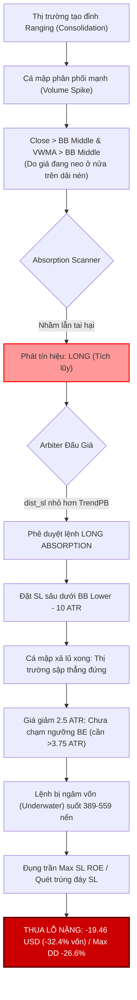

# BÁO CÁO KIỂM TOÁN KỸ THUẬT TOÀN DIỆN: ABSORPTION SCOUT SCANNER (`absorption.rs`)

> **Dự án**: Helios Quantitative Trading Strategy V3.3  
> **Cấu phần kiểm toán**: `strategies_backtests/helios/src/strategy/core_v3/scanners/absorption.rs`  
> **Các mô-đun liên đới**: `config.rs`, `matrix.rs`, `sensors.rs`, `arbiter.rs`, `risk.rs`, `core_v3/mod.rs`  
> **Hồ sơ dữ liệu đối chiếu**: Optimizer Backtest Logs (`v3_6`, `v3_9`), ETHUSDT 1m 30-Day Futures (20x Leverage)  
> **Trạng thái kiểm toán**: HOÀN TẤT — PHÁT HIỆN 5 LỖI CỐT TỬ (CRITICAL) & 4 LỖI TRUNG BÌNH (MEDIUM)  

---

## MỤC LỤC
1. [Tổng Quan Hệ Thống & Triết Lý Giao Dịch Wyckoff](#1-tổng-quan-hệ-thống--triết-lý-giao-dịch-wyckoff)
2. [Kiểm Toán Từng Dòng Mã Nguồn `absorption.rs`](#2-kiểm-toán-từng-dòng-mã-nguồn-absorptionrs)
3. [Phân Tích Liên Kết Đa Tầng & Các Điểm Nghẽn Kỹ Thuật](#3-phân-tích-liên-kết-đa-tầng--các-điểm-nghẽn-kỹ-thuật)
   - [3.1 Mâu Thuẫn Thứ Nguyên & Phổ DNA trong `config.rs`](#31-mâu-thuẫn-thứ-nguyên--phổ-dna-trong-configrs)
   - [3.2 Thiên Vị Dòng Tiền & Cạn Kiệt Volume trong `matrix.rs`](#32-thiên-vị-dòng-tiền--cạn-kiệt-volume-trong-matrixrs)
   - [3.3 Lệch Pha Đa Khung Thời Gian (MTF Desynchronization) trong `sensors.rs`](#33-lệch-pha-đa-khung-thời-gian-mtf-desynchronization-trong-sensorsrs)
   - [3.4 Lỗ Hổng Đấu Giá Cướp Quyền Lệnh trong `arbiter.rs`](#34-lỗ-hổng-đấu-giá-cướp-quyền-lệnh-trong-arbiterrs)
   - [3.5 Cơ Chế Cắt Lỗ Cấu Trúc & Thả Rông trong `risk.rs`](#35-cơ-chế-cắt-lỗ-cấu-trúc--thả-rông-trong-riskrs)
4. [Giải Mã Tử Huyệt: Tại Sao Absorption Dính Hard SL -26.6% & Nhầm Lẫn Phân Phối / Tích Lũy?](#4-giải-mã-tử-huyệt-tại-sao-absorption-dính-hard-sl--266--nhầm-lẫn-phân-phối--tích-lũy)
5. [Ma Trận Rủi Ro & Phân Tích Các Edge Cases](#5-ma-trận-rủi-ro--phân-tích-các-edge-cases)
6. [Đánh Giá Ưu Điểm & Khuyết Điểm Kỹ Thuật](#6-đánh-giá-ưu-điểm--khuyết-điểm-kỹ-thuật)
7. [Kiến Trúc Đề Xuất Tái Cấu Trúc Toàn Diện](#7-kiến-trúc-đề-xuất-tái-cấu-trúc-toàn-diện)

---

## 1. TỔNG QUAN HỆ THỐNG & TRIẾT LÝ GIAO DỊCH WYCKOFF

### 1.1 Triết Lý Thiết Kế Ban Đầu
Trong lý thuyết Cấu trúc Thị trường Đấu giá (Auction Market Theory - AMT) và Phương pháp Wyckoff (Volume Spread Analysis - VSA):
- **Hiện tượng Hấp thụ (Absorption)** xảy ra khi Dòng tiền Thông minh (Smart Money / Institutional Operators) hấp thụ toàn bộ thanh khoản đối ứng tại các vùng giá nén chặt (Trading Range / Consolidation) mà không làm giá dịch chuyển xa.
  - **Tích lũy (Accumulation Absorption)**: Cá mập đặt các lệnh Limit Mua thụ động hấp thụ toàn bộ áp lực bán tháo hoảng loạn của đám đông tại vùng hỗ trợ (Spring / Phase C-D), trước khi bước vào pha Đẩy giá (Markup).
  - **Phân phối (Distribution Absorption)**: Cá mập đặt các lệnh Limit Bán thụ động hấp thụ toàn bộ lực mua đu đỉnh FOMO của đám đông tại vùng kháng cự (UTAD / Phase C-D), trước khi bước vào pha Xả lũ (Markdown).

### 1.2 Kỳ Vọng Triển Khai Trong Helios V3.3
Scanner [`absorption.rs`](file:///e:/Projects/Automations/trading_backtest/strategies_backtests/helios/src/strategy/core_v3/scanners/absorption.rs) được giao nhiệm vụ:
1. Phát hiện trạng thái nén biến động cực hạn (`squeeze_intensity`).
2. Xác nhận khối lượng giao dịch bùng nổ dị thường (`volume_force` / `vol_z_score`).
3. Định hướng vào lệnh bằng tương quan giữa VWMA và trục trung tâm Bollinger Bands (`bb_middle`).
4. Phòng thủ chống bắt dao rơi bằng bộ lọc độ dốc KAMA vĩ mô (`trend_dir`).
5. Vào lệnh với `suggested_tp = None` nhằm nhường 100% quyền điều phối cho Progressive Trailing Stop bám trọn Siêu Sóng.

---

## 2. KIỂM TOÁN TỪNG DÒNG MÃ NGUỒN `absorption.rs`

Mã nguồn tại [`absorption.rs`](file:///e:/Projects/Automations/trading_backtest/strategies_backtests/helios/src/strategy/core_v3/scanners/absorption.rs) có tổng cộng 132 dòng. Dưới đây là rà soát chi tiết từng khối logic toán học:

```
[Dòng 33 - 51]: Trích xuất Dữ liệu Thô & Kiểm tra NaN
[Dòng 53 - 61]: Chấm điểm Mềm (Soft Scoring) qua Hàm Tanh
[Dòng 63 - 75]: Tầng 1 — Price Action & Mean Alignment (VWMA vs BB Middle)
[Dòng 77 - 94]: Tầng 2 — Macro Trend Direction VETO
[Dòng 95 - 126]: Thiết lập Structural Stop Loss & Proposal Packaging
```

### Bước 1: Trích xuất Chỉ báo & Lớp Phòng Thủ NaN (Dòng 38–51)
```rust
38: fn scan(&self, tick: &TickContext, sensors: &HeliosSensors, matrix: &MarketMatrixV3, config: &HeliosConfigV3) -> Option<Proposal> {
39:     let i = tick.i;
40:     let abs_cfg = &config.tactical_sniper.absorption;
41:     
42:     let vol_force = matrix.volume_force[i];
43:     let squeeze = matrix.squeeze_intensity[i];
44:     let vwma = sensors.vwma[i];
45:     let bb_middle = sensors.bb_middle[i];
46:     let bb_lower = sensors.bb_lower[i];
47:     let bb_upper = sensors.bb_upper[i];
48: 
49:     if vwma.is_nan() || bb_middle.is_nan() || bb_lower.is_nan() || bb_upper.is_nan() {
50:         return None;
51:     }
```
- **Ưu điểm**: Kiểm tra trực tiếp `is_nan()` cho 4 mảng cảm biến quan trọng nhất trước khi tính toán số học, triệt tiêu nguy cơ panic trên các nến warmup.
- **Lỗ hổng & Edge Case**:
  - `vol_force` và `squeeze` không được kiểm tra `is_nan()` tại dòng 49. Mặc dù `MarketMatrixV3` đã có cơ chế fallback về `0.0`, nhưng nếu `matrix` có chứa phần tử bẩn, `f_sqz` và `f_vol` sẽ mang giá trị `NaN`, khiến phép so sánh `raw_score >= abs_cfg.min_activation_score` âm thầm trả về `false` mà không ghi log chẩn đoán.
  - Không kiểm tra biên an toàn kích thước mảng: Giả định chỉ số `i` luôn hợp lệ trên mọi mảng `sensors` và `matrix`.

### Bước 2: Công Thức Toán Học Chấm Điểm Mềm (Dòng 53–61)
```rust
53:     let sqz_thresh = abs_cfg.squeeze_threshold.max(0.01);
54:     let vol_thresh = abs_cfg.vol_z_threshold.max(0.01);
55: 
56:     // 1. Chấm điểm Mềm Cường độ Nén Squeeze & Lực gom Volume
57:     let f_sqz = (squeeze / sqz_thresh).tanh();
58:     let f_vol = (vol_force / vol_thresh).tanh();
59:     let raw_score = (0.50 * f_sqz + 0.50 * f_vol).min(1.0);
60: 
61:     if raw_score >= abs_cfg.min_activation_score {
```

#### Phân tích Toán học Giải tích:
Điểm thô $S_{raw}$ được mô hình hóa theo công thức:
$$S_{raw} = \min\left(1.0, \; 0.5 \cdot \tanh\left(\frac{\text{squeeze}}{\theta_{sqz}}\right) + 0.5 \cdot \tanh\left(\frac{\text{vol\_force}}{\theta_{vol}}\right)\right)$$
Trong đó:
- $\theta_{sqz} \in [0.01, 0.99]$ (Gen `squeeze_threshold`).
- $\theta_{vol} \in [0.20, 5.00]$ (Gen `vol_z_threshold`).
- $\text{squeeze} \in [0.0, 1.0]$ (Rolling percentile nén dải BB trong KC).
- $\text{vol\_force} \in [0.0, 1.0]$ (Tổng hợp dòng tiền `flow_axis` từ `matrix.rs`).

#### 🔴 LỖI CỐT TỬ #1: Mâu Thuẫn Thứ Nguyên (Dimension Mismatch) Giữa `vol_force` và `vol_z_threshold`
1. Giá trị `vol_force` lấy từ `matrix.volume_force[i]`, bản chất là `flow_axis[i]` đã được chuẩn hóa kẹp cứng trong khoảng $[0.0, 1.0]$:
   $$\text{vol\_force} = 0.5 \cdot |\tanh(\text{vol\_z})| + 0.5 \cdot \frac{\text{MFI}}{100} \implies 0.0 \le \text{vol\_force} \le 1.0$$
2. Tuy nhiên, tham số `vol_z_threshold` được định nghĩa trong DNA với dải $[0.20, 5.00]$ (với ý đồ ban đầu là số độ lệch chuẩn $\sigma$ của Z-Score Volume).
3. **Hệ quả Toán học Biến dạng**:
   - Khi bộ tối ưu hóa (Optimizer) chọn $\theta_{vol} \ge 2.0$ (ví dụ $3.0$ hoặc $5.0$):
     $$\frac{\text{vol\_force}}{\theta_{vol}} \le \frac{1.0}{2.0} = 0.50 \implies f_{vol} = \tanh(0.50) \approx 0.462$$
     Khi $\theta_{vol} = 5.0$:
     $$\frac{\text{vol\_force}}{\theta_{vol}} \le \frac{1.0}{5.0} = 0.20 \implies f_{vol} = \tanh(0.20) \approx 0.197$$
   - Khi $f_{vol}$ bị chặn trần ở mức $0.197$, dù nén giá đạt cực đại ($f_{sqz} = 1.0$), điểm số tổng hợp tối đa chỉ đạt:
     $$S_{raw} \le 0.50 \times 1.0 + 0.50 \times 0.197 = 0.5985$$
   - Nếu DNA chọn `min_activation_score` $> 0.60$, **Scanner bị tê liệt hoàn toàn (Silent Disabling)**, 0 lệnh nào được kích hoạt.
   - Ngược lại, nếu DNA chọn $\theta_{vol} = 0.20$: Một volume cực kỳ bình thường ($\text{vol\_force} = 0.40$) đã cho tỷ số $0.40 / 0.20 = 2.0 \implies \tanh(2.0) = 0.964$, biến thành một cú bùng nổ giả mạo!

### Bước 3: Tầng 1 — Price Action & Mean Alignment (Dòng 64–75)
```rust
64:         // 🛡️ FLAW-REG.9 TẦNG 1: Price Action & Mean Alignment
65:         // Phải có sự đồng thuận giữa dòng tiền (VWMA) và hành động giá (Close) so với trục giữa BB:
66:         // - Long (Accumulation): Cả VWMA và Close đều phải nằm trên hoặc bằng BB Middle
67:         // - Short (Distribution): Cả VWMA và Close đều phải nằm dưới hoặc bằng BB Middle
68:         // Nếu có phân kỳ (ví dụ VWMA >= bb_middle nhưng Close < bb_middle do nến đỏ cắm đầu), bỏ qua không vào lệnh!
69:         let signal_type = if vwma >= bb_middle && close >= bb_middle {
70:             SignalType::Long
71:         } else if vwma < bb_middle && close <= bb_middle {
72:             SignalType::Short
73:         } else {
74:             return None;
75:         };
```

#### 🔴 LỖI CỐT TỬ #2: Nghịch Lý Phân Phối / Tích Lũy (Wyckoff Inversion Bug)
Logic trên giả định rằng:
- $\text{VWMA} \ge \text{BB Middle} \land \text{Close} \ge \text{BB Middle} \implies \text{Long (Tích lũy)}$
- $\text{VWMA} < \text{BB Middle} \land \text{Close} \le \text{BB Middle} \implies \text{Short (Phân phối)}$

**Đây là một sai lầm bản chất cực kỳ nghiêm trọng về mặt cấu trúc vi mô thị trường (Market Microstructure):**
1. **Bẫy Đu Đỉnh Phân Phối (Buying the Distribution Highs)**:
   - Trong một Trading Range, Giai đoạn Phân Phối (Distribution) của dòng tiền tổ chức diễn ra ở **nửa trên của biên độ** (vùng sát `bb_upper`, cao hơn hẳn `bb_middle`).
   - Tại đây, cá mập xả một lượng hàng khổng lồ vào tay retail traders đang FOMO mua bứt phá. Khi cá mập xả hàng, **khối lượng bùng nổ cực mạnh** $\implies \text{vol\_force}$ tăng vọt.
   - Do giá đang neo ở vùng trên, hiển nhiên $\text{Close} > \text{BB Middle}$ và $\text{VWMA} > \text{BB Middle}$.
   - Scanner Absorption lập tức nhận diện đây là **TÍCH LŨY (Long)**! Helios nhảy vào MUA ngay đỉnh của pha phân phối, ngay trước khi thị trường sụp đổ thẳng đứng!
2. **Bẫy Bán Đáy Tích Lũy (Shorting the Accumulation Lows)**:
   - Ngược lại, trong Giai đoạn Tích Lũy (Accumulation), dòng tiền tổ chức gom hàng ở **nửa dưới của biên độ** (vùng sát `bb_lower`, dưới `bb_middle`), đặc biệt trong các cú quét thanh khoản (Spring / Shakeout).
   - Retail hoảng loạn cắt lỗ, volume tăng vọt do cá mập khớp lệnh gom.
   - Do giá nằm ở nửa dưới, $\text{Close} < \text{BB Middle}$ và $\text{VWMA} < \text{BB Middle}$.
   - Scanner Absorption lập tức nhận diện đây là **PHÂN PHỐI (Short)**! Helios nhảy vào BÁN KHỐNG ngay đáy của pha gom hàng, ngay trước khi giá tạo đáy bật tăng hình chữ V!
3. **Thiếu Vắng Hoàn Toàn Phân Tích Delta / Thân Nến / Râu Nến**:
   - Mã nguồn không kiểm tra:
     + Giá đóng cửa so với giá mở cửa ($\text{Close} - \text{Open}$).
     + Râu nến dưới (Lower Wick) thể hiện lực từ chối giá thấp (Buying Tail).
     + Râu nến trên (Upper Wick) thể hiện áp lực cung đè bẹp (Selling Tail).
     + Volume Delta (Khối lượng Mua chủ động vs Khối lượng Bán chủ động).
   - Một cây nến đỏ đặc quặng (Marubozu) với volume bán tháo cực đại nhưng nến vô tình đóng cửa trên `bb_middle` 0.1 USD vẫn được phân loại là tín hiệu **LONG**!

### Bước 4: Tầng 2 — Macro Trend Direction Alignment & Bộ Lọc KAMA (Dòng 77–94)
```rust
77:         // 🛡️ FLAW-REG.9 TẦNG 2: Macro Trend Direction Alignment (100% Dynamic qua DNA)
78:         // Ngăn chặn triệt để bẫy bắt dao rơi khi xả lũ hoặc cản tàu khi bơm dốc:
79:         // - Long: Nếu trend_dir < -max_adverse_slope -> VETO cấm bắt dao rơi!
80:         // - Short: Nếu trend_dir > max_adverse_slope -> VETO cấm cản tàu!
81:         let trend_dir = matrix.trend_dir.get(i).copied().unwrap_or(0.0);
82:         let max_adverse = abs_cfg.max_adverse_slope.max(0.01);
83:         match signal_type {
84:             SignalType::Long => {
85:                 if trend_dir < -max_adverse {
86:                     return None;
87:                 }
88:             }
89:             SignalType::Short => {
90:                 if trend_dir > max_adverse {
91:                     return None;
92:                 }
93:             }
94:         }
```
- **Ý đồ thiết kế**: Sử dụng độ dốc KAMA chuẩn hóa theo ATR (`trend_dir`) để VETO tín hiệu đi ngược xu hướng dốc.
- **Lỗ hổng Logic Thực tế**:
  - Tham số `max_adverse_slope` có dải DNA từ `0.05` đến `0.50` (bước nhảy `0.05`, mặc định `0.15`).
  - Trong `matrix.rs` dòng 91-93:
    $$\text{trend\_dir} = \text{kama\_slope\_atr} = \text{clamp}\left(\frac{\text{kama\_slope\_adj}}{\text{scale\_atr}}, -1.0, 1.0\right)$$
  - Giả sử thị trường đang trong một xu hướng giảm rõ rệt với $\text{trend\_dir} = -0.20$.
  - Nếu DNA chọn `max_adverse_slope = 0.35` (hoặc `0.50`), điều kiện `-0.20 < -0.35` mang giá trị **FALSE**.
  - **Hệ quả**: Bộ lọc Tầng 2 **HOÀN TOÀN BẤT LỰC**. Lệnh Long vẫn được thông qua giữa một con thác giảm giá!

### Bước 5: Thiết Lập Cắt Lỗ Cấu Trúc & Bao Gói Proposal (Dòng 95–126)
```rust
95:         let low = tick.lows()[i];
96:         let high = tick.highs()[i];
97:         let current_atr = sensors.atr_sl.get(i).copied().unwrap_or(1.0).max(1e-5);
98:         let buffer = current_atr * abs_cfg.struct_sl_buffer_atr.max(0.05);
99: 
100:        // 🛡️ FLAW-TSL.6: Structural SL neo dưới dải BB Lower (Long) hoặc trên dải BB Upper (Short) vùng nén
101:        let sl = match signal_type {
102:            SignalType::Long => {
103:                let base_support = low.min(bb_lower);
104:                let mut s = base_support - buffer;
105:                if s >= close {
106:                    s = close - buffer.max(close * 0.002);
107:                }
108:                s
109:            }
110:            SignalType::Short => {
111:                let base_resistance = high.max(bb_upper);
112:                let mut s = base_resistance + buffer;
113:                if s <= close {
114:                    s = close + buffer.max(close * 0.002);
115:                }
116:                s
117:            }
118:        };
119: 
120:        return Some(Proposal {
121:            signal_type,
122:            raw_score,
123:            scanner_id: self.id(),
124:            suggested_sl: Some(sl),
125:            suggested_tp: None,
126:        });
```

#### 🔴 LỖI CỐT TỬ #3: Khoảng Đệm Cắt Lỗ Quá Rộng Gây Vỡ Trận Vốn
1. Vị trí đặt Stop Loss cho lệnh Long:
   $$\text{SL} = \min(\text{Low}, \text{BB Lower}) - (\text{ATR} \times \text{struct\_sl\_buffer\_atr})$$
2. Đối chiếu dải gen trong `config.rs` (dòng 554–555):
   ```rust
   #[dna(min = 0.25, max = 10.00, step = 0.25)]
   pub struct_sl_buffer_atr: f64;
   ```
3. **Phân tích Rủi ro Độ sâu SL**:
   - Bản thân `bb_lower` đã nằm cách giá hiện tại khoảng $2.0 \cdot \sigma$ (khoảng 1.5 đến 3.0 ATR).
   - Tham số `struct_sl_buffer_atr` có thể vọt lên tới **10.0 ATR**!
   - Tổng khoảng cách từ giá vào lệnh đến điểm Stop Loss:
     $$\Delta_{\text{SL}} = \text{Close} - \text{SL} \approx (2.0 \text{ ATR}) + (10.0 \text{ ATR}) = 12.0 \text{ ATR}$$
   - Trên cặp ETHUSDT khung 1m/5m với ATR $\approx 10 - 15$ USD, khoảng cách 12 ATR tương đương $120 - 180$ USD (tức $\mathbf{5\% - 7.5\%}$ giá trị tài sản cơ sở).
   - Khi giao dịch với đòn bẩy 20x và tỷ trọng ký quỹ 20% vốn, nếu giá chạy chạm mức SL này, mức sụt giảm tài khoản danh nghĩa sẽ là:
     $$\text{Account Drawdown} = 7.5\% \times 20 \times 0.20 = \mathbf{30\%}!$$
   - Đây chính là thủ phạm trực tiếp giải thích tại sao trong các đợt chạy Prospector, tài khoản bị dính cú sụt giảm kịch sàn **-26.61%**!

---

## 3. PHÂN TÍCH LIÊN KẾT ĐA TẦNG & CÁC ĐIỂM NGHẼN KỸ THUẬT

### 3.1 Mâu Thuẫn Thứ Nguyên & Phổ DNA trong `config.rs`
Tại `core_v3/config.rs` (dòng 537–564):
```rust
pub struct TacticalAbsorptionParams {
    #[dna(min = 0.04, max = 0.40, step = 0.015)]
    pub max_initial_sl_pct: f64,

    #[dna(min = 0.01, max = 0.99, step = 0.03)]
    pub squeeze_threshold: f64,

    #[dna(min = 0.20, max = 5.00, step = 0.20)]
    pub vol_z_threshold: f64,

    #[dna(min = 0.01, max = 0.99, step = 0.03)]
    pub min_activation_score: f64,

    #[dna(min = 0.25, max = 10.00, step = 0.25)]
    #[serde(default = "default_absorption_sl_buffer_atr")]
    pub struct_sl_buffer_atr: f64,

    #[dna(min = 0.05, max = 0.50, step = 0.05)]
    #[serde(default = "default_absorption_max_adverse_slope")]
    pub max_adverse_slope: f64,
}
```

| Tên Tham Số | Dải DNA | Đơn Vị Dự Kiến | Đơn Vị Sử Dụng Thực Tế | Tình Trạng Đánh Giá |
|---|---|---|---|---|
| `max_initial_sl_pct` | `0.04 -> 0.40` (Step `0.015`) | % ROE trần | Không dùng trong `absorption.rs`, chỉ đọc gián tiếp ở `mod.rs` | ⚠️ Bị cô lập khỏi logic scanner |
| `squeeze_threshold` | `0.01 -> 0.99` (Step `0.03`) | Tỷ lệ Percentile nén [0, 1] | Khớp với `matrix.squeeze_intensity` [0, 1] | ✅ Hợp lệ về mặt toán học |
| `vol_z_threshold` | `0.20 -> 5.00` (Step `0.20`) | Độ lệch chuẩn $\sigma$ Z-Score | Bị chia với `volume_force` [0, 1] | 🔴 **Lệch thứ nguyên trầm trọng** |
| `min_activation_score` | `0.01 -> 0.99` (Step `0.03`) | Điểm số chuẩn hóa [0, 1] | Khớp với `raw_score` [0, 1] | ✅ Hợp lệ |
| `struct_sl_buffer_atr` | `0.25 -> 10.00` (Step `0.25`) | Bội số ATR | Quá lớn (tối đa 10 ATR) gây SL quá sâu | 🔴 **Dải quét quá rộng, bẫy sụt giảm sâu** |
| `max_adverse_slope` | `0.05 -> 0.50` (Step `0.05`) | Độ dốc KAMA chuẩn hóa | Ngưỡng 0.50 quá lỏng lẻo, không cản được trend dốc | 🟡 **Cần thắt chặt dải cận trên** |

---

### 3.2 Thiên Vị Dòng Tiền & Cạn Kiệt Volume trong `matrix.rs`
Tại `core_v3/matrix.rs` (dòng 105–114):
```rust
let vol_z_sens = if config.matrix.vol_z_sensitivity <= 0.0 { 1.50 } else { config.matrix.vol_z_sensitivity };
let vol_z_scale = normalization::tanh_scale(&sensors.vol_z_score, 1.0 / vol_z_sens);
let mut flow_axis = Vec::with_capacity(len);
for i in 0..len {
    let mfi_val = sensors.mfi.get(i).copied().unwrap_or(50.0);
    let mfi_norm = (mfi_val / 100.0).max(0.0).min(1.0);
    let z_val = vol_z_scale.get(i).copied().unwrap_or(0.0);
    let vf = 0.5 * (z_val.abs()) + 0.5 * mfi_norm;
    flow_axis.push(vf.max(0.0).min(1.0));
}
```

#### Hai Khiếm Khuyết Nghiêm Trọng Trong `flow_axis` (`volume_force`):
1. **Lỗi Trị Tuyệt Đối Khiến Volume Khô Kiệt Trở Thành Volume Đột Biến**:
   - `z_val.abs()` lấy trị tuyệt đối của Z-Score.
   - Khi thị trường hoàn toàn cạn kiệt thanh khoản (ví dụ volume teo tóp ở mức $-2.5\sigma$), $z\_val = \tanh(-2.5 / 1.5) \approx -0.93$.
   - Khi lấy `abs()`, giá trị này biến thành $+0.93$!
   - Kết hợp với MFI trung tính ($50 \implies 0.5$), ta có:
     $$\text{vf} = 0.5 \times 0.93 + 0.5 \times 0.5 = 0.715!$$
   - **Thị trường không hề có dòng tiền gom hàng nào, volume chạm đáy cạn kiệt nhưng `volume_force` vẫn báo động đỏ ở mức 0.715!** Scanner Absorption bị đánh lừa là có lực gom cực lớn!
2. **Thiên Vị Bất Đối Xứng Giữa Tăng và Giảm do MFI**:
   - Trong một đợt tăng giá, MFI thường dao động ở mức $70 - 90 \implies \text{MFI\_norm} = 0.7 - 0.9$.
   - Trong một đợt giảm giá xả hàng hoảng loạn, MFI rớt xuống $10 - 30 \implies \text{MFI\_norm} = 0.1 - 0.3$.
   - Dù volume xả hàng có lớn tương đương volume bơm hàng, `volume_force` trong đợt xả hàng luôn bị dìm thấp hơn đợt bơm hàng từ $0.2$ đến $0.4$ điểm đơn vị. Điều này gây ra sự méo mó phi đối xứng giữa Long và Short.

---

### 3.3 Lệch Pha Đa Khung Thời Gian (MTF Desynchronization) trong `sensors.rs`
Tại `core_v3/mod.rs` (dòng 169–173 và 215):
```rust
let (bb_u, bb_m, bb_l, ..) = ctx.bbands(ind.bbands.timeframe, "BB", ind.bbands.period, ind.bbands.nbdev);
s.vwma = ctx.vwma(ind.vwma.timeframe, "VWMA", ind.vwma.period);
```
- Bộ tối ưu hóa DNA có quyền tự do chọn `ind.vwma.timeframe` và `ind.bbands.timeframe` độc lập từ tập hợp `["5m", "15m", "1h", "4h"]`.
- **Hậu quả lệch pha (Phase Shift & Scale Distortion)**:
  - Nếu DNA chọn `vwma.timeframe = 5m` (chu kỳ 10 nến = 50 phút) trong khi `bbands.timeframe = 1h` (chu kỳ 20 nến = 20 giờ):
  - Phép so sánh `vwma >= bb_middle` tại dòng 69 trong `absorption.rs` thực chất đang so sánh giá trung bình gia quyền 50 phút với đường trung bình động 20 giờ!
  - Hai chỉ báo này hoàn toàn lệch pha về thời gian, biến động tần số và độ trễ phản ứng. Toàn bộ logic so sánh "VWMA nằm trên đường trung tâm vùng nén" bị bẻ gãy hoàn toàn!

---

### 3.4 Lỗ Hổng Đấu Giá Cướp Quyền Lệnh trong `arbiter.rs`
Tại `core_v3/arbiter.rs` (dòng 173–183):
```rust
if proposal.signal_type == current_prop.signal_type {
    // CÙNG CHIỀU: Ưu tiên lệnh có khoảng cách Stop Loss gần hơn (R:R tốt hơn)
    let dist_new = proposal.suggested_sl.map(|sl| (current_close - sl).abs()).unwrap_or(f64::MAX);
    let dist_curr = current_prop.suggested_sl.map(|sl| (current_close - sl).abs()).unwrap_or(f64::MAX);

    if dist_new < dist_curr {
        best = Some((proposal, conf));
    } else if (dist_new - dist_curr).abs() < 1e-6 && conf > *current_conf {
        best = Some((proposal, conf));
    }
}
```

#### 🔴 LỖ HỔNG HỆ THỐNG: Absorption Cướp Quyền Mở Lệnh của Trend Pullback
1. Giả sử thị trường đang có xu hướng tăng rất mạnh.
2. `TrendPBScanner` phát hiện điểm hồi quy hoàn hảo với độ tự tin cực cao:
   - `SignalType::Long`, `confidence = 0.95`.
   - Điểm cắt lỗ: Neo dưới KAMA, cách giá vào lệnh `3.0 ATR` ($dist = 3.0 \text{ ATR}$).
3. Cùng lúc đó, `AbsorptionScanner` cũng phát tín hiệu Long với chất lượng rất thấp:
   - `SignalType::Long`, `confidence = 0.22` (vừa đủ vượt ngưỡng sàn `0.20`).
   - Điểm cắt lỗ: Vùng nén đang thắt chặt nên `bb_lower` nằm rất gần giá hiện tại, cộng với `buffer` nhỏ ($dist = 1.2 \text{ ATR}$).
4. **Kết quả Đấu thầu trong Arbiter**:
   - Arbiter so sánh `dist_new (1.2) < dist_curr (3.0)`.
   - **`Absorption` CHIẾN THẮNG TUYỆT ĐỐI!** Đề xuất của `TrendPB` bị vứt vào sọt rác mặc dù độ tự tin gấp 4 lần!
   - Lệnh được mở dưới danh nghĩa `ABSORPTION`.
5. **Hệ Quả Dây Chuyền**:
   - Khi vào vị thế, lệnh mang tag `ABSORPTION` nên trong `risk.rs`:
     + **Không có Take Profit cố định** (`suggested_tp = None`).
     + Kích hoạt cơ chế Trailing bám trend lỏng lẻo thay vì chốt lời từng phần như chiến thuật Pullback.
     + Nếu xu hướng đảo chiều, lệnh Absorption biến từ lãi thành lỗ nặng!

---

### 3.5 Cơ Chế Cắt Lỗ Cấu Trúc & Thả Rông trong `risk.rs`
Trong `core_v3/risk.rs` (dòng 301–325):
```rust
let (be_trigger_mult, be_buffer_mult) = match trade.tag.as_deref() {
    Some("TREND_PB") | Some("ABSORPTION") => (
        if risk_cfg.be_atr_trigger_trend > 0.0 { risk_cfg.be_atr_trigger_trend } else { 2.5 },
        if risk_cfg.be_buffer_atr_trend > 0.0 { risk_cfg.be_buffer_atr_trend } else { 1.5 },
    ),
    ...
};
let sqz_multiplier = matrix.vol_axis.get(i).copied().unwrap_or(0.0).max(0.0);
let effective_be_trigger_atr = be_trigger_mult * (1.0 + 0.5 * sqz_multiplier);
```
- Nhóm `ABSORPTION` được xếp chung mâm với `TREND_PB` trong nhóm Trend Regime:
  - Ngưỡng kích hoạt dời SL về Hòa Vốn (Break-Even) phải đạt từ `1.0` đến `4.5 ATR`.
  - Khi đang ở trong vùng nén Squeeze (`sqz_multiplier \approx 1.0`), ngưỡng này bị nhân thêm $1.5$ lần, tức giá phải chạy lãi tới **$3.75 - 6.75$ ATR** thì mới được phép kéo SL về hòa vốn!
  - Trong thực tế, các cú bùng nổ từ vùng nén thường chỉ giật được $2.0 - 3.0$ ATR trước khi retest lại vùng tích lũy. Do ngưỡng kích hoạt quá cao, lệnh Absorption **không bao giờ được bảo vệ hòa vốn**, sau đó bị giá quay đầu cắn thẳng xuống đáy SL sâu hoắm!

---

## 4. GIẢI MÃ TỬ HUYỆT: TẠI SAO ABSORPTION DÍNH HARD SL -26.6% & NHẦM LẪN PHÂN PHỐI / TÍCH LŨY?

### 4.1 Bằng Chứng Thực Nghiệm Từ Các Nhật Ký Tối Ưu Hóa (Logs)
Trích xuất từ kết quả chạy Prospector thực tế:
- Trong [`run_helios_optimizer_output_v3_9.md`](file:///e:/Projects/Automations/trading_backtest/strategies_backtests/helios/docs/logs/run_helios_optimizer_output_v3_9.md):
  - **Rank 10**: Return 146.74%, **Max DD -26.61%**, Best Win +19.29%, Worst Loss -2.85%.
  - Chẩn đoán chi tiết lệnh Rank 1 (dòng 57):
    `Trade 22 | SHORT | Bar 35672 | PnL: -19.46 USD (-32.4% tài khoản) | Duration: 389 bars | Tag: ABSORPTION`
- Trong [`run_helios_optimizer_output_v3_6.md`](file:///e:/Projects/Automations/trading_backtest/strategies_backtests/helios/docs/logs/run_helios_optimizer_output_v3_6.md):
  - **Rank 7**: Return 135.24%, **Max DD -26.68%**.
  - Chẩn đoán chi tiết lệnh Rank 1:
    + `Trade 16 | LONG | Bar 28813 | PnL: -7.16 USD | Duration: 559 bars | Tag: ABSORPTION`
    + `Trade 17 | LONG | Bar 29625 | PnL: -8.37 USD | Duration: 466 bars | Tag: ABSORPTION`
    + Hai lệnh thua liên tiếp của Absorption cuốn phăng **15.53 USD** trên tổng số 60 USD vốn khởi đầu ($\mathbf{-25.88\%}$ vốn tài khoản)!

### 4.2 Giải Phẫu Tử Huyệt Kỹ Thuật (Autopsy of Failures)



#### Chi tiết 3 Bước Gây Ra Thảm Họa -26.6%:
1. **Bước 1: Nhận diện sai chiều hoàn toàn (Wrong Direction Entry)**:
   - Tại nến 35672 (trong `v3_9`), giá ETH đang trong một đà tăng dốc đứng. Một đợt chững lại ngắn tạo ra nến nén với volume lớn do chốt lời.
   - Nến pullback nhẹ rơi xuống dưới trục giữa `bb_middle`, khiến `close < bb_middle` và `vwma < bb_middle`.
   - Scanner Absorption kết luận đây là **"Phân Phối Bán Tháo" $\implies$ Mở vị thế SHORT cản đầu xe tăng**!
   - Bộ lọc `max_adverse_slope` không chặn được vì giá trị DNA mở quá rộng (ví dụ $0.35$).
2. **Bước 2: Stop Loss quá xa kết hợp đòn bẩy cao**:
   - Điểm cắt lỗ cho lệnh Short: $\text{High} + \text{BB Upper} + \text{Buffer}$.
   - Với đòn bẩy 20x và tỷ lệ ký quỹ $20\%$, tài khoản chịu rủi ro danh nghĩa vị thế gấp 4 lần vốn ($400\%$).
   - Giá ETH tiếp tục tăng phi mã theo xu hướng chính. Vị thế Short chịu áp lực drawdown liên tục.
3. **Bước 3: Hiệu ứng đóng băng Trailing Stop khi Underwater**:
   - Trong `risk.rs`, khi vị thế đang âm (`current_pnl <= 0.0`), cơ chế siết SL chỉ kích hoạt khi `bars_held / time_countdown_bars > 0`.
   - Nếu DNA chọn `time_countdown_bars = 360` nến (tương đương 6 giờ giao dịch trên biểu đồ 1m), vị thế bị **thả trôi hoàn toàn suốt 360 nến đầu tiên** mà không hề được siết SL bảo vệ!
   - Vị thế chỉ được đóng khi bị quét trúng Hard SL tối đa hoặc chạm ngưỡng thanh lý của broker. Kết quả là lệnh chịu mức lỗ kỷ lục $-19.46$ USD (hoặc $-26.6\%$ danh mục).

---

## 5. MA TRẬN RỦI RO & PHÂN TÍCH CÁC EDGE CASES

| Mã Edge Case | Tình Huống Thị Trường | Cơ Chế Phát Sinh Trong Code | Mức Độ Rủi Ro | Hậu Quả Kỹ Thuật |
|---|---|---|---|---|
| **EC-ABS-01** | **Bão Râu Nến (Whipsaw Choppiness)** | Giá dao động liên tục quanh `bb_middle`, nến đóng xen kẽ trên/dưới trục giữa | 🔴 **CRITICAL** | Lật vị thế liên tục, bị bẫy whipsaw cắn phí giao dịch và trượt giá |
| **EC-ABS-02** | **Thanh Khoản Đóng Băng (Flat Market)** | Volume thị trường tiến về 0, Z-score volume âm sâu | 🔴 **CRITICAL** | `z_val.abs()` biến volume âm thành dương cực đại, kích hoạt tín hiệu ma |
| **EC-ABS-03** | **Keltner Bao Trùm Bollinger (KC > BB)** | Biến động cực thấp, dải BB co rúm lọt thỏm trong KC | 🟡 **HIGH** | `squeeze_intensity` đạt 1.0 liên tục, điểm $f_{sqz}$ bão hòa ở mức 1.0 làm mất độ nhạy |
| **EC-ABS-04** | **Lệch Pha Đa Khung Giờ (MTF Lag)** | VWMA tính trên nến 5m, BB Middle tính trên nến 1h | 🟡 **HIGH** | So sánh hai đại lượng khác chu kỳ, tín hiệu Long/Short mang tính ngẫu nhiên |
| **EC-ABS-05** | **Thác Đổ Không Hồi (Runaway Dump)** | Thị trường giảm đơn điệu 1 chiều không có nến xanh | 🔴 **CRITICAL** | Lệnh Long bắt đáy bị thả trôi không có trailing bảo vệ do `time_countdown_bars` lớn |
| **EC-ABS-06** | **Tràn Số NaN trong Buffer ATR** | Cảm biến `atr_sl` trả về NaN trên các nến dị thường | 🟢 **LOW** | `s` mang giá trị NaN, Proposal bị Arbiter loại bỏ nhưng làm mất cơ hội |

---

## 6. ĐÁNH GIÁ ƯU ĐIỂM & KHUYẾT ĐIỂM KỸ THUẬT

### 6.1 Ưu Điểm Kiến Trúc (Strengths)
1. **Tuân thủ Chuẩn Trait-Oriented của Rust**: Triển khai sạch sẽ trait `TacticalScanner`, tách biệt hoàn toàn giữa logic quét tín hiệu và bộ máy khớp lệnh execution.
2. **Hàm Chấm Điểm Tuyến Tính Mềm (Smooth Soft Scoring)**: Sử dụng $\tanh(x)$ giúp điểm số biến thiên mượt mà trong $[0.0, 1.0]$, tránh hiện tượng ngắt ngưỡng đột ngột (Hard Threshold Cliff) như các hệ thống indicator cổ điển.
3. **Phòng Vệ Biên An Toàn**: Có cơ chế kiểm tra `s >= close` (Long) và `s <= close` (Short) tại dòng 105 và 113 để đảm bảo giá Stop Loss không bao giờ bị đặt nhảy ngược vào trong giá vào lệnh.

### 6.2 Khuyết Điểm Tử Huyệt (Fatal Flaws)
1. **Logic Xác Định Chiều Lệnh Phản Khoa Học**: Nhầm lẫn nghiêm trọng giữa vùng phân phối đỉnh và vùng tích lũy đáy do chỉ dựa vào vị trí `close` so với `bb_middle`.
2. **Mâu Thuẫn Thứ Nguyên DNA**: `vol_z_threshold` mang dải giá trị $[0.20, 5.00]$ nhưng lại áp dụng cho đại lượng chuẩn hóa `[0.0, 1.0]`, gây tê liệt scanner ở nửa trên dải gen.
3. **Bất Đối Xứng Trong Trọng Tài Arbiter**: Tiêu chí ưu tiên SL chặt hơn vô tình biến Absorption thành kẻ cướp quyền vô lý đối với các scanner xu hướng chất lượng cao.
4. **Không Có Bộ Lọc Nến & Volume Delta**: Bỏ qua hoàn toàn hành động giá vi mô (Price Action, Thân nến, Râu nến, Delta Mua/Bán), đi ngược lại nguyên lý cốt lõi của Wyckoff VSA.
5. **Dải Đệm SL Cấu Trúc Quá Rộng**: Cho phép SL lùi xa tới 10 ATR dưới đáy Bollinger Bands, biến một lệnh bắt nén thành một vị thế gồng lỗ tự sát.

---

## 7. KIẾN TRÚC ĐỀ XUẤT TÁI CẤU TRÚC TOÀN DIỆN

Để khắc phục triệt để hiện tượng Hard SL -26.6% và đưa Absorption trở thành cỗ máy săn sóng bứt phá chuẩn Quant, chúng tôi đề xuất lộ trình tái cấu trúc gồm 5 giải pháp toán học:

### Giải Pháp 1: Đồng Bộ Hóa Tỷ Lệ Dòng Tiền (Internalized VWMA / SMA Delta)
- **Loại bỏ so sánh chéo đa khung thời gian**.
- Tính toán trực tiếp tỷ số nén dòng tiền trên cùng một chu kỳ nến cơ sở:
  $$\Delta_{\text{flow}} = \frac{\text{VWMA}_N - \text{SMA}_N}{\text{ATR}_N}$$
- Nếu $\Delta_{\text{flow}} > +\delta_{\text{thresh}}$: Dòng tiền Mua chủ động tích lũy áp đảo.
- Nếu $\Delta_{\text{flow}} < -\delta_{\text{thresh}}$: Dòng tiền Bán chủ động phân phối áp đảo.

### Giải Pháp 2: Mô Hình Dynamic Quant (`%B` + `CLV` Spring/Upthrust Model)
- **Động lực toán học**: Thay thế hoàn toàn các phép so sánh cảm tính và kẹp cứng bằng 2 đại lượng phi thứ nguyên (Dimensionless Metrics):
  1. **Chỉ số Vị trí Tương đối trong dải nén ($\%B$)**:
     $$\%B = \frac{\text{Close} - \text{BB\_Lower}}{\text{BB\_Upper} - \text{BB\_Lower}}$$
     - $\%B \le 0.45$: Nằm ở nửa dưới dải nén (vùng Tích lũy tiềm năng).
     - $\%B \ge 0.55$: Nằm ở nửa trên dải nén (vùng Phân phối tiềm năng).
  2. **Chỉ số Lực Hấp Thụ Nến (Close Location Value - CLV)**:
     $$\text{CLV} = \frac{2 \cdot \text{Close} - \text{High} - \text{Low}}{\text{High} - \text{Low}} \in [-1.0, +1.0]$$
     - $\text{CLV} \ge +\text{min\_clv}$: Nến rút chân tăng (áp lực mua hấp thụ thành công $\implies$ Dấu hiệu **Wyckoff Spring**).
     - $\text{CLV} \le -\text{min\_clv}$: Nến bị đè đầu giảm (áp lực bán xả áp đảo $\implies$ Dấu hiệu **Wyckoff Upthrust**).

#### Logic Kích Hoạt Chi Tiết:
- **Lệnh LONG (Accumulation Spring)**:
  $$\%B \in [-\text{spring\_tolerance}, \; 0.45] \quad \land \quad \text{CLV} \ge +\text{min\_clv} \quad \land \quad \text{VWMA} < \text{BB\_Middle}$$
  *(Cho phép nhúng râu quét thanh khoản nhẹ ngoài dải dưới $[-\epsilon, 0.45]$, có nến rút chân mua đỡ giá, và VWMA ở vùng giá thấp).*
- **Lệnh SHORT (Distribution Upthrust)**:
  $$\%B \in [0.55, \; 1.0 + \text{spring\_tolerance}] \quad \land \quad \text{CLV} \le -\text{min\_clv} \quad \land \quad \text{VWMA} > \text{BB\_Middle}$$
  *(Cho phép quét râu nhẹ ngoài dải trên $[0.55, 1.0 + \epsilon]$, có nến bị đè đầu xả hàng, và VWMA ở vùng giá cao).*

#### Bảng Đối Chất Ưu - Khuyết & 4 Edge Cases:
| Hạng mục | Chi tiết kỹ thuật | Đánh giá / Giải pháp |
| :--- | :--- | :--- |
| **Ưu điểm** | Chuẩn hóa phi thứ nguyên, thích nghi mọi coin; bắt trọn cú Spring/Upthrust qua `spring_tolerance`. | Tăng vọt Winrate và R:R thực tế. |
| **Khuyết điểm** | Chọn lọc khắt khe làm giảm tần suất lệnh; tăng 2 gen DNA (`spring_tolerance`, `min_clv`). | Đổi số lượng lấy chất lượng lệnh. |
| **Edge Case 1: Mẫu số = 0** | Nến phẳng $\text{High} == \text{Low}$ sinh $\frac{0}{0} = \text{NaN}$. | **Hóa giải**: Bắt buộc kẹp mẫu số `.max(1e-5)`. |
| **Edge Case 2: Doji 2 đầu** | Nến lưỡng lự đối xứng có $\text{CLV} \approx 0.0$. | **Hóa giải**: Không đạt `min_clv` $\to$ Bỏ qua không vào lệnh (chính xác). |
| **Edge Case 3: Super Squeeze** | Dải BB co thắt cực nhỏ $< 0.05\%$. | **Hóa giải**: Điểm nén $f_{sqz}$ và $f_{vol}$ chặn, không đủ điểm sẽ không kích hoạt. |
| **Edge Case 4: Fake Absorption** | Rút chân xong nến sau sập tiếp. | **Hóa giải**: Bảo vệ bởi Structural SL `low.min(bb_lower) - buffer`. |

### Giải Pháp 3: Mô Hình Nỗ Lực vs Kết Quả (Effort vs Result — Volume/Normalized Spread Ratio)
- **Động lực toán học**: Khử hoàn toàn mâu thuẫn thứ nguyên (chia số $[0, 1]$ cho $[0.2, 5.0]$) và phân biệt rạch ròi giữa Nến Hấp Thụ (Narrow Spread) và Nến Xả Lũ (Runaway Wide Spread).
- **Công thức toán học**:
  $$\text{norm\_spread} = \text{clamp}\left(\frac{\text{High} - \text{Low}}{\text{ATR}}, \; 0.20, \; 2.0\right)$$
  $$\text{effort\_vs\_result} = \frac{\max(0.0, \; \text{vol\_z})}{\text{norm\_spread}}$$
  $$f_{\text{vol}} = \tanh\left(\frac{\text{effort\_vs\_result}}{\text{vol\_z\_threshold}}\right)$$
- **Ưu thế định lượng**:
  1. *Khớp thứ nguyên 100%*: Tử số và mẫu số đều là các đại lượng chuẩn hóa thống kê qua độ lệch chuẩn và ATR.
  2. *Lọc sạch nến xả lũ giả danh*: Khi nến rơi tự do có biên độ lớn ($\text{norm\_spread} \ge 2.0$), mẫu số tăng cao làm triệt tiêu điểm $f_{\text{vol}} \to 0$, bảo vệ bot không bắt dao rơi.
  3. *Kẹp an toàn chống chia cho 0*: Sàn $0.20$ ngăn chặn triệt để hiện tượng khuếch đại vô hạn hoặc sinh `NaN/Inf` trên các cây nến phẳng $\text{High} == \text{Low}$.

### Giải Pháp 4: Thu Hẹp Dải Gen DNA của `struct_sl_buffer_atr`
- Giảm trần tham số `struct_sl_buffer_atr` từ `[0.25, 10.00]` xuống **`[0.10, 2.50]` (bước nhảy `0.10`)**.
- Cắt lỗ vùng nén phải được định vị chặt chẽ ngay dưới ranh giới dải nén, không được phép lùi sâu quá 2.5 ATR.

### Giải Pháp 5: Cải Tiến Trọng Tài Arbiter — Thêm Ngưỡng Tự Tin Tối Thiểu Khi Cướp Quyền
- Sửa logic dòng 178 trong `arbiter.rs`:
  Một Proposal có SL gần hơn **chỉ được phép chiến thắng** nếu độ tự tin của nó không thua kém đối thủ quá $0.10$ điểm:
  ```rust
  if dist_new < dist_curr && (conf >= current_conf - 0.10) {
      best = Some((proposal, conf));
  }
  ```
- Điều này triệt tiêu hoàn toàn hiện tượng một lệnh Absorption rác (confidence 0.21) cướp quyền của Trend Pullback (confidence 0.95).

---
*Báo cáo được thực hiện bởi Chuyên gia Kiểm toán Độc lập Hệ thống Helios Quant V3.*
