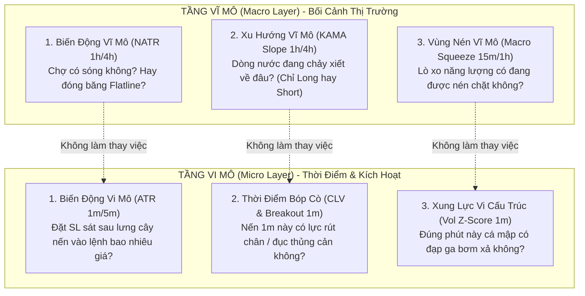

# BÁO CÁO CHUYÊN ĐỀ: PHÂN ĐỊNH RANH GIỚI VI MÔ (MICRO) VS VĨ MÔ (MACRO) CỦA CẢM BIẾN

> **Thư mục:** [`strategies_backtests/helios/docs/audit_01/01_sensors/`](file:///e:/Projects/Automations/trading_backtest/strategies_backtests/helios/docs/audit_01/01_sensors/)  
> **Tài liệu liên quan:** [`01_data_lineage_verification.md`](file:///e:/Projects/Automations/trading_backtest/strategies_backtests/helios/docs/audit_01/01_sensors/01_data_lineage_verification.md), [`TODO.md`](file:///e:/Projects/Automations/trading_backtest/strategies_backtests/helios/docs/audit_01/01_sensors/TODO.md)  
> **Nguyên tắc First-Principles:** Khử bỏ 100% hiện tượng ô nhiễm chéo giữa bối cảnh xu hướng vĩ mô và thời điểm bóp cò lệnh vi cấu trúc.

---

## 🚨 1. DANH SÁCH CÁC CHỈ BÁO ĐANG BỊ "NHỐT CHUNG LỒNG" VI MÔ & VĨ MÔ TRONG CODE

Trong hàm [`HeliosStrategyV3::init()`](file:///e:/Projects/Automations/trading_backtest/strategies_backtests/helios/src/strategy/core_v3/mod.rs#L155-L275) và [`config.rs`](file:///e:/Projects/Automations/trading_backtest/strategies_backtests/helios/src/strategy/core_v3/config.rs), có **4 chỉ báo cốt tử** đang bị lẫn lộn tai hại:

### 🔴 1.1. `s.vol_z_score` (Volume Z-Score)
- **Vị trí code:** [`mod.rs:250`](file:///e:/Projects/Automations/trading_backtest/strategies_backtests/helios/src/strategy/core_v3/mod.rs#L250):
  ```rust
  s.vol_z_score = ctx.z_score_volume(ind.kama.timeframe, "VolZScore", ind.z_score_lookback);
  ```
- **Lỗi kiến trúc:** Bị trói cứng theo `ind.kama.timeframe` (vốn bị khóa vĩ mô trong tập `15m, 1h, 4h`).
- **Hậu quả:** Nến 15m/1h bùng nổ volume làm rải mảng (Forward-fill) khiến **suốt 15 đến 60 nến 1m tiếp theo đều nhận cùng giá trị Z-score cao chót vót**, dù volume nến 1m đã tắt ngóm. Scanner Momentum bị đánh lừa, cào lệnh mua liên tục tại đỉnh kiệt sức.

### 🔴 1.2. `s.z_score` (Price Z-Score - Độ lệch chuẩn giá)
- **Vị trí code:** [`mod.rs:249`](file:///e:/Projects/Automations/trading_backtest/strategies_backtests/helios/src/strategy/core_v3/mod.rs#L249):
  ```rust
  s.z_score = ctx.z_score(ind.kama.timeframe, "ZScore", ind.z_score_lookback);
  ```
- **Lỗi kiến trúc:** Bị trói cứng theo `ind.kama.timeframe` (15m, 1h, 4h) y hệt như volume.
- **Hậu quả:** Độ lệch chuẩn giá bị đóng băng suốt 15-60 phút. Trong khi đó, `trend_pb.rs` dùng `z_score` để chặn đu đỉnh (Boundary Guard) và `reversal.rs` dùng để bắt đảo chiều. Khi giá nến 1m đã sập mạnh, scanner đọc `z_score` vẫn thấy số liệu cũ của nến trước $\implies$ Bắt dao rơi hoặc chặn oan cơ hội vào lệnh.

### 🔴 1.3. `s.atr_sl` (ATR dùng làm đệm Stop Loss)
- **Vị trí code:** [`mod.rs:251`](file:///e:/Projects/Automations/trading_backtest/strategies_backtests/helios/src/strategy/core_v3/mod.rs#L251) & [`config.rs:193`](file:///e:/Projects/Automations/trading_backtest/strategies_backtests/helios/src/strategy/core_v3/config.rs#L193):
  ```rust
  #[dna(subset = "5m, 15m, 1h, 4h")]
  pub timeframe: Timeframe,
  ```
- **Lỗi kiến trúc:** Cho phép GA Optimizer chọn khung 1h hoặc 4h cho `atr_sl`.
- **Hậu quả:** Dùng ATR khung 1h/4h (\$35 trên ETH) để tính khoảng cách SL cho nến vào lệnh 1m (vốn chỉ có biên độ \$3). Nhân với đòn bẩy 20x, SL dạt ra tới 25%–35% ROE $\implies$ **Bị Sniper Guard VETO 100% không cho mở lệnh!**

### 🔴 1.4. `s.bb_lower` & `s.bb_upper` (Dùng neo SL trong Absorption)
- **Vị trí code:** [`scanners/absorption.rs:127, 135`](file:///e:/Projects/Automations/trading_backtest/strategies_backtests/helios/src/strategy/core_v3/scanners/absorption.rs#L127):
  ```rust
  let base_support = low.min(bb_lower);
  ```
- **Lỗi kiến trúc:** Neo SL của nến 1m vào dải BB của khung 1h/4h.
- **Hậu quả:** Dải BB 1h cách giá nến 1m hàng chục giá $\implies$ SL bị kéo giãn tới 34% ROE, triệt tiêu tần suất của Absorption.

---

## 🌐 2. BA CẶP PHẠM TRÙ VI MÔ VS VĨ MÔ CỐT TỬ CẦN TÁCH BẠCH

Để hệ thống thích ứng với mọi tài sản, bắt buộc phải phân định rạch ròi 3 cặp phạm trù:



### 1. Biến Động Vĩ Mô (`NATR 1h/4h`) vs Biến Động Vi Mô (`ATR 1m/5m`)
- **Vĩ mô (`NATR 1h/4h`):** Thuộc về Gatekeeper. Trả lời: *"Thị trường hôm nay có đủ biến động để bù đắp phí sàn và trượt giá không?"*. Nếu $NATR < 0.12\% \implies$ Cấm giao dịch.
- **Vi mô (`ATR 1m/5m`):** Thuộc về Risk Manager. Trả lời: *"Cây nến 1m này có râu dài bao nhiêu? Cần đặt Stop Loss lùi về bao nhiêu giá để không bị liếm râu non?"*.
- **Quy tắc:** Tuyệt đối cấm lấy `NATR` hoặc `ATR` khung 1h/4h để tính khoảng cách Stop Loss cho lệnh Day-trading 1m.

### 2. Cấu Trúc Xu Hướng Vĩ Mô (`KAMA 1h/4h`) vs Thời Điểm Bóp Cò (`CLV 1m`)
- **Vĩ mô (`KAMA Slope`):** Quyết định hướng tác chiến chiến lược. Nếu KAMA 1h dốc xuống mạnh $\implies$ Tuyệt đối cấm Long (chống bắt dao rơi).
- **Vi mô (`CLV 1m`):** Quyết định thời điểm bóp cò chiến thuật. Khi xu hướng đã thuận, nến 1m phải rút chân ($CLV \ge 0.40$) mới được kích hoạt lệnh.

### 3. Vùng Nén Vĩ Mô (`Macro Squeeze 15m/1h`) vs Bứt Phá Vi Mô (`Micro Breakout 1m`)
- **Vĩ mô (`Squeeze`):** Đo sự tích lũy năng lượng của thị trường qua sự co thắt của Bollinger Bands bên trong Keltner Channel trên khung 15m/1h.
- **Vi mô (`Momentum Ignition`):** Khi lò xo vĩ mô đã nén chặt, nến 1m bùng nổ vượt biên kèm Volume Z-score $1\text{m} > 2.0$ mới kích hoạt lệnh bứt phá.
