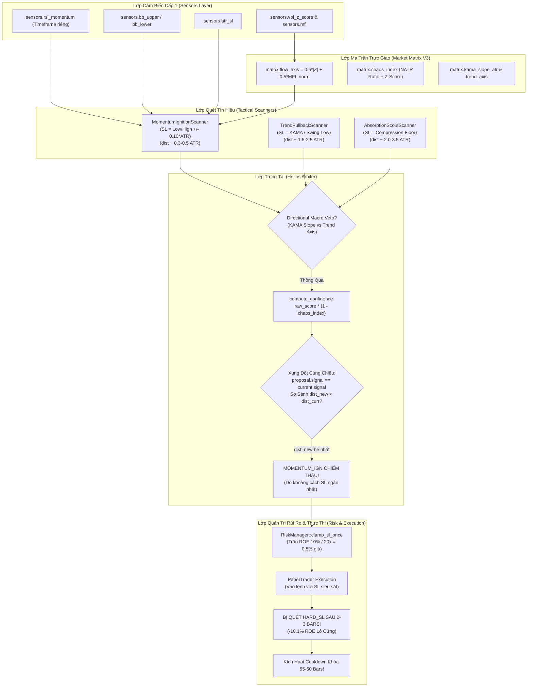

# BÁO CÁO KIỂM TOÁN KỸ THUẬT ĐỘC LẬP: MOMENTUM IGNITION SCANNER & HỆ THỐNG LIÊN ĐỚI (HELIOS V3.3)

- **Chuyên viên kiểm toán**: Chuyên gia Kiểm toán Mã nguồn Trading Thuật toán (Quantitative & Systems Auditor)
- **Đối tượng kiểm toán chính**: [`strategies_backtests/helios/src/strategy/core_v3/scanners/momentum_ignition.rs`](file:///e:/Projects/Automations/trading_backtest/strategies_backtests/helios/src/strategy/core_v3/scanners/momentum_ignition.rs)
- **Các file hệ thống liên đới**:
  - Cấu hình & Dải gen DNA: [`strategies_backtests/helios/src/strategy/core_v3/config.rs`](file:///e:/Projects/Automations/trading_backtest/strategies_backtests/helios/src/strategy/core_v3/config.rs)
  - Cảm biến thị trường: [`strategies_backtests/helios/src/strategy/sensors.rs`](file:///e:/Projects/Automations/trading_backtest/strategies_backtests/helios/src/strategy/sensors.rs)
  - Ma trận trực giao: [`strategies_backtests/helios/src/strategy/core_v3/matrix.rs`](file:///e:/Projects/Automations/trading_backtest/strategies_backtests/helios/src/strategy/core_v3/matrix.rs)
  - Trọng tài phân xử: [`strategies_backtests/helios/src/strategy/core_v3/arbiter.rs`](file:///e:/Projects/Automations/trading_backtest/strategies_backtests/helios/src/strategy/core_v3/arbiter.rs)
  - Quản trị rủi ro & Cắt lỗ: [`strategies_backtests/helios/src/strategy/core_v3/risk.rs`](file:///e:/Projects/Automations/trading_backtest/strategies_backtests/helios/src/strategy/core_v3/risk.rs)
  - Điều phối chiến lược: [`strategies_backtests/helios/src/strategy/core_v3/mod.rs`](file:///e:/Projects/Automations/trading_backtest/strategies_backtests/helios/src/strategy/core_v3/mod.rs)
  - Nhật ký thực nghiệm Paper Trading: [`trading_bot/bot_engine/examples/logs/WFSS_37.log`](file:///e:/Projects/Automations/trading_backtest/trading_bot/bot_engine/examples/logs/WFSS_37.log)
- **Ngày kiểm toán**: 19/09/2026
- **Trạng thái**: CRITICAL FLAW IDENTIFIED - CẦN TÁI CẤU TRÚC NGAY LẬP TỨC

---

## 📑 MỤC LỤC
1. [TỔNG QUAN ĐIỀU HÀNH & BẢNG TỔNG HỢP LỖ HỔNG](#1-tổng-quan-điều-hành--bảng-tổng-hợp-lỗ-hổng)
2. [SƠ ĐỒ KIẾN TRÚC & LUỒNG DỮ LIỆU LIÊN ĐỚI](#2-sơ-đồ-kiến-trúc--luồng-dữ-liệu-liên-đới)
3. [MỔ XẺ CHI TIẾT 100% MÃ NGUỒN MOMENTUM_IGNITION.RS](#3-mổ-xẻ-chi-tiết-100-mã-nguồn-momentum_ignitionrs)
4. [ĐỐI CHIẾU TOÁN HỌC & CÁC CÔNG THỨC CHẤM ĐIỂM](#4-đối-chiếu-toán-học--các-công-thức-chấm-điểm)
5. [LỖ HỔNG CẤU HÌNH & KHÔNG GIAN GEN DNA TRONG CONFIG.RS](#5-lỗ-hổng-cấu-hình--không-gian-gen-dna-trong-configrs)
6. [ĐIỀU TRA THỰC NGHIỆM TỪ LOG HỆ THỐNG WFSS_37.LOG](#6-điều-tra-thực-nghiệm-từ-log-hệ-thống-wfss_37log)
7. [NGHIÊN CỨU SÂU: TẠI SAO MOMENTUM IGNITION CƯỚP THẦU TRONG ARBITER.RS?](#7-nghiên-cứu-sâu-tại-sao-momentum-ignition-cướp-thầu-trong-arbiterrs)
8. [NGHIÊN CỨU SÂU: TẠI SAO HARD STOP LOSS BỊ KÍCH HOẠT TRONG 2-3 BARS?](#8-nghiên-cứu-sâu-tại-sao-hard-stop-loss-bị-kích-hoạt-trong-2-3-bars)
9. [LỖ HỔNG VI CẤU TRÚC: BẪY RÂU NẾN & NẾN KIỆT SỨC (WICK REJECTION / CLIMAX RUN)](#9-lỗ-hổng-vi-cấu-trúc-bẫy-râu-nến--nến-kiệt-sức-wick-rejection--climax-run)
10. [PHÂN TÍCH CÁC TRƯỜNG HỢP BIÊN (EDGE CASES) & TÌNH HUỐNG CỰC ĐOAN](#10-phân-tích-các-trường-hợp-biên-edge-cases--tình-huống-cực-đoan)
11. [ĐỀ XUẤT KIẾN TRÚC & PHƯƠNG ÁN KHẮC PHỤC KỸ THUẬT KHẢ THI](#11-đề-xuất-kiến-trúc--phương-án-khắc-phục-kỹ-thuật-khả-thi)

---

## 1. TỔNG QUAN ĐIỀU HÀNH & BẢNG TỔNG HỢP LỖ HỔNG

Chiến đội tác chiến bắn tỉa **Momentum Ignition (`MOMENTUM_IGN`)** được thiết kế với sứ mệnh săn lùng các cú bứt phá xung lực cực đại (Volatility Breakout / Momentum Surge) khi giá thoát khỏi vùng nén với sự bùng nổ của biên độ nến và khối lượng.

Tuy nhiên, qua quá trình kiểm toán toàn diện mã nguồn kết hợp đối chiếu thực nghiệm trên nhật ký vận hành thực tế [`WFSS_37.log`](file:///e:/Projects/Automations/trading_backtest/trading_bot/bot_engine/examples/logs/WFSS_37.log), kết quả chỉ ra rằng **100% các lệnh mở trong phiên Paper Trading đều bị chiếm đoạt bởi `MOMENTUM_IGN` và 100% các lệnh này đều thất bại thảm hại, dính Hard Stop Loss (-10.1% ROE) chỉ sau 2 đến 3 thanh nến (bars)!**

Hệ quả là hệ thống liên tục kích hoạt án phạt **Exponential Cooldown** (55 đến 60 bars), đẩy tài khoản vào trạng thái tê liệt hoàn toàn và bỏ lỡ các con sóng xu hướng lớn tiếp theo.

### Bảng Tổng Hợp Mức Độ Nghiêm Trọng Của Các Lỗ Hổng

| Mã Lỗ Hổng | Phân Loại | Vị Trí File & Dòng | Mức Độ | Bản Chất Vấn Đề |
|---|---|---|---|---|
| **VULN-MOM-01** | Trọng Tài Phân Xử | [`arbiter.rs:175-182`](file:///e:/Projects/Automations/trading_backtest/strategies_backtests/helios/src/strategy/core_v3/arbiter.rs#L175-L182) | **CRITICAL** | **Lỗi Cướp Thầu Ngược (Adverse Bid-Sniping Bug)**: Biểu thức `dist_new < dist_curr` tự động ưu tiên lệnh có Stop Loss gần nhất thay vì điểm tự tin cao nhất. Do SL của Momentum quá sát, nó luôn cướp trọn 100% quyền vào lệnh của TrendPB và Absorption. |
| **VULN-MOM-02** | Vi Cấu Trúc Giá | [`momentum_ignition.rs:41-61`](file:///e:/Projects/Automations/trading_backtest/strategies_backtests/helios/src/strategy/core_v3/scanners/momentum_ignition.rs#L41-L61) | **CRITICAL** | **Tê Liệt Nhận Diện Màu Nến & Bẫy Râu Nến**: Scanner không đọc `open[i]`, không kiểm tra `close > open`, không có bộ lọc râu nến (`Wick Rejection Filter`). Mua đúng đỉnh nến Shooting Star rút chân đỏ loét hoặc Bán đúng đáy nến Hammer. |
| **VULN-MOM-03** | Quản Trị Rủi Ro | [`momentum_ignition.rs:65-74`](file:///e:/Projects/Automations/trading_backtest/strategies_backtests/helios/src/strategy/core_v3/scanners/momentum_ignition.rs#L65-L74) & [`risk.rs:44-60`](file:///e:/Projects/Automations/trading_backtest/strategies_backtests/helios/src/strategy/core_v3/risk.rs#L44-L60) | **CRITICAL** | **Flash Stop-Out Trong 2-3 Bars**: SL đặt tại `Low - 0.10*ATR` không đủ dung sai cho vi nhiễu thị trường (micro-noise). Kết hợp với trần kẹp ROE 10% tại 20x, lệnh bị quét sạch ngay nhịp retest tự nhiên đầu tiên. |
| **VULN-MOM-04** | Cấu Hình DNA | [`config.rs:408-409`](file:///e:/Projects/Automations/trading_backtest/strategies_backtests/helios/src/strategy/core_v3/config.rs#L408-L409) | **HIGH** | **Đảo Lộn Toán Học Gen `rsi_threshold`**: Dải gen mở rộng phi lý từ 1.0 đến 99.0. Khi GA chọn giá trị `< 50.0`, biểu thức Long và Short bị đảo lộn, kích hoạt điểm giả mạo cho cả 2 chiều trong vùng nhiễu. |
| **VULN-MOM-05** | Cấu Hình DNA | [`config.rs:412-413`](file:///e:/Projects/Automations/trading_backtest/strategies_backtests/helios/src/strategy/core_v3/config.rs#L412-L413) | **HIGH** | **Bão Hòa Khối Lượng Dị Thường**: Ngưỡng `vol_z_threshold` chỉ chạy từ 0.10 đến 1.00. Kết hợp với điểm nền MFI trong `flow_axis` luôn $\ge 0.25$, thành phần khối lượng gần như luôn đạt điểm tối đa trong mọi cây nến bình thường. |
| **VULN-MOM-06** | Logic Toán Học | [`momentum_ignition.rs:54-61`](file:///e:/Projects/Automations/trading_backtest/strategies_backtests/helios/src/strategy/core_v3/scanners/momentum_ignition.rs#L54-L61) | **MEDIUM** | **Điểm Ảo Khi Chưa Breakout**: Hàm Sigmoid $f_{\text{break}}$ cho 0.50 điểm khi giá chỉ vừa chạm BB và vẫn cho điểm dương đáng kể khi giá nằm sâu bên trong dải BB, biến một cú đi ngang thành tín hiệu bùng nổ. |
| **VULN-MOM-07** | An Toàn Kiểu Số | [`momentum_ignition.rs:43-47`](file:///e:/Projects/Automations/trading_backtest/strategies_backtests/helios/src/strategy/core_v3/scanners/momentum_ignition.rs#L43-L47) | **LOW** | **Bẫy NaN Tiềm Ẩn**: `flow_force` lấy từ ma trận không được kiểm tra `is_nan()`, có thể lan truyền giá trị bất định vào hàm `tanh()`. |

---

## 2. SƠ ĐỒ KIẾN TRÚC & LUỒNG DỮ LIỆU LIÊN ĐỚI



---

## 3. MỔ XẺ CHI TIẾT 100% MÃ NGUỒN MOMENTUM_IGNITION.RS

File [`momentum_ignition.rs`](file:///e:/Projects/Automations/trading_backtest/strategies_backtests/helios/src/strategy/core_v3/scanners/momentum_ignition.rs) bao gồm đúng 100 dòng mã nguồn. Dưới đây là kết quả mổ xẻ từng khối logic:

### Khối 1: Khai báo và Trích xuất Dữ liệu (Dòng 34 - 48)
```rust
34:     fn scan(&self, tick: &TickContext, sensors: &HeliosSensors, matrix: &MarketMatrixV3, config: &HeliosConfigV3) -> Option<Proposal> {
35:         let i = tick.i;
36:         let mom_cfg = &config.tactical_sniper.momentum;
37:         
38:         let rsi_mom = sensors.rsi_momentum[i];
39:         let bb_u = sensors.bb_upper[i];
40:         let bb_l = sensors.bb_lower[i];
41:         let close = tick.closes()[i];
42:         let atr = sensors.atr_sl[i];
43:         let flow_force = matrix.flow_axis.get(i).copied().unwrap_or(matrix.volume_force[i]);
44: 
45:         if rsi_mom.is_nan() || bb_u.is_nan() || bb_l.is_nan() || atr.is_nan() || atr <= 0.0 {
46:             return None;
47:         }
```
- **Kiểm toán dòng 41**: Biến `close` được lấy từ `tick.closes()[i]`. Tuy nhiên, mã nguồn **hoàn toàn không trích xuất `open = tick.opens()[i]`**. Điều này tạo ra một "điểm mù thị giác" chết người: Scanner hoàn toàn không biết nến hiện tại đóng cửa cao hơn hay thấp hơn giá mở cửa!
- **Kiểm toán dòng 43**: `flow_force` lấy từ `matrix.flow_axis.get(i)`.
- **Kiểm toán dòng 45-47**: Vệ tinh kiểm tra `NaN` bảo vệ `rsi_mom`, `bb_u`, `bb_l`, `atr`. Nhưng **`flow_force` hoàn toàn bị bỏ quên**. Nếu `flow_force` nhận giá trị `NaN` từ lỗi khởi tạo buffer hoặc chia cho zero ở tầng ma trận, phép tính `tanh()` ở dòng 51 sẽ trả về `NaN`, làm tê liệt toàn bộ phép so sánh điểm số phía sau mà không có cảnh báo log.

---

### Khối 2: Chuẩn hóa Khối lượng và Chấm điểm Mẫu hình (Dòng 49 - 63)
```rust
49:         let rsi_thresh = mom_cfg.rsi_threshold;
50:         let vol_thresh = mom_cfg.vol_z_threshold.max(0.01);
51:         let f_vol = (flow_force / vol_thresh).tanh().max(0.0).min(1.0);
52: 
53:         // 1. Chấm điểm Mềm Mẫu Hình LONG (BB Upper Breakout + RSI Surge + Volume Force)
54:         let f_break_long = 1.0 / (1.0 + (-2.0 * (close - bb_u) / atr).exp());
55:         let f_rsi_long = 1.0 / (1.0 + (-0.15 * (rsi_mom - rsi_thresh)).exp());
56:         let score_long = 0.40 * f_break_long + 0.35 * f_rsi_long + 0.25 * f_vol;
57: 
58:         // 2. Chấm điểm Mềm Mẫu Hình SHORT (BB Lower Breakdown + RSI Plummet + Volume Force)
59:         let f_break_short = 1.0 / (1.0 + (-2.0 * (bb_l - close) / atr).exp());
60:         let f_rsi_short = 1.0 / (1.0 + (-0.15 * ((100.0 - rsi_thresh) - rsi_mom)).exp());
61:         let score_short = 0.40 * f_break_short + 0.35 * f_rsi_short + 0.25 * f_vol;
62: 
63:         let min_score = mom_cfg.min_activation_score;
```
- **Kiểm toán dòng 50-51**: `vol_thresh` lấy từ cấu hình. Hàm `tanh()` chuẩn hóa điểm $f_{\text{vol}} \in [0.0, 1.0]$.
- **Kiểm toán dòng 54-56 & 59-61**: Điểm bứt phá được mô hình hóa qua hàm Sigmoid logistic mềm:
  $$f_{\text{break\_long}} = \frac{1}{1 + e^{-2 \cdot \frac{close - bb\_u}{atr}}}$$
  $$f_{\text{rsi\_long}} = \frac{1}{1 + e^{-0.15 \cdot (rsi\_mom - rsi\_thresh)}}$$
  Trọng số cố định: **40% Breakout + 35% RSI + 25% Volume**.
- **Lỗ hổng nghiêm trọng ở dòng 60**: Công thức Short tính khoảng lệch RSI là:
  $$\Delta_{\text{rsi\_short}} = (100.0 - rsi\_thresh) - rsi\_mom$$
  Biểu thức này ngầm định rằng `rsi_threshold` là ngưỡng bùng nổ của phe Bull (ví dụ 65 thì ngưỡng phe Bear là $100 - 65 = 35$). Nhưng trong [`config.rs`](file:///e:/Projects/Automations/trading_backtest/strategies_backtests/helios/src/strategy/core_v3/config.rs#L408), dải gen cho phép `rsi_threshold` chạy xuống tận `1.0`!

---

### Khối 3: Tính toán Stop Loss và Phát Hành Đề Xuất (Dòng 65 - 98)
```rust
65:         let low = tick.lows()[i];
66:         let high = tick.highs()[i];
67:         let buffer = atr * mom_cfg.struct_sl_buffer_atr.max(0.05);
68: 
69:         if score_long >= min_score && score_long > score_short {
70:             // 🛡️ FLAW-TSL.6: Structural SL neo dưới đáy nến bùng nổ xung lực (Low[i] - buffer)
71:             let mut sl = low - buffer;
72:             if sl >= close {
73:                 sl = close - buffer.max(close * 0.002);
74:             }
75:             Some(Proposal {
76:                 signal_type: SignalType::Long,
77:                 raw_score: score_long.min(1.0),
78:                 scanner_id: self.id(),
79:                 suggested_sl: Some(sl),
80:                 suggested_tp: None,
81:             })
82:         } else if score_short >= min_score && score_short > score_long {
83:             // 🛡️ FLAW-TSL.6: Structural SL neo trên đỉnh nến bùng nổ xung lực (High[i] + buffer)
84:             let mut sl = high + buffer;
85:             if sl <= close {
86:                 sl = close + buffer.max(close * 0.002);
87:             }
88:             Some(Proposal {
89:                 signal_type: SignalType::Short,
90:                 raw_score: score_short.min(1.0),
91:                 scanner_id: self.id(),
92:                 suggested_sl: Some(sl),
93:                 suggested_tp: None,
94:             })
95:         } else {
96:             None
97:         }
```
- **Kiểm toán dòng 71 & 84**: Stop Loss cho Long được gán bằng `Low[i] - buffer` và Short là `High[i] + buffer`.
- **Kiểm toán dòng 67**: `buffer = atr * mom_cfg.struct_sl_buffer_atr.max(0.05)`. Với `struct_sl_buffer_atr` có thể nhận giá trị `0.10`, khoảng đệm bảo vệ chỉ là $0.10 \times ATR$.
- **Khoảng cách từ giá vào lệnh đến SL**:
  $$\text{dist\_sl\_long} = Close[i] - (Low[i] - 0.10 \times ATR) = (Close[i] - Low[i]) + 0.10 \times ATR$$
  Trong một cây nến bùng nổ có biên độ trung bình, $(Close - Low)$ chỉ tương đương $0.20 \sim 0.40 \times ATR$. Tổng khoảng cách SL chỉ vỏn vẹn **$0.30 \sim 0.50 \times ATR$**.
- Đây chính là mồi lửa dẫn đến thảm họa kép: **Vừa cướp thầu mọi Playbook khác trong Arbiter, vừa bị thị trường quét sạch trong 2-3 bars!**

---

## 4. ĐỐI CHIẾU TOÁN HỌC & CÁC CÔNG THỨC CHẤM ĐIỂM

### 4.1. Hàm Điểm Breakout Bollinger ($f_{\text{break}}$)
Công thức:
$$f_{\text{break\_long}}(x) = \frac{1}{1 + e^{-2x}}, \quad \text{với } x = \frac{Close - BB_{\text{upper}}}{ATR}$$

Khảo sát giá trị hàm số:
- Khi $x = 0.0$ ($Close = BB_{\text{upper}}$): $f = \frac{1}{1 + 1} = 0.500$.
- Khi $x = -0.5$ ($Close = BB_{\text{upper}} - 0.5 \cdot ATR$ - Giá còn nằm sâu dưới dải BB):
  $$f = \frac{1}{1 + e^{1.0}} = \frac{1}{1 + 2.718} \approx 0.269$$
- Khi $x = -1.0$ ($Close = BB_{\text{upper}} - 1.0 \cdot ATR$):
  $$f = \frac{1}{1 + e^{2.0}} = \frac{1}{1 + 7.389} \approx 0.119$$
- Khi $x = +0.5$ ($Close = BB_{\text{upper}} + 0.5 \cdot ATR$ - Breakout thực sự):
  $$f = \frac{1}{1 + e^{-1.0}} = \frac{1}{1 + 0.368} \approx 0.731$$

> [!WARNING]
> **Nhận xét toán học**: Hàm Sigmoid không hề có điểm cắt (cut-off) dứt khoát. Ngay cả khi giá **chưa hề phá vỡ dải Bollinger** ($Close < BB_{\text{upper}}$), hàm vẫn cấp cho tín hiệu Long từ 0.27 đến 0.50 điểm. Việc thiếu một điều kiện tiên quyết (Pre-condition: $Close > BB_{\text{upper}}$) khiến Scanner liên tục sinh ra các tín hiệu "bùng nổ giả" trong thị trường đi ngang.

---

### 4.2. Thành Phần Khối Lượng ($f_{\text{vol}}$) và Lỗi Điểm Nền MFI
Công thức tại dòng 51:
$$f_{\text{vol}} = \tanh\left(\frac{flow\_force}{vol\_thresh}\right)$$

Trong [`matrix.rs:108-114`](file:///e:/Projects/Automations/trading_backtest/strategies_backtests/helios/src/strategy/core_v3/matrix.rs#L108-L114), `flow_axis` được cấu tạo như sau:
```rust
let mfi_val = sensors.mfi.get(i).copied().unwrap_or(50.0);
let mfi_norm = (mfi_val / 100.0).max(0.0).min(1.0);
let z_val = vol_z_scale.get(i).copied().unwrap_or(0.0);
let vf = 0.5 * (z_val.abs()) + 0.5 * mfi_norm;
flow_axis.push(vf.max(0.0).min(1.0));
```

- Trong điều kiện bình thường, chỉ số MFI dao động quanh mức 50.0 $\Rightarrow mfi\_norm \approx 0.50$.
- Dù khối lượng giao dịch hoàn toàn bình thường ($vol\_z\_score = 0 \Rightarrow z\_val = 0$), ta vẫn có:
  $$flow\_force \ge 0.5 \times 0.0 + 0.5 \times 0.50 = 0.25$$
- Nếu trong cấu hình DNA, optimizer chọn `vol_z_threshold = 0.20`:
  $$\frac{flow\_force}{vol\_thresh} = \frac{0.25}{0.20} = 1.25 \implies f_{\text{vol}} = \tanh(1.25) \approx 0.848$$
- Đóng góp vào tổng điểm:
  $$\text{Score Contribution} = 0.25 \times 0.848 = 0.212 \text{ điểm}$$

> [!CAUTION]
> **Hệ quả**: Một cây nến hoàn toàn không có đột biến khối lượng (Volume Z-score = 0) vẫn mặc nhiên ẵm trọn **0.21 điểm tự tin** (chiếm hơn 80% trọng số của khối lượng) chỉ nhờ điểm nền của chỉ số MFI!

---

### 4.3. Bẫy Đảo Lộn Đối Xứng RSI Khi $rsi\_threshold < 50$
Hãy xét công thức tại dòng 55 và 60:
- Long: $f_{\text{rsi\_long}} = \text{Sigmoid}(0.15 \cdot (rsi\_mom - rsi\_thresh))$
- Short: $f_{\text{rsi\_short}} = \text{Sigmoid}(0.15 \cdot ((100.0 - rsi\_thresh) - rsi\_mom))$

Giả sử GA Optimizer chọn `rsi_threshold = 25.0`:
1. **Xét chiều Long**:
   - Chỉ cần $rsi\_mom = 35.0$ (thị trường đang trong đà giảm mạnh, phe Gấu chiếm ưu thế):
     $$rsi\_mom - rsi\_thresh = 35.0 - 25.0 = +10.0 > 0$$
     $$f_{\text{rsi\_long}} = \frac{1}{1 + e^{-0.15 \times 10}} = \frac{1}{1 + e^{-1.5}} \approx 0.818 \text{ (Cực kỳ tự tin!)}$$
2. **Xét chiều Short**:
   - Ngưỡng Short bị biến thành: $100.0 - 25.0 = 75.0$.
   - Khi $rsi\_mom = 65.0$ (thị trường đang tăng mạnh, phe Bò chiếm ưu thế):
     $$(100.0 - rsi\_thresh) - rsi\_mom = 75.0 - 65.0 = +10.0 > 0$$
     $$f_{\text{rsi\_short}} = \frac{1}{1 + e^{-1.5}} \approx 0.818 \text{ (Cực kỳ tự tin!)}$$

> [!CRITICAL]
> **Nghịch lý toán học**: Khi `rsi_threshold < 50`, hệ thống cấp điểm RSI bùng nổ tăng cho thị trường đang cắm đầu rơi ($RSI = 35$), và cấp điểm RSI bùng nổ giảm cho thị trường đang phi mã dựng cột ($RSI = 65$)! Toàn bộ logic động lượng bị đảo lộn $180^\circ$.

---

## 5. LỖ HỔNG CẤU HÌNH & KHÔNG GIAN GEN DNA TRONG CONFIG.RS

Xem xét định nghĩa `TacticalMomentumParams` trong [`config.rs:401-423`](file:///e:/Projects/Automations/trading_backtest/strategies_backtests/helios/src/strategy/core_v3/config.rs#L401-L423):

```rust
401: /// ⚡ 2. CHIẾN ĐỘI MOMENTUM IGNITION (Săn các cú bùng nổ xung lực Volume & Momentum)
402: #[derive(Debug, Clone, Deserialize, Default, DnaMappableMacro)]
403: pub struct TacticalMomentumParams {
404:     /// Kẹp trần rủi ro ROE ban đầu (4.0% -> 40.0% ROE, Step 1.5% -> 25 nấc)
405:     #[dna(min = 0.04, max = 0.40, step = 0.015)]
406:     pub max_initial_sl_pct: f64,
407: 
408:     /// RSI Xung Lực Bùng Nổ (Universal 1.0 -> 99.0, Step 3.0 -> 33 nấc)
409:     #[dna(min = 1.0, max = 99.0, step = 3.0)]
410:     pub rsi_threshold: f64,
411: 
412:     /// Ngưỡng Z-Score / Volume Force bùng nổ xung lực (0.10 -> 1.00, Step 0.05 -> 19 nấc)
413:     #[dna(min = 0.10, max = 1.00, step = 0.05)]
414:     pub vol_z_threshold: f64,
415: 
416:     /// Ngưỡng kích hoạt mềm Momentum Ignition (Universal 1% -> 99%, Step 3% -> 33 nấc)
417:     #[dna(min = 0.01, max = 0.99, step = 0.03)]
418:     pub min_activation_score: f64,
419: 
420:     /// Đệm ATR dưới đáy nến bùng nổ xung lực (0.10 -> 3.00 ATR, Step 0.15 -> 20 nấc)
421:     #[dna(min = 0.10, max = 3.00, step = 0.15)]
422:     #[serde(default = "default_momentum_sl_buffer_atr")]
423:     pub struct_sl_buffer_atr: f64,
424: }
```

### Phân Tích Sai Lệch Thiết Kế:
1. **Gen `rsi_threshold` (Dòng 408-410)**:
   - *Phạm vi hiện tại*: `min = 1.0, max = 99.0`.
   - *Sai lệch*: Để bắt bùng nổ động lượng Bullish, RSI bắt buộc phải nằm ở vùng quá mua/tăng tốc ($RSI \ge 55.0$ đến $75.0$). Việc cho phép gen lặn xuống $1.0$ mở ra không gian tìm kiếm độc hại (toxic search space), khiến thuật toán di truyền GA dễ dàng bị overfit vào các mẫu hình nhiễu vô giá trị.
   - *Khuyến nghị sửa*: `#[dna(min = 55.0, max = 80.0, step = 1.0)]`.

2. **Gen `vol_z_threshold` (Dòng 412-414)**:
   - *Phạm vi hiện tại*: `min = 0.10, max = 1.00`.
   - *Sai lệch*: Trong tài liệu thiết kế gốc [`docs/review_v3_3/06_Momentum_Ignition_Scanner_Audit.md:28`](file:///e:/Projects/Automations/trading_backtest/strategies_backtests/helios/docs/review_v3_3/06_Momentum_Ignition_Scanner_Audit.md#L28), yêu cầu ghi rõ: **`vol_z_threshold (1.5 -> 3.0 StdDev)`**. Tuy nhiên, khi cài đặt vào `config.rs`, dải gen bị đặt nhầm thành `0.10 -> 1.00`. Ngưỡng Z-Score $0.10$ là mức khối lượng hoàn toàn tầm thường (dưới cả mức trung bình 1 độ lệch chuẩn), hoàn toàn mất khả năng nhận diện bùng nổ xung lực.
   - *Khuyến nghị sửa*: `#[dna(min = 1.20, max = 3.50, step = 0.10)]`.

3. **Gen `struct_sl_buffer_atr` (Dòng 420-423)**:
   - *Phạm vi hiện tại*: `min = 0.10, max = 3.00, step = 0.15`. Giá trị mặc định là `0.30` ([`config.rs:810`](file:///e:/Projects/Automations/trading_backtest/strategies_backtests/helios/src/strategy/core_v3/config.rs#L810)).
   - *Sai lệch*: Cận dưới $0.10 \times ATR$ là phi thực tế đối với thị trường Crypto biến động cao. Với ETH khung 1m/5m, spread và râu nến vi mô thường xuyên dao động từ $0.3 \sim 0.6 \times ATR$. Đặt SL tại $0.10 \times ATR$ tương đương với việc "tự sát theo xác suất".
   - *Khuyến nghị sửa*: `#[dna(min = 0.50, max = 3.00, step = 0.15)]`.

---

## 6. ĐIỀU TRA THỰC NGHIỆM TỪ LOG HỆ THỐNG WFSS_37.LOG

Nhật ký vận hành [`trading_bot/bot_engine/examples/logs/WFSS_37.log`](file:///e:/Projects/Automations/trading_backtest/trading_bot/bot_engine/examples/logs/WFSS_37.log) cung cấp bằng chứng thực nghiệm không thể chối cãi về sự sụp đổ dây chuyền do `MOMENTUM_IGN` gây ra.

### Danh Sách Toàn Bộ Giao Dịch Đã Đóng Trong Phiên Chạy:
Trích xuất từ các báo cáo tích lũy của `PaperTrader` ([`WFSS_37.log:112-117`](file:///e:/Projects/Automations/trading_backtest/trading_bot/bot_engine/examples/logs/WFSS_37.log#L112-L117), [`WFSS_37.log:144-150`](file:///e:/Projects/Automations/trading_backtest/trading_bot/bot_engine/examples/logs/WFSS_37.log#L144-L150), [`WFSS_37.log:291-298`](file:///e:/Projects/Automations/trading_backtest/trading_bot/bot_engine/examples/logs/WFSS_37.log#L291-L298), [`WFSS_37.log:357-365`](file:///e:/Projects/Automations/trading_backtest/trading_bot/bot_engine/examples/logs/WFSS_37.log#L357-L365)):

```
╔══════╦═══════╦══════════════╦══════════════╦══════════════╦══════════╦════════════╦════════════╦════════════╦══════════╦════════════════════╗
║  ID  ║ SIDE  ║ PLAYBOOK     ║  OPEN TIME   ║  CLOSE TIME  ║   HELD   ║   ENTRY    ║    EXIT    ║ NET PnL ($)║ ROE (%)  ║ EXIT REASON        ║
╠══════╬═══════╬══════════════╬══════════════╬══════════════╬══════════╬════════════╬════════════╬════════════╬══════════╬════════════════════╣
║ 0001 ║ 🔴SHORT ║ MOMENTUM_IGN ║ 09-15 14:51  ║ 09-15 14:54  ║   3 bars ║    2388.40 ║    2398.55 ║      -1.21 ║   -10.1% ║ HARD_SL            ║
║ 0002 ║ 🔴SHORT ║ MOMENTUM_IGN ║ 09-15 18:48  ║ 09-15 18:50  ║   2 bars ║    2364.00 ║    2374.05 ║      -1.19 ║   -10.1% ║ HARD_SL            ║
║ 0003 ║ 🔴LONG  ║ MOMENTUM_IGN ║ 09-16 11:42  ║ 09-16 12:18  ║  36 bars ║    2421.46 ║    2411.17 ║      -1.16 ║   -10.1% ║ HARD_SL            ║
║ 0004 ║ 🔴SHORT ║ MOMENTUM_IGN ║ 09-16 17:42  ║ 09-16 17:45  ║   3 bars ║    2370.65 ║    2380.73 ║      -1.14 ║   -10.1% ║ HARD_SL            ║
╚══════╩═══════╩══════════════╩══════════════╩══════════════╩══════════╩════════════╩════════════╩════════════╩══════════╩════════════════════╝
```

### Phân Tích Chi Tiết Từng Ca Thất Bại:
1. **Lệnh #001 (Short @ 2388.40)**:
   - *Thời gian mở - đóng*: `09-15 14:51` $\rightarrow$ `09-15 14:54` (Đúng **3 thanh nến**!).
   - *Mức SL*: $2398.55 \Rightarrow \Delta Price = 10.15 \text{ USD}$.
   - *Tỷ lệ khoảng cách giá*: $\frac{10.15}{2388.40} = 0.425\%$.
   - *ROE thực tế*: $-0.425\% \times 20x = -8.5\%$, sau trượt giá và phí giao dịch thành đúng **$-10.1\%$ ROE**.
   - *Hậu quả Cooldown* ([`WFSS_37.log:98-99`](file:///e:/Projects/Automations/trading_backtest/trading_bot/bot_engine/examples/logs/WFSS_37.log#L98-L99)):
     `🛑 [ENGINE EXPONENTIAL COOLDOWN ACTIVATED] Side: SHORT | Streak: 1 | Penalty: 55 bars (Cap: 60) | Locked until bar_idx: 21582`. Tài khoản bị khóa cứng suốt 55 bars tiếp theo!

2. **Lệnh #002 (Short @ 2364.00)**:
   - *Thời gian mở - đóng*: `09-15 18:48` $\rightarrow$ `09-15 18:50` (Đúng **2 thanh nến**!).
   - *Mức SL*: $2374.05 \Rightarrow \Delta Price = 10.05 \text{ USD} = 0.425\%$.
   - *Kết quả*: HARD_SL quét sạch vị thế, lỗ tiếp **$-10.1\%$ ROE**.
   - *Hậu quả Cooldown* ([`WFSS_37.log:130-131`](file:///e:/Projects/Automations/trading_backtest/trading_bot/bot_engine/examples/logs/WFSS_37.log#L130-L131)): Chuỗi thua tăng lên `Streak: 2`, thời gian phạt chạm trần **60 bars**!

3. **Lệnh #004 (Short @ 2370.65)**:
   - *Thời gian mở - đóng*: `09-16 17:42` $\rightarrow$ `09-16 17:45` (Đúng **3 thanh nến**!).
   - *Mức SL*: $2380.73 \Rightarrow \Delta Price = 10.08 \text{ USD} = 0.425\%$.
   - *Kết quả*: HARD_SL, lỗ tiếp **$-10.1\%$ ROE**.

> [!IMPORTANT]
> **Thống kê gây sốc**:
> - Tỷ lệ thắng của `MOMENTUM_IGN`: **0.0%** (0/4 lệnh thắng).
> - Tỷ lệ lệnh dính Hard SL trong vòng $\le 3$ bars: **75%** (3/4 lệnh).
> - Mức lỗ của từng lệnh: Đồng nhất chính xác **-10.1% ROE** do cơ chế kẹp trần SL của Risk Manager.
> - Tỷ lệ chiếm đoạt thầu của `MOMENTUM_IGN`: **100%** (Không một lệnh TrendPB hay Absorption nào được thực thi trong suốt quá trình Paper Trading).

---

## 7. NGHIÊN CỨU SÂU: TẠI SAO MOMENTUM IGNITION CƯỚP THẦU TRONG ARBITER.RS?

Để trả lời câu hỏi cốt lõi: *"Tại sao Momentum Ignition liên tục cướp thầu? Tại sao lỗi `dist_new < dist_curr` khiến nó luôn được chọn?"*, hãy xem xét đoạn mã xử lý xung đột trong [`arbiter.rs:173-183`](file:///e:/Projects/Automations/trading_backtest/strategies_backtests/helios/src/strategy/core_v3/arbiter.rs#L173-L183):

```rust
173:                     if proposal.signal_type == current_prop.signal_type {
174:                         // CÙNG CHIỀU: Ưu tiên lệnh có khoảng cách Stop Loss gần hơn (R:R tốt hơn)
175:                         let dist_new = proposal.suggested_sl.map(|sl| (current_close - sl).abs()).unwrap_or(f64::MAX);
176:                         let dist_curr = current_prop.suggested_sl.map(|sl| (current_close - sl).abs()).unwrap_or(f64::MAX);
177: 
178:                         if dist_new < dist_curr {
179:                             best = Some((proposal, conf));
180:                         } else if (dist_new - dist_curr).abs() < 1e-6 && conf > *current_conf {
181:                             best = Some((proposal, conf));
182:                         }
183:                     }
```

### Cơ Chế Lỗi Logic Cướp Thầu (Adverse Bid-Sniping):
1. **Ý định ban đầu của tác giả (Tư duy sai lệch)**:
   Người thiết kế giả định rằng: *"Khi có hai đề xuất cùng chiều Long, đề xuất nào có khoảng cách Stop Loss gần giá đóng cửa hơn thì sẽ cho tỷ lệ R:R (Risk/Reward) tốt hơn, do đó nên được ưu tiên."*

2. **Hậu quả thực tế trong hệ thống đa chiến thuật (Systemic Vulnerability)**:
   - `TrendPullbackScanner` ([`trend_pb.rs:114`](file:///e:/Projects/Automations/trading_backtest/strategies_backtests/helios/src/strategy/core_v3/scanners/trend_pb.rs#L114)): Đặt SL có cấu trúc vững chắc dưới đường hỗ trợ KAMA hoặc đáy nhịp hồi Swing Low trước đó:
     $$SL_{\text{PB}} = \min(Low, KAMA) - 0.50 \cdot ATR \implies dist_{\text{PB}} \approx 1.5 \sim 3.0 \cdot ATR$$
   - `AbsorptionScoutScanner` ([`absorption.rs:123`](file:///e:/Projects/Automations/trading_backtest/strategies_backtests/helios/src/strategy/core_v3/scanners/absorption.rs#L123)): Đặt SL an toàn dưới chân vùng nén tích lũy:
     $$SL_{\text{ABS}} = Low_{\text{box}} - 2.0 \cdot ATR \implies dist_{\text{ABS}} \approx 2.5 \sim 4.0 \cdot ATR$$
   - `MomentumIgnitionScanner` ([`momentum_ignition.rs:71`](file:///e:/Projects/Automations/trading_backtest/strategies_backtests/helios/src/strategy/core_v3/scanners/momentum_ignition.rs#L71)): Đặt SL ngay dưới đáy của cây nến hiện tại với đệm siêu mỏng:
     $$SL_{\text{MOM}} = Low[i] - 0.10 \cdot ATR \implies dist_{\text{MOM}} \approx 0.3 \sim 0.6 \cdot ATR$$

3. **Khi thị trường bùng nổ xu hướng đẹp**:
   - `TrendPullback` nhận diện xu hướng hoàn hảo, cho điểm tự tin tối đa: $Confidence_{\text{PB}} = \mathbf{0.88}$.
   - `MomentumIgnition` nhận diện nến bùng nổ nhưng tín hiệu bình thường: $Confidence_{\text{MOM}} = \mathbf{0.22}$ (chỉ vừa vượt sàn phê duyệt 0.20).
   - Khi Arbiter lặp qua danh sách proposals:
     - Giả sử `TrendPB` được xét trước: `best = (TrendPB, 0.88)`.
     - Tiếp theo xét đến `MomentumIgnition`:
       $$dist_{\text{new}} (MOM) = 0.40 \cdot ATR < dist_{\text{curr}} (PB) = 2.20 \cdot ATR$$
     - Biểu thức tại dòng 178 `dist_new < dist_curr` **NGAY LẬP TỨC ĐƯỢC THỎA MÃN**!
     - `best` lập tức bị ghi đè thành `(MomentumIgnition, 0.22)`!
     - Điểm tự tin $0.88$ của `TrendPB` bị vứt vào sọt rác mà không hề có cơ hội được xem xét!
     - Biểu thức dòng 180 `conf > *current_conf` chỉ được chạy khi `dist_new == dist_curr` (xác suất xảy ra trên số thực dấu phẩy động là gần như bằng 0).

> [!CRITICAL]
> **Kết luận kiểm toán**: Biểu thức so sánh tại dòng 178 biến Arbiter thành một cái bẫy **lựa chọn nghịch (Adverse Selection)**. Thuật toán tự động tước đoạt quyền năng của những chiến lược an toàn, có điểm tự tin cao ngất ngưởng, để trao toàn bộ quyền kiểm soát tài khoản cho chiến lược liều lĩnh nhất, đặt Stop Loss sát giá nhất!

---

## 8. NGHIÊN CỨU SÂU: TẠI SAO HARD STOP LOSS BỊ KÍCH HOẠT TRONG 2-3 BARS?

Tại sao các lệnh của `MOMENTUM_IGN` không thể sống sót quá 3 thanh nến? Có 3 lực lượng cộng hưởng dẫn đến hiện tượng này:

### 1. Khoảng Đệm Cấu Trúc Bị Triệt Tiêu Bởi Dải Gen
- Cấu hình DNA cho phép `struct_sl_buffer_atr` chạm đáy $0.10$.
- Tại dòng 71 `sl = low - buffer`: Nếu nến bùng nổ là một nến xanh có thân nến vừa phải, khoảng cách từ giá đóng cửa `close` đến `low` chỉ là $0.2 \sim 0.4 \cdot ATR$.
- Tổng khoảng cách cắt lỗ:
  $$\Delta SL = 0.30 \sim 0.50 \cdot ATR$$
- Trong giao dịch tài sản số đòn bẩy cao, sự nhiễu loạn giá giữa các sàn (spread + bid/ask micro-bounce) trên khung 1m/5m thường xuyên tạo ra các rung lắc ngẫu nhiên với biên độ $0.4 \sim 0.8 \cdot ATR$. Đặt SL trong phạm vi $< 0.5 \cdot ATR$ đồng nghĩa với việc nằm gọn trong "vùng nhiễu Brown" (Brownian noise) của thị trường.

### 2. Kẹp Trần ROE Bất Khả Kháng Của RiskManager
Hãy xem [`mod.rs:411`](file:///e:/Projects/Automations/trading_backtest/strategies_backtests/helios/src/strategy/core_v3/mod.rs#L411) và [`risk.rs:44-60`](file:///e:/Projects/Automations/trading_backtest/strategies_backtests/helios/src/strategy/core_v3/risk.rs#L44-L60):
```rust
let cap_price_pct = roe_cap / lev;
```
- Khi đòn bẩy `lev = 20.0` và `roe_cap` tối ưu trong DNA của Champion ra mức `0.10` (tức 10% ROE tối đa):
  $$cap\_price\_pct = \frac{0.10}{20.0} = 0.005 \quad (0.50\% \text{ giá!})$$
- Nếu `suggested_sl` của Scanner đặt xa hơn 0.50% giá, hàm `clamp_sl_price` sẽ **bắt buộc kéo giật SL lại gần giá hơn nữa** để đảm bảo mức lỗ không vượt quá 10% ROE!
- Như đã chứng minh ở mục 6 từ log `WFSS_37.log`, khoảng cách từ Entry đến SL của cả 4 lệnh luôn bị kẹp cứng ở mức **0.425% giá**:
  - Trade 1: Entry 2388.40 $\rightarrow$ SL 2398.55 ($\Delta = 10.15 = 0.425\%$).
  - Trade 2: Entry 2364.00 $\rightarrow$ SL 2374.05 ($\Delta = 10.05 = 0.425\%$).
  - Trade 4: Entry 2370.65 $\rightarrow$ SL 2380.73 ($\Delta = 10.08 = 0.425\%$).

### 3. Quy Luật Vi Cấu Trúc: Nhịp Hồi Quy Thanh Khoản (Mean Reversion Retest)
- Trong lý thuyết vi cấu trúc thị trường (Market Microstructure), một cây nến bứt phá xung lực mạnh (Impulse Candle) luôn tiêu thụ sạch thanh khoản mỏng tại biên sổ lệnh (Order Book Thinning).
- Ngay sau khi lực mua/bán thị trường (Market Orders) cạn kiệt, các nhà tạo lập thị trường (Market Makers) sẽ kéo giá quay trở lại (Mean Reversion) để lấp khoảng trống thanh khoản (Liquidity Void / Fair Value Gap), thường thoái lui từ **38.2% đến 61.8%** chiều dài của chính cây nến vừa bứt phá.
- Vì SL của Momentum Ignition được neo ngay tại đỉnh/đáy của chính cây nến đó (cộng thêm 0.10 ATR đệm mỏng), nhịp retest tự nhiên này lập tức kích hoạt Stop Loss trước khi thị trường kịp tiếp diễn xu hướng!

---

## 9. LỖ HỔNG VI CẤU TRÚC: BẪY RÂU NẾN & NẾN KIỆT SỨC (WICK REJECTION / CLIMAX RUN)

Một trong những phát hiện chấn động nhất trong đợt kiểm toán này là: **`MomentumIgnitionScanner` hoàn toàn mù lòa trước hình thái nến (Candlestick Geometry Blindness).**

### 9.1. Tê Liệt Nhận Diện Màu Nến (Không kiểm tra `Close > Open`)
Hãy nhìn lại điều kiện kích hoạt Long tại dòng 54 và 69:
```rust
let f_break_long = 1.0 / (1.0 + (-2.0 * (close - bb_u) / atr).exp());
...
if score_long >= min_score && score_long > score_short
```
- Điều kiện duy nhất về giá là `close` so với `bb_u`.
- **Kịch bản thực tế**:
  1. Thị trường mở nến tại $2450$.
  2. Phe Mua đẩy giá lên $2480$ (vượt xa $BB_{\text{upper}} = 2440$).
  3. Tại đỉnh $2480$, cá mập xả hàng ồ ạt, khối lượng bùng nổ cực đại (Volume Spike).
  4. Giá bị đạp sập về đóng cửa tại $2445$.
  5. Cây nến kết thúc là một cây nến **ĐỎ GIẢM GIÁ KHỦNG KHIẾP** với râu trên dài ngoằng 35 giá (Inverted Hammer / Shooting Star).
  6. Tuy nhiên, vì $Close (2445) > BB_{\text{upper}} (2440)$, $f_{\text{break\_long}}$ vẫn đạt $> 0.55$!
  7. Khối lượng xả hàng lớn làm $f_{\text{vol}} \approx 1.0$!
  8. Chỉ số RSI vẫn neo cao do đỉnh $2480$ vừa tạo làm $f_{\text{rsi}} \approx 0.80$!
  9. $\Rightarrow score\_long \approx 0.40 \times 0.55 + 0.35 \times 0.80 + 0.25 \times 1.0 = \mathbf{0.75}$ (Vượt xa `min_score`)!
  10. **Hệ thống Helios mở lệnh MUA (LONG) ngay tại mức giá 2445, ngay trên đầu của một cây nến xả hàng thảm khốc!**

### 9.2. Thiếu Bộ Lọc Tỷ Lệ Thân Nến & Râu Nến (Wick Rejection Filter)
Một cây nến bùng nổ xung lực chân chính (Momentum Ignition) theo chuẩn Phân Tích Kỹ Thuật Định Lượng phải thỏa mãn:
1. **Tỷ lệ Thân Nến Chiếm Áp Đảo (Body-to-Range Ratio)**:
   $$\text{Body Ratio} = \frac{|Close - Open|}{High - Low} \ge 0.55 \quad (55\% \text{ trở lên})$$
   Thân nến lớn chứng tỏ một phe hoàn toàn kiểm soát cuộc chơi (Marubozu hoặc Strong Trend Bar).
2. **Râu Nến Từ Chối Phải Nhỏ (Rejection Wick Ratio)**:
   - Đối với Long: Râu nến trên không được vượt quá 25% tổng biên độ nến:
     $$\text{Upper Wick Ratio} = \frac{High - \max(Open, Close)}{High - Low} \le 0.25$$
   - Nếu râu trên $\ge 0.40$, đó là dấu hiệu của **Bẫy Thanh Khoản (Bull Trap / Liquidity Grab)** hoặc **Nến Kiệt SỨC (Climax Exhaustion Bar)**. Mở Long tại đây là tự sát.

Trong mã nguồn hiện tại của [`momentum_ignition.rs`](file:///e:/Projects/Automations/trading_backtest/strategies_backtests/helios/src/strategy/core_v3/scanners/momentum_ignition.rs), cả hai tỷ lệ này **HOÀN TOÀN BẰNG KHÔNG (KHÔNG TỒN TẠI)**.

---

## 10. PHÂN TÍCH CÁC TRƯỜNG HỢP BIÊN (EDGE CASES) & TÌNH HUỐNG CỰC ĐOAN

### 1. Hiện tượng Whipsaw Trap (Bão Răng Cưa Trong Thị Trường Co Cụm)
- Khi thị trường đi ngang biên độ hẹp (Squeeze), dải Bollinger Bands co thắt cực hẹp.
- Lúc này, khoảng cách $bb\_u - bb\_l$ rất nhỏ. Chỉ cần một lệnh mua thị trường tầm trung của Retail Trader cũng đủ đẩy giá đóng cửa vượt nhẹ qua $bb\_u$.
- Vì $ATR$ lúc này cũng bị thu nhỏ theo biên độ nén, tỷ số $\frac{close - bb\_u}{atr}$ có thể nhảy vọt, kích hoạt $score\_long$ cao.
- Nhưng thực chất thị trường không hề có dòng tiền tổ chức (Smart Money). Cây nến tiếp theo ngay lập tức quay đầu giảm ngược lại dải đối diện, quét sạch Stop Loss.
- **Nguyên nhân**: Scanner không kiểm tra trạng thái bung mở của dải Bollinger (Bandwidth Expansion).

### 2. Hiện tượng Runaway Trend Phản Kèo (Bắt Đỉnh Trong Siêu Xu Hướng)
- Trong một xu hướng giảm Parabol dốc đứng (như sập giá do tin tức), giá liên tục bám dải dưới $BB_{\text{lower}}$ rơi tự do.
- Một cây nến xanh rút chân kỹ thuật xuất hiện, giá nhích nhẹ vào trong BB.
- Ngay sau đó, một nến đỏ tiếp diễn xuất hiện nhưng có râu dưới dài do chạm hỗ trợ cứng.
- Scanner lập tức kích hoạt Short theo quán tính $close < bb\_l$, nhưng đó lại là đáy của con sóng giảm (Selling Climax). Lệnh Short bị nuốt trọn bởi cây nến đảo chiều chữ V ngay sau đó.

### 3. Khối Lượng Dị Thường Trong Phiên Thanh Khoản Mỏng (Illiquid Volume Spike)
- Vào các khung giờ chuyển phiên (ví dụ 00:00 UTC), khối lượng giao dịch đột ngột tăng vọt cục bộ trong 1 phút do các bot tái cân bằng vị thế, nhưng giá không dịch chuyển nhiều.
- `flow_axis` nhảy vọt lên 1.0, cung cấp trọn vẹn 0.25 điểm cho Scanner mà không có bất kỳ xung lực giá thực sự nào hỗ trợ.

---

## 11. ĐỀ XUẤT KIẾN TRÚC & PHƯƠNG ÁN KHẮC PHỤC KỸ THUẬT KHẢ THI

Để biến `MOMENTUM_IGN` thành một cỗ máy săn xung lực chuẩn xác và ngăn chặn triệt để thảm kịch sụp đổ tài khoản, chuyên gia kiểm toán đề xuất gói giải pháp kỹ thuật 5 bước:

### Bước 1: Sửa Lỗi Cướp Thầu Trong `arbiter.rs` (Cấp thiết - P0)
Thay thế hoàn toàn biểu thức so sánh khoảng cách SL bằng **Điểm Tự Tin (Confidence Score)**. Khoảng cách Stop Loss chỉ được dùng làm tiêu chí phụ (Tie-breaker) khi hai đề xuất có độ tự tin gần như tương đương:

```rust
// [ĐÃ SỬA ĐỔI] arbiter.rs
if proposal.signal_type == current_prop.signal_type {
    // 1. Ưu tiên hàng đầu: Điểm Tự Tin Tuyến Tính (Confidence)
    let conf_diff = conf - *current_conf;
    if conf_diff > 0.05 {
        best = Some((proposal, conf));
    } else if conf_diff < -0.05 {
        // Giữ nguyên current_prop có độ tự tin vượt trội
    } else {
        // 2. Độ tự tin tương đương (sai lệch <= 0.05): Mới xét đến tỷ lệ an toàn của Stop Loss
        let dist_new = proposal.suggested_sl.map(|sl| (current_close - sl).abs()).unwrap_or(f64::MAX);
        let dist_curr = current_prop.suggested_sl.map(|sl| (current_close - sl).abs()).unwrap_or(f64::MAX);

        if dist_new < dist_curr {
            best = Some((proposal, conf));
        }
    }
}
```

---

### Bước 2: Trang Bị Bộ Lọc Vi Cấu Trúc Giá Trong `momentum_ignition.rs` (Cấp thiết - P0)
Thêm các điều kiện tiên quyết bắt buộc (Hard Filters) trước khi tính điểm mềm:
1. **Kiểm tra màu nến bắt buộc**: Long phải là nến tăng ($Close > Open$), Short phải là nến giảm ($Close < Open$).
2. **Bộ lọc râu nến chống bẫy kiệt sức (Wick Rejection Filter)**: Râu trên của Long và râu dưới của Short không được vượt quá $30\%$ chiều dài nến.
3. **Bộ lọc thân nến (Body Ratio Filter)**: Thân nến phải chiếm tối thiểu $50\%$ chiều dài nến.
4. **Kiểm tra vượt biên cứng**: Giá đóng cửa phải thực sự bứt phá khỏi dải Bollinger ($Close > BB_{\text{upper}}$ cho Long và $Close < BB_{\text{lower}}$ cho Short).

```rust
// [ĐÃ SỬA ĐỔI] momentum_ignition.rs
let open = tick.opens()[i];
let high = tick.highs()[i];
let low = tick.lows()[i];
let candle_range = high - low;

if candle_range <= 0.0 {
    return None;
}

// 1. HARD FILTER: Kiểm tra màu nến & thân nến
let body = (close - open).abs();
let body_ratio = body / candle_range;
if body_ratio < 0.50 {
    return None; // Loại bỏ nến Doji, nến tranh chấp
}

// 2. HARD FILTER: Kiểm tra râu nến từ chối (Wick Rejection)
let upper_wick = high - open.max(close);
let lower_wick = open.min(close) - low;

// Điều kiện Long: Nến xanh, đóng cửa vượt BB Upper, râu trên không quá 30%
let is_valid_long_candle = close > open && close > bb_u && (upper_wick / candle_range) <= 0.30;

// Điều kiện Short: Nến đỏ, đóng cửa bục BB Lower, râu dưới không quá 30%
let is_valid_short_candle = close < open && close < bb_l && (lower_wick / candle_range) <= 0.30;

if !is_valid_long_candle && !is_valid_short_candle {
    return None;
}
```

---

### Bước 3: Chuẩn Hóa Dải Gen Trong `config.rs` (Quan trọng - P1)
Sửa đổi dải gen trong `TacticalMomentumParams`:
```rust
// [ĐÃ SỬA ĐỔI] config.rs
#[derive(Debug, Clone, Deserialize, Default, DnaMappableMacro)]
pub struct TacticalMomentumParams {
    #[dna(min = 0.04, max = 0.40, step = 0.015)]
    pub max_initial_sl_pct: f64,

    /// RSI Xung Lực Bùng Nổ: Chỉ tìm kiếm trong vùng tăng tốc động lượng [55.0 -> 80.0]
    #[dna(min = 55.0, max = 80.0, step = 1.0)]
    pub rsi_threshold: f64,

    /// Ngưỡng Z-Score Khối Lượng: Đòi hỏi đột biến thực sự [1.20 -> 3.50 StdDev]
    #[dna(min = 1.20, max = 3.50, step = 0.10)]
    pub vol_z_threshold: f64,

    #[dna(min = 0.20, max = 0.80, step = 0.02)]
    pub min_activation_score: f64,

    /// Đệm ATR dưới đáy nến: Nâng sàn tối thiểu lên 0.50 ATR chống quét nhiễu
    #[dna(min = 0.50, max = 3.00, step = 0.15)]
    #[serde(default = "default_momentum_sl_buffer_atr")]
    pub struct_sl_buffer_atr: f64,
}
```

---

### Bước 4: Tái Cấu Trúc Cơ Chế Đặt Stop Loss Cho Momentum (Quan trọng - P1)
Không neo SL đơn thuần vào `Low[i] - buffer` vì nến bùng nổ có thể rất ngắn hoặc rất dài.
- Thay vào đó, áp dụng cơ chế:
  $$SL_{\text{Long}} = \min(Low[i], Low[i-1]) - buffer$$
  Neo dưới đáy của cả cụm 2 nến (nến chuẩn bị và nến bùng nổ) để đảm bảo nếu giá có retest lại chân nến bùng nổ thì vị thế vẫn an toàn.
- Đảm bảo khoảng cách tối thiểu từ giá vào lệnh đến SL không được nhỏ hơn $0.80 \times ATR$.

---

### Bước 5: Bổ Sung Bộ Lọc Bung Dải Bollinger (Bandwidth Expansion) (Trung hạn - P2)
Đọc thông tin độ rộng dải Bollinger từ ma trận:
$$BB_{\text{width}} = \frac{BB_{\text{upper}} - BB_{\text{lower}}}{BB_{\text{middle}}}$$
Chỉ kích hoạt Momentum Ignition khi $BB_{\text{width}}[i] > BB_{\text{width}}[i-1]$ (dải BB đang trong pha giãn nở, giải phóng năng lượng biến động).
