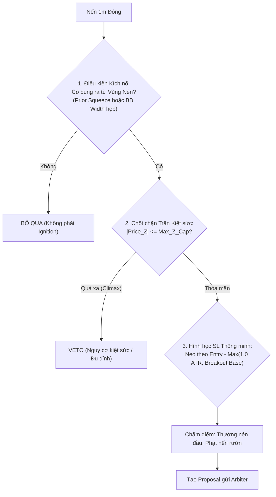

# MỔ XẺ CHUYÊN SÂU MOMENTUM IGNITION SCANNER (MOMENTUM_IGN)

> **Ngày thực hiện:** 04/10/2026  
> **Phạm vi kiểm toán:** `scanners/momentum_ignition.rs`, `core_v3/config.rs:480-522`, `core_v3/normalization.rs`.  
> **Dữ liệu thực tế:** Run 1 (−39.3% ROE, n=10, 3 thắng) & Run 2 (−38.2% ROE, n=18, 7 thắng).

---

## 1. BẢN CHẤT VẬT LÝ THỊ TRƯỜNG VS HIỆN TRẠNG MÃ NGUỒN

| Tiêu chí | Bản chất vật lý thị trường | Code hiện tại (`momentum_ignition.rs`) | Đánh giá First-Principles |
| :--- | :--- | :--- | :--- |
| **Bối cảnh xuất phát** | Phải bung ra từ vùng nén biến động tích lũy (Volatility Squeeze / Compression). | **Không hề kiểm tra `squeeze_intensity`** hay trạng thái dải nén trước đó. Chỉ kiểm tra `close > bb_upper`. | ❌ **Sai lệch tiền đề:** Đuổi theo cả con sóng đã chạy dài 10–20 nến. |
| **Hàm chấm điểm** | Điểm số phải cao ở nến bứt phá đầu tiên, và **giảm dần khi giá đã giãn nở quá mức**. | Dùng `sat_unbounded(vol_z)` và `sat_penetration(dist)`: **Giá càng vọt xa, volume càng to thì điểm càng tiệm cận 1.0**. | ❌ **Bẫy Mua Đỉnh (Climax Trap):** Chấm điểm cao nhất (0.95–0.99) cho nến kiệt sức / thanh lý dây chuyền. |
| **Trần quá độ (Exhaustion)** | Biên độ giãn cách giá (|Price_Z|) phải có ngưỡng giới hạn. | **Hoàn toàn không có trần `Price_Z`** hay khoảng cách tối đa tới KAMA. | ❌ Không có phanh hãm khi thị trường rơi vào trạng thái Parabolic. |
| **Hình học Stop Loss** | Cắt lỗ ngắn dưới điểm kích hoạt (Breakout Point / Hộp tích lũy). | `sl = low - buffer` (với Long). Nến bung càng dài thì SL càng sâu. | 🟡 Bị phạt vô lý: Nến bung đẹp nhất thì SL quá trần ROE -> Sniper Guard VETO. |
| **Tính tương thích Asset** | Crypto có volume thật, Forex spot chỉ có tick volume. | Phụ thuộc 30% trọng số vào `vol_z_score`. | 🟡 Cần cơ chế tự thích ứng nếu volume thiếu tin cậy. |

---

## 2. BẢNG ĐỐI CHẤT ƯU - KHUYẾT - EDGE CASES

| Thành phần | Ưu điểm | Khuyết điểm | Edge Cases nguy hiểm |
| :--- | :--- | :--- | :--- |
| **Điều kiện `close > bb_upper`** | Đơn giản, bắt được mọi pha vượt ngưỡng biến động. | Không phân biệt được "nến bung đầu tiên" với "cây nến thứ 10 của đà tăng". | Khi BBands co thắt cực hẹp trong bão nhiễu, nến 1m bình thường cũng vọt qua dải sinh tín hiệu giả liên tục. |
| **Điểm `sat_unbounded` & `sat_penetration`** | Không bị bão hòa sớm ở các cú breakout vừa phải. | Đơn điệu tăng vô tận. Nến Climax Pump có điểm raw lên tới `0.98 - 0.99`. | Cú quét thanh lý (Liquidation Cascade): Nến giật ngược ngay lập tức sau cú pump volume khủng, dính SL trọn biên độ. |
| **Bộ lọc CLV & Nến** (`clv >= min_clv && close > open`) | Lọc bỏ rất tốt nến Pinbar, Shooting Star rút chân ngược chiều. | Nếu nến Marubozu tăng mạnh đóng sát đỉnh, CLV đạt 1.0 -> hệ thống tưởng là cực tốt nhưng thực chất là cạn kiệt lực mua. | Nến tin tức giật 2 đầu: Nến đóng xanh sát trần nhưng giây tiếp theo sập không thanh khoản. |
| **Hình học SL** (`low - buffer`) | Bám vào cấu trúc nến hiện tại. | Phụ thuộc hoàn toàn vào biên độ nến kích nổ. Nến to -> SL xa -> vi phạm trần ROE Sniper Guard. | Nến kích nổ có râu dưới dài bất thường khiến SL bị đẩy xa vô lý, ngốn 15% ROE rủi ro. |

---

## 3. CÁC PHƯƠNG ÁN ĐỀ XUẤT CẢI TIẾN

- **Phương án 1 (Gốc rễ - Đúng bản chất Ignition):**
  - Bắt buộc kiểm tra nến trước đó có trạng thái nén: `matrix.squeeze_intensity[i-1] >= threshold` hoặc dải BB Width hẹp.
  - Bổ sung trần `Price_Z <= max_boundary_z` (ví dụ 2.5 - 3.0) để loại bỏ cú mua đỉnh kiệt sức.
- **Phương án 2 (Cải tổ Hình học Stop Loss):**
  - Không lấy toàn bộ chiều dài nến `low - buffer` khi nến quá lớn.
  - Giới hạn đệm SL tối đa: `sl = close - min(close - low + buffer, max_sl_atr * atr)`.
