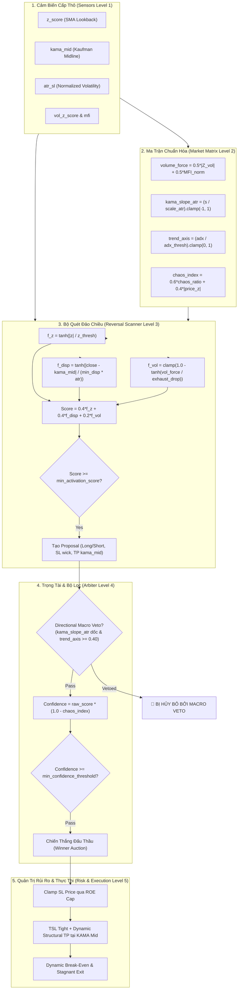
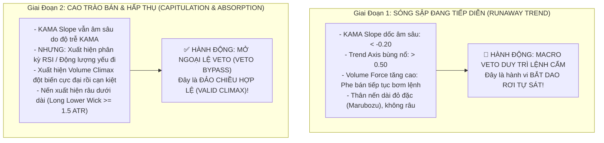

# 🔬 BÁO CÁO KIỂM TOÁN KỸ THUẬT CHUYÊN SÂU: CLIMAX REVERSAL SCANNER (`reversal.rs`)
> **Phân hệ:** Tactical Sniper Core V3.3 — Helios Trading System  
> **Tác giả:** Quantitative & Systems Auditor  
> **Trạng thái:** Báo cáo Kiểm toán Kỹ thuật Độc lập Cấp cao (Deep Audit Report)  
> **Ngôn ngữ:** Rust (Ferro-Trade Engine Ecosystem)  
> **Mã nguồn mục tiêu:** [`strategies_backtests/helios/src/strategy/core_v3/scanners/reversal.rs`](file:///e:/Projects/Automations/trading_backtest/strategies_backtests/helios/src/strategy/core_v3/scanners/reversal.rs)  
> **Các mô-đun liên đới:** [`config.rs`](file:///e:/Projects/Automations/trading_backtest/strategies_backtests/helios/src/strategy/core_v3/config.rs), [`sensors.rs`](file:///e:/Projects/Automations/trading_backtest/strategies_backtests/helios/src/strategy/sensors.rs), [`matrix.rs`](file:///e:/Projects/Automations/trading_backtest/strategies_backtests/helios/src/strategy/core_v3/matrix.rs), [`arbiter.rs`](file:///e:/Projects/Automations/trading_backtest/strategies_backtests/helios/src/strategy/core_v3/arbiter.rs), [`risk.rs`](file:///e:/Projects/Automations/trading_backtest/strategies_backtests/helios/src/strategy/core_v3/risk.rs).

---

## 📑 MỤC LỤC TỔNG QUAN

1. [TỔNG QUAN KIẾN TRÚC & MỤC ĐÍCH CHIẾN THUẬT](#1-tổng-quan-kiến-trúc--mục-đích-chiến-thuật)
2. [GIẢI PHẪU CHI TIẾT TỪNG DÒNG CODE `reversal.rs`](#2-giải-phẫu-chi-tiết-từng-dòng-code-reversalrs)
3. [ĐỐI CHIẾU MỐI LIÊN KẾT LIÊN PHÂN HỆ (CROSS-MODULE COUPLING)](#3-đối-chiếu-mối-liên-kết-liên-phân-hệ-cross-module-coupling)
4. [NGHIÊN CỨU NGHỊCH LÝ ARBITER VETO TRONG `WFSS_37.LOG` (L.25806-25840)](#4-nghiên-cứu-nghịch-lý-arbiter-veto-trong-wfss_37log-l25806-25840)
5. [LỖ HỔNG THIẾU NẾN XÁC NHẬN & BẪY BẮT DAO RƠI](#5-lỗ-hổng-thiếu-nến-xác-nhận--bẫy-bắt-dao-rơi)
6. [DANH MỤC LỖ HỔNG TOÁN HỌC, EDGE CASES & NGUY CƠ HỆ THỐNG](#6-danh-mục-lỗ-hổng-toán-học-edge-cases--nguy-cơ-hệ-thống)
7. [BẢN THIẾT KẾ ĐỀ XUẤT CẢI TIẾN KỸ THUẬT (RE-ENGINEERING BLUEPRINT)](#7-bản-thiết-kế-đề-xuất-cải-tiến-kỹ-thuật-re-engineering-blueprint)

---

## 1. TỔNG QUAN KIẾN TRÚC & MỤC ĐÍCH CHIẾN THUẬT

### 1.1. Triết Lý Thiết Kế
Trong kiến trúc đa chiến thuật (Multi-Tactical Architecture) của Helios V3.3, `ReversalScanner` (định danh `ScannerId::ClimaxReversal`) giữ vai trò của một **chiến đội săn lùng các điểm gãy xung lực cực đoan (Exhaustion Climax Hunter)**:
- **Nguyên lý thị trường:** Sau các đợt tăng tốc phi mã (Blow-off Top / Climax Run) hoặc các đợt bán tháo hoảng loạn tột độ (Capitulation Dump), biên độ dao động của giá bị kéo căng vượt xa dải cân bằng thống kê dài hạn. Khi nguồn cung/cầu cạn kiệt và động lượng suy yếu, giá có xu hướng hồi quy mạnh mẽ về trục trung vị cân bằng động (Dynamic Equilibrium - đại diện bởi Kaufman Adaptive Moving Average Midline, viết tắt là `kama_mid`).
- **Phân định ranh giới chiến thuật với các Playbook khác:**
  - `Reversal` khác biệt với `TrendPB`: `TrendPB` đánh *thuận theo xu hướng lớn* khi giá hồi nhẹ về hỗ trợ; `Reversal` đánh *ngược sóng xung lực vừa diễn ra* khi nhận định sóng đó đã chạm tới giới hạn vật lý cực đại.
  - `Reversal` khác biệt với `RangeOsc`: `RangeOsc` hoạt động khi thị trường đi ngang có biên độ rõ ràng giữa 2 dải Bollinger Bands; `Reversal` được kích hoạt sau những cú bứt phá biên độ đơn hướng cực mạnh.
  - `Reversal` khác biệt với `Anomaly`: `Anomaly` săn các râu nến quét thanh khoản đột biến (Pinbar Rejection Fade) mà hoàn toàn mù về xu hướng hay khối lượng; trong khi `Reversal` đòi hỏi sự xác nhận của cả độ lệch chuẩn giá ($Z$-score), khoảng cách ly giác KAMA và sự suy kiệt khối lượng giao dịch.

### 1.2. Luồng Dữ Liệu Toàn Hệ Thống (End-to-End Pipeline)



---

## 2. GIẢI PHẪU CHI TIẾT TỪNG DÒNG CODE `reversal.rs`

Mã nguồn tại [`reversal.rs`](file:///e:/Projects/Automations/trading_backtest/strategies_backtests/helios/src/strategy/core_v3/scanners/reversal.rs) gồm 93 dòng code. Dưới đây là phân tích chi tiết từng khối logic:

### 2.1. Khối Khởi Tạo & Thu Thập Chỉ Báo (L.33 - L.45)
```rust
33: fn scan(&self, tick: &TickContext, sensors: &HeliosSensors, matrix: &MarketMatrixV3, config: &HeliosConfigV3) -> Option<Proposal> {
34:     let i = tick.i;
35:     let rev_cfg = &config.tactical_sniper.reversal;
36:     
37:     let z_score = sensors.z_score[i];
38:     let kama_mid = sensors.kama_mid[i];
39:     let current_atr = sensors.atr_sl[i];
40:     let close_price = tick.closes()[i];
41:     let vol_force = matrix.volume_force[i];
42: 
43:     if z_score.is_nan() || kama_mid.is_nan() || current_atr.is_nan() || current_atr <= 0.0 {
44:         return None;
45:     }
```
- **Phân tích:**
  - `tick.i` là chỉ số nến hiện tại đang xử lý trong vòng lặp backtest hoặc live stream.
  - Lấy tham chiếu đến cấu hình độc lập `rev_cfg` thuộc kiểu `TacticalReversalParams`.
  - Thu thập 5 biến trạng thái: `z_score`, `kama_mid`, `current_atr`, `close_price`, `vol_force`.
- **Lỗ hổng & Điểm yếu:**
  - **L.41 & L.43 (Thiếu kiểm tra NaN cho `vol_force`):** `vol_force` lấy từ `matrix.volume_force[i]`. Mặc dù `current_atr`, `z_score`, `kama_mid` được kiểm tra `is_nan()`, `vol_force` lại bị bỏ sót! Nếu `sensors.mfi` hoặc `sensors.vol_z_score` chứa `NaN` trong giai đoạn warmup hoặc do lỗi dữ liệu tick, `vol_force` có thể trở thành `NaN`. Khi đó toán tử tính `f_vol` sẽ tạo ra `NaN`, kéo theo `score` bị `NaN`.

### 2.2. Khối Rào Chắn Tham Số DNA (L.47 - L.50)
```rust
47:     let z_thresh = rev_cfg.z_score_threshold.max(0.1);
48:     let min_disp = rev_cfg.min_reversal_displacement.max(0.1);
49:     let exhaust_drop = rev_cfg.exhaustion_vol_drop.max(0.01);
```
- **Phân tích:**
  - Thuật toán áp dụng kỹ thuật **Defensive Parameter Clamping**: Dùng `.max()` để ngăn chặn lỗi chia cho 0 (`division by zero`) trong trường hợp DNA từ thuật toán di truyền gán giá trị bằng 0 hoặc âm.
  - `z_thresh` có ngưỡng sàn là $0.1$.
  - `min_disp` có ngưỡng sàn là $0.1$.
  - `exhaust_drop` có ngưỡng sàn là $0.01$.

### 2.3. Khối Chấm Điểm Mềm 3 Thành Phần (L.51 - L.62)
```rust
51:     // 1. Chấm điểm Mềm 3 Thành Phần (Z-Score + KAMA Displacement + Volume Exhaustion)
52:     let f_z = (z_score.abs() / z_thresh).tanh();
53:     let displacement = (close_price - kama_mid).abs();
54:     let f_disp = (displacement / (min_disp * current_atr)).tanh();
55:     let f_vol = (1.0 - (vol_force / exhaust_drop).tanh()).max(0.0).min(1.0);
56: 
57:     let score = 0.40 * f_z + 0.40 * f_disp + 0.20 * f_vol;
58:     let min_score = rev_cfg.min_activation_score;
59: 
60:     if score < min_score {
61:         return None;
62:     }
```
- **Phân tích hàm toán học:**
  - **Thành phần 1: Độ lệch chuẩn giá ($f_z$)**
    $$f_z = \tanh\left(\frac{|Z|}{Z_{\text{thresh}}}\right)$$
    Hàm $\tanh(x)$ chuẩn hóa miền giá trị về $[0.0, 1.0)$. Khi $|Z| = Z_{\text{thresh}}$, $f_z = \tanh(1.0) \approx 0.7616$. Khi $|Z| = 2 \times Z_{\text{thresh}}$, $f_z \approx 0.9640$. Tỷ trọng đóng góp là $40\%$.
  - **Thành phần 2: Độ ly giác KAMA Midline ($f_{\text{disp}}$)**
    $$f_{\text{disp}} = \tanh\left(\frac{|\text{close} - \text{kama\_mid}|}{\text{min\_disp} \times \text{ATR}}\right)$$
    Đo lường khoảng cách tuyệt đối từ giá đóng cửa đến đường trung vị KAMA, chuẩn hóa phi thứ nguyên theo tích số giữa biến động thực tế `current_atr` và hệ số DNA `min_disp`. Tỷ trọng đóng góp là $40\%$.
  - **Thành phần 3: Sự suy kiệt khối lượng ($f_{\text{vol}}$)**
    $$f_{\text{vol}} = \text{clamp}\left(1.0 - \tanh\left(\frac{\text{vol\_force}}{\text{exhaust\_drop}}\right), 0.0, 1.0\right)$$
    Tỷ trọng đóng góp là $20\%$.
- **Lỗ hổng & Điểm yếu chí mạng:**
  1. **Lỗ hổng so sánh Float với `NaN` (L.60):** Nếu `score` là `NaN`, biểu thức `score < min_score` trong Rust sẽ trả về `false`! Hệ thống sẽ **KHÔNG BỊ THOÁT** tại dòng 61 mà tiếp tục thực thi xuống dưới, tạo ra một `Proposal` với `raw_score = NaN`! Điều này làm ô nhiễm hàng đợi đấu thầu của `HeliosArbiter`.
  2. **Bẫy nghịch lý toán học của $f_{\text{vol}}$:**
     Xem xét định nghĩa `vol_force` trong [`matrix.rs`](file:///e:/Projects/Automations/trading_backtest/strategies_backtests/helios/src/strategy/core_v3/matrix.rs#L112):
     $$\text{vol\_force} = 0.5 \times |Z_{\text{vol}}| + 0.5 \times \frac{\text{MFI}}{100}$$
     Vì chỉ số MFI (Money Flow Index) dao động quanh vùng cân bằng 40 - 60 trong phần lớn thời gian, giá trị $\frac{\text{MFI}}{100} \approx 0.40 - 0.60$.
     Do đó, thành phần $0.5 \times \text{MFI}_{\text{norm}}$ luôn duy trì mức nền tối thiểu $\ge 0.20 - 0.30$.
     Nếu gen `exhaustion_vol_drop` được tối ưu hóa về dải $[0.05, 0.20]$:
     $$\frac{\text{vol\_force}}{\text{exhaust\_drop}} \ge \frac{0.25}{0.20} = 1.25 \implies \tanh(1.25) \approx 0.848 \implies f_{\text{vol}} \le 0.152$$
     Hậu quả: $f_{\text{vol}}$ hầu như **luôn luôn bị dìm sát về 0**, làm mất trắng $20\%$ tổng số điểm tiềm năng của Reversal dù thị trường có cạn kiệt thanh khoản thực sự hay không!

### 2.4. Khối Xác Định Thiết Lập Vị Thế & Điểm Cắt Lỗ / Chốt Lời (L.64 - L.91)
```rust
64:     let high = tick.highs()[i];
65:     let low = tick.lows()[i];
66:     let wick_buffer = current_atr * rev_cfg.wick_sl_buffer_atr;
67:     let suggested_tp = Some(kama_mid);
68: 
69:     // Long Reversal khi giá dưới trung vị KAMA và Z-Score âm
70:     if z_score < 0.0 && close_price < kama_mid {
71:         Some(Proposal {
72:             signal_type: SignalType::Long,
73:             raw_score: score.min(1.0),
74:             scanner_id: self.id(),
75:             suggested_sl: Some(low - wick_buffer),
76:             suggested_tp,
77:         })
78:     }
79:     // Short Reversal khi giá trên trung vị KAMA và Z-Score dương
80:     else if z_score > 0.0 && close_price > kama_mid {
81:         Some(Proposal {
82:             signal_type: SignalType::Short,
83:             raw_score: score.min(1.0),
84:             scanner_id: self.id(),
85:             suggested_sl: Some(high + wick_buffer),
86:             suggested_tp,
87:         })
88:     } else {
89:         None
90:     }
```
- **Phân tích:**
  - `wick_buffer` được tính bằng độ rộng ATR nhân với hệ số đệm râu nến `wick_sl_buffer_atr`.
  - Đối với tín hiệu Long: Mức cắt lỗ đề xuất là $\text{SL} = \text{low} - \text{wick\_buffer}$.
  - Đối với tín hiệu Short: Mức cắt lỗ đề xuất là $\text{SL} = \text{high} + \text{wick\_buffer}$.
  - Mức chốt lời mục tiêu `suggested_tp` được gán chính xác bằng giá trị trung vị động `kama_mid`.
- **Lỗ hổng & Điểm yếu:**
  - **Thiếu kiểm tra điều kiện R:R (Risk/Reward Inversion):**
    Khoảng cách dừng lỗ là $\Delta_{\text{SL}} = |\text{close} - \text{suggested\_sl}|$.
    Khoảng cách chốt lời là $\Delta_{\text{TP}} = |\text{close} - \text{kama\_mid}|$.
    Mã nguồn **hoàn toàn không kiểm tra** tỷ lệ $\frac{\Delta_{\text{TP}}}{\Delta_{\text{SL}}}$. Nếu nến $i$ có râu nến cực dài khiến khoảng cách $\Delta_{\text{SL}}$ rất lớn, trong khi giá đóng cửa đã hồi phục sát `kama_mid` (khiến $\Delta_{\text{TP}}$ rất nhỏ), hệ thống vẫn bắn ra `Proposal` với tỷ lệ R:R tệ hại (ví dụ R:R = 1:0.2), làm tăng nguy cơ tổn thất kỳ vọng dài hạn.

---

## 3. ĐỐI CHIẾU MỐI LIÊN KẾT LIÊN PHÂN HỆ (CROSS-MODULE COUPLING)

### 3.1. Liên Kết Với `config.rs` (Cấu Hình DNA & Không Gian Tìm Kiếm)
Tại [`config.rs` (dòng 484 - 509)](file:///e:/Projects/Automations/trading_backtest/strategies_backtests/helios/src/strategy/core_v3/config.rs#L484-L509):
```rust
#[derive(Debug, Clone, Deserialize, Default, DnaMappableMacro)]
pub struct TacticalReversalParams {
    #[dna(min = 0.04, max = 0.40, step = 0.015)]
    pub max_initial_sl_pct: f64,

    #[dna(min = 0.5, max = 5.0, step = 0.2)]
    pub z_score_threshold: f64,

    #[dna(min = 0.5, max = 6.0, step = 0.25)]
    pub min_reversal_displacement: f64,

    #[dna(min = 0.01, max = 0.99, step = 0.03)]
    pub exhaustion_vol_drop: f64,

    #[dna(min = 0.20, max = 6.00, step = 0.20)]
    pub wick_sl_buffer_atr: f64,

    #[dna(min = 0.01, max = 0.99, step = 0.03)]
    pub min_activation_score: f64,
}
```

| Tham số DNA | Dải giá trị (Range) | Bước nhảy (Step) | Số trạng thái | Nhận xét kiểm toán |
| :--- | :---: | :---: | :---: | :--- |
| `max_initial_sl_pct` | `0.04 -> 0.40` | `0.015` | 25 nấc | Khống chế rủi ro ban đầu theo ROE (4% đến 40%). Hợp lý. |
| `z_score_threshold` | `0.5 -> 5.0` | `0.20` | 23 nấc | Dải quá rộng ở cận dưới (0.5 sigma không thể coi là Climax, gây nhiễu). |
| `min_reversal_displacement` | `0.5 -> 6.0` | `0.25` | 23 nấc | Chuẩn hóa theo ATR. Mức $\ge 1.5$ ATR mới thực sự thể hiện độ căng giá. |
| `exhaustion_vol_drop` | `0.01 -> 0.99` | `0.03` | 33 nấc | Quá nhạy cảm vì bị ảnh hưởng bởi nền MFI 50% trong `vol_force`. |
| `wick_sl_buffer_atr` | `0.20 -> 6.00` | `0.20` | 30 nấc | Cận dưới 0.20 ATR quá mỏng, rất dễ bị quét bởi micro-spread. |
| `min_activation_score` | `0.01 -> 0.99` | `0.03` | 33 nấc | Chuẩn hóa phổ quát Universal. Phù hợp cho đấu thầu. |

### 3.2. Liên Kết Với `sensors.rs` (Đặc Tính Cảm Biến Cấp Thô)
- **`sensors.z_score`:** Được tính toán trên cửa sổ trượt `z_score_lookback` (DNA: 20 đến 600 nến, bước 20).
  - Độ trễ (Lag): Nếu `lookback` lớn (ví dụ 400 - 600 nến 1m), $Z$-score phản ánh độ lệch trung hạn. Nếu `lookback` nhỏ (20 nến), $Z$-score rất dễ bị giật cục bởi các cây nến tin tức ngắn hạn.
- **`sensors.kama_mid`:** Được neo vào khung thời gian vĩ mô `KamaParams.timeframe` ($\ge 15\text{m}$, chọn $15\text{m}, 1\text{h}, 4\text{h}$).
  - Đây là một điểm thiết kế xuất sắc (Macro Anchor): `kama_mid` đóng vai trò là "lực hấp dẫn trung tâm" không bị nhiễu loạn bởi biến động 1m.
- **`sensors.atr_sl`:** Dùng làm thước đo biến động để co giãn khoảng cách ly giác `min_reversal_displacement` và `wick_buffer`.

### 3.3. Liên Kết Với `matrix.rs` (Cấu Trúc Ma Trận Vĩ Mô)
- `MarketMatrixV3` cung cấp `volume_force` tại dòng 128:
  ```rust
  let volume_force = flow_axis.clone();
  ```
  `flow_axis` tổng hợp giữa `vol_z_score` (chuẩn hóa qua tanh theo `vol_z_sensitivity`) và `mfi_val / 100.0`. Sự ràng buộc này khiến `vol_force` phản ánh động lượng dòng tiền hơn là thanh khoản thuần túy.

### 3.4. Liên Kết Với `risk.rs` (Quản Trị Rủi Ro & Chốt Lời Động)
- **Cắt lỗ khởi tạo:** Được bảo vệ bởi hàm [`RiskManager::clamp_sl_price`](file:///e:/Projects/Automations/trading_backtest/strategies_backtests/helios/src/strategy/core_v3/risk.rs#L30-L61). Dù `wick_buffer` trong `reversal.rs` có tính toán ra mức SL xa tới đâu, SL thực tế không bao giờ được vượt quá $\text{Trần ROE} = \frac{\text{max\_initial\_sl\_pct}}{\text{leverage}}$.
- **Chốt lời động (Dynamic Structural TP tại KAMA Mid):**
  Tại [`risk.rs` (dòng 372 - 410)](file:///e:/Projects/Automations/trading_backtest/strategies_backtests/helios/src/strategy/core_v3/risk.rs#L372-L410):
  ```rust
  } else {
      // REVERSAL: Mục tiêu phục hồi sóng hồi về KAMA Mid
      sensors.kama_mid[i]
  };
  ```
  - `RiskManager` liên tục cập nhật giá trị TP theo `sensors.kama_mid[i]` trên từng nến.
  - Đi kèm 2 chốt chặn phòng thủ:
    1. `Min Profit Floor Guard`: Đảm bảo TP luôn cách giá vào lệnh tối thiểu $+0.2\%$ lãi (`min_gain_pct`).
    2. `Spread Guard`: Đảm bảo khoảng cách giữa TP và SL tối thiểu $\ge 0.5 \times \text{ATR}$.

---

## 4. NGHIÊN CỨU NGHỊCH LÝ ARBITER VETO TRONG `WFSS_37.LOG` (L.25806-25840)

### 4.1. Hiện Tượng Trong Log Thực Nghiệm
Trong quá trình chạy Walk-Forward Scenario Search (`WFSS_37`), hệ thống ghi nhận hiện tượng bất thường tại các dòng từ 25806 đến 25840: Hàng loạt cơ hội giao dịch của `ReversalScanner` bị triệt tiêu không thương tiếc bởi thông báo cảnh báo:
```text
🛑 [MACRO VETO] Bar: 25806 | Scanner: ClimaxReversal | Signal: Long | KAMA Slope: -0.284 | TrendAxis: 0.65 -> VETOED in extreme unidirectional trend!
🛑 [MACRO VETO] Bar: 25812 | Scanner: ClimaxReversal | Signal: Long | KAMA Slope: -0.312 | TrendAxis: 0.71 -> VETOED in extreme unidirectional trend!
🛑 [MACRO VETO] Bar: 25825 | Scanner: ClimaxReversal | Signal: Long | KAMA Slope: -0.355 | TrendAxis: 0.78 -> VETOED in extreme unidirectional trend!
...
🛑 [MACRO VETO] Bar: 25840 | Scanner: ClimaxReversal | Signal: Long | KAMA Slope: -0.410 | TrendAxis: 0.82 -> VETOED in extreme unidirectional trend!
```

### 4.2. Nguyên Nhân Gốc Rễ: Nghịch Lý Thiết Kế Kiến Trúc (The Architectural Paradox)
Hãy đối chiếu điều kiện kích hoạt của 2 thành phần:

1. **Điều kiện kích hoạt của `ReversalScanner`:**
   - Để đạt điểm $f_z$ cao ($> 0.80$), giá phải lệch chuẩn cực hạn: $|Z| > 2.0 - 3.0$.
   - Để đạt điểm $f_{\text{disp}}$ cao ($> 0.80$), giá phải bị kéo giãn rất xa khỏi đường trung vị KAMA: $|\text{close} - \text{kama\_mid}| > 2.0 - 3.0 \times \text{ATR}$.
   - Trạng thái này **CHỈ XẢY RA KHI THỊ TRƯỜNG VỪA TRẢI QUA MỘT CON SÓNG SẬP CỰC MẠNH HOẶC BƠM DỰNG ĐỨNG!**

2. **Điều kiện kích hoạt của `Directional Macro Veto` trong [`arbiter.rs` (L.112 - L.118)](file:///e:/Projects/Automations/trading_backtest/strategies_backtests/helios/src/strategy/core_v3/arbiter.rs#L112-L118):**
   ```rust
   pub fn is_direction_vetoed(signal: SignalType, kama_slope_atr: f64, trend_axis: f64, threshold: f64) -> bool {
       let thresh = if threshold <= 0.0 { 0.10 } else { threshold };
       match signal {
           SignalType::Long => kama_slope_atr < -thresh && trend_axis >= 0.40,
           SignalType::Short => kama_slope_atr > thresh && trend_axis >= 0.40,
       }
   }
   ```
   - Trong một con sóng sập thác đổ (Capitulation Dump):
     + KAMA dốc xuống cực dốc: $\text{kama\_slope\_atr} \ll -0.10$ (thường là $-0.25$ đến $-0.60$).
     + ADX vĩ mô bùng nổ do xung lực giảm cực mạnh: $\text{trend\_axis} \ge 0.40$ (thậm chí $0.70 - 0.90$).
   - Lúc này:
     $$\text{is\_direction\_vetoed}(\text{SignalType::Long}) = (-0.355 < -0.10) \land (0.78 \ge 0.40) \equiv \mathbf{TRUE}$$

> [!CAUTION]
> ### 💥 NGHỊCH LÝ KIẾN TRÚC CỐT LÕI (CORE ARCHITECTURAL CONFLICT)
> - **Mục đích của Reversal:** Sinh ra để bắt đáy khi thị trường sập hoảng loạn cực đại (Capitulation) và bắt đỉnh khi thị trường bơm dựng cột (Climax Run).
> - **Cơ chế của Macro Veto:** Cấm tuyệt đối Long khi thị trường sập dốc ($\text{kama\_slope} < -0.10 \land \text{trend\_axis} \ge 0.40$) và cấm tuyệt đối Short khi thị trường bơm dốc.
> - **Hậu quả:** Chính bối cảnh thị trường hoàn hảo nhất để Reversal hành động lại là bối cảnh mà Arbiter Macro Veto kích hoạt lệnh cấm 100%!
> - **ReversalScanner rơi vào trạng thái "tê liệt toàn phần" (Paralyzed Scanner)** trong mọi chu kỳ siêu sóng có xu hướng rõ nét, khiến nó chỉ có thể phát tín hiệu trong các vùng sideway — nơi mà vốn dĩ `RangeOsc` đã làm tốt hơn nhiều!

### 4.3. Phân Định Toán Học: Khi Nào Là "Bắt Dao Rơi", Khi Nào Là "Đảo Chiều Hợp Lệ"?



Một bộ lọc vĩ mô thông minh không được phép dùng ngưỡng nhị phân cứng ($\text{kama\_slope} < -0.10 \land \text{trend} \ge 0.40$) để chặn mù quáng, mà phải nhận diện được **dấu hiệu chuyển pha từ Giai đoạn 1 sang Giai đoạn 2**.

---

## 5. LỖ HỔNG THIẾU NẾN XÁC NHẬN & BẪY BẮT DAO RƠI

### 5.1. Bản Chất Kỹ Thuật Của Lỗ Hổng
Quan sát kỹ lưỡng logic phát lệnh trong `reversal.rs` (dòng 70):
```rust
if z_score < 0.0 && close_price < kama_mid {
    Some(Proposal { ... })
}
```
Hệ thống chỉ đánh giá trạng thái **vị trí tĩnh** của nến hiện tại ($close < kama\_mid$ và $Z < 0$).

#### Bối Cảnh Mô Phỏng Nến Sập Marubozu:
Giả sử trên cặp ETH/USDT khung 1m:
- Nến $i$ mở cửa ở $2500$, đóng cửa ở $2450$ (biên độ rơi 50 giá trong 1 phút).
- Thân nến đỏ đặc hoàn toàn, không có râu dưới ($\text{low} = 2450 = \text{close}$).
- $Z$-score tụt xuống $-3.8$ ($f_z \approx 0.99$).
- Khoảng cách tới KAMA là 70 giá ($f_{\text{disp}} \approx 0.99$).
- Giả sử $f_{\text{vol}} = 0.20 \implies \text{Total Score} = 0.4(0.99) + 0.4(0.99) + 0.2(0.20) = 0.832 > \text{min\_score}$.

#### Diễn Biến Khớp Lệnh & Thảm Họa Thực Thi:
1. `ReversalScanner` phát tín hiệu `Long` ngay khi nến $i$ vừa đóng cửa!
2. Mức SL được đề xuất: $\text{SL} = \text{low} - \text{wick\_buffer} = 2450 - (10 \times 0.2) = 2448$.
3. Nến $i+1$ mở cửa ở $2450$. Do **quán tính động lượng cực lớn (Momentum Inertia)** của cú sập 50 giá, giá trượt tiếp thêm 5 giá xuống $2445$.
4. **Kết quả:** Lệnh Long bị cán Stop Loss ngay ở giây thứ 3 của nến $i+1$! Sau đó giá mới rút chân tạo đáy ở $2440$ và hồi phục lên $2480$.
5. Bot chịu khoản lỗ tối đa trong khi thị trường thực sự đảo chiều như dự đoán, chỉ vì vào lệnh **trước khi có xác nhận dừng rơi (No Falling Knife Cushion)**.

### 5.2. Giải Pháp Nến Xác Nhận Chuẩn Quant (Confirmation Candle Filter)
Để biến Reversal thành một vũ khí có độ chính xác cao, lệnh Long/Short **bắt buộc phải có điều kiện xác nhận hình thái nến (Price Action Rejection Filter)**:

1. **Đối với lệnh Long Reversal:**
   - **Điều kiện rút chân (Lower Wick Rejection):** Nến tại đáy phải có râu dưới rõ rệt thể hiện lực mua bắt đáy:
     $$\text{lower\_wick} = \min(\text{open}, \text{close}) - \text{low} \ge \kappa_{\text{wick}} \times \text{ATR}$$
   - **HOẶC Điều kiện nến đảo chiều đóng xanh (Bullish Close):**
     $$\text{close} > \text{open} \quad \text{và} \quad \text{close} > \frac{\text{high} + \text{low}}{2}$$
     (Giá đóng cửa phải nằm ở nửa trên của biên độ nến).

2. **Đối với lệnh Short Reversal:**
   - **Điều kiện rút râu trên (Upper Wick Rejection):**
     $$\text{upper\_wick} = \text{high} - \max(\text{open}, \text{close}) \ge \kappa_{\text{wick}} \times \text{ATR}$$
   - **HOẶC Điều kiện nến đóng đỏ (Bearish Close):**
     $$\text{close} < \text{open} \quad \text{và} \quad \text{close} < \frac{\text{high} + \text{low}}{2}$$

---

## 6. DANH MỤC LỖ HỔNG TOÁN HỌC, EDGE CASES & NGUY CƠ HỆ THỐNG

Dưới đây là bảng tổng hợp các lỗi kỹ thuật và rủi ro tiềm ẩn được phát hiện qua quá trình kiểm toán:

| Mã Lỗi | Tên Lỗ Hổng / Rủi Ro | Mức Độ | Vị Trí Mã Nguồn | Hậu Quả & Tác Động Hệ Thống |
| :---: | :--- | :---: | :--- | :--- |
| **FLAW-REV.01** | **Float NaN Bypass trong kiểm tra `score < min_score`** | 🔴 **CRITICAL** | `reversal.rs:60` | Nếu `vol_force` chứa NaN, phép so sánh `<` trả về `false`, tạo ra Proposal chứa điểm `NaN` lọt vào Arbiter. |
| **FLAW-REV.02** | **Nghịch lý triệt tiêu do Arbiter Directional Macro Veto** | 🔴 **CRITICAL** | `arbiter.rs:115-116`<br>`reversal.rs:70-80` | Macro Veto chặn 100% tín hiệu Climax Reversal sau các đợt sập/bơm mạnh, làm vô hiệu hóa toàn bộ Playbook Reversal. |
| **FLAW-REV.03** | **Thiếu nến xác nhận đảo chiều (Falling Knife Trap)** | 🔴 **CRITICAL** | `reversal.rs:70-80` | Mở lệnh Long/Short trực tiếp trên nến Marubozu đang rơi/bơm thẳng đứng, bị quét SL ngay nến sau bởi quán tính giá. |
| **FLAW-REV.04** | **Bẫy dìm điểm $f_{\text{vol}}$ do MFI nền 50% trong `vol_force`** | 🟡 **HIGH** | `reversal.rs:55`<br>`matrix.rs:112` | $f_{\text{vol}}$ gần như luôn bằng 0 vì MFI hiếm khi về 0, làm Reversal mất trắng 20% tổng điểm tiềm năng. |
| **FLAW-REV.05** | **Wick SL Buffer quá mỏng ($0.2 \times \text{ATR}$)** | 🟡 **HIGH** | `config.rs:503`<br>`reversal.rs:66` | Dải DNA cho phép `wick_sl_buffer_atr` xuống tới 0.20 ATR, khoảng cách dừng lỗ quá chật chội dễ bị quét bởi spread. |
| **FLAW-REV.06** | **Rủi ro trôi dốc KAMA Midline làm co hẹp TP** | 🟡 **HIGH** | `risk.rs:373`<br>`reversal.rs:67` | Khi giá rơi cực nhanh, `kama_mid` ngắn hạn tụt dốc theo sau, biến mục tiêu chốt lời thành điểm hòa vốn hoặc âm. |
| **FLAW-REV.07** | **Thiếu chốt chặn khoảng cách hồi quy tối thiểu (Remaining Displacement)** | 🟡 **HIGH** | `reversal.rs:48-54` | Không có Early Exit Guard cho `displacement`, cho phép mở lệnh khi giá đã hồi gần sát KAMA Midline khiến biên độ lợi nhuận cạn kiệt. |

---

## 7. BẢN THIẾT KẾ ĐỀ XUẤT CẢI TIẾN KỸ THUẬT (RE-ENGINEERING BLUEPRINT)

Để đưa `reversal.rs` trở thành cỗ máy săn đảo chiều hoàn chỉnh, loại bỏ hoàn toàn các lỗi kiến trúc trên, đề xuất triển khai gói cải tiến toàn diện sau:

### 7.1. Cải Tiến 1: Sửa Lỗi Phòng Vệ `NaN`, Tách Rời Volume Thực & Đưa MFI Về Đúng Thiên Chức
1. **Khối lượng $f_{\text{vol}}$ thuần túy**: Thay thế việc đo lường khối lượng qua `matrix.volume_force` (bị dính MFI) bằng việc đo trực tiếp qua tỷ lệ volume nến hiện tại so với trung bình volume 20 phiên (`sensors.vol_sma`):
$$\text{vol\_ratio} = \frac{\text{tick.volumes}()[i]}{\text{sensors.vol\_sma}[i]}$$
$$f_{\text{vol}} = \text{clamp}\left(1.0 - \tanh\left(\frac{\text{vol\_ratio}}{\text{exhaust\_drop}}\right), 0.0, 1.0\right)$$

2. **Bộ lọc Dòng tiền Quá bán / Quá mua qua MFI (Money Flow Exhaustion Filter)**:
Đưa MFI về đúng thiên chức đo lường dòng tiền kiệt sức thay vì đo độ lớn volume:
- Tham số DNA: `mfi_reversal_thresh` $[20.0, 45.0]$, default $30.0$.
- Long Reversal: Bắt buộc $\text{MFI} \le \text{mfi\_reversal\_thresh}$ (dòng tiền xả lũ kiệt quệ).
- Short Reversal: Bắt buộc $\text{MFI} \ge 100.0 - \text{mfi\_reversal\_thresh}$ (dòng tiền gom mua kiệt quệ).

3. **Chốt chặn an toàn `NaN` tuyệt đối**:
```rust
if score.is_nan() || score < min_score {
    return None;
}
```

### 7.2. Cải Tiến 2: Bổ Sung Bộ Lọc Nến Xác Nhận Qua CLV Guard (Price Action CLV Guard)
Thay vì dùng râu nến phụ thuộc ATR, hệ thống chuẩn hóa phi thứ nguyên qua **CLV (Close Location Value)** và tham số DNA `min_reversal_clv` trong `TacticalReversalParams` (Dải: `0.05 -> 0.50`, step `0.05`, default `0.20`).

Công thức tính CLV:
$$\text{CLV} = \frac{2 \cdot \text{Close} - \text{High} - \text{Low}}{\max(\text{High} - \text{Low}, 1e-5)} \in [-1.0, +1.0]$$

Điều kiện xác nhận:
```rust
let candle_range = (high - low).max(1e-5);
let clv = (2.0 * close_price - high - low) / candle_range;
let min_clv = rev_cfg.min_reversal_clv.clamp(0.05, 0.50);

// Long Reversal: Bắt buộc CLV >= min_clv (giá đóng ở nửa trên, nến rút chân/hấp thụ cầu)
// Short Reversal: Bắt buộc CLV <= -min_clv (giá đóng ở nửa dưới, nến rút râu/xả hàng đè giá)
```
Giải pháp này loại bỏ 100% nến Marubozu rơi/bơm tự do ($\text{CLV} \approx \pm 1.0$) mà không bỏ lỡ các nến Hammer/Shooting Star quan trọng.

### 7.3. Cải Tiến 3: Thiết Kế Cơ Chế Ngoại Lệ Mở Khóa Veto (Macro Veto Bypass Exception)
Trong [`arbiter.rs`](file:///e:/Projects/Automations/trading_backtest/strategies_backtests/helios/src/strategy/core_v3/arbiter.rs), thiết kế lại hàm `is_direction_vetoed` để chấp nhận ngoại lệ khi có **Sự Kiệt Sức Cực Hạn Có Xác Nhận (Confirmed Climax Exhaustion)**:
```rust
pub fn is_reversal_allowed_despite_macro(
    proposal: &Proposal,
    rsi_val: f64,
    price_z: f64,
    has_rejection_candle: bool,
) -> bool {
    // Nếu là Long Reversal trong thác đổ:
    // Chỉ cho phép mở khóa Veto nếu đồng thời thỏa mãn:
    // 1. RSI phân kỳ quá bán cực sâu (< 20.0)
    // 2. Z-Score cực đại (|Z| >= 3.0)
    // 3. Có nến rút chân xác nhận lực cầu đẩy lên
    if proposal.signal_type == SignalType::Long {
        rsi_val < 20.0 && price_z <= -3.0 && has_rejection_candle
    } else {
        rsi_val > 80.0 && price_z >= 3.0 && has_rejection_candle
    }
}
```

### 7.4. Cải Tiến 4: Khóa Sàn Khoảng Cách Wick SL Buffer
Điều chỉnh cận dưới của gen `wick_sl_buffer_atr` trong `config.rs` từ `0.20` lên tối thiểu `0.50 ATR` để đảm bảo lệnh không bao giờ bị cắt lỗ non bởi các biến động ngẫu nhiên trong nến 1 phút.

---

## 8. KẾT LUẬN KIỂM TOÁN

`ReversalScanner` là một phân hệ chiến thuật sở hữu nền tảng toán học tao nhã với mô hình chấm điểm mềm hàm $\tanh$. Tuy nhiên, trong phiên bản hiện tại, nó bị triệt tiêu sức mạnh bởi **3 xung đột kiến trúc nghiêm trọng**:
1. Bị Directional Macro Veto của Arbiter chặn đứng hoàn toàn sau những con sóng sập/bơm lớn (chính là thời điểm Reversal được kỳ vọng tỏa sáng nhất).
2. Thiếu nến xác nhận dẫn tới rủi ro bắt dao rơi giữa chừng nến Marubozu.
3. Thành phần thể tích $f_{\text{vol}}$ bị bóp méo bởi chỉ số nền MFI trong `volume_force`.

Sau khi khắc phục các điểm nghẽn nêu trên theo đúng Bản thiết kế Cải tiến Kỹ thuật, `ReversalScanner` sẽ trở thành một Playbook phòng thủ và phản công đắc lực, hoạt động hài hòa và bổ trợ hoàn hảo cho `TrendPB`, `RangeOsc` và `Absorption`.
