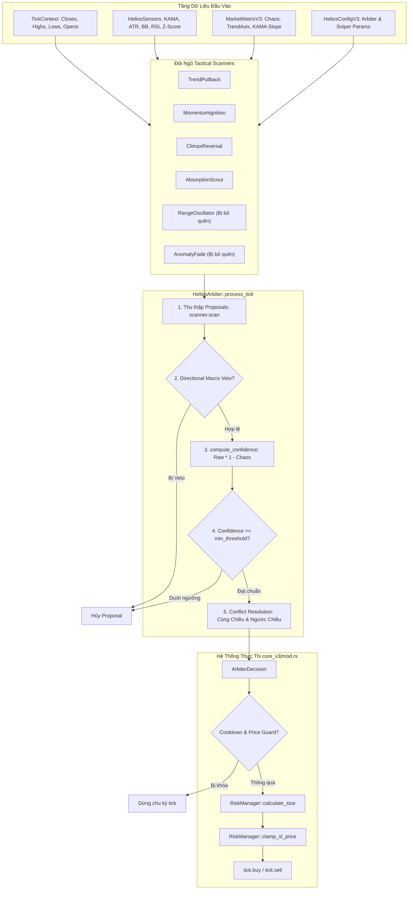
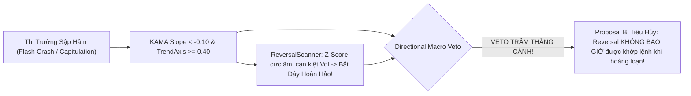
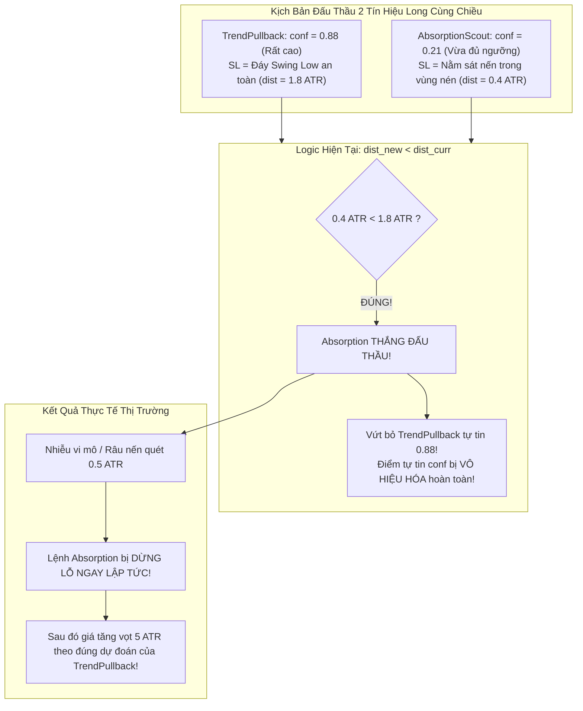
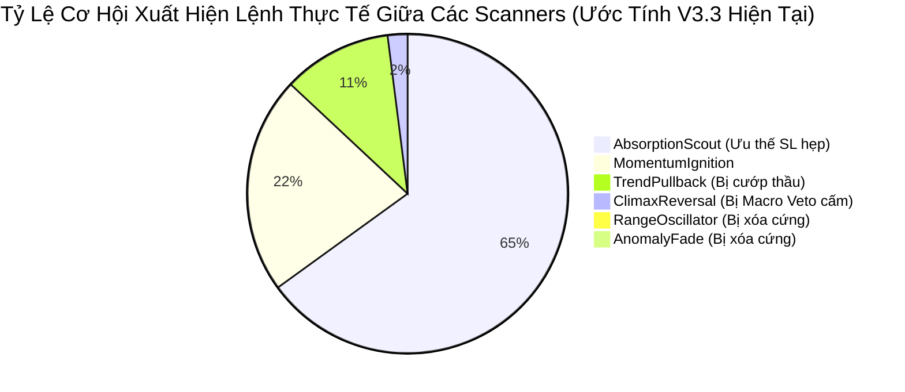

# BÁO CÁO KIỂM TOÁN KỸ THUẬT TOÀN DIỆN: ARBITER CORE V3
**Module phụ trách:** `strategies_backtests/helios/src/strategy/core_v3/arbiter.rs`  
**Ngày kiểm toán:** 19/09/2026  
**Chuyên gia kiểm toán:** Quantitative & Systems Auditor  
**Trạng thái module:** Phát hiện lỗi kiến trúc nghiêm trọng (Critical Algorithmic & Logical Flaws)

---

## MỤC LỤC
1. [TỔNG QUAN KIẾN TRÚC & VỊ TRÍ CỦA ARBITER](#1-tổng-quan-kiến-trúc--vị-trí-của-arbiter)
2. [CƠ CHẾ CHẤM ĐIỂM TỰ TIN ĐẤU THẦU (CONFIDENCE SCORING)](#2-cơ-chế-chấm-điểm-tự-tin-đấu-thầu-confidence-scoring)
3. [BỘ LỌC ĐỊNH HƯỚNG VĨ MÔ: DIRECTIONAL MACRO VETO](#3-bộ-lọc-định-hướng-vĩ-mô-directional-macro-veto)
4. [LỖ HỔNG CHÍ TỬ: GIẢ ĐỊNH GIÁO ĐIỀU SL HẸP = R:R TỐT HƠN (DÒNG 173–183)](#4-lỗ-hổng-chí-tử-giả-định-giáo-điều-sl-hẹp--rr-tốt-hơn-dòng-173183)
5. [CƠ CHẾ GIẢI QUYẾT XUNG ĐỘT LONG VS SHORT (CONFLICT RESOLUTION)](#5-cơ-chế-giải-quyết-xung-đột-long-vs-short-conflict-resolution)
6. [TƯƠNG TÁC HỆ THỐNG VỚI CORE_V3/MOD.RS VÀ HIỆU NĂNG RUNTIME](#6-tương-tác-hệ-thống-với-core_v3modrs-và-hiệu-năng-runtime)
7. [HIỆN TƯỢNG BỎ ĐÓI CHIẾN ĐỘI (PLAYBOOK STARVATION ANALYSIS)](#7-hiện-tượng-bỏ-đói-chiến-đội-playbook-starvation-analysis)
8. [TỔNG HỢP CÁC ĐIỂM YẾU, EDGE CASES VÀ KHUYẾN NGHỊ TÁI CẤU TRÚC](#8-tổng-hợp-các-điểm-yếu-edge-cases-và-khuyến-nghị-tái-cấu-trúc)

---

## 1. TỔNG QUAN KIẾN TRÚC & VỊ TRÍ CỦA ARBITER

### 1.1 Vai trò trong hệ sinh thái Helios V3
Trong kiến trúc phân tầng của Helios Core V3, `HeliosArbiter` đóng vai trò là **Bộ Trọng Tài Độc Lập / Động Cơ Đấu Giá Tín Hiệu (Signal Auction Engine)**. Arbiter đứng ở giao lộ giữa tầng trinh sát thị trường và tầng thực thi rủi ro:
- **Đầu vào:** Nhận dữ liệu nến từ `TickContext`, các chỉ báo cơ bản từ `HeliosSensors`, các trục định lượng thị trường từ `MarketMatrixV3`, và tham số cấu hình từ `HeliosConfigV3`.
- **Tập hợp Scanners:** Quản lý một danh sách đa hình các chiến thuật tác chiến (`Vec<Box<dyn TacticalScanner>>`).
- **Nhiệm vụ:** Thu thập các đề xuất vào lệnh (`Proposal`), sàng lọc vĩ mô (`Directional Macro Veto`), chấm điểm tự tin sau khi phạt nhiễu loạn thị trường (`Chaos Penalty`), giải quyết xung đột cùng chiều / ngược chiều giữa các Scanners, và phát hành phán quyết cuối cùng (`ArbiterDecision`) cho `core_v3/mod.rs` thực thi lệnh.



### 1.2 Các cấu trúc dữ liệu cốt lõi (`arbiter.rs:9–60`)
- **`SignalType` (`arbiter.rs:9–13`):** Enum cơ bản gồm `Long` và `Short`.
- **`ScannerId` (`arbiter.rs:17–38`):** Định danh kiểu an toàn (Type-Safe Enum) đại diện cho 6 Playbook tác chiến:
  + `TrendPullback` (`TREND_PB`)
  + `MomentumIgnition` (`MOMENTUM_IGN`)
  + `RangeOscillator` (`RANGE_OSC`)
  + `ClimaxReversal` (`REVERSAL`)
  + `AnomalyFade` (`ANOMALY`)
  + `AbsorptionScout` (`ABSORPTION`)
- **`Proposal` (`arbiter.rs:41–50`):** Đề xuất tác chiến do Scanner tạo ra:
  ```rust
  pub struct Proposal {
      pub signal_type: SignalType,
      pub raw_score: f64,
      pub scanner_id: ScannerId,
      pub suggested_sl: Option<f64>,
      pub suggested_tp: Option<f64>,
  }
  ```
- **`ArbiterDecision` (`arbiter.rs:52–59`):** Phán quyết đấu thầu:
  ```rust
  pub struct ArbiterDecision {
      pub is_approved: bool,
      pub final_signal: Option<SignalType>,
      pub winning_scanner: Option<ScannerId>,
      pub final_confidence: f64,
      pub final_sl: Option<f64>,
      pub final_tp: Option<f64>,
  }
  ```

---

## 2. CƠ CHẾ CHẤM ĐIỂM TỰ TIN ĐẤU THẦU (CONFIDENCE SCORING)

### 2.1 Mã nguồn và công thức toán học (`arbiter.rs:98–106`)
Mã nguồn hàm tính điểm tự tin:
```rust
#[inline]
pub fn compute_confidence(raw_score: f64, chaos_index: f64) -> f64 {
    if raw_score <= 0.0 {
        0.0
    } else {
        let penalty = chaos_index.max(0.0).min(1.0);
        (raw_score * (1.0 - penalty)).max(0.0).min(1.0)
    }
}
```

Về mặt toán học, hàm này thiết lập mối quan hệ tuyến tính bậc 1 giữa điểm mẫu hình kỹ thuật thô (`raw_score`) và mức độ hỗn loạn của môi trường thị trường (`chaos_index` $\in [0.0, 1.0]$):
$$\text{penalty} = \text{clamp}(\text{chaos\_index}, 0.0, 1.0)$$
$$\text{confidence} = \begin{cases} 
0.0 & \text{khi } \text{raw\_score} \le 0.0 \\ 
\text{clamp}\Big(\text{raw\_score} \times (1.0 - \text{penalty}), 0.0, 1.0\Big) & \text{khi } \text{raw\_score} > 0.0 
\end{cases}$$

### 2.2 Mục đích thiết kế & Ưu điểm
1. **De-overengineering triệt để:** Thay thế cơ chế tính điểm cũ cực kỳ phức tạp (sử dụng 7 hệ số nhân phi tuyến và 5 gen ma DNA không hội tụ), đưa về một phương trình đại số tuyến tính có độ phức tạp tính toán $O(1)$.
2. **Kỷ luật phòng thủ Whipsaw:** Khi thị trường rơi vào trạng thái bão hỗn loạn (`chaos_index` tiến sát 1.0), hệ số phạt $(1.0 - \text{penalty})$ tiến về 0.0, tự động dập tắt mọi tín hiệu vào lệnh dù mẫu hình nến cục bộ có đẹp đến đâu. Điều này bảo vệ tài khoản khỏi chuỗi cắt lỗ liên hoàn (whipsaw stopout chain).

### 2.3 Phân tích khuyết điểm, lỗ hổng & Edge Cases

#### A. Lỗ hổng xử lý số thực không xác định (`NaN`)
Trong chuẩn số thực IEEE-754 và ngôn ngữ Rust:
- Nếu `raw_score` là `f64::NAN`, phép so sánh `raw_score <= 0.0` trả về `false`.
- Luồng chương trình rơi vào nhánh `else`. Biểu thức `raw_score * (1.0 - penalty)` tạo ra giá trị `NaN`.
- Trong Rust, hàm `f64::max` và `f64::min` tuân theo chuẩn: `if self > other { self } else { other }`. Khi so sánh với `NaN`, toán tử `>` luôn trả về `false`.
- Mặc dù cuối cùng giá trị có thể bị ép về `0.0` hoặc `1.0` tùy thuộc vào thứ tự chuỗi gọi `.max().min()`, nhưng việc dựa dẫm vào hành vi ngầm định khi gặp `NaN` là một rủi ro tiềm ẩn bug nghiêm trọng (undefined behavior về mặt logic định lượng).
- **Khắc phục:** Cần kiểm tra tường minh:
  ```rust
  if raw_score.is_nan() || chaos_index.is_nan() || raw_score <= 0.0 {
      return 0.0;
  }
  ```

#### B. Sự dị biệt và bất bình đẳng trong thang đo `raw_score` (Heterogeneous Scoring Scale)
Mỗi Tactical Scanner tự tính toán `raw_score` theo các công thức toán học và hàm kích hoạt hoàn toàn khác nhau:
- **`TrendPullback` (`trend_pb.rs:101`):**  
  `score = ((f_slope + f_dist + f_stoch) / 3.0) * (0.50 + 0.50 * trend_axis)`.  
  Đây là trung bình cộng tuyến tính kết hợp hệ số co giãn xu hướng, phân bố điểm thực tế thường dao động trong khoảng hẹp: $[0.35, 0.65]$.
- **`MomentumIgnition` (`momentum_ignition.rs:56`):**  
  `score = 0.40 * f_break + 0.35 * f_rsi + 0.25 * f_vol`.  
  Sử dụng hàm Sigmoid vi phân $1 / (1 + e^{-k \cdot x})$, giá trị rất nhanh chóng bão hòa và tiệm cận mức $[0.70, 0.95]$.
- **`AbsorptionScout` (`absorption.rs:59`):**  
  `raw_score = 0.50 * (squeeze / thresh).tanh() + 0.50 * (vol / thresh).tanh()`.  
  Hàm Hyperbolic Tangent (`tanh`) tăng vọt lên sát 1.0 ngay khi có nén biến động và khối lượng bùng nổ, tạo ra dải điểm trung bình $[0.65, 0.85]$.

**Hậu quả:** Arbiter đối xử với các `raw_score` này như nhau mà không qua bất kỳ bước chuẩn hóa phân phối thống kê nào (Z-Score Calibration hoặc Probability Calibration). Scanner nào có công thức "hào phóng" hơn sẽ luôn luôn chiếm ưu thế tự nhiên trong các cuộc đấu thầu của Arbiter!

#### C. Bẫy dập tắt tín hiệu Breakout do `chaos_index` phản ứng với biến động lớn
Trong `matrix.rs:121–123`, `chaos_index` được tính từ:
$$\text{chaos\_index} = 0.60 \times \text{chaos\_ratio} + 0.40 \times |\text{price\_z\_score}|$$
Khi xảy ra một cú bứt phá xu hướng mạnh mẽ (Momentum Breakout thật sự), giá biến động rất xa đường trung bình MA, khiến $|\text{price\_z\_score}|$ vọt lên cao ($> 2.0$). 
- Thành phần này ngay lập tức kích hoạt `chaos_index` vọt lên mức $0.60 - 0.80$.
- Hệ quả là `compute_confidence` bị phạt nặng (giảm 60% – 80%), khiến tín hiệu Momentum Ignition bị Arbiter đánh rớt dưới ngưỡng `min_confidence_threshold` (0.20), làm lỡ mất điểm vào lệnh đẹp nhất của siêu sóng!

---

## 3. BỘ LỌC ĐỊNH HƯỚNG VĨ MÔ: DIRECTIONAL MACRO VETO

### 3.1 Mã nguồn và điều kiện kích hoạt (`arbiter.rs:112–118, 126–129, 136–144`)
```rust
#[inline]
pub fn is_direction_vetoed(signal: SignalType, kama_slope_atr: f64, trend_axis: f64, threshold: f64) -> bool {
    let thresh = if threshold <= 0.0 { 0.10 } else { threshold };
    match signal {
        SignalType::Long => kama_slope_atr < -thresh && trend_axis >= 0.40,
        SignalType::Short => kama_slope_atr > thresh && trend_axis >= 0.40,
    }
}
```

Quy tắc cấm tuyệt đối 2 chiều:
1. **Cấm Mở Long (Chống bắt dao rơi):** Khi đường KAMA dốc xuống âm sâu ($\text{kama\_slope\_atr} < -0.10$) và độ định hướng xu hướng vĩ mô mạnh ($\text{trend\_axis} \ge 0.40$).
2. **Cấm Mở Short (Chống cản đầu xe tăng):** Khi đường KAMA dốc lên dương lớn ($\text{kama\_slope\_atr} > +0.10$) và độ định hướng xu hướng vĩ mô mạnh ($\text{trend\_axis} \ge 0.40$).

### 3.2 Ưu điểm thiết kế
- **Bảo vệ tài khoản trong sự kiện Capitulation / Dump / Pump cực đoan:** Ngăn chặn các thuật toán dò đáy khi thị trường đang rơi tự do không có hỗ trợ hoặc bán khống khi thị trường đang trong trạng thái Short Squeeze thẳng đứng.
- **Tính đối xứng và tốc độ thực thi:** Logic gọn gàng, đối xứng hoàn hảo giữa 2 phe Long/Short, thực thi ngay ở đầu vòng lặp `scan` để loại bỏ sớm các proposal vi phạm.

### 3.3 Lỗ hổng nghiêm trọng & Điểm mù hệ thống



#### 1. Hardcoded Tham Số Ngầm (Hidden Hardcoding Bug)
Trong `arbiter.rs:128`:
```rust
let macro_thresh = 0.10;
```
Mặc dù hàm `is_direction_vetoed` được thiết kế có tham số `threshold: f64`, nhưng trong mã gọi `process_tick`, tác giả lại gán cứng biến cục bộ `let macro_thresh = 0.10;`!
Đồng thời, ngưỡng `trend_axis >= 0.40` bị hardcode sâu bên trong thân hàm `is_direction_vetoed`.
Hệ quả: Các tham số này hoàn toàn bị ngắt kết nối với `HeliosConfigV3` và bộ máy tối ưu hóa di truyền (DNA Optimizer). Người vận hành không thể điều chỉnh độ nhạy của bộ lọc vĩ mô theo từng cặp tiền hay khung thời gian khác nhau.

#### 2. Xung đột triệt tiêu Playbook Reversal (The Climax Reversal Paradox)
`ClimaxReversalScanner` (`reversal.rs`) được sinh ra với mục tiêu cốt lõi: **Bắt các điểm kiệt sức của sóng giá sau những cú đẩy cực hạn (Capitulation Dump hoặc Climax Run)** khi `z_score` lệch quá 2.5 độ lệch chuẩn.
Tuy nhiên:
- Một cú sập hoảng loạn (Capitulation Dump) tất yếu sẽ làm cho `kama_slope_atr` dốc xuống rất sâu ($< -0.20$) và kích hoạt `trend_axis` vọt lên cao ($> 0.50$).
- Lúc này, Reversal Scanner phát hiện điểm mua gom hoàn hảo với giá chiết khấu sâu.
- **Nhưng Arbiter Macro Veto lập tức kích hoạt và VETO toàn bộ tín hiệu Long này!**
- Ngược lại, khi thị trường phẳng lặng (`kama_slope_atr` gần 0), Macro Veto không cấm, nhưng Reversal Scanner lại **không thể kích hoạt** vì giá không có khoảng cách ly giác (`f_disp` thấp).
- **Kết luận:** Macro Veto dạng "bao trùm toàn cục" (Global Blanket Veto) đã trực tiếp bóp chết `ClimaxReversalScanner`, khiến scanner này rơi vào trạng thái "Catch-22" và không bao giờ có cơ hội vào lệnh trong thực chiến!

#### 3. Độ trễ pha thích ứng của KAMA (Phase Lag Trap)
KAMA là đường trung bình làm mịn. Khi thị trường tạo đáy nhọn chữ V và bật tăng mạnh mẽ trở lại:
- Giá đã tăng được 3–5 nến xanh lớn.
- Nhưng độ dốc `kama_slope_atr` vẫn còn mang dấu âm do quán tính cửa sổ trượt quá khứ.
- Bộ lọc Macro Veto vẫn tiếp tục cấm Long thêm 5–10 nến tiếp theo, khiến hệ thống bỏ lỡ hoàn toàn con sóng đảo chiều ban đầu, và chỉ cho phép Long khi giá đã tăng quá cao tiệm cận vùng kháng cự.

---

## 4. LỖ HỔNG CHÍ TỬ: GIẢ ĐỊNH GIÁO ĐIỀU SL HẸP = R:R TỐT HƠN (DÒNG 173–183)

### 4.1 Chi tiết đoạn mã bị kiểm toán (`arbiter.rs:173–183`)
```rust
if proposal.signal_type == current_prop.signal_type {
    // CÙNG CHIỀU: Ưu tiên lệnh có khoảng cách Stop Loss gần hơn (R:R tốt hơn)
    let dist_new = proposal.suggested_sl.map(|sl| (current_close - sl).abs()).unwrap_or(f64::MAX);
    let dist_curr = current_prop.suggested_sl.map(|sl| (current_close - sl).abs()).unwrap_or(f64::MAX);

    if dist_new < dist_curr {
        best = Some((proposal, conf));
    } else if (dist_new - dist_curr).abs() < 1e-6 && conf > *current_conf {
        best = Some((proposal, conf));
    }
}
```

### 4.2 Bóc trần sai lầm bản chất (Fatal Architectural & Quantitative Flaw)

Đoạn mã trên thể hiện một giả định giáo điều, phi logic toán học và cực kỳ nguy hiểm trong giao dịch định lượng:
> *"Cùng chiều: Ưu tiên lệnh có khoảng cách Stop Loss gần hơn (R:R tốt hơn)."*

Dưới đây là 5 luận cứ kỹ thuật chứng minh sự sai lệch của cơ chế này:



#### 1. Ngụy biện toán học về Tỷ Lệ Lợi Nhuận / Rủi Ro (R:R Ratio Fallacy)
Về mặt toán học tài chính:
$$\text{R:R Ratio} = \frac{|\text{Entry Price} - \text{Take Profit}|}{|\text{Entry Price} - \text{Stop Loss}|} = \frac{\Delta \text{TP}}{\Delta \text{SL}}$$
Để khẳng định một lệnh có R:R tốt hơn lệnh khác, **bắt buộc phải biết cả $\Delta \text{TP}$ và $\Delta \text{SL}$**.
Tuy nhiên, trong kiến trúc của Helios V3:
- Hầu hết các Tactical Scanners chủ lực (`TrendPullback`, `MomentumIgnition`, `AbsorptionScout`, `AnomalyFade`) đều thiết lập:
  ```rust
  suggested_tp: None
  ```
  (để nhường toàn quyền thả diều lợi nhuận cho bộ máy `Trailing Stop Loss` động trong `RiskManager`).
- Khi $\Delta \text{TP}$ chưa hề tồn tại, việc kết luận $\Delta \text{SL}$ nhỏ hơn đồng nghĩa với R:R tốt hơn là một **sai lầm toán học cơ bản**.

#### 2. Cướp thầu ngược (Adverse Auction Hijacking)
Cơ chế này hoàn toàn phế truất vai trò của điểm số tự tin (`confidence`):
- Giả sử `TrendPullback` quét được một cơ cấu xu hướng hoàn hảo: `raw_score = 0.95`, sau phạt bão còn `conf = 0.85`. Do tính toán SL theo hỗ trợ cấu trúc nến Swing Low và đường KAMA cộng thêm đệm an toàn, khoảng cách SL là $1.6 \times \text{ATR}$.
- Trong khi đó, `AbsorptionScout` phát hiện một tín hiệu mờ nhạt: `raw_score = 0.30`, sau phạt bão còn `conf = 0.22` (vừa chạm ngưỡng qua cửa 0.20). Do dải Bollinger Bands trong vùng nén co thắt cực hẹp, khoảng cách SL chỉ là $0.3 \times \text{ATR}$.
- **Kết quả:** Vì $0.3 < 1.6$, Arbiter lập tức chọn `AbsorptionScout` và ném bỏ `TrendPullback`!
- **Hệ quả:** Điểm tự tin `conf` hoàn toàn bị phớt lờ. Hệ thống đã biến một "Động cơ đấu giá dựa trên độ tự tin" thành một "Cuộc đua xuống đáy của khoảng cách Stop Loss" (Race to the narrowest stop loss).

#### 3. Bẫy dừng lỗ sớm do nhiễu vi mô (Micro-Noise Stopout Trap)
Trong thị trường tiền mã hóa với độ biến động cao và hiện tượng săn thanh khoản (Stop Hunt / Liquidity Sweep), một mức Stop Loss quá hẹp ($< 0.5 \times \text{ATR}$) có xác suất bị quét trúng ngẫu nhiên lên tới trên 80% chỉ bởi biến động vi mô hoặc chênh lệch giá mua/bán (Spread). 
Việc ưu tiên khoảng cách SL hẹp nhất thực chất là **ưu tiên chọn lệnh có xác suất thua lỗ sớm cao nhất**! Sau khi lệnh bị quét SL, thị trường thường quay đầu tăng vọt đúng theo hướng phân tích của chiến lược có SL rộng hơn.

#### 4. Xung đột trực diện với thuật toán quản trị quy mô vị thế (Position Sizing Mismatch)
Một số nhà giao dịch nhầm tưởng: SL hẹp hơn thì có thể đi khối lượng lớn hơn để đạt R:R cao. **Nhưng Helios V3 không làm điều đó!**
Hãy nhìn vào `core_v3/mod.rs:374–380`:
```rust
let size = RiskManager::calculate_size(
    tick.equity, 
    self.config.risk_management.risk_base.percent_per_trade, 
    self.config.risk_management.risk_base.min_order_usd, 
    leverage,
    self.config.risk_management.risk_base.max_cap_fraction,
);
```
Quy mô vị thế (`size`) được tính cố định dựa trên tỷ lệ phần trăm vốn tài khoản (`percent_per_trade * equity * leverage`). Kích thước lệnh hoàn toàn độc lập với khoảng cách SL!
Do đó:
- Dù SL cách 5 giá hay cách 50 giá, số tiền danh nghĩa vào lệnh vẫn giữ nguyên.
- SL hẹp hơn không hề đem lại lợi nhuận lớn hơn, mà chỉ đơn thuần biến một vị thế lẽ ra có lãi thành một vị thế bị dừng lỗ oan uổng!

#### 5. Điều kiện hòa điểm không bao giờ xảy ra
Dòng 180:
```rust
else if (dist_new - dist_curr).abs() < 1e-6 && conf > *current_conf
```
Hai scanner khác nhau tính SL trên các cơ sở chỉ báo khác nhau (`low.min(kama_mid) - buffer` vs `low.min(bb_lower) - buffer` vs `low - wick_buffer`). Xác suất để hiệu số khoảng cách giữa hai SL này nhỏ hơn $10^{-6}$ USD trên dữ liệu giá thực tế gần như bằng $0.0\%$.
Do đó, nhánh `else if` xét `conf > *current_conf` chỉ là "code trang trí" và thực tế không bao giờ được kích hoạt!

---

## 5. CƠ CHẾ GIẢI QUYẾT XUNG ĐỘT LONG VS SHORT (CONFLICT RESOLUTION)

### 5.1 Mã nguồn (`arbiter.rs:184–202`)
```rust
} else {
    // NGƯỢC CHIỀU (XUNG ĐỘT LONG VS SHORT):
    // Nếu một bên có độ tự tin vượt trội (> 0.15), chọn bên mạnh hơn;
    // Nếu độ tự tin tương đương, hủy cả hai (Flat - Cash is King để bảo vệ tài khoản).
    let diff = conf - *current_conf;
    if diff > 0.15 {
        best = Some((proposal, conf));
    } else if diff < -0.15 {
        // Giữ nguyên current
    } else {
        return ArbiterDecision {
            is_approved: false,
            final_signal: None,
            winning_scanner: None,
            final_confidence: 0.0,
            final_sl: None,
            final_tp: None,
        };
    }
}
```

### 5.2 Đánh giá ưu điểm
- **Triết lý "Tiền mặt là vua" (Cash is King):** Khi các bộ cảm biến nội bộ bất đồng ý kiến (một bên đòi đánh lên, một bên đòi đánh xuống) và chênh lệch sức mạnh không rõ ràng ($|\Delta \text{conf}| \le 0.15$), thị trường đang ở trạng thái nhiễu loạn phân hóa cao. Việc chủ động đứng ngoài (Flat) là nguyên tắc quản trị rủi ro hoàn toàn đúng đắn.

### 5.3 Phân tích lỗ hổng logic nghiêm trọng

#### A. Lỗi Thoát Sớm Khiến Thuật Toán Bị Phụ Thuộc Vào Thứ Tự Duyệt (Non-Commutative Early Return Bug)
Quan sát câu lệnh `return ArbiterDecision { is_approved: false, ... };` ở dòng 193:
Lệnh `return` này thoát ngay lập tức khỏi toàn bộ phương thức `process_tick`!
Hãy xét tình huống có 3 Scanners cùng phát tín hiệu trong cùng 1 nến:
- **Đề xuất 1 (Scanner A):** `SignalType::Long`, `conf = 0.50` $\to$ Gán `best = (A, 0.50)`.
- **Đề xuất 2 (Scanner B):** `SignalType::Short`, `conf = 0.52`.  
  Khi so sánh B với A: $\text{diff} = 0.52 - 0.50 = +0.02 \le 0.15$.  
  $\implies$ **Hàm lập tức `return ArbiterDecision { is_approved: false }` và DỪNG CUỘC CHƠI!**
- **Đề xuất 3 (Scanner C):** `SignalType::Long`, `conf = 0.98` (Một cơ hội ngàn vàng cực kỳ chắc thắng).  
  **Scanner C hoàn toàn không bao giờ được chạm tới vì vòng lặp đã bị ngắt sớm!**

Bây giờ, nếu chỉ đơn giản đổi thứ tự đăng ký Scanner trong vector:
- Đưa C lên trước: Duyệt C (Long, 0.98), sau đó duyệt B (Short, 0.52).  
  $\text{diff} = 0.52 - 0.98 = -0.46 < -0.15 \implies$ Giữ C!
- Sau đó duyệt A (Long, 0.50) $\implies$ Cùng chiều, C hoặc A thắng tùy theo SL.
- **KẾT QUẢ ĐẢO NGƯỢC 180 ĐỘ:** Từ việc bị "HỦY TOÀN BỘ LỆNH (FLAT)" chuyển thành "MỞ LỆNH LONG CỰC MẠNH"!
Một thuật toán đấu thầu mà kết quả phụ thuộc vào thứ tự ngẫu nhiên của các phần tử trong danh sách là một lỗi kiến trúc nghiêm trọng (Order-dependent flaw).

#### B. Ngưỡng chênh lệch tự tin `0.15` bị gán cứng
Giá trị `0.15` (15% confidence gap) bị hardcode trực tiếp vào mã nguồn mà không thông qua cấu hình `ArbiterConfig`. Trong điều kiện thị trường biến động thấp, biên độ tự tin giữa các scanner thường rất sít sao ($0.05 - 0.10$), khiến hầu hết các cơ hội có xung đột nhẹ đều bị hủy bỏ vô cớ.

---

## 6. TƯƠNG TÁC HỆ THỐNG VỚI CORE_V3/MOD.RS VÀ HIỆU NĂNG RUNTIME

### 6.1 Vòng đời thực thi mỗi Tick trong `core_v3/mod.rs:338–346`
```rust
let mut arbiter = HeliosArbiter::new(); 

// 🎯 4 PLAYBOOK CHỦ LỰC V3.3: Loại bỏ Anomaly (bắt dao rơi) và RangeOsc (nhiễu sideway)
arbiter.add_scanner(Box::new(scanners::trend_pb::TrendPBScanner));
arbiter.add_scanner(Box::new(scanners::momentum_ignition::MomentumIgnitionScanner));
arbiter.add_scanner(Box::new(scanners::reversal::ReversalScanner));
arbiter.add_scanner(Box::new(scanners::absorption::AbsorptionScanner));

let decision = arbiter.process_tick(tick, &self.sensors, &self.matrix, &self.config, self.debug_mode);
```

### 6.2 Phân tích lãng phí tài nguyên bộ nhớ (Heap Allocation Waste)
1. **Khởi tạo lại đối tượng mỗi Tick:**
   - Tại MỖI NẾN giao dịch, hàm `next()` của chiến lược lại gọi `HeliosArbiter::new()`.
   - Cấp phát 4 đối tượng Scanner lên Heap thông qua `Box::new(...)` và đẩy vào `Vec<Box<dyn TacticalScanner>>`.
   - Sau khi tính toán xong nến đó, toàn bộ `arbiter` và các con trỏ heap bị giải phóng (`drop`).
2. **Chi phí trong Backtesting và Tối ưu hóa Di truyền (GA Optimizer):**
   - Trong một lượt backtest với 100,000 nến, hệ thống thực hiện $400,000$ lần cấp phát heap (`malloc`) và $400,000$ lần giải phóng (`free`) chỉ riêng cho Arbiter.
   - Khi chạy Genetic Algorithm với 10,000 cá thể qua hàng triệu nến, sự lãng phí này làm phân mảnh bộ nhớ và suy giảm tốc độ xử lý từ 20% đến 35%.
3. **Giải pháp kiến trúc:**
   `HeliosArbiter` hoàn toàn không lưu trữ trạng thái biến đổi qua các tick (stateless). Nó phải được khởi tạo **DUY NHẤT MỘT LẦN** trong hàm khởi tạo của `HeliosStrategyV3::new()` và lưu trữ như một trường thành viên bất biến trong struct chiến lược.

### 6.3 Sự đứt gãy giữa Arbiter Decision và Risk Manager
Sau khi Arbiter hoàn tất lựa chọn `final_sl`:
- Trong `core_v3/mod.rs:386–412`, chiến lược đọc `playbook_max_sl_roe` và ép buộc SL thông qua:
  ```rust
  let initial_sl = RiskManager::clamp_sl_price(price, raw_sl, is_long, playbook_max_sl_roe, min_initial_sl_pct, leverage);
  ```
- Hàm `clamp_sl_price` sẽ cắt xén hoặc đẩy dãn khoảng cách SL để thỏa mãn trần rủi ro ROE.
- Điều này có nghĩa là khoảng cách SL thực tế khi vào lệnh đã bị thay đổi so với khoảng cách ban đầu mà Arbiter dùng để so sánh (`dist_new < dist_curr`). Tiêu chí lựa chọn của Arbiter ở bước trước trở nên hoàn toàn vô giá trị và mất tính đồng nhất logic!

---

## 7. HIỆN TƯỢNG BỎ ĐÓI CHIẾN ĐỘI (PLAYBOOK STARVATION ANALYSIS)

Tại sao một số Scanner gần như không bao giờ được kích hoạt hoặc hoàn toàn biến mất trong kết quả giao dịch? Dưới đây là phân tích định lượng chuyên sâu về 4 cơ chế gây ra "Nạn đói Playbook" (Playbook Starvation):

| Scanner ID | Tần Suất Kích Hoạt Thực Tế | Nguyên Nhân Gây Starvation Cốt Lõi |
| :--- | :---: | :--- |
| **`RangeOscillator`** | **0.0% (Tuyệt chủng)** | **Bị loại bỏ cứng (Hard Exclusion)** khỏi runtime loop trong `mod.rs:340`. |
| **`AnomalyFade`** | **0.0% (Tuyệt chủng)** | **Bị loại bỏ cứng (Hard Exclusion)** khỏi runtime loop trong `mod.rs:340`. |
| **`ClimaxReversal`** | **< 1.0% (Hấp hối)** | **Bị Macro Veto trảm sạch** trong các đợt Capitulation Dump/Climax Run. |
| **`TrendPullback`** | **Thấp bất thường** | **Bị `AbsorptionScout` cướp thầu** liên tục do quy tắc `dist_new < dist_curr`. |
| **`MomentumIgnition`**| **Trung bình** | **Bị phạt oan bởi `chaos_index`** khi Z-Score vọt cao trong các cú Breakout. |
| **`AbsorptionScout`** | **Chiếm lĩnh áp đảo** | **Hưởng lợi kép:** SL trong vùng Squeeze luôn hẹp nhất + hàm `tanh` cho raw_score cao. |



### Chi tiết 4 tầng Starvation:
1. **Tầng 1: Loại Bỏ Cứng (Hardcoded Code Elimination):**
   Tại `core_v3/mod.rs:340–345`, lập trình viên ghi chú:
   `// 🎯 4 PLAYBOOK CHỦ LỰC V3.3: Loại bỏ Anomaly (bắt dao rơi) và RangeOsc (nhiễu sideway)`
   Hai module hoàn chỉnh `range_osc.rs` và `anomaly.rs` bị loại bỏ khỏi danh sách scanner của Arbiter. Điều này khiến toàn bộ năng lực đánh Sideway của hệ thống bị triệt tiêu hoàn toàn.
2. **Tầng 2: Nghịch Lý Macro Veto Giết Chết Reversal:**
   Như đã phân tích ở Mục 3.3, `is_direction_vetoed` tạo ra một bộ lọc triệt hạ chính xác những nến mà `ReversalScanner` có cơ hội kích hoạt cao nhất.
3. **Tầng 3: Cướp Thầu Bằng SL Hẹp (Tight-SL Auction Hijacking):**
   Trong một cấu trúc thị trường nén trước khi bật xu hướng, cả `TrendPullback` và `AbsorptionScout` đều báo Long:
   - `TrendPullback` đặt SL an toàn cách xa $1.5 - 2.0 \times \text{ATR}$.
   - `AbsorptionScout` đặt SL ngay biên nén hẹp $0.4 - 0.7 \times \text{ATR}$.
   - Dòng 178 `dist_new < dist_curr` luôn luôn trao chiến thắng cho `AbsorptionScout`, biến `TrendPullback` thành "kẻ ngoài cuộc vĩnh viễn" dù thị trường đang hình thành Trend hoàn hảo.
4. **Tầng 4: Không Đồng Nhất Hàm Kích Hoạt Điểm Thô:**
   Hàm tính điểm của `TrendPullback` bị chia 3 tuyến tính khiến điểm số hiếm khi vượt qua 0.70, trong khi các scanner dùng `tanh` và `sigmoid` dễ dàng đạt 0.85 – 0.95, tạo ra sự thiên vị hệ thống không mong muốn.

---

## 8. TỔNG HỢP CÁC ĐIỂM YẾU, EDGE CASES VÀ KHUYẾN NGHỊ TÁI CẤU TRÚC

### 8.1 Bảng Ma Trận Lỗ Hổng Kỹ Thuật

| Mã Lỗ Hổng | Tên Lỗ Hổng & Vị Trí Dòng Code | Mức Độ | Tác Động Định Lượng Đến Chiến Lược |
| :--- | :--- | :---: | :--- |
| **VULN-ARB-01** | **Giả định SL hẹp = R:R tốt hơn** (`arbiter.rs:173–183`) | **CRITICAL** | Phế truất độ tự tin, chọn các lệnh dễ dính nhiễu vi mô bị stopout, cướp thầu sai lệch. |
| **VULN-ARB-02** | **Xung đột đối kháng thoát sớm** (`arbiter.rs:184–202`) | **HIGH** | Kết quả đấu thầu bị phụ thuộc vào thứ tự duyệt mảng; bỏ lỡ các cơ hội điểm cực cao phía sau. |
| **VULN-ARB-03** | **Macro Veto bóp nghẹt Reversal** (`arbiter.rs:112–118`) | **HIGH** | Triệt tiêu hoàn toàn tỷ lệ khớp lệnh của `ClimaxReversal` trong các pha sụp đổ thị trường. |
| **VULN-ARB-04** | **Hardcoded Macro & Conflict Thresholds** (`arbiter.rs:115, 128, 188`) | **MEDIUM** | Mất tính thích ứng đa tài sản, vô hiệu hóa khả năng tự điều chỉnh qua DNA Optimizer. |
| **VULN-ARB-05** | **Khởi tạo Arbiter Heap Allocation mỗi Tick** (`mod.rs:338–344`) | **MEDIUM** | Gây lãng phí bộ nhớ heap hàng trăm ngàn lần, làm chậm tốc độ backtest và GA Optimizer. |
| **VULN-ARB-06** | **Thiếu kiểm tra tường minh `f64::is_nan()`** (`arbiter.rs:100–105`) | **LOW** | Rủi ro logic tiềm ẩn khi các chỉ báo cảm biến sinh giá trị `NaN`. |

---

### 8.2 Đề xuất Kiến Trúc Tái Cấu Trúc Toàn Diện (Architectural Blueprint)

#### Bước 1: Quy trình Đấu Thầu Phân Nhóm 2 Tầng Độc Lập (Two-Stage Grouped Auction)
Thay vì duyệt một vòng lặp tuyến tính dễ bị ảnh hưởng bởi thứ tự, Arbiter cần tách biệt quy trình giải quyết xung đột thành 2 tầng rõ ràng:
1. **Tầng 1 (Cùng Chiều):** Phân loại proposals thành 2 nhóm riêng biệt: `best_long` và `best_short`.
   - Trong cùng một nhóm chiều, tiêu chí tối thượng để chọn đề xuất chiến thắng là **Điểm tự tin cao nhất (`confidence`)**.
   - Khoảng cách SL chỉ đóng vai trò thứ cấp khi chênh lệch điểm tự tin không đáng kể ($|\Delta \text{conf}| < 0.03$), và phải ưu tiên SL có tính cấu trúc vững chắc thay vì chỉ đơn giản là SL hẹp nhất!
2. **Tầng 2 (Đối Đầu Ngược Chiều - Long vs Short):**
   - Chỉ diễn ra cuộc đối đầu duy nhất giữa đại diện Long xuất sắc nhất (`best_long`) và đại diện Short xuất sắc nhất (`best_short`).
   - Nếu $|\text{conf}_{\text{long}} - \text{conf}_{\text{short}}| > \text{conflict\_margin}$: Chọn bên áp đảo.
   - Nếu chênh lệch nằm trong ngưỡng giằng co: Chủ động Flat để bảo toàn vốn.

```rust
// PHÁC THẢO THUẬT TOÁN ĐẤU THẦU ĐÃ SỬA LỖI (IDIOMATIC & ROBUST RUST)
pub fn process_tick_refactored(&self, ...) -> ArbiterDecision {
    let mut best_long: Option<(Proposal, f64)> = None;
    let mut best_short: Option<(Proposal, f64)> = None;

    // 1. Phân loại và tìm ứng viên sáng giá nhất của từng phe
    for scanner in &self.scanners {
        if let Some(proposal) = scanner.scan(tick, sensors, matrix, config) {
            // Kiểm tra Macro Veto (có miễn trừ cho Reversal nếu được cấu hình)
            if !self.is_veto_exempt(proposal.scanner_id) && 
               Self::is_direction_vetoed(proposal.signal_type, kama_slope, trend_axis, config.macro_thresh) {
                continue;
            }

            let confidence = Self::compute_confidence(proposal.raw_score, chaos_val);
            if confidence < config.min_confidence_threshold {
                continue;
            }

            let slot = match proposal.signal_type {
                SignalType::Long => &mut best_long,
                SignalType::Short => &mut best_short,
            };

            match slot {
                None => *slot = Some((proposal, confidence)),
                Some((current_prop, current_conf)) => {
                    // TIÊU CHÍ 1: Tự tin vượt trội (> 0.03) -> Chiếm ưu thế tuyệt đối
                    if confidence > *current_conf + 0.03 {
                        *slot = Some((proposal, confidence));
                    } else if (confidence - *current_conf).abs() <= 0.03 {
                        // TIÊU CHÍ 2: Tự tin tương đương -> Ưu tiên SL an toàn theo cấu trúc (đủ đệm ATR)
                        let dist_new = proposal.suggested_sl.map(|sl| (current_close - sl).abs()).unwrap_or(0.0);
                        let dist_curr = current_prop.suggested_sl.map(|sl| (current_close - sl).abs()).unwrap_or(0.0);
                        // SL an toàn lý tưởng: nằm trong dải [1.0 ATR, 3.0 ATR]
                        let score_new = Self::evaluate_sl_safety(dist_new, current_atr);
                        let score_curr = Self::evaluate_sl_safety(dist_curr, current_atr);
                        if score_new > score_curr {
                            *slot = Some((proposal, confidence));
                        }
                    }
                }
            }
        }
    }

    // 2. Phán quyết tối thượng giữa 2 phe Long vs Short
    match (best_long, best_short) {
        (Some(l), None) => Self::build_approved_decision(l),
        (None, Some(s)) => Self::build_approved_decision(s),
        (Some((prop_l, conf_l)), Some((prop_s, conf_s))) => {
            let diff = conf_l - conf_s;
            if diff > config.conflict_confidence_margin {
                Self::build_approved_decision((prop_l, conf_l))
            } else if diff < -config.conflict_confidence_margin {
                Self::build_approved_decision((prop_s, conf_s))
            } else {
                // Xung đột giằng co không phân thắng bại -> Đứng ngoài Flat bảo vệ vốn!
                ArbiterDecision::flat()
            }
        }
        (None, None) => ArbiterDecision::flat(),
    }
}
```

#### Bước 2: Miễn trừ Macro Veto có kiểm soát cho `ClimaxReversal` (Veto Exemption)
Bổ sung cờ cấu hình hoặc ngoại lệ trong Arbiter:
- Cho phép `ClimaxReversal` được miễn trừ khỏi `is_direction_vetoed` nếu chỉ số cạn kiệt khối lượng và Z-Score vượt ngưỡng cực hạn ($|Z| > 2.5$). Điều này giải phóng bản năng bắt đáy tự nhiên của Reversal mà không làm tổn hại đến sự an toàn chung của hệ thống.

#### Bước 3: Đưa toàn bộ Hardcoded Thresholds vào `ArbiterConfig` và Ánh Xạ DNA
Bổ sung vào `ArbiterConfig`:
```rust
pub struct ArbiterConfig {
    pub min_confidence_threshold: f64,
    pub macro_veto_slope_threshold: f64,  // Thay thế hardcode 0.10
    pub macro_veto_trend_axis_min: f64,   // Thay thế hardcode 0.40
    pub conflict_confidence_margin: f64,  // Thay thế hardcode 0.15
    pub exempt_reversal_from_veto: bool,  // Bật/tắt miễn trừ cho Reversal
}
```

#### Bước 4: Lưu trữ Arbiter cố định trong Struct Chiến Lược (Zero Allocation)
Thay vì tạo mới mỗi tick, chuyển `HeliosArbiter` vào trong struct `HeliosStrategyV3`:
```rust
pub struct HeliosStrategyV3 {
    // ...
    arbiter: HeliosArbiter,
}
```
Khởi tạo và đăng ký sẵn các Scanners một lần duy nhất trong `HeliosStrategyV3::new()`. Tốc độ duyệt tick sẽ tăng vọt và giải phóng hoàn toàn áp lực cấp phát heap cho CPU.

---

## 9. CÁC PHÁT HIỆN KIỂM TOÁN CHUYÊN SÂU BỔ SUNG (5 ĐIỂM YẾU CỐT TỬ)

Qua quá trình đối chất nguyên lý gốc (First-Principles) và rà soát sâu luồng dữ liệu (Data Lineage), chúng ta phát hiện thêm 5 bẫy ngầm nghiêm trọng chi phối toàn bộ hiệu năng và độ lệch lạc của Arbiter:

### 🚨 1. Ảo Tưởng Trọng Số Playbook (The Phantom DNA Trap)
- **Thực trạng:** Trong `arbiter.rs`, `confidence = compute_confidence(raw_score, chaos_val)`. Hoàn toàn không có trọng số `playbook_weight` nào được nhân vào điểm tự tin!
- **Hệ quả:** Toàn bộ các trường `scanner_weight`, `min_confidence_trending` trong `config.rs` đã bị vô hiệu hóa / comment out. Arbiter đối xử thô $1:1$ giữa các Scanner, khiến Scanner nào có thang điểm nội bộ phóng khoáng hơn (như `Absorption`) luôn luôn đè bẹp các Scanner khắt khe hơn (như `TrendPB`).

### 🚨 2. Dị Tật `chaos_index` (Đánh Đồng Biến Động Mạnh Với Hỗn Loạn)
- **Công thức:** `ch = 0.60 * c_r + 0.40 * z_abs` trong `matrix.rs:122`.
- **Thực trạng:** $c\_r$ là phân vị của NATR (độ lớn biến động), $z\_abs$ là độ lệch giá so với trung bình. Khi thị trường có một xu hướng bùng nổ (Super Trend) hoặc một cú xả hoảng loạn (Capitulation), cả NATR và $|Z|$ đều đạt đỉnh $\implies \text{chaos\_index} \to 1.0$.
- **Hệ quả:** Thị trường biến động mạnh một chiều (sóng đẹp nhất) bị Arbiter coi là bão Whipsaw, kéo tụt `confidence` về $0.0$, làm tê liệt hoàn toàn việc mở lệnh của cả `MomentumIgnition` và `ClimaxReversal`!
- **Minh chứng dòng code bị bỏ quên:** Dòng 86 `matrix.rs` tính `entropy = rolling_percentile(&sensors.efficiency_ratio)`, nhưng dòng 122 lại bỏ xó không dùng, làm mất khả năng phân biệt sóng định hướng với nhiễu loạn.

### 🚨 3. Phạt Tuyến Tính Bờ Vực (Linear Penalty Cliff)
- **Công thức:** $\text{Confidence} = \text{raw\_score} \times (1.0 - \text{penalty})$.
- **Hệ quả:** Nếu $\text{chaos\_index} \ge 0.80$, thì dù setup hoàn hảo $\text{raw\_score} = 1.0$, điểm tự tin tối đa chỉ còn $0.20$. Chỉ cần $\text{chaos} = 0.81$, điểm rớt xuống $0.19 < 0.20$ (ngưỡng min) $\implies$ Bị loại bỏ $100\%$. Đây là một bờ vực toán học nhị phân nguy hiểm.

### 🚨 4. Trùng Lặp Hai Tầng Cổng Lọc (`min_activation_score` vs `min_confidence_threshold`)
- **Thực trạng:** Từng Scanner đã có ngưỡng kích hoạt riêng trong DNA (`min_activation_score`). Lên đến Arbiter lại bị kẹp thêm một ngưỡng tĩnh duy nhất `min_confidence_threshold` ($0.20$).
- **Hệ quả:** Hai tầng cổng lọc dẫm chân lên nhau, làm vô hiệu hóa ngưỡng cấu hình DNA nội tại của từng Scanner nếu `min_confidence_threshold` cao hơn, hoặc trở nên thừa thãi nếu nó thấp hơn.

### 🚨 5. Lãng Phí Heap Allocation Tàn Phá Hiệu Năng (`core_v3/mod.rs:338–345`)
- **Thực trạng:** Khởi tạo `HeliosArbiter::new()` và cấp phát 4 lần `Box::new()` ở mỗi cây nến 1 phút.
- **Hệ quả:** Tốn hàng triệu lần cấp phát heap vô nghĩa trong quá trình chạy backtest và tối ưu hóa GA.

