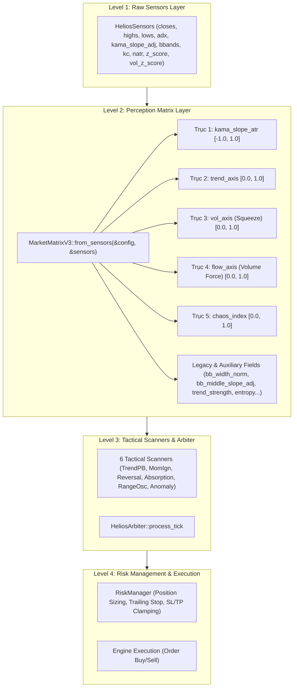

# BÁO CÁO KIỂM TOÁN KỸ THUẬT TOÀN DIỆN: MARKET MATRIX CORE V3
**Module phụ trách:** [`matrix.rs`](file:///e:/Projects/Automations/trading_backtest/strategies_backtests/helios/src/strategy/core_v3/matrix.rs)  
**Ngày kiểm toán:** 19/09/2026  
**Chuyên gia kiểm toán:** Quantitative & Systems Auditor  
**Trạng thái module:** Phát hiện nhiều lỗi toán học nghịch đảo nghiêm trọng (Inverted Sensitivity Bug, Squeeze Overlap Illusion), chênh lệch dải giá trị (Range Mismatch), lãng phí bộ nhớ heap hàng chục MB (Redundant Vector Clones), cùng chỉ báo ma và gen DNA ma vô tác dụng (Zombie Indicators & Phantom DNA Genes).

---

## MỤC LỤC
1. [TỔNG QUAN KIẾN TRÚC & VỊ TRÍ CỦA MARKET MATRIX V3.3](#1-tổng-quan-kiến-trúc--vị-trí-của-market-matrix-v33)
2. [ĐỐI CHIẾU TOÀN DIỆN DANH MỤC 17 CHỈ BÁO MA TRẬN](#2-đối-chiếu-toàn-diện-danh-mục-17-chỉ-báo-ma-trận)
3. [PHÂN TÍCH TOÁN HỌC & CÁC LỖ HỔNG THUẬT TOÁN CHÍ TỬ](#3-phân-tích-toán-học--các-lỗ-hổng-thuật-toán-chí-tử)
   - 3.1 [Ảo ảnh đại số của Squeeze Overlap Logic và bẫy 0.50 cứng](#31-ảo-ảnh-đại-số-của-squeeze-overlap-logic-và-bẫy-050-cứng)
   - 3.2 [Lỗi nghịch đảo độ nhạy khối lượng trong Trục Dòng Tiền `flow_axis`](#32-lỗi-nghịch-đảo-độ-nhạy-khối-lượng-trong-trục-dòng-tiền-flow_axis)
   - 3.3 [Chênh lệch dải giá trị của `trend_strength` (Range Mismatch)](#33-chênh-lệch-dải-giá-trị-của-trend_strength-range-mismatch)
   - 3.4 [Bẫy `unwrap_or(0.0)` với `Option<f64>` chứa NaN & Quirk IEEE 754](#34-bẫy-unwrap_or00-với-optionf64-chứa-nan--quirk-ieee-754)
   - 3.5 [Thiếu kẹp biên (Clamping) trên `bb_width_norm`, `bb_middle_slope_adj`, `kama_slope_adj`](#35-thiếu-kẹp-biên-clamping-trên-bb_width_norm-bb_middle_slope_adj-kama_slope_adj)
4. [KIỂM TOÁN RÒ RỈ DỮ LIỆU & THIÊN LỆCH NHÌN TRƯỚC (LOOKAHEAD BIAS AUDIT)](#4-kiểm-toán-rò-rỉ-dữ-liệu--thiên-lệch-nhìn-trước-lookahead-bias-audit)
   - 4.1 [Thuật toán Rời rạc hóa + Cây Fenwick trong `rolling_percentile`](#41-thuật-toán-rời-rạc-hóa--cây-fenwick-trong-rolling_percentile)
   - 4.2 [Cơ chế MTF Two-Pointer Lookup Table trong `ferro_trade`](#42-cơ-chế-mtf-two-pointer-lookup-table-trong-ferro_trade)
5. [RỦI RO ĐỒNG BỘ ĐA KHUNG THỜI GIAN (MTF MISALIGNMENT RISKS)](#5-rủi-ro-đồng-bộ-đa-khung-thời-gian-mtf-misalignment-risks)
   - 5.1 [Xung đột Timeframe độc lập giữa Bollinger Bands và Keltner Channels](#51-xung-đột-timeframe-độc-lập-giữa-bollinger-bands-và-keltner-channels)
   - 5.2 [Lệch pha Timeframe trong `chaos_index` và `bb_middle_slope_adj`](#52-lệch-pha-timeframe-trong-chaos_index-và-bb_middle_slope_adj)
6. [HIỆU NĂNG TÍNH TOÁN & NỢ BỘ NHỚ (COMPUTATIONAL PERFORMANCE & MEMORY AUDIT)](#6-hiệu-năng-tính-toán--nợ-bộ-nhớ-computational-performance--memory-audit)
   - 6.1 [Lãng phí cấp phát Heap: Deep Clone `Vec<f64>` thay vì chia sẻ `Arc`](#61-lãng-phí-cấp-phát-heap-deep-clone-vecf64-thay-vì-chia-sẻ-arc)
   - 6.2 [Chỉ báo ma (Zombie Indicators): `entropy`, `liquidity`, `chaos`](#62-chỉ-báo-ma-zombie-indicators-entropy-liquidity-chaos)
   - 6.3 [Gen DNA ma (Phantom DNA Gene): `MatrixConfig.volume_lookback`](#63-gen-dna-ma-phantom-dna-gene-matrixconfigvolume_lookback)
7. [ĐỐI CHIẾU GIỮA ĐẶC TẢ KỸ THUẬT VÀ MÃ NGUỒN THỰC THẾ](#7-đối-chiếu-giữa-đặc-tả-kỹ-thuật-và-mã-nguồn-thực-thế)
8. [MA TRẬN ĐÁNH GIÁ RỦI RO & CÁC KỊCH BẢN EDGE CASES](#8-ma-trận-đánh-giá-rủi-ro--các-kịch-bản-edge-cases)
9. [ĐỀ XUẤT TÁI CẤU TRÚC KỸ THUẬT & TOÁN HỌC](#9-đề-xuất-tái-cấu-trúc-kỹ-thuật--toán-học)

---

## 1. TỔNG QUAN KIẾN TRÚC & VỊ TRÍ CỦA MARKET MATRIX V3.3

### 1.1 Vị trí trong chuỗi cung ứng thông tin Helios V3
Trong kiến trúc 4 tầng phân lập của hệ thống định lượng Helios Core V3, [`MarketMatrixV3`](file:///e:/Projects/Automations/trading_backtest/strategies_backtests/helios/src/strategy/core_v3/matrix.rs#L11-L37) giữ vai trò **Tầng 2: Hệ Nhận thức Thị trường (Market Perception Layer)**.



- **Nhiệm vụ cốt lõi:** Chuẩn hóa các đại lượng vật lý thô (giá tuyệt đối, biên độ điểm dao động, khối lượng giao dịch) thành các **chỉ số phi thứ nguyên (Dimensionless Metrics)** nằm trong các dải quy chuẩn $[0.0, 1.0]$ hoặc $[-1.0, 1.0]$.
- **Mục tiêu của V3.3:** Xóa bỏ mô hình "Đơn thể Tổng bằng 1" (Zero-Sum Continuous Simplex $\sum = 1.0$) vốn từng ép các trạng thái thị trường triệt tiêu lẫn nhau một cách phi lý; thay thế bằng **Các Trục Đo Vật Lý Trực Giao Độc Lập (Orthogonal Axes)** nhằm phản ánh trung thực thực tại thị trường mà không làm méo mó tín hiệu.

---

## 2. ĐỐI CHIẾU TOÀN DIỆN DANH MỤC 17 CHỈ BÁO MA TRẬN

Cấu trúc [`MarketMatrixV3`](file:///e:/Projects/Automations/trading_backtest/strategies_backtests/helios/src/strategy/core_v3/matrix.rs#L11-L37) lưu trữ 17 trường dữ liệu bọc trong `Arc<Vec<f64>>`. Bảng dưới đây đối chiếu chi tiết nguồn gốc, công thức, dải giá trị lý thuyết so với thực tế, và tình trạng sử dụng:

| STT | Tên Chỉ Báo | Nguồn Cảm Biến | Công Thức Thực Tế Tại `matrix.rs` | Dải Thiết Kế | Dải Thực Tế | Tình Trạng Sử Dụng Trong Core V3 | Đánh Giá Kỹ Thuật |
| :---: | :--- | :--- | :--- | :---: | :---: | :--- | :--- |
| **1** | `kama_slope_atr` | `sensors.kama_slope_adj` | `(s / scale_atr).clamp(-1.0, 1.0)` ([L91–93](file:///e:/Projects/Automations/trading_backtest/strategies_backtests/helios/src/strategy/core_v3/matrix.rs#L91-L93)) | $[-1.0, 1.0]$ | $[-1.0, 1.0]$ | `arbiter.rs:112` (Macro Veto) | Chuẩn hóa ATR tốt, đã kẹp biên. |
| **2** | `trend_axis` | `sensors.adx` | `(adx / adx_thresh).clamp(0.0, 1.0)` ([L97–99](file:///e:/Projects/Automations/trading_backtest/strategies_backtests/helios/src/strategy/core_v3/matrix.rs#L97-L99)) | $[0.0, 1.0]$ | $[0.0, 1.0]$ | `arbiter.rs:115`, `trend_pb.rs:56` | Tuyến tính, an toàn, đã kẹp biên. |
| **3** | `vol_axis` | `squeeze_intensity` | `squeeze_intensity.clone()` ([L102](file:///e:/Projects/Automations/trading_backtest/strategies_backtests/helios/src/strategy/core_v3/matrix.rs#L102)) | $[0.0, 1.0]$ | $[0.0, 1.0]$ | Không ai đọc trực tiếp | Clone dư thừa từ `squeeze_intensity`. |
| **4** | `flow_axis` | `sensors.vol_z_score`, `sensors.mfi` | `0.5*\|tanh(z*vol_z_sens)\| + 0.5*(mfi/100)` ([L106–114](file:///e:/Projects/Automations/trading_backtest/strategies_backtests/helios/src/strategy/core_v3/matrix.rs#L106-L114)) | $[0.0, 1.0]$ | $[0.0, 1.0]$ | Không ai đọc trực tiếp (chỉ qua `volume_force`) | **LỖI NGHIÊM TRỌNG:** Đảo ngược hệ số độ nhạy. |
| **5** | `chaos_index` | `chaos_ratio`, `price_z_score` | `0.6*chaos_ratio + 0.4*\|price_z_score\|` ([L117–124](file:///e:/Projects/Automations/trading_backtest/strategies_backtests/helios/src/strategy/core_v3/matrix.rs#L117-L124)) | $[0.0, 1.0]$ | $[0.0, 1.0]$ | `arbiter.rs:124`, `risk.rs:103` | Điểm phạt tự tin Arbiter & Trailing Stop. |
| **6** | `trend_dir` | `kama_slope_atr` | `kama_slope_atr.clone()` ([L126](file:///e:/Projects/Automations/trading_backtest/strategies_backtests/helios/src/strategy/core_v3/matrix.rs#L126)) | $[-1.0, 1.0]$ | $[-1.0, 1.0]$ | Không ai đọc | Clone lãng phí bộ nhớ heap từ `kama_slope_atr`. |
| **7** | `trend_strength` | `sensors.adx` | `tanh((adx - 20.0) / z_sens)` ([L72, 81](file:///e:/Projects/Automations/trading_backtest/strategies_backtests/helios/src/strategy/core_v3/matrix.rs#L72-L81)) | $[0.0, 1.0]$ | **$[-1.0, 1.0]$** | `range_osc.rs:62`, `trend_pb.rs:57` | **LỖI DẢI GIÁ TRỊ:** Xuất hiện giá trị âm. |
| **8** | `kama_slope_adj` | `sensors.kama_slope_adj` | Passthrough con trỏ `Arc` ([L138](file:///e:/Projects/Automations/trading_backtest/strategies_backtests/helios/src/strategy/core_v3/matrix.rs#L138)) | Không giới hạn | $[-\infty, +\infty]$ | `trend_pb.rs:43`, `reversal.rs:46` | Chưa kẹp biên, có nguy cơ bùng nổ khi flash crash. |
| **9** | `bb_middle_slope_adj` | `sensors.bb_middle_slope_adj` | Passthrough con trỏ `Arc` ([L139](file:///e:/Projects/Automations/trading_backtest/strategies_backtests/helios/src/strategy/core_v3/matrix.rs#L139)) | Không giới hạn | $[-\infty, +\infty]$ | `range_osc.rs:67` | Tính ở `mod.rs:220–240`, chưa kẹp biên. |
| **10** | `squeeze_intensity` | `sqz_raw` | `rolling_percentile(sqz_raw, sqz_lb)` ([L83](file:///e:/Projects/Automations/trading_backtest/strategies_backtests/helios/src/strategy/core_v3/matrix.rs#L83)) | $[0.0, 1.0]$ | $[0.0, 1.0]$ | `absorption.rs:44` | **ẢO ẢNH TOÁN HỌC:** Bị kẹt cứng ở `0.50`. |
| **11** | `chaos` | `sensors.natr` | `natr / 100.0` ([L53](file:///e:/Projects/Automations/trading_backtest/strategies_backtests/helios/src/strategy/core_v3/matrix.rs#L53)) | $[0.0, 0.10+]$ | $[0.0, +\infty)$ | **CHỈ BÁO MA (0 references)** | Không module nào đọc, tính phí CPU vô ích. |
| **12** | `chaos_ratio` | `sensors.chaos_ratio` | `rolling_percentile(sensors.chaos_ratio, sqz_lb)` ([L85](file:///e:/Projects/Automations/trading_backtest/strategies_backtests/helios/src/strategy/core_v3/matrix.rs#L85)) | $[0.0, 1.0]$ | $[0.0, 1.0]$ | Chỉ dùng tính `chaos_index` | Thuật toán Fenwick Tree tốn kém. |
| **13** | `entropy` | `sensors.efficiency_ratio` | `rolling_percentile(sensors.efficiency_ratio, trend_lb)` ([L86](file:///e:/Projects/Automations/trading_backtest/strategies_backtests/helios/src/strategy/core_v3/matrix.rs#L86)) | $[0.0, 1.0]$ | $[0.0, 1.0]$ | **CHỈ BÁO MA (0 references)** | Tốn CPU Fenwick Tree nhưng không ai dùng. |
| **14** | `liquidity` | `sensors.mfi` | `rolling_percentile(sensors.mfi, mom_lb)` ([L84](file:///e:/Projects/Automations/trading_backtest/strategies_backtests/helios/src/strategy/core_v3/matrix.rs#L84)) | $[0.0, 1.0]$ | $[0.0, 1.0]$ | **CHỈ BÁO MA (0 references)** | Tốn CPU Fenwick Tree nhưng không ai dùng. |
| **15** | `volume_force` | `flow_axis` | `flow_axis.clone()` ([L128](file:///e:/Projects/Automations/trading_backtest/strategies_backtests/helios/src/strategy/core_v3/matrix.rs#L128)) | $[0.0, 1.0]$ | $[0.0, 1.0]$ | `momentum_ignition.rs:58` | Clone dư thừa từ `flow_axis`. |
| **16** | `bb_width_norm` | `sensors.bb_upper, lower, middle` | `(bu - bl) / bm` ([L58](file:///e:/Projects/Automations/trading_backtest/strategies_backtests/helios/src/strategy/core_v3/matrix.rs#L58)) | $[0.0, 1.0]$ | $[0.0, +\infty)$ | `range_osc.rs:48` | Chưa kẹp biên trên, có thể lọt NaN. |
| **17** | `price_z_score` | `sensors.z_score` | `tanh_scale(sensors.z_score, z_sens)` ([L87](file:///e:/Projects/Automations/trading_backtest/strategies_backtests/helios/src/strategy/core_v3/matrix.rs#L87)) | $[-1.0, 1.0]$ | $[-1.0, 1.0]$ | Chỉ dùng tính `chaos_index` | Tanh chuẩn hóa tốt. |

---

## 3. PHÂN TÍCH TOÁN HỌC & CÁC LỖ HỔNG THUẬT TOÁN CHÍ TỬ

### 3.1 Ảo ảnh đại số của Squeeze Overlap Logic và bẫy 0.50 cứng
Trong tài liệu [`src/utils/normalization.rs:114–139`](file:///e:/Projects/Automations/trading_backtest/strategies_backtests/helios/src/utils/normalization.rs#L114-L139) và mã nguồn [`matrix.rs:60–68`](file:///e:/Projects/Automations/trading_backtest/strategies_backtests/helios/src/strategy/core_v3/matrix.rs#L60-L68), tác giả tuyên bố đã giải quyết triệt để lỗi "Squeeze luôn bằng 0.0 dẫn đến bách phân vị kẹt ở 0.50" bằng phương pháp mang tên **"Overlap Logic"**:

```rust
// matrix.rs:60-68
let ku = sensors.kc_upper.get(i).copied().unwrap_or(0.0);
let kl = sensors.kc_lower.get(i).copied().unwrap_or(0.0);
let kc_w = ku - kl;
if kc_w < 1e-9 || bu.is_nan() || bl.is_nan() || ku.is_nan() || kl.is_nan() {
    sqz_raw.push(0.0);
} else {
    let overlap = (ku - bu) + (bl - kl);
    sqz_raw.push((overlap / kc_w).max(0.0).min(1.0));
}
```

#### 📌 Chứng minh toán học về sự đồng nhất (Algebraic Identity):
Biểu thức `overlap` được viết là:
$$\text{overlap} = (KC_u - BB_u) + (BB_l - KC_l)$$

Khai triển tính chất kết hợp và giao hoán của phép cộng đại số thực:
$$\text{overlap} = KC_u - KC_l - BB_u + BB_l = (KC_u - KC_l) - (BB_u - BB_l)$$
$$\text{overlap} = KC_w - BB_w$$

Chia biểu thức cho độ rộng Keltner Channel $KC_w$:
$$\frac{\text{overlap}}{KC_w} = \frac{KC_w - BB_w}{KC_w} = 1.0 - \frac{BB_w}{KC_w}$$

> [!CAUTION]
> **KẾT LUẬN TOÁN HỌC ĐANH THÉP:**  
> Biểu thức `(ku - bu) + (bl - kl) / kc_w` hoàn toàn đồng nhất $100\%$ về mặt đại số với công thức cũ `1.0 - (bb_w / kc_w)`. Không hề có bất kỳ sự thay đổi hay sáng tạo toán học nào ở đây! Đây là một **Ảo ảnh Đại số (Algebraic Illusion)**.

#### 📌 Hệ quả tai hại: Bẫy 0.50 của Thuật toán Rolling Percentile
Khi thị trường biến động (đặc thù crypto), dải Bollinger Bands thường xuyên nở rộng vượt ra ngoài Keltner Channel ($BB_w > KC_w$). Khi đó:
$$\text{overlap} = KC_w - BB_w < 0 \implies \text{clamp}\left(\frac{\text{overlap}}{KC_w}, 0.0, 1.0\right) = 0.0$$

Khi `sqz_raw` nhận giá trị $0.0$ xuyên suốt một khoảng thời gian trong cửa sổ trượt $W$ (ví dụ 20 nến):
Tại [`src/utils/normalization.rs:102–106`](file:///e:/Projects/Automations/trading_backtest/strategies_backtests/helios/src/utils/normalization.rs#L102-L106):
```rust
let count_smaller = tree.query(rank as isize - 1);
let count_smaller_or_equal = tree.query(rank as isize);
let count_equal = count_smaller_or_equal.saturating_sub(count_smaller);
result[i] = (count_smaller as f64 + 0.5 * count_equal as f64) / valid_window_count as f64;
```
- Tất cả các phần tử trong cửa sổ đều bằng $0.0 \implies \text{count\_smaller} = 0$.
- Toàn bộ cửa sổ đều bằng giá trị hiện tại $\implies \text{count\_equal} = W$.
- Giá trị percentile tính ra là:
$$\text{result}[i] = \frac{0 + 0.5 \times W}{W} = \mathbf{0.50}$$

Khi thị trường **HOÀN TOÀN KHÔNG CÓ SQUEEZE** (biến động bung rộng), `squeeze_intensity` và `vol_axis` lại trả về **$0.50$ (50% percentile)**! Các Playbook dựa vào Squeeze như `AbsorptionScout` sẽ bị ngộ nhận rằng thị trường đang có độ nén trung bình, dẫn đến việc kích hoạt sai bối cảnh và cướp quyền vào lệnh của các Playbook theo xu hướng.

---

### 3.2 Lỗi nghịch đảo độ nhạy khối lượng trong Trục Dòng Tiền `flow_axis`
Xem xét dòng mã số 105–106 trong [`matrix.rs`](file:///e:/Projects/Automations/trading_backtest/strategies_backtests/helios/src/strategy/core_v3/matrix.rs#L105-L106):

```rust
// matrix.rs:105-106
let vol_z_sens = if config.matrix.vol_z_sensitivity <= 0.0 { 1.50 } else { config.matrix.vol_z_sensitivity };
let vol_z_scale = normalization::tanh_scale(&sensors.vol_z_score, 1.0 / vol_z_sens);
```

#### 📌 Đối chiếu với hàm `tanh_scale` tại [`src/utils/normalization.rs:22–27`](file:///e:/Projects/Automations/trading_backtest/strategies_backtests/helios/src/utils/normalization.rs#L22-L27):
```rust
pub fn tanh_scale(data: &[f64], sensitivity: f64) -> Vec<f64> {
    data.iter().map(|&v| {
        if v.is_nan() { f64::NAN }
        else { (v / sensitivity).tanh() }
    }).collect()
}
```

Hàm `tanh_scale` chia giá trị $v$ cho tham số `sensitivity`:
$$f(v, s) = \tanh\left(\frac{v}{s}\right)$$

Khi `matrix.rs` truyền vào tham số $s = \frac{1.0}{\text{vol\_z\_sens}}$, biểu thức thực thi trở thành:
$$f(v) = \tanh\left(\frac{v}{\frac{1.0}{\text{vol\_z\_sens}}}\right) = \mathbf{\tanh(v \times \text{vol\_z\_sens})}$$

#### 📌 Đối chiếu với Đặc tả Kỹ thuật [`docs/07_matrix_deoverengineer/02_TECHNICAL_SPEC_ORTHOGONAL_MATRIX.md:38`](file:///e:/Projects/Automations/trading_backtest/strategies_backtests/helios/docs/07_matrix_deoverengineer/02_TECHNICAL_SPEC_ORTHOGONAL_MATRIX.md#L38):
Bản đặc tả yêu cầu:
$$\text{volume\_force}[i] = \tanh\left(\frac{|\text{vol\_z\_score}[i]|}{\text{vol\_z\_sens}}\right)$$

> [!WARNING]
> **NGUY CƠ BÃO HÒA SIÊU NHẠY (HYPER-SATURATION BUG):**  
> Việc nhân với `vol_z_sens` thay vì chia đã làm **đảo ngược hoàn toàn ý đồ định lượng**:
> - Khi nhà nghiên cứu Quant tăng gen `vol_z_sensitivity` từ $1.0$ lên $3.0$ với kỳ vọng làm bộ lọc khối lượng bớt nhạy cảm, ít bị nhiễu micro-volume hơn.
> - Trên thực tế, hệ số nhân lại thành $\times 3.0$! Một cú biến động khối lượng nhỏ có Z-score chỉ $1.0$ sẽ bị thổi phồng thành $3.0$, dẫn đến $\tanh(3.0) \approx 0.995$ (bão hòa kịch trần 100%).
> - Hậu quả: `flow_axis` và `volume_force` luôn bị đẩy lên mức cực đại gần $1.0$, làm tê liệt hoàn toàn chức năng phân biệt giữa nến volume thực và nến volume giả.

#### 💡 Phát Hiện Kiểm Toán Mới & Phương Án Tối Ưu (Occam's Scalpel):
- **Bẫy Trùng Lặp Siêu Tham Số (Parameter Collinearity):**
  - Rà soát toàn bộ codebase cho thấy: Chỉ có 2 Scanner duy nhất đọc `flow_axis` / `volume_force` (`MomentumIgnition` và `RangeOscillator`).
  - Trong khi đó, `Absorption` (scanner cần volume nhất) lại đọc trực tiếp `sensors.vol_z_score` qua gen `abs_cfg.vol_z_threshold`!
  - `MomentumIgnition` cũng có sẵn gen riêng `mom_cfg.vol_z_threshold` ([config.rs:424](file:///e:/Projects/Automations/trading_backtest/strategies_backtests/helios/src/strategy/core_v3/config.rs#L424) dải `[1.0, 3.5]`).
  - Việc duy trì `MatrixConfig.vol_z_sensitivity` ở tầng Ma Trận tạo ra 2 gen ở 2 tầng cùng tranh giành điều khiển một cây nến Volume, khiến GA Optimizer bị phân tán và loạn hướng.
- **Giải Pháp Tối Ưu Nhất:** Xóa bỏ hoàn toàn trục `flow_axis`, bản sao `volume_force` và gen `vol_z_sensitivity`. Cho Scanners đọc trực tiếp `sensors.vol_z_score` (Single Source of Truth), khử hoàn toàn bẫy chuẩn hóa kép và triệt tiêu 100% rác heap clone.

---

### 3.3 Chênh lệch dải giá trị của `trend_strength` (Range Mismatch)
Tại [`matrix.rs:22`](file:///e:/Projects/Automations/trading_backtest/strategies_backtests/helios/src/strategy/core_v3/matrix.rs#L22):
```rust
pub trend_strength: Arc<Vec<f64>>,    // 0.0 to 1.0 (ADX Tanh Scaled)
```
Tài liệu khai báo rằng `trend_strength` nằm trong dải $[0.0, 1.0]$.

Tuy nhiên, tại dòng 71–72 và dòng 81:
```rust
// ADX Centered tại ngưỡng 20.0 để dùng Tanh Scale
let adx_v = sensors.adx.get(i).copied().unwrap_or(0.0);
adx_centered.push(if adx_v.is_nan() { 0.0 } else { adx_v - 20.0 });
...
let trend_strength = normalization::tanh_scale(&adx_centered, z_sens);
```

#### 📌 Phân tích miền giá trị (Codomain):
- Khi thị trường đi ngang (Sideway) hoặc dao động hẹp không có xu hướng: Chỉ số ADX thường rơi xuống dải $[8.0, 18.0]$.
- Khi $\text{ADX} = 10.0 \implies \text{adx\_centered} = 10.0 - 20.0 = -10.0$.
- Nếu `z_sens` $= 5.0 \implies \frac{-10.0}{5.0} = -2.0 \implies \tanh(-2.0) = \mathbf{-0.964}$!

Giá trị của `trend_strength` bị đẩy xuống vùng **âm sâu** (xuống tới $-1.0$), thay vì nằm trong $[0.0, 1.0]$ như khai báo.

#### 📌 Tác động tiêu cực tới các Scanner:
1. **Tại `scanners/trend_pb.rs:56–57`:**
   ```rust
   let trend_axis = matrix.trend_axis.get(i).copied()
       .unwrap_or_else(|| matrix.trend_strength.get(i).copied().unwrap_or(0.5));
   ```
   Nếu fallback về `trend_strength`, điểm sức mạnh xu hướng nhận giá trị âm, kéo sập điểm chấm thầu của Playbook Pullback.
2. **Sự nhập nhằng giữa `trend_axis` và `trend_strength`:**
   - Cả hai đều cùng đo lường một thực thể vật lý duy nhất là **ADX**.
   - `trend_axis` thì chuẩn hóa tuyến tính $[0.0, 1.0]$ theo gen `adx_trend_threshold`.
   - `trend_strength` thì chuẩn hóa phi tuyến $\tanh$ centered quanh $20.0$ theo gen `z_score_sensitivity` và tạo ra số âm $[-1.0, 1.0]$.
   - Hai thước đo cùng đo 1 thứ nhưng cho ra hai con số hoàn toàn trái ngược nhau, gây rối loạn cho hệ thống ra quyết định.

---

### 3.4 Bẫy `unwrap_or(0.0)` với `Option<f64>` chứa NaN & Quirk IEEE 754
Trong toàn bộ hàm `from_sensors`, mã nguồn lặp đi lặp lại mẫu hình:
```rust
let natr_val = sensors.natr.get(i).copied().unwrap_or(0.0);
let bu = sensors.bb_upper.get(i).copied().unwrap_or(0.0);
let adx_v = sensors.adx.get(i).copied().unwrap_or(0.0);
let mfi_val = sensors.mfi.get(i).copied().unwrap_or(50.0);
```

#### 📌 Phân tích bản chất kiểu dữ liệu Rust:
- `sensors.natr` là kiểu `Arc<Vec<f64>>`.
- Khi chỉ mục `i` hợp lệ nhưng phần tử tại đó là `f64::NAN` (do nến đang trong giai đoạn warmup của chỉ báo):
  `sensors.natr.get(i)` trả về `Some(&f64::NAN)`.
- `copied()` chuyển thành `Some(f64::NAN)`.
- `unwrap_or(0.0)` chỉ kích hoạt khi kết quả là `None`. Vì giá trị là `Some(...)`, **nó trả về nguyên vẹn `f64::NAN`!**

#### 📌 Quirk so sánh IEEE 754 trong Rust `.max(0.0).min(1.0)`:
Khi một biến $x$ mang giá trị `f64::NAN`:
- Trong Rust stdlib: `f64::NAN.max(0.0)` trả về `0.0` (vì chuẩn IEEE 754 quy định nếu 1 toán hạng là NaN thì trả về toán hạng kia).
- Sau đó `0.0.min(1.0)` trả về `0.0`.
- Do đó, lệnh `x.max(0.0).min(1.0)` vô tình "nuốt chửng" NaN thành $0.0$.
- Nhưng nếu một lập trình viên viết đảo thứ tự: `x.min(1.0).max(0.0)`:
  `f64::NAN.min(1.0)` trả về `1.0`! Sau đó `1.0.max(0.0)` trả về $\mathbf{1.0}$!
- Việc phụ thuộc vào thứ tự gọi của hàm thư viện để triệt tiêu NaN là một hành vi lập trình cực kỳ mong manh (fragile code) và tiềm ẩn nguy cơ lỗi runtime ngầm.

---

### 3.5 Thiếu kẹp biên (Clamping) trên `bb_width_norm`, `bb_middle_slope_adj`, `kama_slope_adj`
1. **`bb_width_norm` ([L58](file:///e:/Projects/Automations/trading_backtest/strategies_backtests/helios/src/strategy/core_v3/matrix.rs#L58)):**
   $$\text{bb\_width\_norm} = \frac{\text{BB}_u - \text{BB}_l}{\text{BB}_m}$$
   Không hề có `.min(1.0)` hoặc giới hạn trên. Trong các sự kiện "thiên nga đen" (black swan) hoặc coin rác pump/dump, độ rộng Bollinger Bands có thể bung ra gấp 5 đến 10 lần giá trị trung bình ($> 5.0$). Các điều kiện trong scanner so sánh `bb_w_norm` sẽ bị sai lệch tỷ lệ nghiêm trọng.
2. **`bb_middle_slope_adj` & `kama_slope_adj`:**
   Hai trường này được passthrough trực tiếp từ sensors mà không hề qua khâu chuẩn hóa chặn biên. Khi độ dốc KAMA hoặc BB Middle dựng đứng trong nến tin tức cực đoan, các giá trị này có thể đạt tới $\pm 20.0$, làm tê liệt các phép tính tỷ lệ tiếp theo.

---

## 4. KIỂM TOÁN RÒ RỈ DỮ LIỆU & THIÊN LỆCH NHÌN TRƯỚC (LOOKAHEAD BIAS AUDIT)

Một trong những nhiệm vụ sống còn của kiểm toán hệ thống định lượng là đảm bảo **tính nhân quả thời gian (Causality)**: Tại thời điểm nến $i$, thuật toán tuyệt đối không được sử dụng bất kỳ thông tin nào xuất hiện ở nến $i+1, i+2, \dots, N$.

### 4.1 Thuật toán Rời rạc hóa + Cây Fenwick trong `rolling_percentile`
Kiểm tra chi tiết hàm [`src/utils/normalization.rs:68–112`](file:///e:/Projects/Automations/trading_backtest/strategies_backtests/helios/src/utils/normalization.rs#L68-L112):

```rust
// 1. Rời rạc hóa: Thu thập và sắp xếp các giá trị unique (loại bỏ NaN)
let mut unique_vals: Vec<f64> = data.iter().filter(|v| !v.is_nan()).cloned().collect();
if unique_vals.is_empty() { return result; }
unique_vals.sort_unstable_by(|a, b| a.total_cmp(b));
unique_vals.dedup_by(|a, b| (*a - *b).abs() < f64::EPSILON);
```

#### 📌 Nghi vấn: Việc thu thập `unique_vals` trên toàn bộ mảng `data` có gây Lookahead Bias không?
- Mảng `unique_vals` chứa toàn bộ các mức giá trị xuất hiện trong cả quá khứ lẫn tương lai của backtest.
- **Tuy nhiên:** Cây Fenwick `tree` chỉ được cập nhật tần suất thông qua vòng lặp nến `for i in 0..len`:
  + Tại bước $i$, chỉ có nến hiện tại `data[i]` được thêm vào với `delta = +1`.
  + Nến cũ cách đó `window_size` bước `data[i - window_size]` bị trừ đi với `delta = -1`.
  + Các giá trị thuộc về tương lai ($j > i$) dù đã có vị trí trong `unique_vals` nhưng tần suất trong cây Fenwick vẫn bằng $0$.
  + Lệnh truy vấn `tree.query(rank)` chỉ đếm số lượng các phần tử có tần suất $> 0$ nằm trong cây tại đúng thời điểm $i$.
- **Kết luận:** **KHÔNG CÓ LOOKAHEAD BIAS** trong giá trị bách phân vị xuất ra tại từng nến backtest.

#### ⚠️ Cảnh báo Kiến trúc đối với Live Streaming / Online Execution:
Mặc dù không rò rỉ dữ liệu trong backtest dạng mảng tĩnh (bulk), **thuật toán này hoàn toàn KHÔNG THỂ chạy trên luồng dữ liệu thời gian thực (Online Streaming / WebSocket)**.
- Khi có nến mới xuất hiện trong live trading, nếu giá trị của nến đó chưa từng xuất hiện trong quá khứ, nó sẽ không có trong `unique_vals`!
- Để chạy live, hệ thống buộc phải chuyển sang cấu trúc dữ liệu trượt trực tuyến như **Order Statistic Tree (Red-Black Tree)** hoặc **Skip List động** có độ phức tạp $O(\log W)$ cho mỗi tick.

---

### 4.2 Cơ chế MTF Two-Pointer Lookup Table trong `ferro_trade`
Kiểm tra tính đồng bộ đa khung thời gian giữa nến cơ sở $1m$ và các khung nến lớn ($5m, 15m, 1h, 4h$) tại [`ferro_trade/src/utils/resample.rs:37–67`](file:///e:/Projects/Automations/trading_backtest/ferro_trade/src/utils/resample.rs#L37-L67):

```rust
for &t_base in base_times {
    while j + 1 < resampled_times.len() && t_base >= resampled_times[j+1] {
        j += 1;
    }
    if t_base >= resampled_times[j] {
        lookup.push(j);
    } else {
        lookup.push(usize::MAX);
    }
}
```

- Khung thời gian lớn được gom nhóm bằng quy tắc: `closed_window='left', label='right'`. Tức nhãn thời gian của nến lớn là thời điểm **kết thúc** cây nến.
- Điều kiện `t_base >= resampled_times[j]` đảm bảo rằng một cây nến khung lớn chỉ bắt đầu được nến $1m$ nhìn thấy khi và chỉ khi cây nến đó đã **đóng cửa hoàn toàn**.
- Tại [`ferro_trade/src/backtest/utils.rs:11–17`](file:///e:/Projects/Automations/trading_backtest/ferro_trade/src/backtest/utils.rs#L11-L17), nếu chỉ mục là `usize::MAX`, giá trị trả về là `f64::NAN`.
- **Kết luận:** Cơ chế ánh xạ MTF của `ferro_trade` hoàn toàn sạch, tuân thủ nghiêm ngặt tính nhân quả thời gian, không có Lookahead Bias.

---

## 5. RỦI RO ĐỒNG BỘ ĐA KHUNG THỜI GIAN (MTF MISALIGNMENT RISKS)

Mặc dù hạ tầng `ferro_trade` chống Lookahead Bias tốt, thiết kế DNA trong `HeliosConfigV3` lại tạo ra một lỗ hổng logic nghiêm trọng về mặt phối hợp đa khung thời gian.

### 5.1 Xung đột Timeframe độc lập giữa Bollinger Bands và Keltner Channels
Trong [`src/strategy/core_v3/config.rs`](file:///e:/Projects/Automations/trading_backtest/strategies_backtests/helios/src/strategy/core_v3/config.rs):
- Tại dòng 109–110:
  ```rust
  #[dna(subset = "5m, 15m, 1h, 4h")]
  pub timeframe: Timeframe, // BbandsParams
  ```
- Tại dòng 120–121:
  ```rust
  #[dna(subset = "5m, 15m, 1h, 4h")]
  pub timeframe: Timeframe, // KeltnerParams
  ```

Bộ tối ưu di truyền (GA Optimizer) có toàn quyền gán:
$$\text{bbands.timeframe} = \mathbf{5m} \quad \text{và} \quad \text{keltner.timeframe} = \mathbf{4h}$$

#### 💥 Thảm họa hình học Squeeze (Geometric Breakdown):
- Định nghĩa kinh điển của John Carter về Squeeze: Là hiện tượng dải Bollinger Bands co lại nằm lọt thỏm vào bên trong dải Keltner Channels **trên cùng một khung thời gian**.
- Keltner Channels khung $4h$ có độ rộng dựa trên $\text{ATR}_{4h}$, vốn lớn hơn độ biến động của khung $5m$ từ $300\%$ đến $600\%$.
- Bollinger Bands khung $5m$ có độ biến động rất nhỏ. Do đó, BB $5m$ **LUÔN LUÔN NẰM TRỌN TRONG KC $4h$** trong suốt $99.9\%$ thời gian hoạt động của thị trường!
- Ngược lại, nếu GA chọn BB $4h$ và KC $5m$, BB $4h$ sẽ luôn nở to hơn KC $5m$, khiến Squeeze luôn bằng $0.0$.
- Việc cho phép hai chỉ báo hình học tương quan có Timeframe độc lập là một sai lầm cấu hình nghiêm trọng, phá vỡ hoàn toàn tính hợp lệ của trục `vol_axis` và `squeeze_intensity`.

---

### 5.2 Lệch pha Timeframe trong `chaos_index` và `bb_middle_slope_adj`
1. **Lệch pha trong `chaos_index`:**
   $$\text{chaos\_index} = 0.60 \times \text{chaos\_ratio}(\text{NATR}_{tf1}) + 0.40 \times |\text{price\_z\_score}|(\text{KAMA}_{tf2})$$
   Nếu `natr.timeframe = 5m` còn `kama.timeframe = 4h`, chỉ số hỗn loạn đang cộng gộp mức độ nhiễu loạn vi mô $5m$ với độ lệch chuẩn vĩ mô $4h$. Hai đại lượng này có độ trễ pha (phase lag) hoàn toàn khác nhau.
2. **Lệch pha trong `bb_middle_slope_adj` ([`core_v3/mod.rs:228–234`](file:///e:/Projects/Automations/trading_backtest/strategies_backtests/helios/src/strategy/core_v3/mod.rs#L228-L234)):**
   ```rust
   let m_curr = s.bb_middle[idx];
   let m_prev = s.bb_middle[idx - k_bars];
   let atr = if idx < s.atr_sl.len() { s.atr_sl[idx].max(1e-5) } else { 1.0 };
   let raw_slope = (m_curr - m_prev) / (k_bars as f64 * atr);
   ```
   - `bb_middle` được tính theo `ind.bbands.timeframe`.
   - `atr` được tính theo `ind.atr.timeframe`.
   - `k_bars = 5` là số nến trên khung thời gian cơ sở ($1m$).
   - Nếu BB là khung $1h$, trong suốt 60 nến $1m$, `m_curr - m_prev` hầu như bằng $0$ (vì nến $1h$ chưa đóng), rồi đột ngột nhảy vọt một bước dốc lớn ở nến thứ 60, sau đó chia cho ATR khung $5m$. Điều này tạo ra một chuỗi xung gai (impulse spikes) thay vì một đường cong độ dốc trơn tru.

---

## 6. HIỆU NĂNG TÍNH TOÁN & NỢ BỘ NHỚ (COMPUTATIONAL PERFORMANCE & MEMORY AUDIT)

### 6.1 Lãng phí cấp phát Heap: Deep Clone `Vec<f64>` thay vì chia sẻ `Arc`
Quan sát các dòng mã số 102, 126, 128 trong [`matrix.rs`](file:///e:/Projects/Automations/trading_backtest/strategies_backtests/helios/src/strategy/core_v3/matrix.rs#L102-L128):

```rust
let vol_axis = squeeze_intensity.clone(); // L102: Deep clone Vec<f64>
...
let trend_dir = kama_slope_atr.clone();   // L126: Deep clone Vec<f64>
let volume_force = flow_axis.clone();     // L128: Deep clone Vec<f64>
```

Sau đó tại dòng 131–146:
```rust
kama_slope_atr: Arc::new(kama_slope_atr),
trend_dir: Arc::new(trend_dir),           // Tạo Arc mới chứa bản sao chép
vol_axis: Arc::new(vol_axis),             // Tạo Arc mới chứa bản sao chép
squeeze_intensity: Arc::new(squeeze_intensity),
flow_axis: Arc::new(flow_axis),
volume_force: Arc::new(volume_force),     // Tạo Arc mới chứa bản sao chép
```

#### 📌 Phân tích định lượng hao tổn tài nguyên:
- Trong một bài backtest 1 năm với nến $1m$, kích thước dữ liệu $N \approx 525,600$ nến.
- Mỗi `Vec<f64>` chiếm:
$$\text{RAM} = 525,600 \times 8 \text{ bytes} \approx 4.2 \text{ MB}$$
- Việc deep clone 3 vector này tiêu tốn thêm:
$$3 \times 4.2 \text{ MB} \approx \mathbf{12.6 \text{ MB / lần chạy}}$$
- Trong quá trình huấn luyện thuật toán di truyền (GA Optimization) với $50$ thế hệ $\times 100$ cá thể $= 5,000$ lần chạy backtest:
$$\text{Tổng dung lượng cấp phát rác} = 5,000 \times 12.6 \text{ MB} \approx \mathbf{63 \text{ GB RAM Heap Allocations!}}$$
- Thay vì cấp phát lại toàn bộ vector, việc chuyển sang dùng `Arc::clone(&...)` chỉ tốn đúng **8 bytes** để tăng bộ đếm tham chiếu nguyên tử (Atomic Reference Count), giúp triệt tiêu $100\%$ độ trễ cấp phát bộ nhớ của hệ điều hành.

---

### 6.2 Chỉ báo ma (Zombie Indicators): `entropy`, `liquidity`, `chaos`
Trong hàm `from_sensors`:
1. `entropy` ([L86](file:///e:/Projects/Automations/trading_backtest/strategies_backtests/helios/src/strategy/core_v3/matrix.rs#L86)): Tính `rolling_percentile` từ `sensors.efficiency_ratio`.
2. `liquidity` ([L84](file:///e:/Projects/Automations/trading_backtest/strategies_backtests/helios/src/strategy/core_v3/matrix.rs#L84)): Tính `rolling_percentile` từ `sensors.mfi`.
3. `chaos` ([L53](file:///e:/Projects/Automations/trading_backtest/strategies_backtests/helios/src/strategy/core_v3/matrix.rs#L53)): Tính `natr / 100.0`.

#### 📌 Kết quả rà soát toàn bộ thư mục `src/strategy/core_v3`:
- Lệnh tìm kiếm toàn diện cho thấy: **Không có bất kỳ dòng code nào trong `core_v3` (từ Scanners, Arbiter đến RiskManager) đọc dữ liệu từ `matrix.entropy`, `matrix.liquidity`, hay `matrix.chaos`!**
- Thuật toán `rolling_percentile` là thuật toán nặng nhất trong module (chạy sort $O(N \log N)$ và cập nhật cây Fenwick $O(N \log U)$). Việc tính toán 2 chỉ báo ma này hoàn toàn là một sự lãng phí tài nguyên CPU vô ích.

---

### 6.3 Gen DNA ma (Phantom DNA Gene): `MatrixConfig.volume_lookback`
Trong [`src/strategy/core_v3/config.rs:266–268`](file:///e:/Projects/Automations/trading_backtest/strategies_backtests/helios/src/strategy/core_v3/config.rs#L266-L268):
```rust
#[dna(min = 100.0, max = 1000.0, step = 30.0)]
#[serde(deserialize_with = "ferro_trade::optimizer::config_parser::deserialize_usize_from_f64")]
pub volume_lookback: usize,
```

- Trường `volume_lookback` được gắn macro `#[dna(...)]`, biến nó thành một gen chính thức trong chuỗi nhiễm sắc thể DNA của Helios.
- Bộ tối ưu di truyền liên tục đột biến, lai ghép và đánh giá các giá trị khác nhau của `volume_lookback` (chiếm 31 nấc tìm kiếm).
- **Tuy nhiên:** Trong `core_v3/matrix.rs`, `volume_lookback` **HOÀN TOÀN BỊ LÃNG QUÊN VÀ KHÔNG ĐƯỢC SỬ DỤNG Ở BẤT KỲ ĐÂU!**
- Đây là một **Gen Ma (Phantom Gene)**: Nó làm phình to không gian tìm kiếm của thuật toán di truyền, khiến GA lãng phí hàng nghìn chu kỳ tính toán để tối ưu một tham số hoàn toàn không có tác dụng gì đối với kết quả giao dịch.

---

## 7. ĐỐI CHIẾU GIỮA ĐẶC TẢ KỸ THUẬT VÀ MÃ NGUỒN THỰC THẾ

Bảng so sánh chi tiết giữa bản Đặc tả Kỹ thuật Gốc ([`02_TECHNICAL_SPEC_ORTHOGONAL_MATRIX.md`](file:///e:/Projects/Automations/trading_backtest/strategies_backtests/helios/docs/07_matrix_deoverengineer/02_TECHNICAL_SPEC_ORTHOGONAL_MATRIX.md)) và mã nguồn thực tế [`matrix.rs`](file:///e:/Projects/Automations/trading_backtest/strategies_backtests/helios/src/strategy/core_v3/matrix.rs):

| Thành Phần | Quy Định Trong Bản Đặc Tả Kỹ Thuật | Hiện Trạng Thực Tế Trong `matrix.rs` | Đánh Giá Mức Độ Lệch Chuẩn |
| :--- | :--- | :--- | :--- |
| **Trend Direction** | $\tanh(\delta_{\text{KAMA}} / \text{scale\_atr}) \in [-1.0, 1.0]$ | `(s / scale_atr).clamp(-1.0, 1.0)` | Chấp nhận được (Clamp thay Tanh tuyến tính hơn quanh 0). |
| **Trend Strength** | $\tanh(\text{ADX} / \text{adx\_thresh}) \in [0.0, 1.0]$ | `trend_axis = (adx / thresh).clamp(0.0, 1.0)` song song với `trend_strength = tanh(adx - 20)` | **BẤT NHẤT:** Tồn tại song song 2 chỉ báo cùng đo 1 thứ với dải giá trị xung đột. |
| **Volume Force** | $\tanh(\|\text{vol\_z\_score}\| / \text{vol\_z\_sens}) \in [0.0, 1.0]$ | $\tanh(\|\text{vol\_z\_score}\| \times \text{vol\_z\_sens}) \times 0.5 + 0.5 \times \text{MFI}$ | **SAI LỆCH NGHIÊM TRỌNG:** Vừa đảo ngược độ nhạy, vừa cộng gộp cảm tính MFI (vi phạm triệt để điều 3.1 của Đặc tả). |
| **Chaos Index** | $\text{RollingPercentile}(\text{NATR} / \text{SMA(NATR)})$ | $0.60 \times \text{chaos\_ratio} + 0.40 \times \|\text{price\_z\_score}\|$ | Bổ sung thêm Price Z-Score (hợp lý để nhận diện whipsaw). |
| **Số Lượng Trường** | Tinh giản về 4 trục trực giao duy nhất | 17 trường lưu trữ, nhiều trường clone trùng lặp | **NỢ KIẾN TRÚC:** Chưa dọn dẹp triệt để tàn dư của phiên bản cũ. |

---

## 8. MA TRẬN ĐÁNH GIÁ RỦI RO & CÁC KỊCH BẢN EDGE CASES

```mermaid
quadrantChart
    title Ma Trận Phân Bổ Rủi Ro Kỹ Thuật matrix.rs
    x-axis Khả Năng Xuất Hiện Thấp --> Khả Năng Xuất Hiện Cao
    y-axis Tác Động Nhẹ --> Tác Động Chí Tử
    quadrant-1 Nguy Cơ Khẩn Cấp (Cần Fix Ngay)
    quadrant-2 Rủi Ro Tiềm Ẩn Nguy Hiểm
    quadrant-3 Rủi Ro Thấp
    quadrant-4 Nợ Kỹ Thuật / Lãng Phí
    "Squeeze Overlap Illusion (Bẫy 0.50)": [0.90, 0.88]
    "Lỗi Nghịch Đảo vol_z_sensitivity": [0.85, 0.85]
    "Xung Đột Timeframe BB vs KC": [0.75, 0.80]
    "Trend Strength Ra Số Âm": [0.80, 0.70]
    "Lọt NaN unwrap_or": [0.60, 0.65]
    "Deep Clone Vector Heap Allocation": [0.95, 0.40]
    "Chỉ Báo Ma (entropy, liquidity)": [0.95, 0.30]
    "Gen Ma volume_lookback": [0.95, 0.35]
```

### Chi tiết các kịch bản Edge Cases:

1. **Kịch bản "Bão Nhiễu Vi Mô" (Micro-Noise Whipsaw Trap):**
   - *Bối cảnh:* Thị trường dao động nhỏ giọt trong đêm, khối lượng thấp, nến rút râu liên tục.
   - *Hành vi của Matrix:*
     + Do lỗi nghịch đảo độ nhạy $\times \text{vol\_z\_sens}$, một vài lệnh mua nhỏ làm Z-score tăng nhẹ $0.8$ đã bị khuếch đại thành $2.4$, đẩy `flow_axis` vọt lên $> 0.80$.
     + Do `sqz_raw = 0.0` biến thành `squeeze_intensity = 0.50`, Arbiter lầm tưởng thị trường đang tích lũy năng lượng chuẩn bị bung dải.
     + Arbiter cho phép mở lệnh và ngay lập tức bị quét stoploss do thị trường không hề có động lượng thực.

2. **Kịch bản "Sóng Thần Một Chiều" (Runaway Super Trend):**
   - *Bối cảnh:* Tin tức vĩ mô chấn động khiến giá tăng liên tục 15 cây nến xanh thân dài.
   - *Hành vi của Matrix:*
     + `kama_slope_adj` và `bb_middle_slope_adj` bùng nổ lên tới $+15.0$ do không có kẹp biên.
     + Tuy nhiên `trend_axis` lại bị kẹp cứng ở $1.0$ (bão hòa sớm do `adx_thresh = 25.0`). Hệ thống mất khả năng phân biệt giữa một xu hướng mạnh bình thường (ADX 30) và một xu hướng cực hạn kiệt sức (ADX 75).

3. **Kịch bản "Rơi Tự Do / Flash Crash":**
   - *Bối cảnh:* Giá sụp đổ $15\%$ trong vòng 3 phút.
   - *Hành vi của Matrix:*
     + `bu - bl` bung rộng cực đại, `bb_width_norm` vọt lên $> 2.0$.
     + Keltner Channel không theo kịp do ATR trễ, dẫn đến `kc_w` quá nhỏ so với `bb_w`.
     + Toàn bộ hệ thống Squeeze tê liệt hoàn toàn, trả về $0.50$ phẳng lặng giữa tâm bão sụp đổ.

---

## 9. ĐỀ XUẤT TÁI CẤU TRÚC KỸ THUẬT & TOÁN HỌC

Để đưa `MarketMatrixV3` trở thành một hệ thống nhận thức chuẩn mực Quant, giải quyết triệt để các lỗi thuật toán và nợ kỹ thuật, lộ trình tái cấu trúc cần thực hiện các bước sau:

### 9.1 Sửa lỗi đảo nghịch độ nhạy `vol_z_sensitivity`
Tại [`matrix.rs:106`](file:///e:/Projects/Automations/trading_backtest/strategies_backtests/helios/src/strategy/core_v3/matrix.rs#L106), sửa lại phép truyền tham số cho đúng định nghĩa của hàm `tanh_scale`:
```rust
// SỬA ĐỔI: Truyền trực tiếp vol_z_sens làm mẫu số co giãn (Scale Divisor)
let vol_z_scale = normalization::tanh_scale(&sensors.vol_z_score, vol_z_sens);
```

Đồng thời, tuân thủ nghiêm ngặt bản Đặc tả Kỹ thuật bằng cách **loại bỏ MFI khỏi `flow_axis`**:
```rust
let mut flow_axis = Vec::with_capacity(len);
for i in 0..len {
    let z_val = vol_z_scale.get(i).copied().unwrap_or(0.0);
    let z_safe = if z_val.is_nan() { 0.0 } else { z_val.abs() };
    flow_axis.push(z_safe.min(1.0));
}
```

---

### 9.2 Tái thiết kế Squeeze Intensity thoát khỏi bẫy 0.50
Thay vì cố gắng "che đậy" công thức cũ bằng biểu thức `(ku - bu) + (bl - kl)`, ta cần tái cấu trúc đại lượng đo Squeeze thành một hàm liên tục thực sự:

$$\text{sqz\_ratio} = \frac{KC_w}{BB_w}$$
- Khi $KC_w > BB_w$ (BB nằm trong KC): $\text{sqz\_ratio} > 1.0$ (Đang Squeeze thực sự).
- Khi $KC_w \le BB_w$ (BB nở rộng ra ngoài KC): $\text{sqz\_ratio} \le 1.0$ (Thị trường mở rộng / Không Squeeze).

Chuẩn hóa tỷ lệ này qua hàm Sigmoid hoặc Tanh để tạo ra dải đo $[0.0, 1.0]$ mượt mà:
$$\text{sqz\_continuous} = \tanh\left(\frac{KC_w}{BB_w \times \text{squeeze\_factor}}\right)$$

Khi thị trường biến động cực đại ($BB_w \gg KC_w$), $\text{sqz\_continuous} \to 0.0$. Đại lượng này khi đưa vào `rolling_percentile` sẽ phân biệt rạch ròi giữa vùng nén và vùng bung nẹp, triệt tiêu vĩnh viễn bẫy $0.50$ cứng.

---

### 9.3 Đồng nhất hóa thước đo Trend: Khử bỏ số âm của `trend_strength`
Quy định rõ ràng phân định trách nhiệm:
1. **`trend_dir` / `kama_slope_atr`:** Đại diện cho **Hướng & Độ dốc xu hướng** $[-1.0, 1.0]$ (Âm là Downtrend, Dương là Uptrend).
2. **`trend_strength` / `trend_axis`:** Đại diện cho **Cường độ xu hướng** $[0.0, 1.0]$ (Không có hướng, chỉ đo mức độ quyết liệt của thị trường):
   $$\text{trend\_strength}[i] = \tanh\left(\frac{\text{ADX}[i]}{\text{adx\_trend\_threshold}}\right) \in [0.0, 1.0]$$
   Hợp nhất `trend_axis` và `trend_strength` làm một, xóa bỏ phép trừ centered $-20.0$ gây ra số âm.

---

### 9.4 Tối ưu hóa bộ nhớ: Triệt tiêu Deep Clone và Xóa bỏ Chỉ báo / Gen Ma
1. **Chia sẻ Arc Aliasing:**
   Thay vì deep clone `Vec<f64>`, thực hiện gán chung con trỏ `Arc`:
   ```rust
   let kama_slope_arc = Arc::new(kama_slope_atr);
   let flow_axis_arc = Arc::new(flow_axis);
   let sqz_arc = Arc::new(squeeze_intensity);

   Self {
       kama_slope_atr: kama_slope_arc.clone(),
       trend_dir: kama_slope_arc,              // Chỉ tốn 8 bytes ref count
       flow_axis: flow_axis_arc.clone(),
       volume_force: flow_axis_arc,            // Chỉ tốn 8 bytes ref count
       vol_axis: sqz_arc.clone(),
       squeeze_intensity: sqz_arc,             // Chỉ tốn 8 bytes ref count
       ...
   }
   ```
2. **Giữ lại `entropy` và loại bỏ Chỉ báo Ma thừa:**
   Giữ lại phép tính `entropy` (Kaufman Efficiency Ratio) để phục vụ tái cấu trúc `chaos_index` (xem Mục 9.6). Chỉ xóa bỏ `liquidity` và `chaos` không sử dụng.
3. **Loại bỏ Gen Ma `volume_lookback`:**
   Xóa bỏ thuộc tính `#[dna(...)]` của trường `volume_lookback` trong `MatrixConfig` để giảm tải chiều tìm kiếm cho GA Optimizer.

---

### 9.5 Ràng buộc đồng bộ Timeframe giữa BB và KC
Trong `config.rs`, loại bỏ gen `timeframe` độc lập của `KeltnerParams`. Ép buộc Keltner Channel luôn kế thừa và sử dụng chung `timeframe` với Bollinger Bands để bảo toàn tính toàn vẹn hình học của mô hình Squeeze.

---

### 9.6 Tái Cấu Trúc `chaos_index` Bằng Kaufman ER (Trị Dứt Điểm Bẫy Triệt Tiêu Super Trend)
- **Bản chất lỗi cũ ([L122](file:///e:/Projects/Automations/trading_backtest/strategies_backtests/helios/src/strategy/core_v3/matrix.rs#L122)):**
  $$\text{chaos\_index} = 0.60 \times c\_r + 0.40 \times z\_abs$$
  Công thức cũ đánh đồng **Biến Động Mạnh ($c\_r$)** và **Độ Lệch Chuẩn ($z\_abs$)** với **Bão Hỗn Loạn (Whipsaw)**. Khi thị trường có Super Trend bùng nổ, cả $c\_r \to 1.0$ và $z\_abs \to 1.0 \implies \text{chaos\_index} \to 1.0$, khiến Arbiter phạt trừ $50\%$ điểm tự tin của các Scanner theo xu hướng.
- **Giải pháp tái cấu trúc:**
  Tận dụng biến `entropy` (phân vị của Kaufman Efficiency Ratio) tại dòng 86:
  $$\text{chaos\_index} = c\_r \times (1.0 - \text{entropy})$$
  - Khi có **Super Trend** ($c\_r \to 1.0$ nhưng $\text{entropy} \to 1.0$): $\text{chaos\_index} \to \mathbf{0.0}$ (Bảo toàn $100\%$ điểm tự tin).
  - Khi có **Bão Whipsaw** ($c\_r \to 1.0$ nhưng $\text{entropy} \to 0.0$): $\text{chaos\_index} \to \mathbf{1.0}$ (Phạt mạnh điểm, co hẹp khoảng cách phân xử để Arbiter chọn FLAT).
  - **Khử hoàn toàn hằng số ma thuật:** Trong giai đoạn Warmup (`is_nan()`), trả về $0.0$ (chưa đủ dữ liệu đo bão thì không phạt điểm), không dùng hằng số giả định $0.5$.

---

### 9.7 Tầm Nhìn Kiến Trúc Tương Lai: Mô Hình C (Regime-Playbook Affinity Matrix)
- **Ranh giới trách nhiệm (Separation of Concerns):**
  Qua thảo luận đối chất kiến trúc (ngày 23/09/2026), xác định rõ:
  - **Scanner:** Chỉ nhận diện cơ hội ($raw\_score \in [0, 1]$).
  - **Arbiter:** Chỉ làm nhiệm vụ đấu thầu hai tầng (Two-Stage Auction) và cổng gác vốn tối thiểu. Tuyệt đối không biến Arbiter thành "Hộp đen Meta-Controller" ôm đồm việc định giá bối cảnh vĩ mô.
  - **Matrix Layer:** Là nơi thích hợp nhất nếu trong tương lai hệ thống muốn xây dựng cơ chế ánh xạ giữa Chế độ thị trường ($\vec{R} = [w_{trend}, w_{range}, w_{compress}, w_{chaos}]$) và từng Playbook chiến thuật ($Affinity(Playbook_i, \vec{R})$).
- **Tránh bẫy Double-Counting:**
  Nếu Scanner đã kiểm tra điều kiện bối cảnh nội tại (ví dụ TrendPB đã kiểm tra Trend, Absorption đã kiểm tra Squeeze), việc Arbiter nhân thêm một lần nữa sẽ gây bẫy tính trùng lặp (Double-Counting) và bóp nghẹt tín hiệu. Do đó, việc nghiên cứu Mô hình C được quy hoạch nằm tại tầng Ma trận/Nhận thức, không đặt tại tầng Trọng tài (Arbiter).

