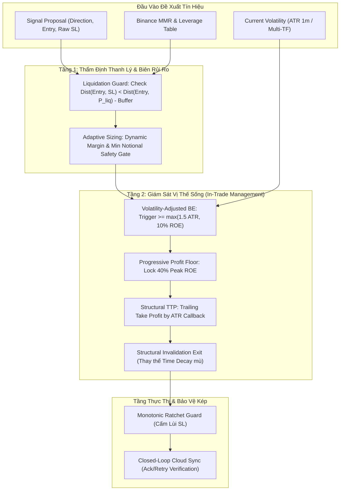

# BÁO CÁO KIỂM TOÁN CHUYÊN SÂU: HỆ THỐNG QUẢN TRỊ RỦI RO & BẢO TOÀN VỐN (RISK MANAGER DEEP DIVE)

> **File kiểm toán:** [`risk.rs`](file:///e:/Projects/Automations/trading_backtest/strategies_backtests/helios/src/strategy/core_v3/risk.rs)  
> **Phiên bản:** Helios V3 Core Risk Engine  
> **Phương pháp:** First-Principles Review, Phân tích Vi cấu trúc Khớp lệnh (Microstructure), Toán học Cực đoan (Extreme Math) & Đối chiếu Thực tế Binance Futures.

---

## 🧭 1. ĐỊNH VỊ KIẾN TRÚC & VAI TRÒ ĐỘC QUYỀN CỦA RISK MANAGER

Theo triết lý định lượng của hệ thống (mục 6.5 GEMINI.md):
- **Risk Manager** nắm quyền **độc quyền và tối cao** trong việc:
  1. Thẩm định đề xuất Stop Loss từ Arbiter (`is_structural_sl_acceptable`).
  2. Kẹp biên an toàn cho Stop Loss (`clamp_sl_price`) chống vượt trần rủi ro.
  3. Tính toán quy mô vị thế (`calculate_size`), đòn bẩy và tuân thủ `MIN_NOTIONAL`.
  4. Quản lý trạng thái lệnh mở: Trailing Stop Loss (TSL), Dynamic Break-Even (BE), Trailing Take Profit (TTP), Progressive Profit Floor, và Underwater Exit.
- **Ranh giới bất biến:** Scanner và Arbiter chỉ tìm kiếm cơ hội và phân xử độ tự tin; **tuyệt đối không được can thiệp vào việc bảo vệ vốn và cắt lỗ**.

---

## 🔬 2. MỔ XẺ 6 KẼ HỞ LOGIC & RỦI RO TOÁN HỌC CỐT TỬ TRONG `risk.rs`

### ⚠️ KẼ HỞ 1: RỦI RO THANH LÝ NGẦM DO THIẾU NHẬN THỨC VỀ MAINTENANCE MARGIN (MMR BLINDNESS)
- **Vị trí code:** [`clamp_sl_price`](file:///e:/Projects/Automations/trading_backtest/strategies_backtests/helios/src/strategy/core_v3/risk.rs#L125-L210) & [`is_structural_sl_acceptable`](file:///e:/Projects/Automations/trading_backtest/strategies_backtests/helios/src/strategy/core_v3/risk.rs#L30-L70).
- **Hiện trạng code:**
  - Hệ thống đặt trần cứng toàn cục: `GLOBAL_HARD_MAX_ROE = 0.15` (15% ROE).
  - Khoảng cách SL tính theo % giá là:
    $$\Delta_{\text{SL}} = \frac{\text{ROE}_{\text{cap}}}{L} = \frac{15\%}{L}$$
  - Ví dụ:
    - Với $L = 20\text{x}$: $\Delta_{\text{SL}} = 0.75\%$ giá.
    - Với $L = 50\text{x}$: $\Delta_{\text{SL}} = 0.30\%$ giá.
    - Với $L = 100\text{x}$: $\Delta_{\text{SL}} = 0.15\%$ giá.
- **Bản chất vi cấu trúc sàn Binance Futures:**
  - Khi mở vị thế `ISOLATED Margin`, giá thanh lý cưỡng chế ($P_{\text{liq}}$) được sàn tính theo công thức chuẩn:
    $$P_{\text{liq, Long}} = \text{Entry} \times \left(1 - \frac{1}{L} + \text{MMR}\right)$$
    Khoảng cách từ Entry đến Giá thanh lý là:
    $$\Delta_{\text{liq}} = \frac{1}{L} - \text{MMR}$$
  - Tỷ lệ ký quỹ duy trì $\text{MMR}$ (Maintenance Margin Ratio) phụ thuộc vào Tier khối lượng và loại tài sản:
    - BTC, ETH: $\text{MMR} \approx 0.4\% - 0.5\%$.
    - Altcoins Top (SOL, BNB, DOGE): $\text{MMR} \approx 1.0\%$.
    - Altcoins Mid/Low-Cap: $\text{MMR} \approx 1.5\% - 2.5\%$, thậm chí $5.0\%$.
- **Hiểm họa toán học:**
  - Hãy xét kịch bản giao dịch Altcoin với $\text{MMR} = 1.0\%$:
    - Tại $L = 50\text{x}$: $\frac{1}{L} = 2.0\% \implies \Delta_{\text{liq}} = 2.0\% - 1.0\% = 1.0\%$ giá (chịu được tối đa $50\%$ ROE).
    - Tại $L = 100\text{x}$: $\frac{1}{L} = 1.0\% \implies \Delta_{\text{liq}} = 1.0\% - 1.0\% = 0.0\%$ giá! **VỊ THẾ BỊ THANH LÝ NGAY LẬP TỨC KHI VỪA MỞ LỆNH HOẶC CHỈ CẦN PHÍ SÀN 0.08% TRỪ VÀO MARGIN!**
  - Trong `risk.rs`: **Hoàn toàn KHÔNG HỀ CÓ BIẾN $\text{MMR}$ hay khái niệm Giá Thanh Lý!**
  - `RiskManager` không kiểm tra khoảng cách an toàn đến Liquidation Price. Khi người dùng cấu hình đòn bẩy cao trên các Altcoin có MMR lớn, tài khoản có thể bị sàn bắn lệnh thanh lý cưỡng chế (kèm phí phạt thanh lý rất nặng) trước khi chạm Stop Loss!

---

### ⚠️ KẼ HỞ 2: BẪY "UNDERWATER TIGHTENING" BÓP CHẾT LỆNH NGAY ĐÁY (PREMATURE WHIPSAW EXECUTION TRAP)
- **Vị trí code:** [`manage_trailing_stop` (dòng 510–560)](file:///e:/Projects/Automations/trading_backtest/strategies_backtests/helios/src/strategy/core_v3/risk.rs#L510-L560).
- **Hiện trạng code:**
  - Khi lệnh bị ngâm âm quá `stagnant_timeout_bars` (mặc định 12 nến 1m):
    $$\text{underwater\_mult} = (\text{base\_sl\_atr} \times 0.80^n).\max(\text{tsl\_buffer\_floor\_atr})$$
  - Mỗi 6 nến kế tiếp, hệ thống tự động siết SL lại gần `entry_price` thêm 20%.
  - Nếu `tightened_sl` chạm hoặc vượt qua `current_close`: `should_force_close` kích hoạt và đóng vị thế ngay lập tức!
- **Bản chất vi cấu trúc thị trường:**
  - Trên đồ thị 1m, sau khi nến bứt phá (Breakout) hoặc hồi quy (Pullback), giá thường cần một khoảng thời gian **tích lũy/nén biên độ (Consolidation)** kéo dài từ 15 đến 30 phút trước khi đi tiếp con sóng chính.
  - Khi thị trường đang sideway tích lũy lành mạnh trên vùng hỗ trợ, lệnh bị âm nhẹ (-2% đến -5% ROE).
  - Thuật toán Underwater Tightening đếm thời gian trôi qua rồi **tự ý dời SL áp sát vào vùng tranh chấp** (từ -10% ROE siết về -4% ROE).
  - Kết quả: **Bot tự cắt lỗ đúng ngay đáy nến nén!** Vừa cắt lỗ xong thì giá nén đủ lực và bùng nổ tăng vọt theo đúng kỳ vọng ban đầu.
- **Nguyên lý First-Principles:** SL chỉ được phép dời khi **cấu trúc thị trường bị phá vỡ** (Market Structure Invalidation) hoặc **động lượng bị suy kiệt hoàn toàn**, tuyệt đối không được bóp nghẹt SL đơn thuần dựa vào số nến trôi qua trong khi giá vẫn nằm an toàn trên vùng hỗ trợ.

---

### ⚠️ KẼ HỞ 3: BẪY KÍCH HOẠT BREAK-EVEN QUÁ SỚM (THE 0.3% PRICE JITTER BE TRAP)
- **Vị trí code:** [`manage_trailing_stop` (dòng 390–420)](file:///e:/Projects/Automations/trading_backtest/strategies_backtests/helios/src/strategy/core_v3/risk.rs#L390-L420).
- **Hiện trạng code:**
  - Ngưỡng Break-Even tối thiểu:
    $$\text{min\_safe\_be\_roe} = (\text{fee\_buffer\_pct} \times L \times 1.5).\max(\text{base\_be\_roe})$$
  - Với $L = 20\text{x}$, `fee_buffer_pct = 0.10%`, `base_be_roe = 0.06` (6% ROE):
    $$\text{min\_safe\_be\_roe} = \max(0.10\% \times 20 \times 1.5,\ 0.06) = \max(0.03,\ 0.06) = 0.06\ (6\%\ \text{ROE})$$
  - Độ dịch chuyển giá để đạt 6% ROE tại 20x:
    $$\Delta_{\text{Price}} = \frac{6\%}{20} = 0.30\%$$
- **Hệ quả thực tế:**
  - Trên khung 1m, độ nhiễu tự nhiên của một cây nến ETH/SOL thông thường là $0.20\% - 0.40\%$.
  - Một râu nến vừa nhích nhẹ lên $0.30\%$ giá đã lập tức kích hoạt Break-Even.
  - Hệ thống dời SL lên $Entry + 0.10\%$ (để bù phí).
  - Cây nến tiếp theo chỉ cần dao động ngẫu nhiên (noise) thoái lui nhẹ là quét văng lệnh tại mức hòa vốn!
  - **Căn bệnh "Đói Lệnh Thắng Lớn" (Home Run Starvation):** Thay vì ăn được con sóng lớn $+20\% \to +50\%$ ROE, hệ thống liên tục bị biến thành cỗ máy đóng lệnh hòa vốn hoặc ăn vài xu lẻ, làm tỷ lệ Win Rate và Profit Factor suy thoái trầm trọng.

---

### ⚠️ KẼ HỞ 4: BẪY "MIN NOTIONAL BUMP" LÀM PHÌNH TO RỦI RO VỐN NHỎ (CAPITAL BLEED TRAP)
- **Vị trí code:** [`calculate_size` (dòng 75–115)](file:///e:/Projects/Automations/trading_backtest/strategies_backtests/helios/src/strategy/core_v3/risk.rs#L75-L115).
- **Hiện trạng code:**
  - Binance Futures yêu cầu giá trị danh nghĩa tối thiểu: $\text{Notional} \ge \$20.0$ (code đặt sàn $\$21.0$).
  - Khi tài khoản có vốn nhỏ (ví dụ $E = \$30.0$) và cấu hình `risk_per_trade = 0.10` (10% vốn):
    $$\text{Margin mong muốn} = \$30.0 \times 0.10 = \$3.0$$
  - Nếu đòn bẩy $L = 5\text{x}$: $\text{Notional mong muốn} = \$3.0 \times 5 = \$15.0 < \$21.0$.
  - Hàm `calculate_size` tự động nâng Notional lên $\$21.0$:
    $$\text{Margin thực tế} = \frac{\$21.0}{5} = \$4.20 \implies \text{Tỷ lệ cược thực tế} = \frac{\$4.20}{\$30.0} = 14.0\%\ \text{vốn}$$
  - Nếu tài khoản trải qua chuỗi thua lỗ và vốn tụt xuống $\$15.0$:
    - Tại $L = 10\text{x}$: Margin cần thiết $= \$21 / 10 = \$2.10$ ($14\%$ vốn).
    - Nhưng tại $L = 5\text{x}$: Margin cần thiết $= \$21 / 5 = \$4.20$ ($28\%$ vốn)!
    - Vượt quá `max_capital_cap = 25%` $\implies$ Hàm trả về `0.0` (tài khoản bị tê liệt hoàn toàn, không thể vào lệnh để phục hồi).
- **Hệ quả rủi ro:** Vốn càng nhỏ, tỷ lệ vốn đem ra mạo hiểm cho mỗi lệnh càng bị phóng đại ngoài ý muốn (từ 5% bị đội lên 15–20% vốn). Khi dính Stop Loss 15% ROE, mức sụt giảm thực tế trên tổng tài khoản bị nhân lên gấp bội.

---

### ⚠️ KẼ HỞ 5: MẤT ĐỒNG BỘ PHẢN HỒI GIỮA SL TRONG RAM VÀ CLOUD BINANCE (THE ORPHANED SL GAP)
- **Vị trí code:** [`manage_trailing_stop` (dòng 567–575)](file:///e:/Projects/Automations/trading_backtest/strategies_backtests/helios/src/strategy/core_v3/risk.rs#L567-L575).
- **Hiện trạng code:**
  - `tick.update_trade_sl_tp(trade.id, sl_to_send, new_tp_to_update);`
  - Lệnh gọi này hoạt động theo cơ chế **Bất đồng bộ một chiều (Fire-and-Forget)**.
- **Rủi ro thực tế trên sàn:**
  - Execution Engine trên sàn thực hiện cập nhật SL bằng cách: Hủy lệnh Algo cũ $\to$ Nghỉ 150ms $\to$ Gửi lệnh Algo mới.
  - Nếu trong 150ms đó xảy ra sự cố mạng, hoặc giá thị trường biến động quá nhanh khiến lệnh mới bị Binance REJECT (lỗi `Order would immediately trigger` hoặc `Price precision invalid`):
    - **Lệnh trên sàn bị hủy nhưng lệnh mới không được đặt!**
    - Vị thế trên sàn Binance trở thành **vị thế mồ côi (Orphaned Position - hoàn toàn không có Stop Loss)**!
    - Trong khi đó, `RiskManager` trong RAM vẫn ngỡ là SL đã được dời lên thành công. Nếu nến sau đó sập mạnh, tài khoản sẽ gánh chịu khoản lỗ không giới hạn hoặc bị cháy sạch!

---

### ⚠️ KẼ HỞ 6: THIẾU KIỂM SOÁT CÁC ĐIỀU KIỆN BIÊN CỰC ĐOAN (EXTREME EDGE CASES)
- **ATR triệt tiêu ($ATR \to 0$):**
  - Khi thị trường đóng băng (Flatline), $ATR = 0.0$.
  - Trong logic Underwater: `tightened_sl = trade.entry_price - (0.0 * mult) = trade.entry_price`.
  - Nếu nến hiện tại đóng đúng bằng `entry_price`, `should_force_close` kích hoạt đóng lệnh tức thì mà không có lý do chính đáng.
- **Giá nhảy Gap vượt qua Stop Loss (Slippage Deficit):**
  - Trong trường hợp Flash Crash hoặc tin tức vĩ mô nuke giá, nến sau mở cửa nhảy vọt qua mức SL.
  - Backtest giả lập khớp đúng tại giá SL (0.04% commission), nhưng trên sàn thực tế, lệnh `STOP_MARKET` sẽ trượt giá khớp sâu hơn 1% – 3% so với dự tính. Risk Manager hiện tại không có cơ chế ghi nhận độ lệch trượt giá (Slippage Feedback) để bù trừ vào các lệnh kế tiếp.

---

## 📊 3. BẢNG ĐỐI CHẤT TOÀN DIỆN: HIỆN TRẠNG VS HỆ QUẢ VS GIẢI PHÁP ĐỀ XUẤT

| Thành phần | Hiện trạng trong Code | Hệ quả Vi cấu trúc Thực tế | Giải pháp Đề xuất Chuẩn Quant |
| :--- | :--- | :--- | :--- |
| **Liquidation Distance & MMR** | Không hề có biến `MMR`, chỉ kẹp trần `15% ROE` | Tại đòn bẩy cao ($\ge 50\text{x}$) hoặc Altcoin MMR cao, vị thế bị sàn thanh lý trước khi chạm SL | Tính toán $P_{\text{liq}}$ động. Bắt buộc $SL$ phải cách $P_{\text{liq}}$ tối thiểu một biên độ an toàn $\Delta_{\text{MMR\_buffer}}$ |
| **Underwater Tightening** | Giảm khoảng cách SL theo số nến ngâm âm | Bóp nghẹt SL trong vùng nén tích lũy, tự cắt lỗ đúng đáy trước khi giá bật tăng | Xóa bỏ Time-Decay mù quáng. Chỉ siết SL khi xuất hiện nến xác nhận suy kiệt xu hướng hoặc thủng Swing Low |
| **Break-Even Trigger** | Kích hoạt tại $6\%$ ROE ($0.3\%$ giá tại 20x) | Râu nến $0.3\%$ quét trúng làm kích hoạt BE sớm, nến sau hồi nhẹ quét hòa vốn, bỏ lỡ sóng lớn | Kích hoạt BE dựa trên **Độ biến động nến**: $\Delta_{\text{BE}} \ge \max(1.5\ \text{ATR},\ 10\%\ \text{ROE})$. Miễn nhiễm với nhiễu nến 1m |
| **Min Notional Sizing** | Tự động bump margin lên để đạt \$21 Notional | Tài khoản vốn nhỏ bị đội tỷ lệ rủi ro/lệnh từ 10% lên 28%, dễ bị sập chuỗi | Thêm chốt chặn tỷ lệ ký quỹ tối đa. Nếu margin cần thiết vượt quá trần cho phép $\to$ Từ chối mở lệnh an toàn |
| **Vòng lặp Cập nhật SL** | Fire-and-forget qua `tick.update_trade_sl_tp` | Vị thế mồ côi không có SL trên sàn nếu lệnh mới bị reject trong 150ms | Thiết lập cơ chế xác nhận 2 chiều (Closed-Loop Ack): Nếu sàn báo lỗi đặt SL mới $\to$ Kích hoạt Retry hoặc khẩn cấp đóng vị thế |
| **Trần Kẹp SL Toàn Cục** | `GLOBAL_HARD_MAX_ROE = 15%` | Rất tốt trong việc chống cháy tài khoản, nhưng VETO nhị phân quá cứng | Kết hợp De-leverage: Khi khoảng cách SL rộng, tự động giảm Position Size thay vì VETO thô bạo |

---

## 🏗️ 4. KIẾN TRÚC NÂNG CẤP ĐỀ XUẤT CHO RISK MANAGER (V3.1)

