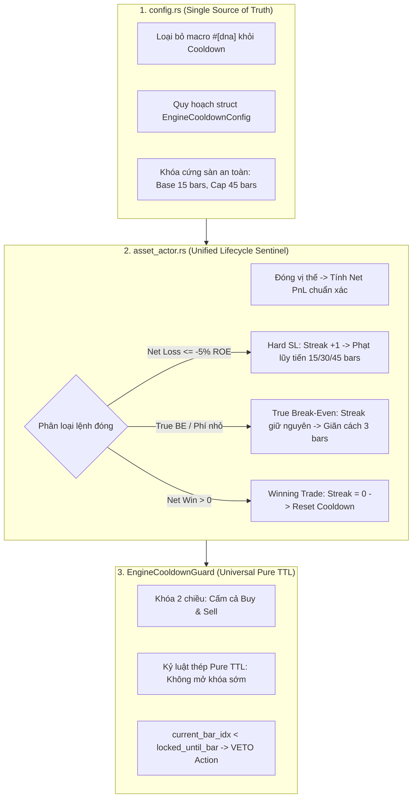

# TÀI LIỆU ĐẶC TẢ KỸ THUẬT: TASK-CORE-01
# CẢI TỔ TOÀN DIỆN CẦU DAO BẢO VỆ TÀI KHOẢN (UNIVERSAL PURE TTL COOLDOWN & TRUE BREAK-EVEN)

> **Thư mục:** `strategies_backtests/helios/docs/audit_01/06_risk/`  
> **Mã công việc:** `TASK-CORE-01`  
> **Ngày lập:** 03/10/2026  
> **Trạng thái:** Thiết Kế Kỹ Thuật Chi Tiết (Approved Design)  
> **Tác giả:** Antigravity Quant Engineering Team  

---

## 🏛️ 1. BẢN CHẤT NGHIỆP VỤ & TOÁN HỌC NỀN TẢNG (FIRST-PRINCIPLES)

### 1.1. Bản chất Vật Lý Thị Trường Sau Khi Dính Cắt Lỗ (Post-Stop-Loss Dynamics)
Khi một vị thế giao dịch phái sinh bị quét **Hard Stop Loss (lỗ 10% - 15% ROE)**, cấu trúc vi mô của thị trường đang phản ánh 3 hiện tượng:
1. **Gãy Đổ Cấu Trúc (Structure Invalidation):** Kịch bản giá và giả định phân tích của chiến lược trước đó đã sai hoàn toàn.
2. **Cơn Bão Thanh Khoản (Liquidity Sweep / Cascade):** Cá mập/Smart Money vừa thực hiện cú quét thanh khoản dồn dập, tạo ra những đợt trượt giá và mất cân bằng cung cầu cực hạn.
3. **Nhiễu Loạn Vi Mô Nến 1m (Micro Chaos & Whipsaw):** Ngay sau cú quét SL, thị trường thường xuất hiện nhịp nảy kỹ thuật giả tạo (Dead Cat Bounce / Bull Trap) hoặc giật 2 đầu dữ dội. Nếu nhảy vào bắt dao rơi hoặc cào lệnh trả thù ngay tại cây nến kế tiếp ($t+1, t+2$ phút), bot chắc chắn sẽ bị "vả 2 đầu" và tiếp tục nộp mạng làm thanh khoản.

### 1.2. Mổ Xẻ Gốc Rễ Nguyên Nhân Gây Lỗi Trong Mã Nguồn (Root Cause Traceability)
1. **Lỗi Không Gian DNA (`config.rs:897`):**
   ```rust
   #[dna(min = 0.0, max = 60.0, step = 5.0)]
   pub re_entry_cooldown_bars: usize,
   ```
   Dải tìm kiếm cho phép cận dưới bằng `0.0`. Thuật toán di truyền (GA) phát hiện rằng nếu đặt `re_entry_cooldown_bars = 0`, chiến lược sẽ bắt được nhiều đợt bùng nổ nến trong dữ liệu In-Sample, đẩy số lệnh $N$ lên cao, từ đó làm tăng $SQN \propto \sqrt{N}$ và Return ảo để ẵm điểm Fitness cao.
2. **Lỗi Lệch Pha Kiến Trúc (Architecture Discrepancy):**
   Trong `core_v3/mod.rs:404-426`, khối Cooldown bị comment out toàn bộ với lý do bàn giao cho Bot Engine. Hậu quả là GA chạy trong phòng thí nghiệm không chịu bất kỳ hình phạt nào về việc cào lệnh thua.
3. **Lỗi Tê Liệt Cầu Dao Tại Bot Engine (`asset_actor.rs:206`):**
   ```rust
   if stop_cfg.enable_re_entry_cooldown && stop_cfg.re_entry_cooldown_bars > 0 { ... }
   ```
   Khi DNA mang giá trị `re_entry_cooldown_bars = 0`, điều kiện kiểm tra trả về `false`, làm tê liệt 100% Cầu Dao Cooldown tại Bot Engine. Bot mở lệnh liên thanh sau mỗi 1 phút ngay sau khi dính Hard SL (vạch trần ở Run 2: Trade #0026 -> #0027 trong 1 phút, Trade #0036 -> #0037 trong 2 phút).

---

## 🎯 2. KIẾN TRÚC GIẢI PHÁP TỔNG THỂ (THE QUANT DEFENSE ARCHITECTURE)

Hệ thống tuân thủ triệt để nguyên tắc **Separation of Concerns (Phân định ranh giới trách nhiệm)**:
* **Helios Strategy Core:** Đóng vai trò là **Alpha Engine thuần khiết** (tìm kiếm cơ hội, tính toán chỉ báo, chấm điểm tự tin). Strategy không trực tiếp can thiệp quản trị tài khoản.
* **Bot Engine (`asset_actor.rs`):** Đóng vai trò là **Execution & Portfolio Engine** (quản lý tiền thật, vị thế thật, số dư Net PnL, phí sàn thực tế). Cooldown thuộc về quyền lực độc quyền của Bot Engine.
* **`config.rs`:** Đóng vai trò là **Single Source of Truth** (Bảng cấu hình tập trung duy nhất cho toàn bộ hệ thống).



---

## 📐 3. BẢNG THAM SỐ CẤU HÌNH TRONG `config.rs`

Toàn bộ các biến liên quan đến Cooldown và True Break-Even được tập trung và loại bỏ hoàn toàn macro `#[dna]`:

```rust
/// 🛡️ CẤU HÌNH CẦU DAO BẢO VỆ TÀI KHOẢN TẠI BOT ENGINE (ENGINE COOLDOWN SENTINEL)
#[derive(Debug, Clone, Deserialize)]
pub struct EngineCooldownConfig {
    /// Cờ bật/tắt toàn cục Cầu Dao Cooldown (true: BẬT, false: TẮT)
    #[serde(default = "default_true")]
    pub enable_re_entry_cooldown: bool,

    /// Thời gian giãn cách cơ sở sau một lệnh dính Hard SL (Mặc định: 15 nến 1m = 15 phút)
    #[serde(default = "default_base_cooldown_bars")]
    pub base_cooldown_bars: usize,

    /// Trần thời gian giãn cách tối đa khi dính chuỗi thua liên tiếp (Mặc định: 45 nến = 45 phút)
    #[serde(default = "default_max_cooldown_cap_bars")]
    pub max_cooldown_cap_bars: usize,

    /// Thời gian giãn cách ngắn sau lệnh hòa vốn True Break-Even để nến ổn định (Mặc định: 3 nến = 3 phút)
    #[serde(default = "default_be_tolerance_cooldown_bars")]
    pub be_tolerance_cooldown_bars: usize,

    /// Khoảng đệm bù phí sàn 2 chiều + trượt giá an toàn khi dời SL hòa vốn (Mặc định: 0.13% = 0.0013)
    #[serde(default = "default_true_be_roundtrip_fee_pct")]
    pub true_be_roundtrip_fee_pct: f64,

    /// Ngưỡng ROE phân định lệnh thua nặng cần kích hoạt Cầu Dao đầy đủ (Mặc định: -5.0% ROE)
    #[serde(default = "default_hard_loss_roe_threshold")]
    pub hard_loss_roe_threshold: f64,
}
```

Các hàm khởi tạo mặc định chuẩn Quant:
```rust
fn default_base_cooldown_bars() -> usize { 15 }
fn default_max_cooldown_cap_bars() -> usize { 45 }
fn default_be_tolerance_cooldown_bars() -> usize { 3 }
fn default_true_be_roundtrip_fee_pct() -> f64 { 0.0013 }
fn default_hard_loss_roe_threshold() -> f64 { -0.05 }
```

---

## ⚙️ 4. LOGIC THỰC THI CHI TIẾT TẠI BOT ENGINE

### 4.1. Công thức Phạt Lũy Tiến (Exponential Backoff with Hard Cap)
Khi chuỗi thua liên tiếp tăng lên, số nến phạt tăng theo lũy thừa 2 và bị chặn cứng tại `max_cooldown_cap_bars`:
$$\text{Penalty}(k) = \min\left(\text{Base} \times 2^{\min(k - 1, 2)},\ \text{MaxCap}\right)$$
Với $\text{Base} = 15$, $\text{MaxCap} = 45$:
* Thua 1 lệnh ($k = 1$): Phạt $15 \times 2^0 = \mathbf{15\text{ nến}}$ ($15$ phút).
* Thua 2 lệnh ($k = 2$): Phạt $15 \times 2^1 = \mathbf{30\text{ nến}}$ ($30$ phút).
* Thua $\ge 3$ lệnh ($k \ge 3$): Phạt $\min(15 \times 2^2, 45) = \mathbf{45\text{ nến}}$ ($45$ phút).

### 4.2. Khái niệm "True Break-Even" (Hòa Vốn Thực Tế Khấu Trừ Phí)
Để tránh bẫy "hòa vốn nhưng mất tiền phí sàn", khoảng đệm dời SL được tính như sau:
* **Lệnh Long:** $\text{SL}_{\text{BE}} = \text{EntryPrice} \times (1 + \text{true\_be\_roundtrip\_fee\_pct})$
* **Lệnh Short:** $\text{SL}_{\text{BE}} = \text{EntryPrice} \times (1 - \text{true\_be\_roundtrip\_fee\_pct})$

### 4.3. Phân Định Lệnh Đóng và Trạng Thái Cầu Dao Trong `sync_and_handle_closed_positions`
Khi có vị thế đóng, hệ thống thực hiện phân loại 3 trạng thái rõ ràng:
1. **Lệnh Thắng Lợi Nhuận ($\text{Net PnL} > 0$):**
   * Reset `consecutive_losses = 0`.
   * Reset `locked_until_bar = 0`.
   * Ghi log vinh danh và sẵn sàng cho các cơ hội tiếp theo.
2. **Lệnh Hòa Vốn True Break-Even ($-5\% \text{ ROE} < \text{Loss} \le 0$ hoặc dính True BE):**
   * **Không tăng chuỗi thua:** Giữ nguyên `consecutive_losses`.
   * Áp dụng giãn cách ngắn: `locked_until_bar = current_bar_idx + be_tolerance_cooldown_bars` (3 nến).
3. **Lệnh Thua Nặng Cấu Trúc / Hard SL ($\text{Loss} \le -5\% \text{ ROE}$):**
   * Tăng chuỗi thua: `consecutive_losses += 1`.
   * Kích hoạt án phạt đầy đủ: `locked_until_bar = current_bar_idx + Penalty(consecutive_losses)`.
   * Khóa 2 chiều tuyệt đối (Universal Pure TTL) đối với mọi đề xuất `Action::Buy` và `Action::Sell`.

### 4.4. Kỷ Luật Thép Pure TTL (Strict No Early Unlock)
* Trong suốt khoảng thời gian $t < \text{locked\_until\_bar}$, mọi hành vi mở lệnh đều bị **VETO 100%**.
* Không áp dụng cơ chế mở khóa sớm theo ATR để triệt tiêu hoàn toàn bẫy Fakeout nến 1m và loại trừ mọi nguy cơ bug deadlock.

---

## ⚖️ 5. BẢNG ĐỐI CHẤT: ƯU - KHUYẾT - EDGE CASES

| Thành Phần | Ưu Điểm | Khuyết Điểm | Biện Pháp Xử Lý Edge Case |
| :--- | :--- | :--- | :--- |
| **Bỏ macro `#[dna]`** | GA không còn quyền lực triệt tiêu Cooldown về 0. | GA không thể tự điều chỉnh độ dài Cooldown cho từng loại coin riêng lẻ. | Giá trị cơ sở 15 nến là tiêu chuẩn vàng của thị trường crypto nến 1m. |
| **Universal Pure TTL (Khóa 2 chiều)** | Triệt tiêu 100% bẫy vả 2 đầu (Whipsaw Trap) và cào lệnh trả thù. | Bỏ lỡ cú đảo chiều nếu thị trường quay đầu cực mạnh ngay sau khi quét SL. | An toàn vốn là trên hết; trong 15 phút sau cú quét SL, xác suất nến tiếp tục giật nhiễu cao hơn nhiều so với việc hình thành ngay trend bền vững. |
| **Dung sai True Break-Even** | Không phạt nhầm các lệnh hòa vốn danh nghĩa, tránh làm tê liệt bot oan uổng. | Thêm 1 nhánh phân loại trong logic xử lý đóng lệnh. | Sử dụng ngưỡng cố định $-5.0\%$ ROE và `true_be_roundtrip_fee_pct` để phân định toán học rành mạch. |
| **Max Cap 45 bars** | Không giam vốn quá lâu (tối đa 45 phút thay vì 2 tiếng), giữ được nhịp giao dịch. | Nếu thị trường sập liên tục 5 cây nến thì sau 45 phút vẫn có thể gặp rủi ro nếu chưa dứt trend. | Đã có Tầng 1 (`RegimeGatekeeper: chaos_index >= 0.70`) lo việc chặn bão dài hạn. |

---

## 🧪 6. KỊCH BẢN KIỂM CHỨNG & UNIT TESTS

Hệ thống phải vượt qua 100% các bài test sau trong `asset_actor.rs`:
1. `test_cooldown_calculation_with_hard_cap_45`: Kiểm tra chuỗi thua 1 -> 15, 2 -> 30, 3 -> 45, 10 -> 45 bars.
2. `test_pure_ttl_universal_blocking`: Kiểm tra cấm cả Long lẫn Short khi `current_bar < locked_until_bar`.
3. `test_true_break_even_tolerance`: Lệnh hòa vốn danh nghĩa (-0.08% net do phí) chỉ phạt 3 bars và không làm tăng `consecutive_losses`.
4. `test_hard_sl_triggers_exponential_penalty`: Lệnh dính Hard SL (-12% ROE) tăng streak lên 1 và phạt đủ 15 bars.
5. `test_winning_trade_full_reset`: Một lệnh lãi +5% ROE reset hoàn toàn streak và gỡ bỏ khóa.
