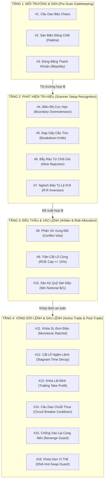

# BẢNG TOÀN DIỆN 100% CÁC CHỐT CHẶN BẢO VỆ VỐN (THE COMPLETE CAPITAL DEFENSE MATRIX)

> **Mô-đun:** Helios Core V3.3 - Capital Defense & Risk Governance  
> **Tài liệu tham chiếu:** [`technical_audit.md`](./technical_audit.md), [`non_tradable_regimes.md`](./non_tradable_regimes.md)  
> **Cập nhật:** 30/09/2026  
> **Định vị kiến trúc:** Ma trận phòng ngự 4 tầng bảo vệ vốn tài khoản trong môi trường giao dịch phái sinh đòn bẩy cao ($20\text{x} \to 125\text{x}$).

---

## 🏛️ 1. MA TRẬN 4 TẦNG PHÒNG NGỰ & 16 CHỐT CHẶN BẢO VỆ VỐN

Hệ thống Helios V3 tác chiến dựa trên nguyên lý phòng thủ đa tầng (Defense-in-Depth). Mỗi vị thế giao dịch phải vượt qua và được giám sát bởi 16 chốt chặn trải dài suốt toàn bộ vòng đời:

---

## 📊 2. BẢNG CHI TIẾT 16 CHỐT CHẶN BẢO VỆ VỐN

| STT | Tên Chốt Chặn | Tầng Phòng Ngự | Bản Chất Toán Học & Vật Lý | Rủi Ro Nếu Bị Bỏ Trống / Vi Phạm | Phân Loại Xử Lý |
| :---: | :--- | :---: | :--- | :--- | :---: |
| **1** | **Cầu Dao Bão Chaos** | Tầng 1: Môi trường | $\text{Chaos\_Idx} \ge \text{chaos\_veto\_threshold}$ ($NATR \uparrow\uparrow$ & $ER \to 0$). | Giá giật 2 đầu (Whipsaw), quét sạch 2 đầu SL trong vài phút. | 🔴 **Hard Gate** (Arbiter) |
| **2** | **Sàn Biến Động Chết** | Tầng 1: Môi trường | $NATR < \text{Taker Fee} \times 2$ (Biến động nến nhỏ hơn phí sàn). | Bẫy phí sàn (Fee Drag): Lợi nhuận không đủ bù phí hoa hồng 2 chiều. | 🔴 **Hard Gate** (Arbiter) |
| **3** | **Đóng Băng Thanh Khoản** | Tầng 1: Môi trường | $Volume \approx 0$ hoặc $Vol\_Z < -2.0$ kéo dài liên tục. | Trượt giá slippage khổng lồ, giãn spread nuốt trọn tài khoản. | 🔴 **Hard Gate** (Arbiter) |
| **4** | **Biên Độ Cực Hạn** | Tầng 2: Tín hiệu | $Z_{\text{price}} > +1.5 \to +2.5$, nến văng khỏi BB, MFI $> 75$. | Đu đỉnh sóng tăng hoặc bán đáy sóng giảm (Ca Trade #029). | 🟢 **DNA Filter** (Scanner) |
| **5** | **Đạp Gãy Cấu Trúc** | Tầng 2: Tín hiệu | Nến đỏ xả dài đâm thủng KAMA với $Vol\_Z > 1.5$ & $\text{CLV} \approx -1.0$. | Hứng dao rơi khi phe gấu đang xả ồ ạt (giả mạo Pullback). | 🟢 **DNA Filter** (Scanner) |
| **6** | **Bẫy Râu Từ Chối Giá** | Tầng 2: Tín hiệu | Râu nến dội ngược chiếm $> 60\%$ chiều dài nến ($\text{CLV}$ đối kháng). | Mở lệnh ngay sau khi phe vừa bị đập dội ngược (xác suất thua 80%). | 🟢 **DNA Filter** (Scanner) |
| **7** | **Nghịch Đảo Tỷ Lệ R:R** | Tầng 2: Tín hiệu | $\Delta SL \gg \Delta TP$ ($R:R < 1:1$). | Thắng ăn non vài đồng, thua mất một đống ($EV$ âm dài hạn). | 🟢 **DNA Filter** (Scanner) |
| **8** | **Phân Xử Xung Đột** | Tầng 3: Đấu thầu | Cả Long và Short cùng phát tín hiệu với $\Delta Conf < Margin$. | Vào lệnh giữa lúc 2 phe mua/bán đang giằng co hỗn loạn. | 🔴 **Hard Gate** (Arbiter) |
| **9** | **Trần Cắt Lỗ Cứng** | Tầng 3: Đấu thầu | $\Delta P_{SL} \times Leverage \le 15\%$ ROE (Bất biến). | Thảm họa Trade #015: Mất -37.1% ROE xóa sạch 5 lệnh thắng. | 🔴 **Hard Gate** (Risk) |
| **10** | **Sàn Ký Quỹ Sàn Đấu** | Tầng 3: Đấu thầu | $Size \times Price < \$21.00$ (Giới hạn Binance Futures). | Lệnh bị sàn từ chối (`MIN_NOTIONAL`), gây lệch pha quản lý vốn. | 🔴 **Hard Gate** (Risk) |
| **11** | **Khóa SL Đơn Điệu** | Tầng 4: Vòng đời | $SL_{t+1} \ge SL_t$ với Long, cấm lùi SL (Monotonic Ratchet). | Bị nới rộng SL khi thị trường quay đầu, biến lỗ nhỏ thành lỗ lớn. | 🔴 **Hard Gate** (Risk) |
| **12** | **Cắt Lỗ Ngâm Lệnh** | Tầng 4: Vòng đời | Giữ lệnh $> N$ bars mà $PnL \le 0$ thì cưỡng chế đóng (Stagnant). | Vốn bị chôn chân trong thị trường thối rữa động lượng. | 🟢 **DNA Filter** (Risk) |
| **13** | **Khóa Lãi Đỉnh** | Tầng 4: Vòng đời | Đạt đỉnh lợi nhuận và thoái lui $N\%$ (Trailing Take Profit). | Để lệnh đang lãi đậm biến thành hòa vốn hoặc lỗ ngược. | 🟢 **DNA Filter** (Risk) |
| **14** | **Cầu Dao Chuỗi Thua** | Tầng 4: Sau lệnh | Phạt thời gian khóa Pure TTL lũy tiến sau chuỗi thua liên tiếp. | Giao dịch trả thù (Revenge Trading) cào cắn tài khoản đến cháy. | 🔴 **Hard Gate** (Actor) |
| **15** | **Chống Vào Lại Cùng Nến** | Tầng 4: Sau lệnh | Cấm mở lại vị thế ở ngay nến vừa bị quét SL. | Bị quét 2 lần liên tiếp trong cùng một nhịp giật giá. | 🔴 **Hard Gate** (Actor) |
| **16** | **Khóa Gen Vị Thế** | Tầng 4: Sau lệnh | Vị thế đang chạy chỉ dùng đúng DNA lúc mở (Hot-Swap Guard). | Bị đổi luật thoát lệnh giữa chừng khi GA nạp DNA mới. | 🔴 **Hard Gate** (Actor) |

---

## ⚖️ 3. PHÂN ĐỊNH RANH GIỚI: CHỐT CHẶN SINH TỬ (HARD GATES) VS CẢM BIẾN THÍCH ỨNG (DYNAMIC DNA)

Nhằm triệt tiêu nguy cơ **Over-Engineered** và **Filter Paralysis (Bệnh sợ chết không dám vào lệnh)**, hệ thống phân định rõ:

### 🔴 Nhóm 1: Chốt Chặn Sinh Tử Bất Biến (Non-negotiable Hard Gates)
- **Bao gồm:** Chốt chặn #1, #2, #3, #8, #9, #10, #11, #14, #15, #16.
- **Nguyên tắc:** Đây là các "Cầu Dao Chống Cháy Tài Khoản". Khi vi phạm, hệ thống **cắt điện 100%**, không cho phép mở lệnh hoặc can thiệp bảo vệ ngay lập tức.
- **Không thỏa hiệp:** Không cho phép GA Optimizer nới lỏng hay tắt bỏ các chốt chặn này.

### 🟢 Nhóm 2: Cảm Biến Co Giãn Thích Ứng (Adaptive Dynamic DNA Sensors)
- **Bao gồm:** Chốt chặn #4, #5, #6, #7, #12, #13.
- **Nguyên tắc:** Phục vụ triết lý **Zerg Swarm & Mahoraga**: chấp nhận hy sinh nhỏ (Controlled Sacrifices $\le 15\%$ ROE) để trinh sát và thích ứng với từng tài sản.
- **Cơ chế:** Giao toàn bộ các ngưỡng kích hoạt vào **chuỗi DNA** để GA Optimizer tự động học tập và co giãn độ nhạy cảm biến phù hợp với từng giai đoạn thị trường.
