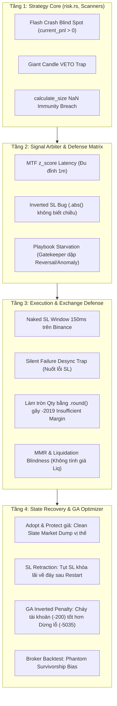

# BÁO CÁO KIỂM TOÁN RỦI RO TOÀN DIỆN 360° (DEEP-PASS RISK & RESILIENCE AUDIT)
> **Dự án:** Hệ sinh thái Giao dịch Định lượng Helios V3.3 & Trading Bot Execution  
> **Ngày hoàn thành:** 02/10/2026  
> **Phương pháp kiểm toán:** First-Principles Quant Analysis, Code Lineage Verification, Stress-Testing  
> **Phạm vi:** 4 Tầng kiến trúc: (1) Strategy Core, (2) Signal Arbiter & Defense Matrix, (3) Live Execution & Exchange Defense, (4) State Recovery & GA Optimizer.

---

## 🏛️ TỔNG QUAN KIẾN TRÚC & PHÂN VÙNG LỖ HỔNG

Hệ sinh thái rủi ro gồm 4 chốt chặn phòng vệ liên hoàn. Đợt kiểm toán chuyên sâu này đã bóc tách toàn bộ các "vùng mù" (blind spots) và mâu thuẫn giữa lý thuyết thiết kế và thực thi thực tế:

---

## 🚨 BẢNG MA TRẬN TỔNG HỢP CÁC LỖ HỔNG SINH TỬ (CRITICAL & HIGH)

| Nhóm | Mã | Mức Độ | Vị Trí File & Dòng Code | Hiện Tượng / Lỗ Hổng Kỹ Thuật | Hậu Quả Thực Tế |
| :--- | :---: | :---: | :--- | :--- | :--- |
| **Strategy Core** | **L1-01** | 🔴 **CRITICAL** | `risk.rs:291` | `current_pnl > 0.0 &&` trong điều kiện kích hoạt Break-Even. | Nến flash crash xả qua Entry làm tắt Emergency BE, lệnh đỉnh lãi +25% biến thành lỗ Underwater. |
| **Strategy Core** | **L1-02** | 🔴 **CRITICAL** | `risk.rs:15-28` `anomaly.rs:75,90` `momentum.rs:144` | SL đặt tại đỉnh/đáy nến bùng nổ to vượt trần 15% ROE $\to$ bị VETO oan. | Mù 100% với các cơ hội breakout và rút chân pinbar đẹp nhất thị trường. |
| **Strategy Core** | **L1-03** | 🔴 **CRITICAL** | `risk.rs:32-53` | Phép so sánh `NaN <= 0.0` trả về `false`, `NaN.min(0.25) = 0.25`. | Hàm cấp kích thước 25% vốn ngay trên một tài khoản có Equity bị nhiễm `NaN`! |
| **Strategy Core** | **L1-04** | 🔴 **HIGH** | `reversal.rs:59-82` | Thiếu hoàn toàn bộ lọc `chaos_index` trong Reversal Scanner. | Nhảy vào bắt dao rơi giữa cơn thác thanh lý (Liquidation Cascade). |
| **Strategy Core** | **L1-05** | 🔴 **HIGH** | `trend_pb.rs:122,170` | SL gán bằng `low.min(kama_mid) - buffer`. KAMA trễ pha khi giá bơm dốc. | Kéo SL tụt sâu xuống KAMA, vượt trần 15% ROE và bị VETO oan uổng. |
| **Arbiter & Matrix** | **L2-01** | 🔴 **CRITICAL** | `mod.rs:249` `trend_pb.rs:96,143` | `z_score` lấy từ khung MTF (15m/1h), chỉ đổi giá trị sau 15-60 nến 1m. | Giá 1m dựng cột pump parabol nhưng `z_score` MTF chưa kịp tăng $\to$ Trend_PB mua trúng đỉnh râu nến 1m! |
| **Arbiter & Matrix** | **L2-02** | 🔴 **HIGH** | `risk.rs:20` `arbiter.rs:219` | `is_structural_sl_acceptable` dùng `.abs()` không kiểm tra chiều lệnh (`is_long`). | Duyệt qua proposal Long có SL nằm TRÊN Entry hoặc Short có SL nằm DƯỚI Entry. |
| **Arbiter & Matrix** | **L2-03** | 🔴 **HIGH** | `arbiter.rs:168` `gatekeeper.rs:128` | Gatekeeper cắt điện toàn bộ khi $Chaos \ge 0.65$. | Triệt tiêu hoàn toàn Reversal & Anomaly đúng vào thời điểm bùng nổ sở trường của chúng. |
| **Arbiter & Matrix** | **L2-04** | 🔴 **HIGH** | `trend_pb.rs:118` `momentum.rs:132` | Thang điểm của Trend_PB và Absorption tự nhiên đạt 0.85-0.95 vs Momentum chỉ 0.65. | Trend_PB cướp quyền hoàn toàn của Momentum Ignition trong các pha Breakout. |
| **Execution Defense** | **L3-01** | 🔴 **CRITICAL** | `order_executor.rs:192-200` | Quy trình Trailing SL: Hủy SL cũ $\to$ sleep 150ms $\to$ Đặt SL mới. | Trong 150ms + RTT mạng, vị thế trơ trọi không có SL trên sàn. Rớt mạng/Flash crash là cháy tài khoản. |
| **Execution Defense** | **L3-02** | 🔴 **CRITICAL** | `order_executor.rs:233-237` | Đặt SL mới thất bại sau 3 lần retry $\to$ log lỗi rồi trả về `Ok(())`. | Bot tưởng còn SL cũ, nhưng trên Binance đã hủy sạch lệnh. Vị thế bị bỏ rơi vĩnh viễn không bảo vệ. |
| **Execution Defense** | **L3-03** | 🔴 **CRITICAL** | `market_info.rs:45` `order_executor.rs:137` | Làm tròn khối lượng bằng `.round()` thay vì `floor`. | Khối lượng bị làm tròn lên vượt quá số dư ký quỹ $\to$ Binance REJECT lệnh với lỗi `-2019 Margin Insufficient`. |
| **Execution Defense** | **L3-04** | 🔴 **HIGH** | `order_executor.rs:242-260` | Live Engine chỉ đặt Algo SL, hoàn toàn không đặt Take Profit lên Binance. | Mất mạng hoặc rút râu nhanh là mất cơ hội chốt lời; phân kỳ kết quả lớn so với Paper Trader. |
| **Execution Defense** | **L3-05** | 🔴 **HIGH** | Toàn bộ codebase | Không hề có dòng code nào tính toán Giá Thanh Lý hay Maintenance Margin (MMR). | Ở 50x-100x, sàn thanh lý tài khoản TRƯỚC KHI chạm tới mức Stop Loss của bot. |
| **State & Resilience**| **L4-01** | 🔴 **CRITICAL** | `account_manager.rs:175-178` | Hàm `initialize_account` gọi `cancel_all_orders` và `force_close_all_positions`. | Khi khởi động/restart, bot Market Dump bán sạch vị thế đang có trên Binance thay vì tiếp quản (Adopt). |
| **State & Resilience**| **L4-02** | 🔴 **CRITICAL** | `live_engine.rs:125-135` `risk.rs:161-180` | Lệnh đang lãi +30% ROE đã khóa lãi $\to$ Restart xong `peak_roe=0`, `old_sl=None`. | Bot hủy lệnh SL đang khóa lãi trên Binance và đặt lại mức SL ban đầu dưới Entry (Lùi SL chết người). |
| **State & Resilience**| **L4-03** | 🔴 **CRITICAL** | `sqlite_impl.rs:30-78` | SQLite không có bảng `active_positions`, không lưu `peak_val`, `bars_held`, `current_sl`. | Sập nguồn/restart là toàn bộ ký ức trailing và quản trị rủi ro trong RAM bốc hơi 100%. |
| **GA Optimizer & Math**| **L4-04** | 🔴 **CRITICAL** | `engine.rs:249` `prospector_runner.rs:512` | Cháy tài khoản (`broker Err`), vòng lặp break không gán `termination_info`. Điểm phạt chỉ `-200`. | Cá thể làm cháy sạch tài khoản có điểm Fitness cao hơn 25 lần so với cá thể dừng lỗ bảo vệ vốn (`-5035`)! GA bị bẫy thích DNA tự sát. |
| **GA Optimizer & Math**| **L4-05** | 🔴 **CRITICAL** | `broker.rs:331-346` | Backtest không kiểm tra Liquidation Price và MMR của Binance. | Vị thế âm 95% giữa nến vẫn sống sót và chốt lời ảo trong backtest (Phantom Survivorship Bias). |
| **GA Optimizer & Math**| **L4-06** | 🔴 **HIGH** | `prospector_runner.rs:400-417` | Cửa sổ OOS 3 ngày của WFE Gate bị đói mẫu (Sample Size Starvation). | Đào thải oan DNA swing tốt có 0 trade trong 3 ngày, nhưng lại duyệt DNA scalping ăn may 1 lệnh duy nhất. |

---

## 🛠️ GIẢI PHÁP ĐỒNG BỘ TOÀN HỆ THỐNG (THE MASTER ARCHITECTURAL FIX)

### 1. Phân Hệ Strategy & Arbiter
1. **Fix L1-01 (Flash Crash BE):** Bỏ `current_pnl > 0.0 &&` tại `risk.rs:291`.
2. **Fix L1-02 (Giant Candle):** Áp dụng cơ chế **De-leverage động**: nếu SL nến rộng $> 15\%$ ROE, tự động giảm `size_fraction` sao cho tổng rủi ro vẫn $\le 15\%$ ROE thay vì VETO.
3. **Fix L1-03 (NaN Check):** Thêm `if equity.is_nan() || equity <= 0.0 || risk_pct.is_nan() { return 0.0; }`.
4. **Fix L2-01 (MTF Latency):** Bổ sung chốt chặn vi mô 1m: cấm Long khi $Close_{\text{1m}} \ge BB_{\text{upper, 1m}}$ hoặc $CLV_{\text{1m}} > 0.85$ để không bao giờ mua trúng râu nến pump.
5. **Fix L2-02 (Inverted SL):** Thêm tham số `is_long: bool` vào `is_structural_sl_acceptable`. Long bắt buộc $SL < Price$, Short bắt buộc $SL > Price$.

### 2. Phân Hệ Execution & Exchange Defense
1. **Fix L3-01 & L3-02 (Atomic SL Replacement & Panic Dump):**
   - Đặt lệnh SL mới thành công trước, nhận ID `NEW` từ sàn rồi mới hủy lệnh SL cũ.
   - Nếu đặt SL thất bại sau 3 lần retry: Lập tức kích hoạt lệnh **Emergency Market Close** vị thế để không bao giờ để vị thế trơ trọi (Naked Position).
2. **Fix L3-03 (Quantity Floor):** Đổi toàn bộ `.round()` trong `market_info.rs` thành `.floor()`.
3. **Fix L3-05 (Liquidation Watchdog):** Bổ sung hàm tính `liq_price` theo công thức MMR Binance Isolated; cấm vào lệnh nếu khoảng cách SL gần hơn $1.5\%$ so với giá thanh lý.

### 3. Phân Hệ State Recovery & Chống Sập
1. **Fix L4-01 & L4-02 (True Adopt & Protect):**
   - Xóa bỏ lệnh `force_close_all_positions` và `cancel_all_orders` khi khởi động bot trong `account_manager.rs`.
   - Tạo 2 bảng SQLite mới: `active_positions` và `account_capital_ledger`.
   - Lưu snapshot `entry_price`, `real_entry_time`, `peak_val`, `current_sl_price` mỗi khi có nến đóng.
   - Khi restart: Nạp lại chính xác trạng thái từ SQLite và đối chiếu lệnh Algo SL đang mở trên Binance; **tuyệt đối không hạ mức SL đã khóa lãi về mức ban đầu**.

### 4. Phân Hệ GA Optimizer & Backtest Broker
1. **Fix L4-04 (Sửa Nghịch Lý Phạt Cháy Tài Khoản):**
   - Trong `engine.rs`, khi `broker.next(i)` trả về `Err("Out of money")`, bắt buộc tạo `EarlyTerminationInfo` với mã `AccountBankrupt` và phạt điểm tối thiểu `-10,000.0`.
2. **Fix L4-05 (Mô phỏng Thanh lý trong Backtest):**
   - Đưa công thức Binance MMR vào `ferro_trade::Broker::process_orders`. Nếu nến chạm giá thanh lý, đóng vị thế ngay lập tức với PnL âm toàn bộ ký quỹ.
3. **Fix L4-06 (WFE Gate Starvation):**
   - Yêu cầu số lệnh tối thiểu OOS $\ge 3$. Nếu OOS không có lệnh, đánh giá tính ổn định của In-Sample thay vì tự động reject.
