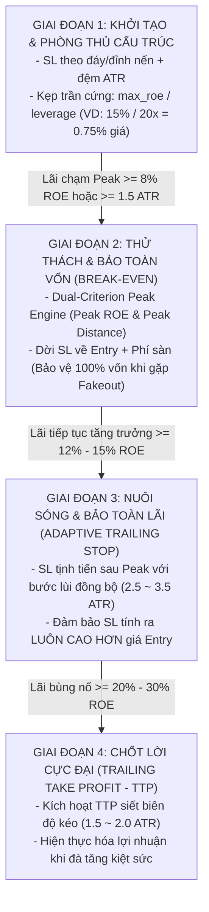

# THIẾT KẾ ĐỊNH LƯỢNG: ĐỒNG BỘ HÓA VÒNG ĐỜI VỊ THẾ & BẢO TOÀN LỢI NHUẬN (HARMONIZED RISK LIFECYCLE)

> **Mô-đun:** `strategies_backtests/helios/src/strategy/core_v3/risk.rs`  
> **Dự án:** Helios Core V3.3 — Universal Multi-Regime Architecture  
> **Ngày lập:** 01/10/2026  
> **Trạng thái:** Thiết kế kiến trúc (Sẵn sàng triển khai)

---

## 🏛️ 1. BẢN ĐỒ VÒNG ĐỜI VỊ THẾ 4 GIAI ĐOẠN (THE 4-STAGE POSITION LIFECYCLE)

Mọi vị thế giao dịch trong Helios từ khi mở đến khi đóng chỉ trải qua đúng **4 giai đoạn tuyến tính bất biến**:



---

## 📐 2. CHUẨN HÓA ĐA ĐÒN BẨY TOÀN NĂNG (UNIVERSAL LEVERAGE SCALING: 20x -> 125x)

### 2.1. Đòn Bẩy (Leverage $L$) Ảnh Hưởng Ra Sao Đến Hệ Thống Risk?
Hệ sinh thái Helios được thiết kế cho thị trường phái sinh đòn bẩy cao ($20\text{x} \to 125\text{x}$). Bản thân đòn bẩy không làm thị trường chạy nhanh hơn, nhưng nó **khuếch đại độ nhạy cảm của vốn ký quỹ (Margin)** đối với từng bước nhảy giá nhỏ nhất.

### 2.2. Công Thức Cốt Tử (The Core Quantitative Equivalence)
$$\text{ROE} = \left(\frac{\Delta P}{P_{\text{entry}}}\right) \times L \quad \iff \quad \Delta P\% = \frac{\text{ROE}}{L}$$

Trong đó:
* $\Delta P\%$: Tỷ lệ phần trăm biến động giá thực tế trên đồ thị nến ($\frac{P_{\text{current}} - P_{\text{entry}}}{P_{\text{entry}}}$).
* $\text{ROE}$ (Return On Equity / Margin): Tỷ suất lãi/lỗ trên số tiền vốn ký quỹ thực tế.
* $L$ (Leverage): Mức đòn bẩy được thiết lập ($1\text{x}, 20\text{x}, 50\text{x}, 100\text{x}, 125\text{x}$).

### 2.3. Bảng Quy Đổi Biên Độ Chịu Đựng Của Stop Loss (Hard SL Cap 15% ROE)

Với trần lỗ tối đa được khống chế ở mức $\text{Hard SL Cap} = 15\% \text{ ROE}$, biên độ dịch chuyển giá cho phép $(\Delta P\%)$ co giãn tỷ lệ nghịch với mức đòn bẩy:

| Mức Đòn Bẩy ($L$) | Trần Lỗ Tối Đa ($\text{ROE}$) | Khoảng Cách Giá Cho Phép ($\Delta P\%$) | Khoảng Cách Giá Cụ Thể (ETH = \$2,000) | Đánh Giá Mức Độ An Toàn Đối Với Nhiễu Nến (Noise) |
| :---: | :---: | :---: | :---: | :--- |
| **$1\text{x}$ (Spot)** | $-15.0\%$ | **$15.00\%$** | \$300.00 | Siêu an toàn. Biên độ cực rộng, chỉ dùng cho đầu tư giao ngay. |
| **$20\text{x}$ (Tiêu chuẩn)** | $-15.0\%$ | **$0.75\%$** | \$15.00 | **Vùng Cân Bằng Vàng.** Đủ rộng để vượt qua độ nhiễu ATR nến 1m, bảo vệ tài khoản tối ưu. |
| **$50\text{x}$** | $-15.0\%$ | **$0.30\%$** | \$6.00 | Bắt đầu chạm ngưỡng nhạy cảm cao với râu nến quét thanh khoản 1m. |
| **$100\text{x}$** | $-15.0\%$ | **$0.15\%$** | \$3.00 | **Vùng Nguy Hiểm Cực Hạn.** Biên độ $0.15\%$ nằm lọt thỏm trong độ biến động tự nhiên của từng nến 1m. |
| **$125\text{x}$ (Kịch trần)** | $-15.0\%$ | **$0.12\%$** | \$2.40 | **Bẫy Tự Sát (Suicide Trap).** Chỉ 1 tick nhảy giá hoặc giãn spread là quét sạch SL! |

### 2.4. Ba Hệ Quả Sống Còn Đối Với Hệ Thống Risk

1. **Bẫy Tự Sát Ở Đòn Bẩy Cực Đại ($100\text{x} - 125\text{x}$):**
   * Nếu giữ cố định trần lỗ $15\%$ ROE khi giao dịch ở đòn bẩy $100\text{x}$, biên độ giá chỉ còn $0.15\%$.
   * Trong khi đó, độ biến động tự nhiên ($\text{ATR}$) nến 1m của ETH thường dao động từ $0.10\% \to 0.25\%$.
   * Lệnh vừa mở ra lập tức bị rung lắc tự nhiên quét trúng SL trước khi xu hướng kịp hình thành $\implies$ Sinh ra chuỗi thua liên tiếp (Chop Loss).
   * **Giải pháp thích ứng:** Ở đòn bẩy cao, hệ thống kích hoạt **Sniper Veto**: Từ chối mở lệnh nếu khoảng cách SL theo cấu trúc hẹp hơn $0.5 \text{ ATR}$, hoặc chuyển sang cơ chế Dynamic Position Sizing (giảm size lệnh để mở rộng biên độ SL).

2. **Bóp Méo Khoảng Lùi Trailing Stop Loss (TSL ATR):**
   * TSL di chuyển theo biến động giá: $\text{TSL Distance} = \text{multiplier} \times \text{ATR}$.
   * Nếu giữ nguyên bước lùi $2.8 \text{ ATR}$ ($\approx 0.35\%$ khoảng cách giá ETH):
     - Ở đòn bẩy $20\text{x}$: Mức lùi tương đương $0.35\% \times 20 = 7.0\% \text{ ROE}$ (biên độ thở hoàn hảo).
     - Ở đòn bẩy $100\text{x}$: Mức lùi tương đương $0.35\% \times 100 = \mathbf{35.0\% \text{ ROE}}$! Lợi nhuận đỉnh đạt $+40\%$ mà lùi $35\%$ mới đóng lệnh thì mất trắng thành quả.
   * **Quy tắc thích ứng:** Kẹp trần khoảng lùi TSL tối đa không vượt quá $14\% \text{ ROE}$ ở mọi mức đòn bẩy.

3. **Mối Tương Quan Sống Còn Giữa Phí Sàn & Điểm Kích Hoạt Break-Even:**
   * Phí sàn tính trên giá trị danh nghĩa, nhưng khấu trừ vào vốn ký quỹ:
     $$\text{Fee ROE} = (\text{Round-trip Fee} + \text{Slippage}) \times L$$
   * Ở đòn bẩy $100\text{x}$ với tổng phí + trượt giá là $0.10\%$, khoản phí này ngốn tới $\mathbf{10.0\% \text{ ROE}}$!
### 2.5. Bảng Đối Chất 3 Phương Án Quản Trị Rủi Ro Đa Đòn Bẩy & Lựa Chọn Kiến Trúc

| Tiêu Chí Phân Tích | Phương Án A: Cố Định ROE Ký Quỹ (Margin-Centric) | Phương Án B: Cố Định Rủi Ro Đô La & Định Cỡ Biến Động (Volatility Sizing) | Phương Án C: Thích Ứng Lai Đa Tầng (Adaptive Hybrid Protection)<br>*(LỰA CHỌN TỐI ƯU CỦA HELIOS)* |
| :--- | :--- | :--- | :--- |
| **Bản chất logic** | Cố định trần lỗ: Luôn mất tối đa $15\%$ số tiền ký quỹ ($\text{Margin}$). Khi đòn bẩy tăng $\to$ Khoảng cách giá $\Delta P\%$ bị bóp nghẹt. | Khoảng cách SL $\Delta P$ **phải theo cấu trúc thị trường (ATR)**. Đòn bẩy tăng $\to$ Chỉ việc **giảm kích thước lệnh (Lot)** để số tiền thua lỗ (\$USD) không đổi. | Kết hợp cả 2: Ưu tiên SL theo cấu trúc ATR, kẹp trần an toàn ROE, nhưng **bật Cầu Dao từ chối lệnh (Sniper Veto)** nếu đòn bẩy ép SL rơi vào vùng nhiễu nến. |
| **Công thức SL** | $\Delta P\% = \frac{15\% \text{ ROE}}{L}$ | $\Delta P\% = \text{Swing} + 1.5 \text{ ATR}$<br>$\text{Size} = \frac{\text{Tài khoản} \times 2\%}{\Delta P}$ | $\Delta P\% = \text{SL}_{\text{ATR}}$<br>Kẹp trần: $\Delta P\% \le \frac{15\%}{L}$<br>Kẹp sàn an toàn: $\Delta P\% \ge 0.5 \text{ ATR}$ |
| **Ưu điểm** | 1. Cực kỳ an toàn cho ví tiền ký quỹ.<br>2. Không bao giờ bị cháy tài khoản Isolated.<br>3. Rất dễ tính toán. | 1. Tôn trọng 100% cấu trúc thị trường.<br>2. Miễn nhiễm với râu nến quét thanh khoản ở mọi đòn bẩy.<br>3. Thích ứng hoàn hảo mọi Asset. | 1. Tận dụng tối đa ưu thế của cả A và B.<br>2. Bảo vệ vốn sàn cố định ($60).<br>3. Không bao giờ để đòn bẩy cao biến thành "bẫy tự sát". |
| **Khuyết điểm cốt tử** | ❌ **Rất nguy hiểm ở đòn bẩy $\ge 50\text{x}$:** Biên độ giá chỉ còn $0.15\% - 0.30\%$, rơi lọt thỏm vào vùng nhiễu nến (Noise), bị quét SL liên tục $\to$ Chuỗi thua kéo dài. | ❌ **Vướng rào cản sàn:** Khi vốn nhỏ (\$60), giảm Lot ở đòn bẩy cao sẽ bị sàn từ chối vì vi phạm `MIN_NOTIONAL` (\$21 Binance). | ⚠️ Cần thêm logic kiểm tra điều kiện VETO trước khi mở lệnh (đã hoàn thiện tại Arbiter). |
| **Edge Cases Nguy Hiểm** | **Edge Case 1:** Ở $100\text{x}$, chỉ cần spread giãn nhẹ là cắn SL.<br>**Edge Case 2:** Phí sàn $0.08\%$ ngốn mất hơn $50\%$ khoản lỗ cho phép. | **Edge Case 3:** Khi gặp siêu biến động (Flash Crash), khoảng cách SL theo ATR quá xa khiến mức lỗ vượt quá số vốn ký quỹ $\to$ Bị sàn thanh lý cưỡng bức. | **Edge Case 4:** Khi đòn bẩy quá cao mà thị trường biến động mạnh, bot sẽ **từ chối hầu hết các lệnh (Sit-on-hands)** cho đến khi thị trường nén lại. |

#### Kết luận kiến trúc Phương Án C (Adaptive Hybrid Protection):
* **Ở đòn bẩy $20\text{x}$ (Mặc định hiện tại):** Trần $15\%$ ROE tương đương $0.75\%$ giá $\implies$ Nằm ngoài vùng nhiễu nến 1m, bảo vệ tài khoản tối ưu.
* **Ở đòn bẩy cao ($50\text{x} \to 125\text{x}$):**
  - Nếu khoảng cách SL cấu trúc bị trần $15\%$ ROE ép hẹp hơn $0.5 \text{ ATR} \implies$ **Kích hoạt Sniper Veto: Từ chối mở lệnh**, giữ nguyên tiền trong túi theo tinh thần *Zerg Swarm Doctrine: Biết chờ khi bất lợi*.
  - Ngưỡng kích hoạt Break-Even được tự động nâng lên theo công thức an toàn:
    $$\text{Min Safe BE ROE} = \max\left(6\%, \ (\text{Round-trip Fee} + \text{Slippage}) \times L \times 1.5\right)$$
    đảm bảo sau khi trừ phí sàn và trượt giá, tài khoản chắc chắn giữ được lợi nhuận dương.

---

## ⚡ 3. GIAI ĐOẠN 2: DUAL-CRITERION PEAK BREAK-EVEN ENGINE

### 3.1. Vấn Đề Gốc
Trong mã nguồn cũ:
- Squeeze thổi phồng ngưỡng Break-Even: `min_be_roe = base * (1.0 + sqz_multiplier)` (đòi lãi tới 16% mới cho hòa vốn).
- Kiểm tra bằng `current_roe` (giá nến đóng) thay vì `peak_roe` (đỉnh râu nến).
- Hệ quả: Lệnh #0004 (+10.6%) và Lệnh #0009 (+15.8%) bị kẹt không dời được BE, quay đầu cắn Hard SL.

### 3.2. Thiết Kế Mới
1. **Triệt tiêu 100% Squeeze khỏi Break-Even:**
   Trạng thái co thắt (Squeeze) chỉ có ý nghĩa trước khi bứt phá. Khi giá đã chạy được $\ge 1.5 \text{ ATR}$, cú bứt phá đã diễn ra, việc duy trì Squeeze là một mâu thuẫn toán học.
2. **Công thức Dual-Criterion Peak Engine:**
   ```rust
   let min_be_roe = risk_cfg.base_be_roe_trigger.max(0.06); // DNA [0.04 -> 0.20], sàn an toàn 6% ROE chống liếm râu non
   let required_profit = current_atr * be_trigger_mult * trade.size.abs(); // be_trigger_mult từ DNA [1.5 -> 3.5 ATR]

   let is_be_triggered = peak_roe >= min_be_roe || peak_profit >= required_profit;
   ```
3. **Mức giá SL sau khi kích hoạt (SSOT Dynamic Fee Buffer):**
   ```rust
   if is_be_triggered && !is_mega_trend {
       // Single Source of Truth: Tính động từ cấu hình sàn/tài khoản và độ trượt giá của asset
       let round_trip_fee = 2.0 * config.risk_management.risk_base.taker_fee_rate;
       let slippage = config.risk_management.risk_base.slippage_allowance_pct;
       let fee_buffer_pct = round_trip_fee + slippage;

       if trade.is_long() {
           let min_be = trade.entry_price * (1.0 + fee_buffer_pct);
           let dynamic_floor = peak_val - (current_atr * be_buffer_mult);
           let target_be_sl = dynamic_floor.max(min_be);
           calculated_sl = calculated_sl.max(target_be_sl);
       } else {
           let max_be = trade.entry_price * (1.0 - fee_buffer_pct);
           let dynamic_ceiling = peak_val + (current_atr * be_buffer_mult);
           let target_be_sl = dynamic_ceiling.min(max_be);
           calculated_sl = calculated_sl.min(target_be_sl);
       }
   }
   ```

---

## 🌊 4. GIAI ĐOẠN 3: ĐỒNG BỘ HÓA TRAILING STOP & TRIỆT TIÊU VÙNG CHÂN KHÔNG

### 4.1. Vấn Đề Gốc
- `MOMENTUM_IGN` dùng `tsl_atr_loose = 10.0 ATR` (tương đương khoảng lùi 35% ROE).
- Khi lãi $+15.8\%$, TSL tính ra là: $15.8\% - 35\% = -19.2\% \text{ ROE}$ (thấp hơn cả Hard SL ban đầu -15%).
- Cơ chế `Monotonic Ratchet Guard` từ chối cập nhật, biến TSL thành "đồ trang trí", tạo ra **Vùng Chân Không Tử Thần từ +8% đến +20% ROE** khiến 163% ROE lợi nhuận bốc hơi.

### 4.2. Giải Pháp Đồng Bộ Hóa
1. **Khống chế trần `tsl_atr_loose` trong `config.rs`:**
   - Thu hẹp dải DNA của `tsl_atr_loose` từ `[5.0, 15.0]` về **`[2.0, 4.0, step 0.20]`** (mặc định 2.5 ATR).
   - Với đòn bẩy 20x, 2.5 ATR tương đương khoảng lùi $\approx 8\% - 10\%$ ROE.
2. **Hiệu ứng tức thì:**
   - Khi vị thế đạt lãi đỉnh $+15.8\%$ ROE (Lệnh #0009):
     $$\text{Trailing SL} = +15.8\% - 9.0\% = \mathbf{+6.8\% \text{ ROE}}$$
   - Mức SL này tự động vượt qua giá Entry, biến vị thế thành một lệnh **chắc chắn thắng $+6.8\%$**, triệt tiêu hoàn toàn nguy cơ sập ngược cắn Hard SL!
