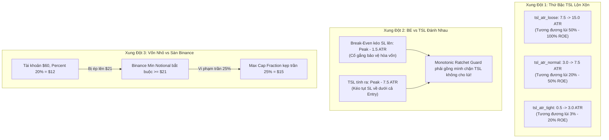

# ĐẠI TU & ĐỒNG BỘ HÓA TOÀN DIỆN CẤU HÌNH QUẢN TRỊ RỦI RO (HOLISTIC RISK AUDIT & HARMONIZATION)

> **Mô-đun:** `strategies_backtests/helios/src/strategy/core_v3/risk.rs` & `config.rs`  
> **Dự án:** Helios Core V3.3 — Universal Multi-Regime Architecture  
> **Nhiệm vụ liên đới trong TODO:** `TODO-RISK-17` trong [`06_risk/TODO.md`](file:///e:/Projects/Automations/trading_backtest/strategies_backtests/helios/docs/audit_01/06_risk/TODO.md)  
> **Ngày lập:** 02/10/2026  
> **Trạng thái:** Kiểm toán chuyên sâu & Thiết kế giải pháp gốc rễ

---

## 🏛️ 1. HIỆN TRẠNG & TẠI SAO CÁC CƠ CHẾ RISK ĐANG "NGÁNG CHÂN NHAU"?

Hệ thống Quản trị rủi ro của Helios được phát triển qua nhiều giai đoạn để đối phó với từng lỗi phát sinh cục bộ. Điều này dẫn đến một **tập hợp các cơ chế chắp vá (Piecemeal Patches)**, thiếu một khung tham chiếu thống nhất từ bản chất toán học:

---

## 🔍 2. BÓC TÁCH 5 MÂU THUẪN NỘI BỘ CỐT TỬ CỦA HỆ THỐNG RISK

### Mâu Thuẫn 1: Phân Tầng Bước Lùi TSL Bị Đảo Lộn & Quá Rộng (TSL Hierarchy Distortion)
* **Thông số hiện tại:**
  * `tsl_atr_tight`: `[0.5, 3.0]` ATR.
  * `tsl_atr_normal`: `[3.0, 7.5]` ATR.
  * `tsl_atr_loose`: `[7.5, 15.0]` ATR.
* **Tử huyệt:**
  * Trên ETH với đòn bẩy $20\text{x}$, $1.0 \text{ ATR} \approx 0.35\%$ giá $\approx 7.0\% \text{ ROE}$.
  * Mức `tsl_atr_normal` tối đa là $7.5 \text{ ATR} \implies 7.5 \times 7.0\% = \mathbf{52.5\% \text{ ROE}}$!
  * Mức `tsl_atr_loose` tối đa là $15.0 \text{ ATR} \implies 15.0 \times 7.0\% = \mathbf{105.0\% \text{ ROE}}$!
  * Dải thông số này được bê nguyên xi từ giao dịch chứng khoán/Spot 1x sang phái sinh đòn bẩy cao. Khi vị thế lãi $+15.8\%$, bước lùi đòi tới $35\% \to 50\%$ ROE khiến Trailing Stop **bị tê liệt hoàn toàn, không bao giờ kéo qua được giá Entry**!

---

### Mâu Thuẫn 2: Xung Đột Trực Diện Giữa Break-Even Buffer Và TSL Distance
* **Hiện tượng:**
  * Trong `risk.rs:362`: Khi kích hoạt Break-Even, khoảng đệm bảo vệ vốn là `be_buffer_mult` ($1.2 \to 1.5 \text{ ATR}$). Nghĩa là SL được kéo lên mức $\text{Peak} - 1.5 \text{ ATR}$ (nằm trên Entry).
  * Nhưng ngay ở nến kế tiếp, Trailing Stop lại tính `raw_sl = peak_val - (current_atr * current_multiplier)` với `current_multiplier = 5.0 -> 10.0 ATR`.
  * Mức TSL này nằm sâu tít bên dưới mức Break-Even vừa đặt!
  * **Hậu quả:** Cơ chế `Monotonic Ratchet Guard` phải liên tục làm nhiệm vụ "chữa cháy", từ chối mức TSL này để giữ lại mức BE. Hai cơ chế không hề phối hợp mà đang triệt tiêu lẫn nhau!

---

### Mâu Thuẫn 3: Time Decay Countdown & Progressive Tighten Bị Vô Hiệu Hóa
* **Hiện tượng:**
  * Thuật toán có logic: Khi nến đi ngang quá lâu sau đỉnh (`decay_cycles > 0`), hệ thống nhân `current_multiplier` với `tighten_step_multiplier` (ví dụ $0.90$) để siết hẹp TSL lại.
  * **Điểm nghẽn:** Nếu ban đầu `current_multiplier` xuất phát ở mức $10.0 \text{ ATR}$, thì sau 3 chu kỳ siết hẹp ($10 \times 0.9^3$), nó vẫn còn **$7.29 \text{ ATR}$**! Khoảng cách này vẫn quá xa so với thực tế, khiến lệnh ngâm vốn hàng chục tiếng mà không thể chốt lời.

---

### Mâu Thuẫn 4: Phân Mảnh Trần Stop Loss (`max_initial_sl_pct`)
* **Hiện trạng:**
  * Có 7 gen DNA quy định trần rủi ro cho 6 Playbooks + 1 Untagged.
  * `GLOBAL_HARD_MAX_ROE = 0.15` (15% ROE) kẹp trần toàn cục.
  * Nhưng trong `manage_trailing_stop:315`, ta lại tính `cap_price_pct = playbook_max_sl_roe / leverage`.
  * Nếu một Playbook có trần SL là $10\%$ ROE (`REVERSAL`), mà TSL lại lùi $14\%$ ROE, thì TSL sẽ bị thụt lùi sâu hơn cả mức Hard SL ban đầu, tạo ra sự mâu thuẫn trong bảo vệ vốn.

---

### Mâu Thuẫn 5: Nghịch Lý Tam Giác Định Cỡ Vốn (Capital Sizing Triangle)
* **Hiện trạng:**
  * Vốn tài khoản: $\$60.00$.
  * Tỷ lệ cấu hình: `percent_per_trade = 0.20` (20% = $\$12.00$ margin).
  * Giới hạn an toàn: `max_cap_fraction = 0.25` (Trần tối đa 25% = $\$15.00$).
  * Quy định cứng của sàn Binance: `min_order_usd = $21.00`.
  * **Nghịch lý:** Trên đòn bẩy 20x, $\$12.00$ margin tương đương $\$240$ notional (thỏa mãn min order). Nhưng nếu tài khoản bị sụt giảm hoặc chuyển sang Spot 1x, lệnh $\$12$ sẽ bị sàn từ chối vì $< \$21$. Khi nâng lên $\$21$ thì lại vi phạm trần $25\%$ vốn!

---

## 🎯 3. BẢN ĐỒ BẬC THANG THỐNG NHẤT (UNIFIED HIERARCHY MATRIX)

Để cả hệ sinh thái Risk vận hành nhịp nhàng (Harmonized) từ $20\text{x}$ đến $125\text{x}$, mọi khoảng cách và ngưỡng kích hoạt phải tuân thủ nghiêm ngặt **Bậc Thang Tỷ Lệ Vàng**:

$$\text{Sàn An Toàn (BE Buffer)} < \text{TSL Tight} < \text{TSL Normal} < \text{TSL Loose} < \text{Playbook Hard SL Cap}$$

| Phân Tầng | Dải ATR Chuẩn Hóa | Quy Đổi ROE Trên 20x (ATR ~0.35%) | Mục Đích Chiến Thuật Phù Hợp |
| :--- | :---: | :---: | :--- |
| **0. BE Buffer** | **`0.8 ~ 1.5 ATR`** | **`2.5% ~ 5.0% ROE`** | Khóa hòa vốn + phí sàn ngay khi có sóng bứt phá ban đầu. |
| **1. TSL Tight** | **`1.2 ~ 2.2 ATR`** | **`4.0% ~ 7.5% ROE`** | Dành cho Range / Reversal / Đỉnh sóng phân phối (bảo vệ lãi chặt chẽ). |
| **2. TSL Normal** | **`2.0 ~ 3.2 ATR`** | **`7.0% ~ 11.0% ROE`** | Dành cho Trend Pullback & Absorption (cho sóng bậc thang thở tự nhiên). |
| **3. TSL Loose** | **`2.8 ~ 4.0 ATR`** | **`9.5% ~ 14.0% ROE`** | Dành cho Momentum Ignition & Anomaly (nuôi trọn sóng bùng nổ xung lực). |
| **4. Max Hard SL Cap** | **Kẹp trần cứng** | **`10.0% ~ 15.0% ROE`** | Trần tổn thất tối đa tuyệt đối, không cho phép bất kỳ lệnh nào vi phạm. |

> **Nguyên tắc cốt tử:** Mức lùi `TSL Loose` tối đa ($14\%$ ROE) **LUÔN NẰM TRÊN** mức `Max Hard SL Cap` ($15\%$ ROE). Không bao giờ có chuyện TSL tính ra mức thấp hơn Hard SL ban đầu!
