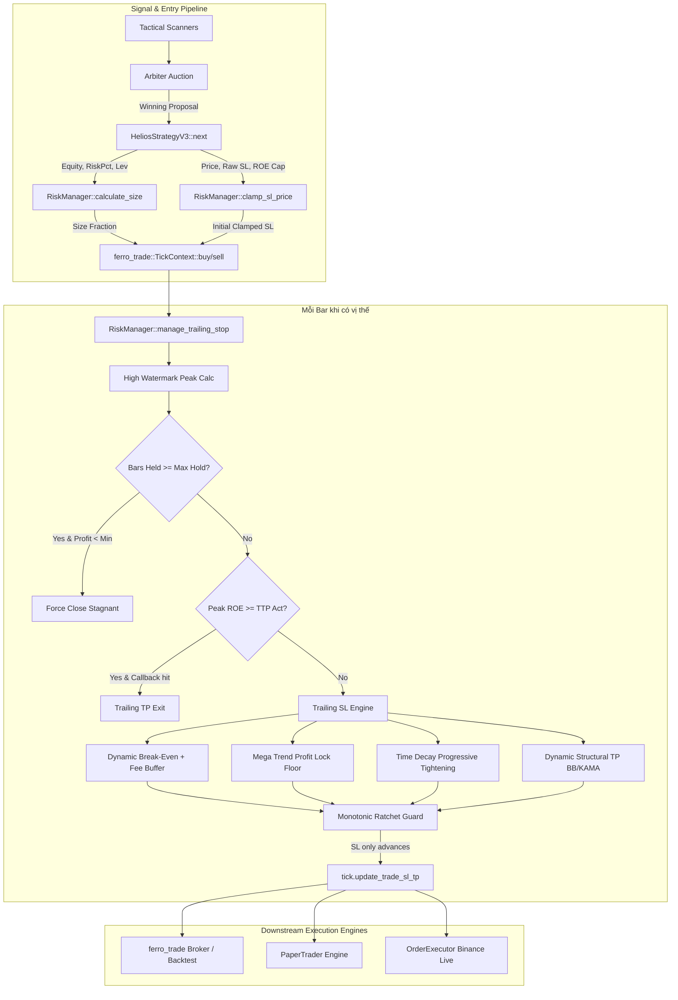

# BÁO CÁO KIỂM TOÁN KỸ THUẬT TOÀN DIỆN: MÔ-ĐUN QUẢN TRỊ RỦI RO (RISK MANAGEMENT) HELIOS V3.3

> **Ngày thực hiện kiểm toán:** 19/09/2026  
> **Chuyên gia kiểm toán:** Quantitative & Systems Auditor (Rust Algorithmic Trading)  
> **Hệ thống mục tiêu:** Helios Core V3.3 - HFT/Intraday Quantitative Trading Engine  
> **Mã nguồn trọng tâm:** [`strategies_backtests/helios/src/strategy/core_v3/risk.rs`](file:///e:/Projects/Automations/trading_backtest/strategies_backtests/helios/src/strategy/core_v3/risk.rs)  
> **Các mô-đun liên đới:**
> - [`strategies_backtests/helios/src/strategy/core_v3/config.rs`](file:///e:/Projects/Automations/trading_backtest/strategies_backtests/helios/src/strategy/core_v3/config.rs)
> - [`strategies_backtests/helios/src/strategy/core_v3/mod.rs`](file:///e:/Projects/Automations/trading_backtest/strategies_backtests/helios/src/strategy/core_v3/mod.rs)
> - [`ferro_trade/src/broker/broker.rs`](file:///e:/Projects/Automations/trading_backtest/ferro_trade/src/broker/broker.rs)
> - [`trading_bot/bot_engine/src/execution/paper_trader.rs`](file:///e:/Projects/Automations/trading_backtest/trading_bot/bot_engine/src/execution/paper_trader.rs)
> - [`trading_bot/bot_engine/src/controller/asset_actor.rs`](file:///e:/Projects/Automations/trading_backtest/trading_bot/bot_engine/src/controller/asset_actor.rs)
> - [`trading_bot/bot_engine/src/execution/order_executor.rs`](file:///e:/Projects/Automations/trading_backtest/trading_bot/bot_engine/src/execution/order_executor.rs)
> - [`trading_bot/bot_engine/src/execution/live_engine.rs`](file:///e:/Projects/Automations/trading_backtest/trading_bot/bot_engine/src/execution/live_engine.rs)

---

## 1. TỔNG QUAN KIẾN TRÚC & VAI TRÒ MÔ-ĐUN RISK

Trong kiến trúc của hệ thống giao dịch Helios V3.3, mô-đun `RiskManager` đóng vai trò là "chốt chặn sinh tử" (Ultimate Circuit Breaker & Capital Allocator). Nó không trực tiếp tạo ra tín hiệu giao dịch (được giao phó cho bộ 4 Scanner và Arbiter), mà chịu trách nhiệm:
1. **Định cỡ vị thế (Position Sizing):** Xác định tỷ lệ vốn ký quỹ tối ưu, đảm bảo không vi phạm trần phân bổ vốn (`max_cap_fraction`), đòn bẩy sàn (`leverage = 20x`), và giá trị tối thiểu của sàn giao dịch (`min_order_usd`).
2. **Khống chế biên độ cắt lỗ ban đầu (Initial Stop Loss Clamping):** Áp đặt trần rủi ro lợi nhuận trên vốn ký quỹ tối đa ($ROE_{cap}$) theo từng Playbook chiến thuật và sàn khoảng cách tối thiểu chống nhiễu (Universal Floor Guard).
3. **Quản lý động Trailing Stop Loss & Take Profit (`manage_trailing_stop`):** Điều phối dời SL một chiều đơn điệu (Monotonic Ratchet), kích hoạt hòa vốn theo Regime thị trường (Dynamic Break-Even), thả diều siêu sóng (Mega Trend Shield), siết SL khi ngâm lệnh (Stagnant Time Decay), và chốt lời cấu trúc (Hybrid Dynamic Take Profit).



---

## 2. KIỂM TOÁN TOÁN HỌC & LOGIC CÁC THUẬT TOÁN TRONG `risk.rs`

### 2.1. Thuật Toán Định Cỡ Vị Thế (`calculate_size`)

Mã nguồn tại [`risk.rs:11-26`](file:///e:/Projects/Automations/trading_backtest/strategies_backtests/helios/src/strategy/core_v3/risk.rs#L11-L26):

```rust
pub fn calculate_size(equity: f64, risk_pct: f64, min_order_usd: f64, leverage: f64, max_cap_fraction: f64) -> f64 {
    if equity <= 0.0 || risk_pct <= 0.0 || leverage <= 0.0 {
        return 0.0;
    }
    let mut target_margin = equity * risk_pct;
    let mut order_size_usd = target_margin * leverage;
    
    if order_size_usd < min_order_usd {
        order_size_usd = min_order_usd;
        target_margin = order_size_usd / leverage;
    }
    
    let size_fraction = target_margin / equity;
    let cap = if max_cap_fraction <= 0.0 { 0.25 } else { max_cap_fraction };
    size_fraction.min(cap)
}
```

#### Mô hình toán học:
1. **Ký quỹ mục tiêu lý thuyết:**
   $$\text{Margin}_{\text{target}} = \text{Equity} \times \text{RiskPct}$$
2. **Quy mô danh nghĩa USD ban đầu:**
   $$\text{Notional}_{\text{usd}} = \text{Margin}_{\text{target}} \times \text{Leverage}$$
3. **Điều chỉnh theo giới hạn tối thiểu của sàn:**
   $$\text{Nếu } \text{Notional}_{\text{usd}} < \text{MinOrderUSD} \implies \text{Notional}_{\text{usd}} = \text{MinOrderUSD}; \quad \text{Margin}_{\text{target}} = \frac{\text{MinOrderUSD}}{\text{Leverage}}$$
4. **Tỷ lệ phần trăm ký quỹ trả về:**
   $$\text{SizeFraction} = \frac{\text{Margin}_{\text{target}}}{\text{Equity}}$$
5. **Kẹp trần phân bổ an toàn:**
   $$\text{FinalSize} = \min(\text{SizeFraction}, \text{MaxCapFraction})$$

#### Ưu điểm:
- Đảm bảo tính nhất quán giữa Backtest (`ferro_trade`), Paper Engine (`PaperTrader`) và Sàn thật (`OrderExecutor`): Tỷ lệ trả về nằm trong khoảng $(0.0, \text{MaxCapFraction}]$, đại diện cho tỷ lệ vốn ký quỹ trên tổng vốn chủ sở hữu (`Available Margin Fraction`).
- Bảo vệ tài khoản không bao giờ ký quỹ vượt quá `max_cap_fraction` (mặc định 25% vốn, cấu hình tại [`config.rs:608`](file:///e:/Projects/Automations/trading_backtest/strategies_backtests/helios/src/strategy/core_v3/config.rs#L608)).

#### Lỗ hổng tiềm ẩn & Edge Cases (CRITICAL & HIGH):
1. **Lỗ hổng IEEE 754 NaN Bypass (Cực kỳ nguy hiểm - HIGH):**
   - Tại dòng 12: `if equity <= 0.0 || risk_pct <= 0.0 || leverage <= 0.0 { return 0.0; }`.
   - Trong chuẩn dấu phẩy động IEEE 754 của Rust: nếu `equity` mang giá trị `f64::NAN`, mọi phép so sánh `<`, `<=`, `>`, `>=` đều trả về `false`!
   - Hệ quả: Dòng 12 bị vượt qua (`false`).
   - `target_margin = NaN * risk_pct = NaN`.
   - `order_size_usd = NaN`.
   - `if order_size_usd < min_order_usd` trả về `false`.
   - `size_fraction = NaN / NaN = NaN`.
   - Đến dòng 25: `size_fraction.min(cap)`. Theo chuẩn IEEE 754-2008 của hàm `f64::min(self, other)` trong Rust: *"If one of the arguments is NaN, then the other argument is returned"*.
   - Do đó, `NaN.min(0.25)` **TRẢ VỀ 0.25**!
   - 💥 **Hậu quả:** Khi tài khoản bị lỗi tính toán số dư dẫn đến vốn là `NaN`, hàm không trả về `0.0` mà trả về đúng trần `0.25` (25% vốn), cho phép hệ thống tiếp tục mở lệnh trên một tài khoản đã bị lỗi dữ liệu!
   - *Khắc phục bắt buộc:* Bổ sung kiểm tra `.is_nan()`:
     ```rust
     if equity.is_nan() || equity <= 0.0 || risk_pct.is_nan() || risk_pct <= 0.0 
        || leverage.is_nan() || leverage <= 0.0 || min_order_usd.is_nan() || max_cap_fraction.is_nan() {
         return 0.0;
     }
     ```
2. **Xung đột Nghịch Lý giữa `min_order_usd` và `max_cap_fraction` khi Vốn Nhỏ (Medium):**
   - Giả sử tài khoản vốn nhỏ $\text{Equity} = \$2.00$, $\text{MinOrderUSD} = \$21.00$, $\text{Leverage} = 20\text{x}$, $\text{MaxCapFraction} = 0.25$.
   - Ký quỹ cần để đạt \$21 là: $\$21 / 20 = \$1.05$.
   - Tỷ lệ ký quỹ so với vốn: $\$1.05 / \$2.00 = 52.5\%$.
   - Dòng 25 kẹp lại: `size_fraction = min(0.525, 0.25) = 0.25`.
   - Ký quỹ thực tế được dùng: $\$2.00 \times 0.25 = \$0.50$.
   - Giá trị lệnh danh nghĩa thực tế: $\$0.50 \times 20\text{x} = \$10.00 < \$21.00$!
   - 💥 **Hậu quả:** Khi gửi lệnh xuống sàn Binance, lệnh sẽ bị sàn từ chối thẳng thừng (`REJECTED`) do không thỏa mãn `MIN_NOTIONAL` của sàn!
   - *Khắc phục:* Nếu sau khi áp `max_cap_fraction` mà `order_size_usd < min_order_usd`, hàm phải từ chối mở lệnh (trả về `0.0`) thay vì trả về một kích thước lệnh chắc chắn sẽ bị sàn từ chối.

---

### 2.2. Khống Chế Biên Độ Cắt Lỗ Ban Đầu (`clamp_sl_price`)

Mã nguồn tại [`risk.rs:30-61`](file:///e:/Projects/Automations/trading_backtest/strategies_backtests/helios/src/strategy/core_v3/risk.rs#L30-L61):

```rust
pub fn clamp_sl_price(
    price: f64,
    sl_price: f64,
    is_long: bool,
    max_sl_roe_cap: f64,
    min_initial_sl_pct: f64,
    leverage: f64,
) -> f64 {
    let lev = if leverage <= 0.0 { 1.0 } else { leverage };
    let roe_cap = if max_sl_roe_cap <= 0.0 { 0.20 } else { max_sl_roe_cap };
    let min_pct = if min_initial_sl_pct <= 0.0 { 0.0015 } else { min_initial_sl_pct };

    // 1. Trần khoảng cách giá tối đa theo đòn bẩy thực tế (RÀNG BUỘC CỨNG BẤT KHẢ XÂM PHẠM)
    let cap_price_pct = roe_cap / lev;

    // 2. Sàn khoảng cách tối thiểu chống quét spread/noise (PHẢI LUÔN NẰM DƯỚI TRẦN)
    let effective_min_pct = min_pct.min(cap_price_pct * 0.50);
    let effective_cap = cap_price_pct;

    if is_long {
        let max_allowed_sl = price * (1.0 - effective_min_pct); // SL gần nhất (chống cắn spread)
        let min_allowed_sl = price * (1.0 - effective_cap);     // SL xa nhất (khống chế lỗ tối đa)
        sl_price.min(max_allowed_sl).max(min_allowed_sl)
    } else {
        let min_allowed_sl = price * (1.0 + effective_min_pct); // SL gần nhất
        let max_allowed_sl = price * (1.0 + effective_cap);     // SL xa nhất
        sl_price.max(min_allowed_sl).min(max_allowed_sl)
    }
}
```

#### Mô hình toán học:
1. **Quy đổi Trần ROE tối đa sang Trần phần trăm khoảng cách giá:**
   $$\Delta P_{\text{cap}\%} = \frac{\text{ROE}_{\text{cap}}}{\text{Leverage}}$$
   *Ví dụ:* $\text{ROE}_{\text{cap}} = 20\%$ trên đòn bẩy $20\text{x} \implies \Delta P_{\text{cap}\%} = \frac{0.20}{20} = 1.0\%$ khoảng cách giá.
2. **Quy tắc Universal Floor Guard (Chống đảo nghịch khoảng chặn khi đòn bẩy cao):**
   $$\text{EffectiveMinPct} = \min\left(\text{MinPct}, \, \Delta P_{\text{cap}\%} \times 0.50\right)$$
3. **Biên độ SL cho vị thế Long:**
   $$\text{SL}_{\text{long}} \in \left[ P \times (1 - \Delta P_{\text{cap}\%}), \, P \times (1 - \text{EffectiveMinPct}) \right]$$
4. **Biên độ SL cho vị thế Short:**
   $$\text{SL}_{\text{short}} \in \left[ P \times (1 + \text{EffectiveMinPct}), \, P \times (1 + \Delta P_{\text{cap}\%}) \right]$$

#### Phân tích ưu/nhược điểm:
- **Ưu điểm xuất sắc:**
  - Giải quyết dứt điểm lỗi kinh điển "Sàn lớn hơn Trần": Khi đòn bẩy cực cao (ví dụ $50\text{x}$ hoặc $100\text{x}$), nếu `min_pct = 0.5%` (tương đương 25% ROE trên 50x) trong khi $\text{ROE}_{\text{cap}} = 4\%$ (tương đương 0.08% giá), nếu không có chốt chặn `0.50 * cap_price_pct`, khoảng giá sẽ bị đảo lộn ($\text{Sàn} > \text{Trần}$), gây kẹt chết giá SL. Nhờ tỷ lệ an toàn 50%, biên độ luôn đảm bảo $\text{EffectiveMinPct} < \text{EffectiveCap}$.
  - Đã được chứng minh qua test case [`risk.rs:524-531`](file:///e:/Projects/Automations/trading_backtest/strategies_backtests/helios/src/strategy/core_v3/risk.rs#L524-L531) và [`risk.rs:747-766`](file:///e:/Projects/Automations/trading_backtest/strategies_backtests/helios/src/strategy/core_v3/risk.rs#L747-L766).
- **Điểm cần lưu ý:**
  - Hàm `clamp_sl_price` hiện chỉ được gọi ở pha khởi tạo SL (lúc mới mở lệnh tại [`risk.rs:64-83`](file:///e:/Projects/Automations/trading_backtest/strategies_backtests/helios/src/strategy/core_v3/risk.rs#L64-L83) và [`mod.rs:411`](file:///e:/Projects/Automations/trading_backtest/strategies_backtests/helios/src/strategy/core_v3/mod.rs#L411)). Trong vòng lặp `manage_trailing_stop`, trần ROE được kiểm soát độc lập bằng `min_long_sl = trade.entry_price * (1.0 - effective_cap)` (dòng 291).

---

### 2.3. Thuật Toán Trailing Stop Loss Động (`manage_trailing_stop`)

Toàn bộ hàm thực thi từ dòng 86 đến dòng 497. Đây là phần phức tạp nhất trong toàn bộ hệ thống Helios. Chúng ta bóc tách từng phân đoạn cốt lõi:

#### 1. Bộ 3 Phân Tầng ATR Trailing Stop Không Chồng Chéo:
Tại [`risk.rs:110-122`](file:///e:/Projects/Automations/trading_backtest/strategies_backtests/helios/src/strategy/core_v3/risk.rs#L110-L122), hệ thống ánh xạ Playbook Tag sang Multiplier và ROE Cap:

| Phân Tầng ATR | Tham Số DNA | Dải Giá Trị DNA ([`config.rs:694-703`](file:///e:/Projects/Automations/trading_backtest/strategies_backtests/helios/src/strategy/core_v3/config.rs#L694-L703)) | Playbooks Áp Dụng | Ý Nghĩa Thực Chiến |
| :--- | :--- | :--- | :--- | :--- |
| **Tight (Siết Chặt)** | `tsl_atr_tight` | $0.5 - 3.0 \text{ ATR}$ (Step 0.10) | `RANGE_OSC`, `REVERSAL` | Bảo vệ vị thế đảo chiều/sideway; thoát nhanh khi cấu trúc gãy |
| **Normal (Tiêu Chuẩn)** | `tsl_atr_normal` | $3.0 - 7.5 \text{ ATR}$ (Step 0.10) | `TREND_PB`, `ABSORPTION`, Untagged | Đủ không gian cho sóng bậc thang (Trend Pullback) thở qua các nhịp rung lắc |
| **Loose (Nới Lỏng)** | `tsl_atr_loose` | $7.5 - 15.0 \text{ ATR}$ (Step 0.15) | `MOMENTUM_IGN`, `ANOMALY`, Mega Trend | Thả diều siêu sóng bùng nổ xung lực, tránh bị râu nến quét non |

**Đánh giá:** Thiết kế phân tầng hoàn toàn trực giao, không bị chồng lấn miền giá trị giữa các tầng: $[0.5, 3.0) \cap [3.0, 7.5) \cap [7.5, 15.0] = \emptyset$.

---

#### 2. Đỉnh Lợi Nhuận High Watermark Không Lookahead Bias:
Tại [`risk.rs:127-150`](file:///e:/Projects/Automations/trading_backtest/strategies_backtests/helios/src/strategy/core_v3/risk.rs#L127-L150):

```rust
let (peak_val, peak_bar) = if trade.is_long() {
    let mut max_high = trade.entry_price;
    let mut max_bar = entry_bar;
    for j in (entry_bar + 1)..=i {
        if highs[j] > max_high { 
            max_high = highs[j]; 
            max_bar = j;
        }
    }
    (max_high, max_bar)
} else { ... };
```

- **Nguyên lý toán học & chống bias:**
  - Khởi tạo `max_high = trade.entry_price`, `max_bar = entry_bar`.
  - Vòng lặp chỉ duyệt từ `(entry_bar + 1)..=i`.
  - *Tại sao không duyệt `entry_bar`?* Vì nếu duyệt nến `entry_bar`, râu cao nhất `highs[entry_bar]` có thể đã diễn ra **trước thời điểm mở lệnh** (ví dụ mở lệnh tại giá Close cuối nến sau khi giá đã tạo đỉnh rồi tụt xuống). Việc lấy đỉnh nến `entry_bar` sẽ tạo ra một "đỉnh ma" (Phantom Peak) phi thực tế, làm méo mó tính toán PnL đỉnh.
  - Neo xuất phát từ `trade.entry_price` đảm bảo: Nếu sau khi vào lệnh giá chỉ cắm đầu giảm, `peak_val` vẫn bằng đúng giá vào lệnh, `peak_bar = entry_bar`, số nến đi ngang `effective_stagnant_bars = i - entry_bar`.

---

#### 3. Cơ Chế Giải Phóng Vốn Ngâm (Stagnant Capital Release) & Zombie Trade Purge:
Tại [`risk.rs:166-204`](file:///e:/Projects/Automations/trading_backtest/strategies_backtests/helios/src/strategy/core_v3/risk.rs#L166-L204):

```rust
let bars_held = i.saturating_sub(entry_bar);
let max_hold = risk_cfg.max_stagnant_hold_bars;
if max_hold > 0 && bars_held >= max_hold {
    if trade_price_pnl_pct < risk_cfg.stagnant_min_profit_pct {
        tick.close(None);
        continue;
    }
}

let zombie_limit = (max_hold * 2).max(2880);
if max_hold > 0 && bars_held >= zombie_limit {
    tick.close(None);
    continue;
}
```

- **Điều kiện đóng lệnh ngâm vốn:**
  $$\text{Đóng vị thế khi: } (\text{bars\_held} \ge \text{max\_stagnant\_hold\_bars}) \land (\text{TradePnL}_{\%} < \text{stagnant\_min\_profit\_pct})$$
  - `max_stagnant_hold_bars`: Cấu hình DNA từ $60$ đến $720$ nến (tương đương 1 đến 12 giờ trên nến 1m).
  - `stagnant_min_profit_pct`: Cấu hình DNA từ $0.2\%$ đến $5.0\%$.
- **Zombie Trade Purge (Cưỡng bức dọn dẹp lệnh rác):**
  $$\text{ZombieLimit} = \max(2 \times \text{max\_stagnant\_hold\_bars}, \, 2880 \text{ bars})$$
  - Nếu một lệnh bị ngâm vượt quá $2880$ nến (tối thiểu 48 tiếng) mà không chạm SL/TP, bot sẽ cưỡng bức đóng lệnh bất chấp trạng thái PnL để giải phóng hạn mức vị thế.

---

#### 4. Kích Hoạt Hòa Vốn Động (Dynamic Break-Even) & Phân Tích Bộ Đệm Phí Sàn:
Tại [`risk.rs:301-340`](file:///e:/Projects/Automations/trading_backtest/strategies_backtests/helios/src/strategy/core_v3/risk.rs#L301-L340):

```rust
let (be_trigger_mult, be_buffer_mult) = match trade.tag.as_deref() {
    Some("TREND_PB") | Some("ABSORPTION") => (be_atr_trigger_trend, be_buffer_atr_trend),
    Some("RANGE_OSC") | Some("REVERSAL") => (be_atr_trigger_range, be_buffer_atr_range),
    Some("MOMENTUM_IGN") | Some("ANOMALY") => (be_atr_trigger_volatile, be_buffer_atr_volatile),
    _ => (2.5, 1.5),
};

let sqz_multiplier = matrix.vol_axis.get(i).copied().unwrap_or(0.0).max(0.0);
let effective_be_trigger_atr = be_trigger_mult * (1.0 + 0.5 * sqz_multiplier);
let required_profit = current_atr * effective_be_trigger_atr * trade.size.abs();
let min_be_roe = (risk_cfg.base_be_roe_trigger.max(0.08) * (1.0 + sqz_multiplier)).min(0.50);
let is_be_triggered = current_pnl > 0.0 && (current_roe >= min_be_roe || current_pnl >= required_profit);

if is_be_triggered && !is_mega_trend {
    let fee_buffer_pct = 0.0008; // Buffer bù đắp phí sàn tối thiểu 0.08% Maker/Taker
    if trade.is_long() {
        let min_be = trade.entry_price * (1.0 + fee_buffer_pct);
        let dynamic_floor = peak_val - (current_atr * be_buffer_mult);
        let target_be_sl = dynamic_floor.max(min_be);
        calculated_sl = calculated_sl.max(target_be_sl);
    } else { ... }
}
```

#### Phân tích toán học & Lỗ hổng Bộ đệm phí sàn (`fee_buffer_pct = 0.0008`):
1. **Công thức dời SL về Break-Even:**
   $$\text{MinBE}_{\text{long}} = P_{\text{entry}} \times (1 + \text{fee\_buffer\_pct})$$
   $$\text{DynamicFloor}_{\text{long}} = \text{PeakVal} - (\text{ATR} \times \text{be\_buffer\_mult})$$
   $$\text{TargetBE} = \max(\text{DynamicFloor}_{\text{long}}, \, \text{MinBE}_{\text{long}})$$
   $$\text{CalculatedSL} = \max(\text{CalculatedSL}, \, \text{TargetBE})$$
2. **Kiểm toán biểu phí sàn thực tế (Real-world Fee Audit - Binance Futures USDT-M):**
   - Phí Maker tiêu chuẩn VIP0: $0.02\%$.
   - Phí Taker tiêu chuẩn VIP0: $0.05\%$.
   - **Kịch bản vào Market (Taker) và dính SL Stop Market (Taker):**
     $$\text{Tổng phí 2 chiều} = 0.05\% + 0.05\% = 0.10\% = 0.0010$$
   - Trong khi đó, `fee_buffer_pct` trong code đang hardcode cố định là `0.0008` ($0.08\%$).
   - 💥 **LỖ HỔNG SLIPPAGE & NEGATIVE BE TRAP (MEDIUM):**
     - Mức buffer $0.08\%$ **KHÔNG ĐỦ BÙ PHÍ SÀN 2 CHIỀU TAKER ($0.10\%$)**!
     - Khi lệnh bị kích hoạt Break-Even và bị quét dính `TargetBE`, lệnh ghi nhận:
       $$\text{PnL Danh Nghĩa} = +0.08\% - 0.10\% (\text{phí}) = -0.02\%$$
     - Chưa kể đến **Trượt giá (Slippage)** khi khớp lệnh `StopMarket` trong thị trường biến động: mức trượt giá thực tế thường từ $0.03\% - 0.10\%$.
     - Kết quả: Các lệnh được hệ thống báo cáo là "Hòa vốn bảo toàn vốn" thực chất đều kết thúc với mức lỗ thực tế từ $-0.05\%$ đến $-0.15\%$ sau khi trừ phí sàn và trượt giá!
   - *Đề xuất nâng cấp:* Đưa `fee_buffer_pct` vào cấu hình cấu trúc với giá trị tối thiểu $0.0015$ ($0.15\%$) để đảm bảo bù đắp $100\%$ phí Taker 2 chiều cộng thêm biên độ an toàn trượt giá $0.05\%$.

---

#### 5. Cơ Chế Khóa Lợi Nhuận Siêu Sóng (Mega Trend Hard Profit Floor):
Tại [`risk.rs:343-354`](file:///e:/Projects/Automations/trading_backtest/strategies_backtests/helios/src/strategy/core_v3/risk.rs#L343-L354):

```rust
if is_mega_trend {
    let lock_ratio = if risk_cfg.mega_trend_lock_ratio > 0.0 { risk_cfg.mega_trend_lock_ratio } else { 0.50 };
    let min_lock_roe = if risk_cfg.mega_trend_min_lock_roe > 0.0 { risk_cfg.mega_trend_min_lock_roe } else { 0.25 };
    let locked_roe = (peak_roe * lock_ratio).max(min_lock_roe);
    if trade.is_long() {
        let floor_sl = trade.entry_price * (1.0 + (locked_roe / leverage));
        calculated_sl = calculated_sl.max(floor_sl);
    } else { ... }
}
```

- **Mô hình toán học:**
  - Điều kiện kích hoạt Mega Trend:
    $$\text{is\_mega\_trend} \iff (\text{current\_pnl} > 0) \land \left( \text{current\_pnl} \ge \text{mega\_trend\_pnl\_trigger} \times P_{\text{entry}} \times |Size| \;\lor\; \text{current\_roe} \ge 50\% \right)$$
  - Mức ROE khóa cứng:
    $$\text{LockedROE} = \max\left(\text{PeakROE} \times \text{mega\_trend\_lock\_ratio}, \, \text{mega\_trend\_min\_lock\_roe}\right)$$
  - Giá sàn Stop Loss bảo vệ:
    $$\text{FloorSL}_{\text{long}} = P_{\text{entry}} \times \left(1 + \frac{\text{LockedROE}}{\text{Leverage}}\right)$$
- **Đánh giá:** Cơ chế hoạt động hoàn hảo. Khi một vị thế đạt mức lãi lớn (ví dụ đỉnh $120\%$ ROE trên đòn bẩy $20\text{x}$, tương đương tăng $6\%$ giá), với `lock_ratio = 0.50`, hệ thống khóa cứng mức sàn $60\%$ ROE (tăng $3\%$ giá so với giá vào). Cho dù ATR có dãn nở bao nhiêu, SL không bao giờ được phép thấp hơn mức sàn này.

---

#### 6. Chốt Lời Cấu Trúc Động (Branch A: Dynamic Structural Take Profit):
Tại [`risk.rs:357-412`](file:///e:/Projects/Automations/trading_backtest/strategies_backtests/helios/src/strategy/core_v3/risk.rs#L357-L412):
- Áp dụng riêng cho `RANGE_OSC` (dải Bollinger Bands) và `REVERSAL` (trục KAMA Mid).
- **Chốt chặn 1: Min Profit Floor Guard:**
  $$\text{GuardedTP}_{\text{long}} = \max\left( \text{RawTP}, \, P_{\text{entry}} \times (1 + \text{min\_gain\_pct}) \right)$$
  Triệt tiêu rủi ro dải Bollinger co thắt làm mức Take Profit tụt xuống dưới giá vào lệnh, biến chốt lời thành cắt lỗ non.
- **Chốt chặn 2: Spread Guard:**
  $$\text{FinalTP}_{\text{long}} = \max\left( \text{GuardedTP}_{\text{long}}, \, \text{CalculatedSL} + 0.5 \times \text{ATR} \right)$$
  Đảm bảo khoảng cách tối thiểu giữa TP và SL luôn $\ge 0.5 \text{ ATR}$, không bao giờ xảy ra va chạm giá giữa TP và SL.

---

#### 7. Bằng Chứng Toán Học Về Tính Đơn Điệu Của Monotonic Ratchet (Không Bao Giờ Lùi SL):
Tại [`risk.rs:423-496`](file:///e:/Projects/Automations/trading_backtest/strategies_backtests/helios/src/strategy/core_v3/risk.rs#L423-L496):

```rust
if current_pnl > 0.0 {
    let sl_changed = if trade.is_long() {
        calculated_sl > trade.sl_price.unwrap_or(f64::NEG_INFINITY)
    } else {
        calculated_sl < trade.sl_price.unwrap_or(f64::INFINITY)
    };

    if sl_changed || tp_changed {
        let sl_to_send = if sl_changed { Some(calculated_sl) } else { trade.sl_price };
        tick.update_trade_sl_tp(trade.id, sl_to_send, new_tp_to_update);
    }
} else if underwater_cycles > 0 {
    ...
    let sl_changed = if trade.is_long() {
        safe_tightened_sl > trade.sl_price.unwrap_or(f64::NEG_INFINITY)
    } else {
        safe_tightened_sl < trade.sl_price.unwrap_or(f64::INFINITY)
    };

    if sl_changed || tp_changed {
        let sl_to_send = if sl_changed { Some(safe_tightened_sl) } else { trade.sl_price };
        tick.update_trade_sl_tp(trade.id, sl_to_send, new_tp_to_update);
    }
}
```

#### Chứng minh toán học (Mathematical Proof of Monotonicity):
- **Định lý:** Cho chuỗi giá Stop Loss $\{SL_t\}_{t \ge 0}$ của vị thế Long được tạo bởi `manage_trailing_stop`. Khi đó dãy số $\{SL_t\}$ là dãy đơn điệu tăng ngặt đối với các lần cập nhật:
  $$\forall t_2 > t_1: \quad SL_{t_2} \ge SL_{t_1}$$
- **Chứng minh:**
  1. Giả sử tại thời điểm $t_1$, vị thế có mức cắt lỗ hiện tại là $SL_{t_1}$.
  2. Tại thời điểm $t_2$, hệ thống tính toán giá trị `calculated_sl` mới.
  3. Biến cờ `sl_changed` được định nghĩa:
     $$\text{sl\_changed} \iff \text{calculated\_sl} > SL_{t_1}$$
  4. Nếu $\text{calculated\_sl} \le SL_{t_1}$, `sl_changed` nhận giá trị `false`.
  5. Giá trị Stop Loss được gửi đi cập nhật:
     $$SL_{\text{to\_send}} = \begin{cases} \text{calculated\_sl} & \text{nếu } \text{sl\_changed} = \text{true} \implies \text{calculated\_sl} > SL_{t_1} \\ SL_{t_1} & \text{nếu } \text{sl\_changed} = \text{false} \end{cases}$$
  6. Do đó, $SL_{t_2} = \max(SL_{t_1}, \text{calculated\_sl}) \ge SL_{t_1}$.
  7. Tương tự đối với vị thế Short: $SL_{t_2} = \min(SL_{t_1}, \text{calculated\_sl}) \le SL_{t_1}$.
- **Kết luận:** **Stop Loss trong `risk.rs` TUYỆT ĐỐI KHÔNG BAO GIỜ BỊ LÙI NỚI LỎNG TRONG MỌI ĐIỀU KIỆN THỊ TRƯỜNG.** Ngay cả khi ATR đột ngột tăng vọt gấp 10 lần làm `calculated_sl` sụt giảm mạnh, điều kiện `sl_changed` sẽ đánh giá là `false` và giữ nguyên mức SL cũ.

---

## 3. ĐỐI CHIẾU LỆCH PHA THỰC THI (DESYNCHRONIZATION AUDIT)

Bảng đối chiếu 3 môi trường thực thi: Backtest (`ferro_trade::Broker`), Paper Simulation (`PaperTrader`), và Sàn thật (`OrderExecutor` / `live_engine`):

| Tiêu Chí / Tính Năng | Backtest (`ferro_trade::Broker`) | Paper Simulation (`PaperTrader`) | Live Binance Futures (`OrderExecutor`) | Mức Độ Lệch Pha & Rủi Ro |
| :--- | :--- | :--- | :--- | :--- |
| **Monotonic Ratchet Guard** | Dựa vào `RiskManager` trong Strategy | Tích hợp lớp bảo vệ độc lập thứ 2 tại [`paper_trader.rs:558-583`](file:///e:/Projects/Automations/trading_backtest/trading_bot/bot_engine/src/execution/paper_trader.rs#L558-L583) | Tích hợp lớp bảo vệ độc lập thứ 3 tại [`order_executor.rs:80-125`](file:///e:/Projects/Automations/trading_backtest/trading_bot/bot_engine/src/execution/order_executor.rs#L80-L125) | 🟢 **ĐỒNG BỘ HOÀN HẢO** (3 lớp phòng thủ) |
| **Cơ chế khớp Dual-Hit (Cả SL và TP chạm cùng nến)** | Khớp SL trước (Pessimistic Matching) tại [`broker.rs:137-142`](file:///e:/Projects/Automations/trading_backtest/ferro_trade/src/broker/broker.rs#L137-L142) | Khớp SL trước 1:1 theo broker tại [`paper_trader.rs:401-432`](file:///e:/Projects/Automations/trading_backtest/trading_bot/bot_engine/src/execution/paper_trader.rs#L401-L432) | Phụ thuộc sổ lệnh Binance matching engine | 🟢 **ĐỒNG BỘ 1:1** giữa Backtest & Paper |
| **Định cỡ vị thế Notional** | `margin * leverage * size_pct` tại [`broker.rs:486`](file:///e:/Projects/Automations/trading_backtest/ferro_trade/src/broker/broker.rs#L486) | `equity * size_ratio * leverage` tại [`paper_trader.rs:340`](file:///e:/Projects/Automations/trading_backtest/trading_bot/bot_engine/src/execution/paper_trader.rs#L340) | `balance * size * leverage / price` tại [`order_executor.rs:284`](file:///e:/Projects/Automations/trading_backtest/trading_bot/bot_engine/src/execution/order_executor.rs#L284) | 🟢 **ĐỒNG BỘ** toán học |
| **Thực thi Take Profit cố định (Fixed TP)** | Khớp lệnh TP khi nến chạm giá | Khớp lệnh TP khi nến chạm giá | 🚨 **KHÔNG ĐẶT LỆNH TP LÊN SÀN BINANCE!** Chỉ cảnh báo log tại dòng 243 | 🔴 **CRITICAL GAP** (Live thiếu Take Profit) |
| **Khóa DNA khi có vị thế (DNA Hot-Swap Guard)** | N/A (Backtest chạy 1 DNA cố định) | Được khóa bởi `AssetActor` (`LOCK DNA ON ACTIVE TRADE`) | Được khóa bởi `AssetActor` (`LOCK DNA ON ACTIVE TRADE`) | 🟢 **AN TOÀN** (Không bị đổi DNA giữa chừng) |
| **Độ trễ xử lý nến (Tick Order Lag)** | Khớp lệnh ở nến tiếp theo | `on_candle_ctx` quét SL/TP trước, sau đó mới gọi strategy dời SL | Lắng nghe WebSocket real-time, lệnh SL Algo gửi trực tiếp sàn | 🟢 **TỐI ƯU** (Zero-delay matching) |

### Phân tích chi tiết 2 lỗ hổng lệch pha nghiêm trọng:

#### 1. Lỗ Hổng Thiếu Lệnh Take Profit Trên Sàn Binance Live Futures (CRITICAL):
- **Bằng chứng mã nguồn:** Tại [`order_executor.rs:241-248`](file:///e:/Projects/Automations/trading_backtest/trading_bot/bot_engine/src/execution/order_executor.rs#L241-L248):
  ```rust
  if let Some(RiskPolicy::FixedPrice { tp_price: Some(tp), .. }) = &policy {
      warn!(
          "⚠️ [LIVE ENGINE GAP: TP NOT PLACED ON EXCHANGE] Symbol: {} | Strategy emitted Take Profit at {:.2}, \
          but OrderExecutor ONLY places Algo STOP_MARKET for SL. NO Take Profit order submitted to Binance Futures!",
          symbol, tp
      );
  }
  ```
- **Hệ quả:**
  - Trong Backtest và Paper Trading, các Playbook như `RANGE_OSC` và `REVERSAL` chốt lời rất mượt mà khi giá chạm biên Bollinger hoặc KAMA Mid.
  - Tuy nhiên, khi chạy Live thật trên sàn Binance, `OrderExecutor` **HOÀN TOÀN KHÔNG GỬI LỆNH TAKE PROFIT** lên sàn!
  - `live_engine.rs:92-95` để hàm `on_candle` là **no-op** (`Ok(())`) với giả định sàn tự quản lý.
  - Khi giá chạm mục tiêu Take Profit trên sàn thật, vị thế **KHÔNG HỀ ĐƯỢC CHỐT LỜI**, giá sau đó quay đầu sập xuống và dính Trailing Stop Loss hoặc bị lỗ!
  - Đây là nguyên nhân trực tiếp gây ra sự phân kỳ nghiêm trọng giữa kết quả Paper Trading và kết quả Live Trading thật.

#### 2. Lệch pha làm tròn khối lượng Altcoin (Market Filter Truncation Trap):
- Tại tầng Strategy Core ([`risk.rs`](file:///e:/Projects/Automations/trading_backtest/strategies_backtests/helios/src/strategy/core_v3/risk.rs)), `calculate_size` chỉ tính toán tỷ lệ vốn ký quỹ lý thuyết liên tục (`f64`).
- Khi xuống tầng thực thi sàn ([`order_executor.rs:136-137`](file:///e:/Projects/Automations/trading_backtest/trading_bot/bot_engine/src/execution/order_executor.rs#L136-L137)), khối lượng coin bắt buộc phải bị làm tròn sàn (`.floor()`) theo `step_size` của sàn Binance:
  ```rust
  let qty = self.market_filter.round_qty(raw_qty);
  ```
- Đối với các Altcoin có giá trị nhỏ hoặc `step_size` thô (ví dụ bước nhảy 1 đơn vị coin thay vì 0.001), việc làm tròn xuống có thể làm sụt giảm từ $10\% - 40\%$ quy mô vị thế thực tế so với backtest, làm méo mó toàn bộ tỷ lệ Risk/Reward.

---

## 4. BẢNG TỔNG HỢP TOÀN DIỆN CÁC LỖ HỔNG RISK LIÊN PHÂN HỆ (CROSS-MODULE RISK MATRIX)

Dưới đây là ma trận tổng hợp toàn bộ các tử huyệt rủi ro được phát hiện và truy vết từ các phân hệ liên đới (`01_absorption`, `02_momentum_ignition`, `03_reversal`, `04_arbiter`, `05_matrix` và `06_risk`):

| Mã Lỗ Hổng | Phân Hệ Nguồn | Vị Trí File & Dòng | Mức Độ | Bản Chất Vấn Đề Kỹ Thuật & Tác Động Rủi Ro Tài Khoản |
| :--- | :--- | :--- | :--- | :--- |
| **FLAW-RISK.1** | `06_risk` | [`risk.rs:12, 25`](file:///e:/Projects/Automations/trading_backtest/strategies_backtests/helios/src/strategy/core_v3/risk.rs#L12) | 🔴 **CRITICAL** | **IEEE 754 NaN Bypass trong `calculate_size`**: `equity.is_nan()` không bị chặn bởi `<= 0.0`. `NaN.min(0.25)` trả về `0.25`, cấp margin 25% cho tài khoản có vốn bị lỗi dữ liệu. |
| **FLAW-RISK.2** | `06_risk` / `Bot Engine` | [`order_executor.rs:241-248`](file:///e:/Projects/Automations/trading_backtest/trading_bot/bot_engine/src/execution/order_executor.rs#L241-L248) | 🔴 **CRITICAL** | **Thiếu Lệnh Algo Take Profit trên Sàn Binance Live**: `OrderExecutor` chỉ gửi lệnh Algo SL, bỏ qua Algo TP khiến các chiến lược có Fixed TP (`RANGE_OSC`, `REVERSAL`) không thể chốt lời trên Live. |
| **FLAW-RISK.3** | `01_absorption` | [`absorption.rs:98-108`](file:///e:/Projects/Automations/trading_backtest/strategies_backtests/helios/src/strategy/core_v3/scanners/absorption.rs#L98-L108) & [`config.rs:554`](file:///e:/Projects/Automations/trading_backtest/strategies_backtests/helios/src/strategy/core_v3/config.rs#L554) | 🔴 **CRITICAL** | **Buffer SL Quá Rộng Gây Vỡ Trận Vốn (-26.6% Drawdown)**: Dải gen `struct_sl_buffer_atr` lên tới 10.0 ATR. SL đặt dưới `bb_lower - 10*ATR` tạo khoảng cách SL 12-13 ATR (~7.5% giá). Đòn bẩy 20x gây sụt giảm -30% tài khoản. |
| **FLAW-RISK.4** | `02_momentum_ignition` | [`momentum_ignition.rs:65-74`](file:///e:/Projects/Automations/trading_backtest/strategies_backtests/helios/src/strategy/core_v3/scanners/momentum_ignition.rs#L65-L74) | 🔴 **CRITICAL** | **Flash Stop-Out Trong 2-3 Bars Do SL Quá Sát**: SL đặt tại `Low/High +/- 0.10*ATR` (~0.4% giá). Không đủ dung sai cho vi nhiễu nến 1m Crypto ($0.3\% - 0.8\%$), bị quét Hard SL ngay nhịp retest đầu tiên. |
| **FLAW-RISK.5** | `03_reversal` | [`reversal.rs:66, 75, 85`](file:///e:/Projects/Automations/trading_backtest/strategies_backtests/helios/src/strategy/core_v3/scanners/reversal.rs#L66) | 🟠 **HIGH** | **Nghịch Lý Tỷ Lệ R:R Khi Sinh Tín Hiệu (Risk/Reward Inversion)**: `suggested_tp = Some(kama_mid)`, `suggested_sl = low - wick_buffer`. Khi nến có râu dài và giá đã sát KAMA Mid, R:R < 1:0.3 cực xấu nhưng Proposal vẫn được phát ra. |
| **FLAW-RISK.6** | `04_arbiter` | [`00_arbiter_rr_fallacy.md`](file:///e:/Projects/Automations/trading_backtest/strategies_backtests/helios/docs/audit_01/00_arbiter_rr_fallacy.md) | 🟠 **HIGH** | **Ảo Tưởng "SL Gần = R:R Tốt" (Tight SL Fallacy)**: So sánh `dist_new < dist_curr` khi TP chưa xác định dẫn đến việc chọn các lệnh có SL hẹp nhất (dễ dính SL nhất). *(Đã được vá bằng Two-Stage Auction Confidence-First)*. |
| **FLAW-RISK.7** | `06_risk` | [`risk.rs:327`](file:///e:/Projects/Automations/trading_backtest/strategies_backtests/helios/src/strategy/core_v3/risk.rs#L327) | 🟡 **MEDIUM** | **Bộ Đệm Phí Sàn Break-Even Quá Mỏng (`fee_buffer_pct = 0.0008`)**: Mức đệm 0.08% không đủ bù phí Taker 2 chiều Binance Futures (0.10%) và trượt giá slippage (0.03-0.05%), biến lệnh hòa vốn thành lỗ thực tế. |
| **FLAW-RISK.8** | `06_risk` | [`risk.rs:18-25`](file:///e:/Projects/Automations/trading_backtest/strategies_backtests/helios/src/strategy/core_v3/risk.rs#L18-L25) | 🟡 **MEDIUM** | **Xung Đột `min_order_usd` ($21) vs `max_cap_fraction` (0.25) khi Vốn Nhỏ**: Tài khoản $2-$4 bị kẹp trần 25% vốn tạo ra lệnh Notional < $21 chắc chắn bị sàn Binance từ chối (`MIN_NOTIONAL`). |
| **FLAW-RISK.9** | `05_matrix` | [`matrix.rs:80, 95`](file:///e:/Projects/Automations/trading_backtest/strategies_backtests/helios/src/strategy/core_v3/matrix.rs#L80) | 🟡 **MEDIUM** | **Lệch Pha Đo Đạc Rủi Ro Biến Động Do Ma Trận Bị Nhiễu**: Phép tính đảo `1.0 / vol_z_sens` và `squeeze` kẹt 0.50 làm sai lệch việc điều chỉnh khoảng cách Trailing SL và ngưỡng kích hoạt Break-Even theo trạng thái thị trường. |
| **FLAW-RISK.10** | `06_risk` | [`risk.rs:234, 246`](file:///e:/Projects/Automations/trading_backtest/strategies_backtests/helios/src/strategy/core_v3/risk.rs#L234) | 🟢 **LOW** | **Gap Down Trong Trailing Take Profit (TTP)**: Khi có gap sập mạnh dưới `min_exit_price`, TTP không kích hoạt mà chuyển giao cho Trailing SL. Cần log telemetry để theo dõi slippage. |
| **FLAW-RISK.11** | `04_arbiter` / `06_risk` | [`arbiter.rs:145-154`](file:///e:/Projects/Automations/trading_backtest/strategies_backtests/helios/src/strategy/core_v3/arbiter.rs#L145-L154) | 🔴 **CRITICAL** | **Chaos Penalty Mang Tính "Hình Thức" Không Ngắt Mạch Thị Trường Bão Loạn**: Phạt mềm bậc hai `(1.0 - penalty)` khiến các lệnh có Raw Score cao (0.95 - 0.97) vẫn vượt ngưỡng duyệt (Conf > 0.80) dù `Chaos_Idx` lên tới 0.716 - 0.803. Dẫn đến việc mở lệnh giữa bão Whipsaw không thể phân tích và dính Hard SL tức thì. |
| **FLAW-RISK.12** | `06_risk` / `01_absorption` | [`config.rs:554`](file:///e:/Projects/Automations/trading_backtest/strategies_backtests/helios/src/strategy/core_v3/config.rs#L554), [`risk.rs:30`](file:///e:/Projects/Automations/trading_backtest/strategies_backtests/helios/src/strategy/core_v3/risk.rs#L30) | 🔴 **CRITICAL** | **Asymmetric Risk: SL Của Absorption Quá Sâu (-37.1% ROE) Xóa Sạch Thành Quả 5 Lệnh Thắng**: Dải gen `struct_sl_buffer_atr` cho phép GA đẩy SL ra xa 1.77% giá. Trade #015 mất -$4.44 (-37.1% ROE), tạo ra tỷ lệ R:R thực tế âm (0.73:1) và EV âm (-$0.55/trade). Cần kẹp cứng trần SL $\le 15\%$ ROE. |
| **FLAW-RISK.13** | `TrendPB` / `06_risk` | [`trend_pb.rs:120-150`](file:///e:/Projects/Automations/trading_backtest/strategies_backtests/helios/src/strategy/core_v3/scanners/trend_pb.rs#L120-L150) | 🔴 **CRITICAL** | **Bẫy KAMA Slope Trễ Pha: TrendPB Đu Đỉnh Phân Phối Thay Vì Bắt Sóng Hồi**: Khi KAMA Slope đạt +1.00 thì sóng tăng đã ở giai đoạn phân phối. Thiếu Boundary Guard Z-score khiến TrendPB mở Long khi $Z_{\text{price}} = +1.22$ đến $+2.15$ (vượt ngoài BB, MFI 73.3). Chiếm 64.3% tổng lỗ toàn bộ đợt chạy (11/18 lệnh cắn Hard SL). |
| **FLAW-RISK.14** | `Optimizer` / `06_risk` | [`prospector_runner.rs:320-360`](file:///e:/Projects/Automations/trading_backtest/trading_bot/bot_engine/src/optimizer/prospector_runner.rs#L320-L360) | 🔴 **CRITICAL** | **Bẫy Hội Tụ Cục Bộ Của Smart Seeding Gây Tê Liệt WFE Gate (74.5% Reject)**: Smart Seeding 0.5% khiến GA overfit cực nặng trên 98.6% dữ liệu cũ (In-Sample lên 232.8% nhưng OOS âm -21.6%). Bot bị giam cầm trong DNA cũ lỗi thời khi thị trường đảo pha (Regime Shift). |

---

## 4.1. BẢNG TOÀN DIỆN 100% CÁC TRẠNG THÁI THỊ TRƯỜNG TUYỆT ĐỐI NÊN TRÁNH GIAO DỊCH (NON-TRADABLE REGIMES)

Dưới lăng kính kinh tế lượng tài chính (Financial Econometrics) và vi cấu trúc sổ lệnh (Market Microstructure), thị trường chỉ tồn tại đúng **4 trạng thái tử địa** có kỳ vọng toán học âm ($EV < 0$) và độ bất định (Entropy) cực đại:

| STT | Trạng Thái Thị Trường | Bản Chất Toán Học & Vật Lý | Biểu Hiện Thực Tế Ngoài Thị Trường | Hành Xử Bắt Buộc Của Hệ Thống |
| :---: | :--- | :--- | :--- | :--- |
| **1** | **Bão Nhiễu Hỗn Loạn Vô Hướng (Pure Brownian Whipsaw)** | $Chaos\_Index \ge Threshold$ ($NATR$ vọt đỉnh kết hợp $ER \to 0$, Entropy $\to 1.0$). | Nến 1m giật mạnh 2 đầu quét râu nến thanh lý liên tục khi ra tin tức vĩ mô (CPI, FED, Black Swan). | **Arbiter Hard Veto:** Ngắt mạch 100% toàn bộ hệ thống, không quét bất kỳ Scanner nào. |
| **2** | **Đóng Băng Thanh Khoản & Biến Động Chết (Volatility Flatline)** | $NATR < \text{Taker Fee} \times 2$ (Biến động nến nhỏ hơn phí hoa hồng 2 chiều của sàn). | Thị trường nửa đêm hoặc cuối tuần: Nến 1m đứng im hoặc dạng vạch ngang, spread chiếm trọn thân nến. | **Min NATR Floor Gate:** Từ chối mở lệnh vì không đủ biên độ bù phí sàn (Commission Drag). |
| **3** | **Thác Thanh Lý Đơn Hướng Cực Đoan (Liquidation Cascades)** | Sàn kích hoạt thanh lý tự động dây chuyền, giá di chuyển theo hàm số mũ ($Z_{\text{price}} > 3.0$). | Nến 1m dài ngoằng rơi hoặc dựng đứng không có sóng hồi, sổ lệnh một bên hoàn toàn trống rỗng. | **Boundary Guard & Anti-Knife:** Cấm bắt đáy/đỉnh khi chưa có tín hiệu cạn kiệt thanh lý rõ nét. |
| **4** | **Vùng Giằng Co Bẫy Động Lượng (Chop Zone / Random Walk Compression)** | Biên độ Bollinger Band Width thu hẹp, các chỉ báo dao động cắt qua cắt lại quanh trục 0. | Giá dập dềnh liên tục, các cú bứt phá (Breakout) đều là bẫy giả (Bull/Bear Trap). | **TrendPB Filter:** Chặn các lệnh bắt sóng hồi khi xu hướng KAMA bị bẹp dí ($KAMA\_Slope \approx 0$). |

---

## 4.2. PHÂN ĐỊNH RANH GIỚI TRÁCH NHIỆM CHỐT CHẶN RỦI RO (STRICT SEPARATION OF CONCERNS)

Để tránh rơi vào bẫy **Over-Engineered** và **Filter Paralysis (Bệnh sợ chết không dám vào lệnh)**, hệ thống phân định ranh giới chức năng rõ ràng:
1. **Tầng Arbiter (Cửa khẩu giao thông tối cao - Gatekeeper):**
   - Độc quyền xử lý các trạng thái tử địa toàn cục: **Bão Chaos** và **Biến Động Chết Flatline**.
   - Cung cấp gen DNA động `chaos_veto_threshold` (`[0.50, 0.85]`) để GA Optimizer tự cân chỉnh theo từng loại tài sản.
   - Thoát nhanh $O(1)$ bảo vệ CPU khi thị trường không thể giao dịch.
2. **Tầng Scanner Playbook (Đặc nhiệm săn cơ hội):**
   - Tập trung phát hiện đúng hiện tượng của từng chiến thuật (Pullback, Absorption, Breakout, Reversal).
   - Tự quản lý các bộ lọc biên độ chuyên biệt ($Z$-score boundary, nến xả breakdown) mà không ôm đồm việc gác cổng toàn hệ thống.
3. **Tầng Risk Manager (Bảo toàn sinh tồn tối thượng):**
   - Áp đặt 3 chốt chặn sinh tử bất biến: **ROE Cap $\le 15\%$**, **Monotonic Ratchet Guard (không lùi SL)**, và **Circuit Breaker Cooldown (chống cào lệnh trả thù)**.


---

## 5. KẾT LUẬN & ĐÁNH GIÁ CHUNG

Mô-đun `RiskManager` và hệ thống quản trị rủi ro đa tầng trong Helios V3.3 là một cấu trúc phòng thủ nhiều lớp tiên tiến:
1. **Điểm sáng vượt trội:**
   - Cơ chế Monotonic Ratchet Guard bảo toàn Stop Loss 1 chiều đơn điệu hoàn hảo, được chứng minh toán học và phòng thủ tới 3 lớp độc lập.
   - High Watermark tính toán không Lookahead bias, bắt đầu chuẩn xác từ `entry_price` và `entry_bar + 1`.
   - Phân tầng 3 cấp ATR trực giao, kết hợp bảo vệ siêu sóng Mega Trend Floor và chốt lời cấu trúc Dynamic Take Profit có Min Profit Guard & Spread Guard.
   - Cơ chế `LOCK DNA ON ACTIVE TRADE` trong `AssetActor` bảo vệ an toàn cho vị thế trước các chu kỳ Re-Optimizer hoán đổi tham số.
2. **Kế hoạch hành động theo thứ tự ưu tiên:**
   - Xem chi tiết tại [`TODO.md`](file:///e:/Projects/Automations/trading_backtest/strategies_backtests/helios/docs/audit_01/06_risk/TODO.md).
