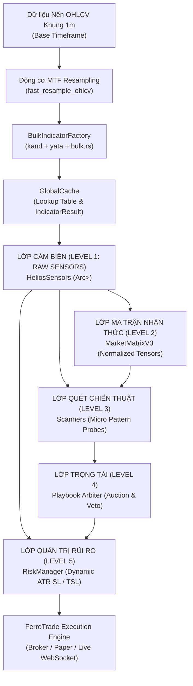

# 🔬 BÁO CÁO KIỂM TOÁN KỸ THUẬT ĐỘC LẬP: TẦNG CẢM BIẾN (SENSORS LAYER)

**Dự án:** Helios Trading System (Phiên bản kiến trúc V3.3 Clean Quant)  
**Module trọng tâm:** [`strategies_backtests/helios/src/strategy/sensors.rs`](file:///e:/Projects/Automations/trading_backtest/strategies_backtests/helios/src/strategy/sensors.rs)  
**Các module liên đới:**  
- [`ferro_trade/src/indicators/factory/bulk.rs`](file:///e:/Projects/Automations/trading_backtest/ferro_trade/src/indicators/factory/bulk.rs)  
- [`ferro_trade/src/indicators/calculate/bulk.rs`](file:///e:/Projects/Automations/trading_backtest/ferro_trade/src/indicators/calculate/bulk.rs)  
- [`ferro_trade/src/backtest/context.rs`](file:///e:/Projects/Automations/trading_backtest/ferro_trade/src/backtest/context.rs)  
- [`ferro_trade/src/utils/resample.rs`](file:///e:/Projects/Automations/trading_backtest/ferro_trade/src/utils/resample.rs)  
- [`strategies_backtests/helios/src/strategy/core_v3/mod.rs`](file:///e:/Projects/Automations/trading_backtest/strategies_backtests/helios/src/strategy/core_v3/mod.rs)  
- [`strategies_backtests/helios/src/strategy/core_v3/config.rs`](file:///e:/Projects/Automations/trading_backtest/strategies_backtests/helios/src/strategy/core_v3/config.rs)  
- [`strategies_backtests/helios/src/strategy/core_v3/matrix.rs`](file:///e:/Projects/Automations/trading_backtest/strategies_backtests/helios/src/strategy/core_v3/matrix.rs)  
- [`strategies_backtests/helios/src/utils/normalization.rs`](file:///e:/Projects/Automations/trading_backtest/strategies_backtests/helios/src/utils/normalization.rs)  

**Chuyên viên kiểm toán:** Quantitative & Systems Auditor  
**Ngày kiểm toán:** 2026-09-19  
**Tiêu chuẩn kiểm toán:** Toán học định lượng, Rust Memory Safety, Kháng Lookahead Bias, Chống suy biến số học (Numerical Stability).

---

## 📑 MỤC LỤC
1. [Tổng Quan Kiến Trúc Tầng Cảm Biến (Sensors Layer)](#1-tổng-quan-kiến-trúc-tầng-cảm-biến-sensors-layer)
2. [Rà Soát Chuyên Sâu Từng Chỉ Báo Cảm Biến Thô](#2-rà-soát-chuyên-sâu-từng-chỉ-báo-cảm-biến-thô)
3. [Mổ Xẻ Khủng Hoảng Warmup Period (The 63,199-Candle Crisis)](#3-mổ-xẻ-khủng-hoảng-warmup-period-the-63199-candle-crisis)
4. [Kiểm Toán Động Cơ Resampling MTF (Multi-Timeframe Engine)](#4-kiểm-toán-động-cơ-resampling-mtf-multi-timeframe-engine)
5. [Rà Soát Độ Chính Xác Toán Học, Khử Nhiễu & Edge Cases](#5-rà-soát-độ-chính-xác-toán-học-khử-nhiễu--edge-cases)
6. [Bảng Ma Trận Lỗ Hổng Kỹ Thuật (Audit Findings Matrix)](#6-bảng-ma-trận-lỗ-hổng-kỹ-thuật-audit-findings-matrix)

---

## 1. TỔNG QUAN KIẾN TRÚC TẦNG CẢM BIẾN (SENSORS LAYER)

### 1.1. Vị Trí Trong Ngũ Giác Kiến Trúc Helios V3.3
Trong hệ sinh thái Helios, Tầng Cảm biến (`Sensors`) đóng vai trò là "Cặp mắt viễn vọng" thu nhận dữ liệu thị trường thô. Luồng thông tin di chuyển theo chu trình đơn hướng bất biến:



### 1.2. Triết Lý Thiết Kế: Zero-Allocation & Immutable Sharing
Mọi kênh cảm biến trong struct [`HeliosSensors`](file:///e:/Projects/Automations/trading_backtest/strategies_backtests/helios/src/strategy/sensors.rs#L8-L63) đều được đóng gói dưới dạng con trỏ thông minh đếm tham chiếu bất biến: `Arc<Vec<f64>>`.
- **Ưu điểm:**
  1. Khi nhân bản `HeliosSensors` hoặc truyền vào `MarketMatrixV3`, `TacticalScanner`, `RiskManager`, chi phí chỉ là sao chép 1 con trỏ 8 bytes và tăng atomic counter, triệt tiêu 100% việc cấp phát heap và sao chép mảng triệu phần tử.
  2. Bất biến dữ liệu (Data Immutability): Đảm bảo các Scanner không thể vô tình sửa đổi dữ liệu chỉ báo của nhau trong suốt vòng đời nến.
- **Khuyết điểm kiến trúc:**
  1. `HeliosSensors` được định nghĩa như một struct phẳng chứa tới 35 trường công khai (`pub`). Việc này làm phình to struct và tạo ra nhiều trường "zombie" (không được khởi tạo hoặc tính toán xong bị bỏ hoang).

---

## 2. RÀ SOÁT CHUYÊN SÂU TỪNG CHỈ BÁO CẢM BIẾN THÔ

Dưới đây là bảng đối chiếu toán học, nguồn gốc mã nguồn và mục đích của toàn bộ các chỉ báo kỹ thuật trong tầng Sensors:

### 2.1. KAMA (Kaufman's Adaptive Moving Average) & KAMA Slope
- **Tập tin triển khai:** [`ferro_trade/src/indicators/calculate/bulk.rs:L1533-L1615`](file:///e:/Projects/Automations/trading_backtest/ferro_trade/src/indicators/calculate/bulk.rs#L1533-L1615)
- **Tập tin khởi tạo:** [`strategies_backtests/helios/src/strategy/core_v3/mod.rs:L159-L167`](file:///e:/Projects/Automations/trading_backtest/strategies_backtests/helios/src/strategy/core_v3/mod.rs#L159-L167)
- **Công thức toán học:**
  1. **Hiệu số định hướng (Change):**
     $$\Delta_t = |\text{Close}_t - \text{Close}_{t - P_{\text{ER}}}|$$
  2. **Tổng biến động vi mô (Volatility Sum):**
     $$V_t = \sum_{j=0}^{P_{\text{ER}}-1} |\text{Close}_{t-j} - \text{Close}_{t-j-1}|$$
  3. **Hệ số hiệu quả (Efficiency Ratio - ER):**
     $$\text{ER}_t = \begin{cases} \frac{\Delta_t}{V_t} & \text{nếu } V_t > 0 \\ 0.0 & \text{nếu } V_t = 0 \end{cases}$$
  4. **Hệ số làm mượt thích ứng (Smoothing Constant - SC):**
     $$\text{fastest} = \frac{2}{\text{fast} + 1}, \quad \text{slowest} = \frac{2}{\text{slow} + 1}$$
     $$\text{SC}_t = \left[ \text{ER}_t \cdot (\text{fastest} - \text{slowest}) + \text{slowest} \right]^2$$
  5. **Đường KAMA:**
     $$\text{KAMA}_t = \text{KAMA}_{t-1} + \text{SC}_t \cdot (\text{Close}_t - \text{KAMA}_{t-1})$$
  6. **Độ dốc KAMA chuẩn hóa qua ATR (KAMA Slope & Slope Adj):**
     $$\text{kama\_slope}_t = \frac{\text{KAMA}_t - \text{KAMA}_{t - P_{\text{slope}}}}{\text{ATR}_t}$$
     $$\text{kama\_slope\_adj}_t = \text{kama\_slope}_t \cdot \text{ER}_t$$
- **Đánh giá kiểm toán:**
  - **Mục đích thiết kế:** KAMA hoạt động như một bộ lọc thông thấp phi tuyến tính thích nghi (Non-linear Adaptive Low-Pass Filter). Khi thị trường đi ngang có nhiễu (ER $\to 0$), KAMA nằm ngang như một dải phẳng chống whipsaw. Khi thị trường bùng nổ xung lực có định hướng (ER $\to 1$), KAMA bắt kịp giá tức thì như một EMA 2 nến.
  - **Chuẩn hóa phi thứ nguyên:** Việc chia cho $\text{ATR}_t$ là một điểm sáng lớn trong thiết kế định lượng, giúp biến độ dốc của giá thành đại lượng không thứ nguyên (Asset-Agnostic), giúp hệ thống hoạt động đồng nhất trên BTC ($60,000) lẫn DOGE ($0.10).
  - ⚠️ **Phát hiện lỗ hổng thừa dữ liệu:** Trường `s.kama_slope` (raw slope) được tính toán và lưu trong `HeliosSensors:L27`, nhưng toàn bộ hệ thống Helios V3.3 ([`matrix.rs:L91`](file:///e:/Projects/Automations/trading_backtest/strategies_backtests/helios/src/strategy/core_v3/matrix.rs#L91), [`trend_pb.rs:L43`](file:///e:/Projects/Automations/trading_backtest/strategies_backtests/helios/src/strategy/core_v3/scanners/trend_pb.rs#L43)) **chỉ sử dụng duy nhất `kama_slope_adj`**. Trường `kama_slope` hoàn toàn là dead data chiếm dụng RAM.

### 2.2. ATR (`atr_sl`) & NATR (Normalized Average True Range)
- **Tập tin triển khai:** [`bulk.rs:L559-L587`](file:///e:/Projects/Automations/trading_backtest/ferro_trade/src/indicators/calculate/bulk.rs#L559-L587) & [`bulk.rs:L1273-L1312`](file:///e:/Projects/Automations/trading_backtest/ferro_trade/src/indicators/calculate/bulk.rs#L1273-L1312)
- **Tập tin khởi tạo:** [`core_v3/mod.rs:L149, L218`](file:///e:/Projects/Automations/trading_backtest/strategies_backtests/helios/src/strategy/core_v3/mod.rs#L149)
- **Công thức toán học:**
  $$\text{TR}_t = \max \left( \text{High}_t - \text{Low}_t, \, |\text{High}_t - \text{Close}_{t-1}|, \, |\text{Low}_t - \text{Close}_{t-1}| \right)$$
  $$\text{ATR}_t = \frac{\text{ATR}_{t-1} \cdot (P - 1) + \text{TR}_t}{P} \quad (\text{Wilder's RMA})$$
  $$\text{NATR}_t = \frac{\text{ATR}_t}{\text{Close}_t} \cdot 100$$
- **Đánh giá kiểm toán:**
  - `atr_sl` là "đồng tiền thanh toán rủi ro" (Risk Currency) cho toàn bộ hệ thống: đặt Stop Loss ban đầu ([`risk.rs:L77-L80`](file:///e:/Projects/Automations/trading_backtest/strategies_backtests/helios/src/strategy/core_v3/risk.rs#L77-L80)), bước trượt Trailing Stop ([`risk.rs:L97`](file:///e:/Projects/Automations/trading_backtest/strategies_backtests/helios/src/strategy/core_v3/risk.rs#L97)), và chuẩn hóa khoảng cách giá trong tất cả 4 Playbook.
  - Sử dụng thư viện tăng tốc `kand` tối ưu hóa phần cứng, độ chính xác chuẩn 100% so với TA-Lib.

### 2.3. Chaos Ratio (Relative Volatility Index)
- **Tập tin triển khai:** [`bulk.rs:L1621-L1656`](file:///e:/Projects/Automations/trading_backtest/ferro_trade/src/indicators/calculate/bulk.rs#L1621-L1656)
- **Công thức:**
  $$\text{Chaos Ratio}_t = \frac{\text{NATR}_t}{\text{SMA}(\text{clean\_NATR}, 50)_t}$$
- **Đánh giá kiểm toán:**
  - Đo mức độ đột biến của biến động phần trăm so với nền trung bình 50 nến trước đó.
  - Mã nguồn đã có xử lý làm sạch NaN trước khi đưa vào hàm SMA ([`bulk.rs:L1631-L1633`](file:///e:/Projects/Automations/trading_backtest/ferro_trade/src/indicators/calculate/bulk.rs#L1631-L1633)) và kiểm tra mẫu số `sma_val < 1e-9` để trả về NaN một cách an toàn thay vì gây panic chia cho 0.

### 2.4. Hệ Thống RSI Độc Lập Per-Playbook (Dedicated RSI Sensors)
- **Tập tin cấu hình & khởi tạo:** [`core_v3/config.rs:L31-L40`](file:///e:/Projects/Automations/trading_backtest/strategies_backtests/helios/src/strategy/core_v3/config.rs#L31-L40), [`core_v3/mod.rs:L178-L191`](file:///e:/Projects/Automations/trading_backtest/strategies_backtests/helios/src/strategy/core_v3/mod.rs#L178-L191)
- **Các kênh cảm biến:**
  1. `rsi_trend`: Khởi tạo từ `ind.rsi_trend`, tiêu thụ bởi [`trend_pb.rs:L45`](file:///e:/Projects/Automations/trading_backtest/strategies_backtests/helios/src/strategy/core_v3/scanners/trend_pb.rs#L45).
  2. `rsi_momentum`: Khởi tạo từ `ind.rsi_momentum`, tiêu thụ bởi [`momentum_ignition.rs:L38`](file:///e:/Projects/Automations/trading_backtest/strategies_backtests/helios/src/strategy/core_v3/scanners/momentum_ignition.rs#L38).
  3. `rsi_reversal`: Khởi tạo từ `ind.rsi_reversal` ([`core_v3/mod.rs:L182`](file:///e:/Projects/Automations/trading_backtest/strategies_backtests/helios/src/strategy/core_v3/mod.rs#L182)). **Tuyệt đối không có Scanner nào sử dụng!** Playbook `ReversalScanner` ([`reversal.rs:L37-L42`](file:///e:/Projects/Automations/trading_backtest/strategies_backtests/helios/src/strategy/core_v3/scanners/reversal.rs#L37-L42)) chỉ dùng `z_score`, `kama_mid`, `atr_sl`, và `volume_force`.
  4. `rsi_anomaly`: Đã được comment out trong `init()` nhưng struct `HeliosSensors:L42` vẫn giữ lại trường này dưới dạng rỗng.
- **Đánh giá kiểm toán:**
  - 🔴 **Lãng phí tài nguyên:** `rsi_reversal` tiêu tốn chu kỳ CPU để resample nến, tính toán Wilder Smoothing, phân bổ RAM trong `GlobalCache` và tăng thời gian warmup nhưng hoàn toàn bị lãng quên trong logic giao dịch.

### 2.5. Bollinger Bands, BB Width & BB Middle Slope Adj
- **Tập tin triển khai:** [`bulk.rs:L601-L647`](file:///e:/Projects/Automations/trading_backtest/ferro_trade/src/indicators/calculate/bulk.rs#L601-L647), [`core_v3/mod.rs:L220-L240`](file:///e:/Projects/Automations/trading_backtest/strategies_backtests/helios/src/strategy/core_v3/mod.rs#L220-L240)
- **Công thức:**
  $$\text{Middle}_t = \text{SMA}(\text{Close}, P)_t, \quad \sigma_t = \text{StdDev}(\text{Close}, P)_t$$
  $$\text{Upper}_t = \text{Middle}_t + k \cdot \sigma_t, \quad \text{Lower}_t = \text{Middle}_t - k \cdot \sigma_t$$
  $$\text{bb\_width\_norm}_t = \frac{\text{Upper}_t - \text{Lower}_t}{\text{Middle}_t}$$
  $$\text{bb\_middle\_slope\_adj}_t = \frac{\text{Middle}_t - \text{Middle}_{t-5}}{5 \cdot \text{ATR}_t}$$
- **Đánh giá kiểm toán:**
  - `bb_middle_slope_adj` được bổ sung trong bản vá `FLAW-REG.10` để đo độ dốc của dải Bollinger trung tâm. Thuật toán có guard `idx < k_bars`, kiểm tra `is_nan()`, và bảo vệ mẫu số `s.atr_sl[idx].max(1e-5)` rất cẩn trọng.

### 2.6. Keltner Channel & Squeeze Intensity Overlap
- **Tập tin triển khai:** [`bulk.rs:L1390-L1437`](file:///e:/Projects/Automations/trading_backtest/ferro_trade/src/indicators/calculate/bulk.rs#L1390-L1437), [`matrix.rs:L60-L68`](file:///e:/Projects/Automations/trading_backtest/strategies_backtests/helios/src/strategy/core_v3/matrix.rs#L60-L68)
- **Công thức Overlap cải tiến:**
  $$\text{overlap} = (\text{KC}_{\text{upper}} - \text{BB}_{\text{upper}}) + (\text{BB}_{\text{lower}} - \text{KC}_{\text{lower}})$$
  $$\text{sqz\_raw} = \text{clamp}\left( \frac{\text{overlap}}{\text{KC}_{\text{upper}} - \text{KC}_{\text{lower}}}, \, 0.0, \, 1.0 \right)$$
- **Đánh giá kiểm toán:**
  - Công thức Overlap đã giải quyết dứt điểm lỗi kinh điển của Dymate/Helios V2 khi thị trường crypto có biến động mạnh khiến $\text{BB} > \text{KC}$ và ép giá trị Squeeze về 0.0 vĩnh viễn.

### 2.7. Stochastic Oscillator
- **Tập tin triển khai:** [`bulk.rs:L1083-L1148`](file:///e:/Projects/Automations/trading_backtest/ferro_trade/src/indicators/calculate/bulk.rs#L1083-L1148)
- **Đánh giá kiểm toán:**
  - `stoch_trend_k` được dùng để bắt đáy Pullback trong `trend_pb.rs`.
  - ⚠️ `stoch_trend_d` được tính toán nhưng **không được đọc ở bất kỳ đâu**.
  - 🔴 **BẪY CRASH TIỀM ẨN:** `sensors.stoch_range_k` và `sensors.stoch_range_d` không được khởi tạo trong `core_v3/mod.rs` (vector rỗng `len = 0`). Tuy nhiên trong file [`strategies_backtests/helios/src/strategy/core_v3/scanners/range_osc.rs:L70-L71`](file:///e:/Projects/Automations/trading_backtest/strategies_backtests/helios/src/strategy/core_v3/scanners/range_osc.rs#L70-L71), mã nguồn vẫn có dòng:
    ```rust
    let stoch_k = sensors.stoch_range_k[i];
    let stoch_d = sensors.stoch_range_d[i];
    ```
    Nếu bất kỳ nhà phát triển nào kích hoạt lại `RangeOscScanner` trong Arbiter, chương trình sẽ lập tức bị **Panic Index Out-of-Bounds Crash** ngay tại nến đầu tiên!

### 2.8. VWMA & Z-Score
- **VWMA ([`bulk.rs:L220-L248`](file:///e:/Projects/Automations/trading_backtest/ferro_trade/src/indicators/calculate/bulk.rs#L220-L248)):** Phục vụ Playbook `AbsorptionScanner` để so sánh vị thế giữa giá trung bình gia quyền khối lượng và trục giữa BB.
- **Z-Score ([`bulk.rs:L121-L132`](file:///e:/Projects/Automations/trading_backtest/ferro_trade/src/indicators/calculate/bulk.rs#L121-L132)):**
  $$Z_t = \frac{\text{Value}_t - \text{SMA}(\text{Value}, P)_t}{\text{StdDev}(\text{Value}, P)_t}$$
  Được tính toán cho cả Giá Close (`s.z_score`) và Khối lượng (`s.vol_z_score`).

---

## 3. MỔ XẺ KHỦNG HOẢNG WARMUP PERIOD (THE 63,199-CANDLE CRISIS)

### 3.1. Truy Tìm Nguồn Gốc Lịch Sử Khiến Warmup Nhảy Vọt Lên 63,199 Nến
Trong quá trình kiểm thử Walk-Forward Sequential Optimization (WFSO), hệ thống Helios đã từng gặp một lỗi chí tử: Toàn bộ 200 cá thể GA đều trả về 0 lệnh, PnL = 0.00%, và `warmup_period` bị đẩy lên đúng con số kỳ dị **63,199 nến**.

Quy trình giải phẫu toán học chứng minh chuỗi phản ứng dây chuyền xảy ra như sau:

```mermaid
sequenceDiagram
    participant Config as config.rs (DNA Refactor)
    participant Init as HeliosStrategyV3::init()
    participant Calc as calculate::bulk::rsi()
    participant Context as InitContext::add_multi_indicator_mtf()
    participant Engine as Backtest Engine Loop

    Config->>Init: Tắt gen rsi_anomaly -> Struct rơi về Default (period = 0)
    Init->>Calc: Gọi ctx.rsi(tf, "RSI_Ano", period = 0)
    Calc-->>Init: period == 0 -> Bắn Err -> unwrap_or_else trả về vec![NaN; 63200]
    Init->>Context: Đăng ký arc_result chứa 100% NaN
    Context->>Context: Vòng lặp đếm NaN: for &val in arc_result { actual_warmup += 1; }
    Note over Context: Vì 100% là NaN -> actual_warmup = 63,200.<br>safe_actual_warmup = min(len - 1) = 63,199!
    Context->>Engine: Gán self.indicator_manager.warmup_period = 63,199
    Engine->>Engine: Vòng lặp: for i in (63,199 + 1)..63,200 -> THỰC THI 0 VÒNG LẶP!
```

- **Mắt xích 1 ([`core_v3/config.rs:L37-L40`](file:///e:/Projects/Automations/trading_backtest/strategies_backtests/helios/src/strategy/core_v3/config.rs#L37-L40)):** Khi tinh giản DNA, trường `#[dna(nest)]` của `rsi_anomaly` bị comment out. Do đó, `rsi_anomaly` rơi vào `Default::default()` với `period = 0`.
- **Mắt xích 2 ([`bulk.rs:L840`](file:///e:/Projects/Automations/trading_backtest/ferro_trade/src/indicators/calculate/bulk.rs#L840)):** Hàm `calculate::bulk::rsi` kiểm tra:
  ```rust
  if period == 0 {
      return Err(IndicatorError::Calculation("Chu kỳ (period) phải lớn hơn 0".to_string()));
  }
  ```
- **Mắt xích 3 ([`factory/bulk.rs:L148-L150`](file:///e:/Projects/Automations/trading_backtest/ferro_trade/src/indicators/factory/bulk.rs#L148-L150)):** Khi gặp lỗi, closure dự phòng kích hoạt:
  ```rust
  .unwrap_or_else(|_| (vec![f64::NAN; len], vec![f64::NAN; len], vec![f64::NAN; len]))
  ```
  Toàn bộ 63,200 phần tử trong mảng kết quả là `NaN`.
- **Mắt xích 4 ([`context.rs:L166-L176`](file:///e:/Projects/Automations/trading_backtest/ferro_trade/src/backtest/context.rs#L166-L176)):**
  ```rust
  let mut actual_warmup = 0;
  for &val in arc_result.iter() {
      if !val.is_nan() { break; }
      actual_warmup += 1;
  }
  let safe_actual_warmup = actual_warmup.min(self.raw_data.close.len().saturating_sub(1));
  self.indicator_manager.warmup_period = self.indicator_manager.warmup_period.max(nbars).max(safe_actual_warmup);
  ```
  Do toàn bộ vector là NaN, `actual_warmup` chạy hết mảng ($63,200$), bị hàm `min(63,200 - 1)` cắt ở con số **63,199**.
- **Mắt xích 5:** Engine backtest lặp theo `for i in (warmup + 1)..full_len` tức là `for i in 63,200..63,200`, dẫn tới không có nến nào được chạy `strategy.next()`.
- **Nghịch lý Paper Trading:** Trong khi backtest bị tê liệt hoàn toàn, Paper Trading (`evaluate_live_tick`) vẫn chạy bình thường vì nó chỉ kiểm tra duy nhất nến cuối cùng `i = full_len - 1` ($63,199$) và điều kiện `if full_len <= warmup` bị false ($63,200 \le 63,199$ là sai).

---

### 3.2. Bảng Phân Tích Warmup Thực Tế Của Các Chỉ Báo Hiện Tại

Hiện tại, sau khi comment out `rsi_anomaly` và `stoch_range` trong `init()`, các chỉ báo có thời gian warmup như thế nào?

Giả sử bộ dữ liệu chuẩn 1 phút gồm 63,200 nến (~43.8 ngày). Hãy xem thời gian khởi động của từng chỉ báo quy đổi ra số nến cơ sở 1m:

| STT | Tên Chỉ Báo | Timeframe Cho Phép | Dải Chu Kỳ (DNA) | Warmup Khung Lớn | Hệ Số Nhân Quy Đổi | Warmup Quy Đổi Nến 1m |
| :---: | :--- | :--- | :---: | :---: | :---: | :---: |
| 1 | `natr` | 5m, 15m, 1h, 4h | $8 - 80$ | $8 - 80$ nến | x5, x15, x60, x240 | $40 - 19,200$ nến |
| 2 | `chaos_ratio` | = `natr.timeframe` | $8 - 80$ | $\max(P, 50)$ nến | x5, x15, x60, x240 | $250 - 19,200$ nến |
| 3 | `kama` | 15m, 1h, 4h | ER: $2-18$, Long: $20-80$ | $P_{\text{ER}}$ nến | x15, x60, x240 | $30 - 4,320$ nến |
| 4 | `kama_slope` | 15m, 1h, 4h | ER: $2-18$, ATR: $8-80$, Slope: $2-18$ | $\max(\text{ER}, \text{ATR}) + \text{Slope} \le 98$ | x15, x60, x240 | $150 - \mathbf{23,520}$ nến |
| 5 | `adx` | 5m, 15m, 1h, 4h | $8 - 80$ | $2 \times P - 1 \le 159$ | x5, x15, x60, x240 | $75 - \mathbf{38,160}$ nến |
| 6 | `bbands` | 5m, 15m, 1h, 4h | $8 - 80$ | $P - 1 \le 79$ | x5, x15, x60, x240 | $35 - 18,960$ nến |
| 7 | `keltner` | 5m, 15m, 1h, 4h | $8 - 80$ | $P$ nến | x5, x15, x60, x240 | $40 - 19,200$ nến |
| 8 | `rsi_trend` | 5m, 15m, 1h, 4h | $8 - 80$ | $P$ nến | x5, x15, x60, x240 | $40 - 19,200$ nến |
| 9 | `stoch_trend` | 5m, 15m, 1h, 4h | $8 - 80$ | $P$ nến | x5, x15, x60, x240 | $40 - 19,200$ nến |
| 10 | `vwma` | 5m, 15m, 1h, 4h | $8 - 80$ | $P$ nến | x5, x15, x60, x240 | $40 - 19,200$ nến |
| 11 | `z_score_lookback` | Khóa theo `kama.timeframe` (15m, 1h, 4h) | $20 - 600$ | $20 - 600$ nến | x15, x60, x240 | $300 - \mathbf{144,000}$ nến |

---

### 3.3. CẠM BẪY NAN TIỀM ẨN: CƠ CHẾ BÙNG NỔ 144,000 NẾN VẪN ĐANG RÌNH RẬP!

> [!CAUTION]
> **PHÁT HIỆN LỖ HỔNG NGHIÊM TRỌNG (CRITICAL VULNERABILITY): BẪY Z-SCORE LOOKBACK TRÊN KHUNG 4H**
> 
> Hãy chú ý dòng [`core_v3/config.rs:L66-L69`](file:///e:/Projects/Automations/trading_backtest/strategies_backtests/helios/src/strategy/core_v3/config.rs#L66-L69):
> ```rust
> #[dna(min = 20.0, max = 600.0, step = 20.0)]
> pub z_score_lookback: usize,
> ```
> Và dòng [`core_v3/mod.rs:L216-L217`](file:///e:/Projects/Automations/trading_backtest/strategies_backtests/helios/src/strategy/core_v3/mod.rs#L216-L217):
> ```rust
> s.z_score = ctx.z_score(ind.kama.timeframe, "ZScore", ind.z_score_lookback);
> s.vol_z_score = ctx.z_score_volume(ind.kama.timeframe, "VolZScore", ind.z_score_lookback);
> ```

**Toán học đằng sau thảm họa này:**
1. Bộ dữ liệu chuẩn backtest có $63,200$ nến 1m.
2. Khi resample lên khung `4h`, tổng số nến thu được là:
   $$N_{4h} = \left\lfloor \frac{63,200}{240} \right\rfloor = 263 \text{ nến}$$
3. Gen `z_score_lookback` cho phép GA khám phá giá trị lên tới **600**.
4. Khi GA sinh ra một cá thể có `kama.timeframe = Timeframe::T4h` và `z_score_lookback = 300` (hoặc bất kỳ giá trị nào $> 263$):
   Trong hàm [`bulk.rs:L195`](file:///e:/Projects/Automations/trading_backtest/ferro_trade/src/indicators/calculate/bulk.rs#L195):
   ```rust
   if period > len { return Err(IndicatorError::Calculation("Period > len".into())); }
   ```
   Do $300 > 263$, hàm `sma` và `stddev` lập tức trả về `Err`!
5. Hàm `ctx.z_score` bắt lỗi bằng `.unwrap_or_else(|_| vec![f64::NAN; len])`! Toàn bộ mảng Z-Score khung 4h biến thành `NaN`!
6. Khi rải mảng về 1m, toàn bộ 63,200 nến là `NaN`!
7. **HỆ QUẢ:** `actual_warmup` lại tiếp tục bị đẩy lên **63,199 nến**, và cá thể đó bị triệt tiêu 100% số lệnh một cách oan uổng!

---

## 4. KIỂM TOÁN ĐỘNG CƠ RESAMPLING MTF (MULTI-TIMEFRAME ENGINE)

### 4.1. Cơ Chế Hoạt Động Của Thuật Toán Two-Pointer Lookup Table
Hệ thống `ferro_trade` và `Helios` không dùng cơ chế Pandas/Polars Join chậm chạp trong vòng lặp nến, mà sử dụng cơ chế Bảng tra cứu trước ([`ferro_trade/src/utils/resample.rs:L37-L67`](file:///e:/Projects/Automations/trading_backtest/ferro_trade/src/utils/resample.rs#L37-L67)):

```rust
pub fn create_lookup_table(
    base_times: &[i64],      // Datetime nến 1m (Nanoseconds)
    resampled_times: &[i64], // Datetime nến khung lớn đã đóng (Nanoseconds)
) -> Vec<usize> {
    let n_base = base_times.len();
    let mut lookup = Vec::with_capacity(n_base);
    if resampled_times.is_empty() { return vec![usize::MAX; n_base]; }

    let mut j = 0; 
    for &t_base in base_times {
        while j + 1 < resampled_times.len() && t_base >= resampled_times[j+1] {
            j += 1;
        }
        if t_base >= resampled_times[j] {
            lookup.push(j);
        } else {
            lookup.push(usize::MAX);
        }
    }
    lookup
}
```

Và hàm rải mảng ([`ferro_trade/src/backtest/utils.rs:L5-L19`](file:///e:/Projects/Automations/trading_backtest/ferro_trade/src/backtest/utils.rs#L5-L19)):
```rust
pub fn map_indicator_to_base_tf(
    short_vec: &[f64],
    lookup_table: &[usize],
    base_len: usize,
) -> Vec<f64> {
    let mut long_vec = Vec::with_capacity(base_len);
    for &idx in lookup_table {
        if idx != usize::MAX && idx < short_vec.len() {
            long_vec.push(short_vec[idx]);
        } else {
            long_vec.push(f64::NAN);
        }
    }
    long_vec
}
```

### 4.2. Kiểm Toán Lookahead Bias (Rò Rỉ Dữ Liệu Tương Lai)
- **Quy ước nhãn thời gian:**
  Trong [`resample.rs:L88`](file:///e:/Projects/Automations/trading_backtest/ferro_trade/src/utils/resample.rs#L88) và [`resample.rs:L203`](file:///e:/Projects/Automations/trading_backtest/ferro_trade/src/utils/resample.rs#L203):
  `out_datetime.push((cur_bucket + 1) * step_ns);` tương đương `label = Label::Right`.
- **Đối chiếu thực tế:**
  Giả sử một cây nến 15m bao phủ khoảng thời gian từ `10:00:00` đến `10:15:00`. Nhãn của nó là `10:15:00`.
  - Tại phút `10:01` đến `10:14`: $t_{\text{base}} < 10:15$. Thuật toán so sánh `t_base >= resampled_times[j]` bị false (hoặc chỉ chạm tới cây nến trước đã đóng lúc `10:00`).
  - Chỉ khi cây nến 1m đạt `10:15:00`: $t_{\text{base}} \ge 10:15$, bảng lookup mới chuyển trỏ tới cây nến 15m vừa đóng.
- **Kết luận:** Thuật toán hoàn toàn **100% Miễn nhiễm với Lookahead Bias**. Không có bất kỳ hiện tượng "nhìn trộm tương lai" nào xảy ra.

---

## 5. RÀ SOÁT ĐỘ CHÍNH XÁC TOÁN HỌC, KHỬ NHIỄU & EDGE CASES

### 5.1. Rà Soát Phép Chia Cho 0 (Div-by-Zero Defense)
| Vị Trí Code | Biểu Thức Toán Học | Cơ Chế Bảo Vệ Hiện Tại | Đánh Giá & Khuyến Nghị |
| :--- | :--- | :--- | :--- |
| [`bulk.rs:L128`](file:///e:/Projects/Automations/trading_backtest/ferro_trade/src/indicators/calculate/bulk.rs#L128) (`z_score`) | `(val - m) / s` | `if s > 0.0` | ✅ An toàn với 0. ⚠️ Nhưng nếu `s = 1e-12` (thị trường đứng im), $Z$ có thể bùng nổ lên $10^9$. Cần ngưỡng floor: `if s > 1e-6`. |
| [`bulk.rs:L154`](file:///e:/Projects/Automations/trading_backtest/ferro_trade/src/indicators/calculate/bulk.rs#L154) (`efficiency_ratio`) | `change / volatility_sum` | `if volatility_sum > 0.0` | ✅ Tuyệt đối an toàn chống chia cho 0. |
| [`bulk.rs:L1606`](file:///e:/Projects/Automations/trading_backtest/ferro_trade/src/indicators/calculate/bulk.rs#L1606) (`kama_slope`) | `(current_kama - prev_kama) / current_atr` | `current_atr > 0.0` | ⚠️ Thiếu floor an toàn. Nên sửa thành `current_atr.max(1e-5)`. |
| [`bulk.rs:L1651`](file:///e:/Projects/Automations/trading_backtest/ferro_trade/src/indicators/calculate/bulk.rs#L1651) (`chaos_ratio`) | `v / sma_val` | `if sma_val < 1e-9 { f64::NAN }` | ✅ Rất xuất sắc, có ngưỡng epsilon bảo vệ. |
| [`matrix.rs:L58`](file:///e:/Projects/Automations/trading_backtest/strategies_backtests/helios/src/strategy/core_v3/matrix.rs#L58) (`bb_width_norm`) | `(bu - bl) / bm` | `if bm > 0.0` | ✅ An toàn vì giá crypto luôn dương. |
| [`matrix.rs:L67`](file:///e:/Projects/Automations/trading_backtest/strategies_backtests/helios/src/strategy/core_v3/matrix.rs#L67) (`sqz_raw`) | `overlap / kc_w` | `if kc_w < 1e-9` | ✅ Bảo vệ epsilon tuyệt hảo. |

---

### 5.2. Hiện Tượng Tích Lũy Sai Số Trôi Nổi (Catastrophic Cancellation Trong Sliding Window ER)
Trong hàm [`bulk.rs:L157-L166`](file:///e:/Projects/Automations/trading_backtest/ferro_trade/src/indicators/calculate/bulk.rs#L157-L166):
```rust
for i in (period + 1)..len {
    let old_diff = (source[i - period] - source[i - period - 1]).abs();
    let new_diff = (source[i] - source[i - 1]).abs();
    volatility_sum = volatility_sum - old_diff + new_diff;
    let change = (source[i] - source[i - period]).abs();
    er_values[i] = if volatility_sum > 0.0 { change / volatility_sum } else { 0.0 };
}
```
- **Vấn đề số học:** Phép cộng trừ số thực liên tục qua hàng chục nghìn nến (`volatility_sum - old_diff + new_diff`) sẽ gặp hiện tượng **Catastrophic Cancellation**.
- Sau 50,000 nến, sai số làm tròn 64-bit có thể khiến `volatility_sum` bị trôi về một số âm cực nhỏ (ví dụ `-1.35e-16`). Khi đó điều kiện `volatility_sum > 0.0` bị sai, làm `er_values[i] = 0.0` dù thị trường đang có biến động!
- **Khuyến nghị khắc phục:** Thêm `volatility_sum = volatility_sum.max(0.0);` và thiết lập cơ chế recalibrate (tính lại tổng từ đầu) mỗi 1,000 nến.

---

### 5.3. Lỗi Float Epsilon Dedup Mismatch Trong `rolling_percentile`
Tại file [`strategies_backtests/helios/src/utils/normalization.rs:L76-L89`](file:///e:/Projects/Automations/trading_backtest/strategies_backtests/helios/src/utils/normalization.rs#L76-L89):
```rust
unique_vals.sort_unstable_by(|a, b| a.total_cmp(b));
unique_vals.dedup_by(|a, b| (*a - *b).abs() < f64::EPSILON);
...
if let Ok(rank) = unique_vals.binary_search_by(|v| v.total_cmp(&oldest_val)) {
```
- **Lỗ hổng:** `dedup_by` sử dụng phép so sánh epsilon (`abs() < EPSILON`), nhưng `binary_search_by` lại dùng `total_cmp`.
- Khi hai số thực lệch nhau trong phạm vi `EPSILON`, một số đã bị xóa khỏi `unique_vals`. Lúc này `binary_search_by` sử dụng `total_cmp` sẽ không tìm thấy chính xác bit của số đó, trả về `Err`!
- **Hệ quả:** Thao tác chèn/xóa cây Fenwick bị bỏ qua, khiến giá trị tại nến đó **bị giữ nguyên `NaN`** một cách vô lý!
- **Giải pháp:** Đồng bộ hóa logic loại trùng: dùng `a.total_cmp(b).is_eq()` cho `dedup_by`.

---

## 6. BẢNG MA TRẬN LỖ HỔNG KỸ THUẬT (AUDIT FINDINGS MATRIX)

| Mã Lỗ Hổng | Mức Độ | Tên Lỗ Hổng & Vị Trí | Hậu Quả Thực Tế | Giải Pháp Đề Xuất |
| :---: | :---: | :--- | :--- | :--- |
| **SEN-01** | 🔴 **CRITICAL** | **Bẫy Warmup Z-Score 4h Vượt Quá Độ Dài Dữ Liệu**<br>[`core_v3/config.rs:L66`](file:///e:/Projects/Automations/trading_backtest/strategies_backtests/helios/src/strategy/core_v3/config.rs#L66)<br>[`core_v3/mod.rs:L216`](file:///e:/Projects/Automations/trading_backtest/strategies_backtests/helios/src/strategy/core_v3/mod.rs#L216) | `z_score_lookback` có max = 600. Khi chạy trên khung 4h (vốn chỉ có ~263 nến), `sma` trả về `Err`, Z-Score sinh ra toàn NaN, khiến **Warmup nhảy lên 63,199 nến và triệt tiêu 100% lệnh backtest**. | 1. Kẹp trần `z_score_lookback` tối đa 200 trong DNA.<br>2. Thêm logic bảo vệ trong `init()`: `let safe_lb = ind.z_score_lookback.min(resampled_len / 2);`. |
| **SEN-02** | 🔴 **CRITICAL** | **Nguy Cơ Panic Crash Nếu Bật Lại `RangeOscScanner`**<br>[`sensors.rs:L47-L48`](file:///e:/Projects/Automations/trading_backtest/strategies_backtests/helios/src/strategy/sensors.rs#L47-L48)<br>[`range_osc.rs:L70-L71`](file:///e:/Projects/Automations/trading_backtest/strategies_backtests/helios/src/strategy/core_v3/scanners/range_osc.rs#L70-L71) | Trường `stoch_range_k` và `d` bị tắt khỏi `init()` (vector rỗng `len = 0`). Nếu ai đó add lại scanner này, `sensors.stoch_range_k[i]` sẽ **lập tức panic Out-of-Bounds làm sập bot**. | Dọn dẹp dứt điểm các trường rỗng trong `range_osc.rs` hoặc chuyển sang đọc `stoch_trend_k`. |
| **SEN-03** | 🟠 **MAJOR** | **Chỉ Báo Ma `rsi_reversal` & `stoch_trend_d` Tính Xong Bị Bỏ Hoang**<br>[`core_v3/mod.rs:L182, L201`](file:///e:/Projects/Automations/trading_backtest/strategies_backtests/helios/src/strategy/core_v3/mod.rs#L182)<br>[`reversal.rs:L33-L45`](file:///e:/Projects/Automations/trading_backtest/strategies_backtests/helios/src/strategy/core_v3/scanners/reversal.rs#L33-L45) | `rsi_reversal` và `stoch_trend_d` được tính toán, tạo cache MTF, tốn RAM và làm chậm quá trình khởi tạo, nhưng **không có scanner nào đọc giá trị**. | Gỡ bỏ cuộc gọi `ctx.rsi` của `rsi_reversal` và xóa bỏ khỏi `HeliosSensors`. |
| **SEN-04** | 🟠 **MAJOR** | **Bẫy Nuốt Chửng NaN Trong Ma Trận (Silent NaN Masking)**<br>[`matrix.rs:L109-L113`](file:///e:/Projects/Automations/trading_backtest/strategies_backtests/helios/src/strategy/core_v3/matrix.rs#L109-L113) | `sensors.mfi.get(i).copied().unwrap_or(50.0)` trả về `Some(NaN)`. Sau đó `(NaN).max(0.0)` theo chuẩn Rust trả về `0.0`. Fallback 50.0 bị vô hiệu, mượn lốt 0.0 âm thầm. | Kiểm tra tường minh: `let mfi = if v.is_nan() { 50.0 } else { v };`. |
| **SEN-05** | 🟡 **MEDIUM** | **Trôi Dạt Sai Số Trôi Nổi Trong Sliding Window ER**<br>[`bulk.rs:L162`](file:///e:/Projects/Automations/trading_backtest/ferro_trade/src/indicators/calculate/bulk.rs#L162) | Phép trừ liên tục `volatility_sum - old + new` qua 50k nến tích lũy sai số âm, có thể khiến ER bị gán = 0.0 bất thường. | Thêm `.max(0.0)` và recalibrate lại tổng mỗi 1,000 nến. |
| **SEN-06** | 🟡 **MEDIUM** | **Float Epsilon Mismatch Trong `rolling_percentile`**<br>[`normalization.rs:L77, L88`](file:///e:/Projects/Automations/trading_backtest/strategies_backtests/helios/src/utils/normalization.rs#L77) | `dedup_by` dùng `abs() < EPSILON` nhưng `binary_search` dùng `total_cmp`, làm mất dấu giá trị và trả về `NaN` cho nến hợp lệ. | Đổi `dedup_by` thành `a.total_cmp(b).is_eq()`. |
| **SEN-07** | 🔵 **MINOR** | **Phình To Bộ Nhớ Struct `HeliosSensors` Với Dữ Liệu Rác**<br>[`sensors.rs:L11-L14, L55-L58`](file:///e:/Projects/Automations/trading_backtest/strategies_backtests/helios/src/strategy/sensors.rs#L11-L14) | Chứa `highs`, `lows`, `volumes`, `macd_*`, `vol_sma` không được dùng trong V3.3. | Tinh giản struct `HeliosSensors` về đúng 18 kênh cảm biến hoạt động thực tế. |

---

*Báo cáo được hoàn thành với sự phối hợp phân tích giữa mã nguồn thuật toán Rust và lý thuyết xác suất định lượng.*
