# BÁO CÁO KIỂM TOÁN KỸ THUẬT TOÀN DIỆN: CẤU HÌNH & KHÔNG GIAN DNA HELIOS V3.3

> **Ngày thực hiện kiểm toán:** 19/09/2026  
> **Chuyên gia kiểm toán:** Quantitative & Systems Auditor (Rust Algorithmic Trading)  
> **Hệ thống mục tiêu:** Helios Core V3.3 - HFT/Intraday Quantitative Trading Engine  
> **Mã nguồn trọng tâm:** [`strategies_backtests/helios/src/strategy/core_v3/config.rs`](file:///e:/Projects/Automations/trading_backtest/strategies_backtests/helios/src/strategy/core_v3/config.rs) (851 dòng code)  
> **Các mô-đun liên đới:**
> - [`strategies_backtests/helios/src/strategy/core_v3/mod.rs`](file:///e:/Projects/Automations/trading_backtest/strategies_backtests/helios/src/strategy/core_v3/mod.rs)
> - [`strategies_backtests/helios/src/strategy/core_v3/matrix.rs`](file:///e:/Projects/Automations/trading_backtest/strategies_backtests/helios/src/strategy/core_v3/matrix.rs)
> - [`strategies_backtests/helios/src/strategy/core_v3/arbiter.rs`](file:///e:/Projects/Automations/trading_backtest/strategies_backtests/helios/src/strategy/core_v3/arbiter.rs)
> - [`strategies_backtests/helios/src/strategy/core_v3/risk.rs`](file:///e:/Projects/Automations/trading_backtest/strategies_backtests/helios/src/strategy/core_v3/risk.rs)
> - [`strategies_backtests/helios/src/strategy/core_v3/scanners/trend_pb.rs`](file:///e:/Projects/Automations/trading_backtest/strategies_backtests/helios/src/strategy/core_v3/scanners/trend_pb.rs)
> - [`strategies_backtests/helios/src/strategy/core_v3/scanners/momentum_ignition.rs`](file:///e:/Projects/Automations/trading_backtest/strategies_backtests/helios/src/strategy/core_v3/scanners/momentum_ignition.rs)
> - [`strategies_backtests/helios/src/strategy/core_v3/scanners/reversal.rs`](file:///e:/Projects/Automations/trading_backtest/strategies_backtests/helios/src/strategy/core_v3/scanners/reversal.rs)
> - [`strategies_backtests/helios/src/strategy/core_v3/scanners/absorption.rs`](file:///e:/Projects/Automations/trading_backtest/strategies_backtests/helios/src/strategy/core_v3/scanners/absorption.rs)
> - [`strategies_backtests/helios/src/strategy/core_v3/scanners/range_osc.rs`](file:///e:/Projects/Automations/trading_backtest/strategies_backtests/helios/src/strategy/core_v3/scanners/range_osc.rs)
> - [`strategies_backtests/helios/src/strategy/core_v3/scanners/anomaly.rs`](file:///e:/Projects/Automations/trading_backtest/strategies_backtests/helios/src/strategy/core_v3/scanners/anomaly.rs)
> - [`trading_bot/bot_engine/src/optimizer/prospector_runner.rs`](file:///e:/Projects/Automations/trading_backtest/trading_bot/bot_engine/src/optimizer/prospector_runner.rs)

---

## 1. TỔNG QUAN KIẾN TRÚC & VAI TRÒ KHÔNG GIAN DNA HELIOS V3.3

Trong kiến trúc định lượng Helios V3.3, file [`core_v3/config.rs`](file:///e:/Projects/Automations/trading_backtest/strategies_backtests/helios/src/strategy/core_v3/config.rs) đóng vai trò là **"Bộ bản đồ gen gốc" (Genetic Blueprint & Configuration Schema)**. Đây là nơi định hình toàn bộ không gian tham số tìm kiếm (Hyperparameter Search Space) cho thuật toán di truyền di động (Genetic Algorithm / Prospector Runner), đồng thời là cấu trúc ánh xạ trực tiếp từ file JSON/TOML sang bộ nhớ Runtime của Bot.

Toàn bộ cấu hình hệ thống được gói gọn trong struct cội rễ:
[`HeliosConfigV3`](file:///e:/Projects/Automations/trading_backtest/strategies_backtests/helios/src/strategy/core_v3/config.rs#L9-L21):

```rust
#[derive(Debug, Clone, Deserialize, Default, DnaMappableMacro)]
pub struct HeliosConfigV3 {
    #[dna(nest)]
    pub indicators: IndicatorsConfig,        // Phân bổ 34 gen
    #[dna(nest)]
    pub matrix: MatrixConfig,                // Phân bổ 8 gen
    #[dna(nest)]
    pub arbiter: ArbiterConfig,              // Phân bổ 1 gen
    #[dna(nest)]
    pub tactical_sniper: TacticalSniperConfig,// Phân bổ 25 gen
    #[dna(nest)]
    pub risk_management: RiskManagementConfig,// Phân bổ 27 gen
}
```

### Sơ Đồ Cây Phân Bổ Không Gian DNA V3.3 (Tổng: 95 Chiều)

```mermaid
graph TD
    Root[HeliosConfigV3: 95 Dimensions] --> IND[IndicatorsConfig: 34 Gens]
    Root --> MAT[MatrixConfig: 8 Gens]
    Root --> ARB[ArbiterConfig: 1 Gen]
    Root --> TAC[TacticalSniperConfig: 25 Gens]
    Root --> RSK[RiskManagementConfig: 27 Gens]

    IND --> IND_KAMA[KamaParams: 3]
    IND --> IND_ADX[AdxParams: 2]
    IND --> IND_RSI[RsiParams: Trend 2, Rev 2, Mom 2 = 6]
    IND --> IND_BB[BbandsParams: 3]
    IND --> IND_KC[KeltnerParams: 4]
    IND --> IND_STOCH[StochTrend: 7]
    IND --> IND_ATR[AtrParams: 2, NAtr: 2]
    IND --> IND_MFI[MfiParams: 2]
    IND --> IND_VWMA[VwmaParams: 2]
    IND --> IND_Z[z_score_lookback: 1]

    MAT --> MAT_LB[Lookbacks: Trend 1, Squeeze 1, Mom 1, Vol 1 = 4]
    MAT --> MAT_ORTH[Orthogonal: z_sens 1, adx_thresh 1, kama_scale 1, vol_z_sens 1 = 4]

    ARB --> ARB_CONF[min_confidence_threshold: 1]

    TAC --> TAC_PB[TacticalPullbackParams: 8]
    TAC --> TAC_MOM[TacticalMomentumParams: 5]
    TAC --> TAC_REV[TacticalReversalParams: 6]
    TAC --> TAC_ABS[TacticalAbsorptionParams: 6]

    RSK --> RSK_BASE[RiskBaseParams: 0 Gens User Settings]
    RSK --> RSK_STOP[RiskStopParams: 27 Gens Trailing & Dynamic SL/TP]
```



---

## 2. BẢNG KIỂM TOÁN CHI TIẾT 95 GEN DNA (GENE INVENTORY & BOUNDS AUDIT)

Dưới đây là bảng đối chiếu toàn bộ 95 gen DNA được xuất ra từ [`HeliosConfigV3::parameter_defs()`](file:///e:/Projects/Automations/trading_backtest/strategies_backtests/helios/src/strategy/core_v3/config.rs):

| Nhóm Cấu Hình | Tên Gen | Dải Min..Max | Bước Nhảy (Step) | Số Nấc | Đánh Giá Kỹ Thuật & Toán Học |
| :--- | :--- | :---: | :---: | :---: | :--- |
| **Indicators (34)** | `indicators.kama.short_period` | 2.0 .. 18.0 | 4.0 | 5 | Hợp lý cho nến intraday ngắn |
| | `indicators.kama.long_period` | 20.0 .. 80.0 | 4.0 | 16 | Hợp lý làm neo xu hướng |
| | `indicators.kama.timeframe` | `15m, 1h, 4h` | Categorical | 3 | Macro Anchor khóa cận dưới >= 15m chuẩn |
| | `indicators.adx.period` | 8.0 .. 80.0 | 3.0 | 25 | Dải tốt |
| | `indicators.adx.timeframe` | `5m, 15m, 1h, 4h` | Categorical | 4 | Chuẩn đa khung thời gian |
| | `indicators.rsi_trend.period` | 8.0 .. 80.0 | 3.0 | 25 | Dải tốt |
| | `indicators.rsi_trend.timeframe` | `5m, 15m, 1h, 4h` | Categorical | 4 | Chuẩn |
| | `indicators.rsi_reversal.period` | 8.0 .. 80.0 | 3.0 | 25 | Dải tốt |
| | `indicators.rsi_reversal.timeframe` | `5m, 15m, 1h, 4h` | Categorical | 4 | Chuẩn |
| | `indicators.rsi_momentum.period` | 8.0 .. 80.0 | 3.0 | 25 | Dải tốt |
| | `indicators.rsi_momentum.timeframe` | `5m, 15m, 1h, 4h` | Categorical | 4 | Chuẩn |
| | `indicators.bbands.period` | 8.0 .. 80.0 | 3.0 | 25 | Chuẩn |
| | `indicators.bbands.nbdev` | 1.0 .. 5.0 | 1.0 | 5 | 5 nấc độ lệch chuẩn (1, 2, 3, 4, 5) |
| | `indicators.bbands.timeframe` | `5m, 15m, 1h, 4h` | Categorical | 4 | Chuẩn |
| | `indicators.keltner.period` | 8.0 .. 80.0 | 3.0 | 25 | Chuẩn |
| | `indicators.keltner.multiplier` | 1.0 .. 5.0 | 1.0 | 5 | Chuẩn |
| | `indicators.keltner.timeframe` | `5m, 15m, 1h, 4h` | Categorical | 4 | Chuẩn |
| | `indicators.keltner.ma_type` | 15 MA Types | Categorical | 15 | Quá nhiều MA type làm GA phân tán |
| | `indicators.stoch_trend.period` | 8.0 .. 80.0 | 3.0 | 25 | Chuẩn |
| | `indicators.stoch_trend.k_period` | 2.0 .. 20.0 | 4.0 | 5 | Chuẩn |
| | `indicators.stoch_trend.d_period` | 2.0 .. 20.0 | 4.0 | 5 | Chuẩn |
| | `indicators.stoch_trend.k_ma_type` | 15 MA Types | Categorical | 15 | Dư thừa độ phức tạp |
| | `indicators.stoch_trend.d_ma_type` | 15 MA Types | Categorical | 15 | Dư thừa độ phức tạp |
| | `indicators.stoch_trend.zone` | 0.05 .. 0.45 | 0.10 | 5 | Vùng biên [5%, 45%] hợp lý |
| | `indicators.stoch_trend.timeframe` | `5m, 15m, 1h, 4h` | Categorical | 4 | Chuẩn |
| | `indicators.atr.period` | 8.0 .. 80.0 | 3.0 | 25 | Chuẩn |
| | `indicators.atr.timeframe` | `5m, 15m, 1h, 4h` | Categorical | 4 | Chuẩn |
| | `indicators.natr.period` | 8.0 .. 80.0 | 3.0 | 25 | Chuẩn |
| | `indicators.natr.timeframe` | `5m, 15m, 1h, 4h` | Categorical | 4 | Chuẩn |
| | `indicators.mfi.period` | 8.0 .. 80.0 | 3.0 | 25 | Chuẩn |
| | `indicators.mfi.timeframe` | `5m, 15m, 1h, 4h` | Categorical | 4 | Chuẩn |
| | `indicators.vwma.period` | 8.0 .. 80.0 | 3.0 | 25 | Chuẩn |
| | `indicators.vwma.timeframe` | `5m, 15m, 1h, 4h` | Categorical | 4 | Chuẩn |
| | `indicators.z_score_lookback` | 20.0 .. 600.0 | 20.0 | 30 | Chuẩn hóa thống kê giá |
| **Matrix (8)** | `matrix.trend_lookback` | 100.0 .. 1000.0 | 30.0 | 31 | Chuẩn (dùng cho ER) |
| | `matrix.squeeze_lookback` | 100.0 .. 1000.0 | 30.0 | 31 | Chuẩn (dùng cho Squeeze/Chaos) |
| | `matrix.momentum_lookback` | 100.0 .. 1000.0 | 30.0 | 31 | Chuẩn (dùng cho MFI) |
| | `matrix.volume_lookback` | 100.0 .. 1000.0 | 30.0 | 31 | 🔴 **GEN MA (PHANTOM GENE)**: Không được đọc trong code! |
| | `matrix.z_score_sensitivity` | 1.0 .. 10.0 | 0.30 | 31 | Độ nhạy Tanh scale |
| | `matrix.adx_trend_threshold` | 15.0 .. 40.0 | 1.0 | 26 | Trục xu hướng trực giao |
| | `matrix.kama_slope_scale_atr`| 0.05 .. 0.50 | 0.01 | 46 | Chuẩn hóa độ dốc KAMA theo ATR |
| | `matrix.vol_z_sensitivity` | 1.0 .. 3.0 | 0.10 | 21 | Độ nhạy Volume Z-Score |
| **Arbiter (1)** | `arbiter.min_confidence_threshold` | 0.05 .. 0.50 | 0.01 | 46 | Ngưỡng phê duyệt đấu giá tuyến tính O(1) |
| **Tactical Scanners (25)** | `tactical_sniper.pullback.max_initial_sl_pct` | 0.04 .. 0.40 | 0.015 | 25 | Trần rủi ro ROE ban đầu (4% -> 40%) |
| | `tactical_sniper.pullback.rsi_max_cap` | 50.0 .. 80.0 | 2.0 | 16 | Trần RSI an toàn chống đu đỉnh |
| | `tactical_sniper.pullback.stoch_pullback_thresh` | 10.0 .. 50.0 | 2.0 | 21 | Vùng hồi quy Stochastic |
| | `tactical_sniper.pullback.kama_slope_threshold` | 0.01 .. 0.40 | 0.02 | 20 | Độ dốc tối thiểu KAMA |
| | `tactical_sniper.pullback.max_pullback_dist_atr` | 0.50 .. 3.50 | 0.20 | 16 | Khoảng cách tối đa từ giá đến KAMA |
| | `tactical_sniper.pullback.invalidation_buffer_atr`| 0.10 .. 1.50 | 0.10 | 15 | Hộp gãy trend KAMA |
| | `tactical_sniper.pullback.min_activation_score` | 0.10 .. 0.90 | 0.05 | 17 | Điểm kích hoạt mềm |
| | `tactical_sniper.pullback.struct_sl_buffer_atr` | 0.10 .. 3.00 | 0.15 | 20 | Đệm ATR dưới đáy nhịp hồi |
| | `tactical_sniper.momentum.max_initial_sl_pct` | 0.04 .. 0.40 | 0.015 | 25 | Trần rủi ro ROE ban đầu |
| | `tactical_sniper.momentum.rsi_threshold` | 1.0 .. 99.0 | 3.0 | 33 | 🔴 **LỖI LOGIC TOÁN HỌC**: Dải quá rộng, phá hỏng Short/Long |
| | `tactical_sniper.momentum.vol_z_threshold` | 0.10 .. 1.00 | 0.05 | 19 | ⚠️ **QUÁ NHẠY**: Cần nâng cận dưới tránh bão hòa Tanh |
| | `tactical_sniper.momentum.min_activation_score`| 0.01 .. 0.99 | 0.03 | 33 | Điểm kích hoạt mềm |
| | `tactical_sniper.momentum.struct_sl_buffer_atr`| 0.10 .. 3.00 | 0.15 | 20 | Đệm ATR đáy nến xung lực |
| | `tactical_sniper.reversal.max_initial_sl_pct` | 0.04 .. 0.40 | 0.015 | 25 | Trần rủi ro ROE ban đầu |
| | `tactical_sniper.reversal.z_score_threshold` | 0.5 .. 5.0 | 0.20 | 23 | Độ lệch chuẩn kiệt sức |
| | `tactical_sniper.reversal.min_reversal_displacement`| 0.5 .. 6.0 | 0.25 | 23 | Ly giác tối thiểu so với KAMA Mid |
| | `tactical_sniper.reversal.exhaustion_vol_drop` | 0.01 .. 0.99 | 0.03 | 33 | ⚠️ **CẬN DƯỚI LỖI**: 0.01 làm tê liệt điểm volume kiệt sức |
| | `tactical_sniper.reversal.wick_sl_buffer_atr` | 0.20 .. 6.00 | 0.20 | 30 | Đệm ATR qua râu nến |
| | `tactical_sniper.reversal.min_activation_score`| 0.01 .. 0.99 | 0.03 | 33 | Điểm kích hoạt mềm |
| | `tactical_sniper.absorption.max_initial_sl_pct` | 0.04 .. 0.40 | 0.015 | 25 | Trần rủi ro ROE ban đầu |
| | `tactical_sniper.absorption.squeeze_threshold` | 0.01 .. 0.99 | 0.03 | 33 | ⚠️ **QUÁ RỘNG**: Phân vị nén < 0.40 không phản ánh Squeeze |
| | `tactical_sniper.absorption.vol_z_threshold` | 0.20 .. 5.00 | 0.20 | 25 | Z-Score volume hấp thụ |
| | `tactical_sniper.absorption.min_activation_score`| 0.01 .. 0.99 | 0.03 | 33 | Điểm kích hoạt mềm |
| | `tactical_sniper.absorption.struct_sl_buffer_atr`| 0.25 .. 10.00 | 0.25 | 40 | 🔴 **DẢI GEN NGUY HIỂM**: 10.0 ATR quá lớn, luôn bị clamp đè bẹp |
| | `tactical_sniper.absorption.max_adverse_slope` | 0.05 .. 0.50 | 0.05 | 10 | VETO cấm bắt dao rơi |
| **Risk Stop (27)** | `risk_management.stop_management.tsl_buffer_floor_atr` | 0.4 .. 2.5 | 0.10 | 22 | Sàn đệm ATR chống liếm SL |
| | `risk_management.stop_management.min_initial_sl_pct` | 0.0015 .. 0.040 | 0.0005 | 78 | Sàn khoảng cách SL ban đầu (0.15% -> 4%) |
| | `risk_management.stop_management.default_sl_roe_cap` | 0.04 .. 0.40 | 0.015 | 25 | Trần ROE fallback cho lệnh untagged |
| | `risk_management.stop_management.time_countdown_bars` | 15.0 .. 360.0 | 15.0 | 24 | Chu kỳ đếm nến đi ngang (15 -> 360 bars) |
| | `risk_management.stop_management.tighten_step_multiplier` | 0.50 .. 0.98 | 0.02 | 25 | ⚠️ **CẬN DƯỚI QUÁ GẮNG**: 0.50 co thắt quá mạnh |
| | `risk_management.stop_management.base_be_roe_trigger` | 0.03 .. 0.25 | 0.01 | 23 | ROE tối thiểu kích hoạt Break-Even |
| | `risk_management.stop_management.be_atr_trigger_trend` | 1.0 .. 4.5 | 0.10 | 36 | Ngưỡng BE cho nhóm Trend |
| | `risk_management.stop_management.be_buffer_atr_trend` | 0.8 .. 3.0 | 0.10 | 23 | Đệm bảo vệ vốn nhóm Trend |
| | `risk_management.stop_management.be_atr_trigger_range` | 0.8 .. 3.0 | 0.10 | 23 | Ngưỡng BE cho nhóm Range |
| | `risk_management.stop_management.be_buffer_atr_range` | 0.4 .. 2.0 | 0.10 | 17 | Đệm bảo vệ vốn nhóm Range |
| | `risk_management.stop_management.be_atr_trigger_volatile` | 0.8 .. 3.5 | 0.10 | 28 | Ngưỡng BE cho nhóm Xung lực |
| | `risk_management.stop_management.be_buffer_atr_volatile` | 0.5 .. 2.5 | 0.10 | 21 | Đệm bảo vệ vốn nhóm Xung lực |
| | `risk_management.stop_management.tsl_atr_tight` | 0.5 .. 3.0 | 0.10 | 26 | Trailing phân tầng siết chặt |
| | `risk_management.stop_management.tsl_atr_normal` | 3.0 .. 7.5 | 0.10 | 46 | Trailing phân tầng chuẩn |
| | `risk_management.stop_management.tsl_atr_loose` | 7.5 .. 15.0 | 0.15 | 51 | Trailing phân tầng nới lỏng |
| | `risk_management.stop_management.mega_trend_pnl_trigger` | 0.01 .. 0.20 | 0.005 | 39 | Lợi nhuận kích hoạt Mega Trend |
| | `risk_management.stop_management.mega_trend_lock_ratio` | 0.20 .. 0.80 | 0.05 | 13 | Tỷ lệ khóa lãi đỉnh Mega Trend |
| | `risk_management.stop_management.mega_trend_min_lock_roe` | 0.10 .. 0.50 | 0.05 | 9 | Sàn ROE khóa cứng Mega Trend |
| | `risk_management.stop_management.max_stagnant_hold_bars` | 60.0 .. 720.0 | 30.0 | 23 | Giới hạn nến ngâm vốn (60 -> 720 bars) |
| | `risk_management.stop_management.stagnant_min_profit_pct` | 0.002 .. 0.050 | 0.002 | 25 | Lãi tối thiểu để không bị giải phóng vốn |
| | `risk_management.stop_management.base_sl_atr` | 0.5 .. 6.0 | 0.10 | 56 | SL khởi tạo mặc định theo ATR |
| | `risk_management.stop_management.re_entry_cooldown_bars` | 0.0 .. 60.0 | 5.0 | 13 | Số nến cơ sở giãn cách Cooldown |
| | `risk_management.stop_management.cooldown_breakout_atr_mult`| 0.5 .. 4.0 | 0.25 | 15 | Hệ số bứt phá mở khóa Cooldown sớm |
| | `risk_management.stop_management.ttp_activation_roe` | 0.10 .. 0.50 | 0.05 | 9 | Ngưỡng kích hoạt Trailing Take Profit |
| | `risk_management.stop_management.ttp_callback_atr` | 0.4 .. 2.0 | 0.10 | 17 | Biên độ quay đầu chốt lời theo ATR |
| | `risk_management.stop_management.dynamic_tp_min_gain_pct` | 0.001 .. 0.008 | 0.0005 | 15 | Sàn bảo vệ lãi tối thiểu khi dời TP |

---

## 3. RÀ SOÁT CHUYÊN SÂU GEN MA & CÁC TRƯỜNG TÀN DƯ (PHANTOM & DEAD FIELDS)

### 3.1. Gen Ma Nghiêm Trọng: `MatrixConfig.volume_lookback`

- **Vị trí định nghĩa:** [`core_v3/config.rs:266-269`](file:///e:/Projects/Automations/trading_backtest/strategies_backtests/helios/src/strategy/core_v3/config.rs#L266-L269)
```rust
#[dna(min = 100.0, max = 1000.0, step = 30.0)]
#[serde(deserialize_with = "ferro_trade::optimizer::config_parser::deserialize_usize_from_f64")]
pub volume_lookback: usize,
```
- **Đối chiếu thực tế trong mã nguồn:**
  Tại [`core_v3/matrix.rs:76-88`](file:///e:/Projects/Automations/trading_backtest/strategies_backtests/helios/src/strategy/core_v3/matrix.rs#L76-L88):
```rust
let z_sens = if config.matrix.z_score_sensitivity <= 0.0 { 1.0 } else { config.matrix.z_score_sensitivity };
let sqz_lb = if config.matrix.squeeze_lookback == 0 { 20 } else { config.matrix.squeeze_lookback };
let trend_lb = if config.matrix.trend_lookback == 0 { 20 } else { config.matrix.trend_lookback };
let mom_lb = if config.matrix.momentum_lookback == 0 { 20 } else { config.matrix.momentum_lookback };
```
Mô-đun `matrix.rs` chỉ đọc đúng 4 tham số: `z_score_sensitivity`, `squeeze_lookback`, `trend_lookback`, và `momentum_lookback`. Trường `volume_lookback` **hoàn toàn không được tham chiếu ở bất kỳ dòng code nào trong `matrix.rs`**!
Tại dòng 105-114 của `matrix.rs`, trục dòng tiền `flow_axis` được tính trực tiếp từ:
$$\text{flow\_axis}[i] = 0.5 \times |\tanh(\text{vol\_z\_score}[i] / \text{vol\_z\_sens})| + 0.5 \times \frac{\text{MFI}[i]}{100.0}$$
Lookback cho khối lượng đã được `Sensors` tính toán trước thông qua `ind.z_score_lookback`!
- **Tác hại đối với Genetic Algorithm:**
  `volume_lookback` có dải từ 100 đến 1000 nến với bước nhảy 30 nến, tạo ra $31$ trạng thái giả. GA tiêu tốn tài nguyên đột biến, lai ghép và đánh giá các cá thể có `volume_lookback` khác nhau trong khi kết quả backtest hoàn toàn y hệt (Zero Gradient Fitness).

### 3.2. Các Trường Rác Tồn Tại Trong Struct (Dead / Zombie Fields)

Các trường này không có attribute `#[dna(...)]` (không chiếm chiều DNA) nhưng vẫn tồn tại trong struct bộ nhớ và cấu trúc Serde Deserialize, gây lãng phí bộ nhớ và gây nhiễu nhận thức:

1. **Nhóm tàn dư trong `ArbiterConfig` ([`config.rs:310-327`](file:///e:/Projects/Automations/trading_backtest/strategies_backtests/helios/src/strategy/core_v3/config.rs#L310-L327)):
   - `min_multiplier_veto`: Mặc định 0.01.
   - `scanner_weight`: Mặc định 0.50.
   - `min_confidence_trending`: Mặc định 0.20.
   - `min_confidence_ranging`: Mặc định 0.20.
   - `min_confidence_compression`: Mặc định 0.20.
   - `min_confidence_chaos`: Mặc định 0.20.
   *Hiện trạng:* Trong [`core_v3/arbiter.rs:125`](file:///e:/Projects/Automations/trading_backtest/strategies_backtests/helios/src/strategy/core_v3/arbiter.rs#L125), Arbiter chỉ đọc:
   `let min_threshold = config.arbiter.min_confidence_threshold;`
   Toàn bộ 6 trường trên là phế tích của kiến trúc Arbiter Multiplier phi tuyến cũ, không còn chức năng gì.

2. **Nhóm tàn dư trong `RiskBaseParams` ([`config.rs:581-609`](file:///e:/Projects/Automations/trading_backtest/strategies_backtests/helios/src/strategy/core_v3/config.rs#L581-L609)):
   - `sl_min_dist_pct` (dòng 588): Không hề được đọc trong logic đặt lệnh. Tại [`core_v3/mod.rs:396`](file:///e:/Projects/Automations/trading_backtest/strategies_backtests/helios/src/strategy/core_v3/mod.rs#L396), hệ thống đọc `self.config.risk_management.stop_management.min_initial_sl_pct`. Sự trùng lặp này gây hiểu lầm tai hại cho người vận hành bot.
   - `base_lot_size` (dòng 592): `RiskManager::calculate_size` (`risk.rs:11-26`) tính toán kích thước vị thế theo tỷ lệ phần trăm ký quỹ trên vốn (`target_margin / equity`), hoàn toàn bỏ qua `base_lot_size`.
   - `nuke_leverage` (dòng 600): Không có bất kỳ Playbook nào áp dụng chiến lược Nuke trong `core_v3`.

3. **Trường ma chưa wire logic trong `RiskStopParams` ([`config.rs:714`](file:///e:/Projects/Automations/trading_backtest/strategies_backtests/helios/src/strategy/core_v3/config.rs#L714)):
   - `mega_trend_max_cycles`: Được định nghĩa với `default = 10`. Tài liệu thiết kế ghi rõ: *"chỉ bảo vệ siêu sóng khi decay_cycles <= mega_trend_max_cycles"*. Tuy nhiên trong [`core_v3/risk.rs:257-260`](file:///e:/Projects/Automations/trading_backtest/strategies_backtests/helios/src/strategy/core_v3/risk.rs#L257-L260):
     ```rust
     let is_mega_trend = current_pnl > 0.0 && (current_pnl >= mega_trend_trigger_pnl || current_roe >= 0.50);
     ```
     Điều kiện hoàn toàn **không kiểm tra `decay_cycles <= risk_cfg.mega_trend_max_cycles`**! Trường này bị bỏ quên 100%.

4. **Struct Mồ Côi (Orphan Struct): `WarmupConfig` ([`config.rs:846-850`](file:///e:/Projects/Automations/trading_backtest/strategies_backtests/helios/src/strategy/core_v3/config.rs#L846-L850)):**
   Được định nghĩa cuối file nhưng không nằm trong bất kỳ struct cha nào của `HeliosConfigV3`.

5. **Các Cảm Biến Bị Vô Hiệu Hóa Trong `IndicatorsConfig`:**
   - `macd: MacdParams`: `DNA_WIDTH = 0`, `init()` không gọi.
   - `vol_ma: VolMaParams`: `DNA_WIDTH = 0`, `init()` không gọi.
   - `rsi_anomaly`: Comment out gen DNA, `init()` comment out.
   - `stoch_range`: Comment out gen DNA, `init()` comment out.

---

## 4. RÀ SOÁT HẰNG SỐ MA THUẬT (MAGIC NUMBERS / HARDCODED PARAMETERS)

Một hệ thống định lượng cấp cao đòi hỏi khả năng cấu hình linh hoạt (Asset Agnostic & Configurable). Tuy nhiên, hiện tại có rất nhiều tham số cốt lõi đang bị gán cứng trong mã nguồn:

### 4.1. Hằng số gán cứng trong `arbiter.rs`
- [`arbiter.rs:128-129`](file:///e:/Projects/Automations/trading_backtest/strategies_backtests/helios/src/strategy/core_v3/arbiter.rs#L128-L129):
  ```rust
  let macro_thresh = 0.10;
  ```
  Ngưỡng độ dốc KAMA để kích hoạt Directional Macro VETO (chống bắt dao rơi / cản đầu xe tăng) bị gán cứng cố định $0.10$. Đáng lẽ tham số này phải nằm trong `ArbiterConfig.macro_veto_slope_threshold`.
- [`arbiter.rs:115-116`](file:///e:/Projects/Automations/trading_backtest/strategies_backtests/helios/src/strategy/core_v3/arbiter.rs#L115-L116):
  ```rust
  SignalType::Long => kama_slope_atr < -thresh && trend_axis >= 0.40,
  SignalType::Short => kama_slope_atr > thresh && trend_axis >= 0.40,
  ```
  Ngưỡng sức mạnh xu hướng `trend_axis >= 0.40` bị gán cứng $0.40$. Trên các cặp tiền có tính biến động thấp (như BTC/ETH ở khung 15m), `trend_axis` hiếm khi vượt qua 0.40, khiến bộ lọc VETO bị vô hiệu hóa ngầm.
- [`arbiter.rs:188-190`](file:///e:/Projects/Automations/trading_backtest/strategies_backtests/helios/src/strategy/core_v3/arbiter.rs#L188-L190):
  ```rust
  let diff = conf - *current_conf;
  if diff > 0.15 { ... }
  ```
  Ngưỡng chênh lệch tự tin để giải quyết xung đột đối đầu giữa Long và Short bị gán cứng $0.15$.

### 4.2. Hằng số gán cứng trong `risk.rs`
- [`risk.rs:327`](file:///e:/Projects/Automations/trading_backtest/strategies_backtests/helios/src/strategy/core_v3/risk.rs#L327):
  ```rust
  let fee_buffer_pct = 0.0008; // Buffer bù đắp phí sàn tối thiểu 0.08% Maker/Taker
  ```
  Phí bù đắp hòa vốn gán cứng $0.08\%$. Nếu giao dịch trên các cặp tiền có phí VIP khác nhau hoặc mạng lưới DEX/Paper trading, con số này không thể điều chỉnh được.
- [`risk.rs:393`](file:///e:/Projects/Automations/trading_backtest/strategies_backtests/helios/src/strategy/core_v3/risk.rs#L393):
  ```rust
  let spread_buffer = 0.5 * current_atr;
  ```
  Khoảng cách tối thiểu giữa TP và SL bị gán cứng $0.5 \times \text{ATR}$.
- [`risk.rs:194`](file:///e:/Projects/Automations/trading_backtest/strategies_backtests/helios/src/strategy/core_v3/risk.rs#L194):
  ```rust
  let zombie_limit = (max_hold * 2).max(2880);
  ```
  Giới hạn thanh trừng lệnh ngâm vốn Zombie Trade bị ép cứng cận dưới $2880$ nến (tương đương 48 tiếng trên nến 1m hoặc 10 ngày trên nến 5m).

### 4.3. Hằng số gán cứng trong `mod.rs`
- [`mod.rs:284, 311`](file:///e:/Projects/Automations/trading_backtest/strategies_backtests/helios/src/strategy/core_v3/mod.rs#L284):
  ```rust
  if trade_pnl <= 0.001 { ... }
  ```
  Ngưỡng phân định lệnh thắng/thua danh nghĩa gán cứng $0.001$ USD. Với tài khoản quy mô lớn ($100,000 USD), ngưỡng $0.001$ là quá vi mô và không phản ánh đúng trượt giá sàn.
- [`mod.rs:298`](file:///e:/Projects/Automations/trading_backtest/strategies_backtests/helios/src/strategy/core_v3/mod.rs#L298):
  ```rust
  60, // Trần Max Cap 60 nến (~1 giờ) chống khóa vô hạn
  ```
  Trần phạt Cooldown lũy tiến gán cứng $60$ nến, không thể cấu hình từ `RiskStopParams`.

### 4.4. Hằng số gán cứng trong Scanners
- [`trend_pb.rs:95, 136`](file:///e:/Projects/Automations/trading_backtest/strategies_backtests/helios/src/strategy/core_v3/scanners/trend_pb.rs#L95):
  ```rust
  if clv < 0.15 || close < open { return None; }
  ```
  Ngưỡng Close Location Value (CLV) xác nhận lực nến bị gán cứng $0.15$ và $-0.15$.
- Các sàn SL tối thiểu trong `trend_pb.rs:108`, `momentum_ignition.rs:73`, `absorption.rs:106`:
  ```rust
  buffer.max(close * 0.002)
  ```
  Sàn đệm bảo vệ $0.2\%$ giá gán cứng trong code.

---

## 5. ĐỐI CHIẾU TOÁN HỌC DẢI GEN `MIN..MAX` VÀ BƯỚC NHẢY `STEP`

### 5.1. Bẫy Đảo Lộn Chiều Vị Thế Của `momentum.rsi_threshold`
Tại [`config.rs:408-409`](file:///e:/Projects/Automations/trading_backtest/strategies_backtests/helios/src/strategy/core_v3/config.rs#L408-L409):
```rust
#[dna(min = 1.0, max = 99.0, step = 3.0)]
pub rsi_threshold: f64,
```
Đối chiếu với công thức tính điểm tại [`momentum_ignition.rs:55, 60`](file:///e:/Projects/Automations/trading_backtest/strategies_backtests/helios/src/strategy/core_v3/scanners/momentum_ignition.rs#L55-L60):
$$\begin{aligned}
f_{\text{rsi\_long}} &= \frac{1}{1 + \exp\left(-0.15 \times (\text{RSI} - \text{rsi\_thresh})\right)} \\
f_{\text{rsi\_short}} &= \frac{1}{1 + \exp\left(-0.15 \times ((100.0 - \text{rsi\_thresh}) - \text{RSI})\right)}
\end{aligned}$$

**Mô hình hóa sự cố toán học:**
1. Giả sử GA sinh ra cá thể có $\text{rsi\_threshold} = 25.0$ (nằm trong dải hợp lệ $[1.0, 99.0]$):
   - Ngưỡng cho Long: $25.0$. Khi thị trường đang giảm mạnh, $\text{RSI} = 35.0$ (vùng giảm giá/suy yếu):
     $$\text{RSI} - \text{rsi\_thresh} = 35.0 - 25.0 = +10.0 \implies f_{\text{rsi\_long}} = \frac{1}{1 + e^{-1.5}} \approx 0.817$$
     $\implies$ **Tín hiệu Long bùng nổ xung lực được kích hoạt ngay trong xu hướng giảm nát đáy!**
   - Ngưỡng cho Short: $100.0 - 25.0 = 75.0$. Khi thị trường đang tăng tốc cực mạnh, $\text{RSI} = 65.0$:
     $$75.0 - 65.0 = +10.0 \implies f_{\text{rsi\_short}} \approx 0.817$$
     $\implies$ **Tín hiệu Short bùng nổ xung lực được kích hoạt ngay đỉnh đà tăng phi mã!**
2. Bản chất của Momentum Breakout là săn nhịp bứt phá động lượng cao. Do đó, $\text{rsi\_threshold}$ **phải luôn $> 50.0$** (thường từ $55.0$ đến $80.0$). Việc mở dải gen xuống $1.0$ là một lỗi toán học nghiêm trọng.

### 5.2. Bẫy Bão Hòa Tanh Của `momentum.vol_z_threshold`
Tại [`config.rs:412`](file:///e:/Projects/Automations/trading_backtest/strategies_backtests/helios/src/strategy/core_v3/config.rs#L412):
```rust
#[dna(min = 0.10, max = 1.00, step = 0.05)]
pub vol_z_threshold: f64,
```
Trong `momentum_ignition.rs:51`:
$$f_{\text{vol}} = \tanh\left(\frac{\text{flow\_force}}{\text{vol\_thresh}}\right)$$
Trục `flow_force` tại [`matrix.rs:112`](file:///e:/Projects/Automations/trading_backtest/strategies_backtests/helios/src/strategy/core_v3/matrix.rs#L112) là:
$$\text{flow\_force} = 0.5 \times |\tanh(\text{vol\_z})| + 0.5 \times \frac{\text{MFI}}{100}$$
Ở trạng thái thị trường đi ngang bình thường: $\text{MFI} \approx 50 \implies 0.5 \times 0.5 = 0.25$. Biến động volume nhẹ $\implies 0.5 \times 0.2 = 0.10$. Do đó, $\text{flow\_force}$ nền tảng luôn dao động quanh mức $0.35$.
Nếu GA chọn $\text{vol\_z\_threshold} = 0.10$:
$$\frac{\text{flow\_force}}{\text{vol\_thresh}} = \frac{0.35}{0.10} = 3.5 \implies \tanh(3.5) \approx 0.998$$
Thành phần $f_{\text{vol}}$ luôn luôn đạt điểm tối đa $1.0$ ngay cả khi khối lượng giao dịch hoàn toàn cạn kiệt! Bộ lọc khối lượng bị vô hiệu hóa hoàn toàn.

### 5.3. Bẫy Lãng Phí Không Gian Gen Của `absorption.struct_sl_buffer_atr`
Tại [`config.rs:554-555`](file:///e:/Projects/Automations/trading_backtest/strategies_backtests/helios/src/strategy/core_v3/config.rs#L554-L555):
```rust
#[dna(min = 0.25, max = 10.00, step = 0.25)]
pub struct_sl_buffer_atr: f64,
```
Dải gen cho phép buffer lên tới **$10.0 \times \text{ATR}$** (gồm 40 nấc).
- Với cặp ETHUSDT nến 5m, $\text{ATR} \approx 15$ USD ($0.6\%$ giá). $10 \times \text{ATR} = 150$ USD ($6.0\%$ giá).
- Với đòn bẩy $20\text{x}$, khoảng cách $6.0\%$ giá tương đương mức lỗ **$-120\%$ ROE** (cháy tài khoản trước khi chạm SL).
- Tuy nhiên, hàm [`RiskManager::clamp_sl_price`](file:///e:/Projects/Automations/trading_backtest/strategies_backtests/helios/src/strategy/core_v3/risk.rs#L30-L61) luôn khống chế trần lỗ tối đa:
  $$\text{effective\_cap} = \frac{\text{max\_sl\_roe\_cap}}{\text{leverage}} = \frac{0.20}{20} = 1.0\% \text{ giá } (\approx 1.67 \text{ ATR})$$
- **Hệ quả:** Bất kể GA chọn `struct_sl_buffer_atr` là $2.0, 3.0, 5.0$ hay $10.0$ ATR, mức SL thực tế **luôn luôn bị cắt cụt về cùng một giá trị trần $1.67$ ATR**. Toàn bộ không gian gen từ $2.0$ đến $10.0$ ATR (chiếm $32/40$ nấc = $80\%$ không gian tìm kiếm) trở thành vùng chết (Zero-Sensitivity Blind Zone)!

### 5.4. Bẫy Triệt Tiêu Volume Của `reversal.exhaustion_vol_drop`
Tại [`config.rs:499`](file:///e:/Projects/Automations/trading_backtest/strategies_backtests/helios/src/strategy/core_v3/config.rs#L499):
```rust
#[dna(min = 0.01, max = 0.99, step = 0.03)]
pub exhaustion_vol_drop: f64,
```
Trong [`reversal.rs:55`](file:///e:/Projects/Automations/trading_backtest/strategies_backtests/helios/src/strategy/core_v3/scanners/reversal.rs#L55):
$$f_{\text{vol}} = 1.0 - \tanh\left(\frac{\text{vol\_force}}{\text{exhaust\_drop}}\right)$$
Nếu $\text{exhaust\_drop} = 0.01$, tỷ số $\frac{\text{vol\_force}}{0.01}$ luôn $\ge 30$, dẫn đến $\tanh \approx 1.0 \implies f_{\text{vol}} = 0.0$ vĩnh viễn! Playbook Reversal bị mất trọn vẹn $20\%$ trọng số điểm, khiến nó hầu như không bao giờ kích hoạt được proposal.

---

## 6. TÍNH TƯƠNG THÍCH SERDE JSON/TOML VÀ BẢO VỆ DEFAULT

### 6.1. Nguy Cơ Panic Thiếu Trường Khi Deserialize
Khi nạp cấu hình từ file JSON thông qua `serde_json::from_str::<HeliosConfigV3>(...)`, Serde yêu cầu mọi trường không có `#[serde(default)]` đều phải xuất hiện trong JSON.

Rà soát toàn bộ các struct trong `config.rs`:
1. **`MatrixConfig` ([`config.rs:253-271`](file:///e:/Projects/Automations/trading_backtest/strategies_backtests/helios/src/strategy/core_v3/config.rs#L253-L271)):
   - 5 trường đầu tiên (`trend_lookback`, `squeeze_lookback`, `momentum_lookback`, `volume_lookback`, `z_score_sensitivity`) **KHÔNG CÓ `#[serde(default)]`**.
   - Nếu file cấu hình JSON chỉ cung cấp 3 tham số mới (`adx_trend_threshold`, `kama_slope_scale_atr`, `vol_z_sensitivity`), Serde sẽ trả về `Err("missing field `trend_lookback`")`.
2. **`TacticalSniperConfig` Các Phân Hệ Scanners:**
   - `TacticalPullbackParams`: 4 trường thiếu default (`max_initial_sl_pct`, `stoch_pullback_thresh`, `kama_slope_threshold`, `min_activation_score`).
   - `TacticalMomentumParams`: 4 trường thiếu default (`max_initial_sl_pct`, `rsi_threshold`, `vol_z_threshold`, `min_activation_score`).
   - `TacticalReversalParams`: Toàn bộ 6 trường đều thiếu default!
   - `TacticalAbsorptionParams`: 4 trường thiếu default.
3. **`RiskStopParams` ([`config.rs:635-771`](file:///e:/Projects/Automations/trading_backtest/strategies_backtests/helios/src/strategy/core_v3/config.rs#L635-L771)):
   - Hơn 18 trường quan trọng như `min_initial_sl_pct`, `time_countdown_bars`, `tighten_step_multiplier`, `base_be_roe_trigger`, bộ 6 tham số Dynamic Break-Even, bộ 3 phân tầng ATR Trailing Stop, các tham số Mega Trend **hoàn toàn không có `#[serde(default)]`**!

### 6.2. Giải Pháp Tương Thích Hoàn Hảo Cấp Struct
Trong thư viện `serde`, việc thêm hàng chục hàm helper `default_xyz()` vừa làm phình to mã nguồn vừa dễ thiếu sót.  
**Giải pháp chuẩn mực Idiomatic Rust:** Đặt attribute `#[serde(default)]` **trực tiếp lên cấp độ struct** cho tất cả các struct đã `impl Default`:

```rust
#[derive(Debug, Clone, Deserialize, Default, DnaMappableMacro)]
#[serde(default)] // <--- Khi deserialize, bất kỳ field nào thiếu sẽ tự động lấy từ Default::default()
pub struct MatrixConfig { ... }

#[derive(Debug, Clone, Deserialize, Default, DnaMappableMacro)]
#[serde(default)]
pub struct TacticalPullbackParams { ... }

#[derive(Debug, Clone, Deserialize, Default, DnaMappableMacro)]
#[serde(default)]
pub struct RiskStopParams { ... }
```
Cơ chế này đảm bảo:
- Người dùng có thể cung cấp file JSON chỉ chứa các trường cần tùy biến (Partial JSON).
- Không bao giờ xảy ra lỗi panic runtime thiếu trường.
- Tương thích $100\%$ cả xuôi lẫn ngược (Forward & Backward Compatibility).

---

## 7. ĐÁNH GIÁ ƯU ĐIỂM & ĐIỂM SÁNG TRONG THIẾT KẾ V3.3

Bên cạnh các điểm nghẽn cần khắc phục, `core_v3/config.rs` sở hữu những ưu điểm kiến trúc xuất sắc:
1. **Tinh Giảm Chiều Không Gian Hiệu Quả:** Đã giảm từ 123 chiều xuống chính xác 95 chiều bằng cách vô hiệu hóa các phân hệ kém hiệu quả (`RangeOsc`, `Anomaly`) và de-overengineer Arbiter.
2. **Cơ Chế Ép Kiểu An Toàn `deserialize_usize_from_f64`:** Tích hợp bộ parser thông minh giúp GA xuất ra số thực $f64$ nhưng chiến lược vẫn nhận dạng đúng kiểu $usize$ mà không bị lỗi kiểu dữ liệu.
3. **Neo Khung Thời Gian Vĩ Mô (Macro Anchor):** Trường `kama.timeframe` được khóa cứng ở subset `"15m, 1h, 4h"` bằng attribute `#[dna(subset = "...")]`, triệt tiêu hoàn toàn hiện tượng Lookahead Bias hoặc nhiễu nến 1m/3m trên đường trung bình chủ lực.
4. **Phân Tách Rõ Ràng Giữa User Settings & Genetic Hyperparameters:** Nhóm `RiskBaseParams` (vốn, đòn bẩy sàn, trần margin) được cách ly khỏi DNA, ngăn ngừa GA can thiệp vào cấu hình tài chính cốt lõi của người dùng.

---

## 8. TỔNG KẾT & ĐỀ XUẤT HÀNH ĐỘNG

| Vấn Đề | Mức Độ | Tác Động | Hành Động Khắc Phục |
| :--- | :---: | :--- | :--- |
| **Gen ma `volume_lookback`** | **CRITICAL** | Lãng phí 31 nấc tìm kiếm của GA, làm loãng độ hội tụ fitness | Xóa bỏ khỏi `MatrixConfig` và cập nhật `DNA_WIDTH` từ 95 về 94 |
| **Bẫy dải gen `rsi_threshold`** | **CRITICAL** | RSI < 50 kích hoạt Long bùng nổ xung lực ngay trong downtrend | Thu hẹp dải gen về `[55.0, 85.0]`, step `1.0` |
| **Dải gen `struct_sl_buffer_atr` 10 ATR** | **HIGH** | 80% không gian gen bị trần ROE clamp đè bẹp, lãng phí 32 nấc | Thu hẹp dải gen về `[0.20, 2.50]`, step `0.10` |
| **Bão hòa `vol_z_threshold` & `exhaustion`**| **HIGH** | Tanh bão hòa khiến bộ lọc volume thành hằng số | Điều chỉnh lại cận dưới của `vol_z_threshold` và `exhaustion_vol_drop` |
| **Hằng số ma thuật trong Arbiter & Risk** | **MEDIUM** | Mất tính linh hoạt định lượng đa tài sản | Đưa `macro_veto_slope`, `trend_axis_thresh`, `fee_buffer_pct` vào config |
| **Thiếu `#[serde(default)]` cấp struct** | **MEDIUM** | Nguy cơ panic khi deserialize partial JSON | Thêm `#[serde(default)]` lên đầu toàn bộ các struct cấu hình |
| **Các trường rác tàn dư trong Arbiter & Risk**| **LOW** | Gây nhầm lẫn mã nguồn và phình to struct | Dọn dẹp các field thừa không còn sử dụng |
