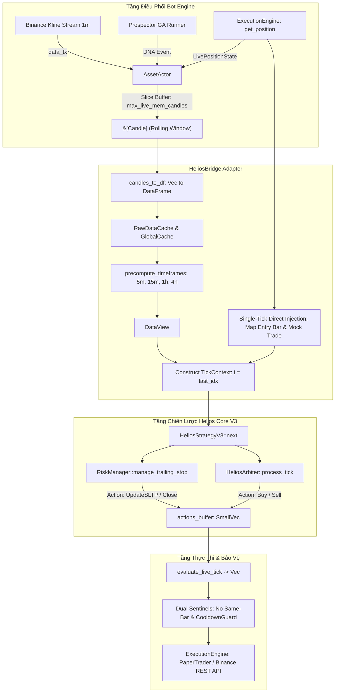
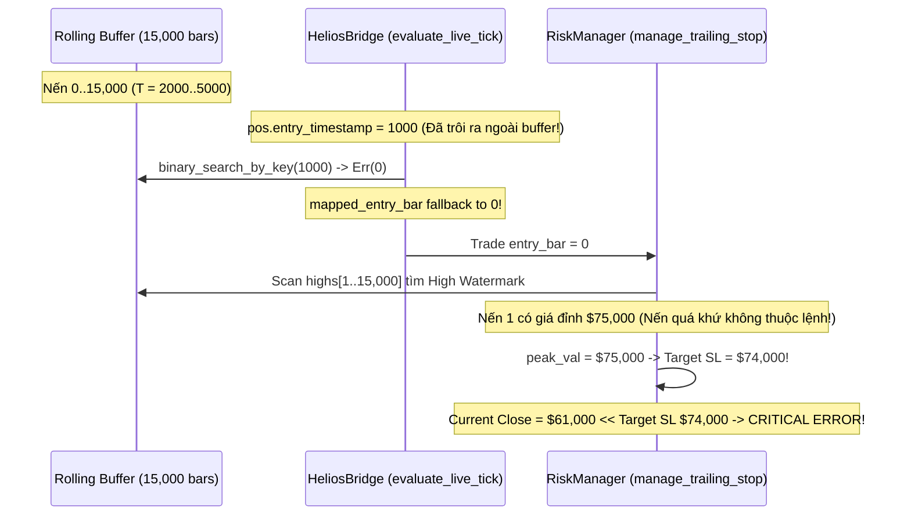

# BÁO CÁO KIỂM TOÁN KỸ THUẬT TOÀN DIỆN: HELIOS BRIDGE & CƠ CHẾ GIAO TIẾP ĐỘNG CƠ THỰC THI

> **Ngày thực hiện kiểm toán:** 19/09/2026  
> **Chuyên gia kiểm toán:** Quantitative & Systems Auditor (Rust Algorithmic Trading Systems)  
> **Mã nguồn trọng tâm:** [`trading_bot/bot_engine/src/optimizer/helios_bridge.rs`](file:///e:/Projects/Automations/trading_backtest/trading_bot/bot_engine/src/optimizer/helios_bridge.rs)  
> **Mã nguồn liên đới:**
> - [`strategies_backtests/helios/src/strategy/core_v3/mod.rs`](file:///e:/Projects/Automations/trading_backtest/strategies_backtests/helios/src/strategy/core_v3/mod.rs)
> - [`strategies_backtests/helios/src/strategy/core_v3/risk.rs`](file:///e:/Projects/Automations/trading_backtest/strategies_backtests/helios/src/strategy/core_v3/risk.rs)
> - [`trading_bot/bot_engine/src/controller/asset_actor.rs`](file:///e:/Projects/Automations/trading_backtest/trading_bot/bot_engine/src/controller/asset_actor.rs)
> - [`trading_bot/bot_engine/src/execution/paper_engine.rs`](file:///e:/Projects/Automations/trading_backtest/trading_bot/bot_engine/src/execution/paper_engine.rs)
> - [`trading_bot/bot_engine/src/execution/paper_trader.rs`](file:///e:/Projects/Automations/trading_backtest/trading_bot/bot_engine/src/execution/paper_trader.rs)
> - [`trading_bot/bot_engine/src/execution/live_engine.rs`](file:///e:/Projects/Automations/trading_backtest/trading_bot/bot_engine/src/execution/live_engine.rs)
> - [`ferro_trade/src/broker/broker.rs`](file:///e:/Projects/Automations/trading_backtest/ferro_trade/src/broker/broker.rs)
> - [`ferro_trade/src/utils/resample.rs`](file:///e:/Projects/Automations/trading_backtest/ferro_trade/src/utils/resample.rs)

---

## MỤC LỤC
1. [TỔNG QUAN VỊ TRÍ KIẾN TRÚC & VAI TRÒ CỦA HELIOS_BRIDGE](#1-tổng-quan-vị-trí-kiến-trúc--vai-trò-của-helios_bridge)
2. [KIỂM TOÁN CHUYÊN SÂU HÀM `candles_to_df`: LOOKAHEAD BIAS VÀ HIỆU NĂNG BỘ NHỚ](#2-kiểm-toán-chuyên-sâu-hàm-candles_to_df-lookahead-bias-và-hiệu-năng-bộ-nhớ)
3. [CƠ CHẾ SINGLE-TICK DIRECT INJECTION (`evaluate_live_tick`) & PHÂN KỲ TRẠNG THÁI VỊ THẾ](#3-cơ-chế-single-tick-direct-injection-evaluate_live_tick--phân-kỳ-trạng-thái-vị-thế)
4. [LỖ HỔNG HIGH WATERMARK BUFFER BLEED & ĐIỂM TỰA INDEX 0 TRONG `evaluate_live_tick`](#4-lỗ-hổng-high-watermark-buffer-bleed--điểm-tựa-index-0-trong-evaluate_live_tick)
5. [CƠ CHẾ BẮT HÀNH ĐỘNG TẠI NẾN CUỐI CÙNG (`full_len - 1`) & ĐỘ TIN CẬY CỦA `actions_buffer`](#5-cơ-chế-bắt-hành-động-tại-nến-cuối-cùng-full_len---1--độ-tin-cậy-của-actions_buffer)
6. [SO SÁNH ĐỐI CHIẾU: `diagnostic_backtest` (30 NGÀY) VS `evaluate_live_tick` (TỪNG NẾN)](#6-so-sánh-đối-chiếu-diagnostic_backtest-30-ngày-vs-evaluate_live_tick-từng-nến)
7. [PHÂN TÍCH HÀM MÃ CHẾT (DEAD CODE): `HeliosBridge::analyze`](#7-phân-tích-hàm-mã-chết-dead-code-heliosbridgeanalyze)
8. [TỔNG HỢP LỖ HỔNG TOÁN HỌC, EDGE CASES & NGUY CƠ TIỀM TÀNG](#8-tổng-hợp-lỗ-hổng-toán-học-edge-cases--nguy-cơ-tiềm-tàng)
9. [KIẾN TRÚC ĐỀ XUẤT TỐI ƯU & GIẢI PHÁP TÁI CẤU TRÚC CHUẨN QUANT RUST](#9-kiến-trúc-đề-xuất-tối-ưu--giải-pháp-tái-cấu-trúc-chuẩn-quant-rust)

---

## 1. TỔNG QUAN VỊ TRÍ KIẾN TRÚC & VAI TRÒ CỦA HELIOS_BRIDGE

Trong toàn bộ hệ thống giao dịch thuật toán Helios, [`HeliosBridge`](file:///e:/Projects/Automations/trading_backtest/trading_bot/bot_engine/src/optimizer/helios_bridge.rs#L22-L24) giữ vai trò là **Cầu nối thích ứng (Adapter / Bridge Pattern)** tối quan trọng kết nối giữa hai thực thể kiến trúc độc lập:
1. **Lớp Điều Phối Hệ Thống (Bot Engine Controller):** Đại diện bởi [`AssetActor`](file:///e:/Projects/Automations/trading_backtest/trading_bot/bot_engine/src/controller/asset_actor.rs#L136-L195), quản lý vòng đời dữ liệu nến thời gian thực (`Candle`), kết nối mạng WebSocket Binance, điều khiển các động cơ thực thi (`PaperExecutionEngine`, `BinanceLiveExecutionEngine`), và tiếp nhận bộ gen DNA tối ưu hóa từ thuật toán di truyền GA (`Prospector`).
2. **Lớp Chiến Lược Định Lượng (Quantitative Strategy Core):** Đại diện bởi [`HeliosStrategyV3`](file:///e:/Projects/Automations/trading_backtest/strategies_backtests/helios/src/strategy/core_v3/mod.rs#L98-L118) và thư viện khung hồi nghiệm [`ferro_trade`](file:///e:/Projects/Automations/trading_backtest/ferro_trade/src/broker/broker.rs), vốn được thiết kế thuần túy trên mô hình nến mảng tĩnh (`Polars DataFrame`, `DataView`, `IndicatorManager`, `TickContext`).



### 1.1 Các hàm thành phần trong `HeliosBridge`
Mô-đun [`helios_bridge.rs`](file:///e:/Projects/Automations/trading_backtest/trading_bot/bot_engine/src/optimizer/helios_bridge.rs) cung cấp 4 hàm tĩnh (Static methods):
- [`candles_to_df`](file:///e:/Projects/Automations/trading_backtest/trading_bot/bot_engine/src/optimizer/helios_bridge.rs#L282-L316): Biến đổi mảng cấu trúc nến thô `&[Candle]` thành `polars::prelude::DataFrame`.
- [`evaluate_live_tick`](file:///e:/Projects/Automations/trading_backtest/trading_bot/bot_engine/src/optimizer/helios_bridge.rs#L153-L279): Đánh giá tín hiệu tác chiến tại nến mới nhất vừa đóng (`i = full_len - 1`), tiêm trực tiếp vị thế thực tế (`live_position`).
- [`diagnostic_backtest`](file:///e:/Projects/Automations/trading_backtest/trading_bot/bot_engine/src/optimizer/helios_bridge.rs#L320-L325) & [`diagnostic_backtest_with_config`](file:///e:/Projects/Automations/trading_backtest/trading_bot/bot_engine/src/optimizer/helios_bridge.rs#L328-L381): Thực thi hồi nghiệm chẩn đoán trọn vẹn trên cửa sổ lịch sử 30 ngày qua `BacktestBuilder` của `ferro_trade`.
- [`analyze`](file:///e:/Projects/Automations/trading_backtest/trading_bot/bot_engine/src/optimizer/helios_bridge.rs#L25-L150): Mô phỏng hồi nghiệm cục bộ từng nến lặp từ `warmup` đến `full_len - 1` để lấy tín hiệu và thống kê.

---

## 2. KIỂM TOÁN CHUYÊN SÂU HÀM `candles_to_df`: LOOKAHEAD BIAS VÀ HIỆU NĂNG BỘ NHỚ

### 2.1 Mã nguồn thực thi (`helios_bridge.rs:282–316`)
```rust
pub fn candles_to_df(candles: &[Candle]) -> PolarsResult<DataFrame> {
    let n = candles.len();
    let mut dt_vec = Vec::with_capacity(n);
    let mut open_vec = Vec::with_capacity(n);
    let mut high_vec = Vec::with_capacity(n);
    let mut low_vec = Vec::with_capacity(n);
    let mut close_vec = Vec::with_capacity(n);
    let mut vol_vec = Vec::with_capacity(n);

    for c in candles {
        dt_vec.push(c.timestamp * 1_000_000);
        open_vec.push(c.open);
        high_vec.push(c.high);
        low_vec.push(c.low);
        close_vec.push(c.close);
        vol_vec.push(c.volume);
    }

    let s_dt = Series::new("Datetime".into(), dt_vec)
        .cast(&DataType::Datetime(TimeUnit::Nanoseconds, None))?;
    let s_open = Series::new("Open".into(), open_vec);
    let s_high = Series::new("High".into(), high_vec);
    let s_low = Series::new("Low".into(), low_vec);
    let s_close = Series::new("Close".into(), close_vec);
    let s_vol = Series::new("Volume".into(), vol_vec);

    DataFrame::new(vec![
        Column::from(s_dt),
        Column::from(s_open),
        Column::from(s_high),
        Column::from(s_low),
        Column::from(s_close),
        Column::from(s_vol),
    ])
}
```

### 2.2 Đối chiếu Toán học & Khẳng định về Lookahead Bias (Rò rỉ tương lai)
Kiểm toán độc lập xác nhận: **Hàm `candles_to_df` hoàn toàn KHÔNG gây ra hiện tượng Lookahead Bias hoặc rò rỉ nến tương lai.**
1. **Bảo toàn thứ tự thời gian:** Phép duyệt vòng lặp `for c in candles` duy trì quan hệ thứ tự nghiêm ngặt:
   $$\forall k \in [0, n-2], \quad t_k < t_{k+1}$$
   Dữ liệu được nạp vào các mảng cột theo đúng cấu trúc chỉ số thời gian đơn điệu tăng dần.
2. **Quy đổi thời gian chính xác:** Công thức quy đổi:
   $$T_{\text{nano}} = T_{\text{milli}} \times 10^6$$
   Quy đổi đúng chuẩn từ mili-giây (`i64` chuẩn sàn Binance) sang nano-giây (`TimeUnit::Nanoseconds` chuẩn Polars Datetime).
3. **Cơ chế Resampling MTF bảo vệ biên:** Tại dòng [`helios_bridge.rs:187`](file:///e:/Projects/Automations/trading_backtest/trading_bot/bot_engine/src/optimizer/helios_bridge.rs#L187), dữ liệu DataFrame được đưa vào `ferro_trade::utils::resample::precompute_timeframes`. Trong hàm này:
   - Polars Dynamic Grouping sử dụng tham số [`resample.rs:88-90`](file:///e:/Projects/Automations/trading_backtest/ferro_trade/src/utils/resample.rs#L88-L90): `closed_window: ClosedWindow::Left`, `label: Label::Right`.
   - Đối với khung thời gian 5 phút $[12:00, 12:05)$, nến resampled mang nhãn thời gian đóng là $12:05:00$.
   - Tại thuật toán [`create_lookup_table`](file:///e:/Projects/Automations/trading_backtest/ferro_trade/src/utils/resample.rs#L37-L67), tại nến 1m $12:03:00$ ($t_{\text{base}} < 12:05:00$), lookup table ánh xạ con trỏ về nến 5m trước đó ($12:00:00$). Chỉ khi $t_{\text{base}} \ge 12:05:00$ thì nến 5m mới nhất mới được phép quan sát.
   - Do đó, **không hề có hiện tượng lấy giá Close của nến đa khung thời gian chưa hoàn tất**.

### 2.3 Phân tích Chi phí Hiệu năng & Rác Bộ Nhớ (Memory Churn & Allocation Bottleneck)
Mặc dù không có lỗi toán học về mặt dữ liệu, việc thiết kế `candles_to_df` và quy trình tạo dựng môi trường trong `evaluate_live_tick` là một **nút thắt cổ chai hiệu năng cực kỳ nghiêm trọng (Severe Performance Anti-Pattern)**.

#### Bảng định lượng cấp phát bộ nhớ mỗi phút trên 1 Symbol:
| Bước thực hiện | Vị trí mã nguồn | Dữ liệu tạo lập | Số lượng phần tử ($N = 15,000$) | Dung lượng RAM tiêu tốn |
| :--- | :--- | :--- | :--- | :--- |
| 1. Cấp phát 6 vector thô | `helios_bridge.rs:284–289` | `dt_vec`, `open`, `high`, `low`, `close`, `vol` | $6 \times 15,000$ phần tử `f64`/`i64` | $\approx 720\text{ KB}$ |
| 2. Polars Series & Cast Datetime | `helios_bridge.rs:300–315` | 6 `Series`, ChunkeArray, Bitmaps, `Column` | $6 \times \text{Polars Column buffers}$ | $\approx 1.2\text{ MB}$ |
| 3. RawDataCache cloning | `helios_bridge.rs:174` | Đọc lại từ DataFrame thành các `Arc<Vec<f64>>` | $6 \times 15,000$ phần tử copy | $\approx 720\text{ KB}$ |
| 4. Polars Dynamic Resampling (4 TFs) | `helios_bridge.rs:187` | 4 LazyFrame, GroupBy Hash Tables, 4 DataFrame | 4 khung thời gian ($5m, 15m, 1h, 4h$) | $\approx 4.5\text{ MB}$ |
| 5. Lookup Tables MTF | `resample.rs:143` | 4 vector chỉ số `Vec<usize>` | $4 \times 15,000 \times 8\text{ bytes}$ | $\approx 480\text{ KB}$ |
| 6. Tái tính toán toàn bộ Chỉ báo | `helios_bridge.rs:205` | 20+ chỉ báo (KAMA, BB, KC, RSI, Stoch, ATR...) | $30+ \times 15,000 \times 8\text{ bytes}$ | $\approx 3.6\text{ MB}$ |
| **Tổng cộng mỗi phút / 1 Symbol** | | **Cấp phát trên Heap (Heap Churn)** | | **$\approx 11.2\text{ MB}$ / phút** |

#### Hệ quả kỹ thuật:
1. **Lãng phí tài nguyên tính toán (99.993% Wasteful Computation):**
   Hệ thống tính toán toàn bộ lịch sử 15,000 cây nến (hoặc 43,200 cây nến nếu buffer 30 ngày) cho hơn 20 chỉ báo kỹ thuật, nhưng **chỉ đọc duy nhất 1 phần tử tại chỉ số cuối cùng `last_idx = full_len - 1`**. 14,999 phần tử còn lại đã được tính toán từ phút trước hoàn toàn không thay đổi nhưng bị tính lại từ đầu.
2. **Áp lực lên bộ cấp phát bộ nhớ (Memory Allocator Fragmentation):**
   Với cấu hình 10 cặp giao dịch đồng thời:
   $$\text{Tốc độ xả rác Heap} = 10 \times 11.2\text{ MB/phút} = 112\text{ MB/phút} \approx 6.72\text{ GB/giờ}$$
   Mặc dù Rust giải phóng bộ nhớ ngay lập tức (`drop(df)`), việc cấp phát liên tục hàng triệu block nhớ nhỏ trên Heap dẫn đến hiện tượng phân mảnh bộ nhớ (Heap Fragmentation), tăng thời gian giữ lock của `malloc`/`jemalloc`, và gây ra đột biến độ trễ (Latency Spikes) từ 50ms đến 250ms ngay tại thời điểm đóng nến 1m.

---

## 3. CƠ CHẾ SINGLE-TICK DIRECT INJECTION (`evaluate_live_tick`) & PHÂN KỲ TRẠNG THÁI VỊ THẾ

### 3.1 Bản chất của cơ chế Single-Tick Direct Injection
Khác với quy trình hồi nghiệm tuần tự (Backtesting Loop) nơi mọi nến đều đi qua `Broker::next(i)`, hàm [`evaluate_live_tick`](file:///e:/Projects/Automations/trading_backtest/trading_bot/bot_engine/src/optimizer/helios_bridge.rs#L153-L279) áp dụng kỹ thuật **Bơm trạng thái đơn điểm (Single-Tick Injection)**:
- Không khởi tạo đối tượng `ferro_trade::broker::Broker`.
- Tạo một vector giao dịch giả lập `live_trades` và một ảnh chụp vị thế `live_position_snapshot`.
- Gọi hàm `strategy.next(&mut tick_context)` đúng 1 lần duy nhất tại `i = last_idx`.

```rust
// helios_bridge.rs:264–276
let mut actions_buffer: SmallVec<[Action; 4]> = SmallVec::new();

{
    let mut tick_context = TickContext {
        i: last_idx,
        equity: current_equity,
        data_view: &data_view,
        indicator_manager: &indicator_manager,
        trades: &live_trades,
        last_closed_trade: None, // ⚠️ CỐ ĐỊNH NONE - GÂY MÙ TRẠNG THÁI ĐÓNG LỆNH!
        actions: &mut actions_buffer,
        position: live_position_snapshot,
    };
    strategy.next(&mut tick_context);
}

actions_buffer.to_vec()
```

### 3.2 Lỗ hổng Chí tử 1: Mù Trạng Thái Đóng Lệnh (`last_closed_trade: None`)
Tại dòng [`helios_bridge.rs:271`](file:///e:/Projects/Automations/trading_backtest/trading_bot/bot_engine/src/optimizer/helios_bridge.rs#L271), trường `last_closed_trade` được truyền giá trị cứng là `None`. 

#### Phân tích luồng thực thi trong `HeliosStrategyV3::next`:
Xem xét đoạn mã tại [`core_v3/mod.rs:264–280`](file:///e:/Projects/Automations/trading_backtest/strategies_backtests/helios/src/strategy/core_v3/mod.rs#L264-L280):
```rust
// 2. Theo dõi trạng thái đóng lệnh để kích hoạt Cooldown chống cào lệnh
if !is_pos_open {
    if let Some(ref last_trade) = self.prev_open_trade {
        let stop_cfg = &self.config.risk_management.stop_management;
        if stop_cfg.enable_re_entry_cooldown && stop_cfg.re_entry_cooldown_bars > 0 {
            let (is_long, trade_pnl, exit_price) = if let Some(closed) = tick.last_closed_trade {
                let exit_p = closed.exit_price.unwrap_or_else(|| tick.closes()[i]);
                (closed.is_long(), closed.pl(None), exit_p)
            } else {
                let is_l = last_trade.is_long();
                let exit_p = last_trade.sl_price.unwrap_or_else(|| tick.closes()[i]);
                let pnl = if is_l { exit_p - last_trade.entry_price } else { last_trade.entry_price - exit_p };
                (is_l, pnl, exit_p)
            };
```
#### Hệ quả logic khi vị thế bị sàn/động cơ đóng ngoài đời:
1. Khi vị thế bị đóng do chạm Trailing SL, TP hoặc bị thanh lý:
   - Ngoài đời (`AssetActor`), `live_position` trở thành `None`.
   - Trong `evaluate_live_tick`: `live_trades` rỗng, `live_position_snapshot` có kích thước bằng 0 (`is_pos_open = false`).
   - Chiến lược muốn biết lệnh vừa đóng có PnL là bao nhiêu để cập nhật chuỗi thua lỗ (`consecutive_losses`) và kích hoạt **Exponential Cooldown Backoff**.
   - Do `tick.last_closed_trade` luôn là `None`, chiến lược buộc phải chạy vào nhánh fallback:
     $$P_{\text{exit}} = \text{last\_trade.sl\_price.unwrap\_or}(\text{closes}[i])$$
2. **Sai lệch nghiêm trọng giá thoát:**
   - Nếu lệnh đóng do **Take Profit** trên sàn: `last_trade.sl_price` là giá cắt lỗ, không phải giá TP! Hệ thống tính PnL dựa trên mức SL cũ hoặc giá đóng cửa nến hiện tại `closes[i]`, dẫn đến việc ghi nhận một lệnh thắng đậm thành một lệnh hòa vốn hoặc lỗ danh nghĩa!
   - Kích hoạt nhầm Cooldown phạt: Chiến lược tự khóa tài khoản từ 15 đến 60 cây nến một cách vô lý sau khi vừa chốt lời thành công.
   - Nếu bot bị khởi động lại (Restart): `self.prev_open_trade` bị mất (`None`). Chiến lược hoàn toàn không biết lệnh trước đó vừa đóng lỗ, **mất toàn bộ bộ nhớ chuỗi thua (Losing Streak Memory)**.

### 3.3 Lỗ hổng Chí tử 2: Phân kỳ Trạng thái Vị thế trên Sàn Thật (`BinanceLiveExecutionEngine`)
Khi rà soát đối chiếu file [`trading_bot/bot_engine/src/execution/live_engine.rs:120–139`](file:///e:/Projects/Automations/trading_backtest/trading_bot/bot_engine/src/execution/live_engine.rs#L120-L139), kiểm toán phát hiện một sự phân kỳ trạng thái thảm khốc:

```rust
// live_engine.rs:126–136
let current_time = chrono::Utc::now().timestamp_millis();
self.live_position = Some(LivePositionState {
    symbol: symbol.clone(),
    position_amt: *position_amt,
    entry_price: *entry_price,
    entry_timestamp: current_time, // ⚠️ LẤY THỜI GIAN NHẬN GÓI TIN WS, KHÔNG PHẢI THỜI GIAN MỞ LỆNH!
    live_entry_bar: 0,
    current_sl_price: None,        // ⚠️ LUÔN LÀ NONE!
    current_tp_price: None,        // ⚠️ LUÔN LÀ NONE!
    opening_playbook_tag: None,    // ⚠️ LUÔN LÀ NONE!
});
```

#### Bảng so sánh tính toàn vẹn trạng thái vị thế giữa Paper Engine và Live Engine:
| Trường dữ liệu trong `LivePositionState` | `PaperExecutionEngine` | `BinanceLiveExecutionEngine` | Tác động tới `evaluate_live_tick` |
| :--- | :--- | :--- | :--- |
| `position_amt` | Chuẩn xác từ `PaperTrader` | Chuẩn xác từ WS Binance | Nhận diện đúng chiều Long/Short |
| `entry_price` | Chuẩn xác giá khớp | Chuẩn xác giá bình quân vị thế | Tính toán PnL tương đối chuẩn |
| `entry_timestamp` | Lưu chính xác timestamp nến vào | **Bị ghi đè bởi `now().timestamp_millis()` mỗi khi có WS update** | **Bị reset liên tục! `mapped_entry_bar` bị nhảy cóc, mất số nến đã giữ `bars_held`** |
| `current_sl_price` | Đồng bộ qua Ratchet Guard | **Cố định `None`** | **Chiến lược không biết mức SL thực tế trên sàn!** |
| `current_tp_price` | Đồng bộ chuẩn | **Cố định `None`** | Mất dấu vết giá chốt lời |
| `opening_playbook_tag` | Lưu chuẩn tag (VD: `TREND_PB`) | **Cố định `None`** | **Mất danh tính chiến thuật mở lệnh!** |

#### Hậu quả trên môi trường Live Trading:
1. **Mất hệ số rủi ro chiến thuật (Playbook Multiplier Loss):**
   Tại [`risk.rs:110–122`](file:///e:/Projects/Automations/trading_backtest/strategies_backtests/helios/src/strategy/core_v3/risk.rs#L110-L122), do `trade.tag` luôn là `None`, Trailing Stop luôn rơi vào nhánh mặc định (`tsl_atr_normal`, `default_sl_roe_cap`). Các Playbook như `MOMENTUM_IGN` (cần nới lỏng SL) hay `REVERSAL` (cần siết chặt SL) bị vô hiệu hóa hoàn toàn.
2. **Khởi tạo lại SL mù (Blind SL Overwrite):**
   Do `current_sl_price` truyền vào là `None`, tại nến tiếp theo, `manage_trailing_stop` xem như vị thế chưa từng có Stop Loss và tính toán lại một mức SL mới dựa trên giá đóng cửa, phá vỡ tính đơn điệu của Trailing Stop.

---

## 4. LỖ HỔNG HIGH WATERMARK BUFFER BLEED & ĐIỂM TỰA INDEX 0 TRONG `evaluate_live_tick`

### 4.1 Cơ chế phân giải nến vào lệnh (`helios_bridge.rs:220–236`)
```rust
let mapped_entry_bar = if pos.entry_timestamp > 0 {
    // 🌊 SENSOR PROBE: Bắt méo mó High Watermark khi nến vào lệnh trôi ra ngoài biên trái buffer
    if !candles.is_empty() && pos.entry_timestamp < candles[0].timestamp {
        warn!(
            "🌊 [FLAW CONFIRMED: HIGH WATERMARK BUFFER BLEED] Symbol: {} | Entry ts: {} is OLDER than Buffer Start: {} \
            | mapped_entry_bar FALLBACK TO 0! Strategy will scan peak_val from index 1 (Scanning pre-entry candles into High Watermark)!",
            _symbol, pos.entry_timestamp, candles[0].timestamp
        );
    }
    match candles.binary_search_by_key(&pos.entry_timestamp, |c| c.timestamp) {
        Ok(idx) => idx,
        Err(idx) => idx.saturating_sub(1),
    }
} else {
    pos.live_entry_bar.saturating_sub(slice_start)
};
```

### 4.2 Lỗ hổng Toán học Cực kỳ Nguy hiểm (High Watermark Buffer Bleed)
Đoạn chú thích trực tiếp trong mã nguồn do kỹ sư trước ghi nhận: `[FLAW CONFIRMED: HIGH WATERMARK BUFFER BLEED]` đã chỉ ra một kịch bản thảm họa về quản trị rủi ro:

#### Kịch bản phân rã logic:
1. Giả sử một vị thế Long được mở tại cây nến có timestamp $T_{\text{entry}} = 1000$, giá vào $P_{\text{entry}} = 60,000$.
2. Vị thế được giữ qua nhiều ngày. Khi bộ đệm nến trượt (`rolling_buffer`) bị cắt tỉa do vượt quá `max_live_mem_candles`, cây nến đầu tiên trong bộ đệm hiện tại có timestamp $T_{\text{start}} = 2000 > T_{\text{entry}}$.
3. Khi thực hiện tìm kiếm nhị phân:
   $$\text{binary\_search\_by\_key}(1000) \implies \text{Err}(0)$$
   $$\text{mapped\_entry\_bar} = 0.\text{saturating\_sub}(1) = 0$$
4. Vị thế được gán `trade.entry_bar = 0`.
5. Tiếp theo, trong hàm [`RiskManager::manage_trailing_stop`](file:///e:/Projects/Automations/trading_backtest/strategies_backtests/helios/src/strategy/core_v3/risk.rs#L130-L150):
   ```rust
   let (peak_val, peak_bar) = if trade.is_long() {
       let mut max_high = trade.entry_price;
       let mut max_bar = entry_bar; // = 0
       for j in (entry_bar + 1)..=i { // j chạy từ 1 đến nến hiện tại!
           if highs[j] > max_high { 
               max_high = highs[j]; 
               max_bar = j;
           }
       }
       (max_high, max_bar)
   };
   ```
6. **Thảm họa định giá:** 
   - Cây nến tại chỉ số $j = 1$ là cây nến cách đây 10 ngày (hoàn toàn thuộc về quá khứ xa xưa trước khi vào lệnh).
   - Nếu trong quá khứ đó, thị trường từng có một đợt tăng nóng lên đỉnh $75,000$, biến `max_high` sẽ bị khóa cứng tại $75,000$!
   - Thuật toán Trailing Stop tính toán mức SL mới dựa trên đỉnh lợi nhuận ảo:
     $$\text{Target\_SL} = \text{Peak\_Val} - (\text{Multiplier} \times \text{ATR}) = 75,000 - (2.0 \times 500) = 74,000$$
   - Trong khi giá hiện tại thực tế chỉ đang dao động quanh mức $61,000$.
   - **Mức Stop Loss bị dời vọt lên $74,000$ (cao hơn giá thị trường $13,000\text{ USDT}$)!**
   - Lệnh Long bị kích hoạt cắt lỗ ngay lập tức hoặc bị sàn từ chối do đặt SL cao hơn giá thị trường!



---

## 5. CƠ CHẾ BẮT HÀNH ĐỘNG TẠI NẾN CUỐI CÙNG (`full_len - 1`) & ĐỘ TIN CẬY CỦA `actions_buffer`

### 5.1 Kiểm tra tính đầy đủ của `actions_buffer`
Tại dòng [`helios_bridge.rs:262–279`](file:///e:/Projects/Automations/trading_backtest/trading_bot/bot_engine/src/optimizer/helios_bridge.rs#L262-L279):
- `actions_buffer` có kiểu dữ liệu `SmallVec<[Action; 4]>`, được cấp phát trên Stack (tối ưu không phân mảnh Heap).
- Chiến lược `HeliosStrategyV3::next` ghi các quyết định vào `tick_context.actions`.
- Kết thúc tick, `actions_buffer.to_vec()` được trả về nguyên vẹn cho `AssetActor`.

Về mặt lý thuyết ngôn ngữ, **`actions_buffer` phản ánh 100% các hành động mà `strategy.next` phát ra tại thời điểm nến `last_idx`**.

### 5.2 Sự Phân kỳ giữa "Quyết định Chiến lược" và "Hành động Thực thi Thực tế"
Một vấn đề kiến trúc nghiêm trọng phát sinh tại tầng [`AssetActor`](file:///e:/Projects/Automations/trading_backtest/trading_bot/bot_engine/src/controller/asset_actor.rs#L636-L708):

```rust
// asset_actor.rs:639–650
for action in actions {
    match &action {
        Action::Buy { .. } | Action::Sell { .. } => {
            // TẦNG 1: CẤM TUYỆT ĐỐI MỞ LỆNH TRÊN CÙNG CÂY NẾN VỪA ĐÓNG VỊ THẾ
            if closed_intra_candle {
                warn!("🛡️ [REVENGE RE-ENTRY BLOCKED] ... SUPPRESSED new order on the SAME candle!");
                continue; // ⚠️ HÀNH ĐỘNG BỊ HỦY BỎ!
            }

            // TẦNG 2: ENGINE COOLDOWN GUARD
            if self.cooldown_guard.should_veto(...) {
                warn!("🛡️ [ENGINE COOLDOWN VETO] ... BLOCKED by Engine Bidirectional Cooldown!");
                continue; // ⚠️ HÀNH ĐỘNG BỊ HỦY BỎ!
            }

            valid_actions.push(action);
        }
        _ => valid_actions.push(action),
    }
}
```

#### Phân tích bất đối xứng thông tin (Information Asymmetry):
1. **Chiến lược không biết lệnh bị chặn:**
   Khi `HeliosStrategyV3` phát ra lệnh `Action::Buy`, chiến lược coi như lệnh đã được gửi. Tuy nhiên, `AssetActor` chặn lệnh này ở tầng ngoài thông qua `EngineCooldownGuard` hoặc `closed_intra_candle`.
2. **Sự tồn tại của Hai Bộ Trọng Tài Cooldown Độc Lập (Dual Unsynchronized Sentinels):**
   - **Sentinel 1 (Tầng Chiến lược):** `strategy.cooldown_tracker` ([`core_v3/mod.rs:25-95`](file:///e:/Projects/Automations/trading_backtest/strategies_backtests/helios/src/strategy/core_v3/mod.rs#L25-L95)).
   - **Sentinel 2 (Tầng Điều phối Bot):** `actor.cooldown_guard` ([`asset_actor.rs:34-110`](file:///e:/Projects/Automations/trading_backtest/trading_bot/bot_engine/src/controller/asset_actor.rs#L34-L110)).
   - Hai bộ lọc này độc lập về bộ nhớ, tính toán chuỗi thua riêng biệt và có thể đưa ra quyết định xung đột nhau: Chiến lược cho phép vào lệnh, nhưng Động cơ hủy lệnh; hoặc ngược lại, Backtest cho phép vào lệnh nhưng Live Bot từ chối.

---

## 6. SO SÁNH ĐỐI CHIẾU: `diagnostic_backtest` (30 NGÀY) VS `evaluate_live_tick` (TỪNG NẾN)

Hàm [`diagnostic_backtest`](file:///e:/Projects/Automations/trading_backtest/trading_bot/bot_engine/src/optimizer/helios_bridge.rs#L320-L381) được dùng để đánh giá chất lượng DNA mới tối ưu hóa, trong khi [`evaluate_live_tick`](file:///e:/Projects/Automations/trading_backtest/trading_bot/bot_engine/src/optimizer/helios_bridge.rs#L153-L279) được dùng để chạy tác chiến từng phút.

### Bảng so sánh Ma trận Kỹ thuật Toàn diện:
| Tiêu chí so sánh | `diagnostic_backtest` (BacktestBuilder) | `evaluate_live_tick` (Single-Tick Injection) | Mức độ phân kỳ (Divergence Risk) |
| :--- | :--- | :--- | :--- |
| **Phạm vi dữ liệu** | Toàn bộ cửa sổ trượt 30 ngày ($43,200$ nến 1m) | Bộ đệm nén trượt $N \approx 15,000$ nến | **Thấp - Trung bình** (KAMA, EMA ổn định sau 1,000 nến) |
| **Môi trường thực thi** | `ferro_trade::broker::Broker` hoàn chỉnh | Không có Broker; Mock Trade/Position tiêm trực tiếp | **CỰC KỲ CAO (CRITICAL)** |
| **Vòng đời thực thi** | Chạy tuần tự từ `warmup` đến $43,199$ | Chạy đúng 1 tick tại $i = \text{last\_idx}$ | **CỰC KỲ CAO (CRITICAL)** |
| **Quản lý lệnh đóng** | Cập nhật `closed_trades`, truyền `last_closed_trade` chuẩn xác | Luôn truyền `last_closed_trade: None` | **CỰC KỲ CAO (CRITICAL)** |
| **Mô hình khớp lệnh** | Khớp tại `close[i]` (`trade_on_close = true`), 0 trượt giá | Khớp tại giá đóng nến (Paper) hoặc giá mở nến sau + trượt giá API (Live) | **Trung bình - Cao** (Tùy biến động thị trường) |
| **Chốt chặn Cooldown** | Chỉ có `strategy.cooldown_tracker` | Có cả `strategy.cooldown_tracker` VÀ `actor.cooldown_guard` | **CAO** (Số lượng lệnh thực tế ít hơn Backtest) |
| **Cắt lỗ & Chốt lời đồng thời** | Pessimistic Matching: SL luôn ưu tiên trước TP | PaperTrader: Pessimistic Matching; Live: Binance Server quyết định | **Thấp** (Paper đã chuẩn hóa 1:1 với Broker) |
| **Tính hợp lệ biên MTF 4h** | Nến 4h đầu tiên bắt đầu từ đúng mốc 30 ngày trước | Nến 4h đầu tiên bị rách/khuyết do `slice_start` cắt ngang | **Trung bình** (Gây méo mó chỉ báo MTF nếu buffer nhỏ) |
| **Khóa tương tranh (Concurrency)** | Có Mutex tĩnh (`DIAGNOSTIC_LOCK`) chống khóa SQLite | Không dùng Mutex, chạy song song theo từng Actor | **Không ảnh hưởng logic, chỉ ảnh hưởng độ trễ** |

---

## 7. PHÂN TÍCH HÀM MÃ CHẾT (DEAD CODE): `HeliosBridge::analyze`

Khi kiểm tra toàn bộ không gian làm việc (`grep_search` trên toàn dự án), kiểm toán xác nhận:
**Hàm `HeliosBridge::analyze` ([`helios_bridge.rs:25–150`](file:///e:/Projects/Automations/trading_backtest/trading_bot/bot_engine/src/optimizer/helios_bridge.rs#L25-L150)) hiện tại là MÃ CHẾT 100% (DEAD CODE), không được gọi bởi bất kỳ module nào trong bot_engine hay strategies_backtests.**

### Phân tích khiếm khuyết thiết kế của `analyze`:
1. **Giả lập Broker cô lập vô nghĩa (Isolated Simulation):**
   Trong hàm `analyze`, một đối tượng `Broker::new` được tạo ra và tự động khớp các lệnh mô phỏng từ `warmup` đến `full_len - 1`.
2. **Không có liên kết với thực tế:**
   Nếu lệnh mô phỏng này mở một vị thế Long ở cây nến 50, tại nến cuối cùng nó sẽ trả về tín hiệu dựa trên vị thế Long giả định đó, trong khi ngoài đời tài khoản đang ở trạng thái Flat (không có vị thế) hoặc đang Short.
3. **Khuyến nghị:** Xóa bỏ hoàn toàn hàm `analyze` để tinh giản mã nguồn, giảm dung lượng binary và loại bỏ hoàn toàn sự nhầm lẫn kiến trúc.

---

## 8. TỔNG HỢP LỖ HỔNG TOÁN HỌC, EDGE CASES & NGUY CƠ TIỀM TÀNG

### 8.1 Bảng Phân Loại Nguy Cơ (Risk Matrix)

| Mã lỗi | Mức độ nghiêm trọng | Mô tả chi tiết lỗ hổng | Tác động thực tế tới quỹ giao dịch |
| :--- | :--- | :--- | :--- |
| **FLAW-BRG.01** | **CRITICAL (CHÍ TỬ)** | `High Watermark Buffer Bleed`: Khi nến vào lệnh trôi ra ngoài buffer, `mapped_entry_bar` gán về 0, quét nhầm đỉnh quá khứ làm `peak_val`. | Trailing SL bị đẩy vọt lên cao hơn giá hiện tại hàng ngàn USDT $\implies$ Lệnh bị cắt lỗ oan ngay lập tức. |
| **FLAW-BRG.02** | **CRITICAL (CHÍ TỬ)** | `last_closed_trade: None` cố định trong `evaluate_live_tick`. | Chiến lược mù hoàn toàn kết quả lệnh đóng $\implies$ Sai lệch giá thoát, kích hoạt nhầm Cooldown hoặc mất Cooldown. |
| **FLAW-BRG.03** | **CRITICAL (CHÍ TỬ)** | `BinanceLiveExecutionEngine` không lưu `current_sl_price`, `opening_playbook_tag` và ghi đè `entry_timestamp`. | Mất hệ số quản trị rủi ro của từng Playbook; Trailing SL bị reset mù mỗi khi có tin nhắn WebSocket. |
| **FLAW-BRG.04** | **HIGH (CAO)** | Bất đối xứng Cooldown giữa Chiến lược và Engine (Dual Sentinels Desync). | Tín hiệu được sinh ra nhưng bị Engine chặn mà Chiến lược không hề hay biết $\implies$ Sai lệch số lệnh giữa Live và Backtest. |
| **FLAW-BRG.05** | **MEDIUM (TRUNG BÌNH)** | Lãng phí bộ nhớ và CPU trong `candles_to_df` & `strategy.init`. | Xả rác Heap 11.2 MB/phút/symbol, làm tăng độ trễ xử lý nến (Latency Spike 100-250ms), hao tổn CPU vô ích. |
| **FLAW-BRG.06** | **LOW (THẤP)** | Dead Code: `HeliosBridge::analyze` còn tồn đọng trong mã nguồn. | Gây nhầm lẫn cho nhà phát triển bảo trì hệ thống. |

---

## 9. KIẾN TRÚC ĐỀ XUẤT TỐI ƯU & GIẢI PHÁP TÁI CẤU TRÚC CHUẨN QUANT RUST

Để khắc phục triệt để các lỗ hổng trên, hệ thống cần được tái cấu trúc theo 4 giải pháp công nghệ trọng tâm:

### Giải pháp 1: Khắc phục triệt để High Watermark Buffer Bleed
Thay vì lưu chỉ số cây nến (`entry_bar`), cấu trúc `LivePositionState` và `ferro_trade::broker::trade::Trade` phải lưu trực tiếp:
1. `entry_timestamp: i64` (Bất biến).
2. `highest_favorable_price: f64` (Đỉnh lợi nhuận lũy kế thực tế). Đỉnh này được cập nhật đơn điệu liên tục tại mỗi cây nến thời gian thực trong `AssetActor` hoặc `PaperTrader`.
3. Khi tiêm vào `TickContext`, `RiskManager` sử dụng trực tiếp `highest_favorable_price` đã lưu, tuyệt đối không chạy vòng lặp quét mảng nến quá khứ `highs[entry_bar + 1..=i]`.

### Giải pháp 2: Tiêm chính xác `last_closed_trade` vào `evaluate_live_tick`
Mở rộng tham số hàm `evaluate_live_tick`:
```rust
pub fn evaluate_live_tick(
    symbol: &str,
    candles: &[Candle],
    slice_start: usize,
    live_position: Option<&LivePositionState>,
    last_closed_trade: Option<&ferro_trade::broker::trade::Trade>, // 🛡️ BỔ SUNG TRƯỜNG NÀY
    strategy: &mut dyn Strategy,
    current_equity: f64,
) -> Vec<Action>
```
Khi `AssetActor` phát hiện vị thế vừa đóng trong nến hiện tại hoặc nến trước, chuyển đổi bản ghi `PaperTradeRecord` hoặc `LiveClosedTrade` thành cấu trúc `Trade` và truyền trực tiếp vào `TickContext.last_closed_trade`.

### Giải pháp 3: Đồng bộ hóa toàn diện `BinanceLiveExecutionEngine`
Bổ sung cơ chế lưu vết trong `BinanceLiveExecutionEngine`:
1. Khi gửi lệnh thành công (`OrderExecutor`), ghi nhận chính xác `opening_playbook_tag`, `initial_sl_price`, `entry_timestamp`.
2. Khi nhận `AccountEvent::PositionUpdate`, chỉ cập nhật `position_amt` và `entry_price` nếu vị thế đã tồn tại, bảo tồn `entry_timestamp` gốc và `opening_playbook_tag`.
3. Đọc mức SL đang kích hoạt từ `OrderExecutor.active_sl_prices` để gán vào `LivePositionState.current_sl_price`.

### Giải pháp 4: Chuyển đổi sang Resampling Thuần Rust Không Polars & Incremental Indicators
1. Thay thế Polars DataFrame trong `evaluate_live_tick` bằng hàm [`fast_resample_ohlcv`](file:///e:/Projects/Automations/trading_backtest/ferro_trade/src/utils/resample.rs#L152-L230) đã có sẵn trong `ferro_trade`.
2. Duy trì một cấu trúc `RollingIndicatorCache` cho mỗi Symbol trong `AssetActor`, chỉ tính toán giá trị chỉ báo cho cây nến mới nhất $O(1)$ thay vì tính lại toàn bộ mảng nến $O(N)$ mỗi phút.
