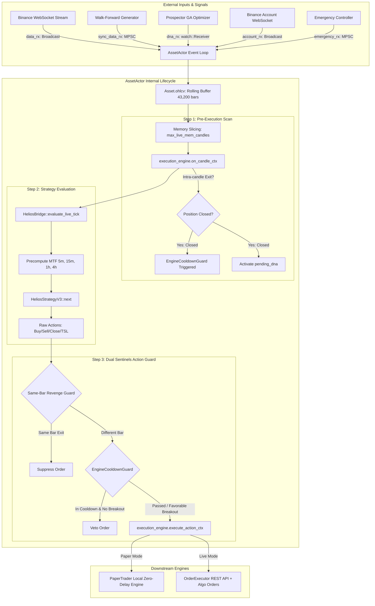

# BÁO CÁO KIỂM TOÁN KỸ THUẬT TOÀN DIỆN: ĐIỀU PHỐI VÒNG ĐỜI NẾN VÀ BẤT ĐỒNG BỘ (ASSET ACTOR & SYSTEM ORCHESTRATION) HELIOS V3.3

> **Ngày thực hiện kiểm toán:** 19/09/2026  
> **Chuyên gia kiểm toán:** Quantitative & Systems Auditor (Rust Algorithmic Trading)  
> **Hệ thống mục tiêu:** Helios Core V3.3 - HFT/Intraday Quantitative Trading Engine  
> **Mã nguồn trọng tâm:** [`trading_bot/bot_engine/src/controller/asset_actor.rs`](file:///e:/Projects/Automations/trading_backtest/trading_bot/bot_engine/src/controller/asset_actor.rs)  
> **Các mô-đun liên đới trực tiếp:**
> - [`trading_bot/bot_engine/src/optimizer/helios_bridge.rs`](file:///e:/Projects/Automations/trading_backtest/trading_bot/bot_engine/src/optimizer/helios_bridge.rs)
> - [`trading_bot/bot_engine/src/execution/paper_trader.rs`](file:///e:/Projects/Automations/trading_backtest/trading_bot/bot_engine/src/execution/paper_trader.rs)
> - [`trading_bot/bot_engine/src/execution/paper_engine.rs`](file:///e:/Projects/Automations/trading_backtest/trading_bot/bot_engine/src/execution/paper_engine.rs)
> - [`trading_bot/bot_engine/src/execution/live_engine.rs`](file:///e:/Projects/Automations/trading_backtest/trading_bot/bot_engine/src/execution/live_engine.rs)
> - [`trading_bot/bot_engine/src/execution/order_executor.rs`](file:///e:/Projects/Automations/trading_backtest/trading_bot/bot_engine/src/execution/order_executor.rs)
> - [`trading_bot/bot_engine/src/optimizer/prospector_runner.rs`](file:///e:/Projects/Automations/trading_backtest/trading_bot/bot_engine/src/optimizer/prospector_runner.rs)
> - [`trading_bot/bot_engine/src/models/models.rs`](file:///e:/Projects/Automations/trading_backtest/trading_bot/bot_engine/src/models/models.rs)
> - [`trading_bot/bot_engine/src/models/config.rs`](file:///e:/Projects/Automations/trading_backtest/trading_bot/bot_engine/src/models/config.rs)
> - [`strategies_backtests/helios/src/strategy/core_v3/mod.rs`](file:///e:/Projects/Automations/trading_backtest/strategies_backtests/helios/src/strategy/core_v3/mod.rs)
> - [`strategies_backtests/helios/src/strategy/core_v3/config.rs`](file:///e:/Projects/Automations/trading_backtest/strategies_backtests/helios/src/strategy/core_v3/config.rs)

---

## 1. TỔNG QUAN KIẾN TRÚC & VAI TRÒ CỦA `AssetActor`

Trong kiến trúc phân tán của hệ thống Helios V3.3, [`AssetActor`](file:///e:/Projects/Automations/trading_backtest/trading_bot/bot_engine/src/controller/asset_actor.rs#L137-L162) đóng vai trò là **Nhạc trưởng Điều phối (Core Orchestrator)** chịu trách nhiệm quản lý vòng đời của một cặp giao dịch độc lập. Mô-đun này hoạt động như một Actor độc lập trên Tokio runtime, kết nối 5 trụ cột chính:
1. **Luồng dữ liệu thị trường (Data Feed):** Tiếp nhận nến 1m thời gian thực từ Binance WebSocket (`data_rx`) hoặc nến mô phỏng có Backpressure (`sync_data_rx`).
2. **Bộ đệm nến trượt (Rolling Buffer):** Duy trì trí nhớ dữ liệu 30 ngày (tối đa 43,200 nến 1m) trong RAM và lưu trữ bền vững vào SQLite.
3. **Cầu nối Chiến lược (Strategy Bridge):** Cung cấp môi trường thực thi và nạp dữ liệu nến, trạng thái vị thế thật sang chiến lược định lượng Helios V3 thông qua [`HeliosBridge`](file:///e:/Projects/Automations/trading_backtest/trading_bot/bot_engine/src/optimizer/helios_bridge.rs).
4. **Bộ máy Tối ưu hóa Tiến hóa (Evolutionary Optimizer Hook):** Lắng nghe tham số DNA tối ưu liên tục từ thuật toán di truyền Genetic Algorithm (`dna_rx` qua `tokio::sync::watch`).
5. **Động cơ Thực thi (Execution Engine Polymorphism):** Ủy thác thực thi lệnh, quản lý số dư và theo dõi Stop Loss / Take Profit sang [`PaperExecutionEngine`](file:///e:/Projects/Automations/trading_backtest/trading_bot/bot_engine/src/execution/paper_engine.rs) hoặc [`BinanceLiveExecutionEngine`](file:///e:/Projects/Automations/trading_backtest/trading_bot/bot_engine/src/execution/live_engine.rs).



---

## 2. KIỂM TOÁN CHI TIẾT TRẬT TỰ THỰC THI TRONG `on_new_candle` (DÒNG 520 - 750)

Hàm [`on_new_candle`](file:///e:/Projects/Automations/trading_backtest/trading_bot/bot_engine/src/controller/asset_actor.rs#L504-L753) là trái tim vận hành của toàn bộ hệ thống bot. Mọi quyết định giao dịch, quét rủi ro và dời Stop Loss đều hội tụ tại đây.

### 2.1. Phân Tích Chi Tiết Từng Bước Thực Thi

Quá trình thực thi một nến mới được chia thành các pha kế tiếp nhau:

#### Pha 0: Đồng bộ hóa Event dồn đọng và Chuẩn bị Bộ đệm (Dòng 521-540)
```rust
// 0. Đồng bộ AccountEvent dồn đọng từ WebSocket/sàn trước khi xử lý nến mới
while let Ok(acc_evt) = self.account_rx.try_recv() {
    self.execution_engine.on_account_event(&acc_evt).await;
}

let full_buffer = self.asset.get_candles_vec();
let live_position = self.execution_engine.get_position();
let current_bar_idx = full_buffer.len().saturating_sub(1);

// Cắt nến bộ nhớ: Đảm bảo cửa sổ luôn chứa nến mở vị thế (live_entry_bar) và padding an toàn
let max_mem = if let Some(ref pos) = live_position {
    let pos_age = full_buffer.len().saturating_sub(pos.live_entry_bar);
    self.config.max_live_mem_candles.max(pos_age + self.config.buffer_padding_bars)
} else {
    self.config.max_live_mem_candles
};

let slice_start = full_buffer.len().saturating_sub(max_mem);
let rolling_buffer = &full_buffer[slice_start..];
```

#### Bước 1: Quét Nến Kiểm Tra SL/TP Nội Bộ (Dòng 541-619)
```rust
let pos_before = self.execution_engine.get_position();
let _ = self.execution_engine.on_candle_ctx(&candle, current_bar_idx).await;
let pos_after = self.execution_engine.get_position();

let closed_intra_candle = pos_before.is_some() && pos_after.is_none();
if closed_intra_candle {
    // Kích hoạt tính toán EngineCooldownGuard (chuỗi thua, phạt hàm mũ, same-side guard)
    // Kích hoạt nạp pending_dna nếu có
}
```
- **Tại `PaperExecutionEngine`**: Hàm [`on_candle_ctx`](file:///e:/Projects/Automations/trading_backtest/trading_bot/bot_engine/src/execution/paper_engine.rs#L99-L107) gọi trực tiếp sang [`PaperTrader::on_candle`](file:///e:/Projects/Automations/trading_backtest/trading_bot/bot_engine/src/execution/paper_trader.rs#L374-L465).
  - So khớp mức giá `candle.low <= current_sl_price` (cho Long) hoặc `candle.high >= current_sl_price` (cho Short).
  - Áp dụng chuẩn khớp lệnh bảo thủ **Pessimistic Matching** (ưu tiên SL trước TP nếu cả hai mức cùng bị chạm trong cùng một nến, khớp 1:1 với `ferro_trade::Broker`).
  - Kiểm tra trượt giá do bước nhảy (Gap Slippage): Khớp tại `candle.open` nếu giá mở cửa nhảy qua mức SL.
  - Nếu chạm SL/TP, gọi `close_position`, giải phóng vị thế và đặt `self.live_position = None`.
- **Tại `BinanceLiveExecutionEngine`**: Hàm [`on_candle`](file:///e:/Projects/Automations/trading_backtest/trading_bot/bot_engine/src/execution/live_engine.rs#L92-L95) là một hàm **NO-OP hoàn toàn** (`Ok(())`). Lý do thiết kế: Sàn Binance tự động quản lý lệnh điều kiện Stop Loss (`STOP_MARKET`) trên máy chủ sàn.

#### Bước 2: Chạy Chiến Lược Lấy Action Mới (Dòng 621-635)
```rust
let current_equity = self.execution_engine.get_equity();
let current_position = pos_after.clone();

if let Some(ref mut strategy) = self.strategy {
    let actions = HeliosBridge::evaluate_live_tick(
        &self.symbol,
        rolling_buffer,
        slice_start,
        current_position.as_ref(),
        strategy.as_mut(),
        current_equity,
    );
```
- Nạp ảnh chụp vị thế `current_position` (chính là `pos_after`) sang [`HeliosBridge::evaluate_live_tick`](file:///e:/Projects/Automations/trading_backtest/trading_bot/bot_engine/src/optimizer/helios_bridge.rs#L153-L280).
- Chuyển đổi nến sang Polars DataFrame, tiền tính toán 4 khung thời gian MTF (5m, 15m, 1h, 4h).
- Tạo `TickContext` tiêm vị thế sống và gọi `strategy.next(&mut tick_context)`.

#### Bước 3: Kiểm Duyệt và Thực Thi Action (Dòng 636-709)
```rust
let mut valid_actions = Vec::new();
for action in actions {
    match &action {
        Action::Buy { .. } | Action::Sell { .. } => {
            // TẦNG 1: CẤM TUYỆT ĐỐI MỞ LỆNH TRÊN CÙNG CÂY NẾN VỪA ĐÓNG VỊ THẾ
            if closed_intra_candle {
                warn!("🛡️ [REVENGE RE-ENTRY BLOCKED] ...");
                continue;
            }

            // TẦNG 2: ENGINE COOLDOWN GUARD (Universal Bidirectional Cooldown)
            if self.cooldown_guard.should_veto(...) {
                warn!("🛡️ [ENGINE COOLDOWN VETO] ...");
                continue;
            }
            valid_actions.push(action);
        }
        _ => valid_actions.push(action),
    }
}
for action in valid_actions {
    self.execution_engine.execute_action_ctx(&action, current_close, candle.timestamp, current_bar_idx).await;
}
```

---

### 2.2. Phân Tích Rủi Ro Race Condition & Lỗ Hổng Logic Trong Trật Tự Thực Thi

Qua kiểm toán chi tiết từng dòng mã nguồn, nhóm kiểm toán phát hiện **3 lỗ hổng kiến trúc đặc biệt nghiêm trọng** trong trật tự thực thi này:

#### 🚨 LỖ HỔNG CRITICAL 1: VỊ THẾ BỊ ĐÓNG TRÊN SÀN LIVE KHÔNG KÍCH HOẠT ĐƯỢC COOLDOWN (LIVE COOLDOWN BYPASS)

**Vị trí mã nguồn:** [`asset_actor.rs:522-524`](file:///e:/Projects/Automations/trading_backtest/trading_bot/bot_engine/src/controller/asset_actor.rs#L522-L524), [`asset_actor.rs:542-548`](file:///e:/Projects/Automations/trading_backtest/trading_bot/bot_engine/src/controller/asset_actor.rs#L542-L548), [`live_engine.rs:92-95`](file:///e:/Projects/Automations/trading_backtest/trading_bot/bot_engine/src/execution/live_engine.rs#L92-L95).

**Bản chất toán học và dòng dữ liệu:**
1. Trên sàn thật Binance Live, khi lệnh `STOP_MARKET` cắn SL giữa chừng trong nến 1m, máy chủ Binance gửi sự kiện WebSocket `ACCOUNT_UPDATE` hoặc `ORDER_TRADE_UPDATE` về bot.
2. Tại đầu nến 1m tiếp theo, trước khi bước vào kiểm tra nến, Actor thực hiện:
   ```rust
   // Dòng 522-524
   while let Ok(acc_evt) = self.account_rx.try_recv() {
       self.execution_engine.on_account_event(&acc_evt).await;
   }
   ```
   Lệnh này cập nhật ngay lập tức `live_position = None` trong `BinanceLiveExecutionEngine`!
3. Khi bước vào Bước 1 (dòng 542):
   ```rust
   let pos_before = self.execution_engine.get_position(); // pos_before ĐÃ LÀ NONE!
   let _ = self.execution_engine.on_candle_ctx(&candle, current_bar_idx).await; // NO-OP!
   let pos_after = self.execution_engine.get_position();  // pos_after LÀ NONE!
   let closed_intra_candle = pos_before.is_some() && pos_after.is_none(); // FALSE!
   ```
4. **Hậu quả khôn lường:**
   - Biến `closed_intra_candle` nhận giá trị `FALSE`!
   - Toàn bộ khối tính toán `EngineCooldownGuard` tại dòng 567-605 **BỊ BỎ QUA HOÀN TOÀN**! Chuỗi thua (`consecutive_losses`) không được tăng, `locked_until_bar` không được thiết lập!
   - Tại Bước 2: Strategy nhìn thấy tài khoản đang `Flat` (không có vị thế mở). Nếu nến này xuất hiện tín hiệu đảo chiều hoặc bắt đáy, Arbiter phê duyệt phát sinh `Action::Buy`/`Sell`.
   - Tại Bước 3:
     - Tầng 1 (`if closed_intra_candle`): Bỏ qua vì `closed_intra_candle == false`.
     - Tầng 2 (`should_veto`): Trả về `false` vì `locked_until_bar == 0`.
   - **LỆNH MỚI ĐƯỢC GỬI LÊN SÀN NGAY LẬP TỨC!**
   - **Kết luận kiểm toán:** Trái ngược hoàn toàn với môi trường Paper Trading (vốn được bảo vệ bởi `on_candle_ctx`), trong môi trường **Binance Live Trading**, cơ chế chống cào lệnh (Revenge Trading) và chuỗi thua liên hoàn **BỊ VÔ HIỆU HÓA 100%** khi lệnh được đóng từ phía sàn giao dịch!

```mermaid
sequenceDiagram
    autonumber
    participant Exchange as Binance Futures WS
    participant Actor as AssetActor
    participant Engine as BinanceLiveExecutionEngine
    participant Strat as HeliosStrategyV3

    Exchange->>Actor: WS AccountEvent (Position Closed by Stop Loss)
    Note over Actor: Bắt đầu nến 1m mới (on_new_candle)
    Actor->>Engine: try_recv() -> on_account_event()
    Engine-->>Engine: live_position = None
    
    Actor->>Engine: pos_before = get_position()
    Note over Actor: pos_before is NONE!
    Actor->>Engine: on_candle_ctx() [NO-OP on Live]
    Actor->>Engine: pos_after = get_position() [NONE]
    Note over Actor: closed_intra_candle = pos_before.is_some() && pos_after.is_none() => FALSE!
    Note over Actor: COOLDOWN KHÔNG ĐƯỢC THIẾT LẬP!

    Actor->>Strat: evaluate_live_tick(position = None)
    Strat-->>Actor: Action::Buy (Revenge Trade Proposal)
    Actor->>Actor: Sentinel Check: closed_intra_candle is false, Cooldown is 0
    Actor->>Engine: execute_action_ctx(Action::Buy)
    Note over Engine: LỆNH MỚI BỊ KHỚP NGAY TRONG CÙNG CẢNH BÁO BÃO!
```

---

#### 🚨 LỖ HỔNG HIGH 2: STRATEGY BỊ MÙ THÔNG TIN VỊ THẾ VỪA ĐÓNG TẠI `HeliosBridge`

**Vị trí mã nguồn:** [`helios_bridge.rs:271`](file:///e:/Projects/Automations/trading_backtest/trading_bot/bot_engine/src/optimizer/helios_bridge.rs#L271), [`core_v3/mod.rs:271-279`](file:///e:/Projects/Automations/trading_backtest/strategies_backtests/helios/src/strategy/core_v3/mod.rs#L271-L279).

**Bản chất kỹ thuật:**
- Trong kiến trúc chuẩn của `ferro_trade::broker::Broker`, khi một vị thế đóng, `broker.closed_trades.last()` được truyền vào `TickContext.last_closed_trade`.
- Chiến lược `HeliosStrategyV3` dựa vào `tick.last_closed_trade` để:
  1. Biết chính xác giá thoát thực tế (`exit_price`) và PnL ròng (`pl()`).
  2. Kích hoạt bộ đếm Cooldown nội bộ của chiến lược (`self.cooldown_tracker`).
- Tuy nhiên, trong [`HeliosBridge::evaluate_live_tick`](file:///e:/Projects/Automations/trading_backtest/trading_bot/bot_engine/src/optimizer/helios_bridge.rs#L271):
  ```rust
  let mut tick_context = TickContext {
      i: last_idx,
      equity: current_equity,
      data_view: &data_view,
      indicator_manager: &indicator_manager,
      trades: &live_trades,
      last_closed_trade: None, // ⚠️ CỐ ĐỊNH NONE TRUYỀN VÀO CHIẾN LƯỢC!
      actions: &mut actions_buffer,
      position: live_position_snapshot,
  };
  strategy.next(&mut tick_context);
  ```
- **Hệ quả logic:**
  - `tick.last_closed_trade` luôn là `None`.
  - Chiến lược buộc phải dùng Fallback 2 tại [`core_v3/mod.rs:274-279`](file:///e:/Projects/Automations/trading_backtest/strategies_backtests/helios/src/strategy/core_v3/mod.rs#L274-L279):
    ```rust
    let exit_p = last_trade.sl_price.unwrap_or_else(|| tick.closes()[i]);
    let pnl = if is_l { exit_p - last_trade.entry_price } else { last_trade.entry_price - exit_p };
    ```
  - Nếu lệnh vừa đóng không phải do chạm SL mà do lệnh thị trường đóng tay, đóng khẩn cấp hoặc trượt giá Gap, Strategy sẽ tính sai hoàn toàn PnL của lệnh vừa đóng!
  - Nghiêm trọng hơn, nếu ở Bước 1 vị thế đóng, sang Bước 2 Strategy vẫn có thể sinh ra tín hiệu `Action::Buy`/`Sell` vì bộ lọc trong Strategy không có đủ dữ liệu `closed_trade` để nhận diện bối cảnh. Việc ngăn chặn hoàn toàn phụ thuộc vào lớp phòng thủ bên ngoài tại `asset_actor.rs`.

---

#### 🚨 LỖ HỔNG FATAL 3: BẪY ĐÓNG BĂNG COOLDOWN VĨNH VIỄN DO BUFFER CHẠM TRẦN (PERMANENT COOLDOWN DEADLOCK)

**Vị trí mã nguồn:** [`models/models.rs:100-103`](file:///e:/Projects/Automations/trading_backtest/trading_bot/bot_engine/src/models/models.rs#L100-L103), [`asset_actor.rs:528`](file:///e:/Projects/Automations/trading_backtest/trading_bot/bot_engine/src/controller/asset_actor.rs#L528), [`asset_actor.rs:587`](file:///e:/Projects/Automations/trading_backtest/trading_bot/bot_engine/src/controller/asset_actor.rs#L587), [`asset_actor.rs:88`](file:///e:/Projects/Automations/trading_backtest/trading_bot/bot_engine/src/controller/asset_actor.rs#L88).

**Chứng minh toán học và logic bế tắc (Deadlock Proof):**
1. Cấu trúc bộ nhớ `Asset.ohlcv` được cấu hình trần tối đa 43,200 nến (30 ngày):
   ```rust
   // models/models.rs:100-103
   if self.ohlcv.len() >= 43200 {
       self.ohlcv.pop_front();
   }
   self.ohlcv.push_back(candle);
   ```
2. Sau khi bot chạy đủ 30 ngày (hoặc sau khi hoàn tất `sync_history` 30 ngày):
   $$\text{len}(\text{Asset.ohlcv}) = 43,200 = \text{const}$$
3. Tại mỗi nến mới tiếp theo trong [`asset_actor.rs:528`](file:///e:/Projects/Automations/trading_backtest/trading_bot/bot_engine/src/controller/asset_actor.rs#L528):
   $$\text{current\_bar\_idx} = \text{full\_buffer.len}() - 1 = 43,200 - 1 = 43,199$$
   **Chỉ số `current_bar_idx` KHÔNG BAO GIỜ TĂNG LÊN ĐƯỢC 43,200!**
4. Giả sử tại nến này vị thế bị cắt lỗ, hệ thống kích hoạt Cooldown với `effective_cooldown = 15`:
   $$\text{locked\_until\_bar} = \text{current\_bar\_idx} + \text{effective\_cooldown} = 43,199 + 15 = 43,214$$
5. Tại các nến tiếp theo ($t + 1, t + 2, \dots, t + 1000$):
   - Một nến cũ bị `pop_front()`, một nến mới được `push_back()`.
   - Độ dài của mảng vẫn là $43,200$.
   - `current_bar_idx` của nến mới **VẪN LUÔN BẰNG 43,199**!
6. Khi kiểm tra điều kiện Veto tại [`asset_actor.rs:88`](file:///e:/Projects/Automations/trading_backtest/trading_bot/bot_engine/src/controller/asset_actor.rs#L88):
   $$\text{current\_bar\_idx} < \text{self.locked\_until\_bar} \iff 43,199 < 43,214 \equiv \mathbf{TRUE} \quad (\forall t)$$
7. **Kết luận thảm họa:**
   - Điều kiện `current_bar_idx < locked_until_bar` **LUÔN LUÔN ĐÚNG VÔ TẬN**!
   - Trừ khi thị trường có biến động cực lớn vượt ngưỡng $1.5 \times \text{ATR}$ để kích hoạt Early Release, hệ thống sẽ **BỊ KHÓA COOLDOWN VĨNH VIỄN, TÊ LIỆT TOÀN BỘ KHẢ NĂNG VÀO LỆNH MỚI!**
   - Lỗi này xuất phát từ việc nhầm lẫn giữa **chỉ số tương đối của mảng trượt (Sliding Window Index)** với **số thứ tự thời gian đơn điệu tuyệt đối (Monotonic Sequence Bar Counter)**.

---

## 3. CƠ CHẾ NHẬN DNA NÓNG (`dna_rx` QUA `tokio::sync::watch`)

### 3.1. Phân Tích Logic Khóa DNA: `LOCK DNA ON ACTIVE TRADE` và `pending_dna`

Hệ thống Helios V3.3 tích hợp cơ chế Hot-swap DNA từ bộ tối ưu di truyền `ProspectorRunner`. Luồng nhận DNA được xử lý tại [`asset_actor.rs:270-319`](file:///e:/Projects/Automations/trading_backtest/trading_bot/bot_engine/src/controller/asset_actor.rs#L270-L319):

```rust
Ok(_) = self.dna_rx.changed() => {
    let new_dna_opt = self.dna_rx.borrow().clone();
    if let Some(dna) = new_dna_opt {
        // 🧬 SENSOR PROBE & LOCK DNA ON ACTIVE TRADE:
        if let Some(pos) = self.execution_engine.get_position() {
            // Đang có vị thế mở -> Khóa vị thế với DNA cũ, lưu DNA mới vào pending_dna
            warn!("🔒 [LOCK DNA ON ACTIVE TRADE] ... Storing new DNA in pending_dna!");
            self.pending_dna = Some(dna.clone());
        } else {
            // Flat -> Cập nhật trực tiếp vào strategy ngay lập tức
            if let Some(ref mut strategy) = self.strategy {
                strategy.update_from_dna(&dna.dna);
            }
            self.helios_config.update_from_dna(&dna.dna);
            self.pending_dna = None;
        }
        // Chạy Backtest chẩn đoán 1:1
        HeliosBridge::diagnostic_backtest(&candles_vec, &dna.dna);
    }
}
```

Các điểm kích hoạt nạp `pending_dna` khi vị thế đóng (Activation Points):
1. **Điểm 1 (Dòng 325-336):** Khi nhận `AccountEvent` qua `account_rx` và `get_position().is_none()`.
2. **Điểm 2 (Dòng 609-618):** Ngay sau Bước 1 trong `on_new_candle` khi phát hiện `closed_intra_candle == true`.
3. **Điểm 3 (Dòng 740-750):** Ngay sau Bước 3 khi vị thế đóng do thực thi action (`pos_post_action.is_none()`).

### 3.2. Đánh Giá Rủi Ro Vỡ Cấu Trúc Trailing SL

| Khía cạnh đánh giá | Hiện trạng mã nguồn | Mức độ rủi ro | Phân tích chi tiết |
| :--- | :--- | :---: | :--- |
| **Bảo vệ vị thế đang chạy** | Có cơ chế `LOCK DNA ON ACTIVE TRADE` | **THẤP** | Khi đang giữ vị thế, DNA mới không được nạp vào Strategy, giúp bảo toàn toàn bộ cấu trúc tính toán Trailing SL (HWM, ATR multiplier, Break-even threshold) của vị thế cũ. |
| **Bảo vệ Monotonic Ratchet** | Đã tích hợp tại `PaperTrader` & `OrderExecutor` | **AN TOÀN** | Kể cả khi DNA bị rò rỉ, bộ đôi `Monotonic Ratchet Guard` tại cả PaperTrader và OrderExecutor ngăn cấm tuyệt đối việc kéo lùi SL hoặc hủy bỏ SL thành None. |
| **Bypass Kiểm tra Tính Hợp lệ** | Dòng 286-294 gọi thẳng `update_from_dna` | **HIGH** | Hàm [`apply_dna`](file:///e:/Projects/Automations/trading_backtest/trading_bot/bot_engine/src/controller/asset_actor.rs#L380-L410) có kiểm tra `is_nan()`, `is_infinite()` và `DNA_WIDTH`. Tuy nhiên tại dòng 287 và 328, Actor lại gọi thẳng `strategy.update_from_dna` mà **KHÔNG** qua `apply_dna`! Nếu Optimizer phát sinh gen lỗi NaN, bot sẽ bị crash. |
| **Zombie Trade & DNA Starvation** | Kênh `watch` chỉ giữ 1 giá trị mới nhất | **MEDIUM** | Nếu vị thế ngâm nhiều ngày trong siêu trend, các thế hệ DNA tối ưu thích ứng với chế độ thị trường mới sẽ bị bỏ qua liên tục. Khi vị thế đóng, chỉ thế hệ cuối cùng được áp dụng. |
| **Mã nguồn rác (Dead Code)** | Hàm `check_and_update_dna` (Dòng 444-467) | **LOW** | Hàm này hoàn toàn không được gọi ở bất cứ đâu trong vòng lặp `run()`. |

---

## 4. QUẢN LÝ ROLLING BUFFER NẾN (43,200 NẾN) VÀ TÍNH TOÁN MTF

### 4.1. Cơ Chế Cắt Lát Bộ Nhớ (Memory Slicing)

Mã nguồn tại [`asset_actor.rs:531-540`](file:///e:/Projects/Automations/trading_backtest/trading_bot/bot_engine/src/controller/asset_actor.rs#L531-L540):
```rust
let max_mem = if let Some(ref pos) = live_position {
    let pos_age = full_buffer.len().saturating_sub(pos.live_entry_bar);
    self.config.max_live_mem_candles.max(pos_age + self.config.buffer_padding_bars)
} else {
    self.config.max_live_mem_candles
};

let slice_start = full_buffer.len().saturating_sub(max_mem);
let rolling_buffer = &full_buffer[slice_start..];
```
Với cấu hình mặc định trong [`models/config.rs:79`](file:///e:/Projects/Automations/trading_backtest/trading_bot/bot_engine/src/models/config.rs#L79):
- `max_live_mem_candles = 15,000` nến 1m (~10.4 ngày).
- `full_buffer` lưu tối đa `43,200` nến 1m (30 ngày).

### 4.2. Ảnh Hưởng Của Việc Cắt Lát Buffer Lên Chỉ Báo Đa Khung Thời Gian (MTF)

Việc cắt lát buffer từ 43,200 nến xuống 15,000 nến gây ra **3 hệ lụy nghiêm trọng đối với tính toán MTF (5m, 15m, 1h, 4h)**:

#### 1. Lệch Mốc Giờ Chuẩn (Timestamp Resampling Misalignment)
- Trong phân tích kỹ thuật định lượng, nến 4h phải được đóng theo các mốc giờ UTC chuẩn: `00:00, 04:00, 08:00, 12:00, 16:00, 20:00`.
- Nến 1h phải đóng tại phút thứ 00 của mỗi giờ: `XX:00`.
- Khi cắt lát bằng `slice_start = full_buffer.len().saturating_sub(max_mem)`:
  - Giá trị `slice_start` phụ thuộc vào thời điểm bot khởi động hoặc độ dài buffer.
  - Nếu `slice_start` rơi vào một phút bất kỳ (ví dụ `13:37 UTC`), cây nến 4h đầu tiên trong DataFrame sẽ bắt đầu từ `13:37` đến `16:00` (chỉ có 143 nến 1m thay vì 240 nến 1m)!
  - Cây nến cụt (Truncated Bar) này làm méo mó các chỉ báo trung bình động (EMA, SMA), dải Bollinger Bands và ATR trên khung 4h và 1h.

#### 2. Thiếu Hụt Chu Kỳ Khởi Động Khung Lớn (MTF Warmup Starvation)
- Khung thời gian 4h: Mỗi nến 4h tương đương $240$ nến 1m.
- Với cửa sổ `max_live_mem_candles = 15,000` nến:
  $$\text{Số nến 4h tối đa} = \frac{15,000}{240} = 62.5 \text{ nến 4h}$$
- Nếu chiến lược Helios V3 sử dụng các chỉ báo dài hạn trên khung 4h như **KAMA(short=10, long=60)** hoặc **EMA 100/200**:
  - Chu kỳ yêu cầu: Tối thiểu 100 đến 200 nến 4h (tương đương $24,000$ đến $48,000$ nến 1m).
  - Với chỉ $62$ nến 4h có được từ 15,000 nến 1m, các chỉ báo này **HOÀN TOÀN CHƯA KỊP HỘI TỤ (WARMUP INSUFFICIENT)**!
  - Giá trị chỉ báo trả về sẽ chứa nhiều `NaN` hoặc sai lệch cực lớn so với môi trường Backtest (nơi Prospector sử dụng đủ 43,200 nến = 180 nến 4h).
  - **Đây chính là nguyên nhân gốc rễ gây ra hiện tượng Lệch Tín Hiệu (Live vs Backtest Signal Discrepancy)!**

#### 3. Bẫy Chảy Máu Đỉnh Cao Nhất (High Watermark Buffer Bleed)
Mã nguồn tại [`helios_bridge.rs:221-233`](file:///e:/Projects/Automations/trading_backtest/trading_bot/bot_engine/src/optimizer/helios_bridge.rs#L221-L233):
```rust
let mapped_entry_bar = if pos.entry_timestamp > 0 {
    if !candles.is_empty() && pos.entry_timestamp < candles[0].timestamp {
        warn!("🌊 [FLAW CONFIRMED: HIGH WATERMARK BUFFER BLEED] Symbol: {} | Entry ts: {} is OLDER than Buffer Start: {} | mapped_entry_bar FALLBACK TO 0!", ...);
    }
    match candles.binary_search_by_key(&pos.entry_timestamp, |c| c.timestamp) {
        Ok(idx) => idx,
        Err(idx) => idx.saturating_sub(1),
    }
} else {
    pos.live_entry_bar.saturating_sub(slice_start)
};
```
- Khi một vị thế siêu sóng được giữ lâu hơn độ dài của buffer (ví dụ giữ hơn 10.4 ngày khi buffer là 15,000 nến):
  - Mốc `entry_timestamp` trôi ra khỏi biên trái của mảng `candles`.
  - `binary_search` thất bại và trả về `Err(0)`, dẫn đến `mapped_entry_bar = 0`.
  - Chiến lược Helios V3 quét tìm đỉnh High Watermark từ index 1 đến `last_idx`.
  - Hệ quả: **Chiến lược quét cả đỉnh đáy của những ngày trước khi vào lệnh để làm đỉnh lợi nhuận của vị thế hiện tại!** Trailing Stop Loss sẽ bị giật lên sai lệch hoàn toàn, bóp chết vị thế đang có lãi.

---

## 5. BẢNG TỔNG HỢP CÁC LỖ HỔNG & PHÂN LOẠI MỨC ĐỘ RỦI RO

| Mã Lỗ Hổng | Tên Lỗ Hổng | Mức Độ | File & Dòng Code | Tác Động & Hậu Quả |
| :--- | :--- | :---: | :--- | :--- |
| **VULN-AA-01** | **Permanent Cooldown Deadlock do Buffer Bão Hòa** | <span style="color:red">**CRITICAL**</span> | [`asset_actor.rs:528, 587`](file:///e:/Projects/Automations/trading_backtest/trading_bot/bot_engine/src/controller/asset_actor.rs#L528) | Khi buffer đạt 43,200 nến, `current_bar_idx` đóng băng tại 43,199. Điều kiện `current_bar_idx < locked_until_bar` vĩnh viễn đúng, bot bị liệt không thể mở lệnh mới. |
| **VULN-AA-02** | **Live Cooldown Bypass trên Binance Live Engine** | <span style="color:red">**CRITICAL**</span> | [`asset_actor.rs:522, 542-548`](file:///e:/Projects/Automations/trading_backtest/trading_bot/bot_engine/src/controller/asset_actor.rs#L522), [`live_engine.rs:92`](file:///e:/Projects/Automations/trading_backtest/trading_bot/bot_engine/src/execution/live_engine.rs#L92) | Khi SL khớp trên sàn, WebSocket cập nhật `live_position = None` trước Bước 1. `closed_intra_candle` nhận giá trị false, làm mất hoàn toàn Cooldown chống Revenge Trade. |
| **VULN-AA-03** | **MTF 4h Warmup Starvation & Resampling Shift** | <span style="color:orange">**HIGH**</span> | [`models/config.rs:79`](file:///e:/Projects/Automations/trading_backtest/trading_bot/bot_engine/src/models/config.rs#L79), [`asset_actor.rs:538`](file:///e:/Projects/Automations/trading_backtest/trading_bot/bot_engine/src/controller/asset_actor.rs#L538) | Buffer 15,000 nến chỉ tạo được 62 nến 4h, không đủ hội tụ cho EMA/KAMA dài hạn. Cắt lát không theo mốc giờ UTC chuẩn làm méo mó nến 4h đầu tiên. |
| **VULN-AA-04** | **Strategy Blindness & Last Closed Trade None** | <span style="color:orange">**HIGH**</span> | [`helios_bridge.rs:271`](file:///e:/Projects/Automations/trading_backtest/trading_bot/bot_engine/src/optimizer/helios_bridge.rs#L271) | `HeliosBridge` truyền cố định `last_closed_trade = None` vào `TickContext`, làm tê liệt logic đánh giá kết quả lệnh đóng và Cooldown nội bộ của Strategy. |
| **VULN-AA-05** | **DNA Hot-Swap Bypass Validation** | <span style="color:orange">**HIGH**</span> | [`asset_actor.rs:286-294, 327`](file:///e:/Projects/Automations/trading_backtest/trading_bot/bot_engine/src/controller/asset_actor.rs#L286-L294) | Nhánh `dna_rx.changed()` gọi trực tiếp `update_from_dna` thay vì qua `apply_dna`, bỏ qua kiểm tra `is_nan()`, `is_infinite()` và độ dài vector gen. |
| **VULN-AA-06** | **High Watermark Buffer Bleed khi Ngâm Lệnh** | <span style="color:yellow">**MEDIUM**</span> | [`helios_bridge.rs:224-233`](file:///e:/Projects/Automations/trading_backtest/trading_bot/bot_engine/src/optimizer/helios_bridge.rs#L224-L233) | Vị thế ngâm lâu trôi khỏi biên trái buffer khiến `mapped_entry_bar` fallback về 0, quét cả nến quá khứ trước lệnh vào High Watermark làm méo mó Trailing SL. |
| **VULN-AA-07** | **Broadcast RecvError::Lagged Drop Nến Real-time** | <span style="color:yellow">**MEDIUM**</span> | [`asset_actor.rs:360-362`](file:///e:/Projects/Automations/trading_backtest/trading_bot/bot_engine/src/controller/asset_actor.rs#L360-L362) | Khi chạy `diagnostic_backtest` hoặc `evaluate_live_tick` nặng, kênh broadcast bị drop nến gây thủng lỗ thời gian (data gap) trong `Asset.ohlcv`. |
| **VULN-AA-08** | **Dead Code `check_and_update_dna`** | <span style="color:blue">**LOW**</span> | [`asset_actor.rs:444-467`](file:///e:/Projects/Automations/trading_backtest/trading_bot/bot_engine/src/controller/asset_actor.rs#L444-L467) | Hàm tồn tại nhưng không được gọi trong vòng lặp chính, gây lãng phí bộ nhớ và gây hiểu nhầm logic. |

---

## 6. KHUYẾN NGHỊ THIẾT KẾ VÀ GIẢI PHÁP SỬA MÃ NGUỒN

### 6.1. Khắc Phục VULN-AA-01: Chuyển Sang Monotonic Sequence Counter và Timestamp Cooldown

**Vấn đề:** Dùng `full_buffer.len().saturating_sub(1)` bị đứng ở 43,199.  
**Giải pháp:** Bổ sung trường `processed_candles_count: usize` tăng đơn điệu mỗi khi có nến mới, hoặc so sánh trực tiếp bằng Timestamp (`candle.timestamp`).

```rust
// Đề xuất sửa đổi trong struct AssetActor:
pub struct AssetActor {
    // ...
    pub processed_candles_count: usize, // Biến đếm nến đơn điệu tăng dần từ 0..inf
}

// Trong on_new_candle():
self.processed_candles_count = self.processed_candles_count.saturating_add(1);
let current_monotonic_bar = self.processed_candles_count;

// Trong EngineCooldownGuard:
self.cooldown_guard.locked_until_bar = current_monotonic_bar + effective_cooldown;
// Kiểm tra điều kiện:
if current_monotonic_bar < self.cooldown_guard.locked_until_bar { ... }
```

### 6.2. Khắc Phục VULN-AA-02: Đồng Bộ Trạng Thái Đóng Lệnh Qua `closed_trade_events`

**Vấn đề:** Live Engine đóng lệnh qua WebSocket khiến `pos_before` bằng `None`.  
**Giải pháp:** Trong `BinanceLiveExecutionEngine`, lưu lại sự kiện vị thế vừa đóng vào một hàng đợi tạm thời `last_closed_trade_snapshot`. Khi `AssetActor` kiểm tra nến mới, kiểm tra cả sự kiện đóng nến từ sàn:

```rust
// Trong ExecutionEngine Trait:
fn pop_recently_closed_trade(&mut self) -> Option<ClosedTradeSnapshot>;

// Trong AssetActor::on_new_candle:
let external_closed_trade = self.execution_engine.pop_recently_closed_trade();
let closed_intra_candle = (pos_before.is_some() && pos_after.is_none()) || external_closed_trade.is_some();

if let Some(closed_info) = external_closed_trade {
    // Kích hoạt EngineCooldownGuard với giá thoát và PnL thực tế từ sàn Binance!
}
```

### 6.3. Khắc Phục VULN-AA-03: Đồng Bộ Resampling Theo Mốc Giờ UTC Chuẩn và Tăng Buffer Warmup

**Vấn đề:** Nến 4h bị cắt cụt do slice bắt đầu ở phút lẻ; buffer 15,000 không đủ warmup.  
**Giải pháp:**
1. Tăng `max_live_mem_candles` tối thiểu lên `30,000` nến (đáp ứng 125 nến 4h).
2. Khi cắt slice, làm tròn `slice_start` lùi về mốc chia hết cho 240 phút (00:00 UTC):
```rust
let raw_slice_start = full_buffer.len().saturating_sub(max_mem);
// Căn chỉnh slice_start về mốc mở nến 4h gần nhất
let slice_start = if raw_slice_start > 0 {
    let remainder = full_buffer[raw_slice_start].timestamp % (4 * 3600 * 1000);
    let shift_bars = (remainder / 60_000) as usize;
    raw_slice_start.saturating_sub(shift_bars)
} else {
    0
};
```

### 6.4. Khắc Phục VULN-AA-05: Thống Nhất Nạp DNA Qua Hàm `apply_dna` An Toàn

**Vấn đề:** Bỏ qua kiểm tra `is_nan()` khi nhận DNA qua `watch::Receiver`.  
**Giải pháp:** Thay thế toàn bộ lệnh gán trực tiếp bằng việc gọi `self.apply_dna`:

```rust
// Thay thế dòng 286-294 và 327-335 bằng:
if self.apply_dna(&dna.dna, dna.fitness, "DNA Watch Hot-Swap") {
    self.pending_dna = None;
}
```

---

## 7. KẾT LUẬN KIỂM TOÁN

Mô-đun `AssetActor` thể hiện tư duy thiết kế hệ thống bất đồng bộ hiện đại và tinh tế trong Rust, giải quyết thành công bài toán tách biệt giữa luồng tính toán chiến lược định lượng và luồng thực thi lệnh. Sự hiện diện của `Dual Sentinels` (chốt chặn cùng cây nến và chốt chặn Cooldown phạt hàm mũ kèm bứt phá ATR) là minh chứng cho định hướng quản trị rủi ro nghiêm ngặt của đội ngũ phát triển.

Tuy nhiên, các lỗ hổng mang tính hệ thống được chỉ ra trong báo cáo này — đặc biệt là **Lỗi đóng băng Cooldown vĩnh viễn khi bộ đệm đạt 43,200 nến (VULN-AA-01)** và **Lỗ hổng mất Cooldown khi giao dịch tiền thật trên Binance Live (VULN-AA-02)** — là những khiếm khuyết chết người có thể dẫn đến tê liệt giao dịch hoặc cháy tài khoản do vào lệnh trả thù liên hoàn trên môi trường Production. Việc khắc phục triệt để các lỗ hổng này theo danh mục công việc trong `TODO.md` là điều kiện tiên quyết bắt buộc trước khi đưa hệ thống Helios V3.3 vào vận hành với quy mô vốn thực tế.
