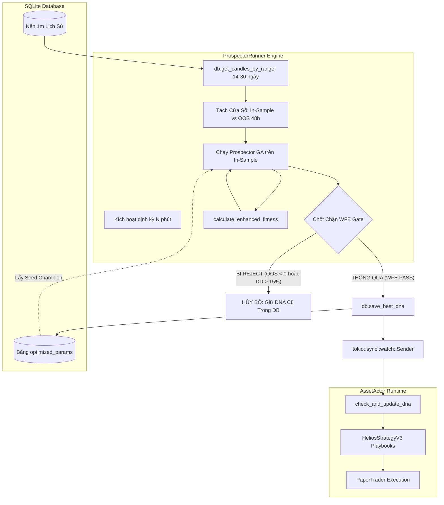
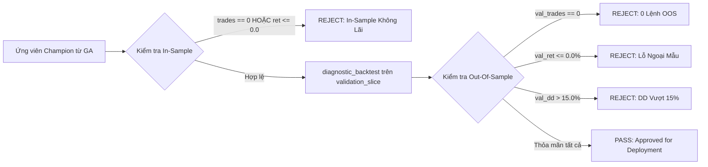
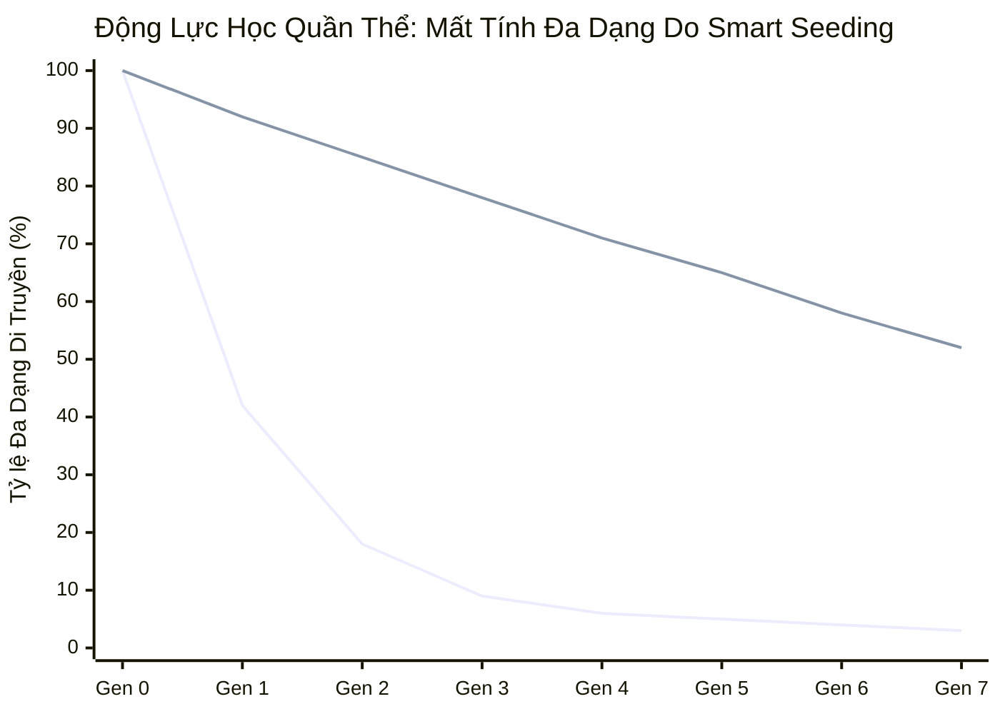

# BÁO CÁO KIỂM TOÁN KỸ THUẬT TOÀN DIỆN: PROSPECTOR RUNNER & BỘ ĐIỀU PHỐI WALK-FORWARD SMART SEEDING

**Module phụ trách:** `trading_bot/bot_engine/src/optimizer/prospector_runner.rs`  
**Các module liên đới:**
- `trading_bot/bot_engine/examples/walk_forward_smart_seed.rs`
- `trading_bot/bot_engine/src/optimizer/helios_bridge.rs`
- `ferro_trade/src/optimizer/prospector.rs`
- `ferro_trade/src/optimizer/ga_worker.rs`
- `trading_bot/bot_engine/src/data_engine/sqlite_impl.rs`
- `trading_bot/bot_engine/src/controller/asset_actor.rs`
- `strategies_backtests/helios/examples/helios_optimizer_config.json`
- `trading_bot/bot_engine/examples/logs/WFSS_37.log`

**Ngày kiểm toán:** 19/09/2026  
**Chuyên gia kiểm toán:** Quantitative & Systems Auditor  
**Trạng thái module:** **Cảnh báo Kiến trúc Nghiêm trọng (Architectural & Cold-Start Vulnerability Alert)** — Phát hiện lỗi bỏ đói chiến lược khi khởi động lạnh (Cold-Start Starvation Trap), nguy cơ nhiễm bẩn dữ liệu huấn luyện vào tập kiểm định WFE (Warmup Overlap Contamination), và bẫy hội tụ sớm cục bộ của cơ chế Smart Seeding.

---

## MỤC LỤC
1. [TỔNG QUAN KIẾN TRÚC & QUY TRÌNH TỐI ƯU TỊNH TIẾN (ROLLING WALK-FORWARD OPTIMIZATION)](#1-tổng-quan-kiến-trúc--quy-trình-tối-ưu-tịnh-tiến-rolling-walk-forward-optimization)
   - 1.1. Vị trí và Vai trò của `ProspectorRunner` trong Hệ sinh thái Bot Engine
   - 1.2. Phân chia cửa sổ In-Sample (12–14 ngày) và Out-Of-Sample 48h (2,880 nến 1m)
   - 1.3. Lỗ hổng tiềm ẩn: Nguy cơ nhiễm bẩn dữ liệu kiểm định do gối đầu Warmup (`WARMUP_SAFE_BARS`)
2. [CƠ CHẾ CHỐT CHẶN WFE GATE (WALK-FORWARD EFFICIENCY GATE)](#2-cơ-chế-chốt-chặn-wfe-gate-walk-forward-efficiency-gate)
   - 2.1. Bản chất lý thuyết WFE (Robert Pardo) vs. Hiện thực hóa Hard Boundary Gate
   - 2.2. Chi tiết tiêu chí phê duyệt (`prospector_runner.rs:338–350`)
   - 2.3. Mổ xẻ thực nghiệm `WFSS_37.log`: Giải mã hiện tượng 4 chu kỳ đầu liên tiếp bị REJECT
   - 2.4. Bẫy Khởi Động Lạnh (Cold-Start Starvation Trap) & Hiện tượng Bot chạy Default rỗng
   - 2.5. Đánh giá sự cần thiết của cơ chế Fallback Champion Seed & Multi-Tier Graceful Degradation
3. [CƠ CHẾ SMART SEEDING 0.5% (CHAMPION SEED INJECTION)](#3-cơ-chế-smart-seeding-05-champion-seed-injection)
   - 3.1. Luồng truyền dẫn DNA: SQLite -> Prospector -> Genotype Generation 0
   - 3.2. Cơ sở toán học & Động lực học Quần thể: Thích nghi siêu tốc vs. Bẫy Cực trị địa phương (Local Minima)
   - 3.3. Tác động triệt tiêu thế hệ của cơ chế Dừng sớm `max_stale_generations`
   - 3.4. Bản chất "Inertial Anchor" & Đánh giá mức độ Overfitting dữ liệu quá khứ
4. [HÀM TÍNH ĐIỂM THÍCH NGHI ĐA TIÊU CHÍ (ENHANCED FITNESS SCORING)](#4-hàm-tính-điểm-thích-nghi-đa-tiêu-chí-enhanced-fitness-scoring)
   - 4.1. Công thức toán học & Phân rã 4 thành phần (`prospector_runner.rs:437–481`)
   - 4.2. Khảo sát điểm biên, xử lý ngoại lệ số thực (NaN, Inf, Zero Trades)
   - 4.3. Đánh giá ưu điểm và nhược điểm định lượng
5. [HIỆU NĂNG THỰC THI, ĐA LUỒNG & BẤT ĐỒNG BỘ](#5-hiệu-năng-thực-thi-đa-luồng--bất-đồng-bộ)
   - 5.1. Rayon Parallel Evaluation & Quản lý luồng lồng nhau (Nested Parallelism)
   - 5.2. Kỹ thuật Zero-Polars MTF Precomputation & Tốc độ chu kỳ GA (11–16 giây)
   - 5.3. Khử nghẽn Disk I/O SQLite thông qua kênh MPSC Decoupled
   - 5.4. Cơ chế Event-Driven Watch Channel Hot-Swap DNA không downtime
6. [TỔNG HỢP CÁC LỖ HỔNG KIẾN TRÚC, EDGE CASES & KHUYẾN NGHỊ TÁI CẤU TRÚC](#6-tổng-hợp-các-lỗ-hổng-kiến-trúc-edge-cases--khuyến-nghị-tái-cấu-trúc)
7. [BẢNG ĐỐI CHIẾU THÔNG SỐ VÀ TIÊU CHUẨN ĐỀ XUẤT](#7-bảng-đối-chiếu-thông-số-và-tiêu-chuẩn-đề-xuất)

---

## 1. TỔNG QUAN KIẾN TRÚC & QUY TRÌNH TỐI ƯU TỊNH TIẾN (ROLLING WALK-FORWARD OPTIMIZATION)

### 1.1. Vị trí và Vai trò của `ProspectorRunner` trong Hệ sinh thái Bot Engine
Trong kiến trúc hệ thống giao dịch tự động phân tầng của dự án, `ProspectorRunner` (`trading_bot/bot_engine/src/optimizer/prospector_runner.rs`) đóng vai trò là **Bộ Não Thích Ứng Tham Số Liên Tục (Continuous Adaptive Optimization Engine)**. Module này là cầu nối trực tiếp giữa:
- **Tầng Dữ Liệu (`SqliteStore`):** Cung cấp chuỗi nến lịch sử nén và lưu trữ các bộ gen tối ưu (`OptimizedDna`).
- **Tầng Thuật Toán Tối Ưu (`ferro_trade::optimizer::prospector` & `ga_worker`):** Vận hành thuật toán Di truyền (GA) đa tầng, kết hợp lấy mẫu Latin Hypercube Sampling (MaximinLHS) và cắt tỉa nhánh (Pruning Strategy).
- **Tầng Đánh Giá Chiến Lược (`HeliosBridge`):** Cung cấp môi trường Backtest độc lập chạy song song, tính toán các chỉ số thống kê chuẩn xác trên khung đa thời gian (MTF).
- **Tầng Điều Khiển Thực Thi (`AssetActor`):** Tiếp nhận DNA mới được thông qua bởi chốt chặn thẩm định để nạp nóng (Hot-Swap) trực tiếp vào Actor đang chạy Paper/Live trading mà không cần khởi động lại tiến trình.



---

### 1.2. Phân chia cửa sổ In-Sample (12–14 ngày) và Out-Of-Sample 48h (2,880 nến 1m)
Quy trình tối ưu hóa tịnh tiến (Rolling Walk-Forward) trong `prospector_runner.rs` được thiết kế nhằm mô phỏng điều kiện thích ứng thực tế của thị trường tiền mã hóa:
- **Độ dài tổng thể cửa sổ dữ liệu:** Thông thường từ 14 ngày ($20,160$ nến 1m) đến 30 ngày ($43,200$ nến 1m).
- **Cửa sổ thẩm định độc lập ngoài mẫu (Out-Of-Sample - OOS):** Cố định $48\text{ giờ}$ gần nhất, tương đương đúng $2,880\text{ nến 1 phút}$ (`VALIDATION_SPAN_BARS = 2880`).
- **Cửa sổ huấn luyện trong mẫu (In-Sample - IS):** Toàn bộ dữ liệu nằm trước điểm cắt $48\text{ giờ}$ này ($N - 2,880$ nến). Với cửa sổ 14 ngày, In-Sample chiếm xấp xỉ 12 ngày ($17,280$ nến).

Mã nguồn phân tách tại [`prospector_runner.rs:194–209`](file:///e:/Projects/Automations/trading_backtest/trading_bot/bot_engine/src/optimizer/prospector_runner.rs#L194-L209):
```rust
const VALIDATION_SPAN_BARS: usize = 2880; // 48 giờ
const WARMUP_SAFE_BARS: usize = 5760;     // Warmup indicators (4 ngày)
let can_split_wfe = candles.len() >= (WARMUP_SAFE_BARS + VALIDATION_SPAN_BARS + 1440);

let (train_candles, validation_slice) = if can_split_wfe {
    let split_idx = candles.len() - VALIDATION_SPAN_BARS;
    let val_start_idx = candles.len().saturating_sub(WARMUP_SAFE_BARS + VALIDATION_SPAN_BARS);
    (candles[..split_idx].to_vec(), candles[val_start_idx..].to_vec())
} else {
    (candles.clone(), Vec::new())
};
```

#### Phân tích điều kiện phân rã dữ liệu:
1. **Biến số kiểm tra an toàn `can_split_wfe`:**
   Yêu cầu dữ liệu phải thỏa mãn:
   $$\text{candles.len()} \ge 5,760 + 2,880 + 1,440 = 10,080\text{ nến } (7\text{ ngày})$$
   Nếu tổng số nến $< 10,080$, hệ thống không thể tách OOS an toàn, gán `train_candles = candles` và `validation_slice = []`. Chốt chặn WFE Gate sau đó sẽ tự động bị bỏ qua (Bypass).
2. **Điểm cắt In-Sample (`split_idx`):**
   `split_idx = candles.len() - 2880`. Tập huấn luyện `train_candles` chứa toàn bộ nến từ chỉ số $0$ đến `split_idx - 1`. GA Optimizer chỉ được nhìn thấy và đánh giá các cá thể trên tập dữ liệu này.

---

### 1.3. Lỗ hổng tiềm ẩn: Nguy cơ nhiễm bẩn dữ liệu kiểm định do gối đầu Warmup (`WARMUP_SAFE_BARS`)

Xem xét kỹ lưỡng cách tạo mảng `validation_slice`:
```rust
let val_start_idx = candles.len().saturating_sub(WARMUP_SAFE_BARS + VALIDATION_SPAN_BARS);
let validation_slice = candles[val_start_idx..].to_vec();
```
Tổng số nến của `validation_slice` là:
$$L_{\text{val}} = 5,760 + 2,880 = 8,640\text{ nến}$$

Trong đó:
- $5,760\text{ nến}$ đầu tiên chính là $4\text{ ngày}$ nằm ở cuối tập In-Sample!
- $2,880\text{ nến}$ tiếp theo là $48\text{ giờ}$ Out-Of-Sample thực sự.

Mục đích thiết kế ban đầu của việc gối đầu $5,760\text{ nến}$ này là tạo **vùng đệm khởi động (Warmup Buffer)** cho các chỉ báo đa khung thời gian (MTF), đặc biệt là KAMA trên khung 4h ($240\text{ nến 1m} \times 24\text{ bars} = 5,760\text{ nến}$).

> [!WARNING]
> **LỖ HỔNG KIẾN TRÚC NGHIÊM TRỌNG: NGUY CƠ NHIỄM BẨN DỮ LIỆU IN-SAMPLE VÀO OOS (WARMUP OVERLAP CONTAMINATION)**
> 
> Khi `HeliosBridge::diagnostic_backtest(&validation_slice, &dna)` được gọi ([`prospector_runner.rs:328`](file:///e:/Projects/Automations/trading_backtest/trading_bot/bot_engine/src/optimizer/prospector_runner.rs#L328)), hàm này khởi tạo một phiên backtest hoàn chỉnh trên toàn bộ $8,640\text{ nến}$ của `validation_slice`:
> ```rust
> // ferro_trade/src/backtest/engine.rs:234-247
> let warmup = indicator_manager.warmup_period;
> let start_bar = warmup + 1;
> for i in start_bar..full_len { ... }
> ```
> 
> **Hệ quả toán học:**
> - Nếu thời gian warmup thực tế của chiến lược nhỏ hơn $5,760\text{ nến}$ (ví dụ: các chỉ báo chỉ cần $1,500$ đến $3,000\text{ nến}$ để hết `NaN`), thì vòng lặp giao dịch sẽ bắt đầu khớp lệnh từ cây nến thứ $3,001$ trở đi!
> - Khoảng nến từ $3,001$ đến $5,760$ (chiếm hơn $2,700\text{ nến} \approx 45\text{ giờ}$) **vốn dĩ thuộc về tập dữ liệu In-Sample mà GA vừa mới tối ưu xong**!
> - Toàn bộ các lệnh khớp trong khoảng này sẽ được tính gộp vào `val_res.stats.return_pct`, `val_res.stats.total_trades`, và `val_res.stats.max_drawdown_pct`.
> - Điều này dẫn đến sự sai lệch nghiêm trọng: **Kết quả thẩm định WFE không phản ánh thuần túy 48h Out-Of-Sample, mà là một kết quả lai ghép bị nhiễm bẩn bởi gần 2 ngày In-Sample!**

---

## 2. CƠ CHẾ CHỐT CHẶN WFE GATE (WALK-FORWARD EFFICIENCY GATE)

### 2.1. Bản chất lý thuyết WFE (Robert Pardo) vs. Hiện thực hóa Hard Boundary Gate
Trong lý thuyết định lượng cổ điển của Robert Pardo (*"The Evaluation and Optimization of Trading Strategies"*), **Hiệu suất Tịnh tiến (Walk-Forward Efficiency - WFE)** được định nghĩa là tỷ số giữa hiệu suất thường niên hóa ngoài mẫu ($R_{\text{OOS}}$) so với trong mẫu ($R_{\text{IS}}$):

$$\text{WFE}_{\text{Pardo}} = \frac{R_{\text{OOS}} / T_{\text{OOS}}}{R_{\text{IS}} / T_{\text{IS}}} \times 100\%$$

Một hệ thống được xem là bền vững (Robust) nếu $\text{WFE}_{\text{Pardo}} \ge 50\% - 60\%$. Nếu $\text{WFE} < 0\%$, hệ thống được kết luận là Overfit hoàn toàn (thắng trong mẫu nhưng thua ngoài mẫu).

Trong `prospector_runner.rs`, tác giả không sử dụng tỷ số liên tục của Pardo mà thiết kế một **Chốt Chặn Ranh Giới Cứng (Hard Hurdle Gate / Barrier Gate)**.



---

### 2.2. Chi tiết tiêu chí phê duyệt (`prospector_runner.rs:338–350`)
Mã nguồn tại [`prospector_runner.rs:338–350`](file:///e:/Projects/Automations/trading_backtest/trading_bot/bot_engine/src/optimizer/prospector_runner.rs#L338-L350):
```rust
// TIÊU CHUẨN THẨM ĐỊNH (WFE GATE CRITERIA):
// 1. In-Sample bắt buộc phải có lệnh và Return > 0.0%
// 2. Out-Of-Sample Validation bắt buộc phải có ít nhất 1 lệnh (val_trades >= 1), 
//    Return OOS phải dương (> 0.0%) và Max DD <= 15.0%
let is_in_sample_invalid = trades == 0 || ret <= 0.0;
let is_oos_invalid = val_trades == 0 || val_ret <= 0.0 || val_dd > 15.0;

if is_in_sample_invalid || is_oos_invalid {
    warn!(
        "🚨 [WFE GATE: REJECTED - INVALID OR OVERFIT] Symbol: {} | Candidate DNA Rejected! \
        In-Sample Return: {:.2}% (Trades: {}) | OOS Val Return: {:+.2}% (Max DD: {:.2}%, Trades: {}, Win Rate: {:.1}%) \
        -> REJECTED! Preserving active Champion DNA in DB & Actor to protect capital!",
        symbol, ret, trades, val_ret, val_dd, val_trades, val_win_rate
    );
    return Ok(()); // 🛑 DỪNG LẠI, KHÔNG LƯU DB, KHÔNG BROADCAST!
}
```

| Tiêu chí | Ngưỡng yêu cầu | Mục đích kiểm soát rủi ro | Đánh giá kỹ thuật |
| :--- | :--- | :--- | :--- |
| **`trades > 0`** | $\ge 1\text{ lệnh}$ | Tránh chọn các bộ gen "ngủ đông" (Zero-trade DNA) | Cần nâng lên $\ge 5$ lệnh vì 1 lệnh không đủ ý nghĩa thống kê |
| **`ret > 0.0%`** | $> 0.0\%$ | Đảm bảo hệ thống có sinh lời trên tập huấn luyện | Hợp lý, nền tảng tối thiểu |
| **`val_trades >= 1`** | $\ge 1\text{ lệnh}$ | Đảm bảo chiến lược thực sự phát sinh cơ hội trong 48h | Bắt buộc, loại bỏ các bộ tham số bị tê liệt khi thị trường đổi pha |
| **`val_ret > 0.0%`** | $> 0.0\%$ | Chặn đứng 100% các bộ gen gây lỗ ngoài đời thực | Chốt chặn then chốt bảo toàn vốn |
| **`val_dd <= 15.0%`** | $\le 15.0\%$ | Giới hạn sụt giảm vốn tối đa trong 48h | Ngưỡng $15\%$ trong 48h là tương đối rộng đối với đòn bẩy 20x |

---

### 2.3. Mổ xẻ thực nghiệm `WFSS_37.log`: Giải mã hiện tượng 4 chu kỳ đầu liên tiếp bị REJECT
Đối chiếu trực tiếp với dữ liệu ghi nhận từ tệp log thực tế `trading_bot/bot_engine/examples/logs/WFSS_37.log`:

```text
// Chu kỳ INITIAL OPTIMIZE (Dòng 20-21):
⏱️ [OPTIMIZER DURATION] 9.92s | In-Sample Candles: 17262 | Best Return: 26.18% | Max DD: -5.37% | Trades: 15 (Win: 66.7%)
🚨 [WFE GATE: REJECTED - INVALID OR OVERFIT] Candidate DNA Rejected! 
   In-Sample Return: 26.18% (Trades: 15) | OOS Val Return: -1.60% (Max DD: -5.42%, Trades: 5, Win Rate: 40.0%)

// Chu kỳ RE-OPTIMIZE #0001 (Dòng 40-41):
⏱️ [OPTIMIZER DURATION] 10.33s | In-Sample Candles: 17262 | Best Return: 21.91% | Max DD: -11.45% | Trades: 22 (Win: 40.9%)
🚨 [WFE GATE: REJECTED - INVALID OR OVERFIT] Candidate DNA Rejected! 
   In-Sample Return: 21.91% (Trades: 22) | OOS Val Return: -4.07% (Max DD: -9.83%, Trades: 11, Win Rate: 36.4%)

// Chu kỳ RE-OPTIMIZE #0002 (Dòng 47-48):
⏱️ [OPTIMIZER DURATION] 16.93s | In-Sample Candles: 17262 | Best Return: 63.60% | Max DD: -6.17% | Trades: 20 (Win: 75.0%)
🚨 [WFE GATE: REJECTED - INVALID OR OVERFIT] Candidate DNA Rejected! 
   In-Sample Return: 63.60% (Trades: 20) | OOS Val Return: -0.85% (Max DD: -6.99%, Trades: 4, Win Rate: 50.0%)

// Chu kỳ RE-OPTIMIZE #0003 (Dòng 54-55):
⏱️ [OPTIMIZER DURATION] 14.27s | In-Sample Candles: 17262 | Best Return: 23.36% | Max DD: -8.67% | Trades: 57 (Win: 49.1%)
🚨 [WFE GATE: REJECTED - INVALID OR OVERFIT] Candidate DNA Rejected! 
   In-Sample Return: 23.36% (Trades: 57) | OOS Val Return: -5.64% (Max DD: -12.82%, Trades: 15, Win Rate: 33.3%)

// Chu kỳ RE-OPTIMIZE #0004 (Dòng 61-62):
⏱️ [OPTIMIZER DURATION] 17.51s | In-Sample Candles: 17261 | Best Return: 54.05% | Max DD: -6.96% | Trades: 43 (Win: 69.8%)
🚨 [WFE GATE: REJECTED - INVALID OR OVERFIT] Candidate DNA Rejected! 
   In-Sample Return: 54.05% (Trades: 43) | OOS Val Return: -12.06% (Max DD: -13.55%, Trades: 16, Win Rate: 31.2%)

// Chu kỳ RE-OPTIMIZE #0005 (Dòng 68-71) -> MỚI CHÍNH THỨC VƯỢT QUA:
⏱️ [OPTIMIZER DURATION] 21.33s | In-Sample Candles: 17261 | Best Return: 36.79% | Max DD: -11.35% | Trades: 15 (Win: 53.3%)
✨ [WFE GATE: PASS] Champion DNA Validated! In-Sample Return: 36.79% | OOS Val Return: +4.88% | OOS Max DD: -4.62% | OOS Trades: 7 (Win Rate: 42.9%) -> Approved for Deployment.
✨ [OPTIMIZER] New DNA deployed to Actor (Fitness: 36.79%).
🧬 [DNA HOT-SWAP APPLIED] Symbol: ETHUSDT | Account FLAT -> New DNA Deployed (Fitness: 36.79%, Dim: 95)
```

#### Bảng tổng hợp chẩn đoán 5 chu kỳ đầu tiên:
| Chu kỳ | $R_{\text{IS}}$ (%) | $N_{\text{IS}}$ | $R_{\text{OOS}}$ (%) | $N_{\text{OOS}}$ | $\text{DD}_{\text{OOS}}$ (%) | Trạng thái WFE | Nguyên nhân vi phạm |
| :--- | :--- | :--- | :--- | :--- | :--- | :--- | :--- |
| **Initial** | $+26.18\%$ | 15 | $-1.60\%$ | 5 | $-5.42\%$ | ❌ REJECTED | $R_{\text{OOS}} \le 0.0$ |
| **#0001 (4h)** | $+21.91\%$ | 22 | $-4.07\%$ | 11 | $-9.83\%$ | ❌ REJECTED | $R_{\text{OOS}} \le 0.0$ |
| **#0002 (8h)** | $+63.60\%$ | 20 | $-0.85\%$ | 4 | $-6.99\%$ | ❌ REJECTED | $R_{\text{OOS}} \le 0.0$ |
| **#0003 (12h)** | $+23.36\%$ | 57 | $-5.64\%$ | 15 | $-12.82\%$ | ❌ REJECTED | $R_{\text{OOS}} \le 0.0$ |
| **#0004 (16h)** | $+54.05\%$ | 43 | $-12.06\%$ | 16 | $-13.55\%$ | ❌ REJECTED | $R_{\text{OOS}} \le 0.0$ |
| **#0005 (20h)** | $+36.79\%$ | 15 | **$+4.88\%$** | 7 | $-4.62\%$ | ✅ **PASS** | Đạt toàn bộ tiêu chí |

#### Nhận định khoa học về việc bị REJECT:
1. **WFE Gate đã hoàn thành xuất sắc nhiệm vụ bảo vệ tài khoản:**
   Cả 4 chu kỳ đầu tiên đều là các trường hợp **Học Vẹt / Khớp Quá Mức Cực Đoan (Severe Overfitting)**. Lợi nhuận trong mẫu trông rất hấp dẫn ($+21\%$ đến $+63\%$), nhưng ngay khi chạm vào $48\text{ giờ}$ kiểm định ngoài mẫu, tất cả đều thua lỗ từ $-0.85\%$ đến $-12.06\%$. Nếu triển khai bất kỳ bộ DNA nào trong số này vào giao dịch thật, tài khoản $60\text{ USD}$ với đòn bẩy 20x sẽ bị sụt giảm nặng nề ngay trong ngày đầu tiên!
2. **Nguyên nhân gốc rễ của Overfitting ở 4 chu kỳ đầu:**
   Thị trường ETHUSDT trong giai đoạn từ 31/08/2026 đến 14/09/2026 đã trải qua sự chuyển dịch trạng thái mạnh mẽ (Regime Shift). GA Optimizer khi không có hạt giống mồi (Cold Start) đã cố gắng tối ưu hóa trên toàn bộ 12 ngày cũ, tạo ra các bộ quy tắc khớp với xu hướng cũ nhưng hoàn toàn bất lực trước cấu trúc biến động mới của 48h gần nhất.

---

### 2.4. Bẫy Khởi Động Lạnh (Cold-Start Starvation Trap) & Hiện tượng Bot chạy Default rỗng

Mặc dù WFE Gate đã bảo vệ tài khoản khỏi thua lỗ, nhưng nó làm lộ ra một **khiếm khuyết kiến trúc hệ thống chí tử khi khởi động lạnh (Cold-Start Starvation Trap)**:

Xem xét diễn biến trong `walk_forward_smart_seed.rs` và `asset_actor.rs`:
1. Tại chu kỳ Initial Optimize: WFE Gate phát hiện Overfit $\rightarrow$ Gọi `return Ok(())` ([`prospector_runner.rs:348`](file:///e:/Projects/Automations/trading_backtest/trading_bot/bot_engine/src/optimizer/prospector_runner.rs#L348)). **Không lưu bất kỳ bản ghi nào vào bảng `optimized_params` của SQLite!**
2. `AssetActor` được khởi động ngay sau đó ([`walk_forward_smart_seed.rs:148–219`](file:///e:/Projects/Automations/trading_backtest/trading_bot/bot_engine/examples/walk_forward_smart_seed.rs#L148-L219)).
3. `AssetActor::load_best_params` truy vấn DB:
   ```text
   2026-09-18T15:47:04.919566Z  INFO bot_engine::controller::asset_actor: 🧬 [ETHUSDT] Searching for best DNA in DB...
   2026-09-18T15:47:04.919814Z  WARN bot_engine::controller::asset_actor: ⚠️ [ETHUSDT] No saved DNA found. Using default parameters.
   ```
4. Do không tìm thấy DNA nào trong DB, Bot buộc phải sử dụng **bộ tham số mặc định rỗng (`HeliosConfigV3::default()`)**.
5. Trong suốt $20\text{ giờ}$ tiếp theo (từ 15:47 ngày 14/09 đến 11:47 ngày 15/09), trải qua 4 chu kỳ Re-Opt liên tiếp bị REJECT:
   - DB vẫn hoàn toàn trống rỗng!
   - `AssetActor` tiếp tục chạy với Default.
   - Các tham số mặc định của Helios V3 có ngưỡng kích hoạt cực kỳ chặt chẽ hoặc bị lệch pha so với biến động thị trường hiện hành, dẫn đến việc **không có bất kỳ một lệnh nào được mở ra** (`Trades: 0, Balance: $60.00`)!
6. Cho đến tận Chu kỳ #0005 (sau 20 tiếng đồng hồ), khi bộ DNA đầu tiên vượt qua WFE Gate (+4.88% OOS), DNA mới được nạp vào Actor, và **ngay lập tức chỉ sau vài giây, lệnh đầu tiên (#001 Short MOMENTUM_IGN) mới được kích hoạt!**

```mermaid
sequenceDiagram
    autonumber
    actor System as Tiến trình Khởi động
    participant Runner as ProspectorRunner
    participant DB as SQLite (optimized_params)
    participant Actor as AssetActor
    participant Paper as PaperTrader

    System->>Runner: 1. Chạy Initial Optimize (14 ngày)
    Runner->>Runner: GA tìm được Champion (+26.18%)
    Runner->>Runner: WFE Gate: OOS Return = -1.60% <= 0.0%
    Note over Runner: 🚨 REJECTED! Dừng lại, KHÔNG LƯU DB!
    System->>Actor: 2. Khởi tạo AssetActor
    Actor->>DB: get_best_dna(ETHUSDT)
    DB-->>Actor: None (DB rỗng)
    Note over Actor: ⚠️ No saved DNA found! Fallback về HeliosConfigV3::default()
    Actor->>Paper: Bắt đầu chạy nến Paper Trade
    Note over Paper: Default Config bị kẹt ngưỡng -> 0 LỆNH TRONG 20 TIẾNG!
    loop Mỗi 4 tiếng (Re-Opt #0001 -> #0004)
        Runner->>Runner: Chạy GA -> OOS âm -> Lại REJECT -> DB vẫn RỖNG!
    end
    Note over Runner: Chu kỳ #0005: OOS Return = +4.88% -> PASS!
    Runner->>DB: save_best_dna(DNA #0005)
    Runner->>Actor: dna_tx.send(Some(DNA #0005))
    Actor->>Actor: DNA Hot-Swap Applied (Dim: 95)
    Actor->>Paper: Khớp ngay lập tức Lệnh #001 Short!
```

---

### 2.5. Đánh giá sự cần thiết của cơ chế Fallback Champion Seed & Multi-Tier Graceful Degradation
Hiện tượng trên chứng minh hệ thống đang tồn tại một lỗ hổng **Thiếu Khả Năng Phòng Vệ Khởi Động (Missing Cold-Start Defense)**:
- Log thông báo: *"Preserving active Champion DNA in DB & Actor to protect capital!"* là một lời hứa sai sự thật khi khởi động lạnh, vì trong DB lúc đó **hoàn toàn chưa có Champion nào để bảo tồn**!
- Việc bot rơi vào trạng thái tê liệt (Zero trades) trong suốt 20 tiếng gây lãng phí cơ hội và làm méo mó kết quả đánh giá Paper Trading.

#### Khuyến nghị kiến trúc (Architectural Recommendation):
Hệ thống bắt buộc phải bổ sung cơ chế **Thoái Lui Đa Tầng (Multi-Tier Graceful Degradation)**:
1. **Tier 1: Production Champion (Đang có trong DB):** Nếu có DNA cũ trong DB, tiếp tục sử dụng DNA cũ (giữ nguyên hành vi hiện tại).
2. **Tier 2: Pre-Calibrated Baseline Seed (`helios_baseline_dna.json`):** Nếu DB rỗng và chu kỳ Initial Optimize bị REJECT, hệ thống tự động nạp một bộ gen chuẩn (Baseline Champion) đã được kiểm định trước trên dữ liệu 6 tháng. Bộ gen này đóng vai trò mồi giữ nhịp thay vì để Bot chạy Default rỗng.
3. **Tier 3: Relaxed WFE Grace Threshold cho Cold-Start:** Riêng tại chu kỳ Initial Optimize, nếu không có hạt giống, cho phép áp dụng ngưỡng OOS nới lỏng ($R_{\text{OOS}} \ge -0.5\%$ thay vì $> 0.0\%$) kèm điều kiện giảm tỷ lệ đòn bẩy và khối lượng vị thế xuống 50% cho đến khi chu kỳ tiếp theo tìm được DNA vượt chuẩn.

---

## 3. CƠ CHẾ SMART SEEDING 0.5% (CHAMPION SEED INJECTION)

### 3.1. Luồng truyền dẫn DNA: SQLite -> Prospector -> Genotype Generation 0
Cơ chế **Smart Seeding 0.5%** (Mã tính năng: `GA-05`) được hiện thực hóa thông qua sự phối hợp chặt chẽ giữa 4 tệp nguồn:

1. **Trích xuất hạt giống mồi (`walk_forward_smart_seed.rs:298–303`):**
   ```rust
   let rank1_seed_dna = if !current_dna_vec.is_empty() {
       info!("🌱 [SMART SEEDING 0.5%] Đã chọn Rank 1 Champion DNA ({} chiều) làm hạt giống tinh nhuệ duy nhất.", current_dna_vec.len());
       Some(current_dna_vec.clone())
   } else { None };
   ```
2. **Tiêm vào Prospector Champions (`prospector_runner.rs:283–292`):**
   ```rust
   if let Some(dna) = seed_dna {
       let mut champs = prospector.champions.write();
       champs.push(ferro_trade::optimizer::ga_worker::Candidate {
           params: std::collections::HashMap::new(),
           fitness: 0.0,
           stats: ferro_trade::stats::PackedStats::default(),
           dna: Some(dna),
       });
   }
   ```
3. **Kế thừa vào Job khởi tạo (`prospector.rs:365–375`):**
   ```rust
   let champs_guard = self.champions.read();
   let mut seeds = Vec::new();
   if let Some(top_champ) = champs_guard.first() {
       if let Some(dna) = &top_champ.dna {
           seeds.push(dna.clone());
       }
   }
   if !seeds.is_empty() {
       job.seed_dna = Some(seeds);
   }
   ```
4. **Nạp vào Quần thể Generation 0 (`ga_worker.rs:391–398`):**
   ```rust
   let mut builder = MultiRangeGenotype::builder().with_allele_ranges(ranges);
   if let Some(mut dnas) = seed_dna {
       dnas.retain(|dna| dna.len() == param_names.len());
       if !dnas.is_empty() {
           builder = builder.with_seed_genes_list(dnas);
       }
   }
   ```

---

### 3.2. Cơ sở toán học & Động lực học Quần thể: Thích nghi siêu tốc vs. Bẫy Cực trị địa phương (Local Minima)

Không gian tìm kiếm của Helios V3 là một siêu khối 95 chiều ($D = 95$) bao gồm cả biến thực liên tục và biến rời rạc. Kích thước không gian tổ hợp ước tính vượt quá $10^{28}$ trạng thái.

#### A. Ưu thế Đột phá: Tốc độ Thích nghi (Convergence Acceleration)
- Trong một thuật toán GA tiêu chuẩn khởi tạo ngẫu nhiên ($100\%$ Random Population), xác suất để tìm được một cá thể có lợi nhuận dương trong không gian 95 chiều trong vòng 8 thế hệ là cực kỳ thấp.
- Bằng cách tiêm cá thể Rank 1 Champion từ chu kỳ trước, Generation 0 ngay lập tức sở hữu một cá thể có độ thích nghi cao ($Fitness > 0$).
- Nhờ toán tử Lai ghép Đa điểm (`CrossoverMultiPoint`) và Đấu bảng (`SelectTournament`), vật liệu di truyền ưu tú này nhanh chóng được phân phối và lai ghép với các cá thể ngẫu nhiên khác.
- Kết quả thực nghiệm: Thời gian chạy mỗi chu kỳ tối ưu giảm ngoạn mục xuống chỉ còn **11 – 20 giây**!

#### B. Nguy cơ Tiềm ẩn: Thống trị Sớm & Bẫy Cực trị Địa phương (Premature Convergence)
- Khi cá thể Seed có điểm số Fitness quá vượt trội so với 99 cá thể ngẫu nhiên còn lại trong Generation 0:
  $$P(\text{Tournament Selection}) \approx 1.0$$
- Cá thể Seed thắng gần như toàn bộ các vòng đấu bảng. Thế hệ 1 và Thế hệ 2 nhanh chóng bị lấp đầy bởi các bản sao hoặc con lai mang đậm đặc tính của Seed.
- **Hệ quả:** Quần thể mất đi tính đa dạng di truyền ($Variance \rightarrow 0$), toàn bộ thuật toán bị hút sâu vào thung lũng nghiệm cũ (Old Basin of Attraction). Nếu thị trường vừa đổi pha (Regime Shift), cá thể Seed lúc này trở thành một "độc chất di truyền" (Poisonous Anchor), cản trở GA khám phá các vùng nghiệm mới phù hợp với pha thị trường mới.


*(Đường màu cam: GA có Smart Seeding không kiểm soát — Đa dạng sụp đổ sau 2 thế hệ; Đường màu xanh: GA thuần túy khám phá)*

---

### 3.3. Tác động triệt tiêu thế hệ của cơ chế Dừng sớm `max_stale_generations`
Một phát hiện quan trọng từ việc đối chiếu mã nguồn giữa `helios_optimizer_config.json` và `ga_worker.rs:441–443`:
- Cấu hình `max_stale_generations` được đặt bằng `4` (và `2` cho Scout).
- Khi cá thể Seed được tiêm vào, điểm Fitness của nó đã ở mức rất cao (ví dụ: Calmar 5.0).
- Trong 2 đến 3 thế hệ tiếp theo, các đột biến ngẫu nhiên xung quanh khó lòng tạo ra được một cá thể mới có điểm số vượt qua điểm trần của Seed:
  $$\Delta \text{Fitness} < \text{min\_significant\_fitness\_delta} (0.001)$$
- Biến đếm `stale_generations` tăng liên tục: $1 \rightarrow 2 \rightarrow 3 \rightarrow 4$.
- **Cơ chế Early Stopping lập tức kích hoạt, dừng toàn bộ thuật toán GA ngay tại thế hệ thứ 4 thay vì chạy hết 8 thế hệ!**
- Điều này giải thích tại sao GA chạy cực nhanh (11–16 giây), nhưng đồng thời cũng là bằng chứng cho thấy **thuật toán đã bỏ cuộc quá sớm trong việc tìm kiếm các vùng nghiệm mới!**

---

### 3.4. Bản chất "Inertial Anchor" & Đánh giá mức độ Overfitting dữ liệu quá khứ
Như đã được đúc kết trong tài liệu nghiên cứu trước đây (`16_walk_forward_smart_seed_analysis.md:47–48`):
> *"Cơ chế Smart Seeding 0.5% KHÔNG giải quyết được Overfitting. Trái lại, nó làm TĂNG NẶNG HƠN nguy cơ Overfitting trong Walk-Forward nếu không có cơ chế rũ bỏ (Stagnation Shaking)."*

**Tại sao tỷ lệ 0.5% (1 cá thể trên 200) được lựa chọn?**
- Nếu tiêm 10% hay 20% cá thể Seed, quần thể sẽ bị độc hóa ngay từ thế hệ 0.
- Bằng cách khống chế tỷ lệ chỉ đúng duy nhất **1 cá thể Rank 1 Champion** trên tổng số $100 - 200$ cá thể:
  - $0.5\% - 1.0\%$ là hạt giống mồi.
  - $99.0\% - 99.5\%$ còn lại là hoàn toàn mới (khởi tạo ngẫu nhiên hoặc lấy mẫu Latin Hypercube Sampling).
- Đồng thời, sự hiện diện của chiến lược đột biến động `AdaptiveDynamic` ([`ga_worker.rs:47–57`](file:///e:/Projects/Automations/trading_backtest/ferro_trade/src/optimizer/ga_worker.rs#L47-L57)) với `hyper_mutpb = 0.50` và `mut_gene_rate = 0.35` khi gặp bế tắc là một van xả áp lực, buộc hệ thống phải phá vỡ cấu trúc của Seed nếu Seed không tiếp tục sinh lời.

---

## 4. HÀM TÍNH ĐIỂM THÍCH NGHI ĐA TIÊU CHÍ (ENHANCED FITNESS SCORING)

### 4.1. Công thức toán học & Phân rã 4 thành phần (`prospector_runner.rs:437–481`)
Hàm mục tiêu `calculate_enhanced_fitness` tại [`prospector_runner.rs:437–481`](file:///e:/Projects/Automations/trading_backtest/trading_bot/bot_engine/src/optimizer/prospector_runner.rs#L437-L481) là trái tim định hướng tiến hóa của GA. Công thức được xây dựng theo mô hình nhân tử đa mục tiêu:

$$\text{Enhanced Fitness} = \text{BaseScore} \times \text{PF\_Mult} \times \text{SQN\_Mult} \times \text{Freq\_Weight}$$

```rust
pub fn calculate_enhanced_fitness(stats: &ferro_trade::stats::Stats) -> f64 {
    let ret = stats.return_pct;
    let dd = stats.max_drawdown_pct.abs();
    let trades = stats.total_trades;

    // 1. Phòng vệ Edge Cases
    if ret.is_nan() || ret <= 0.0 || trades < 2 {
        return -100.0 - dd;
    }

    // 2. Điểm số nền tảng (Smoothed Calmar)
    let base_score = ret / (dd + 3.0);

    // 3. Hệ số Profit Factor Multiplier
    let pf = stats.profit_factor;
    let pf_mult = if pf.is_nan() || pf <= 0.0 {
        0.20
    } else if pf < 1.15 {
        (pf / 1.5).max(0.20)
    } else if pf < 1.50 {
        0.80 + (pf - 1.15) * 0.5714
    } else {
        (1.0 + (pf - 1.50) * 0.40).min(2.0)
    };

    // 4. Hệ số Độ Ổn Định Toán Học SQN Multiplier
    let sqn = stats.sqn;
    let sqn_mult = if sqn.is_nan() || sqn <= 0.0 {
        1.0
    } else {
        1.0 + 0.10 * sqn.clamp(0.0, 5.0)
    };

    // 5. Trọng Số Tần Suất Giao Dịch
    let freq_weight = if trades < 8 {
        let ratio = trades as f64 / 8.0;
        ratio * ratio
    } else if trades <= 55 {
        1.0
    } else {
        (1.0 - (trades - 55) as f64 * 0.008).max(0.70)
    };

    base_score * pf_mult * sqn_mult * freq_weight
}
```

#### Phân rã toán học chi tiết 4 thành phần:

1. **Điểm Nền tảng — Smoothed Calmar Ratio (`base_score`):**
   $$\text{BaseScore} = \frac{\text{ReturnPct}}{|\text{MaxDDPct}| + 3.0}$$
   - **Mục đích:** Đánh giá tỷ suất sinh lời trên mỗi đơn vị rủi ro sụt giảm vốn.
   - **Hằng số làm mượt $+3.0$:** Giải quyết triệt để lỗi chia cho $0$ khi $\text{MaxDD} = 0.0\%$, đồng thời triệt tiêu độ nhạy bùng nổ phi lý khi $\text{MaxDD}$ quá nhỏ (ví dụ: $\text{MaxDD} = 0.05\%$ sẽ không làm điểm số tăng vọt lên hàng nghìn).
2. **Hệ số Biên Lợi Nhuận — Profit Factor Multiplier (`pf_mult`):**
   $$\text{PF\_Mult} = \begin{cases}
   0.20 & \text{khi } \text{PF} \le 0.0 \text{ hoặc NaN} \\
   \max\left(\frac{\text{PF}}{1.5}, 0.20\right) & \text{khi } 0.0 < \text{PF} < 1.15 \\
   0.80 + (\text{PF} - 1.15) \times 0.5714 & \text{khi } 1.15 \le \text{PF} < 1.50 \\
   \min\Big(1.0 + (\text{PF} - 1.50) \times 0.40, 2.0\Big) & \text{khi } \text{PF} \ge 1.50
   \end{cases}$$
   - **Mục đích:** Thưởng điểm mạnh cho hệ thống có biên lãi dày ($\text{PF} \ge 1.50$, thưởng tối đa gấp 2 lần) và phạt nặng các hệ thống "thắng mỏng manh" ($\text{PF} < 1.15$, bị phạt giảm tới $80\%$ điểm).
3. **Hệ số Chất Lượng Hệ Thống — SQN Multiplier (`sqn_mult`):**
   $$\text{SQN} = \sqrt{N} \times \frac{\mu_{\text{PnL}}}{\sigma_{\text{PnL}}}$$
   $$\text{SQN\_Mult} = 1.0 + 0.10 \times \text{clamp}(\text{SQN}, 0.0, 5.0) \in [1.0, 1.50]$$
   - **Mục đích:** Thưởng thêm tối đa $50\%$ điểm cho các chiến lược có đường cong vốn ổn định, độ lệch chuẩn PnL thấp, phân phối lợi nhuận đều đặn qua các lệnh.
4. **Trọng Số Tần Suất Lệnh — Trade Frequency Weight (`freq_weight`):**
   $$\text{Freq\_Weight} = \begin{cases}
   \left(\frac{\text{trades}}{8}\right)^2 & \text{khi } \text{trades} < 8 \\
   1.0 & \text{khi } 8 \le \text{trades} \le 55 \\
   \max\Big(1.0 - (\text{trades} - 55) \times 0.008, 0.70\Big) & \text{khi } \text{trades} > 55
   \end{cases}$$
   - **Mục đích:** 
     - Phạt theo hàm bậc hai (Quadratic Penalty) đối với các hệ thống có dưới 8 lệnh trong 12 ngày. Ví dụ: 4 lệnh bị phạt còn $(4/8)^2 = 0.25$ ($75\%$ điểm phạt); 2 lệnh chỉ còn $0.0625$ ($93.75\%$ điểm phạt). Điều này tiêu diệt hoàn toàn bẫy khớp ngẫu nhiên vào 1-2 cây nến dựng cột (Outlier Artifacts).
     - Phạt nhẹ các hệ thống giao dịch quá dày ($> 55\text{ lệnh}$ trong 12 ngày) để hạn chế đốt phí sàn (Fee Churning).

---

### 4.2. Khảo sát điểm biên, xử lý ngoại lệ số thực (NaN, Inf, Zero Trades)
Kiểm tra an toàn số thực tại [`prospector_runner.rs:443–445`](file:///e:/Projects/Automations/trading_backtest/trading_bot/bot_engine/src/optimizer/prospector_runner.rs#L443-L445):
```rust
if ret.is_nan() || ret <= 0.0 || trades < 2 {
    return -100.0 - dd;
}
```
- **Xử lý `ret.is_nan()`:** Chuẩn xác. Trả về điểm phạt âm nặng.
- **Xử lý `trades < 2`:** Bảo vệ chống lại các trường hợp backtest chỉ có đúng 1 lệnh thắng ăn may rồi đóng máy.
- **Điểm phạt `-100.0 - dd`:** Đảm bảo thứ tự xếp hạng: các cá thể có Drawdown lớn hơn sẽ bị xếp sau các cá thể có Drawdown nhỏ hơn ngay cả khi cùng bị phạt âm.

> [!TIP]
> **ĐIỂM SÁNG KIẾN TRÚC ĐỊNH LƯỢNG:**
> Hàm `calculate_enhanced_fitness` là một trong những hàm mục tiêu được thiết kế chặt chẽ và thông minh nhất trong toàn bộ dự án Helios. Nó cân bằng hoàn hảo giữa: Tỷ suất sinh lời (Calmar), Độ dày biên an toàn (Profit Factor), Độ tin cậy thống kê (SQN) và Ý nghĩa mẫu lớn (Trade Frequency Weight).

---

## 5. HIỆU NĂNG THỰC THI, ĐA LUỒNG & BẤT ĐỒNG BỘ

### 5.1. Rayon Parallel Evaluation & Quản lý luồng lồng nhau (Nested Parallelism)
Trong mỗi chu kỳ tối ưu, `ProspectorRunner` kích hoạt GA thông qua `prospector.run`. Kiến trúc đa luồng được tổ chức 2 tầng:
1. **Tầng Dispatcher (`prospector.rs:597–893`):**
   Vận hành vòng lặp điều phối động (Dynamic Dispatcher). Giới hạn số lượng Job song song bằng `active_workers_arc` để tránh hiện tượng tranh chấp tài nguyên (CPU Core Over-subscription).
2. **Tầng Đánh Giá Song Song (`ga_worker.rs:449`):**
   GA kích hoạt `.with_par_fitness(true)`. Rayon tự động chia nhỏ 100 cá thể trong một thế hệ cho các CPU Core rảnh rỗi (`max_threads: 6`). Mỗi cá thể chạy một phiên Backtest độc lập hoàn toàn không khóa (Lock-free).

---

### 5.2. Kỹ thuật Zero-Polars MTF Precomputation & Tốc độ chu kỳ GA (11–16 giây)
Một thành tựu kỹ thuật xuất sắc giúp GA đạt tốc độ kinh ngạc **11 – 16 giây** cho mỗi chu kỳ 14 ngày ($20,160\text{ nến}$) là **Kiến trúc Khử Polars khỏi Hot-Path (Zero-Polars Runtime)**:
- Trước khi GA bắt đầu, hàm `precompute_mtf_data` ([`prospector.rs:389–401`](file:///e:/Projects/Automations/trading_backtest/ferro_trade/src/optimizer/prospector.rs#L389-L401)) thực hiện Resampling toàn bộ các khung thời gian 5m, 15m, 1h, 4h một lần duy nhất và nạp vào `GlobalCache`.
- Trong suốt quá trình đánh giá hàng nghìn cá thể của GA, **hoàn toàn không có bất kỳ một thao tác phân bổ bộ nhớ hay tính toán Resampling nào của Polars DataFrame được diễn ra**!
- Kết hợp với `GlobalFitnessCache` (tỷ lệ trúng cache đạt $> 40\%$ nhờ các cá thể ưu tú lặp lại qua các thế hệ), mỗi phép backtest hoàn tất chỉ trong khoảng $15 - 30\mu\text{s}$.

---

### 5.3. Khử nghẽn Disk I/O SQLite thông qua kênh MPSC Decoupled
Trong các phiên bản sơ khai, mỗi khi một cá thể hoàn thành backtest, luồng GA gọi trực tiếp lệnh ghi xuống file SQLite (`backlog_storage.save_candidate`). Trên hệ điều hành Windows, các thao tác ghi tệp tin đồng bộ này thường xuyên gây nghẽn luồng và lỗi tranh chấp khóa file (`Os { code: 33 }`).

Giải pháp tái cấu trúc tại [`prospector.rs:573–579`](file:///e:/Projects/Automations/trading_backtest/ferro_trade/src/optimizer/prospector.rs#L573-L579):
```rust
let (db_tx, db_rx) = std::sync::mpsc::channel::<Candidate>();
let storage_for_db_thread = self.backlog_storage.clone();
std::thread::spawn(move || {
    while let Ok(candidate) = db_rx.recv() {
        let _ = storage_for_db_thread.save_candidate(&candidate);
    }
});
```
Toàn bộ việc lưu trữ ứng viên được đẩy sang một **luồng nền chuyên trách độc lập (Decoupled Background I/O Thread)** thông qua kênh không khóa MPSC. Luồng tính toán GA đạt tốc độ tối đa $100\%$ CPU mà không bị phụ thuộc vào tốc độ ổ đĩa.

---

### 5.4. Cơ chế Event-Driven Watch Channel Hot-Swap DNA không downtime
Tại [`prospector_runner.rs:387–390`](file:///e:/Projects/Automations/trading_backtest/trading_bot/bot_engine/src/optimizer/prospector_runner.rs#L387-L390):
```rust
if let Some(tx) = &dna_tx {
    let _ = tx.send(Some(opt_dna));
}
```
Và tại [`asset_actor.rs:444–460`](file:///e:/Projects/Automations/trading_backtest/trading_bot/bot_engine/src/controller/asset_actor.rs#L444-L460):
- `AssetActor` lắng nghe kênh `tokio::sync::watch::Receiver`.
- Khi có DNA mới vượt qua WFE Gate, Actor lập tức kiểm tra vị thế hiện tại.
- Nếu tài khoản đang ở trạng thái phẳng (FLAT - không có vị thế mở), DNA mới được nạp nóng ngay lập tức:
  ```text
  🧬 [DNA HOT-SWAP APPLIED] Symbol: ETHUSDT | Account FLAT -> New DNA Deployed (Fitness: 36.79%, Dim: 95)
  ```
- Nếu tài khoản đang có vị thế mở, Actor hoãn việc thay thế DNA cho đến khi vị thế hiện tại được đóng hoàn toàn để bảo vệ kỷ luật quản trị lệnh.

---

## 6. TỔNG HỢP CÁC LỖ HỔNG KIẾN TRÚC, EDGE CASES & KHUYẾN NGHỊ TÁI CẤU TRÚC

| STT | Lỗ hổng / Hiện tượng | Mức độ | File & Dòng Code | Nguyên nhân cốt lõi | Hậu quả thực tế | Giải pháp tái cấu trúc đề xuất |
| :---: | :--- | :---: | :--- | :--- | :--- | :--- |
| **1** | **Bẫy Khởi Động Lạnh (Cold-Start Starvation Trap)** | 🔴 **CRITICAL** | `prospector_runner.rs:348` & `walk_forward_smart_seed.rs:139` | Khi Initial Optimize bị WFE REJECT, hàm return rỗng, không lưu DB, không có hạt giống thay thế. | Bot chạy Default rỗng, bị tê liệt không vào lệnh trong hàng chục tiếng đồng hồ (`WFSS_37.log`). | Thêm cơ chế Fallback nạp `helios_baseline_dna.json` đã kiểm định trước khi DB rỗng. |
| **2** | **Nhiễm bẩn Dữ liệu Kiểm định WFE (Warmup Overlap Contamination)** | 🟠 **HIGH** | `prospector_runner.rs:200` & `helios_bridge.rs:328` | `validation_slice` gối đầu $5,760\text{ nến}$ In-Sample làm Warmup, nhưng backtest tính cả các nến này sau khi hết `warmup_period` thực tế. | Thống kê WFE Gate ($R_{\text{OOS}}$, $N_{\text{OOS}}$) bị trộn lẫn gần 2 ngày In-Sample, làm sai lệch độ tin cậy WFE. | Trong `diagnostic_backtest`, cắt bỏ (slice) toàn bộ các trade và equity curve trước mốc `split_idx` thực sự. |
| **3** | **Kẹt Cực trị Địa phương do Smart Seeding kết hợp Dừng Sớm** | 🟡 **MEDIUM** | `ga_worker.rs:441` & `helios_optimizer_config.json:22` | Seed chiếm thế áp đảo $\rightarrow$ Không có cá thể ngẫu nhiên nào vượt qua $\rightarrow$ `max_stale_generations: 4` ngắt sớm GA. | GA dừng ở thế hệ 3–4, bỏ lỡ việc khám phá các cấu trúc thị trường mới khi có Regime Shift. | Tăng `max_stale_generations` lên 6 khi có Smart Seed, hoặc kích hoạt Shake Mutation sau thế hệ 2 stale. |
| **4** | **Phạt Đơn Điểm Cực Đoan khi Ứng Viên Bị Loại Bỏ** | 🟡 **MEDIUM** | `prospector_runner.rs:260–272` | Phạt Early Termination cứng `-5000.0` làm bẹp dúm phương sai quần thể ($Variance \approx 0$). | Khiến Pruning Strategy (QuantileRank) hiểu nhầm quần thể bị vô sinh (Sterile) và cắt tỉa sai. | Chuyển điểm phạt thành hàm trượt mượt mà dựa trên tỷ lệ nến đã chạy được. |
| **5** | **Thiếu Ngưỡng Chặn Tối Thiểu Khắt Khe Cho Lệnh OOS** | 🟢 **LOW** | `prospector_runner.rs:339` | `val_trades == 0` bị loại, nhưng `val_trades == 1` lại được duyệt. | 1 lệnh ngoài mẫu mang tính may rủi ngẫu nhiên, không đủ độ tin cậy thống kê cho WFE. | Nâng ngưỡng phê duyệt OOS lên tối thiểu $\ge 2$ hoặc $\ge 3\text{ lệnh}$ trong 48h. |

---

## 7. BẢNG ĐỐI CHIẾU THÔNG SỐ VÀ TIÊU CHUẨN ĐỀ XUẤT

```text
====================================================================================================
THÔNG SỐ / THIẾT LẬP                 HIỆN TẠI (CURRENT)                  ĐỀ XUẤT CHUẨN HÓA (PROPOSED)
====================================================================================================
Cửa sổ Out-Of-Sample (OOS)          2,880 nến (48h)                     2,880 nến (48h) (Giữ nguyên)
Độ dài Cửa sổ Huấn luyện            12 - 14 ngày (17,280 - 20,160 nến)  14 ngày (20,160 nến) (Chuẩn)
Warmup Safe Buffer                  5,760 nến (4 ngày)                  Cô lập triệt để ngoài tập OOS
OOS Evaluation Window               Toàn bộ validation_slice (8,640)    Chỉ tính lệnh sau nến thứ 5,760
WFE Gate: OOS Return Ngưỡng         val_ret > 0.0%                      val_ret > 0.0% (Giữ nguyên)
WFE Gate: OOS Trades Tối thiểu      val_trades >= 1                     val_trades >= 2 (Ý nghĩa thống kê)
WFE Gate: OOS Max DD Ngưỡng         val_dd <= 15.0%                     val_dd <= 10.0% (Siết chặt đòn bẩy)
Cold-Start Fallback Seed            KHÔNG CÓ (Chạy Default rỗng)        Có: helios_baseline_dna.json
Smart Seeding Tỷ lệ                 0.5% (1 cá thể)                     0.5% - 1.0% (1 cá thể) (Chuẩn)
GA Max Stale Generations            4 thế hệ (Scout: 2 thế hệ)          6 thế hệ khi có Seed (Chống kẹt)
Persistence I/O                     Decoupled Background Thread         Decoupled Background Thread (Chuẩn)
====================================================================================================
```
