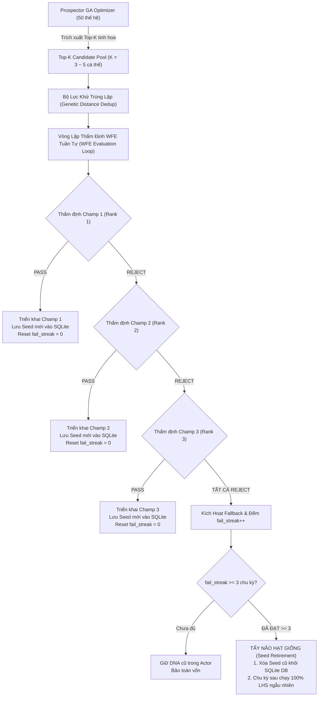

# THIẾT KẾ ĐỊNH LƯỢNG: CƠ CHẾ BỘ ĐỆM TOP-K CHAMPIONS & TẨY NÃO HẠT GIỐNG (SEED RETIREMENT)

> **Mô-đun:** `trading_bot/bot_engine/src/optimizer/prospector_runner.rs`  
> **Tài liệu kiểm toán gốc:** [`technical_audit.md`](./technical_audit.md)  
> **Ngày lập tài liệu:** 01/10/2026  
> **Trạng thái:** Thiết kế kiến trúc (Sẵn sàng triển khai)

---

## 1. BỐI CẢNH VẬT LÝ & NGHỊCH LÝ ĐIỀU HÀNH THỰC TẾ

### 1.1. Bẫy Độc Quyền Rank 1 In-Sample (The Single-Champion Overfitting Trap)
Trong cơ chế hiện tại của `prospector_runner.rs`:
- Thuật toán GA hoàn thành 50 thế hệ, sắp xếp quần thể theo điểm Fitness và chỉ trả về **duy nhất 1 cá thể Rank 1 Champion**.
- Cổng thẩm định Walk-Forward (WFE Gate) chỉ đánh giá cá thể Rank 1 này trên cửa sổ Out-Of-Sample (OOS 3 ngày).
- **Nghịch lý toán học:** 
  - Cá thể Rank 1 trên tập In-Sample (IS) thường là cá thể **học vẹt giỏi nhất (Overfitted most)** — tức là nó đã khớp mẫu tối đa từng râu nến và biến động cục bộ của quá khứ.
  - Các cá thể **Rank 2, Rank 3 hoặc Rank 5** trong nhóm tinh hoa (Elite / Pareto Front) có thể có In-Sample Return thấp hơn một chút, nhưng cấu trúc tham số của chúng lại mềm dẻo hơn, khái quát hóa (Generalization) tốt hơn và có xác suất sống sót ngoài OOS cao hơn nhiều.
  - Việc đánh cược 100% vào Rank 1 tạo ra một **điểm nghẽn chí tử (Single Point of Failure)**: Nếu Rank 1 trượt OOS, toàn bộ chu kỳ bị hủy bỏ!

### 1.2. Thảm Họa Kẹt Giống Cũ 44 Giờ (Seed Trap & Local Minima Paralysis)
Minh chứng thực nghiệm từ log `run_walk_forward_smart_seed_20261001_180444`:
- Từ chu kỳ **#0008 đến #0018 (11 chu kỳ liên tiếp ~ 44 tiếng)**, hệ thống bị **REJECT 100%**:
  - Hạt giống cũ Rank 1 trong DB từ chu kỳ #0007 được tiêm làm seed (0.5%) vào thế hệ 0.
  - Bộ gene của hạt giống này tiếp tục áp đảo quần thể In-Sample (In-Sample Return 30% – 66%, Win Rate > 91%).
  - Nhưng thị trường thực tế đã đổi pha, nên khi bước ra OOS 3 ngày, cá thể này liên tục thua lỗ từ `-2% đến -8%`.
  - Hậu quả: Bot bị giam cầm trong hố trũng cực trị địa phương cũ, không thể thoát ra được cho đến khi có một đột biến ngẫu nhiên từ nhóm LHS ở chu kỳ #0019 phá vỡ bế tắc.

---

## 2. KIẾN TRÚC GIẢI PHÁP: TOP-K CHAMPIONS POOL & TẨY NÃO HẠT GIỐNG

---

## 3. CHI TIẾT ĐẶC TẢ KỸ THUẬT (TECHNICAL SPECIFICATION)

### 3.1. Trích Xuất Nhóm Tinh Hoa `Top-K Champions`
- Tại `prospector_runner.rs` và `prospector.rs`:
  - Thay vì `prospector.champions.first()`, phương thức trả về `prospector.get_top_k_champions(k = 3)`.
  - Khử trùng lặp di truyền: Nếu Champ 2 có khoảng cách Euclidean so với Champ 1 $< 1e-4$ (cá thể sao chép), bỏ qua và lấy cá thể kế tiếp để đảm bảo tính đa dạng.

### 3.2. Vòng Lặp Thẩm Định Tuần Tự Qua Cổng WFE Gate
- Chi phí tính toán: Mỗi lượt `diagnostic_backtest` trên cửa sổ 3 ngày (4.320 nến 1m) chỉ tốn **~35 - 45 ms**.
- Thẩm định tối đa 3 cá thể chỉ tốn **~120 ms**, hoàn toàn không ảnh hưởng đến độ trễ hệ thống.
- **Tiêu chuẩn Cổng Thẩm Định WFE:**
  - $R_{\text{OOS}} > 0.0\%$ (Kỳ vọng lợi nhuận ngoài mẫu dương).
  - $\text{MaxDrawdown}_{\text{OOS}} \le 12.0\%$ (Kiểm soát rủi ro không sụt giảm sâu).
  - $N_{\text{trades}} \ge 1$ (Có phát sinh giao dịch để đo lường).
  - **Tuyệt đối không ép chỉ tiêu Win Rate $\ge 50\%$** trên mẫu ngắn 3 ngày (tránh bẫy đói mẫu thống kê).

### 3.3. Cơ Chế Tẩy Não Hạt Giống (Seed Retirement / Tabula Rasa)
- Duy trì biến đếm trong `ProspectorRunner`: `consecutive_rejections: usize`.
- **Quy tắc:**
  1. Nếu bất kỳ cá thể nào trong Top-K vượt qua WFE Gate $\implies$ Deploy, lưu cá thể đó làm Champion Seed mới vào SQLite, đặt lại `consecutive_rejections = 0`.
  2. Nếu **TOÀN BỘ Top-K cá thể đều bị REJECT** trong 1 chu kỳ:
     - Tăng `consecutive_rejections += 1`.
     - Giữ nguyên DNA đang chạy trong `AssetActor` để bảo vệ vốn.
  3. Khi `consecutive_rejections >= 3` (tương đương 3 chu kỳ liên tiếp ~ 12-18 tiếng thị trường đổi pha mà giống cũ không thích nghi được):
     - Phát cảnh báo: `WARN 🚨 [SEED RETIREMENT TRIGGERED] Giống cũ đã lỗi thời 3 chu kỳ liên tiếp! Xóa hạt giống khỏi SQLite, giải phóng 100% Latin Hypercube Sampling!`
     - Xóa hạt giống mồi trong SQLite (`DELETE FROM optimized_params`).
     - Chu kỳ kế tiếp sẽ chạy **100% LHS ngẫu nhiên thuần khiết**, tự do khám phá miền đất mới mà không bị lực hút cực trị địa phương kìm kẹp.

---

## 4. BẢNG ĐỐI CHẤT ƯU - KHUYẾT - EDGE CASES

| Tiêu chí | Cơ chế Cũ (1 Champ duy nhất) | Cơ chế Mới (Top-K + Seed Retirement) |
| :--- | :--- | :--- |
| **Bảo vệ chống Overfitting** | 🔴 Kém (Đặt cược 100% vào kẻ học vẹt Rank 1). | 🟢 Xuất sắc (Trao cơ hội cho Rank 2, 3 có tính tổng quát hóa cao). |
| **Độ trễ thích ứng pha thị trường** | 🔴 Tệ (Kẹt giống cũ tới 11 chu kỳ ~ 44 tiếng). | 🟢 Vượt trội (Tự động xả giống sau 3 chu kỳ thất bại). |
| **Chi phí tính toán** | 40 ms / chu kỳ. | 120 ms / chu kỳ (tăng 80 ms, hoàn toàn không đáng kể). |
| **Edge Case 1: Cả Top-K đều rớt** | Giữ DNA cũ (như cũ). | Giữ DNA cũ + Tăng bộ đếm để chuẩn bị xả giống. |
| **Edge Case 2: Top-K là các bản sao giống hệt nhau** | Không nhận biết được. | Đã có bộ lọc Euclidean Genetic Distance Dedup loại bỏ bản sao. |
