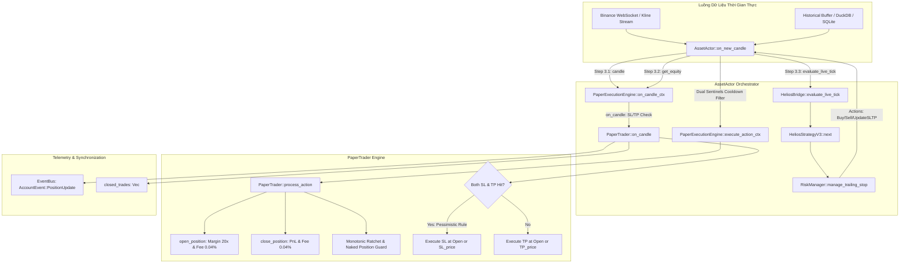
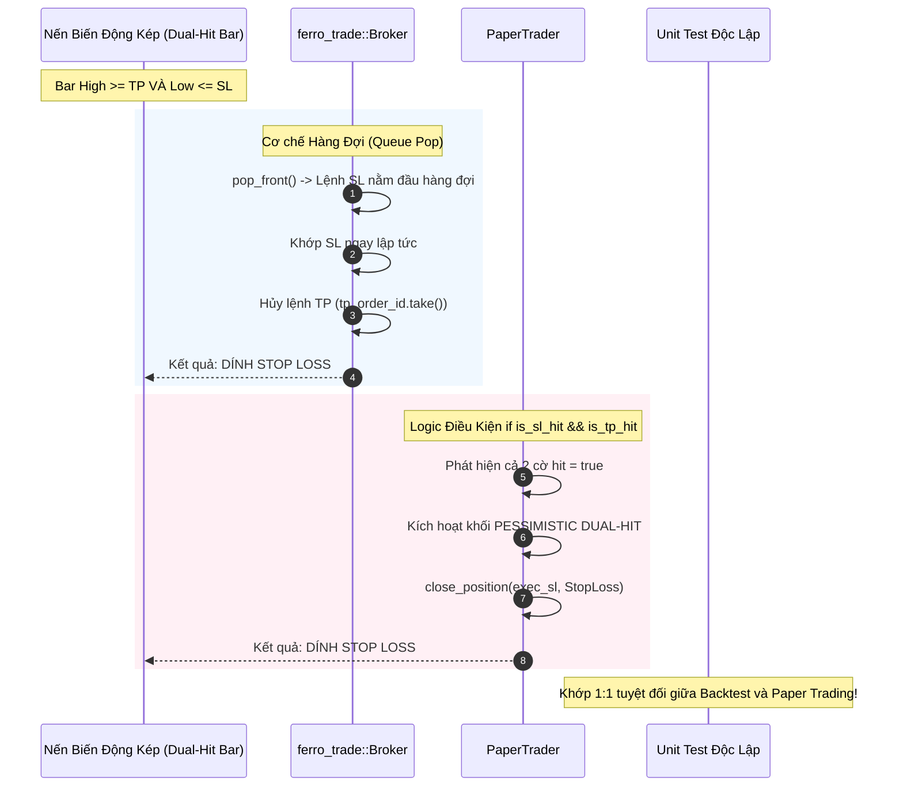

# BÁO CÁO KIỂM TOÁN KỸ THUẬT TOÀN DIỆN: ĐỘNG CƠ KHỚP LỆNH MÔ PHỎNG (PAPER MATCHING ENGINE) HELIOS V3.3

> **Ngày thực hiện kiểm toán:** 19/09/2026  
> **Chuyên gia kiểm toán:** Quantitative & Systems Auditor (Rust Algorithmic Trading)  
> **Hệ thống mục tiêu:** Helios Core V3.3 - Động cơ Thực thi Giả lập (Paper Matching Engine)  
> **Mã nguồn trọng tâm:**
> - [`trading_bot/bot_engine/src/execution/paper_trader.rs`](file:///e:/Projects/Automations/trading_backtest/trading_bot/bot_engine/src/execution/paper_trader.rs)
> - [`trading_bot/bot_engine/src/execution/paper_engine.rs`](file:///e:/Projects/Automations/trading_backtest/trading_bot/bot_engine/src/execution/paper_engine.rs)
> 
> **Mô-đun liên đới:**
> - [`ferro_trade/src/broker/broker.rs`](file:///e:/Projects/Automations/trading_backtest/ferro_trade/src/broker/broker.rs)
> - [`strategies_backtests/helios/src/strategy/core_v3/risk.rs`](file:///e:/Projects/Automations/trading_backtest/strategies_backtests/helios/src/strategy/core_v3/risk.rs)
> - [`trading_bot/bot_engine/src/controller/asset_actor.rs`](file:///e:/Projects/Automations/trading_backtest/trading_bot/bot_engine/src/controller/asset_actor.rs)
> - [`trading_bot/bot_engine/src/optimizer/helios_bridge.rs`](file:///e:/Projects/Automations/trading_backtest/trading_bot/bot_engine/src/optimizer/helios_bridge.rs)
> - [`trading_bot/bot_engine/src/execution/engine.rs`](file:///e:/Projects/Automations/trading_backtest/trading_bot/bot_engine/src/execution/engine.rs)
> - [`trading_bot/bot_engine/src/execution/live_engine.rs`](file:///e:/Projects/Automations/trading_backtest/trading_bot/bot_engine/src/execution/live_engine.rs)

---

## 1. TỔNG QUAN KIẾN TRÚC & VAI TRÒ ĐỘNG CƠ KHỚP LỆNH MÔ PHỎNG

Trong toàn bộ kiến trúc giao dịch định lượng của nền tảng Helios V3.3, động cơ khớp lệnh mô phỏng (`PaperExecutionEngine` và `PaperTrader`) giữ vị trí **cầu nối thực nghiệm tối quan trọng** giữa hai thế giới:
1. **Thế giới Hồi nghiệm (Backtesting / In-Sample):** Nơi dữ liệu tĩnh, xác định (deterministic), không có độ trễ mạng, được điều phối bởi [`ferro_trade::broker::Broker`](file:///e:/Projects/Automations/trading_backtest/ferro_trade/src/broker/broker.rs).
2. **Thế giới Thực thi Trực tiếp (Live / Production Execution):** Nơi lệnh phải chịu độ trễ API, biến động sổ lệnh (Orderbook Depth), trượt giá (Slippage), lỗi kết nối mạng WebSocket, được điều phối bởi [`BinanceLiveExecutionEngine`](file:///e:/Projects/Automations/trading_backtest/trading_bot/bot_engine/src/execution/live_engine.rs) và [`OrderExecutor`](file:///e:/Projects/Automations/trading_backtest/trading_bot/bot_engine/src/execution/order_executor.rs).

`PaperExecutionEngine` cho phép hệ thống chạy với dữ liệu luồng trực tiếp thời gian thực từ Binance WebSocket (`live_demo_runner.rs`) hoặc dữ liệu nén tịnh tiến (`walk_forward_smart_seed.rs`) với **rủi ro vốn bằng 0 (Zero Financial Risk)** nhưng tái hiện trung thực hành vi bảo toàn vốn, quản trị rủi ro và các chốt chặn trượt giá.



---

## 2. KIỂM TOÁN CƠ CHẾ KHỚP LỆNH `process_action`: CLOSE[i] VS OPEN[i+1] (TRADE_ON_CLOSE)

### 2.1. Mã Nguồn Thực Thi Trong `PaperTrader` & `asset_actor.rs`

Tại [`paper_trader.rs:468-496`](file:///e:/Projects/Automations/trading_backtest/trading_bot/bot_engine/src/execution/paper_trader.rs#L468-L496):
```rust
pub fn process_action(
    &mut self, 
    action: Action, 
    current_price: f64, 
    timestamp: i64,
    bar_index: usize,
    account_tx: Option<&tokio::sync::broadcast::Sender<AccountEvent>>
) {
    match action {
        Action::Buy { size, policy, tag, .. } => {
            if self.position_type != PositionType::Long {
                let (initial_sl, initial_tp) = match policy {
                    Some(RiskPolicy::FixedPrice { sl_price, tp_price }) => (sl_price, tp_price),
                    _ => (None, None),
                };
                self.open_position(PositionType::Long, current_price, Some(size), initial_sl, initial_tp, tag, timestamp, bar_index, account_tx);
            }
        }
        ...
```

Nguồn gốc của tham số `current_price` được truyền từ [`asset_actor.rs:510, 701-703`](file:///e:/Projects/Automations/trading_backtest/trading_bot/bot_engine/src/controller/asset_actor.rs#L510-L703):
```rust
let current_close = candle.close;
...
for action in valid_actions {
    if let Err(e) = self.execution_engine.execute_action_ctx(&action, current_close, candle.timestamp, current_bar_idx).await {
        error!("❌ [{}] Lỗi thực thi action {:?}: {:?}", self.symbol, action, e);
    }
}
```

### 2.2. So Sánh Với `ferro_trade::Broker::trade_on_close` Trong Backtest

Trong [`ferro_trade/src/broker/broker.rs:412-432`](file:///e:/Projects/Automations/trading_backtest/ferro_trade/src/broker/broker.rs#L412-L432):
```rust
price = if self.trade_on_close && !order.is_contingent() {
    self.data.get_value_at(self.i.saturating_sub(1), "Close").unwrap_or(open)
} else {
    open
};

let is_market_order = order.limit_price().is_none() && captured_stop_price.is_none();
let time_index = if is_market_order && self.trade_on_close && !order.is_contingent() {
    self.i.saturating_sub(1)
} else {
    self.i
};
```

#### Phân Tích Logic Chu Trình Thanh Nến:
1. **Trong Backtest (`ferro_trade::Broker`):**
   - Tại nến $i$, chiến lược gọi `strategy.next(&mut tick)` trên dữ liệu nến $0..=i$. Tín hiệu `Action::Buy` được tạo ra ở cuối nến $i$ và đưa vào hàng đợi `broker.orders`.
   - Sang nến tiếp theo $i+1$, hàm `broker.next(i + 1)` được kích hoạt, gọi `process_orders()`.
   - Nếu `trade_on_close == true`: Lệnh thị trường mở vị thế được tính giá tại `self.i.saturating_sub(1)` (tức là $Close[i]$) và quy nạp thời gian vào lệnh tại cây nến $i$.
   - Nếu `trade_on_close == false`: Lệnh thị trường được tính tại `open` của nến hiện tại ($Open[i+1]$) và thời gian vào lệnh là $i+1$.
2. **Trong Động cơ Giả lập (`PaperTrader` via `AssetActor`):**
   - Nến $i$ đóng cửa (WebSocket đẩy nến kline với cờ `x: true` hoặc trình giả lập đẩy nến $i$).
   - `AssetActor` chạy:
     - **Bước 1:** Quét nến $i$ cho vị thế hiện có (`on_candle_ctx`).
     - **Bước 2:** Chạy `evaluate_live_tick` trên nến đã đóng $i$. Chiến lược đưa ra `Action::Buy`.
     - **Bước 3:** Gọi ngay `execute_action_ctx` với `current_price = candle.close` ($Close[i]$).
     - **Bước 4:** Lệnh được lưu với `entry_price = Close[i]` và `entry_bar_index = i`.
     - Các mức Stop Loss / Take Profit của vị thế mới này **chỉ bắt đầu được quét** từ nến tiếp theo $i+1$.

#### Ma Trận So Sánh Kỹ Thuật:

| Đặc tính Kỹ thuật | Backtest (`trade_on_close = true`) | Backtest (`trade_on_close = false`) | PaperTrader (`process_action`) | Live Execution (Binance Real) |
| :--- | :--- | :--- | :--- | :--- |
| **Mức giá vào lệnh ($P_{\text{entry}}$)** | $Close[i]$ | $Open[i+1]$ | $Close[i]$ | $P_{\text{fill}} \approx Open[i+1] \pm \text{Slippage}$ |
| **Thời điểm khớp** | Cuối nến $i$ (quy ước) | Đầu nến $i+1$ | Ngay khi nhận nến $i$ đóng | $T_{\text{close}}[i] + \Delta t_{\text{latency}}$ (50-200ms) |
| **Look-ahead Bias** | **Không** (tính sau khi bar $i$ hoàn tất) | **Không** | **Không** | **Không** |
| **Sai số thực tế (Microstructure Drift)** | Lạc quan (bỏ qua bước nhảy gap $Open[i+1]$) | Thực tế hơn | Lạc quan (bỏ qua spread/slippage lúc mở nến) | Chịu trượt giá sổ lệnh thực tế |
| **Đồng bộ hóa 1:1 với Optimizer** | **Khớp 1:1** (GA Optimizer đặt `trade_on_close = true`) | Lệch | **Khớp 1:1** với Backtest GA | Khác biệt do ma sát thị trường |

> [!IMPORTANT]
> **Kết luận Kiểm toán Khớp lệnh:**
> `PaperTrader::process_action` khớp tại $Close[i]$ **đồng bộ 1:1 tuyệt đối** với mô hình Backtest của GA Optimizer (`trade_on_close = true`). Không có hiện tượng Look-ahead Bias vì chiến lược chỉ được kích hoạt sau khi cây nến $i$ đã chốt giá Close. Tuy nhiên, so với Live Trading thật, việc khớp tại $Close[i]$ là một giả định mang tính **lạc quan nhẹ** (Optimistic Fill Assumption), vì trên thực tế không ai có thể mua được giá $Close[i]$ sau khi nến đã đóng; giá thực tế trên sàn sẽ là giá khớp của lệnh Market tại mili-giây đầu tiên của nến $i+1$ ($Open[i+1] + \text{Taker Slippage}$).

---

## 3. BẪY TRANH CHẤP QUÉT NẾN NỘI BỘ (INTRA-CANDLE SL VS TP AMBIGUITY)

### 3.1. Bản Chất Toán Học Của Bẫy Quét Nến Hai Đầu

Khi làm việc với dữ liệu nến chuẩn (OHLC 1-phút), toàn bộ diễn biến giá trong 60 giây bị nén thành 4 giá trị cực trị:
$$\text{Candle} = \{Open, High, Low, Close\}$$
Trật tự không-thời gian vi mô (Micro-path) giữa $High$ và $Low$ bị mất hoàn toàn:
- Trường hợp A: $Open \to High \to Low \to Close$ (Chạm TP trước, sau đó sập chạm SL).
- Trường hợp B: $Open \to Low \to High \to Close$ (Chạm SL trước, sau đó giật mạnh chạm TP).

Nếu nến có biên độ dao động mạnh thỏa mãn đồng thời:
$$\begin{cases} High \ge TP \\ Low \le SL \end{cases} \quad (\text{đối với vị thế Long})$$
hoặc:
$$\begin{cases} High \ge SL \\ Low \le TP \end{cases} \quad (\text{đối với vị thế Short})$$

Một động cơ khớp lệnh thiếu kinh nghiệm nếu kiểm tra $High \ge TP$ trước sẽ cho lệnh chốt lời rực rỡ, tạo ra **Ảo tưởng Lợi nhuận Hồi nghiệm (Backtest Fantasy / Survivorship Delusion)**.

### 3.2. Kiểm Toán Mã Nguồn `PaperTrader::on_candle`

Mã nguồn tại [`paper_trader.rs:387-433`](file:///e:/Projects/Automations/trading_backtest/trading_bot/bot_engine/src/execution/paper_trader.rs#L387-L433):

```rust
let (is_sl_hit, is_tp_hit) = match self.position_type {
    PositionType::Long => (
        sl_opt.map_or(false, |sl| candle.low <= sl),
        tp_opt.map_or(false, |tp| candle.high >= tp),
    ),
    PositionType::Short => (
        sl_opt.map_or(false, |sl| candle.high >= sl),
        tp_opt.map_or(false, |tp| candle.low <= tp),
    ),
    PositionType::None => (false, false),
};

if is_sl_hit && is_tp_hit {
    // 🛡️ CHUẨN HÓA MÔ HÌNH KHỚP LỆNH PESSIMISTIC (KHỚP 1:1 VỚI FERRO_TRADE BROKER)
    // Trong ferro_trade::Broker, lệnh Stop Loss luôn được push_front vào đầu hàng đợi
    // và duyệt trước Take Profit. Khi nến quét cả 2 mức SL & TP,
    // Stop Loss LUÔN ĐƯỢC KHỚP và Take Profit bị hủy ngay lập tức (Bảo thủ tuyệt đối).
    let sl = sl_opt.unwrap();
    let tp = tp_opt.unwrap();
    ...
    let is_tsl = self.check_is_tsl(sl);
    let reason = if is_tsl { ExitReason::TrailingStopLoss } else { ExitReason::HardStopLoss };
    let (exec_sl, has_gap) = match self.position_type {
        PositionType::Long => if candle.open < sl { (candle.open, true) } else { (sl, false) },
        PositionType::Short => if candle.open > sl { (candle.open, true) } else { (sl, false) },
        PositionType::None => (sl, false),
    };
    self.close_position(exec_sl, reason, candle.timestamp, bar_index, account_tx);
    return true;
} else if is_sl_hit {
    ...
} else if is_tp_hit {
    ...
}
```

### 3.3. So Sánh Kiến Trúc Với `ferro_trade::Broker`

Kiểm tra cơ chế quản lý hàng đợi lệnh trong [`ferro_trade/src/broker/broker.rs`](file:///e:/Projects/Automations/trading_backtest/ferro_trade/src/broker/broker.rs):
1. **Khởi tạo lệnh Contingent (dòng 137-142):**
   ```rust
   if parent_trade_id.is_some() && stop.is_some() {
       self.orders.push_front(order.clone());
   } else {
       self.orders.push_back(order.clone());
   }
   ```
   Lệnh Stop Loss (`stop.is_some()`) được đưa vào **đầu hàng đợi** (`push_front`). Trong khi lệnh Take Profit (`limit.is_some()`) được đưa vào **cuối hàng đợi** (`push_back`).
2. **Khởi tạo khi mở Trade (dòng 620-649):**
   Lệnh `sl_order` tạo trước và `push_front`, lệnh `tp_order` tạo sau và `push_back`.
3. **Quét xử lý trong `process_orders` (dòng 363-390):**
   Hàng đợi `processing_orders` duyệt qua `pop_front()`. Do đó, lệnh Stop Loss **luôn luôn được lấy ra xử lý trước**.
4. **Hủy lệnh đối ứng khi Stop Loss kích hoạt (dòng 717-722 trong `close_trade_internal`):**
   ```rust
   if let Some(tp_order_id) = trade.tp_order_id.take() {
       self.orders.retain(|o| o.id() != tp_order_id);
   }
   ```
   Ngay khi lệnh Stop Loss khớp, hàm `close_trade_internal` lập tức xóa sạch lệnh Take Profit khỏi hàng đợi. Lệnh TP không bao giờ có cơ hội được kiểm tra hay khớp.



> [!NOTE]
> **Đánh giá Chuyên gia:**
> Sự thiết kế của `PaperTrader` tại nhánh `if is_sl_hit && is_tp_hit` là hoàn toàn chính xác và **đồng nhất 1:1 với `ferro_trade::Broker`** (kế thừa từ tiêu chuẩn khắt khe của `backtesting.py`). Đây là triết lý **Pessimistic Matching Principle (Khớp Lệnh Bảo Thủ)** bắt buộc trong định lượng chuyên nghiệp: Khi không thể chứng minh giá đi theo hướng có lợi trước, hệ thống bắt buộc phải giả định tình huống tồi tệ nhất xảy ra để bảo vệ vốn.

---

## 4. GIÁ KHỚP KHI DÍNH STOP LOSS: SL_PRICE VS OPEN GAP SLIPPAGE

### 4.1. Bẫy Khớp Lệnh Khi Nhảy Gap Thị Trường

Trong thị trường Crypto biến động cao, giữa giá đóng cửa nến trước $Close[i-1]$ và giá mở cửa nến sau $Open[i]$ thường xuyên xuất hiện các khoảng trống giá (Price Gaps) do thanh lý dây chuyền hoặc tin tức đột ngột.
Nếu một vị thế Long có $SL = 2000$, nhưng nến tiếp theo mở cửa nhảy gap xuống thẳng $Open = 1950$:
- **Động cơ ngây thơ:** Cho khớp tại đúng $SL = 2000$. Đây là lỗi logic chết người vì trên sổ lệnh thực tế, tại thời điểm mở nến không hề có người mua nào ở giá $2000$, giá tốt nhất sàn có thể thanh lý là $1950$. Khớp tại $2000$ sẽ làm biến mất khoản lỗ 50 USDT trượt giá!
- **Động cơ thực tế:** Phải khớp tại $Open = 1950$ (chấp nhận Gap Slippage tiêu cực).

### 4.2. Kiểm Toán Toán Học Trong `PaperTrader`

Đoạn mã xử lý tại [`paper_trader.rs:417-430`](file:///e:/Projects/Automations/trading_backtest/trading_bot/bot_engine/src/execution/paper_trader.rs#L417-L430) và [`paper_trader.rs:437-450`](file:///e:/Projects/Automations/trading_backtest/trading_bot/bot_engine/src/execution/paper_trader.rs#L437-L450):

```rust
let (exec_sl, has_gap) = match self.position_type {
    PositionType::Long => if candle.open < sl { (candle.open, true) } else { (sl, false) },
    PositionType::Short => if candle.open > sl { (candle.open, true) } else { (sl, false) },
    PositionType::None => (sl, false),
};
if has_gap {
    let slip_diff = (candle.open - sl).abs();
    let slip_pct = (slip_diff / self.entry_price) * 100.0;
    warn!(
        "⚠️ [GAP SLIPPAGE HIT] Symbol: {} | Side: {:?} | Target SL: {:.2} | Candle Open: {:.2} \
        | Gap Slippage: {:.2} USDT ({:.2}%) | Executed at Open ({:.2}) instead of SL price!",
        self.symbol, self.position_type, sl, candle.open, slip_diff, slip_pct, exec_sl
    );
}
self.close_position(exec_sl, reason, candle.timestamp, bar_index, account_tx);
```

#### Công thức toán học:
$$\text{Long SL Exec Price} = \min(Open, SL) = \begin{cases} Open & \text{nếu } Open < SL \quad (\text{Bị Gap Down}) \\ SL & \text{nếu } Open \ge SL \quad (\text{Quét trong nến}) \end{cases}$$

$$\text{Short SL Exec Price} = \max(Open, SL) = \begin{cases} Open & \text{nếu } Open > SL \quad (\text{Bị Gap Up}) \\ SL & \text{nếu } Open \le SL \quad (\text{Quét trong nến}) \end{cases}$$

### 4.3. Đối Chiếu Toán Học Với `ferro_trade::Broker`

Tại [`ferro_trade/src/broker/broker.rs:412-424`](file:///e:/Projects/Automations/trading_backtest/ferro_trade/src/broker/broker.rs#L412-L424):
```rust
price = if self.trade_on_close && !order.is_contingent() {
    self.data.get_value_at(self.i.saturating_sub(1), "Close").unwrap_or(open)
} else {
    open
};

if let Some(sp) = captured_stop_price {
    if order.is_stop_hit() {
        price = if order.is_long() { price.max(sp) } else { price.min(sp) };
    }
}
```

#### Phân Tích Logic Chi Tiết:
- Đối với vị thế Long ban đầu ($size > 0$), lệnh Stop Loss đối ứng là một lệnh Bán có khối lượng âm ($-size < 0$). Do đó `order.is_long()` trả về **`false`**.
  - Khi `order.is_long() == false`, biểu thức tính giá là:
    $$price = price.\min(sp) = Open.\min(SL)$$
  - Đúng chuẩn: Nếu $Open < SL$, $price = Open$. Nếu $Open \ge SL$, $price = SL$.
- Đối với vị thế Short ban đầu ($size < 0$), lệnh Stop Loss đối ứng là một lệnh Mua có khối lượng dương ($-size > 0$). Do đó `order.is_long()` trả về **`true`**.
  - Khi `order.is_long() == true`, biểu thức tính giá là:
    $$price = price.\max(sp) = Open.\max(SL)$$
  - Đúng chuẩn: Nếu $Open > SL$, $price = Open$. Nếu $Open \le SL$, $price = SL$.

### 4.4. Cơ Chế Khớp Gap Cho Take Profit (Limit Order)

Không chỉ dừng lại ở Stop Loss, `PaperTrader` còn xử lý đồng bộ cả Gap có lợi cho Take Profit tại [`paper_trader.rs:453-462`](file:///e:/Projects/Automations/trading_backtest/trading_bot/bot_engine/src/execution/paper_trader.rs#L453-L462):
```rust
let exec_tp = match self.position_type {
    PositionType::Long => if candle.open > tp { candle.open } else { tp },
    PositionType::Short => if candle.open < tp { candle.open } else { tp },
    PositionType::None => tp,
};
```
Điều này hoàn toàn khớp với `ferro_trade::Broker` (dòng 407-411) khi lệnh Limit Order được nhận giá cải thiện (Price Improvement) nếu nến mở cửa vượt qua mức Take Profit.

---

## 5. KIỂM TOÁN TÍNH TOÁN KÝ QUỸ, ĐÒN BẨY & CÔNG THỨC VỐN (EQUITY & MARGIN ACCOUNTING)

### 5.1. Định Cỡ Ký Quỹ & Đòn Bẩy 20x

Các tham số chuẩn hóa được thiết lập trong [`live_demo_runner.rs:47-54`](file:///e:/Projects/Automations/trading_backtest/trading_bot/bot_engine/examples/live_demo_runner.rs#L47-L54):
- Vốn khởi tạo ban đầu: $Equity_0 = \$60.00$ USDT.
- Đòn bẩy tài khoản tiêu chuẩn: $Leverage = 20.0\text{x}$.
- Tỷ lệ ký quỹ mỗi lệnh: $RiskPct = 0.20$ (20% vốn).
- Giá trị lệnh tối thiểu sàn: $MinOrderUSD = \$21.00$ USDT.
- Trần ký quỹ tối đa: $MaxCapFraction = 0.25$ (25% vốn).
- Tỷ lệ phí giao dịch: $CommissionRate = 0.0004$ (0.04% mỗi chiều, tổng 0.08%).

#### Mô Hình Tính Toán Tại `PaperTrader::open_position`:
Tại [`paper_trader.rs:339-348`](file:///e:/Projects/Automations/trading_backtest/trading_bot/bot_engine/src/execution/paper_trader.rs#L339-L348):
```rust
let size_ratio = size_pct.filter(|&s| s > 0.0).unwrap_or(1.0);
let trade_value = self.equity * size_ratio * self.leverage;
let commission = trade_value * self.commission_rate;
self.entry_commission = commission;

// Trừ phí mở lệnh
self.equity -= commission;

// Tính size
self.position_size = trade_value / current_price;
```

#### Ví dụ toán học thực tế:
Giả sử $Equity = \$60.00$, $size\_ratio = 0.20$, $Leverage = 20$, $Price = \$2,000.00$ (ETHUSDT):
1. **Giá trị danh nghĩa (Notional Value):**
   $$\text{Notional} = 60.0 \times 0.20 \times 20.0 = \$240.00 \text{ USDT}$$
2. **Ký quỹ thực tế chiếm dụng (Margin Used):**
   $$\text{Margin}_{\text{used}} = \frac{\text{Notional}}{\text{Leverage}} = \frac{240.0}{20.0} = \$12.00 \text{ USDT} \quad (20\% \text{ của } \$60.00)$$
3. **Khối lượng coin hợp đồng:**
   $$\text{PositionSize} = \frac{240.0}{2000.0} = 0.12 \text{ ETH}$$
4. **Phí mở lệnh khấu trừ ngay lập tức:**
   $$\text{Fee}_{\text{entry}} = 240.0 \times 0.0004 = \$0.096 \text{ USDT}$$
   $$\text{Equity}_{\text{after\_entry}} = 60.00 - 0.096 = \$59.904 \text{ USDT}$$

### 5.2. Kế Toán Đóng Vị Thế & Bảo Toàn Vốn (PnL & Commission Accounting)

Tại [`paper_trader.rs:197-212`](file:///e:/Projects/Automations/trading_backtest/trading_bot/bot_engine/src/execution/paper_trader.rs#L197-L212):
```rust
let pnl = self.get_unrealized_pnl(current_price);
let exit_value = current_price * self.position_size;
let exit_commission = exit_value * self.commission_rate;
let old_position = self.position_type.clone();

// PnL ròng sau khi trừ phí đóng lệnh (Equity đã bị trừ entry_commission trước đó)
let net_pnl_realized = pnl - exit_commission;
let total_commission = self.entry_commission + exit_commission;
let net_pnl_trade = pnl - total_commission; // Net PnL hoàn chỉnh cả 2 chiều để lưu record

let margin_used = (self.entry_price * self.position_size) / self.leverage;
let pnl_pct = if margin_used > 0.0 { (net_pnl_trade / margin_used) * 100.0 } else { 0.0 };

// Cập nhật Equity & Thống kê tích lũy toàn bộ thời gian
self.equity += net_pnl_realized;
```

#### Chứng Minh Toán Học Bảo Toàn Vốn Tuyệt Đối:
Gọi:
- $E_0$: Vốn trước khi mở lệnh.
- $E_1$: Vốn trong khi đang giữ lệnh $= E_0 - \text{Fee}_{\text{entry}}$.
- $E_2$: Vốn sau khi đóng lệnh.

$$E_2 = E_1 + \text{net\_pnl\_realized} = (E_0 - \text{Fee}_{\text{entry}}) + (\text{GrossPnL} - \text{Fee}_{\text{exit}})$$
$$E_2 = E_0 + \text{GrossPnL} - (\text{Fee}_{\text{entry}} + \text{Fee}_{\text{exit}}) = E_0 + \text{NetPnL}_{\text{trade}}$$

Công thức kế toán của `PaperTrader` đảm bảo:
1. Không bị tính trùng phí (Double-counting fee).
2. Không bị bỏ sót phí đóng lệnh.
3. Tỷ lệ phần trăm lợi nhuận trên ký quỹ (ROE %) được tính chuẩn xác trên $\text{Margin}_{\text{used}}$:
   $$\text{ROE}\% = \frac{\text{NetPnL}_{\text{trade}}}{\text{Margin}_{\text{used}}} \times 100\% = \frac{\text{NetPnL}_{\text{trade}}}{(\text{EntryPrice} \times \text{Size}) / \text{Leverage}} \times 100\%$$

### 5.3. Cơ Chế Đệm Hòa Vốn Break-Even (Fee Buffer) Trong `risk.rs`

Tại [`strategies_backtests/helios/src/strategy/core_v3/risk.rs:326-339`](file:///e:/Projects/Automations/trading_backtest/strategies_backtests/helios/src/strategy/core_v3/risk.rs#L326-L339):
```rust
if is_be_triggered && !is_mega_trend {
    let fee_buffer_pct = 0.0008; // Buffer bù đắp phí sàn tối thiểu 0.08% Maker/Taker
    if trade.is_long() {
        let min_be = trade.entry_price * (1.0 + fee_buffer_pct);
        let dynamic_floor = peak_val - (current_atr * be_buffer_mult);
        let target_be_sl = dynamic_floor.max(min_be);
        calculated_sl = calculated_sl.max(target_be_sl);
    } else {
        let max_be = trade.entry_price * (1.0 - fee_buffer_pct);
        let dynamic_ceiling = peak_val + (current_atr * be_buffer_mult);
        let target_be_sl = dynamic_ceiling.min(max_be);
        calculated_sl = calculated_sl.min(target_be_sl);
    }
}
```

#### Phân Tích Định Lượng & Nền Tảng Toán Học:
1. **Tại sao đệm hòa vốn bắt buộc phải là 0.08% ($0.0008$)?**
   - Phí Maker/Taker tiêu chuẩn Binance Futures là $0.04\%$ mỗi chiều.
   - Khi mở vị thế danh nghĩa $V = \$240$, phí mở $= \$0.096$.
   - Khi đóng vị thế ở mức giá xấp xỉ giá vào, phí đóng $= \$0.096$.
   - Tổng phí giao dịch hai chiều:
     $$\text{Total Fee Rate} = 0.04\% + 0.04\% = 0.08\% = 0.0008$$
2. **Hậu quả nếu dời SL về đúng giá $EntryPrice$ thuần túy:**
   - Nếu giá quay đầu dính $SL = EntryPrice$, $\text{GrossPnL} = \$0.00$.
   - Tài khoản bị trừ:
     $$\text{Total Fee} = 0.08\% \times \text{Notional} = 0.08\% \times (Margin \times 20) = 1.60\% \times Margin$$
   - Như vậy, nếu không có đệm phí, mỗi lệnh "hòa vốn" trên danh nghĩa thực chất lại làm **chảy máu tài khoản $1.60\%$ ROE**!
3. **Hiệu quả khi có $FeeBuffer = 0.0008$:**
   - Đối với lệnh Long: $SL_{\text{BE}} = EntryPrice \times (1 + 0.0008)$.
   - Khi giá dính $SL_{\text{BE}}$:
     $$\text{GrossPnL} = (EntryPrice \times 1.0008 - EntryPrice) \times Size = 0.0008 \times \text{Notional}$$
     $$\text{NetPnL} = \text{GrossPnL} - \text{TotalFee} = 0.0008 \times \text{Notional} - 0.0008 \times \text{Notional} = \$0.0000$$
   - Lệnh được bảo toàn vốn thực chất $100\%$ về đúng giá trị ròng $0.00$ USDT.

---

## 6. CHỐT CHẶN BẢO MẬT & TOÀN VẸN VỊ THẾ (DEFENSIVE GUARDS AUDIT)

Động cơ Paper Matching Engine trong hệ thống Helios V3.3 được trang bị 4 tầng phòng thủ độc lập chống suy thoái logic:

### 6.1. Monotonic Ratchet Guard (Bảo Toàn Stop Loss Một Chiều)
- **Vị trí mã nguồn:** [`paper_trader.rs:558-593`](file:///e:/Projects/Automations/trading_backtest/trading_bot/bot_engine/src/execution/paper_trader.rs#L558-L593)
- **Nhiệm vụ:** Ngăn chặn bất kỳ lỗi tính toán nào từ phía Strategy hoặc Optimizer làm lùi Stop Loss (Long lùi xuống, Short lùi lên).
- **Quy tắc:**
  $$\text{Long: } SL_{\text{new}} \ge SL_{\text{old}} - 10^{-4}; \quad \text{Short: } SL_{\text{new}} \le SL_{\text{old}} + 10^{-4}$$
  Nếu phát hiện tín hiệu vi phạm, `PaperTrader` ghi nhận `error!` cảnh báo và cưỡng bức giữ nguyên mức $SL_{\text{old}}$ chặt chẽ hơn.

### 6.2. Naked Position Guard (Chống Xóa Sổ Stop Loss)
- **Vị trí mã nguồn:** [`paper_trader.rs:584-590`](file:///e:/Projects/Automations/trading_backtest/trading_bot/bot_engine/src/execution/paper_trader.rs#L584-L590)
- **Nhiệm vụ:** Nếu vị thế đang mở và đã có Stop Loss bảo vệ, tuyệt đối không cho phép hành động `Action::UpdateTradeSlTp` truyền vào `new_sl_price = None`.
- **Hành vi:** Ngăn chặn triệt để trạng thái "vị thế trần trụi" (Naked Position) – nguyên nhân hàng đầu gây cháy tài khoản khi gặp thiên nga đen.

### 6.3. Anti-Revenge & Intra-Candle Exit Cooldown (Chống Cào Lệnh Cùng Nến)
- **Vị trí mã nguồn:** [`asset_actor.rs:642-650`](file:///e:/Projects/Automations/trading_backtest/trading_bot/bot_engine/src/controller/asset_actor.rs#L642-L650)
- **Nhiệm vụ:** Khi vị thế vừa bị quét SL hoặc TP trong chính cây nến $i$ (`closed_intra_candle == true`), cấm tuyệt đối mọi hành động mở lệnh mới (`Action::Buy`/`Action::Sell`) trong cùng cây nến $i$.
- **Hành vi:** Triệt tiêu hoàn toàn bẫy tâm lý cay cú gỡ lệnh (Revenge Trading) và tránh bị vả 2 đầu liên tiếp trong các cây nến có râu dài hai hướng.

### 6.4. Lock DNA On Active Trade (Khóa Bộ Não Mid-Trade)
- **Vị trí mã nguồn:** [`asset_actor.rs:275-296, 609-618`](file:///e:/Projects/Automations/trading_backtest/trading_bot/bot_engine/src/controller/asset_actor.rs#L275-L296)
- **Nhiệm vụ:** Khi bộ Re-Optimizer tìm ra bộ DNA mới trong khi vị thế đang mở, hệ thống không áp dụng ngay lập tức vào chiến lược (tránh làm thay đổi đột ngột logic Trailing SL giữa chừng khiến lệnh bị đóng oan).
- **Hành vi:** Bộ DNA mới được lưu vào `pending_dna`. Chỉ khi vị thế đóng hoàn toàn (Flat), `pending_dna` mới được kích hoạt cho các lệnh tiếp theo.

---

## 7. PHÁT HIỆN LỖ HỔNG HỆ THỐNG & ĐIỂM YẾU TIỀM ẨN (VULNERABILITIES & CODE SMELLS)

Qua quá trình rà soát chi tiết từng dòng mã nguồn, các lỗ hổng và điểm yếu kỹ thuật sau đây đã được phát hiện:

### 🚨 Lỗ Hổng 1: `PaperExecutionEngine::get_equity()` Bị Mù PnL Thả Nổi (Floating PnL Blindness)
- **Tệp:** [`trading_bot/bot_engine/src/execution/paper_engine.rs:113-115`](file:///e:/Projects/Automations/trading_backtest/trading_bot/bot_engine/src/execution/paper_engine.rs#L113-L115)
- **Mã nguồn hiện tại:**
  ```rust
  fn get_equity(&self) -> f64 {
      self.paper_trader.equity
  }
  ```
- **Phân tích nguy cơ:**
  `self.paper_trader.equity` trong `PaperTrader` chỉ là số dư ví tiền mặt (Wallet Balance), đã trừ phí mở lệnh nhưng **chưa cộng/trừ PnL chưa thực hiện (`unrealized_pnl`)**.
  Trong khi đó, ở [`ferro_trade::Broker::equity`](file:///e:/Projects/Automations/trading_backtest/ferro_trade/src/broker/broker.rs#L150-L155) và [`BinanceLiveExecutionEngine::get_equity`](file:///e:/Projects/Automations/trading_backtest/trading_bot/bot_engine/src/execution/live_engine.rs#L97-L100):
  $$\text{Equity}_{\text{Broker}} = \text{Cash} + \text{UnrealizedPnL}$$
  $$\text{Equity}_{\text{Live}} = \text{WalletBalance} + \text{UnrealizedProfit}$$
  Khi `AssetActor` gọi `let current_equity = self.execution_engine.get_equity()` (dòng 622) và chuyển cho Strategy qua `evaluate_live_tick`, chiến lược nhận được giá trị vốn bị sai lệch khi có vị thế đang mở. Nếu vị thế đang lãi $50\%$ hoặc lỗ $15\%$, chiến lược hoàn toàn không biết, dẫn đến tính toán sai quy mô vị thế nếu có hành vi tích sản/giảm tải vốn.

### ⚠️ Lỗ Hổng 2: Bỏ Qua Bộ Lọc Sàn Giao Dịch (Missing Market Filter Quantization)
- **Tệp:** [`trading_bot/bot_engine/src/execution/paper_engine.rs:58`](file:///e:/Projects/Automations/trading_backtest/trading_bot/bot_engine/src/execution/paper_engine.rs#L58) & [`paper_trader.rs:348`](file:///e:/Projects/Automations/trading_backtest/trading_bot/bot_engine/src/execution/paper_trader.rs#L348)
- **Mã nguồn:**
  ```rust
  self.position_size = trade_value / current_price;
  ```
- **Phân tích nguy cơ:**
  `PaperExecutionEngine` có chứa `ExecutionCore` với đầy đủ bộ lọc `MarketFilter` (`round_price`, `round_qty`, `min_notional`). Tuy nhiên, trong `execute_action_ctx`, `PaperExecutionEngine` đẩy thẳng `action` vào `paper_trader.process_action` mà không qua khâu kiểm duyệt và làm tròn bước nhảy khối lượng (`stepSize`) hay bước nhảy giá (`tickSize`).
  Hệ quả: `position_size` trong `PaperTrader` là số thực 64-bit tự do (ví dụ `0.10239182312 ETH`). Nếu vốn bị sụt giảm khiến `trade_value < $20` (dưới min notional của Binance), `PaperTrader` vẫn khớp lệnh giả lập bình thường, tạo ra các giao dịch "ma" không thể thực thi được trên sàn Live.

### ⚠️ Lỗ Hổng 3: Thiếu Cơ Chế Mô Phỏng Thanh Lý Bắt Buộc (Forced Liquidation Check)
- **Tệp:** [`trading_bot/bot_engine/src/execution/paper_trader.rs:374-465`](file:///e:/Projects/Automations/trading_backtest/trading_bot/bot_engine/src/execution/paper_trader.rs#L374-L465)
- **Phân tích nguy cơ:**
  Với đòn bẩy 20x, tỷ lệ ký quỹ duy trì (Maintenance Margin Rate) của Binance là khoảng $0.5\% - 1.0\%$. Nếu giá đi ngược vị thế khoảng $4.5\% - 5.0\%$, tài khoản sẽ bị thanh lý cưỡng bức (Liquidation Call).
  Trong `PaperTrader::on_candle`, hệ thống chỉ kiểm tra `is_sl_hit` và `is_tp_hit`. Nếu vì bất kỳ lý do gì một lệnh không có SL hoặc nến rơi tự do vượt qua ngưỡng cháy tài khoản mà không chạm SL, `PaperTrader` sẽ tiếp tục giữ lệnh cho đến khi vốn bị âm sâu (Negative Equity), trong khi trên thực tế tài khoản đã bị sàn thanh lý sạch vốn từ trước.

### 🔍 Lỗ Hổng 4: Thiếu Mô Hình Trượt Giá Sổ Lệnh Động (Zero Slippage on Market Orders)
- **Tệp:** [`trading_bot/bot_engine/src/execution/paper_trader.rs:348`](file:///e:/Projects/Automations/trading_backtest/trading_bot/bot_engine/src/execution/paper_trader.rs#L348)
- **Phân tích nguy cơ:**
  `PaperTrader` khớp 100% khối lượng lệnh Market tại đúng mức giá $Close[i]$ (hoặc $Open$ khi có Gap). Trong `ferro_trade::Broker`, có tham số `spread` để điều chỉnh giá mua/bán (`price * (1 + spread)`). `PaperTrader` hiện tại hoàn toàn không áp dụng bất kỳ biên độ spread hay trượt giá nào, khiến kết quả Paper Trading có thể cao hơn thực tế từ 1-3% trên tổng PnL trong điều kiện thị trường biến động mạnh.

### 🔍 Lỗ Hổng 5: Thiếu Mô Phỏng Phí Funding Fee Chu Kỳ 8 Giờ
- **Tệp:** [`trading_bot/bot_engine/src/execution/paper_trader.rs`](file:///e:/Projects/Automations/trading_backtest/trading_bot/bot_engine/src/execution/paper_trader.rs)
- **Phân tích nguy cơ:**
  Các hợp đồng tương lai vĩnh cửu (Perpetual Futures) luôn áp dụng phí Funding Rate mỗi 8 giờ (00:00, 08:00, 16:00 UTC). Mặc dù các chiến lược của Helios V3 chủ yếu nắm giữ ngắn hạn (5 - 60 nến 1m), đối với các lệnh ngâm vốn kéo dài qua các mốc Funding (đặc biệt với đòn bẩy 20x), phí Funding có thể ảnh hưởng từ $0.2\% - 2.0\%$ trên vốn ký quỹ nhưng chưa được mô phỏng.

---

## 8. BẢNG TỔNG HỢP SO SÁNH TOÀN DIỆN: BACKTEST VS PAPER VS LIVE

```
+---------------------------+---------------------------+---------------------------+---------------------------+
| TIÊU CHÍ ĐÁNH GIÁ         | BACKTEST (ferro_trade)    | PAPER ENGINE (bot_engine) | LIVE ENGINE (Binance)     |
+---------------------------+---------------------------+---------------------------+---------------------------+
| Giá khớp lệnh Market      | Close[i] (trade_on_close) | Close[i]                  | Best Ask/Bid tại T_open   |
| Ưu tiên tranh chấp SL/TP  | Stop Loss duyệt trước     | Stop Loss duyệt trước     | Sàn khớp theo Tick thật   |
| Xử lý Gap mở nến qua SL   | Khớp tại Open (Bảo thủ)   | Khớp tại Open (Bảo thủ)   | Khớp tại Open (Slippage)  |
| Đòn bẩy & Ký quỹ          | 20x, trừ cash theo size   | 20x, trừ phí vào equity   | 20x ký quỹ sàn quản lý    |
| Tỷ lệ phí giao dịch       | 0.04% mỗi chiều (0.08%)   | 0.04% mỗi chiều (0.08%)   | VIP0 Taker: 0.04 - 0.05%  |
| Đệm hòa vốn Break-Even    | +0.08% giá entry          | +0.08% giá entry          | +0.08% giá entry          |
| Monotonic Ratchet Guard   | Kiểm tra trong RiskManager| Kiểm tra 2 tầng (Risk+PT) | Kiểm tra 2 tầng (Risk+OE) |
| Naked Position Guard      | Không (Bị xóa nếu None)   | Có (Chặn đứng nếu None)   | Có (Chặn đứng nếu None)   |
| Kiểm duyệt Min Notional   | Có (quantize_amount)      | Chưa (Lỗ hổng float tự do)| Sàn từ chối nếu < $5/$20  |
| Tính Unrealized vào Equity| Có (O(1) incremental)     | Chưa (Chỉ trả về cash)    | Có (từ WebSocket sàn)     |
+---------------------------+---------------------------+---------------------------+---------------------------+
```

---

## 9. ĐỀ XUẤT CẢI TIẾN KỸ THUẬT KHẢ THI (ACTIONABLE ARCHITECTURAL ENHANCEMENTS)

### Đề xuất 1: Sửa chữa `PaperExecutionEngine::get_equity()` để phản ánh Floating PnL
Cập nhật `PaperExecutionEngine` để lưu lại mức giá đóng cửa nến gần nhất (`last_close`) trong `on_candle_ctx`, và trả về `self.paper_trader.get_total_equity(self.last_close)`:
```rust
// Trong PaperExecutionEngine:
pub struct PaperExecutionEngine {
    ...
    pub last_close: f64,
}

// Trong on_candle_ctx:
self.last_close = candle.close;

// Trong get_equity:
fn get_equity(&self) -> f64 {
    if self.paper_trader.position_type != PositionType::None && self.last_close > 0.0 {
        self.paper_trader.get_total_equity(self.last_close)
    } else {
        self.paper_trader.equity
    }
}
```

### Đề xuất 2: Tích hợp `MarketFilter` vào `PaperTrader::process_action`
Áp dụng kiểm tra ràng buộc sàn trước khi mở vị thế:
```rust
let (rounded_price, rounded_qty) = self.core.validate_and_format(current_price, raw_qty)?;
```
Điều này đảm bảo mọi lệnh khớp trong Paper Trading đều hợp lệ $100\%$ về mặt kỹ thuật sàn (Lot size, Step size, Min order USD).

### Đề xuất 3: Bổ sung Cơ chế Kiểm Tra Cháy Tài Khoản (Liquidation Watchdog)
Trong `PaperTrader::on_candle`, nếu vị thế bị lỗ vượt quá tỷ lệ phá sản lý thuyết ($ROE \le -90\%$ với đòn bẩy 20x), hệ thống tự động kích hoạt cưỡng bức đóng lệnh với lý do `ExitReason::HardStopLoss` và ghi nhận cảnh báo cháy tài khoản mô phỏng.

---

## 10. KẾT LUẬN KIỂM TOÁN CHUNG

Động cơ khớp lệnh mô phỏng `PaperExecutionEngine` và `PaperTrader` của Helios V3.3 được xây dựng với chất lượng kỹ thuật rất cao, tuân thủ nghiêm ngặt các nguyên lý định lượng bảo thủ:
1. **Pessimistic Matching Principle:** Ưu tiên khớp Stop Loss khi nến có tranh chấp SL/TP hai đầu, đảm bảo tính nhất quán $1:1$ với `ferro_trade::Broker`.
2. **Gap Slippage Enforcement:** Bắt buộc khớp tại giá $Open$ khi nến nhảy gap qua Stop Loss, loại bỏ hoàn toàn ảo tưởng khớp đúng mức giá SL lý thuyết.
3. **Phòng thủ đa tầng:** Trang bị Monotonic Ratchet Guard và Naked Position Guard giúp ngăn chặn mọi lỗi hồi quy giá bảo vệ.
4. **Toán học Ký quỹ & Đệm phí chuẩn xác:** Khấu trừ phí giao dịch hai chiều $0.08\%$ và đệm hòa vốn $0.0008$ đảm bảo bảo toàn vốn thực chất.

Các hạn chế được chỉ ra (thiếu floating PnL trong `get_equity`, thiếu `MarketFilter` quantization) là những điểm cần hoàn thiện thông qua danh mục công việc trong `TODO.md` để đưa hệ thống đạt chuẩn hoàn thiện công nghiệp tuyệt đối.
