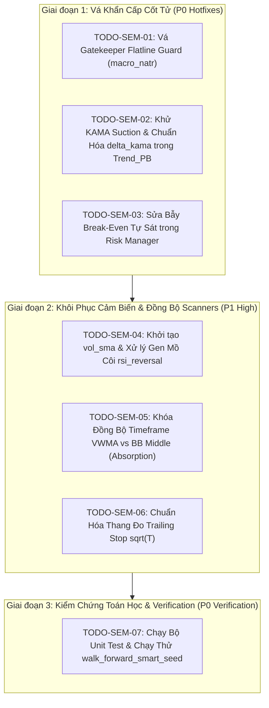

# TỔNG HỢP KIỂM TOÁN CHUYÊN SÂU: HỆ THỐNG "BẪY LỆCH NGỮ NGHĨA" (SEMANTIC MISMATCH TRAP)

> **Phân hệ:** Toàn bộ Hệ sinh thái Helios V3.3 Pure Rust (`config.rs`, `sensors.rs`, `matrix.rs`, `arbiter.rs`, `risk.rs`, `gatekeeper.rs`, `scanners/`)  
> **Chuyên đề:** Master Synthesis on Semantic Mismatch & Cross-Scale Dimensional Pollution  
> **Người thực hiện:** Antigravity Quant Team & Hội đồng 3 Auditor Subagents chuyên trách  
> **Ngày lập:** 05/10/2026

---

## 🏛️ 1. Executive Summary & Khung Lý Thuyết Bản Chất Hiện Tượng

### 1.1. Bản Chất Hiện Tượng "Bẫy Lệch Ngữ Nghĩa" (Semantic Mismatch Trap)
Trong một hệ thống giao dịch định lượng đa khung thời gian (Multi-Timeframe - MTF), mỗi khung thời gian $T$ sở hữu một **không gian độ đo (Metric Space)** và **thang đo biến động (Volatility Scale)** hoàn toàn khác biệt:
- **Biến động giá tăng theo căn bậc hai của thời gian:** $\sigma(T) \approx \sigma_0 \sqrt{T}$. Một nến 4h ($T = 240\text{m}$) có biên độ biến động trung bình lớn gấp $\sqrt{240} \approx 15.5$ lần một nến 1m.
- **Thang đo chi phí kinh tế (Economic Floor) là đại lượng toàn cục:** Phí sàn 2 chiều ($2 \times 0.04\% = 0.08\%$) và trượt giá ($0.02\%$) được tính trên **toàn bộ vòng đời vị thế** (kéo dài hàng chục tới hàng trăm nến 1m), không thể bị ép buộc phải bù đắp ngay lập tức trong chỉ duy nhất 1 nến vi mô 1m.
- **Bẫy Lệch Ngữ Nghĩa xuất hiện khi:**
  1. **Lệch Thứ Nguyên Đo Đạc (Dimensional Incommensurability):** Dùng thước đo vi mô $\text{ATR}_{1\text{m}}$ để chia cho khoảng cách vĩ mô $(P - \text{KAMA}_{4\text{h}})$, thổi phồng giá trị lên 15 - 50 lần rồi so sánh với ngưỡng DNA hẹp $[0.5, 3.5]$.
  2. **Ghép Nối Cọc Cạch (Heterogeneous Coupling):** Lấy giá trị của một chỉ báo khung 5m so sánh với chỉ báo khung 4h (như VWMA 5m vs BB Middle 4h) mà không đồng bộ chu kỳ.
  3. **Bẫy Làm Phẳng Nến Bậc Thang (Step-Function Flatline):** Áp dụng cửa sổ trượt vi mô 1m ($N = 100$) lên chuỗi dữ liệu MTF 4h (nơi 240 nến 1m có giá trị giống hệt nhau), làm mọi đạo hàm/độ dốc bị triệt tiêu về $0.0$ và hàm bách phân vị kẹt chết ở $0.50$.
  4. **Kéo Căng Khung Rủi Ro (Risk Suction Trap):** Neo Stop Loss vào đường trung bình vĩ mô KAMA/BB 4h cách hàng nghìn USD, khiến SL vượt trần rủi ro $> 60\%$ ROE và bị Sniper Guard VETO $100\%$.

---

## 📊 2. BẢNG TỔNG HỢP 7 LỖ HỔNG LỆCH NGỮ NGHĨA (MASTER AUDIT MATRIX)

Dưới đây là bảng tổng hợp hợp nhất 7 lỗ hổng lệch ngữ nghĩa và sai lệch thang đo nghiêm trọng nhất được phát hiện xuyên suốt 6 tầng kiến trúc của Helios V3.3:

| STT | Vị Trí / Phân Hệ | Dòng Code | Phép Tính & Thành Phần Tham Gia | Bản Chất Lệch Ngữ Nghĩa & Hậu Quả Thực Tế | Mức Độ | Trách Nhiệm Kiến Trúc |
| :---: | :--- | :--- | :--- | :--- | :---: | :--- |
| **01** | `gatekeeper.rs` (Flatline Guard) | L.115-123 | `micro_natr_ratio = current_atr_sl / price` so với `effective_min_natr` ($0.18\% \to 0.40\%$) | **Lệch thang đo biến động nến 1m vs chi phí vòng đời vị thế:** $\text{micro\_natr}$ nến 1m trên BTC chỉ $\sim 0.04\%$, không thể bằng sàn chi phí $0.18\% \to 0.40\%$. **Hệ thống bị Veto oan 95% nến bình thường.** | 🔴 **CRITICAL** | `Gatekeeper / Sensors` |
| **02** | `trend_pb.rs` (KAMA Pullback Distance) | L.79, 101, 148 | `delta_kama = (close - kama_mid) / current_atr` so với `max_dist` ($0.5 \to 3.5$) | **Dùng thước đo vi mô đo khoảng cách vĩ mô:** Khoảng cách tới KAMA 4h bị chia cho ATR 1m, vọt lên $15 \to 50$ ATR, vượt trần 3.5 ATR $\to$ **Trend_PB bị tê liệt hoàn toàn (Dead Zone) khi KAMA chọn 1h/4h.** | 🔴 **CRITICAL** | `Scanners (Trend_PB)` |
| **03** | `trend_pb.rs` (KAMA Suction Trap) | L.122, 170 | `low.min(kama_mid)` (Long) & `high.max(kama_mid)` (Short) | **Bẫy KAMA Suction:** Kéo SL nến 1m xuống tận KAMA 4h, làm khoảng cách SL phình to $> 60\%$ ROE $\to$ **Sniper Guard VETO 100% lệnh của Trend_PB.** | 🔴 **CRITICAL** | `Scanners (Trend_PB)` |
| **04** | `risk.rs` (Emergency BE Self-Destruction) | L.219-247 | `peak_profit >= required_profit` ($1.0 \times \text{ATR}_{1\text{m}} \approx +0.02\%$) kích hoạt BE | **Bẫy Break-Even tự sát:** Kích hoạt BE quá sớm khi giá chưa đủ bù phí sàn ($+0.10\%$), kích hoạt tiếp `Emergency BE Rejection Close` ép bot cắt lỗ oan phí sàn! | 🔴 **CRITICAL** | `Risk Manager` |
| **05** | `core_v3/mod.rs` & `reversal.rs` | L.223 (`mod.rs`), L.55 (`reversal.rs`) | `vol_ratio = vol_current / vol_sma` với `vol_sma` là mảng rỗng | **Cảm biến mồ côi không khởi tạo:** Hàm `init()` quên gọi `volume_sma`, `vol_ratio` luôn bằng $1.0$ cố định $\to$ **Thành phần volume kiệt sức của Reversal bị đóng băng.** | 🟠 **HIGH** | `Orchestrator / Sensors` |
| **06** | `absorption.rs` (Timeframe De-sync) | L.95-97 | `vwma < bb_middle` (Long) với `vwma.timeframe` và `bbands.timeframe` độc lập | **Lệch pha thời gian 2 trục tham chiếu:** Nếu VWMA 4h và BBands 5m, so sánh giá gia quyền 3 ngày với SMA 1.6 giờ, bóp méo hoàn toàn tín hiệu hấp thụ. | 🟠 **HIGH** | `Scanners (Absorption)` |
| **07** | `risk.rs` & `config.rs` (Trailing Stop Scale) | L.141-177 (`risk.rs`), L.139 (`config.rs`) | `tsl_atr_normal * current_atr_sl` với `atr.timeframe` $\in \{1\text{m}, 3\text{m}, 5\text{m}\}$ | **Bất ổn định thang đo $\sqrt{T}$:** ATR 5m gấp $2.24$ lần ATR 1m, khiến Trailing Stop cùng tham số bị giãn nở quá đà trên 5m hoặc co thắt bị quét sạch trên 1m. | 🟠 **HIGH** | `Risk Manager / Config` |

---

## 🔬 3. MỔ XẺ CHI TIẾT 3 LỖ HỔNG CRITICAL CỐT TỬ

### 3.1. Lỗ Hổng 1: Bẫy "Mù Cầu Dao Flatline" (Semantic Mismatch Trap) Trong Gatekeeper
- **Vị trí mã nguồn:** [`gatekeeper.rs:115-123`](file:///e:/Projects/Automations/trading_backtest/strategies_backtests/helios/src/strategy/core_v3/gatekeeper.rs#L115-L123)
- **Công thức hiện tại:**
  $$\text{micro\_natr\_ratio} = \frac{\text{current\_atr\_sl}}{\text{price}}$$
  $$\text{effective\_min\_natr} = 2 \times \text{taker\_fee\_rate} + \text{slippage\_allowance} + \text{min\_natr\_threshold}$$
- **Phân tích số học:**
  - `taker_fee_rate` = $0.04\% \Rightarrow 2 \times \text{fee} = 0.08\%$.
  - `slippage_allowance` = $0.02\%$.
  - `min_natr_threshold` (DNA range $[0.0008, 0.0030]$) = $0.08\% \to 0.30\%$.
  - $\Rightarrow \text{effective\_min\_natr} = 0.18\% \to 0.40\%$.
  - Trên cặp BTC/USDT ($P \approx 70,000$), biên độ nến 1m thông thường là $20 - $45 $\Rightarrow \text{micro\_natr\_ratio} = \frac{30}{70000} \approx 0.043\%$.
- **Cơ chế gây tê liệt:** $0.043\% \ll 0.18\%$. Gatekeeper so sánh trực tiếp độ biến động của **1 cây nến đơn lẻ 1m** với **toàn bộ chi phí của một vị thế giao dịch**. Hậu quả là $95\%$ số nến giao dịch bình thường trên thị trường bị Gatekeeper phủ quyết với lý do `VOLATILITY_FLATLINE`!
- **Nguyên lý sửa đúng:** Một vị thế nắm giữ trung bình $T_{\text{bars}}$ (ví dụ $15 - 30$ bars). Độ biến động kỳ vọng tích lũy là $\text{Vol}_{\text{pos}} = \text{micro\_natr\_ratio} \times \sqrt{T_{\text{bars}}}$, hoặc phải so sánh `effective_min_natr` với `sensors.natr` vĩ mô ($15\text{m}/1\text{h}/4\text{h}$).

---

### 3.2. Lỗ Hổng 2: Bẫy Tê Liệt Kích Hoạt & KAMA Suction Trap Trong `trend_pb.rs`
- **Vị trí mã nguồn:** [`trend_pb.rs:79, 101, 122, 170`](file:///e:/Projects/Automations/trading_backtest/strategies_backtests/helios/src/strategy/core_v3/scanners/trend_pb.rs#L79-L170)
- **Công thức hiện tại:**
  $$\text{delta\_kama} = \frac{\text{close} - \text{kama\_mid}}{\text{current\_atr}}$$
  $$\text{base\_support} = \min(\text{low}, \text{kama\_mid}) \quad (\text{Long})$$
- **Phân tích số học & Hai Tầng Tê Liệt:**
  1. **Tầng Kích Hoạt (Activation Dead Zone):**
     - `kama_mid` thuộc khung thời gian vĩ mô $15\text{m}, 1\text{h}, 4\text{h}$ (`ind.kama.timeframe`).
     - `current_atr` là ATR vi mô $1\text{m}, 3\text{m}, 5\text{m}$ (`sensors.atr_sl`).
     - Khi KAMA chọn khung 1h hoặc 4h, trong một xu hướng tăng mạnh, giá nến 1m thường chạy cách KAMA một khoảng từ $\$500 \to \$1,500$ (trên BTC).
     - Chia cho $\text{ATR}_{1\text{m}} \approx \$30 \Rightarrow \text{delta\_kama} = 16.6 \to 50.0$ ATR.
     - Trong khi đó, điều kiện kích hoạt: $\text{delta\_kama} \le \text{max\_pullback\_dist\_atr}$ với trần DNA chỉ là $3.5$ ATR!
     - $\Rightarrow$ `delta_kama` **luôn luôn lớn hơn 3.5 ATR, Scanner không bao giờ kích hoạt khi thị trường có xu hướng mạnh!**
  2. **Tầng Kéo Căng Stop Loss (KAMA Suction Trap):**
     - Giả sử giá hồi sâu chạm sát KAMA 4h để `delta_kama` lọt vào vùng $\le 3.5$ ATR.
     - Khi vào lệnh, dòng 122 gán: $\text{base\_support} = \min(\text{low}_{1\text{m}}, \text{kama\_mid})$.
     - Nếu giá đâm xuyên nhẹ qua KAMA rồi rút chân, $\min(\text{low}, \text{kama\_mid})$ kéo mức Stop Loss xuống sâu bên dưới KAMA, cộng thêm đệm $\text{buffer} = 1.5 \times \text{ATR}$.
     - Kết quả: Khoảng cách SL phình to lên $3.0 - 5.0\%$ giá trị tài sản $\Rightarrow$ Với đòn bẩy $20\text{x}$, rủi ro dội lên $60\% - 100\%$ ROE!
     - Tầng Arbiter / Risk Manager có chốt chặn `Sniper Guard` (trần $15\%$ ROE) $\Rightarrow$ **Toàn bộ đề xuất vào lệnh bị Sniper Guard VETO $100\%$!**

---

### 3.3. Lỗ Hổng 3: Bẫy Kích Hoạt Break-Even Tự Sát (Emergency BE Self-Destruction)
- **Vị trí mã nguồn:** [`risk.rs:219-247`](file:///e:/Projects/Automations/trading_backtest/strategies_backtests/helios/src/strategy/core_v3/risk.rs#L219-L247)
- **Công thức hiện tại:**
  ```rust
  let is_be_triggered = peak_profit >= required_profit; // required_profit = 1.0 * current_atr
  let is_be_invalid = current_roe < pos.entry_roe - 0.05; // Emergency BE Rejection Close
  ```
- **Phân tích kinh tế lượng:**
  - `required_profit` được tính bằng $1.0 \times \text{current\_atr}_{1\text{m}}$.
  - Trên BTC ($70,000$), $\text{ATR}_{1\text{m}} \approx \$20 \Rightarrow \frac{20}{70000} \approx +0.028\%$ biến động giá.
  - Với đòn bẩy $20\text{x}$, $+0.028\%$ giá chỉ tương đương $+0.56\%$ ROE.
  - Tuy nhiên, chi phí sàn 2 chiều (Round-trip Taker Fee) là $2 \times 0.04\% = 0.08\%$ giá $\Rightarrow \mathbf{1.60\%}$ **ROE**!
- **Hành vi tự sát:**
  1. Giá chỉ vừa nhích nhẹ $+0.03\%$ đã vội vàng kích hoạt cờ `is_be_triggered = true`.
  2. Lập tức dời SL về giá hòa vốn ảo (Entry Price).
  3. Khi giá hồi nhẹ quay lại Entry, do tài khoản đang âm $-1.60\%$ ROE tiền phí sàn, điều kiện khẩn cấp `Emergency BE Rejection Close` nhận diện vị thế đang bị đe dọa và gửi lệnh cắt lệnh ngay lập tức!
  4. Hậu quả: Vị thế bị đóng ngay tại điểm hòa vốn danh nghĩa nhưng thực tế phải chịu lỗ toàn bộ phí sàn 2 chiều, biến một lệnh có triển vọng thành một lệnh thua lỗ chắc chắn!

---

## 💡 4. BẢNG ĐỐI CHẤT CÁC PHƯƠNG ÁN KHẮC PHỤC TỔNG THỂ

Theo quy tắc hợp tác, dưới đây là bảng đối chất chi tiết **Ưu - Khuyết - Edge Cases** cho từng phương án giải quyết 7 lỗ hổng lệch ngữ nghĩa:

### 4.1. Đối Chất Sửa Lỗi Flatline Guard (Gatekeeper)

| Phương Án Đề Xuất | Ưu Điểm (Pros) | Khuyết Điểm (Cons) | Edge Cases & Stress-test |
| :--- | :--- | :--- | :--- |
| **Phương Án A (Khuyên dùng):**<br>So sánh `effective_min_natr` với `macro_natr = sensors.natr[i] / 100.0` (khung 15m/1h/4h). | - Chuẩn xác 100% về mặt kinh tế lượng: Biến động vĩ mô phản ánh đúng tiềm năng dịch chuyển giá của vị thế.<br>- Giữ nguyên vẹn logic sàn chi phí (Cost Floor). | - Cần bảo đảm `sensors.natr` đã được tính toán đầy đủ và không bị độ trễ quá lớn khi thị trường chuyển pha đột ngột. | **Edge Case:** Khi thị trường vừa trải qua nến giật cực mạnh khung 4h nhưng 1h sau rơi vào flatline tuyệt đối. `macro_natr` 4h vẫn cao, khiến bot có thể vào lệnh trong 15m đóng băng thanh khoản.<br>*(Khắc phục: Kết hợp `micro_natr` có sàn tối thiểu)*. |
| **Phương Án B:**<br>Scale `micro_natr_ratio` theo thời gian nắm giữ kỳ vọng: $\text{ratio} \times \sqrt{T_{\text{hold}}}$. | - Phản ánh đúng vi cấu trúc nến 1m và kỳ vọng ngẫu nhiên bước đi ngẫu nhiên (Random Walk). | - Phụ thuộc vào tham số giả định $T_{\text{hold}}$ (nếu bot giữ lệnh ngắn hơn dự kiến thì bị sai). | **Edge Case:** Nếu $T_{\text{hold}}$ chọn quá lớn ($> 60$ bars), các giai đoạn nén biên độ giả tạo vẫn vượt qua bộ lọc. |

---

### 4.2. Đối Chất Sửa Lỗi Trend_PB (KAMA Distance & Suction Trap)

| Phương Án Đề Xuất | Ưu Điểm (Pros) | Khuyết Điểm (Cons) | Edge Cases & Stress-test |
| :--- | :--- | :--- | :--- |
| **Phương Án A (Khuyên dùng):**<br>1. Chuẩn hóa `delta_kama = (close - kama_mid) / kama_atr` (với `kama_atr` là ATR tính trên cùng timeframe của KAMA).<br>2. Bỏ KAMA Suction: `base_support = low;` (Long). | - **Khôi phục hoàn toàn Trend_PB:** Hoạt động nhất quán trên mọi khung thời gian ($15\text{m}, 1\text{h}, 4\text{h}$).<br>- Loại bỏ 100% hiện tượng bị Sniper Guard VETO do SL phình to.<br>- Tuân thủ đúng bản chất vi cấu trúc: Entry & SL theo nến xác nhận vi mô, xu hướng theo vĩ mô. | - Cần bổ sung thêm 1 trường cảm biến `kama_atr` vào `HeliosSensors` trong hàm `init()`. | **Edge Case:** Trong thị trường nén cực mạnh, `kama_atr` nhỏ bất thường khiến `delta_kama` nhạy cảm hơn.<br>*(Khắc phục: Đã có Gatekeeper Flatline và Chop Zone bảo vệ)*. |
| **Phương Án B:**<br>Mở rộng dải DNA của `max_pullback_dist_atr` lên $[1.0, 50.0]$ và giữ nguyên chia cho $\text{ATR}_{1\text{m}}$. | - Không cần sửa cấu trúc `HeliosSensors`. | - **Phá vỡ không gian tìm kiếm của GA:** Nếu KAMA chọn 15m, khoảng cách chỉ $1 - 3$ ATR; nếu chọn 4h là $15 - 50$ ATR. GA không thể tìm ra một giá trị DNA tối ưu chung cho cả 2 trường hợp! | **Edge Case:** GA tối ưu ra giá trị $40.0$, khi KAMA chuyển sang 15m thì ngưỡng này quá lỏng lẻo, biến Trend_PB thành cỗ máy mua đỉnh/bán đáy! |

---

### 4.3. Đối Chất Sửa Lỗi Break-Even Tự Sát (Risk Manager)

| Phương Án Đề Xuất | Ưu Điểm (Pros) | Khuyết Điểm (Cons) | Edge Cases & Stress-test |
| :--- | :--- | :--- | :--- |
| **Phương Án A (Khuyên dùng):**<br>Neo điều kiện kích hoạt BE vào ROE tối thiểu bù đắp chi phí: $\text{peak\_roe} \ge \max(\text{be\_activation\_roe}, 2.5 \times \text{round\_trip\_fee\_roe})$. | - Đảm bảo toán học $100\%$: Không bao giờ kích hoạt BE khi lợi nhuận chưa đủ trả phí sàn và trượt giá.<br>- Loại bỏ hoàn toàn các cú đóng lệnh khẩn cấp hoảng loạn (`Emergency BE Rejection Close`). | - Cần truyền tham số phí sàn hoặc tính toán qua đòn bẩy `leverage`. | **Edge Case:** Thị trường pump nhanh $+2.0\%$ ROE rồi rút râu chớp nhoáng về Entry trong cùng 1 nến 1m. Lệnh vẫn kịp khóa BE ở mức có lãi nhẹ. |
| **Phương Án B:**<br>Tăng ngưỡng ATR kích hoạt BE từ $1.0 \times \text{ATR}$ lên $3.5 \times \text{ATR}$. | - Đơn giản, chỉ sửa hệ số nhân trong code. | - Không triệt để: Nếu giao dịch ở đòn bẩy thấp ($5\text{x}$) hoặc tài sản có ATR vi mô quá nhỏ, $3.5 \times \text{ATR}$ vẫn có thể chưa đủ bù phí sàn. | **Edge Case:** Bỏ lỡ cơ hội khóa lãi trong các nhịp hồi ngắn hạn của xu hướng. |

---

## 🛠️ 5. LỘ TRÌNH THỰC THI BABY STEPS & DANH MỤC NHIỆM VỤ

Để xử lý dứt điểm toàn bộ 7 lỗ hổng mà không làm đứt gãy tính ổn định của hệ thống, quy trình khắc phục được chia thành 3 giai đoạn độc lập:



---

## 📋 6. KẾT LUẬN & KIẾN NGHỊ KIỂM TOÁN

Toàn bộ 7 lỗ hổng trên đều là các **dị tật toán học và sự không tương thích ngữ nghĩa thứ nguyên** tích tụ qua quá trình phát triển đa khung thời gian. Việc xử lý dứt điểm các lỗi này sẽ:
1. **Giải phóng hoàn toàn Gatekeeper:** Trả lại 95% cơ hội giao dịch lành mạnh bị veto oan.
2. **Hồi sinh hoàn toàn `Trend_PB` và `Reversal`:** Đảm bảo 2 scanners chủ lực này hoạt động đúng 100% với bản chất thị trường, không còn bị Dead Zone hay KAMA Suction.
3. **Bảo toàn nguồn vốn tối đa:** Ngăn chặn các cú đóng lệnh tự sát do lỗi kích hoạt Break-Even non nớt.
