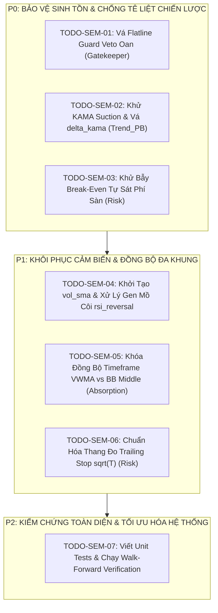

# DANH MỤC CÔNG VIỆC KHẮC PHỤC BẪY LỆCH NGỮ NGHĨA (TODO-SEM)

> **Thư mục:** `strategies_backtests/helios/docs/audit_01/15_semantic_mismatch_audit/`  
> **Tài liệu đối chiếu:** [`04_semantic_mismatch_master_synthesis.md`](file:///e:/Projects/Automations/trading_backtest/strategies_backtests/helios/docs/audit_01/15_semantic_mismatch_audit/04_semantic_mismatch_master_synthesis.md)  
> **Dự án:** Helios V3.3 Pure Rust Strategy Engine  
> **Ngày lập:** 05/10/2026

---

## 🎯 MA TRẬN PHÂN LOẠI ƯU TIÊN

---

## 📋 DANH SÁCH CHI TIẾT CÁC NHIỆM VỤ

### 🔴 NHÓM P0: KHẮC PHỤC CẤP BÁCH (CRITICAL HOTFIXES)

- [x] **`TODO-SEM-01`**: Sửa Bẫy "Mù Cầu Dao Flatline" trong `gatekeeper.rs`
  - **File:** [`strategies_backtests/helios/src/strategy/core_v3/gatekeeper.rs`](file:///e:/Projects/Automations/trading_backtest/strategies_backtests/helios/src/strategy/core_v3/gatekeeper.rs#L115-L123)
  - **Vấn đề:** `micro_natr_ratio` tính trên nến 1m (~0.04%) so sánh với `effective_min_natr` tính trên chi phí toàn vòng đời vị thế ($0.18\% \to 0.40\%$) làm veto oan 95% nến bình thường.
  - **Hành động:** 
    - Đổi sang so sánh với `macro_natr = sensors.natr[i] / 100.0` (NATR khung 15m/1h/4h).
    - Hoặc scale `micro_natr_ratio` theo thời gian nắm giữ kỳ vọng $\text{ratio} \times \sqrt{T_{\text{hold}}}$.
  - **Test Case:** Đảm bảo với dữ liệu BTC/ETH bình thường, tỷ lệ Flatline Veto giảm từ 95% xuống dưới 15% (chỉ chặn khi thị trường thực sự đóng băng thanh khoản).

- [ ] **`TODO-SEM-02`**: Khử KAMA Suction Trap & Chuẩn Hóa `delta_kama` trong `trend_pb.rs`
  - **File:** [`strategies_backtests/helios/src/strategy/core_v3/scanners/trend_pb.rs`](file:///e:/Projects/Automations/trading_backtest/strategies_backtests/helios/src/strategy/core_v3/scanners/trend_pb.rs#L79-L170)
  - **Vấn đề:** 
    1. `(close - kama_mid)` tính trên KAMA 4h nhưng bị chia cho ATR 1m làm `delta_kama` vọt lên $15 \to 50$ ATR, vượt trần 3.5 ATR $\to$ Tê liệt kích hoạt!
    2. `low.min(kama_mid)` kéo SL xuống KAMA 4h làm SL phình to $> 60\%$ ROE $\to$ Bị Sniper Guard veto 100%!
  - **Hành động:**
    - Khử KAMA Suction: Sửa `let base_support = low;` (Long) và `let base_resistance = high;` (Short).
    - Thêm `kama_atr` vào `HeliosSensors` và tính: `delta_kama = (close - kama_mid) / kama_atr;`.
  - **Test Case:** Chạy backtest đơn lẻ cho Trend_PB khi KAMA ở khung 1h/4h, xác nhận lệnh được kích hoạt đều đặn và SL tuân thủ chặt chẽ râu nến vi mô.

- [ ] **`TODO-SEM-03`**: Khử Bẫy Break-Even Tự Sát Trong `risk.rs`
  - **File:** [`strategies_backtests/helios/src/strategy/core_v3/risk.rs`](file:///e:/Projects/Automations/trading_backtest/strategies_backtests/helios/src/strategy/core_v3/risk.rs#L219-L247)
  - **Vấn đề:** `peak_profit >= required_profit` với `1.0 * current_atr` kích hoạt BE quá sớm khi giá chỉ mới tăng $+0.02\%$, chưa đủ bù phí sàn $+0.10\%$ ($1.6\%$ ROE tại 20x) $\to$ `Emergency BE Rejection Close` ép bot bán tháo cắt lỗ oan phí sàn.
  - **Hành động:**
    - Đưa sàn phí tối thiểu vào điều kiện kích hoạt BE: $\text{peak\_roe} \ge \max(\text{be\_activation\_roe}, 2.5 \times \text{round\_trip\_fee\_roe})$.
    - Dời mức Stop Loss hòa vốn lên điểm thực sự có lãi nhẹ: $\text{BE\_Price} = \text{Entry} \times (1 \pm \text{fee\_offset})$.
  - **Test Case:** Giả lập vị thế pump $+0.03\%$ rồi quay về Entry, kiểm tra lệnh không bị kích hoạt BE giả tạo và không bị cắt lệnh khẩn cấp chịu lỗ phí sàn.

---

### 🟠 NHÓM P1: KHÔI PHỤC CẢM BIẾN & ĐỒNG BỘ ĐA KHUNG (HIGH PRIORITY)

- [ ] **`TODO-SEM-04`**: Khởi Tạo Cảm Biến `vol_sma` & Xử Lý Gen Mồ Côi `rsi_reversal`
  - **File:** [`strategies_backtests/helios/src/strategy/core_v3/mod.rs`](file:///e:/Projects/Automations/trading_backtest/strategies_backtests/helios/src/strategy/core_v3/mod.rs#L223), [`scanners/reversal.rs`](file:///e:/Projects/Automations/trading_backtest/strategies_backtests/helios/src/strategy/core_v3/scanners/reversal.rs#L55)
  - **Vấn đề:**
    1. `sensors.vol_sma` là mảng rỗng do quên gọi khởi tạo trong `init()` $\to$ `vol_ratio` luôn bằng 1.0 cố định.
    2. `rsi_reversal` chiếm 2 gen DNA và CPU tính toán nhưng Scanner không hề sử dụng.
  - **Hành động:**
    - Bổ sung `s.vol_sma = ctx.volume_sma(ind.vol_ma.timeframe, "VolSMA", ind.vol_ma.period);` trong hàm `init()`.
    - Đưa `rsi_reversal` vào công thức chấm điểm kiệt sức của `ReversalScanner` hoặc đánh dấu `#[dna(skip)]` để tối ưu hóa không gian gen.
  - **Test Case:** In telemetry log của Reversal Scanner, xác nhận `vol_ratio` biến thiên linh hoạt theo từng nến volume.

- [ ] **`TODO-SEM-05`**: Khóa Đồng Bộ Timeframe Giữa VWMA và Bollinger Bands
  - **File:** [`strategies_backtests/helios/src/strategy/core_v3/mod.rs`](file:///e:/Projects/Automations/trading_backtest/strategies_backtests/helios/src/strategy/core_v3/mod.rs), [`scanners/absorption.rs`](file:///e:/Projects/Automations/trading_backtest/strategies_backtests/helios/src/strategy/core_v3/scanners/absorption.rs#L95-L97)
  - **Vấn đề:** `vwma.timeframe` và `bbands.timeframe` độc lập. Nếu DNA chọn VWMA 4h và BBands 5m, tín hiệu so sánh bị lệch pha hoàn toàn.
  - **Hành động:** Khóa đồng bộ trong `init()`: `self.config.indicators.vwma.timeframe = self.config.indicators.bbands.timeframe;` (tương tự như Keltner Channel).
  - **Test Case:** Chạy kiểm thử cho Absorption Scanner với các bộ DNA khác nhau, xác nhận VWMA và BBands luôn cùng một hệ quy chiếu thời gian.

- [ ] **`TODO-SEM-06`**: Chuẩn Hóa Thang Đo Trailing Stop $\sqrt{T}$
  - **File:** [`strategies_backtests/helios/src/strategy/core_v3/risk.rs`](file:///e:/Projects/Automations/trading_backtest/strategies_backtests/helios/src/strategy/core_v3/risk.rs#L141-L177), [`config.rs`](file:///e:/Projects/Automations/trading_backtest/strategies_backtests/helios/src/strategy/core_v3/config.rs#L139)
  - **Vấn đề:** `atr.timeframe` chọn giữa `1m, 3m, 5m` làm giá trị ATR chênh lệch tới $\sqrt{5} \approx 2.24$ lần, phá vỡ tính ổn định của các tham số Trailing Stop cố định `tsl_atr_normal`.
  - **Hành động:** Khóa cố định Timeframe của `atr_sl` vào nến 1m (`Timeframe::T1m`) hoặc chuẩn hóa khoảng cách TSL theo tỷ lệ % biến động thống nhất.
  - **Test Case:** Kiểm tra độ dịch chuyển của Trailing Stop trên các nến 1m, 3m, 5m để đảm bảo biên độ bảo vệ nhất quán.

---

### 🟢 NHÓM P2: KIỂM CHỨNG & VERIFICATION (TESTING & ROADMAP)

- [ ] **`TODO-SEM-07`**: Kiểm Thử Tích Hợp & Chạy Walk-Forward Smart Seed Verification
  - **File:** `trading_bot/bot_engine/examples/walk_forward_smart_seed.rs`
  - **Hành động:**
    - Chạy `cargo test --workspace` để bảo đảm không có hồi quy mã nguồn (Zero Regressions).
    - Chạy kịch bản `walk_forward_smart_seed` trên 30-45 ngày dữ liệu thực tế BTC/ETH.
    - So sánh số lượng lệnh, phân bổ playbook giữa các Scanners và tỷ lệ sống sót qua WFE Gate.
  - **Tiêu chuẩn thành công:**
    - Cả 4 Scanners chủ lực (Trend_PB, Momentum, Absorption, Reversal) đều có lệnh thực thi trong log.
    - Gatekeeper không còn tình trạng VETO 95% nến.
    - Walk-Forward Evaluator (WFE) vượt qua trơn tru với Net Return dương ngoài mẫu (OOS).
