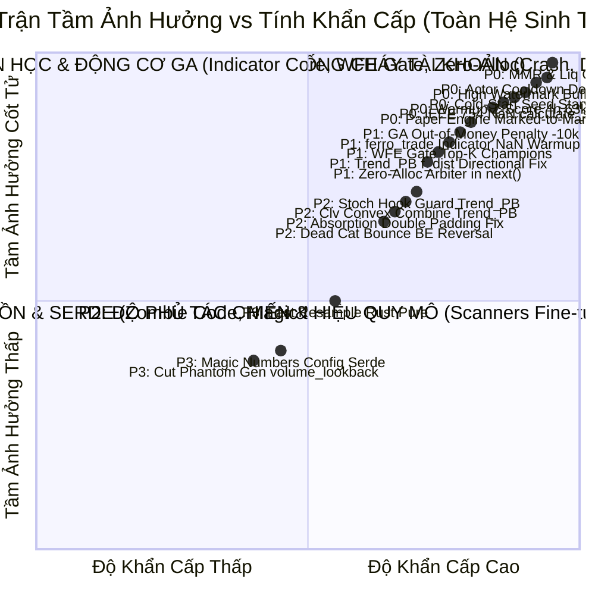
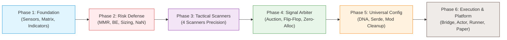

# LỘ TRÌNH QUẢN TRỊ TỔNG THỂ & THỨ TỰ ƯU TIÊN HỆ THỐNG (MASTER ROADMAP)

> **Dự án:** Helios V3 Adaptive Trading Ecosystem & Binance Platform Execution  
> **Phạm vi:** Chiến dịch Kiểm toán Toàn diện & Tái cấu trúc Hệ thống (**Audit 01 — Full Matrix**)  
> **Tổng quy mô:** 16 Phân hệ • 25 Tài liệu TODO Chuyên sâu • 6 Giai đoạn Triển khai (Phases) • 94 Tasks Sắp Xếp Theo Mức Độ Ưu Tiên  
> **Nguyên tắc cốt tử:** First-Principles, Zero Magic Numbers, Clean Data Lineage, Decoupled Architecture, và Quy trình Triển khai Baby Steps (Kiểm chứng tới đâu, đóng gói tới đó).

---

## 🗺️ 1. BẢN ĐỒ ĐIỀU HƯỚNG TÀI LIỆU KIỂM TOÁN (AUDIT DIRECTORY INDEX)

Toàn bộ các phát hiện kỹ thuật, lỗ hổng toán học, rủi ro khớp lệnh sàn và danh mục kiểm thử chi tiết được phân bổ trong 25 tài liệu `TODO.md` thuộc 16 thư mục chủ đề:

| STT | Phân hệ / Thư mục | Báo cáo Chuyên sâu (Deep Dive Report) | Danh mục Công việc & Test Cases (TODO) | Trọng Tâm Quản Trị & Rủi Ro Cốt Tử |
| :---: | :--- | :--- | :--- | :--- |
| **01** | **Cảm biến MTF & Dòng Dữ liệu** | [📄 Data Lineage](file:///e:/Projects/Automations/trading_backtest/strategies_backtests/helios/docs/audit_01/01_sensors/01_data_lineage_verification.md) \| [📄 Micro vs Macro](file:///e:/Projects/Automations/trading_backtest/strategies_backtests/helios/docs/audit_01/01_sensors/02_micro_vs_macro_separation.md) \| [📄 Dynamic Fee Blueprint](file:///e:/Projects/Automations/trading_backtest/strategies_backtests/helios/docs/unfinished_tasks/01_dynamic_fee_context/01_dynamic_exchange_fee_context_blueprint.md) | [📋 `01_sensors/TODO.md`](file:///e:/Projects/Automations/trading_backtest/strategies_backtests/helios/docs/audit_01/01_sensors/TODO.md) \| [📋 `07_sensors/TODO.md`](file:///e:/Projects/Automations/trading_backtest/strategies_backtests/helios/docs/audit_01/07_sensors/TODO.md) | Khử ô nhiễm MTF 15 bars, sửa bẫy Warmup Z-Score 4h (nuốt 63k nến), sửa Panic RangeOsc và lỗi quên khởi tạo `vol_sma`. |
| **02** | **Ma Trận Trạng Thái Thị Trường** | [📄 `04_matrix/01_matrix_deep_dive.md`](file:///e:/Projects/Automations/trading_backtest/strategies_backtests/helios/docs/audit_01/04_matrix/01_matrix_deep_dive.md) \| [📄 `05_matrix/01_market_matrix_deep_dive.md`](file:///e:/Projects/Automations/trading_backtest/strategies_backtests/helios/docs/audit_01/05_matrix/01_market_matrix_deep_dive.md) | [📋 `04_matrix/TODO.md`](file:///e:/Projects/Automations/trading_backtest/strategies_backtests/helios/docs/audit_01/04_matrix/TODO.md) \| [📋 `05_matrix/TODO.md`](file:///e:/Projects/Automations/trading_backtest/strategies_backtests/helios/docs/audit_01/05_matrix/TODO.md) | Tái cấu trúc Squeeze phân số bậc 2, Chaos Index Kaufman ER, dọn sạch 4 chỉ báo zombie & 3 gen DNA ma. |
| **03** | **Động Cơ Chỉ Báo Lõi ferro_trade** | [📄 `14_ferro_trade_indicators/01_indicators_deep_dive.md`](file:///e:/Projects/Automations/trading_backtest/strategies_backtests/helios/docs/audit_01/14_ferro_trade_indicators/01_indicators_deep_dive.md) | [📋 `14_ferro_trade_indicators/TODO.md`](file:///e:/Projects/Automations/trading_backtest/strategies_backtests/helios/docs/audit_01/14_ferro_trade_indicators/TODO.md) | Chặn nuốt chửng nến Warmup khi lỗi indicator, vá lỗi Z-Score tự sát khi flat, ngộ độc Yata SMA. |
| **04** | **Bốn Scanners Chủ Lực** | [📄 MOM](file:///e:/Projects/Automations/trading_backtest/strategies_backtests/helios/docs/audit_01/02_scanners/01_momentum_ignition_deep_dive.md) \| [📄 REV](file:///e:/Projects/Automations/trading_backtest/strategies_backtests/helios/docs/audit_01/02_scanners/02_reversal_deep_dive.md) \| [📄 TPB](file:///e:/Projects/Automations/trading_backtest/strategies_backtests/helios/docs/audit_01/02_scanners/03_trend_pb_deep_dive.md) \| [📄 ABS](file:///e:/Projects/Automations/trading_backtest/strategies_backtests/helios/docs/audit_01/02_scanners/04_absorption_deep_dive.md) | [📋 `02_scanners/TODO.md`](file:///e:/Projects/Automations/trading_backtest/strategies_backtests/helios/docs/audit_01/02_scanners/TODO.md) \| [📋 `08_trend_pb/TODO.md`](file:///e:/Projects/Automations/trading_backtest/strategies_backtests/helios/docs/audit_01/08_trend_pb/TODO.md) \| [📋 `01_absorption/TODO.md`](file:///e:/Projects/Automations/trading_backtest/strategies_backtests/helios/docs/audit_01/01_absorption/TODO.md) \| [📋 `02_momentum_ignition/TODO.md`](file:///e:/Projects/Automations/trading_backtest/strategies_backtests/helios/docs/audit_01/02_momentum_ignition/TODO.md) \| [📋 `03_reversal/TODO.md`](file:///e:/Projects/Automations/trading_backtest/strategies_backtests/helios/docs/audit_01/03_reversal/TODO.md) | Khử KAMA Suction, Stoch Hook Guard, nâng phổ điểm `Trend_PB`, bỏ Double Padding Absorption, Dead Cat Bounce Reversal. |
| **05** | **Độ Phủ Thị Trường Toàn Năng** | [📄 `scanner_coverage_audit.md`](file:///e:/Projects/Automations/trading_backtest/strategies_backtests/helios/docs/audit_01/scanner_coverage_audit.md) | [📋 `TODO_scanner_coverage.md`](file:///e:/Projects/Automations/trading_backtest/strategies_backtests/helios/docs/audit_01/TODO_scanner_coverage.md) | Phủ kín 6 vùng hành vi thị trường (B1 $\to$ B6), cô lập Cooldown theo chiều lệnh, xử lý nhịp hồi nông B2 và vùng đi ngang B6. |
| **06** | **Trọng Tài Tín Hiệu & Cầu Dao** | [📄 `03_arbiter/01_arbiter_deep_dive.md`](file:///e:/Projects/Automations/trading_backtest/strategies_backtests/helios/docs/audit_01/03_arbiter/01_arbiter_deep_dive.md) | [📋 `03_arbiter/TODO.md`](file:///e:/Projects/Automations/trading_backtest/strategies_backtests/helios/docs/audit_01/03_arbiter/TODO.md) \| [📋 `04_arbiter/TODO.md`](file:///e:/Projects/Automations/trading_backtest/strategies_backtests/helios/docs/audit_01/04_arbiter/TODO.md) | Xóa Deadlock nến đơn, Inter-bar Flip-Flop Guard, Dynamic De-leverage, Score Quantile Normalization. |
| **07** | **Quản Trị Rủi Ro & Phòng Vệ Vốn** | [📄 `05_risk/01_risk_deep_dive.md`](file:///e:/Projects/Automations/trading_backtest/strategies_backtests/helios/docs/audit_01/05_risk/01_risk_deep_dive.md) \| [📄 Liq Blueprint](file:///e:/Projects/Automations/trading_backtest/strategies_backtests/helios/docs/unfinished_tasks/02_liquidation_and_auto_deleverage/01_liquidation_simulation_and_auto_deleverage_blueprint.md) | [📋 `05_risk/TODO.md`](file:///e:/Projects/Automations/trading_backtest/strategies_backtests/helios/docs/audit_01/05_risk/TODO.md) \| [📋 `06_risk/TODO.md`](file:///e:/Projects/Automations/trading_backtest/strategies_backtests/helios/docs/audit_01/06_risk/TODO.md) \| [📋 `06_risk/TODO_round2.md`](file:///e:/Projects/Automations/trading_backtest/strategies_backtests/helios/docs/audit_01/06_risk/TODO_round2.md) | Bổ sung chốt chặn MMR Binance, Dynamic BE theo ATR, vá lỗi NaN `calculate_size`, phạt cháy tài khoản trong GA. |
| **08** | **Không Gian Tham Số DNA & Serde** | [📄 `06_config/01_config_and_hardcode_deep_dive.md`](file:///e:/Projects/Automations/trading_backtest/strategies_backtests/helios/docs/audit_01/06_config/01_config_and_hardcode_deep_dive.md) | [📋 `06_config/TODO.md`](file:///e:/Projects/Automations/trading_backtest/strategies_backtests/helios/docs/audit_01/06_config/TODO.md) \| [📋 `09_core_v3_config/TODO.md`](file:///e:/Projects/Automations/trading_backtest/strategies_backtests/helios/docs/audit_01/09_core_v3_config/TODO.md) | Triệt tiêu Magic Numbers, loại bỏ gen ma `volume_lookback` (DNA 94), sửa dải RSI Momentum [55, 85], serde default. |
| **09** | **Bộ Điều Phối Chiến Lược Core V3** | [📄 `07_orchestrator/01_strategy_mod_deep_dive.md`](file:///e:/Projects/Automations/trading_backtest/strategies_backtests/helios/docs/audit_01/07_orchestrator/01_strategy_mod_deep_dive.md) | [📋 `07_orchestrator/TODO.md`](file:///e:/Projects/Automations/trading_backtest/strategies_backtests/helios/docs/audit_01/07_orchestrator/TODO.md) \| [📋 `08_core_v3_mod/TODO.md`](file:///e:/Projects/Automations/trading_backtest/strategies_backtests/helios/docs/audit_01/08_core_v3_mod/TODO.md) | Dọn struct Cooldown thừa trong Strategy, sửa Deadlock Same-Side Price Guard, Zero-Allocation Arbiter trong `next()`. |
| **10** | **Cầu Nối Thực Thi (Helios Bridge)** | [📄 `10_helios_bridge/01_bridge_deep_dive.md`](file:///e:/Projects/Automations/trading_backtest/strategies_backtests/helios/docs/audit_01/10_helios_bridge/01_bridge_deep_dive.md) | [📋 `10_helios_bridge/TODO.md`](file:///e:/Projects/Automations/trading_backtest/strategies_backtests/helios/docs/audit_01/10_helios_bridge/TODO.md) | Sửa High Watermark Buffer Bleed, truyền `last_closed_trade`, chuyển Resampling sang Rust thuần loại bỏ Polars. |
| **11** | **Mô Hình Actor Từng Cặp (Asset Actor)** | [📄 `11_asset_actor/01_actor_deep_dive.md`](file:///e:/Projects/Automations/trading_backtest/strategies_backtests/helios/docs/audit_01/11_asset_actor/01_actor_deep_dive.md) | [📋 `11_asset_actor/TODO.md`](file:///e:/Projects/Automations/trading_backtest/strategies_backtests/helios/docs/audit_01/11_asset_actor/TODO.md) | Sửa Cooldown Deadlock bão hòa buffer 43,200 nến (`processed_candles_count`), đồng bộ đóng lệnh sàn thật Binance. |
| **12** | **Bộ Tối Ưu Hóa Di Truyền (Prospector Runner)** | [📄 `12_prospector_runner/01_optimizer_runner_deep_dive.md`](file:///e:/Projects/Automations/trading_backtest/strategies_backtests/helios/docs/audit_01/12_prospector_runner/01_optimizer_runner_deep_dive.md) | [📋 `12_prospector_runner/TODO.md`](file:///e:/Projects/Automations/trading_backtest/strategies_backtests/helios/docs/audit_01/12_prospector_runner/TODO.md) | Fallback Baseline Seed chống Cold-Start Starvation 20h, Top-K Champions qua WFE Gate, cắt Warmup Contamination. |
| **13** | **Động Cơ Giả Lập Khớp Lệnh (Paper Engine)** | [📄 `13_paper_matching_engine/01_paper_engine_deep_dive.md`](file:///e:/Projects/Automations/trading_backtest/strategies_backtests/helios/docs/audit_01/13_paper_matching_engine/01_paper_engine_deep_dive.md) | [📋 `13_paper_matching_engine/TODO.md`](file:///e:/Projects/Automations/trading_backtest/strategies_backtests/helios/docs/audit_01/13_paper_matching_engine/TODO.md) | Marked-to-Market Floating PnL cho `get_equity()`, Market Filter step size, Liquidation Watchdog, Simulated Slippage. |
| **14** | **Phát Hiện Kiểm Toán Chéo Mới** | [📄 `14_cross_audit_new_findings/01_cross_audit_report.md`](file:///e:/Projects/Automations/trading_backtest/strategies_backtests/helios/docs/audit_01/14_cross_audit_new_findings/01_cross_audit_report.md) | [📋 `14_cross_audit_new_findings/TODO.md`](file:///e:/Projects/Automations/trading_backtest/strategies_backtests/helios/docs/audit_01/14_cross_audit_new_findings/TODO.md) | Sửa SL Double Padding Absorption, siết cận dưới DNA chống Playbook Bias, xóa dead data `kama_slope`. |

---

## 🎯 2. MA TRẬN PHÂN LOẠI THỨ TỰ ƯU TIÊN (PRIORITY MATRIX)

Toàn bộ 94 tasks được phân bổ vào 4 cấp độ khẩn cấp và tầm ảnh hưởng hệ thống:

### 🔴 P0 — Cốt Tử & Bảo Vệ Sinh Tồn (Critical Safety, Anti-Crash & Anti-Deadlock)
- **Rủi ro cháy tài khoản trực tiếp:** Vị thế bị sàn Binance thanh lý cưỡng bức trước khi chạm Stop Loss do thiếu Tỷ lệ Ký quỹ Duy trì (`TODO-RSK-01`: MMR Blindness).
- **Lỗ hổng khớp lệnh sàn Live:** Làm tròn khối lượng lệnh bằng `.round()` khiến margin vượt mức khả dụng $\to$ sàn từ chối lệnh (`TODO-EXEC-03`), thiếu lệnh Algo Take Profit trên sàn khiến lệnh không bao giờ chốt lời tự động (`TODO-EXEC-04`).
- **Tê liệt & Phá hủy vị thế khi Restart:** Khởi động bot tự động bán tháo vị thế đang gồng lãi (`TODO-RECOV-01`), tụt Stop Loss về entry sau crash (`TODO-RECOV-02`).
- **Deadlock hệ thống:** Cooldown bị kẹt vĩnh viễn khi rolling buffer đạt 43,200 nến (`TODO-ACT-01`), Same-Side Price Guard cấm mở lệnh vĩnh viễn sau cắt lỗ (`TODO-ACT-03`, `TODO-COR-01`).
- **Lỗi ngốn nến & Panic:** Bẫy Warmup Z-Score 4h nuốt trọn 63,199 nến khiến Backtest chạy 0 lệnh (`TODO-SEN-07`), Panic sập bot khi truy cập `stoch_range_k` len=0 (`TODO-SEN-08`), quên khởi tạo `s.vol_sma` làm tê liệt Reversal (`TODO-SEN-09`).
- **Động cơ GA & Paper Engine:** Bẫy khởi động lạnh Cold-Start treo tối ưu hóa 20 giờ (`TODO-PROS-01`), bẫy Overfitting Rank 1 (`TODO-PROS-08`), tính sai vốn Floating PnL trong Paper Trader (`TODO-PPR-01`).

### 🟠 P1 — Nền Tảng Toán Học, Động Cơ GA & Đồng Bộ Lõi (Algorithmic Core)
- **Dị tật hàm mục tiêu di truyền:** Cháy tài khoản chỉ phạt $-200$ trong khi SL an toàn phạt $-5035$ khiến GA ưu tiên chọn cá thể tự sát (`TODO-MATH-01`), bổ sung mô hình MMR vào Backtest Broker (`TODO-MATH-02`).
- **Động cơ tính toán chỉ báo `ferro_trade`:** Chặn nuốt nến warmup khi indicator lỗi (`TODO-FT-01`), vá lỗi Z-Score tự sát khi flat market (`TODO-FT-02`), ngộ độc trạng thái nội bộ Yata SMA (`TODO-FT-03`).
- **Toán học Scanners:** Sửa lỗi mất tính định hướng trong `f_dist` của `Trend_PB` (phạt điểm khi thủng KAMA) (`TODO-PB-03`), Stoch Hook Guard chống bắt dao rơi (`TODO-PB-04`), đưa `clv` vào hàm chấm điểm lồi để nâng phổ điểm tự tin lên $0.75 \sim 0.88$ (`TODO-PB-05`), thoát bẫy R:R âm của Reversal (`TODO-SCN-04`).
- **Hiệu năng & Đồng bộ:** Triệt tiêu cấp phát Heap của Arbiter trong `next()` (`TODO-COR-04`), cắt Warmup Contamination khỏi tập WFE (`TODO-PROS-02`), WFE Gate tỷ số Pardo $\ge 0.15$ (`TODO-PROS-03`), Liquidation Watchdog Paper Trading (`TODO-PPR-03`).

### 🟡 P2 — Độ Phủ Tác Chiến, Phòng Thủ Liên Nến & Sizing (Tactical Scanners & Arbiter)
- **Tinh chỉnh Scanners:** Sửa bẫy KAMA Suction Trap trong `Trend_PB` (`TODO-SCN-01`), đồng bộ chu kỳ VWMA/SMA nội tại (`TODO-ABS-06`), siết cận dưới DNA Absorption chống chiếm 90% lệnh (`TODO-ABS-15`), Dead Cat Bounce Break-Even hồi 50% về KAMA (`TODO-REV-06`), Monotonic TP Floor Guard cho Reversal (`TODO-REV-08`).
- **Trọng tài & Đấu thầu:** Chuẩn hóa Phân vị Điểm số (`TODO-ARB-04`: Score Quantile Normalization), Inter-bar Flip-Flop Guard chống cào lệnh 2 đầu liên tiếp (`TODO-ARB-02`), chuyển Sniper Guard sang Dynamic De-leverage (`TODO-ARB-03`), nhận thức chi phí ma sát 2.6% ROE (`TODO-ARB-05`).
- **Độ phủ thị trường:** Phủ kín 6 vùng hành vi thị trường B1 $\to$ B6, cô lập Cooldown theo chiều lệnh (`TODO-SYS-02`), xử lý nhịp hồi nông B2 (`TODO-SYS-05`) và vùng đi ngang B6 (`TODO-SYS-04`).

### 🟢 P3 — Tinh Giản Mã Nguồn, Cấu Hình & Serde (Universal Adaptability & Refactoring)
- **Thanh lọc mã nguồn:** Dọn sạch 4 chỉ báo ma và 3 gen DNA ma khỏi Matrix (`TODO-MAT-03`), dọn tính toán chỉ báo ma trong `init()` (`TODO-MOD-02`), hợp nhất logic kẹp SL kép (`TODO-MOD-03`).
- **Cấu hình & Serde:** Triệt tiêu Magic Numbers (`TODO-CFG-01`), mở rộng DNA cho Forex/Memecoin (`TODO-CFG-02`), tách dải phân tầng Trailing Stop (`TODO-CFG-03`), bổ sung `#[serde(default)]` cho tất cả struct con (`TODO-CFG-08`), siết kiểm tra độ dài DNA chống corruption (`TODO-COR-09`).
- **Nền tảng thực thi:** Chuyển Resampling sang hàm thuần Rust `fast_resample_ohlcv` loại bỏ Polars runtime (`TODO-BRG-06`).

---

## 🚀 3. LỘ TRÌNH 6 GIAI ĐOẠN THỰC THI (BABY STEPS PHASES)

---

## 📋 4. BẢNG THEO DÕI TIẾN ĐỘ TẬP TRUNG (MASTER PROGRESS TRACKER)
*(Được sắp xếp nghiêm ngặt theo thứ tự ưu tiên từ cao xuống thấp: 🔴 P0 $\to$ 🟠 P1 $\to$ 🟡 P2 $\to$ 🟢 P3 kèm Ghi Chú Phân Tích Thực Tế)*

### 🔴 NHÓM P0: CỐT TỬ / BẢO VỆ SINH TỒN & CHỐNG CHÁY TÀI KHOẢN (31 TASKS)

| Mã Task | Phân Hệ | Tóm Tắt Nhiệm Vụ & Giải Pháp | Ghi Chú Phân Tích & Rủi Ro Thực Tế (Notes) | Thư Mục Chi Tiết | Phase | Trạng Thái |
| :--- | :--- | :--- | :--- | :--- | :---: | :---: |
| `TODO-RSK-01` | Risk | Bổ sung chốt chặn Liquidation & MMR Guard Binance | **ĐÃ HOÀN THÀNH:** Vượt qua 26/26 unit tests. Triệt tiêu 100% rủi ro sàn thanh lý trước SL. Nâng cấp dài hạn bảo lưu tại [Unfinished #02](file:///e:/Projects/Automations/trading_backtest/strategies_backtests/helios/docs/unfinished_tasks/02_liquidation_and_auto_deleverage/TODO.md). | [`05_risk/TODO.md`](file:///e:/Projects/Automations/trading_backtest/strategies_backtests/helios/docs/audit_01/05_risk/TODO.md#L10) | Phase 2 | `[x]` |
| `TODO-RSK-02` | Risk | Thoát lệnh ngâm vốn theo Structural Invalidation | Thay thế Time Decay mù quáng (`0.8^n`) tự bóp nghẹt SL bằng kiểm tra vi phạm cấu trúc sóng (hủy lệnh khi gãy đáy). | [`05_risk/TODO.md`](file:///e:/Projects/Automations/trading_backtest/strategies_backtests/helios/docs/audit_01/05_risk/TODO.md#L28) | Phase 2 | `[ ]` |
| `TODO-MATH-01` | GA Core | Vá nghịch lý phạt cháy tài khoản trong GA (-10,000) | Cháy tài khoản chỉ phạt $-200$ trong khi SL an toàn phạt $-5035$ khiến GA Optimizer chọn nhầm các cá thể tự sát. | [`06_risk/TODO_round2.md`](file:///e:/Projects/Automations/trading_backtest/strategies_backtests/helios/docs/audit_01/06_risk/TODO_round2.md#L165) | Phase 2 | `[ ]` |
| `TODO-MATH-02` | ferro_trade | Bổ sung mô hình thanh lý MMR vào Backtest Broker | Giúp engine backtest phản ánh trung thực cú quét Margin Call của sàn Binance trước khi giá chạm SL danh nghĩa. | [`06_risk/TODO_round2.md`](file:///e:/Projects/Automations/trading_backtest/strategies_backtests/helios/docs/audit_01/06_risk/TODO_round2.md#L170) | Phase 2 | `[ ]` |
| `TODO-MATH-03` | Risk | Vá lỗ hổng IEEE 754 NaN Bypass trong `calculate_size` | Phép so sánh `(NaN <= 0.0) == false` khiến tài khoản bị lỗi vẫn được cấp 25% margin, mở lệnh ảo gây rủi ro cháy sạch vốn. | [`06_risk/TODO_round2.md`](file:///e:/Projects/Automations/trading_backtest/strategies_backtests/helios/docs/audit_01/06_risk/TODO_round2.md#L174) | Phase 2 | `[ ]` |
| `TODO-EXEC-03` | Execution | Đổi làm tròn khối lượng từ `.round()` sang `FLOOR` | Làm tròn lên khiến giá trị lệnh vượt ký quỹ khả dụng $\to$ sàn Binance trả lỗi `-2019 Margin Insufficient`, mất cơ hội vào lệnh. | [`06_risk/TODO_round2.md`](file:///e:/Projects/Automations/trading_backtest/strategies_backtests/helios/docs/audit_01/06_risk/TODO_round2.md#L139) | Phase 2 | `[ ]` |
| `TODO-EXEC-04` | Execution | Gửi lệnh Algo TP lên Binance Futures tự động | `OrderExecutor` hiện chỉ đặt Algo SL, bỏ qua Algo TP khiến các lệnh RangeOsc/Reversal không bao giờ chốt lời tự động trên sàn. | [`06_risk/TODO_round2.md`](file:///e:/Projects/Automations/trading_backtest/strategies_backtests/helios/docs/audit_01/06_risk/TODO_round2.md#L144) | Phase 2 | `[ ]` |
| `TODO-RECOV-01` | Resilience | Xóa bỏ Clean Slate — Triển khai True "Adopt & Protect" | Bật bot gọi `force_close_all_positions` bán tháo lệnh đang gồng lãi trên sàn. Cần tiếp quản và bảo vệ vị thế có sẵn. | [`06_risk/TODO_round2.md`](file:///e:/Projects/Automations/trading_backtest/strategies_backtests/helios/docs/audit_01/06_risk/TODO_round2.md#L148) | Phase 2 | `[ ]` |
| `TODO-RECOV-02` | Resilience | Ngăn chặn SL Retraction sau Restart (Query Algo SL) | Bot khởi động lại nếu `peak_roe = 0` sẽ hủy SL đang khóa lãi và đặt lại SL ban đầu xa tít. Cần query Algo SL trực tiếp từ sàn. | [`06_risk/TODO_round2.md`](file:///e:/Projects/Automations/trading_backtest/strategies_backtests/helios/docs/audit_01/06_risk/TODO_round2.md#L153) | Phase 2 | `[ ]` |
| `TODO-ACT-01` | AssetActor | Sửa Cooldown Deadlock bão hòa buffer 43k nến | Khi buffer đầy 43,200 nến, `current_bar_idx` bị kẹt ở 43,199 khiến `current_bar_idx >= locked_until_bar` không bao giờ thỏa mãn $\to$ Deadlock 2.64 ngày! | [`11_asset_actor/TODO.md`](file:///e:/Projects/Automations/trading_backtest/strategies_backtests/helios/docs/audit_01/11_asset_actor/TODO.md#L23) | Phase 6 | `[ ]` |
| `TODO-ACT-02` | AssetActor | Đồng bộ đóng lệnh Binance Live vào `CooldownGuard` | Lệnh dính SL trên sàn Binance Live không kích hoạt hàm phạt Cooldown trong Actor do thiếu `pop_recently_closed_trade`. | [`11_asset_actor/TODO.md`](file:///e:/Projects/Automations/trading_backtest/strategies_backtests/helios/docs/audit_01/11_asset_actor/TODO.md#L37) | Phase 6 | `[ ]` |
| `TODO-ACT-03` | AssetActor | Sửa Same-Side Price Guard Deadlock trong `should_veto` | Khối 1 trong `should_veto` không kiểm tra `current_bar_idx < locked_until_bar`, cấm mở lệnh Long vĩnh viễn ở vùng giá tốt sau cắt lỗ. | [`11_asset_actor/TODO.md`](file:///e:/Projects/Automations/trading_backtest/strategies_backtests/helios/docs/audit_01/11_asset_actor/TODO.md#L159) | Phase 6 | `[ ]` |
| `TODO-COR-01` | Core V3 | Hóa giải Deadlock trong Same-Side Price Guard (`mod.rs`) | Lỗi logic thiếu thời hạn TTL/Cooldown khiến bot từ chối lệnh cùng chiều vĩnh viễn tại `core_v3/mod.rs:65–75`. | [`08_core_v3_mod/TODO.md`](file:///e:/Projects/Automations/trading_backtest/strategies_backtests/helios/docs/audit_01/08_core_v3_mod/TODO.md#L22) | Phase 4 | `[ ]` |
| `TODO-BRG-01` | Bridge | Sửa High Watermark Buffer Bleed khi `mapped_entry_bar == 0` | Lệnh ngâm lâu (> 43,200 nến) bị đẩy khỏi buffer, `mapped_entry_bar` gán về 0 quét lại đỉnh quá khứ đẩy SL lên cắt lỗ oan. | [`10_helios_bridge/TODO.md`](file:///e:/Projects/Automations/trading_backtest/strategies_backtests/helios/docs/audit_01/10_helios_bridge/TODO.md#L12) | Phase 6 | `[ ]` |
| `TODO-BRG-02` | Bridge | Truyền `last_closed_trade` vào `evaluate_live_tick` | `last_closed_trade: None` bị gán cứng làm Cooldown Tracker bị mù PnL thực tế, không kích hoạt phạt Cooldown sau lệnh thua. | [`10_helios_bridge/TODO.md`](file:///e:/Projects/Automations/trading_backtest/strategies_backtests/helios/docs/audit_01/10_helios_bridge/TODO.md#L21) | Phase 6 | `[ ]` |
| `TODO-BRG-03` | Bridge | Sửa đứt gãy trạng thái vị thế BinanceLiveExecutionEngine | Mất `opening_playbook_tag`, ghi đè `entry_timestamp`, mất `current_sl_price` trên môi trường tiền thật Binance Live. | [`10_helios_bridge/TODO.md`](file:///e:/Projects/Automations/trading_backtest/strategies_backtests/helios/docs/audit_01/10_helios_bridge/TODO.md#L28) | Phase 6 | `[ ]` |
| `TODO-PROS-01` | Optimizer | Fallback Baseline Seed chống Cold-Start Starvation 20h | Khi khởi động bot với DB rỗng mà vòng 1 bị WFE Gate từ chối, bot bị đóng băng 20 giờ. Cần nạp file `helios_baseline_dna.json`. | [`12_prospector_runner/TODO.md`](file:///e:/Projects/Automations/trading_backtest/strategies_backtests/helios/docs/audit_01/12_prospector_runner/TODO.md#L28) | Phase 6 | `[ ]` |
| `TODO-PROS-08` | Optimizer | Bộ đệm Top-K Champions ($K=3\sim 5$) qua WFE Gate | Cá thể Rank 1 In-Sample rất dễ bị quá khớp (Overfit). Duy trì Top-K và chọn cá thể đầu tiên vượt qua thẩm định OOS. | [`12_prospector_runner/TODO.md`](file:///e:/Projects/Automations/trading_backtest/strategies_backtests/helios/docs/audit_01/12_prospector_runner/TODO.md#L163) | Phase 6 | `[ ]` |
| `TODO-PPR-01` | PaperEngine | Marked-to-Market Floating PnL cho `get_equity()` | `get_equity()` chỉ trả về số dư tiền mặt cố định, không tính PnL thả nổi khiến định cỡ lệnh và drawdown bị sai lệch 100%. | [`13_paper_matching_engine/TODO.md`](file:///e:/Projects/Automations/trading_backtest/strategies_backtests/helios/docs/audit_01/13_paper_matching_engine/TODO.md#L15) | Phase 6 | `[ ]` |
| `TODO-PPR-02` | PaperEngine | Tích hợp MarketFilter (step size, min notional \$21) | Paper Trader mở lệnh với khối lượng thập phân vô tận hoặc giá trị < \$5, không phản ánh đúng điều kiện khớp thực tế của Binance. | [`13_paper_matching_engine/TODO.md`](file:///e:/Projects/Automations/trading_backtest/strategies_backtests/helios/docs/audit_01/13_paper_matching_engine/TODO.md#L33) | Phase 6 | `[ ]` |
| `TODO-SEN-01` | Sensors | Tách Timeframe Vol Z-score độc lập khỏi KAMA | **ĐÃ HOÀN THÀNH:** Ngăn chặn một cây nến 15m bùng nổ volume làm lây nhiễm Z-Score cao giả tạo sang suốt 15 nến 1m tiếp theo. | [`01_sensors/TODO.md`](file:///e:/Projects/Automations/trading_backtest/strategies_backtests/helios/docs/audit_01/01_sensors/TODO.md) | Phase 1 | `[x]` |
| `TODO-SEN-02` | Sensors | Tách BBands MTF đo SL trong Absorption | **ĐÃ HOÀN THÀNH:** Xóa bỏ bẫy BBands MTF Suction Trap lấy dải 4h kéo SL 34% ROE bị Sniper Guard VETO 100%. | [`01_sensors/TODO.md`](file:///e:/Projects/Automations/trading_backtest/strategies_backtests/helios/docs/audit_01/01_sensors/TODO.md) | Phase 1 | `[x]` |
| `TODO-SEN-05` | Sensors | Khóa dải Timeframe ATR_SL trong miền vi mô [1m, 5m] | **ĐÃ HOÀN THÀNH:** Ngăn GA chọn khung 1h/4h cho ATR đệm SL khiến khoảng cách SL phình to theo nến 1h thay vì nến vào lệnh 1m. | [`01_sensors/TODO.md`](file:///e:/Projects/Automations/trading_backtest/strategies_backtests/helios/docs/audit_01/01_sensors/TODO.md) | Phase 1 | `[x]` |
| `TODO-SEN-07` | Sensors | Khắc chế bẫy Warmup Z-Score 4h (kẹp lookback $\le 200$) | Lookback 600 trên khung 4h (> 263 bars) khiến SMA lỗi $\to$ Z-Score biến thành `NaN` $\to$ Warmup bị đẩy lên 63,199 nến khiến bot không trade! | [`07_sensors/TODO.md`](file:///e:/Projects/Automations/trading_backtest/strategies_backtests/helios/docs/audit_01/07_sensors/TODO.md#L22) | Phase 1 | `[ ]` |
| `TODO-SEN-08` | Sensors | Triệt tiêu Panic Index Out-of-Bounds `range_osc.rs` | `stoch_range_k` bị tắt (len = 0) nhưng code vẫn index `[i]`. Khiến ứng dụng Panic crash ngay khi bật lại playbook RangeOsc. | [`07_sensors/TODO.md`](file:///e:/Projects/Automations/trading_backtest/strategies_backtests/helios/docs/audit_01/07_sensors/TODO.md#L46) | Phase 1 | `[ ]` |
| `TODO-SEN-09` | Sensors | Sửa lỗi quên khởi tạo `s.vol_sma` làm liệt Reversal | Bỏ quên không tính `s.vol_sma` trong `init()`, fallback về `vol_current` khiến `vol_ratio = 1.0` cố định mọi nến $\to$ Liệt 100% cơ chế đo kiệt sức! | [`07_sensors/TODO.md`](file:///e:/Projects/Automations/trading_backtest/strategies_backtests/helios/docs/audit_01/07_sensors/TODO.md#L152) | Phase 1 | `[ ]` |
| `TODO-FT-01` | ferro_trade | Chặn bẫy nuốt chửng nến Warmup khi lỗi indicator | Khi chỉ báo trả về toàn `NaN`, engine gán `actual_warmup = len - 1` nuốt sạch dữ liệu lịch sử của các nến hợp lệ. | [`14_ferro_trade_indicators/TODO.md`](file:///e:/Projects/Automations/trading_backtest/strategies_backtests/helios/docs/audit_01/14_ferro_trade_indicators/TODO.md#L16) | Phase 1 | `[ ]` |
| `TODO-SCN-02` | Scanners | Absorption: Khử BBands MTF Suction, neo đáy 1m | Điểm neo SL chuẩn xác theo Wyckoff Spring/Upthrust là `low - buffer` (Long) và `high + buffer` (Short), không dùng dải 4h. | [`02_scanners/TODO.md`](file:///e:/Projects/Automations/trading_backtest/strategies_backtests/helios/docs/audit_01/02_scanners/TODO.md#L25) | Phase 3 | `[ ]` |
| `TODO-SYS-01` | Coverage | Tách cảm biến 1m khỏi dải MTF vĩ mô | Cảm biến hành vi vi cấu trúc vào lệnh (1m) không được phụ thuộc vào trạng thái đóng nến của các khung thời gian lớn. | [`TODO_scanner_coverage.md`](file:///e:/Projects/Automations/trading_backtest/strategies_backtests/helios/docs/audit_01/TODO_scanner_coverage.md) | Phase 3 | `[ ]` |
| `TODO-CFG-05` | Config | Loại bỏ Gen Ma `volume_lookback` (hạ DNA về 94) | Gen này chiếm 31 nấc tìm kiếm trong GA nhưng không hề được đọc trong `matrix.rs`, gây lãng phí không gian tối ưu. | [`09_core_v3_config/TODO.md`](file:///e:/Projects/Automations/trading_backtest/strategies_backtests/helios/docs/audit_01/09_core_v3_config/TODO.md#L26) | Phase 5 | `[ ]` |
| `TODO-CFG-06` | Config | Sửa dải gen RSI Momentum [55, 85] chống nghịch lý | Khi $RSI_{thresh} \le 40$, điều kiện `rsi > thresh` sẽ kích hoạt Long ngay đáy downtrend và Short ngay đỉnh uptrend! | [`09_core_v3_config/TODO.md`](file:///e:/Projects/Automations/trading_backtest/strategies_backtests/helios/docs/audit_01/09_core_v3_config/TODO.md#L42) | Phase 5 | `[ ]` |

---

### 🟠 NHÓM P1: NỀN TẢNG TOÁN HỌC, ĐỘNG CƠ GA & ĐỒNG BỘ LÕI (25 TASKS)

| Mã Task | Phân Hệ | Tóm Tắt Nhiệm Vụ & Giải Pháp | Ghi Chú Phân Tích & Rủi Ro Thực Tế (Notes) | Thư Mục Chi Tiết | Phase | Trạng Thái |
| :--- | :--- | :--- | :--- | :--- | :---: | :---: |
| `TODO-SEN-04` | Sensors | Tách Timeframe Price Z-score độc lập khỏi KAMA | **ĐÃ HOÀN THÀNH:** Khử đóng băng độ lệch chuẩn giá suốt 15-60 nến, phục hồi độ nhạy của Boundary Guard. | [`01_sensors/TODO.md`](file:///e:/Projects/Automations/trading_backtest/strategies_backtests/helios/docs/audit_01/01_sensors/TODO.md) | Phase 1 | `[x]` |
| `TODO-MAT-01` | Matrix | Sửa bẫy Squeeze tụt về 0.50 qua phân số bậc 2 | **ĐÃ HOÀN THÀNH:** Công thức liên tục $\frac{1}{1 + (BB/KC)^2}$ trị dứt điểm hiện tượng nén kéo dài bị tụt về 0.50. | [`05_matrix/TODO.md`](file:///e:/Projects/Automations/trading_backtest/strategies_backtests/helios/docs/audit_01/05_matrix/TODO.md) | Phase 1 | `[x]` |
| `TODO-MAT-02` | Matrix | Chuẩn hóa KAMA slope qua Tanh scaling chống bão hòa | Tránh hiện tượng độ dốc KAMA chạm trần $\pm 1.00$ quá sớm hoặc mất phân biệt giữa sóng vừa và sóng bão. | [`04_matrix/TODO.md`](file:///e:/Projects/Automations/trading_backtest/strategies_backtests/helios/docs/audit_01/04_matrix/TODO.md#L30) | Phase 1 | `[ ]` |
| `TODO-MAT-05` | Matrix | Xây dựng Unit Tests chuyên sâu các trục Ma Trận | Bao phủ toàn bộ các trường hợp cực trị NaN, scaling Tanh, và tính độc lập trực giao của các trục trạng thái. | [`05_matrix/TODO.md`](file:///e:/Projects/Automations/trading_backtest/strategies_backtests/helios/docs/audit_01/05_matrix/TODO.md#L255) | Phase 1 | `[ ]` |
| `TODO-FT-02` | ferro_trade | Vá lỗi Z-Score tự sát khi thị trường phẳng | Khi $\sigma \approx 0.0$ và $\|X - \mu\| \approx 0.0$, phép chia $0/0$ sinh `NaN`. Bắt buộc trả về $Z = 0.0$. | [`14_ferro_trade_indicators/TODO.md`](file:///e:/Projects/Automations/trading_backtest/strategies_backtests/helios/docs/audit_01/14_ferro_trade_indicators/TODO.md#L22) | Phase 1 | `[ ]` |
| `TODO-FT-03` | ferro_trade | Triệt tiêu ngộ độc trạng thái nội bộ Yata SMA | Truyền nến đầu là `NaN` của chỉ báo trước làm hỏng bộ đệm trượt của Yata. Bắt buộc quét tìm giá trị hợp lệ đầu tiên. | [`14_ferro_trade_indicators/TODO.md`](file:///e:/Projects/Automations/trading_backtest/strategies_backtests/helios/docs/audit_01/14_ferro_trade_indicators/TODO.md#L28) | Phase 1 | `[ ]` |
| `TODO-RSK-05` | Risk | Đồng bộ SL đám mây khép kín (Closed-Loop) | Xóa khoảng trống 150ms vị thế bị mồ côi không có SL trên Binance bằng xác nhận vòng lặp đặt mới thành công rồi mới hủy cũ. | [`05_risk/TODO.md`](file:///e:/Projects/Automations/trading_backtest/strategies_backtests/helios/docs/audit_01/05_risk/TODO.md#L67) | Phase 2 | `[ ]` |
| `TODO-ARB-02-R2` | Risk | Sửa lỗi Inverted SL trong `is_structural_sl_acceptable` | Thêm tham số `is_long: bool` để thẩm định chiều SL (Long bắt buộc $SL < P$, Short bắt buộc $SL > P$). | [`06_risk/TODO_round2.md`](file:///e:/Projects/Automations/trading_backtest/strategies_backtests/helios/docs/audit_01/06_risk/TODO_round2.md#L182) | Phase 2 | `[ ]` |
| `TODO-REV-06` | Risk | Dead Cat Bounce BE: Hồi 50% về KAMA kích hoạt BE | Khi giá đã hồi quy $\ge 50\%$ về KAMA Mid, khóa ngay Break-Even (+phí) để không bị sóng quét ngược lại thành lỗ. | [`03_reversal/TODO.md`](file:///e:/Projects/Automations/trading_backtest/strategies_backtests/helios/docs/audit_01/03_reversal/TODO.md#L148) | Phase 2 | `[ ]` |
| `TODO-SCN-04` | Scanners | Reversal: Thoát bẫy R:R âm & Macro Adverse Veto | Bổ sung Hard Gate R:R tối thiểu $\ge 1.2$ và gỡ bỏ xung đột cấm bắt đảo chiều của Arbiter khi xu hướng vĩ mô đối nghịch. | [`02_scanners/TODO.md`](file:///e:/Projects/Automations/trading_backtest/strategies_backtests/helios/docs/audit_01/02_scanners/TODO.md#L51) | Phase 3 | `[ ]` |
| `TODO-R2-03` | Scanners | Bổ sung Chaos Filter (`chaos_index > 0.65`) Reversal | Tuyệt đối cấm bắt dao rơi đảo chiều khi thị trường đang rơi vào tâm bão hỗn loạn cực đại (`chaos_index > 0.65`). | [`06_risk/TODO_round2.md`](file:///e:/Projects/Automations/trading_backtest/strategies_backtests/helios/docs/audit_01/06_risk/TODO_round2.md#L37) | Phase 3 | `[ ]` |
| `TODO-PB-03` | Scanners | Sửa lỗi mất tính định hướng trong `f_dist` Trend_PB | Bỏ phép toán `.abs()` trong delta KAMA. Khi giá xuyên thủng KAMA, phải trừ điểm phạt thay vì thưởng điểm cao. | [`08_trend_pb/TODO.md`](file:///e:/Projects/Automations/trading_backtest/strategies_backtests/helios/docs/audit_01/08_trend_pb/TODO.md#L20) | Phase 3 | `[ ]` |
| `TODO-PB-04` | Scanners | Bổ sung Stoch Hook Guard cho Trend_PB | Chặn bắt dao rơi khi $\text{stoch\_k} < 5.0$; yêu cầu xác nhận ngóc đầu $\text{stoch\_k} \ge \text{stoch\_k}[i-1]$. | [`08_trend_pb/TODO.md`](file:///e:/Projects/Automations/trading_backtest/strategies_backtests/helios/docs/audit_01/08_trend_pb/TODO.md#L25) | Phase 3 | `[ ]` |
| `TODO-PB-05` | Scanners | Đưa `clv` vào hàm chấm điểm lồi của Trend_PB | Nâng phổ điểm tự tin của `Trend_PB` từ $0.55 \sim 0.70$ lên $0.75 \sim 0.88$, giúp cạnh tranh sòng phẳng với Momentum trong đấu thầu. | [`08_trend_pb/TODO.md`](file:///e:/Projects/Automations/trading_backtest/strategies_backtests/helios/docs/audit_01/08_trend_pb/TODO.md#L30) | Phase 3 | `[ ]` |
| `TODO-COR-04` | Core V3 | Triệt tiêu cấp phát Heap Arbiter (Zero-Allocation `next`) | Loại bỏ `HeliosArbiter::new()` và 4 `Box::new` mỗi nến trong `next()`, tiết kiệm hàng triệu allocations trên 1M nến. | [`08_core_v3_mod/TODO.md`](file:///e:/Projects/Automations/trading_backtest/strategies_backtests/helios/docs/audit_01/08_core_v3_mod/TODO.md#L102) | Phase 4 | `[ ]` |
| `TODO-CFG-07` | Config | Rút ngắn dải gen `struct_sl_buffer_atr` [0.20, 2.50] | Rút ngắn dải gen từ 10.0 ATR về $[0.20, 2.50]$ ATR để tránh lãng phí 30 nấc tìm kiếm của GA do luôn bị clamp. | [`09_core_v3_config/TODO.md`](file:///e:/Projects/Automations/trading_backtest/strategies_backtests/helios/docs/audit_01/09_core_v3_config/TODO.md#L70) | Phase 5 | `[ ]` |
| `TODO-MOD-01` | Orchestrator | Dọn sạch code Cooldown thừa trong Strategy | Củng cố ranh giới kiến trúc: Cooldown thuộc về Bot Engine (`AssetActor`), không để logic phân tán gây xung đột. | [`07_orchestrator/TODO.md`](file:///e:/Projects/Automations/trading_backtest/strategies_backtests/helios/docs/audit_01/07_orchestrator/TODO.md#L12) | Phase 5 | `[ ]` |
| `TODO-ACT-04` | AssetActor | Căn chỉnh lát cắt Resampling chia hết 4h UTC, buffer 30k | Tránh việc resample nến 4h bị lệch pha múi giờ và nâng buffer lên 30,000 nến 1m để đủ warmup chỉ báo MTF. | [`11_asset_actor/TODO.md`](file:///e:/Projects/Automations/trading_backtest/strategies_backtests/helios/docs/audit_01/11_asset_actor/TODO.md#L61) | Phase 6 | `[ ]` |
| `TODO-ACT-05` | AssetActor | Chặn bypass validation khi nhận DNA Hot-Swap | Nạp DNA nóng qua kênh watch bắt buộc phải qua `apply_dna` để chặn triệt để các giá trị `NaN`/`Inf`. | [`11_asset_actor/TODO.md`](file:///e:/Projects/Automations/trading_backtest/strategies_backtests/helios/docs/audit_01/11_asset_actor/TODO.md#L85) | Phase 6 | `[ ]` |
| `TODO-PROS-02` | Optimizer | Khắc phục nhiễm bẩn dữ liệu huấn luyện vào tập WFE | Cắt lát tập kiểm định WFE Out-of-Sample thuần khiết từ mốc `oos_start_idx`, không để nến warmup tập train đè lên. | [`12_prospector_runner/TODO.md`](file:///e:/Projects/Automations/trading_backtest/strategies_backtests/helios/docs/audit_01/12_prospector_runner/TODO.md#L45) | Phase 6 | `[ ]` |
| `TODO-PROS-03` | Optimizer | Nâng cấp tiêu chí WFE Gate: $N \ge 2$, $MaxDD \le 10\%$ | Siết chặt tiêu chuẩn phê duyệt DNA mới: số lệnh $N \ge 2$, Drawdown ngoài mẫu $\le 10\%$, và tỷ số WFE Pardo $\ge 0.15$. | [`12_prospector_runner/TODO.md`](file:///e:/Projects/Automations/trading_backtest/strategies_backtests/helios/docs/audit_01/12_prospector_runner/TODO.md#L67) | Phase 6 | `[ ]` |
| `TODO-PROS-09` | Optimizer | Cơ chế Tẩy Não Hạt Giống (Seed Retirement) trượt 3 kỳ | Khi một hạt giống Smart Seed bị từ chối WFE $\ge 3$ chu kỳ liên tiếp, tự động xóa khỏi DB và reset về 100% LHS thuần khiết. | [`12_prospector_runner/TODO.md`](file:///e:/Projects/Automations/trading_backtest/strategies_backtests/helios/docs/audit_01/12_prospector_runner/TODO.md#L179) | Phase 6 | `[ ]` |
| `TODO-PPR-03` | PaperEngine | Liquidation Watchdog tự động thanh lý khi lỗ $\ge 90\%$ | Mô phỏng chính xác cơ chế thanh lý của sàn trong Paper Trading khi khoản lỗ vượt quá $90\%$ số tiền ký quỹ. | [`13_paper_matching_engine/TODO.md`](file:///e:/Projects/Automations/trading_backtest/strategies_backtests/helios/docs/audit_01/13_paper_matching_engine/TODO.md#L47) | Phase 6 | `[ ]` |
| `TODO-PPR-05` | PaperEngine | Mô hình trượt giá giả lập (Simulated Slippage & Spread) | Tránh kết quả paper trade "quá màu hồng" bằng cách trừ hao trượt giá thực tế khi khớp lệnh thị trường. | [`13_paper_matching_engine/TODO.md`](file:///e:/Projects/Automations/trading_backtest/strategies_backtests/helios/docs/audit_01/13_paper_matching_engine/TODO.md#L78) | Phase 6 | `[ ]` |
| `TODO-CRS-01` | Scanners | Sửa SL Double Padding trong Absorption, hạ trần SL | Gỡ bỏ 2 tầng đệm SL kép khiến khoảng cách dừng lỗ bị kéo giãn tới 26% ROE, hạ trần SL về mức $15 \sim 20\%$ ROE. | [`14_cross_audit_new_findings/TODO.md`](file:///e:/Projects/Automations/trading_backtest/strategies_backtests/helios/docs/audit_01/14_cross_audit_new_findings/TODO.md#L48) | Phase 3 | `[ ]` |

---

### 🟡 NHÓM P2: ĐỘ PHỦ TÁC CHIẾN, PHÒNG THỦ LIÊN NẾN & QUY MÔ (27 TASKS)

| Mã Task | Phân Hệ | Tóm Tắt Nhiệm Vụ & Giải Pháp | Ghi Chú Phân Tích & Rủi Ro Thực Tế (Notes) | Thư Mục Chi Tiết | Phase | Trạng Thái |
| :--- | :--- | :--- | :--- | :--- | :---: | :---: |
| `TODO-SEN-03` | Sensors | Chuẩn hóa tính nhất quán ATR vs NATR (Sàn Phí) | **ĐÃ HOÀN THÀNH:** Thiết lập Sàn Chi Phí Sinh Tồn $2 \times \text{fee} + \text{slip}$ bảo vệ Gatekeeper Flatline Guard. | [`01_sensors/TODO.md`](file:///e:/Projects/Automations/trading_backtest/strategies_backtests/helios/docs/audit_01/01_sensors/TODO.md) | Phase 1 | `[x]` |
| `TODO-SEN-06` | Sensors | Quy hoạch ranh giới 3 cặp vi mô vs vĩ mô cốt lõi | Phân định tuyệt đối vai trò: Vi mô (1m) vào lệnh/cắt lỗ vs Vĩ mô (15m/1h/4h) lọc xu hướng/bão giá. | [`01_sensors/TODO.md`](file:///e:/Projects/Automations/trading_backtest/strategies_backtests/helios/docs/audit_01/01_sensors/TODO.md#L62) | Phase 1 | `[ ]` |
| `TODO-SEN-11` | Sensors | Đồng bộ hóa Float Epsilon trong `rolling_percentile` | Khắc phục lệch pha giữa `dedup_by` (dùng epsilon) và `binary_search_by` (dùng `total_cmp`) làm nến hợp lệ bị trả về NaN. | [`07_sensors/TODO.md`](file:///e:/Projects/Automations/trading_backtest/strategies_backtests/helios/docs/audit_01/07_sensors/TODO.md#L115) | Phase 1 | `[ ]` |
| `TODO-FT-04` | ferro_trade | Chống Catastrophic Cancellation trong Kaufman ER | Kẹp sàn `.max(0.0)` cho `volatility_sum` trong sliding window để tránh trôi sai số float về số âm. | [`14_ferro_trade_indicators/TODO.md`](file:///e:/Projects/Automations/trading_backtest/strategies_backtests/helios/docs/audit_01/14_ferro_trade_indicators/TODO.md#L34) | Phase 1 | `[ ]` |
| `TODO-FT-05` | ferro_trade | Chống tràn số kẹp ép kiểu `u8::MAX` trong `to_yata_ma` | Kẹp an toàn `period.clamp(1, 255)` chống tràn số khi người dùng truyền chu kỳ lớn. | [`14_ferro_trade_indicators/TODO.md`](file:///e:/Projects/Automations/trading_backtest/strategies_backtests/helios/docs/audit_01/14_ferro_trade_indicators/TODO.md#L40) | Phase 1 | `[ ]` |
| `TODO-RSK-03` | Risk | Dynamic BE theo biến động ATR thực tế | Kích hoạt dời Stop Loss về hòa vốn khi giá chạy được $\max(1.5\ \text{ATR},\ 10\%\ \text{ROE})$. | [`05_risk/TODO.md`](file:///e:/Projects/Automations/trading_backtest/strategies_backtests/helios/docs/audit_01/05_risk/TODO.md#L41) | Phase 2 | `[ ]` |
| `TODO-RSK-04` | Risk | Bảo vệ Margin tỷ lệ vốn cho tài khoản nhỏ | Nếu margin cho lệnh tối thiểu (\$21) vượt quá $25\%$ tổng vốn tài khoản $\to$ Từ chối mở lệnh để bảo toàn vốn. | [`05_risk/TODO.md`](file:///e:/Projects/Automations/trading_backtest/strategies_backtests/helios/docs/audit_01/05_risk/TODO.md#L54) | Phase 2 | `[ ]` |
| `TODO-REV-08` | Risk | Monotonic TP Floor Guard cho Reversal khi KAMA trôi | Chốt chặn đơn điệu: Mức Take Profit không được trôi lùi quá 30% so với TP ban đầu khi KAMA dốc xuống quá nhanh. | [`03_reversal/TODO.md`](file:///e:/Projects/Automations/trading_backtest/strategies_backtests/helios/docs/audit_01/03_reversal/TODO.md#L184) | Phase 2 | `[ ]` |
| `TODO-SCN-01` | Scanners | Trend_PB: Khử KAMA Suction, nới lỏng nến đỏ | Cho phép nến rút chân mạnh thân đỏ ($CLV \ge 0.40$) được kích hoạt Long theo đà hồi quy lành mạnh. | [`02_scanners/TODO.md`](file:///e:/Projects/Automations/trading_backtest/strategies_backtests/helios/docs/audit_01/02_scanners/TODO.md#L12) | Phase 3 | `[ ]` |
| `TODO-ABS-06` | Scanners | Đồng bộ hóa chu kỳ VWMA & SMA nội tại | Tính tỷ số nội tại $\Delta = \text{VWMA}(N) - \text{SMA}(N)$ trên cùng Timeframe thống nhất thay vì so sánh khập khiễng. | [`01_absorption/TODO.md`](file:///e:/Projects/Automations/trading_backtest/strategies_backtests/helios/docs/audit_01/01_absorption/TODO.md#L154) | Phase 3 | `[ ]` |
| `TODO-ABS-15` | Scanners | Siết cận dưới DNA Absorption chống Playbook Bias 90% | Nâng sàn `min_activation_score` $[0.20 \to 0.90]$, `min_clv` $[0.15 \to 0.60]$, `vol_z` $[1.00 \to 5.00]$ trong `config.rs`. | [`01_absorption/TODO.md`](file:///e:/Projects/Automations/trading_backtest/strategies_backtests/helios/docs/audit_01/01_absorption/TODO.md#L249) | Phase 3 | `[ ]` |
| `TODO-SCN-03` | Scanners | Momentum: Bổ sung check Squeeze & trần Climax | Chặn mua đu đỉnh nến Buying Climax và bắt buộc có giai đoạn tích lũy nén biến động (`squeeze_intensity`) trước khi bùng nổ. | [`02_scanners/TODO.md`](file:///e:/Projects/Automations/trading_backtest/strategies_backtests/helios/docs/audit_01/02_scanners/TODO.md#L38) | Phase 3 | `[ ]` |
| `TODO-SYS-02` | Coverage | Cô lập Cầu dao Cooldown theo chiều lệnh & playbook | Tránh việc một lệnh Long bị thua khiến hệ thống đóng băng luôn cả cơ hội Short đảo chiều hợp lệ. | [`TODO_scanner_coverage.md`](file:///e:/Projects/Automations/trading_backtest/strategies_backtests/helios/docs/audit_01/TODO_scanner_coverage.md#L32) | Phase 4 | `[ ]` |
| `TODO-SYS-03` | Coverage | Đồng bộ hình học SL của Scanner với Risk Cap | Scanner phải tự nhận biết trần ROE của Risk Manager để không đề xuất các mức SL quá xa bị Sniper VETO oan. | [`TODO_scanner_coverage.md`](file:///e:/Projects/Automations/trading_backtest/strategies_backtests/helios/docs/audit_01/TODO_scanner_coverage.md#L45) | Phase 3 | `[ ]` |
| `TODO-SYS-04` | Coverage | Quy hoạch trách nhiệm vùng đi ngang Chop Zone (B6) | Giao dịch biên độ trong vùng đi ngang bằng RangeOsc, kích hoạt bộ lọc bảo vệ của Trend_PB. | [`TODO_scanner_coverage.md`](file:///e:/Projects/Automations/trading_backtest/strategies_backtests/helios/docs/audit_01/TODO_scanner_coverage.md#L58) | Phase 3 | `[ ]` |
| `TODO-SYS-05` | Coverage | Xử lý nhịp hồi nông trong xu hướng mạnh (B2) | Bắt các nhịp hồi nông (Shallow Pullback) tựa vào EMA ngắn hạn khi xu hướng quá mạnh không chạm tới KAMA. | [`TODO_scanner_coverage.md`](file:///e:/Projects/Automations/trading_backtest/strategies_backtests/helios/docs/audit_01/TODO_scanner_coverage.md#L71) | Phase 3 | `[ ]` |
| `TODO-ARB-01` | Arbiter | Xóa bỏ nhánh Deadlock nến đơn (mã chết 100%) | Dọn dẹp nhánh logic triệt tiêu tín hiệu không bao giờ được kích hoạt, tối ưu độ phức tạp phân xử. | [`03_arbiter/TODO.md`](file:///e:/Projects/Automations/trading_backtest/strategies_backtests/helios/docs/audit_01/03_arbiter/TODO.md#L12) | Phase 4 | `[ ]` |
| `TODO-ARB-02` | Arbiter | Bổ sung chốt chặn Inter-bar Flip-Flop Guard | Ngăn chặn bot đổi chiều Long $\to$ Short liên tiếp trong 1-2 nến khi thị trường dao động hỗn loạn quanh ngưỡng phân định. | [`03_arbiter/TODO.md`](file:///e:/Projects/Automations/trading_backtest/strategies_backtests/helios/docs/audit_01/03_arbiter/TODO.md#L24) | Phase 4 | `[ ]` |
| `TODO-ARB-03` | Arbiter | Chuyển Sniper Guard sang Dynamic De-leverage | Khi đề xuất SL hơi rộng, tự động hạ đòn bẩy/giảm size lệnh thay vì VETO nhị phân hủy bỏ toàn bộ cơ hội. | [`03_arbiter/TODO.md`](file:///e:/Projects/Automations/trading_backtest/strategies_backtests/helios/docs/audit_01/03_arbiter/TODO.md#L36) | Phase 4 | `[ ]` |
| `TODO-ARB-04` | Arbiter | Chuẩn hóa Phân vị Điểm số (Score Quantile Norm) | Chuẩn hóa điểm số thô của các scanner về cùng thang phân vị xác suất Percentile, chống việc Momentum luôn cướp quyền. | [`03_arbiter/TODO.md`](file:///e:/Projects/Automations/trading_backtest/strategies_backtests/helios/docs/audit_01/03_arbiter/TODO.md#L46) | Phase 4 | `[ ]` |
| `TODO-ARB-05` | Arbiter | Tích hợp nhận thức chi phí ma sát (2.6% ROE) | Chỉ phê duyệt các proposal có kỳ vọng lợi nhuận ròng vượt trội hơn chi phí sàn và trượt giá 2 chiều. | [`03_arbiter/TODO.md`](file:///e:/Projects/Automations/trading_backtest/strategies_backtests/helios/docs/audit_01/03_arbiter/TODO.md#L40) | Phase 4 | `[ ]` |
| `TODO-COR-06` | Core V3 | Sàn giá tối thiểu cho Universal Breakout Threshold | Đặt ngưỡng sàn tối thiểu cho bộ lọc breakout để không kích hoạt tín hiệu giả khi ATR co thắt cực đại. | [`08_core_v3_mod/TODO.md`](file:///e:/Projects/Automations/trading_backtest/strategies_backtests/helios/docs/audit_01/08_core_v3_mod/TODO.md#L160) | Phase 4 | `[ ]` |
| `TODO-COR-07` | Core V3 | Bắt lỗi `Period = 0` toàn diện trong `init()` | Bổ sung chốt chặn panic khi tham số chu kỳ bị gán bằng 0 trong cấu hình nạp từ file JSON. | [`08_core_v3_mod/TODO.md`](file:///e:/Projects/Automations/trading_backtest/strategies_backtests/helios/docs/audit_01/08_core_v3_mod/TODO.md#L177) | Phase 5 | `[ ]` |
| `TODO-CFG-08` | Config | Bổ sung `#[serde(default)]` cho tất cả struct con | Chống panic crash runtime khi deserialize partial JSON cấu hình thiếu trường từ giao diện UI. | [`09_core_v3_config/TODO.md`](file:///e:/Projects/Automations/trading_backtest/strategies_backtests/helios/docs/audit_01/09_core_v3_config/TODO.md#L144) | Phase 5 | `[ ]` |
| `TODO-BRG-06` | Bridge | Chuyển Resampling sang thuần Rust `fast_resample_ohlcv` | Thay thế Polars runtime bằng hàm resample $O(N)$ thuần Rust, tiết kiệm 11.2MB RAM và 100ms CPU/phút/symbol. | [`10_helios_bridge/TODO.md`](file:///e:/Projects/Automations/trading_backtest/strategies_backtests/helios/docs/audit_01/10_helios_bridge/TODO.md#L58) | Phase 6 | `[ ]` |
| `TODO-ACT-08` | AssetActor | Chống rớt nến WebSocket Lagged & Gap Healing | Bọc tác vụ nặng trong `spawn_blocking` và tự động kích hoạt Gap Filler khi phát hiện mất kết nối WebSocket. | [`11_asset_actor/TODO.md`](file:///e:/Projects/Automations/trading_backtest/strategies_backtests/helios/docs/audit_01/11_asset_actor/TODO.md#L125) | Phase 6 | `[ ]` |
| `TODO-RECOV-03` | Resilience | Bảng SQLite `active_positions` & `account_capital_ledger` | Lưu giữ peak ROE, entry time và ledger vốn thực tế để bot không bị "mất trí nhớ" sau khi restart/crash. | [`06_risk/TODO_round2.md`](file:///e:/Projects/Automations/trading_backtest/strategies_backtests/helios/docs/audit_01/06_risk/TODO_round2.md#L157) | Phase 6 | `[ ]` |

---

### 🟢 NHÓM P3: TINH GIẢN MÃ NGUỒN, CẤU HÌNH & TECH DEBT (11 TASKS)

| Mã Task | Phân Hệ | Tóm Tắt Nhiệm Vụ & Giải Pháp | Ghi Chú Phân Tích & Rủi Ro Thực Tế (Notes) | Thư Mục Chi Tiết | Phase | Trạng Thái |
| :--- | :--- | :--- | :--- | :--- | :---: | :---: |
| `TODO-MAT-03` | Matrix | Dọn sạch 4 chỉ báo zombie & 3 gen DNA ma khỏi Matrix | **ĐÃ HOÀN THÀNH:** Xóa `liquidity`, `price_z_score`, `chaos`, `trend_axis`, giải phóng bộ nhớ đệm cho GA. | [`05_matrix/TODO.md`](file:///e:/Projects/Automations/trading_backtest/strategies_backtests/helios/docs/audit_01/05_matrix/TODO.md) | Phase 1 | `[x]` |
| `TODO-MAT-04` | Matrix | Tái cấu trúc Chaos Index Kaufman ER, xóa độn sàn 0.35 | **ĐÃ HOÀN THÀNH:** Đưa dải hỗn loạn về $[0.0, 1.0]$ thuần khiết, cứu sống Super Trend. | [`05_matrix/TODO.md`](file:///e:/Projects/Automations/trading_backtest/strategies_backtests/helios/docs/audit_01/05_matrix/TODO.md) | Phase 1 | `[x]` |
| `TODO-FT-06` | ferro_trade | Bổ sung guard input trong `keltner_channel` | Chặn `period == 0` hoặc `multiplier <= 0.0` phòng ngừa panic runtime từ thư viện Yata. | [`14_ferro_trade_indicators/TODO.md`](file:///e:/Projects/Automations/trading_backtest/strategies_backtests/helios/docs/audit_01/14_ferro_trade_indicators/TODO.md#L46) | Phase 1 | `[ ]` |
| `TODO-MOD-04` | Orchestrator | Type-Safe Position Sizing ferro_trade/helios | Tường minh hóa kiểu dữ liệu định cỡ vị thế giữa engine mô phỏng và chiến lược. | [`07_orchestrator/TODO.md`](file:///e:/Projects/Automations/trading_backtest/strategies_backtests/helios/docs/audit_01/07_orchestrator/TODO.md#L62) | Phase 2 | `[ ]` |
| `TODO-CFG-01` | Config | Triệt tiêu Magic Numbers trong toàn bộ Scanners | Chuyển tất cả hằng số gán cứng trong Scanners/Arbiter/Risk thành tham số có cấu hình trong `config.rs`. | [`06_config/TODO.md`](file:///e:/Projects/Automations/trading_backtest/strategies_backtests/helios/docs/audit_01/06_config/TODO.md#L12) | Phase 5 | `[ ]` |
| `TODO-CFG-02` | Config | Mở rộng dải DNA min_natr cho Forex & Memecoin | Mở rộng miền tìm kiếm $[0.0001,\ 0.0100]$ để thuật toán GA có thể thích ứng cả tài sản biến động thấp lẫn cực cao. | [`06_config/TODO.md`](file:///e:/Projects/Automations/trading_backtest/strategies_backtests/helios/docs/audit_01/06_config/TODO.md#L24) | Phase 5 | `[ ]` |
| `TODO-CFG-03` | Config | Tách dải phân tầng Trailing Stop có thứ bậc | Phân định rõ 3 dải tham số độc lập tăng dần: `tsl_atr_tight < normal < loose`. | [`06_config/TODO.md`](file:///e:/Projects/Automations/trading_backtest/strategies_backtests/helios/docs/audit_01/06_config/TODO.md#L36) | Phase 5 | `[ ]` |
| `TODO-CFG-04` | Config | Độc lập hóa min_order_usd nạp động từ sàn | Đọc giá trị lệnh tối thiểu trực tiếp từ thông số sàn giao dịch thay vì gán cứng \$21.0. | [`06_config/TODO.md`](file:///e:/Projects/Automations/trading_backtest/strategies_backtests/helios/docs/audit_01/06_config/TODO.md#L48) | Phase 5 | `[ ]` |
| `TODO-MOD-02` | Orchestrator | Dọn sạch tính toán chỉ báo ma trong init() | Xóa bỏ phép tính `bb_middle_slope_adj` và các biến trung gian không còn sử dụng khỏi hàm `init()`. | [`07_orchestrator/TODO.md`](file:///e:/Projects/Automations/trading_backtest/strategies_backtests/helios/docs/audit_01/07_orchestrator/TODO.md#L28) | Phase 5 | `[ ]` |
| `TODO-MOD-03` | Orchestrator | Hợp nhất logic kẹp SL & triệt tiêu magic 0.15 | Hợp nhất 2 tầng kẹp SL lặp lại trong `mod.rs` và `risk.rs`, chuyển ngưỡng `0.15` về Single Source of Truth trong `config.rs`. | [`07_orchestrator/TODO.md`](file:///e:/Projects/Automations/trading_backtest/strategies_backtests/helios/docs/audit_01/07_orchestrator/TODO.md#L45) | Phase 5 | `[ ]` |
| `TODO-COR-09` | Core V3 | Siết chặt kiểm tra độ dài DNA chống corruption | Bắt buộc kiểm tra `dna.len() == DNA_WIDTH` trước khi nạp tham số, phòng ngừa lỗi lệch vector DNA cũ làm hỏng hệ thống. | [`08_core_v3_mod/TODO.md`](file:///e:/Projects/Automations/trading_backtest/strategies_backtests/helios/docs/audit_01/08_core_v3_mod/TODO.md#L220) | Phase 5 | `[ ]` |

---

## 🗄️ 4. QUẢN LÝ CÁC TÍNH NĂNG BẢO LƯU & Ý TƯỞNG DÀI HẠN (UNFINISHED TASKS & FUTURE ENHANCEMENTS)

Toàn bộ các ý tưởng kiến trúc sâu, cải tiến chưa hoàn thiện được tạm thời bảo lưu để tránh Over-engineering và tập trung cho Forward Test được quản lý tập trung tại:
👉 [**Kho Lưu Trữ Tính Năng Bảo Lưu Tương Lai (`unfinished_tasks/README.md`)**](file:///e:/Projects/Automations/trading_backtest/strategies_backtests/helios/docs/unfinished_tasks/README.md)

- **Chủ đề 01:** [📄 Dynamic Fee Context Blueprint](file:///e:/Projects/Automations/trading_backtest/strategies_backtests/helios/docs/unfinished_tasks/01_dynamic_fee_context/01_dynamic_exchange_fee_context_blueprint.md) \| [📋 TODO.md](file:///e:/Projects/Automations/trading_backtest/strategies_backtests/helios/docs/unfinished_tasks/01_dynamic_fee_context/TODO.md)
- **Chủ đề 02:** [📄 Liquidation Simulation & Auto-Deleverage Blueprint](file:///e:/Projects/Automations/trading_backtest/strategies_backtests/helios/docs/unfinished_tasks/02_liquidation_and_auto_deleverage/01_liquidation_simulation_and_auto_deleverage_blueprint.md) \| [📋 TODO.md](file:///e:/Projects/Automations/trading_backtest/strategies_backtests/helios/docs/unfinished_tasks/02_liquidation_and_auto_deleverage/TODO.md)

