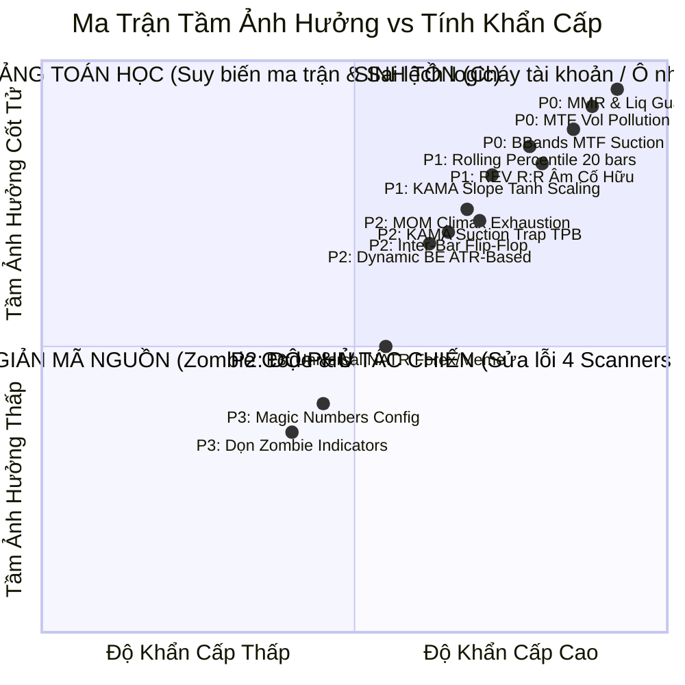
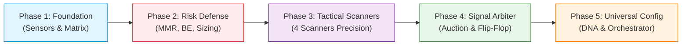

# LỘ TRÌNH QUẢN TRỊ TỔNG THỂ & THỨ TỰ ƯU TIÊN HỆ THỐNG (MASTER ROADMAP)

> **Dự án:** Helios V3 Adaptive Trading Ecosystem  
> **Phạm vi:** Chiến dịch Kiểm toán Toàn diện & Tái cấu trúc Hệ thống (**Audit 01**)  
> **Tổng quy mô:** 8 Phân hệ • 36 Hạng mục Công việc (Action Items) • 5 Giai đoạn Triển khai (Phases)  
> **Nguyên tắc cốt tử:** First-Principles, Zero Magic Numbers, Clean Data Lineage, Decoupled Architecture, và Quy trình Triển khai Baby Steps (Kiểm chứng tới đâu, đóng gói tới đó).

---

## 🗺️ 1. BẢN ĐỒ ĐIỀU HƯỚNG TÀI LIỆU KIỂM TOÁN (AUDIT DIRECTORY INDEX)

Toàn bộ phát hiện, báo cáo phân tích chuyên sâu và danh mục kiểm thử chi tiết được phân bổ trong 8 tài liệu `TODO.md` độc lập:

| Phân hệ / Thư mục | Báo cáo Chuyên sâu (Deep Dive Report) | Danh mục Công việc & Test Cases (TODO) | Số Tasks |
| :--- | :--- | :--- | :---: |
| **01. Cảm biến & Dữ liệu** | [📄 Data Lineage](file:///e:/Projects/Automations/trading_backtest/strategies_backtests/helios/docs/audit_01/01_sensors/01_data_lineage_verification.md) \| [📄 Micro vs Macro](file:///e:/Projects/Automations/trading_backtest/strategies_backtests/helios/docs/audit_01/01_sensors/02_micro_vs_macro_separation.md) \| [📄 Dynamic Fee Blueprint](file:///e:/Projects/Automations/trading_backtest/strategies_backtests/helios/docs/audit_01/01_sensors/03_dynamic_exchange_fee_context_blueprint.md) | [📋 `01_sensors/TODO.md`](file:///e:/Projects/Automations/trading_backtest/strategies_backtests/helios/docs/audit_01/01_sensors/TODO.md) | **6** |
| **02. Bốn Scanners Chủ Lực** | [📄 MOM](file:///e:/Projects/Automations/trading_backtest/strategies_backtests/helios/docs/audit_01/02_scanners/01_momentum_ignition_deep_dive.md) \| [📄 REV](file:///e:/Projects/Automations/trading_backtest/strategies_backtests/helios/docs/audit_01/02_scanners/02_reversal_deep_dive.md) \| [📄 TPB](file:///e:/Projects/Automations/trading_backtest/strategies_backtests/helios/docs/audit_01/02_scanners/03_trend_pb_deep_dive.md) \| [📄 ABS](file:///e:/Projects/Automations/trading_backtest/strategies_backtests/helios/docs/audit_01/02_scanners/04_absorption_deep_dive.md) | [📋 `02_scanners/TODO.md`](file:///e:/Projects/Automations/trading_backtest/strategies_backtests/helios/docs/audit_01/02_scanners/TODO.md) | **4** |
| **02b. Độ Phủ Thị Trường** | [📄 `scanner_coverage_audit.md`](file:///e:/Projects/Automations/trading_backtest/strategies_backtests/helios/docs/audit_01/scanner_coverage_audit.md) | [📋 `TODO_scanner_coverage.md`](file:///e:/Projects/Automations/trading_backtest/strategies_backtests/helios/docs/audit_01/TODO_scanner_coverage.md) | **5** |
| **03. Trọng Tài & Cầu Dao** | [📄 `03_arbiter/01_arbiter_deep_dive.md`](file:///e:/Projects/Automations/trading_backtest/strategies_backtests/helios/docs/audit_01/03_arbiter/01_arbiter_deep_dive.md) | [📋 `03_arbiter/TODO.md`](file:///e:/Projects/Automations/trading_backtest/strategies_backtests/helios/docs/audit_01/03_arbiter/TODO.md) | **4** |
| **04. Ma Trận Thị Trường** | [📄 `04_matrix/01_matrix_deep_dive.md`](file:///e:/Projects/Automations/trading_backtest/strategies_backtests/helios/docs/audit_01/04_matrix/01_matrix_deep_dive.md) | [📋 `04_matrix/TODO.md`](file:///e:/Projects/Automations/trading_backtest/strategies_backtests/helios/docs/audit_01/04_matrix/TODO.md) | **4** |
| **05. Quản Trị Rủi Ro** | [📄 `05_risk/01_risk_deep_dive.md`](file:///e:/Projects/Automations/trading_backtest/strategies_backtests/helios/docs/audit_01/05_risk/01_risk_deep_dive.md) | [📋 `05_risk/TODO.md`](file:///e:/Projects/Automations/trading_backtest/strategies_backtests/helios/docs/audit_01/05_risk/TODO.md) | **5** |
| **06. Cấu Hình & Magic Numbers** | [📄 `06_config/01_config_and_hardcode_deep_dive.md`](file:///e:/Projects/Automations/trading_backtest/strategies_backtests/helios/docs/audit_01/06_config/01_config_and_hardcode_deep_dive.md) | [📋 `06_config/TODO.md`](file:///e:/Projects/Automations/trading_backtest/strategies_backtests/helios/docs/audit_01/06_config/TODO.md) | **4** |
| **07. Bộ Điều Phối Lệnh** | [📄 `07_orchestrator/01_strategy_mod_deep_dive.md`](file:///e:/Projects/Automations/trading_backtest/strategies_backtests/helios/docs/audit_01/07_orchestrator/01_strategy_mod_deep_dive.md) | [📋 `07_orchestrator/TODO.md`](file:///e:/Projects/Automations/trading_backtest/strategies_backtests/helios/docs/audit_01/07_orchestrator/TODO.md) | **4** |
| **TỔNG CỘNG** | | | **36 TASKS** |

---

## 🎯 2. MA TRẬN PHÂN LOẠI THỨ TỰ ƯU TIÊN (PRIORITY MATRIX)

Toàn bộ 36 tasks được phân bổ vào 4 cấp độ khẩn cấp và tầm ảnh hưởng hệ thống:

- 🔴 **P0 - Cốt Tử / Bảo Vệ Sinh Tồn (Critical Safety & Data Lineage):**
  - Ngăn chặn nguy cơ thanh lý tài khoản cưỡng chế sàn Binance (`TODO-RSK-01`: MMR Blindness).
  - Triệt tiêu ô nhiễm dữ liệu MTF kéo dài 15 nến trong bộ nhớ đệm (`TODO-SEN-01`, `TODO-SYS-01`).
  - Khử bỏ bẫy BBands MTF Suction Trap kéo SL 34% ROE bị VETO 100% (`TODO-SEN-02`, `TODO-SCN-02`).
  - Chống bẫy Underwater Tightening tự cắt lỗ đúng ngay đáy nén trước khi giá bật tăng (`TODO-RSK-02`).
- 🟠 **P1 - Chuẩn Hóa Toán Học & Đồng Bộ Nền Tảng (Algorithmic Core):**
  - Khắc phục bẫy suy biến Rolling Percentile 20 bars làm tê liệt Gatekeeper (`TODO-MAT-01`).
  - Tái cấu trúc độ dốc KAMA qua hàm Tanh chuẩn hóa chống bão hòa $\pm 1.00$ (`TODO-MAT-02`).
  - Tái cấu trúc Playbook `Reversal` thoát khỏi bẫy R:R âm thiết kế (`TODO-SCN-04`).
  - Dọn sạch code Cooldown thừa trong Strategy, củng cố quyền sở hữu tại Bot Engine (`TODO-MOD-01`).
- 🟡 **P2 - Tinh Chỉnh 4 Scanners & Đấu Thầu Tín Hiệu (Tactical Scanners & Arbiter):**
  - Hóa giải bẫy KAMA Suction Trap trong `Trend_PB` (`TODO-SCN-01`).
  - Bổ sung bộ lọc Squeeze và chặn nến Buying Climax cho `Momentum_Ignition` (`TODO-SCN-03`).
  - Xóa bỏ nhánh Deadlock mã chết trong Arbiter, bổ sung chốt chặn chống `Inter-bar Flip-Flop` (`TODO-ARB-01`, `TODO-ARB-02`).
  - Chuyển Sniper Guard từ VETO nhị phân sang Dynamic De-leverage (`TODO-ARB-03`, `TODO-SYS-03`).
  - Mở rộng độ phủ các vùng giao dịch B2 và B6 (`TODO-SYS-04`, `TODO-SYS-05`).
- 🟢 **P3 - Tinh Giản Mã Nguồn & Thích Ứng Đa Tài Sản (Universal Adaptability & Refactoring):**
  - Dọn sạch các chỉ báo Zombie (`bb_middle_slope_adj`, `trend_strength`) giải phóng RAM cho GA (`TODO-MAT-03`, `TODO-MOD-02`).
  - Xóa bỏ toàn bộ Magic Numbers, chuyển trần ROE về `config.rs` làm Single Source of Truth (`TODO-CFG-01`, `TODO-MOD-03`).
  - Mở rộng dải DNA của `min_natr_threshold` cho Forex và Memecoins (`TODO-CFG-02`).
  - Tách dải phân tầng Trailing Stop có thứ bậc (`TODO-CFG-03`).
  - Type-Safe Position Sizing bên `ferro_trade` và `helios` (`TODO-MOD-04`).

---

## 🚀 3. LỘ TRÌNH 5 GIAI ĐOẠN THỰC THI (BABY STEPS PHASES)

### 🧱 PHASE 1: NỀN TẢNG CẢM BIẾN & MA TRẬN CHUẨN HÓA (11 TASKS)
*Mục tiêu: Đảm bảo dữ liệu đầu vào và các trục trạng thái thị trường tuyệt đối trong sạch, không bị suy biến hay bão hòa.*

1. [x] **`TODO-SEN-01`**: Tách bạch Timeframe của `vol_z_score` độc lập với KAMA Timeframe, khử ô nhiễm MTF 15 nến.
2. [x] **`TODO-SEN-02`**: Tách bạch Timeframe Bollinger Bands đo SL khỏi khung vĩ mô MTF trong Absorption.
3. [x] **`TODO-SEN-03`**: Chuẩn hóa đơn vị và tính nhất quán toán học giữa cặp chỉ báo biến động ATR vs NATR.
4. [x] **`TODO-SEN-04`**: Tách bạch Timeframe `price_z_score` độc lập khỏi KAMA vĩ mô, khử đóng băng độ lệch chuẩn 15-60 nến.
5. [x] **`TODO-SEN-05`**: Khóa dải Timeframe `atr_sl` trong miền vi mô `[1m, 5m]`, chống bẫy kéo giãn SL 25-35% ROE.
6. [ ] **`TODO-SEN-06`**: Quy hoạch ranh giới 3 cặp phạm trù vi mô vs vĩ mô giữa các cảm biến cốt lõi.
7. [ ] **`TODO-SYS-01`**: Tách bạch cảm biến vi cấu trúc (1m) khỏi dải MTF vĩ mô.
8. [ ] **`TODO-MAT-01`**: Sửa bẫy suy biến `rolling_percentile` 20 nến, chống tụt về 0.50 khi bão/nén kéo dài.
9. [ ] **`TODO-MAT-02`**: Tái cấu trúc `kama_slope_atr` qua hàm Tanh chuẩn hóa chống bão hòa $\pm 1.00$.
10. [ ] **`TODO-MAT-03`**: Thanh lọc triệt để 3 chỉ báo Zombie (`trend_strength`, `bb_width_norm`, `bb_middle_slope_adj`).
11. [ ] **`TODO-MAT-04`**: Xóa bỏ độn sàn giả tạo $0.35$ của Chaos Index, đưa dải hỗn loạn về $[0.0, 1.0]$ thuần khiết.

---

### 🛡️ PHASE 2: CỐT LÕI BẢO VỆ VỐN & AN TOÀN SÀN (6 TASKS)
*Mục tiêu: Triệt tiêu 100% nguy cơ thanh lý sàn trước SL và ngăn chặn việc tự bóp nghẹt vị thế khi nén biên độ.*

1. [ ] **`TODO-RSK-01`**: Nạp bảng MMR sàn Binance, bổ sung chốt chặn khoảng cách thanh lý `Liquidation & MMR Guard`.
2. [ ] **`TODO-RSK-02`**: Thoát lệnh ngâm vốn theo Structural Invalidation thay cho Time Decay mù quáng (`0.8^n`).
3. [ ] **`TODO-RSK-03`**: Neo ngưỡng kích hoạt Dynamic Break-Even vào biến động ATR thực tế $\max(1.5\ \text{ATR},\ 10\%\ \text{ROE})$.
4. [ ] **`TODO-RSK-04`**: Chốt chặn an toàn vốn nhỏ: Margin cho `min_notional` (\$21) vượt quá $25\%$ vốn $\to$ Từ chối mở lệnh.
5. [ ] **`TODO-RSK-05`**: Thiết lập cơ chế xác nhận lệnh SL đám mây (Closed-Loop Cloud Sync), xóa khoảng trống SL mồ côi 150ms.
6. [ ] **`TODO-MOD-04`**: Tường minh hóa kiểu dữ liệu Position Sizing bên `ferro_trade` và đồng bộ sang `helios`.

---

### 🏹 PHASE 3: ĐIỀU CHỈNH 4 TACTICAL SCANNERS & ĐỘ PHỦ (7 TASKS)
*Mục tiêu: Sửa chữa các dị tật toán học và bẫy vi cấu trúc của từng scanner theo đúng bản chất hành vi thị trường.*

1. [ ] **`TODO-SCN-01`**: Trend_PB: Khử KAMA Suction Trap, nới lỏng cho phép nến rút chân mạnh thân đỏ ($CLV \ge 0.40$).
2. [ ] **`TODO-SCN-02`**: Absorption: Khử BBands MTF Suction Trap, neo SL theo đáy nến 1m, bỏ khóa cứng VWMA.
3. [ ] **`TODO-SCN-03`**: Momentum_IGN: Bổ sung chốt chặn nén trước đó (`squeeze_intensity`) và trần Z-Score kiệt sức Climax.
4. [ ] **`TODO-SCN-04`**: Reversal: Tái cấu trúc mục tiêu Take Profit động và bổ sung Hard Gate R:R tối thiểu $\ge 1.2$.
5. [ ] **`TODO-SYS-03`**: Đồng bộ hóa hình học SL của Scanner với Risk Cap ngay tại Scanner, chống bị Sniper VETO oan.
6. [ ] **`TODO-SYS-04`**: Quy hoạch trách nhiệm vùng đi ngang & nén biến động (Hành vi B6 - Chop Zone).
7. [ ] **`TODO-SYS-05`**: Xử lý nhịp hồi nông trong xu hướng mạnh (Hành vi B2 - Shallow Pullback).

---

### ⚖️ PHASE 4: ĐẤU THẦU TÍN HIỆU & PHÒNG THỦ LIÊN NẾN (5 TASKS)
*Mục tiêu: Loại bỏ mã chết trong Arbiter, chống cào lệnh 2 đầu liên tiếp và phân xử tín hiệu khoa học.*

1. [ ] **`TODO-ARB-01`**: Dọn dẹp nhánh Deadlock nến đơn (mã chết 100%), tối ưu độ phức tạp phân xử xung đột.
2. [ ] **`TODO-ARB-02`**: Xây dựng Cầu dao Phòng thủ Đảo Chiều Liên Nến (`Inter-bar Flip-Flop Guard`).
3. [ ] **`TODO-ARB-03`**: Chuyển đổi Sniper Guard từ VETO nhị phân cực đoan sang Tự Động Giảm Size (`Dynamic De-leveraging`).
4. [ ] **`TODO-ARB-04`**: Tích hợp nhận thức chi phí ma sát ($2.6\%$ ROE) vào điều kiện phê duyệt của Arbiter.
5. [ ] **`TODO-SYS-02`**: Cô lập Cầu dao Cooldown theo chiều lệnh và playbook, không chặn chéo cơ hội của nhau.

---

### 🧬 PHASE 5: TỔNG QUÁT HÓA DNA & TINH GIẢN ĐIỀU PHỐI (7 TASKS)
*Mục tiêu: Triệt tiêu Magic Numbers, mở rộng không gian tìm kiếm cho mọi asset và dọn sạch kiến trúc điều phối.*

1. [ ] **`TODO-CFG-01`**: Triệt tiêu toàn bộ Magic Numbers trong Scanners/Gatekeeper/Matrix, chuyển thành tham số trong `config.rs`.
2. [ ] **`TODO-CFG-02`**: Mở rộng dải DNA của `min_natr_threshold` $[0.0001,\ 0.0100]$ để bao quát cả Forex lẫn Memecoins.
3. [ ] **`TODO-CFG-03`**: Phân định 3 dải DNA độc lập tăng dần cho bộ Trailing Stop (`tsl_atr_tight < normal < loose`).
4. [ ] **`TODO-CFG-04`**: Độc lập hóa `min_order_usd`, nạp động từ sàn giao dịch thay vì gán cứng \$21.0.
5. [ ] **`TODO-MOD-01`**: Dọn sạch struct và biến Cooldown thừa trong `HeliosStrategyV3`, củng cố ranh giới Cooldown thuộc về Bot Engine.
6. [ ] **`TODO-MOD-02`**: Dọn sạch phép tính `bb_middle_slope_adj` khỏi hàm `init()`.
7. [ ] **`TODO-MOD-03`**: Hợp nhất logic kẹp SL kép và xóa bỏ magic number `0.15` trong `mod.rs`.

---

## 📋 4. BẢNG THEO DÕI TIẾN ĐỘ TẬP TRUNG (MASTER PROGRESS TRACKER — 36 TASKS)

| Mã Task | Phân hệ | Tóm tắt Nội dung | Độ Ưu Tiên | Thư mục Chi Tiết | Phase | Trạng Thái |
| :--- | :--- | :--- | :---: | :--- | :---: | :---: |
| `TODO-SEN-01` | Sensors | Tách Timeframe Vol Z-score độc lập khỏi KAMA | **P0** | [`01_sensors/TODO.md`](file:///e:/Projects/Automations/trading_backtest/strategies_backtests/helios/docs/audit_01/01_sensors/TODO.md) | Phase 1 | `[x]` |
| `TODO-SEN-02` | Sensors | Tách BBands MTF đo SL trong Absorption | **P0** | [`01_sensors/TODO.md`](file:///e:/Projects/Automations/trading_backtest/strategies_backtests/helios/docs/audit_01/01_sensors/TODO.md) | Phase 1 | `[x]` |
| `TODO-SEN-03` | Sensors | Chuẩn hóa tính nhất quán ATR vs NATR | **P2** | [`01_sensors/TODO.md`](file:///e:/Projects/Automations/trading_backtest/strategies_backtests/helios/docs/audit_01/01_sensors/TODO.md) | Phase 1 | `[x]` |
| `TODO-SEN-04` | Sensors | Tách Timeframe Price Z-score độc lập khỏi KAMA | **P1** | [`01_sensors/TODO.md`](file:///e:/Projects/Automations/trading_backtest/strategies_backtests/helios/docs/audit_01/01_sensors/TODO.md) | Phase 1 | `[x]` |
| `TODO-SEN-05` | Sensors | Khóa dải Timeframe ATR_SL trong miền vi mô [1m, 5m] | **P0** | [`01_sensors/TODO.md`](file:///e:/Projects/Automations/trading_backtest/strategies_backtests/helios/docs/audit_01/01_sensors/TODO.md) | Phase 1 | `[x]` |
| `TODO-SEN-06` | Sensors | Quy hoạch ranh giới 3 cặp vi mô vs vĩ mô cốt lõi | **P2** | [`01_sensors/TODO.md`](file:///e:/Projects/Automations/trading_backtest/strategies_backtests/helios/docs/audit_01/01_sensors/TODO.md) | Phase 1 | `[ ]` |
| `TODO-SYS-01` | Coverage | Tách cảm biến 1m khỏi dải MTF vĩ mô | **P0** | [`TODO_scanner_coverage.md`](file:///e:/Projects/Automations/trading_backtest/strategies_backtests/helios/docs/audit_01/TODO_scanner_coverage.md) | Phase 1 | `[ ]` |
| `TODO-MAT-01` | Matrix | Sửa suy biến Rolling Percentile 20 nến | **P1** | [`04_matrix/TODO.md`](file:///e:/Projects/Automations/trading_backtest/strategies_backtests/helios/docs/audit_01/04_matrix/TODO.md) | Phase 1 | `[ ]` |
| `TODO-MAT-02` | Matrix | Chuẩn hóa KAMA slope qua Tanh scaling | **P1** | [`04_matrix/TODO.md`](file:///e:/Projects/Automations/trading_backtest/strategies_backtests/helios/docs/audit_01/04_matrix/TODO.md) | Phase 1 | `[ ]` |
| `TODO-MAT-03` | Matrix | Dọn sạch 3 chỉ báo Zombie khỏi Matrix | **P3** | [`04_matrix/TODO.md`](file:///e:/Projects/Automations/trading_backtest/strategies_backtests/helios/docs/audit_01/04_matrix/TODO.md) | Phase 1 | `[ ]` |
| `TODO-MAT-04` | Matrix | Xóa bỏ độn sàn giả tạo 0.35 của Chaos Index | **P3** | [`04_matrix/TODO.md`](file:///e:/Projects/Automations/trading_backtest/strategies_backtests/helios/docs/audit_01/04_matrix/TODO.md) | Phase 1 | `[ ]` |
| `TODO-RSK-01` | Risk | Bổ sung chốt chặn Liquidation & MMR Guard | **P0** | [`05_risk/TODO.md`](file:///e:/Projects/Automations/trading_backtest/strategies_backtests/helios/docs/audit_01/05_risk/TODO.md) | Phase 2 | `[ ]` |
| `TODO-RSK-02` | Risk | Thoát lệnh ngâm vốn theo Structural Invalidation | **P0** | [`05_risk/TODO.md`](file:///e:/Projects/Automations/trading_backtest/strategies_backtests/helios/docs/audit_01/05_risk/TODO.md) | Phase 2 | `[ ]` |
| `TODO-RSK-03` | Risk | Dynamic BE theo biến động ATR thực tế | **P2** | [`05_risk/TODO.md`](file:///e:/Projects/Automations/trading_backtest/strategies_backtests/helios/docs/audit_01/05_risk/TODO.md) | Phase 2 | `[ ]` |
| `TODO-RSK-04` | Risk | Bảo vệ Margin tỷ lệ vốn cho tài khoản nhỏ | **P2** | [`05_risk/TODO.md`](file:///e:/Projects/Automations/trading_backtest/strategies_backtests/helios/docs/audit_01/05_risk/TODO.md) | Phase 2 | `[ ]` |
| `TODO-RSK-05` | Risk | Đồng bộ SL đám mây khép kín (Closed-Loop) | **P1** | [`05_risk/TODO.md`](file:///e:/Projects/Automations/trading_backtest/strategies_backtests/helios/docs/audit_01/05_risk/TODO.md) | Phase 2 | `[ ]` |
| `TODO-MOD-04` | Orchestrator | Type-Safe Position Sizing ferro_trade/helios | **P3** | [`07_orchestrator/TODO.md`](file:///e:/Projects/Automations/trading_backtest/strategies_backtests/helios/docs/audit_01/07_orchestrator/TODO.md) | Phase 2 | `[ ]` |
| `TODO-SCN-01` | Scanners | Trend_PB: Khử KAMA Suction, nới lỏng nến đỏ | **P2** | [`02_scanners/TODO.md`](file:///e:/Projects/Automations/trading_backtest/strategies_backtests/helios/docs/audit_01/02_scanners/TODO.md) | Phase 3 | `[ ]` |
| `TODO-SCN-02` | Scanners | Absorption: Khử BBands MTF Suction, neo đáy 1m | **P0** | [`02_scanners/TODO.md`](file:///e:/Projects/Automations/trading_backtest/strategies_backtests/helios/docs/audit_01/02_scanners/TODO.md) | Phase 3 | `[ ]` |
| `TODO-SCN-03` | Scanners | Momentum: Bổ sung check Squeeze & trần Climax | **P2** | [`02_scanners/TODO.md`](file:///e:/Projects/Automations/trading_backtest/strategies_backtests/helios/docs/audit_01/02_scanners/TODO.md) | Phase 3 | `[ ]` |
| `TODO-SCN-04` | Scanners | Reversal: Thoát bẫy R:R âm & Macro Adverse Veto | **P1** | [`02_scanners/TODO.md`](file:///e:/Projects/Automations/trading_backtest/strategies_backtests/helios/docs/audit_01/02_scanners/TODO.md) | Phase 3 | `[ ]` |
| `TODO-SYS-03` | Coverage | Đồng bộ hình học SL của Scanner với Risk Cap | **P2** | [`TODO_scanner_coverage.md`](file:///e:/Projects/Automations/trading_backtest/strategies_backtests/helios/docs/audit_01/TODO_scanner_coverage.md) | Phase 3 | `[ ]` |
| `TODO-SYS-04` | Coverage | Quy hoạch trách nhiệm vùng đi ngang Chop Zone (B6) | **P2** | [`TODO_scanner_coverage.md`](file:///e:/Projects/Automations/trading_backtest/strategies_backtests/helios/docs/audit_01/TODO_scanner_coverage.md) | Phase 3 | `[ ]` |
| `TODO-SYS-05` | Coverage | Xử lý nhịp hồi nông trong xu hướng mạnh (B2) | **P2** | [`TODO_scanner_coverage.md`](file:///e:/Projects/Automations/trading_backtest/strategies_backtests/helios/docs/audit_01/TODO_scanner_coverage.md) | Phase 3 | `[ ]` |
| `TODO-ARB-01` | Arbiter | Xóa bỏ nhánh Deadlock nến đơn (mã chết 100%) | **P2** | [`03_arbiter/TODO.md`](file:///e:/Projects/Automations/trading_backtest/strategies_backtests/helios/docs/audit_01/03_arbiter/TODO.md) | Phase 4 | `[ ]` |
| `TODO-ARB-02` | Arbiter | Bổ sung chốt chặn Inter-bar Flip-Flop Guard | **P2** | [`03_arbiter/TODO.md`](file:///e:/Projects/Automations/trading_backtest/strategies_backtests/helios/docs/audit_01/03_arbiter/TODO.md) | Phase 4 | `[ ]` |
| `TODO-ARB-03` | Arbiter | Chuyển Sniper Guard sang Dynamic De-leverage | **P2** | [`03_arbiter/TODO.md`](file:///e:/Projects/Automations/trading_backtest/strategies_backtests/helios/docs/audit_01/03_arbiter/TODO.md) | Phase 4 | `[ ]` |
| `TODO-ARB-04` | Arbiter | Tích hợp nhận thức chi phí ma sát (2.6% ROE) | **P2** | [`03_arbiter/TODO.md`](file:///e:/Projects/Automations/trading_backtest/strategies_backtests/helios/docs/audit_01/03_arbiter/TODO.md) | Phase 4 | `[ ]` |
| `TODO-SYS-02` | Coverage | Cô lập Cầu dao Cooldown theo chiều lệnh & playbook | **P2** | [`TODO_scanner_coverage.md`](file:///e:/Projects/Automations/trading_backtest/strategies_backtests/helios/docs/audit_01/TODO_scanner_coverage.md) | Phase 4 | `[ ]` |
| `TODO-CFG-01` | Config | Triệt tiêu Magic Numbers trong toàn bộ Scanners | **P3** | [`06_config/TODO.md`](file:///e:/Projects/Automations/trading_backtest/strategies_backtests/helios/docs/audit_01/06_config/TODO.md) | Phase 5 | `[ ]` |
| `TODO-CFG-02` | Config | Mở rộng dải DNA min_natr cho Forex & Memecoin | **P3** | [`06_config/TODO.md`](file:///e:/Projects/Automations/trading_backtest/strategies_backtests/helios/docs/audit_01/06_config/TODO.md) | Phase 5 | `[ ]` |
| `TODO-CFG-03` | Config | Tách dải phân tầng Trailing Stop có thứ bậc | **P3** | [`06_config/TODO.md`](file:///e:/Projects/Automations/trading_backtest/strategies_backtests/helios/docs/audit_01/06_config/TODO.md) | Phase 5 | `[ ]` |
| `TODO-CFG-04` | Config | Độc lập hóa min_order_usd nạp động từ sàn | **P3** | [`06_config/TODO.md`](file:///e:/Projects/Automations/trading_backtest/strategies_backtests/helios/docs/audit_01/06_config/TODO.md) | Phase 5 | `[ ]` |
| `TODO-MOD-01` | Orchestrator | Dọn sạch code Cooldown thừa trong Strategy | **P1** | [`07_orchestrator/TODO.md`](file:///e:/Projects/Automations/trading_backtest/strategies_backtests/helios/docs/audit_01/07_orchestrator/TODO.md) | Phase 5 | `[ ]` |
| `TODO-MOD-02` | Orchestrator | Dọn sạch tính toán chỉ báo ma trong init() | **P3** | [`07_orchestrator/TODO.md`](file:///e:/Projects/Automations/trading_backtest/strategies_backtests/helios/docs/audit_01/07_orchestrator/TODO.md) | Phase 5 | `[ ]` |
| `TODO-MOD-03` | Orchestrator | Hợp nhất logic kẹp SL & triệt tiêu magic 0.15 | **P3** | [`07_orchestrator/TODO.md`](file:///e:/Projects/Automations/trading_backtest/strategies_backtests/helios/docs/audit_01/07_orchestrator/TODO.md) | Phase 5 | `[ ]` |
