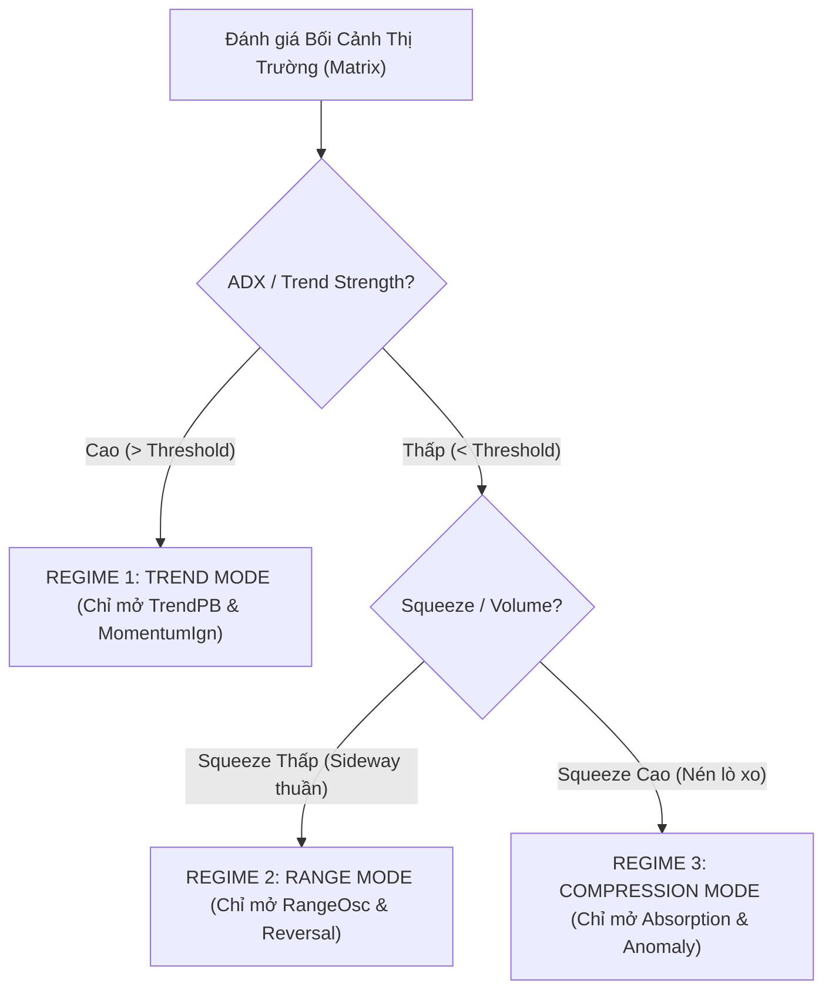

# 🔬 BÁO CÁO NGHIÊN CỨU CHUYÊN SÂU: GIẢI MÃ BỆNH LỆCH KÈO & TÌM PHƯƠNG ÁN CÂN BẰNG 6 PLAYBOOK SQUADS IN HELIOS V3

**Thư mục lưu trữ**: `strategies_backtests/helios/docs/review_v3_2/03_Playbook_Squads_Balancing_Deep_Research.md`  
**Ngày lập**: 2026-07-29  
**Đối tượng phân tích**: Toàn bộ hệ thống Phân bổ Tín hiệu (`Arbiter`, `Matrix`, và 6 Scanners)

---

## 🏛️ 1. NGUYÊN TẮC CỐ ĐỊNH: NÓI KHÔNG VỚI HARDCODED THRESHOLDS

> [!IMPORTANT]
> **Nguyên tắc bất di bất dịch của dự án**: Tất cả các ngưỡng giới hạn (Thresholds), khoảng thời gian (Time Limits), và trần cắt lỗ/chốt lời **TUYỆT ĐỐI KHÔNG ĐƯỢC HARDCODE**. Tất cả đều phải được khai báo dạng thuộc tính tùy biến với dải `min / max / step` trong [`config.rs`](file:///E:/Projects/Automations/trading_backtest/strategies_backtests/helios/src/strategy/core_v3/config.rs) để Optimizer tự do tìm kiếm giá trị tối ưu phù hợp cho từng asset và khung thời gian.

---

## 🔬 2. BẠCH NHẬT HÓA NGUYÊN NHÂN TẠI SAO HỆ THỐNG LIÊN TỤC MẤT CÂN BẰNG

Dựa trên việc đọc và phân tích toàn bộ mã nguồn `core_v3`, chúng ta bóc tách được **3 Nguyên Nhân Lõi** làm cho hệ thống luôn bị lệch kèo (`ABSORPTION` và `ANOMALY` nuốt trọn $85\%+$ số lệnh, trong khi `RANGE_OSC`, `TREND_PB`, `REVERSAL`, `MOMENTUM_IGN` bị bỏ đói):

---

### 💥 NGUYÊN NHÂN 1: CHÊNH LỆCH THƯỚC ĐO ĐIỂM RAW SCORE GIỮA CÁC SCANNER

- **Hành vi của `AbsorptionScanner` (`absorption.rs` dòng 34)**:
  $$\text{raw\_score} = (\text{vol\_activation} \times w_v) + (\text{squeeze\_activation} \times w_s)$$
  Vì `squeeze_activation` được lấy trực tiếp từ `matrix.squeeze_intensity` (vốn là mảng Rolling Percentile thường xuyên dao động ở mức $0.40 \rightarrow 0.70$), nên điểm `raw_score` của Absorption **luôn duy trì ở mức rất cao ($0.60 \rightarrow 0.85$) ở hầu như MỌI NẾN**!
- **Hành vi của `RangeOscScanner` (`range_osc.rs` dòng 63-75)**:
  Yêu cầu giá phải nằm sát biên Bollinger Bands VÀ `Stoch K > Stoch D`. Điều kiện này chỉ xuất hiện ở $< 2\%$ số nến. Khi xuất hiện, điểm `raw_score` cũng chỉ đạt $0.30 \rightarrow 0.50$.
- **Hậu quả tại Arbiter**: Khi đấu giá tại `Arbiter`, `Confidence` của Absorption ($0.70 - 0.85$) **gần như LUÔN LUÔN ĐÈ BẸP** `Confidence` của RangeOsc ($0.30 - 0.50$). RangeOsc không bao giờ có cửa thắng!

---

### 💥 NGUYÊN NHÂN 2: BỐI CẢNH MA TRẬN BỊ CHỒNG CHÉO (OVERLAPPING MULTIPLIERS)

Trong [`matrix.rs`](file:///E:/Projects/Automations/trading_backtest/strategies_backtests/helios/src/strategy/core_v3/matrix.rs#L103-L137):
- `range_multiplier = 1.0 - t_mul` (Khi thị trường sideway không có trend, `range_multiplier` vọt lên $0.80 - 0.90$).
- `absorption_multiplier = (squeeze_intensity * w) + (volume_force * (1 - w))` (Trong thị trường sideway đi ngang nén giá, `absorption_multiplier` cũng vọt lên $0.70 - 0.85$!).

#### 💥 Thảm họa chồng chéo bối cảnh:
Khi thị trường bước vào giai đoạn Sideway đi ngang, **CẢ HAI MULTIPLIER của RangeOsc VÀ Absorption ĐỀU CAO CÙNG LÚC**.
Và vì `raw_score` của Absorption cao hơn hẳn RangeOsc, `AbsorptionScanner` đã **CƯỚP TRỌN TOÀN BỘ CÁC LỆNH SIDEWAY** mà đáng lẽ phải thuộc về `RangeOscScanner`!

---

### 💥 NGUYÊN NHÂN 3: ABSORPTION LÀ SCANNER "LUÔN MỞ" (ALWAYS-ON FALLBACK)

- Các Scanner như `TrendPB`, `MomentumIgnition`, `Reversal` đều đòi hỏi các mẫu hình kỹ thuật phức tạp (KAMA Tolerance, BB Break KC, Volume Exhaustion Drop).
- Ngược lại, `AbsorptionScanner` chỉ dùng một bộ chuyển mạch đơn giản `if macd > macd_signal { Long } else { Short }`.
- ABSORPTION đã biến thành một "cỏ dại dại dột", nổ tín hiệu tràn lan trên khắp các nến medium-volume và bóp chết các "bông hoa chuyên biệt" khác.

---

## 💡 3. ĐỀ XUẤT 3 GIẢI PHÁP KIẾN TRÚC ĐỘT PHÁ ĐỂ CÂN BẰNG PLAYBOOKS

Để giải quyết tận gốc 3 nguyên nhân trên, chúng ta đề xuất **3 giải pháp kiến trúc đột phá**:

---

### 🛡️ GIẢI PHÁP A: CƠ CHẾ PHÂN CHIA BỐI CẢNH ĐỘC QUYỀN (MUTUALLY EXCLUSIVE REGIMES)

Thay vì để các Multipliers chồng chéo nhau, ta chia thị trường thành **3 Bối Cảnh Độc Quyền (Mutually Exclusive Regimes)**:



- **Tác dụng**: Trong REGIME 2 (Range Mode), **TẮT HOÀN TOÀN ABSORPTION**. `RangeOscScanner` sẽ được giải phóng $100\%$ không gian tác chiến để tự do bắt lệnh sideway mà không lo bị Absorption cướp vị thế!

---

### ⚖️ GIẢI PHÁP B: QUOTA TẦN SUẤT & PHẠT ĐỘC QUYỀN PLAYBOOK (DYNAMIC WINNER PENALTY)

- Bổ sung vào `Arbiter` một bộ đếm Quota động:
  - Nếu một Playbook (ví dụ Absorption) thắng liên tiếp $N$ lệnh hoặc chiếm quá $X\%$ tổng số lệnh đã phê duyệt, Arbiter sẽ tự động áp dụng một **Hệ số Phạt Tần Suất (`frequency_penalty_multiplier = 0.60`)** đối với Playbook đó.
- **Tác dụng**: Ép Arbiter phải nhường cơ hội cho các Playbooks khác khi một Playbook đang có dấu hiệu "làm bừa/chiếm sóng".

---

### 📏 GIẢI PHÁP C: CHUẨN HÓA THƯỚC ĐO RAW SCORE (RAW SCORE NORMALIZATION)

- Tái cấu trúc hàm `scan()` của `AbsorptionScanner`: Yêu cầu phải có sự xác nhận nén giá thực sự và điểm `raw_score` được chuẩn hóa theo dải Z-Score, không cho phép duy trì điểm cao $0.70 - 0.85$ liên tục trên các nến thường.

---

## 📊 4. BỔ SUNG CẤU HÌNH CẮT LỆNH NGÂM LỜI TÙY BIẾN VÀO CONFIG

Để giải quyết vấn đề "Lệnh ngâm hàng ngàn nến mà PnL không tăng", ta bổ sung thuộc tính tùy biến vào `RiskStopParams` trong [`config.rs`](file:///E:/Projects/Automations/trading_backtest/strategies_backtests/helios/src/strategy/core_v3/config.rs):

```rust
#[derive(Debug, Clone, Deserialize, Default, DnaMappableMacro)]
pub struct RiskStopParams {
    ...
    /// Số nến ngâm tối đa cho phép nếu lợi nhuận không phát triển (Tùy biến cho Optimizer)
    #[dna(min = 100.0, max = 2000.0, step = 50.0)]
    #[serde(deserialize_with = "ferro_trade::optimizer::config_parser::deserialize_usize_from_f64")]
    pub max_stagnant_hold_bars: usize,

    /// Ngưỡng PnL tối thiểu (%) bắt buộc phải đạt được nếu ngâm quá max_stagnant_hold_bars
    #[dna(min = 0.005, max = 0.05, step = 0.005)]
    pub stagnant_min_profit_pct: f64,
}
```

---

Bản báo cáo nghiên cứu chuyên sâu trên đã bóc tách toàn bộ nguyên nhân và vạch ra giải pháp kiến trúc tối ưu. Bạn đánh giá thế nào về **Giải pháp Bối cảnh Độc quyền (Mutually Exclusive Regimes)** và **Quota Phạt Tần Suất** này?
