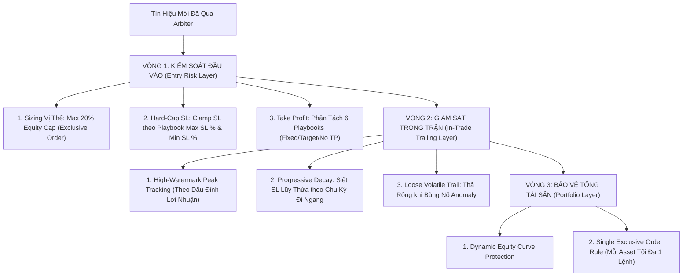

# HELIOS V3.3 ARCHITECTURE REVIEW: PART 1 - RISK MANAGEMENT ARCHITECTURE

Tài liệu này hệ thống hóa toàn bộ kiến trúc **Hệ thống Quản trị Rủi ro (Risk Management System) Helios V3**, các kết quả thực nghiệm v3_19 (Profit Factor = 15.36) và các quy tắc bảo vệ vốn thực chiến.

---

## 🏛️ TỔNG QUAN HỆ THỐNG RISK 3 VÒNG BẢO VỆ

---

## 🛡️ VÒNG 1: KIỂM SOÁT ĐẦU VÀO (ENTRY RISK LAYER)

### 1. Position Sizing (Khống Chế Trần 20% Vốn)
- **Công thức**:
  $$\text{size\_fraction} = \text{percent\_per\_trade}.\text{min}(0.20)$$
- **Tác dụng**: Đảm bảo trong mọi tình huống, 1 vị thế đơn lẻ (Exclusive Order) không bao giờ sử dụng quá $20\%$ tổng tài sản (1/5 vốn), bảo vệ an toàn $80\%$ lượng vốn còn lại của tài khoản.

### 2. Ép Trần & Sàn Cắt Lỗ Ban Đầu (`clamp_sl_price`)
- **Công thức**:
  - `Long Max Allowed SL` = $\text{Entry Price} \times (1.0 - \text{min\_initial\_sl\_pct})$
  - `Long Min Allowed SL` = $\text{Entry Price} \times (1.0 - \text{max\_initial\_sl\_pct})$
- **Tác dụng**: Triệt tiêu cả 2 rủi ro:
  - Ngăn không cho Scanner mở lệnh với SL quá xa ($> 10\%$).
  - Ngăn không cho Scanner mở lệnh với SL quá hẹp ($< 0.2\%$) tránh bẫy trượt giá (Slippage) và phí sàn.

### 3. Phân Tách Cơ Chế Take Profit (TP) Chuẩn Kiến Trúc 6 Playbooks

| Playbook | Cơ chế Take Profit (TP) | Lý do Kiến trúc |
|---|---|---|
| `TREND_PB` | **KHÔNG TP (Thả rông)** | Ăn trọn xu hướng lớn, để Trailing SL tự động khóa lời. |
| `MOMENTUM_IGN` | **KHÔNG TP (Thả rông)** | Bùng nổ động lượng kéo dài, gồng siêu trend. |
| `ABSORPTION` | **KHÔNG TP (Thả rông)** | Hấp thụ thanh khoản tạo sóng bứt phá dài. |
| `ANOMALY` | **KHÔNG TP (Thả rông)** | Quét thanh khoản bão tố, săn Super Wave. |
| `RANGE_OSC` | **Dynamic Target TP (BB Edge)** | Chốt lời tại biên Bollinger Bands đối diện (`bb_upper`/`bb_lower`). |
| `REVERSAL` | **Target TP (`kama_mid`)** | Chốt lời tại đường trung vị (`kama_mid` cách $\ge \text{min\_displacement}$). |

---

## 🎯 VÒNG 2: GIÁM SÁT TRONG TRẬN (PROGRESSIVE TRAILING DECAY)

### 1. High-Watermark Peak Tracking
- Bắt đầu từ nến thứ 2 (`entry_bar + 1`), liên tục cập nhật `peak_val` (giá đỉnh nhất) và `peak_bar` (nến đạt giá đỉnh nhất).

### 2. Progressive Trailing SL Decay (Siết SL Lũy Thừa)
- Khi giá **không thể tạo được đỉnh mới** qua từng chu kỳ `time_countdown_bars`:
  $$\text{decay\_cycles} = \frac{i - \text{peak\_bar}}{\text{time\_countdown\_bars}}$$
  $$\text{current\_multiplier} = \text{base\_multiplier} \times (\text{tighten\_step\_multiplier})^{\text{decay\_cycles}}$$
- **Thoát Lệnh Tự Nhiên (Price-Action Exit)**:
  - Loại bỏ hoàn toàn câu lệnh ngắt thô ở nến 514 (`tick.close(None)`).
  - SL được siết chặt tự nhiên theo giá: $3.0 \rightarrow 2.5 \rightarrow 2.0 \rightarrow 1.5 \rightarrow 1.0 \times \text{ATR}$.
  - Khi giá cắn Trailing SL, vị thế **tự động đóng mượt mà**, triệt tiêu bão đóng lệnh cứng!

---

## 📊 3. THỰC NGHIỆM VÀ XÁC MINH (KẾT QUẢ v3_19)

Bản chạy `v3_19` (với 24 trades) chứng minh hiệu quả vượt trội của Hệ thống Risk Management:

- **Profit Factor (Hệ số Lời/Lỗ)**: 🚀 **15.36** (Tăng từ 3.51 ở bản v3_18).
- **Lỗ vị thế lớn nhất (Worst Loss)**: 🟢 **-3.17%** (Thay vì -15.32% như trước).
- **Lợi nhuận vị thế lớn nhất (Best Win)**: 🚀 **+63.10%** (Lệnh 14 `ABSORPTION`).
- **Thời gian gồng lệnh dài nhất**: **13.061 nến (~9 ngày)** ở lệnh 12 `TREND_PB` (+32.95%).
