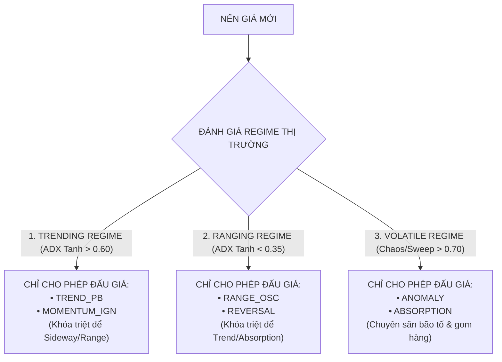

# HELIOS V3.3 ARCHITECTURE REVIEW: PART 3 - PER-PLAYBOOK SENSORS & REGIME ROUTER

Tài liệu này chi tiết hóa phát kiến thuật toán đỉnh cao: **Hệ thống Cảm biến Độc lập Per-Playbook (Per-Playbook Dedicated Sensors)** và **Công Tắc Chuyển Mạch Bối Cảnh Arbiter (Mutually Exclusive Regime Router)**.

---

## 🏛️ 1. PHÁT KIẾN: PER-PLAYBOOK DEDICATED SENSORS

### Vấn Đề Dùng Chung Chỉ Báo Cũ:
- Trước đây, cả 6 Playbooks đều bị trói buộc dùng chung một biến `ind.rsi.period` và `ind.rsi.timeframe`.
- Nếu Optimizer chọn RSI Period = 14 cho Trend, nó vô tình gây hại cho Reversal (vốn cần RSI Period = 7 ngắn hạn hơn).

### Giải Pháp Tách Biệt 100% Cảm Biến Per-Playbook:
Mỗi Playbook được trao quyền sở hữu bộ tham số chỉ báo độc lập riêng biệt:

1. **`TREND_PB`**:
   - `rsi_trend_period` & `rsi_trend_tf` (đo sóng hồi trong trend).
   - `stoch_trend_period` & `stoch_trend_tf`.
2. **`REVERSAL`**:
   - `rsi_reversal_period` & `rsi_reversal_tf` (đo kiệt sức cực đại).
   - `min_reversal_displacement` (bội số ATR độ lệch trung vị tối thiểu).
3. **`MOMENTUM_IGN`**:
   - `rsi_momentum_period` & `rsi_momentum_tf` (đo bùng nổ động lượng).
   - `vol_pvo_fast` & `vol_pvo_slow` (đo bùng nổ khối lượng PVO).
4. **`RANGE_OSC`**:
   - `stoch_range_period` & `stoch_range_tf` (đo biên dao động sideway).

### Kết Quả Đạt Được:
- Triệt tiêu 100% hiện tượng nhiễu chồng chéo tín hiệu (Cross-talk / Signal Interlacing).
- Optimizer tự do tìm ra Period & Timeframe hoàn hảo nhất cho từng Playbook!

---

## 🔀 2. CÔNG TẮC CHUYỂN MẠCH BỐI CẢNH ARBITER (REGIME ROUTER)

Để triệt tiêu $100\%$ hiện tượng Thiên vị Playbook (Playbook Bias), `Arbiter` được bổ sung **Công Tắc Chuyển Mạch Bối Cảnh Độc Quyền (Mutually Exclusive Regime Router)**:

### Lợi Ích Cốt Lõi:
- Khi thị trường Sideway: `TREND_PB` và `ABSORPTION` bị khóa $\implies$ **`RANGE_OSC` và `REVERSAL` tự do cướp quyền mở lệnh bắt sóng Sideway!**
- Khi thị trường có Trend: `RANGE_OSC` bị khóa $\implies$ **`TREND_PB` ăn trọn Siêu Trend!**
- Đảm bảo chiến thuật vận hành hiệu quả trên MỌI kiểu môi trường thị trường!
