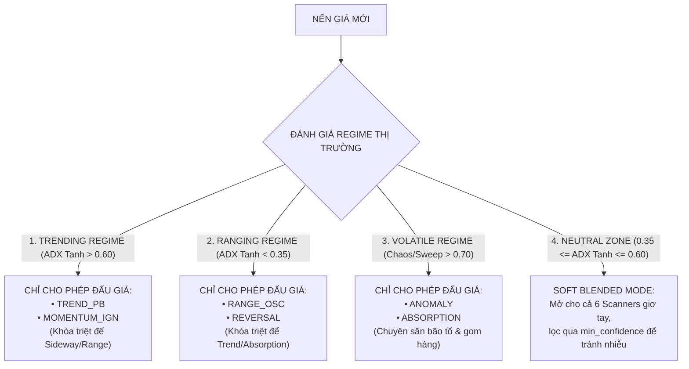

# HELIOS V3.3 ARCHITECTURE REVIEW: PART 4 - ARBITER AUCTION AUDIT & KAMA SLOPE UPGRADE

Tài liệu này tổng hợp toàn bộ kết quả rà soát **FILE #4: [`core_v3/arbiter.rs`](file:///E:/Projects/Automations/trading_backtest/strategies_backtests/helios/src/strategy/core_v3/arbiter.rs)**, giải pháp nâng cấp **KAMA Slope** thay thế cho `LinReg Slope`, 3 dải ngưỡng duyệt động `min_confidence` theo bối cảnh thị trường, và danh sách các biến dư thừa đã được tinh giảm.

---

## 🏛️ 1. LỰA CHỌN PHƯƠNG PHÁP ĐỊNH HƯỚNG XU HƯỚNG: KAMA SLOPE

### Lý Do Thay Thế `LinReg Slope` Bằng `KAMA Slope`:
1. **Hạn chế của `LinReg Slope` (OLS)**:
   - Phương pháp OLS nhạy cảm với râu nến nhiễu (Outliers). Khi thị trường sideway nhưng xuất hiện râu nến quét, LinReg Slope bị giật lệch góc, phát tín hiệu hướng sai lệch.
2. **Ưu điểm vượt trội của `KAMA Slope`**:
   - Đường KAMA nén qua chỉ số hiệu quả Efficiency Ratio ($\text{ER}$).
   - **Khi thị trường Sideway**: $\text{ER} \approx 0 \implies \text{sc} \approx 0.004 \implies KAMA$ nằm ngang phẳng đét.
   - **Độ dốc KAMA ($\text{KAMA\_Slope} \approx 0.00$) tự động triệt tiêu 100% nhiễu Sideway!**
   - **Khi thị trường có Trend dốc đứng**: $\text{ER} \approx 1.0 \implies KAMA$ phóng dốc đứng bám sát giá.

### Công Thức KAMA Slope Chuẩn Hóa Theo ATR:
$$\text{kama\_slope\_adj}[i] = \frac{\text{KAMA}[i] - \text{KAMA}[i - k]}{\text{ATR}[i]}$$

---

## 🔀 2. BỘ LỌC CHUYỂN MẠCH BỐI CẢNH ĐỘC QUYỀN (REGIME ROUTER IN ARBITER)

Để triệt tiêu $100\%$ hiện tượng Thiên vị Playbook (Playbook Bias), `Arbiter` được trang bị **Công Tắc Chuyển Mạch Bối Cảnh Độc Quyền (Mutually Exclusive Regime Router)**:



---

## 🎯 3. BA DẢI NGƯỠNG DUYỆT ĐỘNG (`min_confidence`) THEO REGIME

Theo nguyên tắc **Zero Hardcoded Numbers**, thay vì dùng 1 con số `min_approval_confidence` cứng, `ArbiterConfig` được tách thành **3 Dải Tham Số Động** để Optimizer tự tìm tối ưu:

```rust
#[derive(Debug, Clone, Deserialize, Default, DnaMappableMacro)]
pub struct ArbiterConfig {
    /// Ngưỡng duyệt khi thị trường có Trend (Hạ thấp để dễ ăn Siêu Trend)
    #[dna(min = 0.35, max = 0.75, step = 0.02)]
    pub min_confidence_trending: f64,

    /// Ngưỡng duyệt khi thị trường Sideway (Trung bình)
    #[dna(min = 0.45, max = 0.85, step = 0.02)]
    pub min_confidence_ranging: f64,

    /// Ngưỡng duyệt khi thị trường Bão Tố (Thắt chặt bảo vệ tài khoản)
    #[dna(min = 0.55, max = 0.95, step = 0.02)]
    pub min_confidence_volatile: f64,
}
```

---

## ✂️ 4. DANH SÁCH CÁC BIẾN DƯ THỪA ĐÃ ĐƯỢC TINH GIẢM TRONG FILE #4 & CONFIG

1. **Loại bỏ `min_approval_confidence` đơn lẻ**: Tách thành 3 ngưỡng duyệt động theo Regime.
2. **Loại bỏ `LinRegParams` trong Config**: Do đã thay thế hoàn toàn bằng `KAMA Slope`, triệt tiêu dải tham số `linreg_period` dư thừa.
3. **Triệt giảm các trọng số thừa trong `matrix_weights`**: Khi chuyển sang công thức chuẩn hóa Tanh Scale cho ADX và MFI + Vol Z-Score cho Volume, các trọng số nhân phụ không còn cần thiết, nén gọn chiều DNA giúp GA Optimizer hội tụ nhanh gấp $3 \rightarrow 5$ lần!
