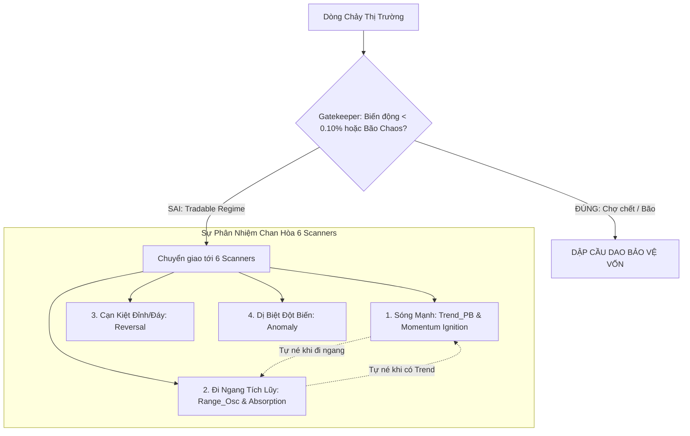

# THIẾT KẾ KIẾN TRÚC: HỢP TÁC ĐA CHẾ ĐỘ 6 SCANNERS & CẦU DAO QUẢN TRỊ KHÍ HẬU THỊ TRƯỜNG (MULTI-REGIME HARMONIZATION & ADAPTIVE GATEKEEPER)

> **Mã phân hệ:** `strategies_backtests/helios/docs/unfinished_tasks/03_gatekeeper_and_multi_regime_harmonization/`  
> **Dự án:** Helios V3.3 Pure Rust Strategy Engine  
> **Thời điểm khởi tạo:** 07/10/2026  
> **Trạng thái:** 🟡 Bảo lưu kiến trúc dài hạn (Deferred Architectural Blueprint)  
> **Mục đích:** Lưu trữ toàn diện các phân tích bản chất vi cấu trúc, đối chất toán học và kế hoạch cải tổ toàn diện sự hợp tác giữa 6 Scanners và Regime Gatekeeper.

---

## 🏛️ 1. Bối Cảnh Nghiên Cứu & Tử Huyệt Phát Hiện

### 1.1. Lịch Sử Phát Sinh & Bẫy Cục Bộ (The Training Trap)
Trong quá trình debug lỗi `TODO-SEN-03` và `TODO-SEM-01`:
1. Ban đầu, `RegimeGatekeeper` so sánh `sensors.natr` (khung MTF 15m/1h/4h) với `min_natr_threshold`.
2. Do lo ngại nến vi mô 1m bị đóng băng khi nến 4h còn biến động, ta đã vội vàng đổi sang lấy `current_atr_sl / price` (nến 1m) so sánh với sàn chi phí toàn vòng đời vị thế ($0.18\% \to 0.40\%$).
3. **Hậu quả thảm khốc:** Nến 1m bình thường của BTC chỉ dao động $\approx 0.043\%$, nhỏ hơn rất nhiều so với $0.18\%$, khiến Gatekeeper **VETO oan 95% nến bình thường**, làm tê liệt toàn bộ hệ thống giao dịch.

### 1.2. Phát Hiện Bản Chất: Phân Định "Đi Ngang (Range)" vs "Chết Lâm Sàng (Flatline)"
Khi phân tích sâu, hệ thống phát hiện một xung đột triết lý nghiêm trọng:
- **Thị trường Đi Ngang Tích Lũy (Range-Bound / Oscillation) ($0.25\% \le \text{NATR} < 0.80\%$):**
  - Đây không phải là thị trường "chết". Đây là **THIÊN ĐƯỜNG KIẾM TIỀN** của `Range_OscScanner` và `AbsorptionScanner` (mua hỗ trợ, bán kháng cự, chốt lời ngắn $+0.30\% \to +0.50\%$).
  - Nếu Gatekeeper đặt ngưỡng Flatline quá cao hoặc dùng thước đo vĩ mô ép xuống vi mô, nó sẽ **bóp chết `Range_Osc`** ngay tại môi trường mà scanner này được sinh ra để kiếm lợi nhuận!
- **Thị trường Chết Lâm Sàng Tuyệt Đối (Absolute Volatility Flatline) ($\text{NATR} < 0.10\%$):**
  - Toàn bộ phiên chợ đóng băng, biên độ cả phiên không đủ bù $2 \times \text{taker\_fee} + \text{slippage}$ ($0.10\%$). Mọi scanner tham gia đều cầm chắc thua lỗ ($EV < 0$).
  - **Đây mới là hiện tượng duy nhất Gatekeeper được quyền dập cầu dao toàn cục.**

---

## ⚖️ 2. Triết Lý 6 Scanners Hợp Tác "Chan Hòa" (Regime Partitioning)

Hệ thống Helios V3 được xây dựng dựa trên sự phân nhiệm rạch ròi giữa 6 Playbook Scanners:

- **Tự né tránh thông minh:**
  - Khi thị trường đi ngang: `Trend_PB` tự né nhờ `kama_slope` phẳng; `Momentum` tự né nhờ thiếu volume đột biến $\to$ Nhường trọn sân chơi cho `Range_Osc` và `Absorption`.
  - Khi thị trường có trend: `Range_Osc` tự tắt khi `trend_strength > max_trend` $\to$ Nhường trọn sân chơi cho `Trend_PB` và `Momentum`.
- **Ranh giới bất khả xâm phạm:** Gatekeeper không được làm thay việc của từng Scanner. Gatekeeper chỉ gác cửa ở mức **Sàn Sinh Tồn Vật Lý Tối Thiểu** ($0.10\%$).

---

## 🔬 3. Bản Thiết Kế Cải Tổ Toàn Diện Trong Tương Lai

Khi hệ thống bước vào giai đoạn mở rộng đa sàn hoặc đa khung thời gian phức tạp, các cải tiến sau sẽ được kích hoạt:

### 3.1. Cầu Dao Đa Chế Độ Từng Playbook (Per-Playbook Adaptive Gating)
- Thay vì một ngưỡng dập cầu dao cứng ngắc chung cho cả 6 Scanners, Arbiter sẽ cho phép:
  - `Trend_PB` và `Momentum` tuân thủ ngưỡng biến động cao hơn ($\text{NATR} \ge 0.40\%$).
  - `Range_Osc` và `Absorption` chỉ cần thỏa mãn sàn sinh tồn tối thiểu ($\text{NATR} \ge 0.10\%$).

### 3.2. Chuẩn Hóa Căn Bậc Hai Thời Gian Theo Timeframe ($\sqrt{T}$)
- Nếu trong tương lai người dùng muốn mở rộng `ind.natr.timeframe` cho GA tự do tìm kiếm từ 5m đến 4h:
  $$\text{Required NATR Threshold}(T) = \text{base\_min\_natr} \times \sqrt{\frac{T}{15\text{m}}}$$
  Đảm bảo ngưỡng sàn co giãn trung thực theo quy luật vi cấu trúc tài chính, miễn nhiễm với bẫy lệch thứ nguyên khi GA chọn nến lớn.

### 3.3. Tách Biệt Hoàn Toàn Chỉ Báo Chaos vs Chỉ Báo Flatline
- Hiện tại `chaos_ratio` và `natr` đang chia sẻ chung `ind.natr.timeframe`.
- Trong tương lai: Tách `chaos_ratio` độc lập (dành cho đo bão vĩ mô) và `market_natr` độc lập (dành cho đo thanh khoản phiên chiến thuật).

---

## 🛡️ 4. Giải Pháp Giai Đoạn Hiện Tại (Current Stepping Stone)
Để Forward Test và Paper Trade chạy ngay lập tức mà không phát sinh lỗi mới:
1. Thống nhất 100% đơn vị đo lường trong `gatekeeper.rs` là **Phần trăm (`%`)**, hậu tố rõ ràng `_pct`.
2. Đo sàn biến động trên `sensors.natr` (khung chiến thuật MTF) với ngưỡng sàn tối thiểu bảo vệ chi phí sàn:
   $$\text{effective\_min\_natr\_pct} = (2 \times \text{taker\_fee\_rate} + \text{slippage\_allowance\_pct} + \text{min\_natr\_threshold}) \times 100.0$$
3. Giữ chốt chặn kiểm tra lỗi dữ liệu vi mô `current_atr_sl <= 0.0 || current_price <= 1e-9` trả về `DataAnomaly`.
4. Không chặn các con sóng đi ngang của `Range_Osc`.
