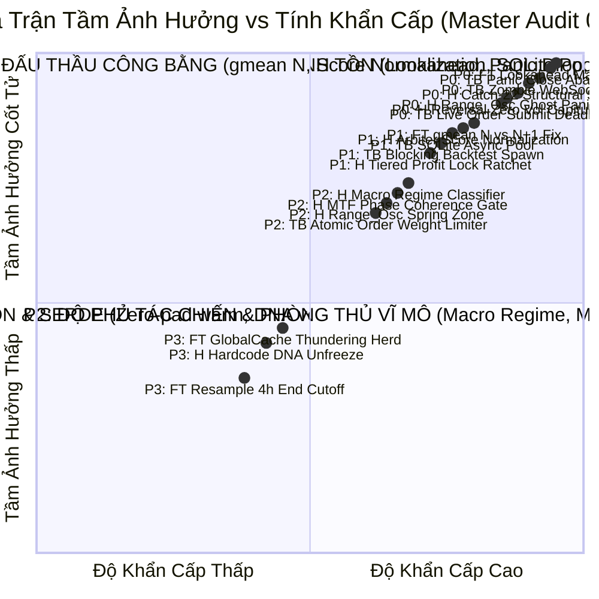
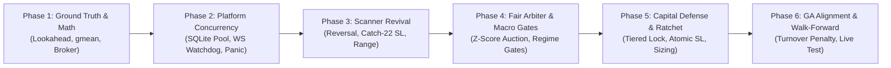

# LỘ TRÌNH QUẢN TRỊ TỔNG THỂ & THỨ TỰ ƯU TIÊN HỆ THỐNG (MASTER ROADMAP 02)

> **Dự án:** Helios V3 Adaptive Trading Ecosystem, FerroTrade Core & Binance Platform Execution  
> **Phạm vi:** Chiến dịch Kiểm toán Toàn diện & Ổn Định Hóa Hệ Thống (**Audit 02 — Systemic Stability & Quant Architecture**)  
> **Tổng quy mô:** 3 Dự án Độc lập • 4 Tài liệu Kiểm toán Chuyên sâu • 6 Giai đoạn Triển khai (Phases) • 52 Tasks Chi tiết Sắp Xếp Theo Mức Độ Ưu Tiên  
> **Mục tiêu tối thượng:** Chuyển đổi toàn diện hệ thống từ "Cào lệnh quá mức, kết quả bấp bênh" sang "Lỗ ít, lời ổn định, đủ nhiều, lọc sạch trạng thái nguy hiểm và tối đa hóa lợi nhuận bền vững".

---

## 🗺️ 1. BẢN ĐỒ ĐIỀU HƯỚNG TÀI LIỆU KIỂM TOÁN (AUDIT DIRECTORY INDEX)

Toàn bộ các phát hiện kỹ thuật, lỗ hổng toán học, rủi ro khớp lệnh sàn và danh mục kiểm thử chi tiết được phân bổ trong các tài liệu thuộc thư mục [`05_systemic_stability_and_quant_architecture_flaws/`](file:///E:/Projects/Automations/trading_backtest/strategies_backtests/helios/docs/unfinished_tasks/05_systemic_stability_and_quant_architecture_flaws/):

| STT | Tài Liệu Kỹ Thuật | Trọng Tâm Quản Trị & Rủi Ro Cốt Tử |
| :---: | :--- | :--- |
| **01** | [📄 `01_quant_architecture_flaws_and_stability_blueprint.md`](file:///E:/Projects/Automations/trading_backtest/strategies_backtests/helios/docs/unfinished_tasks/05_systemic_stability_and_quant_architecture_flaws/notes/01_quant_architecture_flaws_and_stability_blueprint.md) | Mổ xẻ 4 tử huyệt định lượng: Turnover Blindspot, Độc quyền Playbook, Bẫy giãn ATR ở Trailing SL, Thiếu đồng thuận pha MTF; Bản thiết kế ổn định hóa. |
| **02** | [📄 `02_helios_and_trading_bot_architectural_flaws.md`](file:///E:/Projects/Automations/trading_backtest/strategies_backtests/helios/docs/unfinished_tasks/05_systemic_stability_and_quant_architecture_flaws/notes/02_helios_and_trading_bot_architectural_flaws.md) | Phân tích 5 điểm yếu giao thoa kiến trúc: Split-Brain Risk giữa Backtest và Bot, Điểm mù trong nến, Thiếu Portfolio Guardian, Naked SL Gap 150ms, Adopt & Protect SL Retraction. |
| **03** | [📄 `03_full_system_codebase_audit_flaws.md`](file:///E:/Projects/Automations/trading_backtest/strategies_backtests/helios/docs/unfinished_tasks/05_systemic_stability_and_quant_architecture_flaws/notes/03_full_system_codebase_audit_flaws.md) | Báo cáo kiểm toán tổng hợp 42 điểm yếu mới trên toàn bộ 3 dự án (`ferro_trade`, `helios`, `trading_bot`). |
| **04** | [📄 `04_subagents_audit_detailed_tables.md`](file:///E:/Projects/Automations/trading_backtest/strategies_backtests/helios/docs/unfinished_tasks/05_systemic_stability_and_quant_architecture_flaws/notes/04_subagents_audit_detailed_tables.md) | Tổng hợp nguyên vẹn các bảng biểu chi tiết, ma trận đối chất và phân loại từ 3 sub-agents độc lập. |
| **05** | [📄 `05_scanner_independence_and_regime_auction_architecture.md`](file:///E:/Projects/Automations/trading_backtest/strategies_backtests/helios/docs/unfinished_tasks/05_systemic_stability_and_quant_architecture_flaws/notes/05_scanner_independence_and_regime_auction_architecture.md) | Phân tích sự sụp đổ của triết lý cấm trùng indicator & thiết kế sàn đấu thầu 3 tầng. |
| **06** | [📄 `06_sprint_plan_and_3tier_architecture_notes.md`](file:///E:/Projects/Automations/trading_backtest/strategies_backtests/helios/docs/unfinished_tasks/05_systemic_stability_and_quant_architecture_flaws/notes/06_sprint_plan_and_3tier_architecture_notes.md) | Kế hoạch tác chiến 7 ngày dứt điểm đưa bot vào demo & bản thiết kế 3 tầng. |
| **07** | [📄 `07_micro_vs_macro_timeframe_quant_standards.md`](file:///E:/Projects/Automations/trading_backtest/strategies_backtests/helios/docs/unfinished_tasks/05_systemic_stability_and_quant_architecture_flaws/notes/07_micro_vs_macro_timeframe_quant_standards.md) | Tiêu chuẩn định lượng và nguyên lý vật lý phân chia khung thời gian Vi mô vs Vĩ mô. |
| **08** | [📄 `08_forward_fill_matrix_flaws_and_architectural_sanity_check.md`](file:///E:/Projects/Automations/trading_backtest/strategies_backtests/helios/docs/unfinished_tasks/05_systemic_stability_and_quant_architecture_flaws/notes/08_forward_fill_matrix_flaws_and_architectural_sanity_check.md) | Mổ xẻ dị tật forward-fill trong matrix, nguyên nhân thất bại của Arbiter và giải pháp triệt tiêu xung đột đa khung thời gian. |
| **09** | [📄 `09_dynamic_timeframe_agnostic_architecture_and_deep_sanity_audit.md`](file:///E:/Projects/Automations/trading_backtest/strategies_backtests/helios/docs/unfinished_tasks/05_systemic_stability_and_quant_architecture_flaws/notes/09_dynamic_timeframe_agnostic_architecture_and_deep_sanity_audit.md) | Thiết kế độc lập khung thời gian (Timeframe-Agnostic) và thẩm định toàn diện tính tối ưu, nguy cơ Over/Under-engineering và xung đột logic. |
| **10** | [📄 `10_ga_fitness_expectancy_alignment.md`](file:///E:/Projects/Automations/trading_backtest/strategies_backtests/helios/docs/unfinished_tasks/05_systemic_stability_and_quant_architecture_flaws/notes/10_ga_fitness_expectancy_alignment.md) | Tái cấu trúc hàm mục tiêu Fitness GA, đồng trục kỳ vọng toán học (EV Alignment) và triệt tiêu 4 tử huyệt lệch tâm. |
| **11** | [📋 `TODO.md`](file:///E:/Projects/Automations/trading_backtest/strategies_backtests/helios/docs/unfinished_tasks/05_systemic_stability_and_quant_architecture_flaws/TODO.md) | Check-list tác chiến quản lý tiến độ từng đầu việc. |

---

## 🎯 2. MA TRẬN PHÂN LOẠI THỨ TỰ ƯU TIÊN (PRIORITY MATRIX)

Toàn bộ 52 nhiệm vụ tái cấu trúc được phân bổ vào 4 cấp độ theo tầm ảnh hưởng và tính khẩn cấp:

### 🔴 P0 — Cốt Tử & Bảo Vệ Sinh Tồn (Critical Safety, Anti-Crash & Ground Truth Fidelity)
1. **Triệt tiêu Lookahead Bias trong Sizing Broker (`TODO-AUDIT-FT-01`):** Sizing tại $Open[i]$ không được gọi $Close[i]$ tương lai.
2. **Khắc phục Lỗ hổng Bỏ rơi Lệnh khi Panic Close (`TODO-AUDIT-TB-04`):** Gọi lệnh Market Close thật trên Binance trước khi thoát bot.
3. **Chống Vòng lặp WebSocket Zombie (`TODO-AUDIT-TB-02`):** Bổ sung Heartbeat / Watchdog ngắt kết nối ngầm.
4. **Phá Bẫy Catch-22 SL Cấu trúc vs VETO ROE (`TODO-AUDIT-H-02`):** Tự động co hẹp SL về mức trần $\le 15\%$ ROE và giảm size thay vì VETO.
5. **Hóa giải Nghịch lý Khối lượng Kiệt sức Reversal (`TODO-AUDIT-H-01`):** Chấp nhận bão khối lượng lớn ($vol\_ratio \ge 1.5$) là điểm cộng.
6. **Xử lý Mã nguồn Ma `range_osc.rs` (`TODO-AUDIT-H-03`):** Xóa bỏ nguy cơ crash Out-of-bounds và tích hợp chuẩn.
7. **Khử Deadlock Cờ Lệnh Live Engine (`TODO-AUDIT-TB-03`):** Tự động timeout reset cờ `is_submitting_order` sau 3-5 giây.

### 🟠 P1 — Nền Tảng Toán Học, Đấu Thầu Công Bằng & Concurrency
8. **Chuẩn hóa Geometric Mean $N$ thay vì $N+1$ (`TODO-AUDIT-FT-03`):** Bảo đảm tính đúng đắn cho Sharpe, Sortino và Return.
9. **Chuẩn hóa Phân phối Điểm số Arbiter (`TODO-AUDIT-H-03`):** Chống việc Absorption cướp trọn quyền đấu thầu của Momentum/Reversal.
10. **Tách biệt Kết nối SQLite Pool (`TODO-AUDIT-TB-01`):** Khử nghẽn worker Tokio khi truy vấn 43,200 nến.
11. **Spawn Blocking cho Diagnostic Backtest (`TODO-AUDIT-TB-03`):** Đưa tác vụ CPU nặng ra khỏi Async Event Loop.
12. **Triển khai Tiered Profit Lock & Break-Even Ratchet (`TODO-STAB-01`):** Khóa lãi từng nấc ($+3.5\%$ ROE $\to$ BE $+1.60\%$; $+8\%$ ROE $\to +4\%$).
13. **Độc quyền hóa Thẩm quyền Risk về `helios::risk` (`TODO-STAB-06`):** Khử triệt để Split-Brain Risk giữa Backtest và Bot.

### 🟡 P2 — Độ Phủ Tác Chiến & Phòng Thủ Vĩ Mô
14. **Bộ Phân Loại Chế Độ Thị Trường Cấp Vĩ Mô (`TODO-STAB-03`):** Khóa `Trend_PB` và `Momentum_IGN` trong pha Chop/Đi ngang.
15. **Chốt Chặn Đồng Thuận Pha Đa Khung Thời Gian (`TODO-STAB-04`):** Ép nến 1m phải cùng pha xu hướng với 15m/1h.
16. **Nới lỏng Dải Biên Range Spring (`TODO-AUDIT-H-03`):** Cho phép bắt false breakdown ngoài dải BB trong vùng tích lũy.
17. **Cơ chế Atomic Rate Limit Reservation (`TODO-AUDIT-TB-05`):** Khử lỗi Check-then-act trong `WeightMonitor` chống bị ban IP.
18. **Atomic SL Replacement (`TODO-STAB-09`):** Khử hoàn toàn Naked SL Gap 150ms trên sàn Binance.

### 🟢 P3 — Tinh Giản Mã Nguồn, Bộ Nhớ Đệm & Serde
19. **Khử Bơm Số 0 trong `chaos_ratio` & `atr_sma` (`TODO-AUDIT-FT-02`):** Bảo toàn $NaN$ trong giai đoạn warmup.
20. **Bộ nhớ đệm LRU cho `FitnessCache` (`TODO-AUDIT-FT-05`):** Thay thế lệnh `clear()` toàn bộ bằng đào thải LRU mượt mà.
21. **Mở khóa Toàn bộ Hyperparameters trong DNA (`TODO-AUDIT-H-04`):** Đưa `min_activation_score` và volume period vào DNA.
22. **Zero-copy Slice cho DataView trong GA (`TODO-AUDIT-FT-06`):** Dùng `Arc<DataView>` thay vì deep clone.

---

## 🚀 3. LỘ TRÌNH 6 GIAI ĐOẠN THỰC THI (BABY STEPS PHASES)

---

## 📋 4. DANH MỤC NHIỆM VỤ CHI TIẾT THEO CẤP ĐỘ ƯU TIÊN

### GIAI ĐOẠN 1: CHUẨN HÓA TOÁN HỌC & ĐỘNG CƠ BACKTEST (`ferro_trade`)
- [ ] **TODO-FT-01 [P0]: Sửa Lookahead Bias trong Sizing Margin tại Nến Mở Vị Thế**
  - **Files:** `ferro_trade/src/broker/broker.rs:166, 479`, `ferro_trade/src/backtest/engine.rs:294`
  - **Mô tả:** Định cỡ và kiểm tra margin bằng giá $Open[i]$ của nến hiện tại hoặc $Close[i-1]$ nến trước, cấm dùng $Close[i]$.
  - **Unit Tests:** `test_margin_available_uses_open_price_at_entry_bar`
- [ ] **TODO-FT-02 [P0]: Khử Backfill (`bfill`) trong `atr_sma` & Bơm Số 0 trong `chaos_ratio`**
  - **Files:** `ferro_trade/src/indicators/bulk.rs:1507-1514, 1631`
  - **Mô tả:** Trả về $NaN$ trong giai đoạn warmup của ATR; tính SMA NATR bỏ qua NaN thay vì độn số 0.
  - **Unit Tests:** `test_atr_sma_warmup_returns_nan_without_bfill`, `test_chaos_ratio_no_artificial_spike`
- [ ] **TODO-FT-03 [P1]: Sửa Công Thức Geometric Mean ($N$ thay vì $N+1$)**
  - **Files:** `ferro_trade/src/stats/core.rs:186-188`
  - **Mô tả:** Chuẩn hóa số bước thời gian $total\_days = welford\_count$ thay vì $welford\_count + 1$.
  - **Unit Tests:** `test_compute_stats_gmean_matches_python_1_to_1`
- [ ] **TODO-FT-04 [P1]: Sửa Logic Pessimistic Execution cho Stop Entry & Hedging Zero Net**
  - **Files:** `ferro_trade/src/broker/broker.rs:150, 558-564`
  - **Mô tả:** Khớp SL ngay trong nến nếu vi phạm mức dừng; tính đúng Unrealized PnL khi net size = 0.
  - **Unit Tests:** `test_stop_entry_triggers_pessimistic_sl_same_bar`, `test_hedging_zero_net_preserves_equity`

---

### GIAI ĐOẠN 2: GIA CỐ NỀN TẢNG THỰC THI & CONCURRENCY (`trading_bot`)
- [ ] **TODO-TB-01 [P0]: Khắc Phục Lỗ Hổng Panic Close All Bỏ Rơi Lệnh Trên Sàn**
  - **Files:** `trading_bot/bot_engine/src/controller/asset_actor.rs:703`, `execution/order_executor.rs:310`
  - **Mô tả:** Khi nhận Panic, gọi lệnh khẩn cấp Market Close `closePosition: true` và hủy mọi Algo Order trên Binance trước khi thoát loop.
  - **Unit Tests:** `test_panic_close_sends_market_reduce_only_order`
- [ ] **TODO-TB-02 [P0]: WebSocket Watchdog & Chống Zombie Connection**
  - **Files:** `trading_bot/bot_engine/src/execution/ws_manager.rs:139`, `data_engine/binance_stream.rs:19`
  - **Mô tả:** Bổ sung Ping/Pong Timeout + Heartbeat. Nếu $> 65$s không nhận được nến mới $\implies$ thoát loop và kích hoạt khối Reconnect.
  - **Unit Tests:** `test_ws_watchdog_triggers_reconnect_on_silence`
- [ ] **TODO-TB-03 [P0]: Timeout Guard Cho Cờ `is_submitting_order`**
  - **Files:** `trading_bot/bot_engine/src/execution/live_engine.rs:122-140`
  - **Mô tả:** Tự động reset cờ về `false` ngay khi REST API trả kết quả, kèm fallback timeout 3s nếu WS User Data bị nghẽn.
  - **Unit Tests:** `test_submitting_flag_auto_resets_after_timeout`
- [ ] **TODO-TB-04 [P1]: Tách Biệt Kết Nối SQLite & Khử Nghẽn Tokio Worker Threads**
  - **Files:** `trading_bot/bot_engine/src/data_engine/sqlite_impl.rs:10-12`
  - **Mô tả:** Chuyển sang mô hình Read Connection Pool độc lập với Write Connection, bọc các truy vấn $43,200$ nến bằng `spawn_blocking`.
  - **Unit Tests:** `test_sqlite_concurrent_read_does_not_block_writes`
- [ ] **TODO-TB-05 [P1]: Đưa Diagnostic Backtest Ra Khỏi Async Event Loop**
  - **Files:** `trading_bot/bot_engine/src/controller/asset_actor.rs:348`, `optimizer/helios_bridge.rs:167`
  - **Mô tả:** Bọc `diagnostic_backtest` trong `tokio::task::spawn_blocking` để Actor loop phản xạ dưới 1ms.
  - **Unit Tests:** `test_diagnostic_backtest_runs_in_blocking_pool`

---

### GIAI ĐOẠN 3: TÁI SINH CÁC SCANNER BỊ TÊ LIỆT (`helios`)
- [ ] **TODO-H-01 [P0]: Tái Sinh `reversal.rs` & Hóa Giải Nghịch Lý Khối Lượng Kiệt Sức**
  - **Files:** `strategies_backtests/helios/src/strategy/core_v3/scanners/reversal.rs:105-110`
  - **Mô tả:** Xóa bỏ `sat_proximity` ép vol về 0.50; chấm điểm cao tối đa khi có bão khối lượng lớn ($vol\_ratio \ge 1.5$); nới lỏng tương thích giữa CLV và MFI.
  - **Unit Tests:** `test_reversal_scores_high_on_panic_capitulation_volume`
- [ ] **TODO-H-02 [P0]: Phá Bẫy Catch-22 Giữa Stop Loss Cấu Trúc và VETO ROE**
  - **Files:** `strategies_backtests/helios/src/strategy/core_v3/scanners/reversal.rs:130`, `anomaly.rs:75`, `arbiter.rs:222`
  - **Mô tả:** **Dynamic SL Clamping:** Nếu SL cấu trúc $> 15\%$ ROE, tự động kẹp SL về trần an toàn $\le 15\%$ ROE và giảm kích thước vị thế tương ứng thay vì VETO loại bỏ hoàn toàn.
  - **Unit Tests:** `test_clamped_structural_sl_passes_arbiter_with_scaled_size`
- [ ] **TODO-H-03 [P0]: Xử Lý Dứt Điểm Mã Nguồn Ma `range_osc.rs` & Phòng Ngừa Panic Crash**
  - **Files:** `strategies_backtests/helios/src/strategy/core_v3/scanners/range_osc.rs:77`, `core_v3/mod.rs:48`
  - **Mô tả:** Đảm bảo vector cảm biến Donchian/Stoch luôn có dữ liệu an toàn; nới lỏng điều kiện Gaussian và cho phép bắt Spring râu nến nhúng ngoài dải BB.
  - **Unit Tests:** `test_range_osc_handles_empty_sensors_without_panic`, `test_range_osc_detects_spring_breakdown`

---

### GIAI ĐOẠN 4: ĐẤU THẦU CÔNG BẰNG & BỘ LỌC CHẾ ĐỘ THỊ TRƯỜNG VĨ MÔ
- [ ] **TODO-H-04 [P1]: Chuẩn Hóa Phân Phối Điểm Số Arbiter (Confidence Normalization)**
  - **Files:** `strategies_backtests/helios/src/strategy/core_v3/arbiter.rs:150-165`
  - **Mô tả:** Chuẩn hóa điểm số thô của từng Scanner về thang đo tương đương (Z-Score hoặc Percentile nội bộ) trước khi đưa vào sàn đấu thầu.
  - **Unit Tests:** `test_arbiter_normalized_scoring_prevents_absorption_monopoly`
- [ ] **TODO-H-05 [P2]: Bộ Phân Loại Chế Độ Thị Trường Cấp Vĩ Mô (Macro Regime Classifier)**
  - **Files:** `strategies_backtests/helios/src/strategy/core_v3/matrix.rs`, `arbiter.rs`
  - **Mô tả:** Nhận diện 3 chế độ vĩ mô lớn: `Trend`, `Range/Chop`, `High-Volatility Chaos`. Chỉ kích hoạt các Scanner tương ứng với từng chế độ (khóa `Trend_PB` và `Momentum_IGN` khi thị trường Chop).
  - **Unit Tests:** `test_regime_classifier_blocks_trend_scanners_in_choppy_market`
- [ ] **TODO-H-06 [P2]: Chốt Chặn Đồng Thuận Pha Đa Khung Thời Gian (MTF Phase Coherence Gate)**
  - **Files:** `strategies_backtests/helios/src/strategy/core_v3/scanners/trend_pb.rs`, `momentum_ignition.rs`
  - **Mô tả:** Chỉ cho phép vào lệnh 1m khi xu hướng khung 15m/1h đồng thuận pha (KAMA 15m cùng chiều, không đối nghịch).
  - **Unit Tests:** `test_mtf_phase_coherence_blocks_counter_trend_noise`

---

### GIAI ĐOẠN 5: BẢO VỆ VỐN LŨY TIẾN & KHÓA LỢI NHUẬN TỨC THÌ
- [ ] **TODO-RSK-01 [P1]: Triển Khai Tiered Profit Lock & Break-Even Ratchet**
  - **Files:** `strategies_backtests/helios/src/strategy/core_v3/risk.rs:250`, `trading_bot/bot_engine/src/execution/paper_trader.rs:450`
  - **Mô tả:** Nấc 1: Khi $\text{MFE} \ge +3.5\%$ ROE $\to$ dời SL lên tối thiểu $+1.60\%$ ROE (bảo hiểm phí sàn); Nấc 2: Khi $\text{MFE} \ge +8.0\%$ ROE $\to$ khóa cứng $+4.00\%$ ROE.
  - **Unit Tests:** `test_tiered_profit_lock_break_even_at_3_5_roe`, `test_tiered_profit_lock_locks_4_pct_at_8_pct_roe`
- [ ] **TODO-RSK-02 [P1]: Atomic SL Replacement Trên Binance Futures**
  - **Files:** `trading_bot/bot_engine/src/execution/order_executor.rs:420`
  - **Mô tả:** Đặt lệnh Stop Loss mới thành công trên sàn trước khi phát lệnh hủy Stop Loss cũ (khử Naked SL Gap 150ms).
  - **Unit Tests:** `test_atomic_sl_replaces_old_order_safely`
- [ ] **TODO-RSK-03 [P1]: True Adopt & Protect Chống Tụt Stop Loss Khi Khởi Động Lại**
  - **Files:** `trading_bot/bot_engine/src/controller/asset_actor.rs:210`, `execution/live_engine.rs:180`
  - **Mô tả:** Kế thừa trực tiếp mức giá dừng lỗ của lệnh Algo SL đang sống trên sàn Binance, cấm tụt SL về giá entry ban đầu.
  - **Unit Tests:** `test_adopt_and_protect_preserves_cloud_trailing_sl`

---

### GIAI ĐOẠN 6: ĐỒNG BỘ HÀM MỤC TIÊU GA & WALK-FORWARD TESTING
- [~] **TODO-OPT-01 [P1]: Tái Cấu Trúc Hàm Mục Tiêu Fitness GA Theo Chuẩn t-Statistic EV_Net (TRẠNG THÁI: HOÀN THIỆN MỘT PHẦN — PHASE 1 DONE)**
  - **Files:** `trading_bot/bot_engine/src/optimizer/prospector_runner.rs`, `ferro_trade/src/stats/core.rs`
  - **Đã Hoàn Thành (Giai Đoạn 1 — Quick Win):**
    - [x] Triển khai hàm `calculate_enhanced_fitness_with_leverage` và `FitnessConfig` tại `prospector_runner.rs`.
    - [x] Khấu trừ Trượt giá Động ($\text{Dynamic Slippage Drag}$) theo đòn bẩy tài khoản: $\text{SlippageDrag} = 2 \times \text{slippage\_rate} \times L$.
    - [x] Cổng chặn mẫu tự co giãn theo thời gian ($\text{Adaptive Sample Gate}$): $N_{\min}, N_{\max}$ theo $T_{\text{days}}$.
    - [x] Đồng bộ Cổng WFE Validation Gate yêu cầu $\text{val\_net\_ret} > 0.0$ (lãi ròng sau trượt giá) mới duyệt DNA.
    - [x] Bộ Unit Tests toán học đạt $7/7$ PASSED: `test_fitness_negative_or_nan`, `test_fitness_low_trades_penalty`, `test_fitness_slippage_friction_elimination`, `test_fitness_dynamic_leverage_scaling`, `test_wfe_gate_hard_zero_tolerance`.
  - **Kế Hoạch Dài Hạn (Giai Đoạn 2 — Hoàn Thiện Thể Chế, Sẽ Thực Hiện Khi App Ổn Định):**
    - [ ] Tận dụng trường dự phòng `custom_1` trong struct 256-byte aligned `PackedStats` (`ferro_trade/src/stats/types.rs`) để tính toán trực tiếp Downside Deviation và EV trên từng giao dịch riêng lẻ (`closed_trades`) thay vì chuỗi MaxDD/Daily Equity.
- [ ] **TODO-OPT-02 [P2]: Kiểm Thử Toàn Diện Walk-Forward Out-Of-Sample**
  - **Files:** `trading_bot/bot_engine/examples/walk_forward_smart_seed.rs`
  - **Mô tả:** Chạy kiểm thử Walk-Forward 4 chu kỳ trên dữ liệu thực tế, đo lường các tiêu chí: Realized Net PnL $> 0$, Phân bổ đa playbook cân bằng, Không dính chuỗi thua lỗ quá mức.
  - **Verify Check:** `cargo run --release --example walk_forward_smart_seed`

