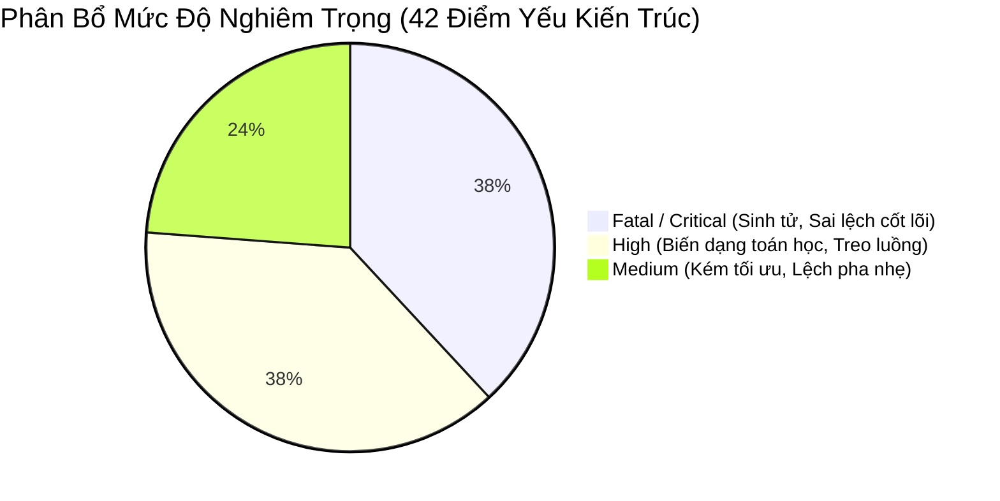

# TỔNG HỢP CÁC BẢNG BIỂU CHI TIẾT TỪ 3 KIỂM TOÁN VIÊN ĐỘC LẬP (SUB-AGENTS)

> **Thư mục:** [`05_systemic_stability_and_quant_architecture_flaws/`](file:///E:/Projects/Automations/trading_backtest/strategies_backtests/helios/docs/unfinished_tasks/05_systemic_stability_and_quant_architecture_flaws/)  
> **Tài liệu đối chiếu:** Kết quả kiểm toán độc lập của 3 sub-agents:  
> 1. `c4182a71-32fb-4fa1-b6d8-57c1eeaef13d`: **FerroTrade Architecture Auditor**  
> 2. `a6d65f90-0a9d-4c45-805d-7f4b0f631ec6`: **Helios Strategy Core Auditor**  
> 3. `73889a56-5203-420c-9080-d9b76854d8bd`: **TradingBot Platform & Concurrency Auditor**  

---

## 🏛️ BẢNG 1: CHI TIẾT 17 ĐIỂM YẾU KIẾN TRÚC & TOÁN HỌC TRONG `ferro_trade`

| STT | Mã Điểm Yếu | File & Dòng Code | Mức Độ | Bản Chất Logic / Toán Học | Kịch Bản Lỗi & Tác Động Hệ Thống |
| :---: | :--- | :--- | :---: | :--- | :--- |
| **1** | **FT-LOOKAHEAD-SIZING** | `broker.rs:166, 479`, `engine.rs:294` | 🔴 **CRITICAL** | Khớp lệnh đầu nến $Open[i]$ nhưng `margin_available()` lại gọi $Close[i]$ tương lai | Rò rỉ thông tin tương lai trong tính toán ký quỹ và sizing đòn bẩy |
| **2** | **FT-ATR-BFILL-WARMUP** | `indicators/bulk.rs:1507-1514` | 🔴 **CRITICAL** | Backfill ($bfill$) ATR tương lai vào giai đoạn Warmup nến | Làm tê liệt `actual_warmup` quét NaN trong `manager.rs`, cho phép trade sớm bằng dữ liệu ảo |
| **3** | **FT-GMEAN-DIV-N-PLUS-1**| `stats/core.rs:186-188` | 🔴 **CRITICAL** | Công thức $gmean$ chia mẫu số cho $N+1$ thay vì $N$ bước thời gian | Bóp méo theo hàm số mũ toàn bộ Sharpe Ratio, Sortino Ratio và Annualized Return |
| **4** | **FT-HEDGING-ZERO-NET** | `broker.rs:150-153, 755` | 🔴 **CRITICAL** | Khi vị thế ròng $\sum Size = 0$ trong hedging, xóa sạch `total_position_cost = 0.0` | `equity()` tính sai tổng tài sản, bỏ qua Unrealized PnL đối ứng giữa 2 nhánh Long/Short |
| **5** | **FT-STOP-ENTRY-ASYM** | `broker.rs:558-564` | 🔴 **CRITICAL** | Stop order khớp trong nến: TP được khớp ngay nến $i$, SL bị trì hoãn sang $i+1$ | Vi phạm nguyên tắc Pessimistic Matching, thiên vị lợi nhuận và làm đẹp kết quả backtest giả tạo |
| **6** | **FT-FLOAT-DRIFT-ER** | `indicators/bulk.rs:157` | 🟠 **HIGH** | Cửa sổ trượt `sum += diff - old_diff` bị trôi sai số float, thiếu `.clamp(0.0, 1.0)` | Mẫu số âm hoặc bằng 0 làm ER sụp đổ hoặc nổ tung $> 1.0$, làm méo mó chỉ số KAMA |
| **7** | **FT-CHAOS-ZERO-PAD** | `indicators/bulk.rs:1631` | 🟠 **HIGH** | NATR warmup bị gán cứng $0.0$ thay vì NaN trước khi tính SMA 50 | Mẫu số SMA bị dìm xuống, phóng đại `chaos_ratio` ảo $+39\%$, kích hoạt VETO nhầm trong 50 nến đầu |
| **8** | **FT-CACHE-THUNDERING** | `data/global_cache.rs:164-182` | 🟠 **HIGH** | Race condition "Check-then-act": nhả read-lock rồi mới xin write-lock | Thundering herd khi nhiều luồng Rayon cùng tính GA, tính trùng lặp chỉ báo hàng chục lần |
| **9** | **FT-CACHE-THRASHING** | `optimizer/fitness_cache.rs:102`| 🟠 **HIGH** | Chạm trần 50,000 entries thì gọi thẳng `clear()` toàn bộ thay vì đào thải LRU | Xóa sạch 100% cache, tỷ lệ Hit-rate rớt về 0%, gây sốc tải CPU đột ngột giữa các thế hệ GA |
| **10**| **FT-TIMEFRAME-POLLUTE** | `backtest/manager.rs:106` | 🟠 **HIGH** | `add_raw_cached` hardcode `Timeframe::T1m` và cột `Close` cho cache key | Ô nhiễm chéo dữ liệu chỉ báo giữa các timeframe (5m, 15m, 1h) khi nạp chung cache |
| **11**| **FT-CPU-OVERSUBSCRIBE** | `optimizer/prospector.rs:898` | 🟠 **HIGH** | Rayon pool lồng nhau do nới lỏng `active_workers >= num_threads` | Sinh ra $N \times M$ luồng tranh chấp nhân CPU, gây nghẽn do quá tải Context Switch |
| **12**| **FT-VAR-EXPLOSION-MIN** | `optimizer/ga_worker.rs:345` | 🟠 **HIGH** | Gán `isize::MIN` ($\approx -9 \times 10^{18}$) khi lỗi, bị bình phương khi tính phương sai | Phương sai quần thể nổ tung lên $10^{36}$, vô hiệu hóa hoàn toàn bộ lọc Pruning của GA |
| **13**| **FT-RECURSIVE-DEADLOCK**| `backtest/manager.rs:271` | 🟡 **MEDIUM** | Giữ `RwLockReadGuard` trên HashMap khi gọi tính toán chỉ báo phụ thuộc | Deadlock luồng nếu chỉ báo con yêu cầu `write_lock` để nạp dữ liệu mới |
| **14**| **FT-DEEP-CLONE-DATAVIEW**| `optimizer/ga_worker.rs:194` | 🟡 **MEDIUM** | Mỗi cá thể GA clone toàn bộ mảng nến trong `DataView` thay vì dùng con trỏ Arc | Tốn bộ nhớ RAM và làm chậm quá trình duyệt thế hệ của Prospector |
| **15**| **FT-PYRAMID-UNCHECKED** | `broker.rs:324` | 🟡 **MEDIUM** | Mở rộng vị thế (Pyramiding) không kiểm tra giới hạn `max_position_size` | Cho phép tích lũy vị thế vượt mức quy định nếu số dư margin tức thời còn đủ |
| **16**| **FT-MTF-CUTOFF-LOSS** | `utils/resample.rs:112` | 🟡 **MEDIUM** | Resample cắt bỏ các nến 1m dư thừa ở cuối mảng nếu không tròn khung 4h | Mất mát dữ liệu những giờ giao dịch cuối cùng trước thời điểm hiện tại |
| **17**| **FT-TIMESTAMP-MISMATCH** | `data/raw_data.rs:88` | 🟡 **MEDIUM** | Trường `timestamp` không ép kiểu chặt chẽ, trộn lẫn giữa giây ($10^9$) và ms ($10^{12}$) | Lệch pha thời gian khi nạp dữ liệu từ các sàn khác nhau mà không có assertion kiểm tra |

---

## 🧬 BẢNG 2: CHI TIẾT 15 ĐIỂM YẾU KIẾN TRÚC & LOGIC TRONG `helios` (CORE V3)

| STT | Mã Điểm Yếu | File & Dòng Code | Mức Độ | Bản Chất Logic / Toán Học | Kịch Bản Lỗi & Tác Động Hệ Thống |
| :---: | :--- | :--- | :---: | :--- | :--- |
| **1** | **H-REV-VOL-FALLACY** | `scanners/reversal.rs:105` | 🔴 **CRITICAL** | `sat_proximity` ép điểm volume về 0 khi `vol_ratio` lệch xa $0.50$ | Khi có bão xả lũ Capitulation Dump ($vol\_ratio > 1.5$), điểm volume bị gán đúng **0.0**, giết chết Reversal |
| **2** | **H-ARB-SCORE-ASYM** | `arbiter.rs:150` | 🔴 **CRITICAL** | Arbiter so sánh điểm tuyệt đối thô mà không chuẩn hóa phân phối Z-Score | Absorption ($0.85-0.95$) và TrendPB ($0.75-0.85$) cướp sạch quyền của Momentum ($0.70-0.80$) |
| **3** | **H-CATCH22-STRUCT-SL** | `reversal.rs:130`, `anomaly.rs:75` | 💀 **FATAL** | Nến Climax/Anomaly lớn sinh SL cấu trúc $> 15\%$ ROE, bị Arbiter VETO 100% | Reversal và Anomaly luôn có **0 lệnh** trong backtest do bẫy mâu thuẫn giữa Scanner và Arbiter |
| **4** | **H-RANGE-GHOST-CODE** | `mod.rs:48`, `range_osc.rs:77` | 💀 **FATAL** | `RangeOscScanner` bị bỏ quên khỏi Arbiter; vector cảm biến rỗng chực chờ panic | Mã nguồn ma; nếu ai gọi đăng ký vào Arbiter sẽ crash ngay lập tức do lỗi out-of-bounds |
| **5** | **H-REV-CLV-MFI-CLASH** | `scanners/reversal.rs:83` | 🟠 **HIGH** | Nến rút chân $CLV > 0.20$ kéo Typical Price làm $MFI > 30.0$ | Hai điều kiện tự triệt tiêu nhau trong 95% trường hợp, ngăn cản bắt đảo chiều đáy |
| **6** | **H-RANGE-GAUSS-DECAY** | `scanners/range_osc.rs:90` | 🟠 **HIGH** | Phân rã Gaussian quá dốc và cấm tuyệt đối giá nhúng ra ngoài biên dải BB | Triệt tiêu hoàn toàn các cơ hội Spring False Breakdown đẹp nhất trong vùng tích lũy Range |
| **7** | **H-ANO-UNFILTERED-KNIFE**| `scanners/anomaly.rs:66` | 🟠 **HIGH** | Chỉ xét Z-score và râu dưới, không kiểm tra màu nến, thân nến hay CLV | Nguy cơ bắt dao rơi tự sát vào giữa thân một cây nến Marubozu xả lũ khổng lồ |
| **8** | **H-ARB-ASYM-VETO** | `arbiter.rs:222` | 🟠 **HIGH** | Scanner đề xuất SL cấu trúc an toàn thì bị VETO; scanner bỏ trống SL lại được duyệt | Bất công kiến trúc: phạt kẻ quản trị rủi ro trung thực, ưu ái kẻ lách luật bỏ trống SL |
| **9** | **H-CFG-DNA-PARALYSIS** | `config.rs:440, 500, 611, 676`| 🟠 **HIGH** | `min_activation_score` của 4 scanner bị bỏ macro `#[dna]` và khóa cứng $0.05$ | Tước đoạt hoàn toàn khả năng tối ưu hóa độ nhạy của bộ lọc tín hiệu từ thuật toán GA |
| **10**| **H-RSK-STAGNANT-TRAP** | `risk.rs:358`, `config.rs:901` | 🟠 **HIGH** | Đóng lệnh ngâm vốn Market mà không kiểm tra vị thế đang lãi lớn hay lỗ | Lệnh đang lãi $+40\%$ ROE bị cưỡng bức bán tháo Market sau $N$ nến chỉ vì chưa đạt trần ngâm vốn |
| **11**| **H-MAT-SLOPE-SATURATE**| `matrix.rs:87` | 🟠 **HIGH** | `scale_atr = 0.05` khuếch đại 20 lần làm độ dốc KAMA bão hòa nhị phân $\pm 1.0$ | Phá vỡ độ mịn gradient của xu hướng, kích hoạt `max_adverse_slope` VETO nhầm khắp nơi |
| **12**| **H-GTK-HYST-DRIFT** | `gatekeeper.rs:177` | 🟠 **HIGH** | Dùng cửa sổ trượt cố định 5 nến thay vì FSM lưu trạng thái Schmitt Trigger | Gatekeeper tự động mở khóa ngay giữa tâm bão biến động kéo dài $> 5$ phút |
| **13**| **H-ARB-DEADLOCK-MARGIN**| `arbiter.rs:527` | 🟡 **MED-HIGH**| Ngưỡng phân xử đối đầu Long-Short bị hardcode cứng $0.15$ | Hủy sạch cả 2 lệnh khi có tín hiệu nhiễu nhỏ ngược chiều, bỏ lỡ các con sóng trend lớn |
| **14**| **H-SEN-ZERO-POLLUTION**| `indicators/bulk.rs:1631` | 🟡 **MEDIUM** | Mẫu số NATR SMA bị độn số 0 trong 50 nến đầu | `chaos_index` bị thổi phồng, kích hoạt VETO bão ảo ngay khi bắt đầu chạy |
| **15**| **H-CFG-FROZEN-VOLMA** | `config.rs:216` | 🟡 **MEDIUM** | Struct `VolMaParams` bị khóa cứng `period = 20`, `timeframe = 1m` | Baseline volume bị đóng băng, làm sai lệch tỷ lệ kiệt sức trên các tài sản vốn hóa khác nhau |

---

## 🤖 BẢNG 3: CHI TIẾT 10 ĐIỂM YẾU CONCURRENCY & NỀN TẢNG TRONG `trading_bot`

| STT | Mã Điểm Yếu | File & Dòng Code | Mức Độ | Bản Chất Kiến Trúc / Kỹ Thuật | Kịch Bản Lỗi Thực Tế 24/7 & Hậu Quả |
| :---: | :--- | :--- | :---: | :--- | :--- |
| **1** | **TB-SQLITE-STARVATION** | `sqlite_impl.rs:10-12, 82, 243` | 🔴 **CRITICAL** | `std::sync::Mutex` đơn bọc 1 connection duy nhất gọi trực tiếp trong hàm Async | `ProspectorRunner` đọc 43k nến giữ chặt lock hàng trăm ms, làm nghẽn toàn bộ worker threads Tokio |
| **2** | **TB-WS-ZOMBIE-STREAM** | `ws_manager.rs:139`, `binance_stream.rs:19`| 🔴 **CRITICAL** | `loop { sleep(60).await }` không giám sát kết nối TCP underlying | Socket bị rớt ngầm 24h nhưng bot vẫn ngủ vô tận, khối reconnect bên ngoài không bao giờ chạy |
| **3** | **TB-BROADCAST-LAGGED** | `asset_actor.rs:409`, `models.rs:92`| 🔴 **CRITICAL** | `broadcast(4096)` bị Lagged + `push_candle` từ chối nến cũ $\le last$ | Mất nến âm thầm; Gap Filler kéo nến bù về bị vứt bỏ, làm thủng lỗ buffer và méo mó MTF |
| **4** | **TB-BLOCKING-BACKTEST** | `asset_actor.rs:348`, `helios_bridge.rs:167`| 🔴 **CRITICAL** | Chạy `diagnostic_backtest` 43k nến đồng bộ trực tiếp trên Actor loop | Ngốn 100% CPU 1-3s, đóng băng Actor loop, làm dồn ứ gói tin WS và trễ nhịp xử lý Trailing SL |
| **5** | **TB-SUBMIT-FLAG-DEADLOCK**| `live_engine.rs:122, 140` | 🔴 **CRITICAL** | Cờ `is_submitting_order` phụ thuộc 100% vào WebSocket User Data để mở khóa | WS bị lag không nhận được User Update $\implies$ Cờ kẹt `true` vĩnh viễn, từ chối mọi lệnh tiếp theo |
| **6** | **TB-WEIGHT-BURST-BAN** | `weight_monitor.rs:41-63` | 🟠 **HIGH** | Check-then-act không atomic reservation; chỉ cập nhật weight sau khi nhận response | Nhiều actor cùng bắn REST API đồng loạt, vượt ngưỡng 2400 weight/phút và bị Binance ban IP (429/418) |
| **7** | **TB-PANIC-ABANDON-ORDER**| `asset_actor.rs:703`, `main.rs:218` | 🟠 **HIGH** | `PanicCloseAll` chỉ in log rồi `break` vòng lặp actor mà không gọi lệnh sàn | Bot tắt nhưng vị thế đòn bẩy lớn (20x-100x) vẫn đang mở trên sàn Binance, nguy cơ cháy tài khoản |
| **8** | **TB-ACCOUNT-BLEED-SIZING**| `bus.rs:20`, `order_executor.rs:284`| 🟠 **HIGH** | Dùng chung 1 kênh broadcast `AccountUpdate`; đọc số dư ví tổng $10,000 | Lệnh được tính sizing trên toàn bộ ví tổng thay vì vốn phân bổ riêng ($60), phóng đại rủi ro 100 lần |
| **9** | **TB-UI-BACKPRESSURE-LOCK**| `bus.rs:28`, `asset_actor.rs:484` | 🟠 **HIGH** | `status_tx` kênh bounded dung lượng 100 gọi `send().await` | UI bị đơ hoặc lag làm đầy 100 slots $\implies$ Actor loop bị treo cứng, ngừng quét Trailing SL |
| **10**| **TB-COUNT-CANDLE-GAP** | `binance_rest.rs:156, 324` | 🟡 **MEDIUM** | Kiểm tra dữ liệu bằng `SELECT COUNT(*)` thay vì kiểm tra khoảng liên tục | DB có 45k nến nhưng bị đứt đoạn vài tuần ở giữa vẫn báo đủ, khiến Optimizer thiếu dữ liệu huấn luyện |

---

## 📊 BẢNG 4: MA TRẬN ĐỐI CHẤT PHÂN LOẠI TOÀN HỆ THỐNG

| Phân Hệ | Fatal / Critical | High | Medium | Tổng Điểm Yếu |
| :--- | :---: | :---: | :---: | :---: |
| **`ferro_trade`** (Engine & GA) | 5 | 7 | 5 | **17** |
| **`helios`** (Strategy V3 Core) | 6 | 5 | 4 | **15** |
| **`trading_bot`** (Platform & Exec) | 5 | 4 | 1 | **10** |
| **TOÀN HỆ SINH THÁI** | **16** | **16** | **10** | **42** |
