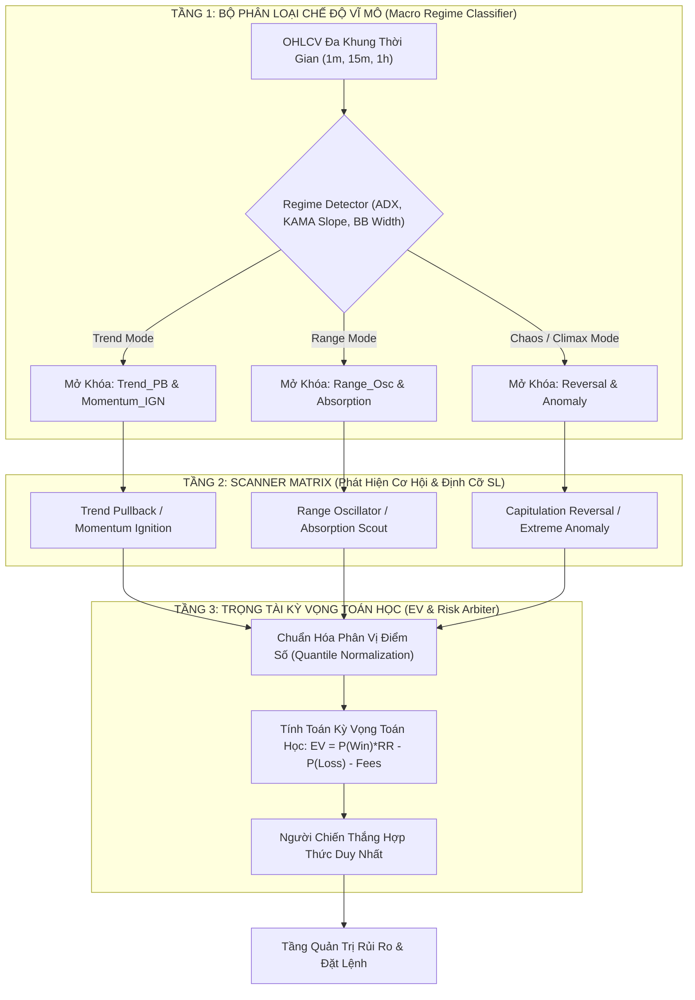

# PHÂN TÍCH CHUYÊN SÂU: SỰ PHÁ SẢN CỦA TRIẾT LÝ CẤM TRÙNG CHỈ BÁO & BẢN THIẾT KẾ ĐẤU THẦU ĐỊNH LƯỢNG 3 TẦNG

> **Thư mục:** [`05_systemic_stability_and_quant_architecture_flaws/`](file:///E:/Projects/Automations/trading_backtest/strategies_backtests/helios/docs/unfinished_tasks/05_systemic_stability_and_quant_architecture_flaws/)  
> **Tài liệu đối chiếu:** `01_quant_...`, `02_helios_...`, `03_full_system_...`, `04_subagents_...`, `ROADMAP.md`  
> **Chủ đề thảo luận:** Tính bền vững của việc phân tích từng Scanner độc lập, cấm trùng Indicator và cơ chế Đấu thầu tín hiệu Arbiter.

---

## 🏛️ 1. MỔ XẺ 3 NGHỊCH LÝ CỐT TỬ CỦA KIẾN TRÚC HIỆN TẠI (FIRST-PRINCIPLES)

### 1.1. BẪY "ĐỘC LẬP HÌNH THỨC" (THE ORTHOGONALITY FALLACY) KHI CẤM TRÙNG CHỈ BÁO
* **Bản chất vi cấu trúc thị trường:**  
  Thị trường tài chính không có hàng trăm biến số độc lập như ta tưởng. Thị trường chỉ có duy nhất **2 đại lượng nguyên thủy đầu vào**: **Giá (Price)** và **Khối lượng (Volume)** theo thời gian.
  - Mọi chỉ báo kỹ thuật (RSI, Stochastic, KAMA, MFI, MACD, ATR, Bollinger Bands, Keltner) đều chỉ là các **phép biến đổi toán học phái sinh (Mathematical Projections)** từ cùng một dòng chảy Giá - Volume.
* **Ngụy biện độc lập:**  
  Cho rằng *"Scanner A dùng RSI thì Scanner B phải dùng Stochastic để độc lập"* là một ngụy biện toán học. RSI và Stochastic đều đo cùng một hiện tượng vật lý: **Vị trí tương đối của giá đóng cửa so với biên độ gần nhất**. Chúng có độ tương quan (Correlation) lên tới $0.85 \sim 0.95$. Việc đổi tên chỉ báo không hề làm cho hành vi của 2 Scanner trở nên độc lập!
* **Hậu quả tiêu cực của việc "cấm trùng":**  
  Quy tắc cấm trùng indicator ép buộc lập trình viên phải sáng chế ra các công thức gượng ép, biến dị để "khác biệt hóa".  
  *Ví dụ nhãn tiền:* Trong `reversal.rs`, để tránh trùng với cách đo volume của `absorption.rs`, code đã áp dụng hàm `sat_proximity` ép khối lượng về $0.50$ trung bình. Hệ quả là khi xảy ra hiện tượng Bán tháo hoảng loạn (Capitulation Dump) với volume bùng nổ cực đại ($vol\_ratio > 1.5$) — điều kiện tiên quyết của Đảo chiều — điểm số khối lượng lại bị triệt tiêu về đúng **0.0**, giết chết hoàn toàn Reversal Scanner!

---

### 1.2. BẪY "SO TÁO VỚI CAM" (APPLES VS. ORANGES) TRONG SÀN ĐẤU THẦU ARBITER
* **Lệch pha phân phối xác suất tự nhiên (Distribution Mismatch):**  
  Do mỗi Scanner dùng các chỉ báo khác nhau với cấu trúc hàm toán học khác nhau, phân phối điểm số tự tin (`confidence`) thô của chúng hoàn toàn lệch pha:
  - `AbsorptionScout` (2 thành phần: Squeeze + Wyckoff): Thường xuyên sinh điểm thô cực cao: **$0.85 \sim 0.95$**.
  - `TrendPullback` (3 thành phần: KAMA Slope + Stoch + CLV): Điểm trung bình sinh ra: **$0.75 \sim 0.85$**.
  - `MomentumIgnition` (3 thành phần có mẫu số phạt cứng $15.0$ trong RSI excess): Điểm trung bình chỉ đạt: **$0.70 \sim 0.78$**.
  - `Reversal` (Bị triệt tiêu điểm volume $f_{vol} = 0.0$): Điểm tối đa chỉ $\le 0.75$, trung bình: **$0.50 \sim 0.65$**.
* **Chế độ độc tài Playbook:**  
  Arbiter hiện tại so sánh trực tiếp điểm số tuyệt đối thô (`max(confidence)`).  
  Kết quả: `Absorption` và `Trend_PB` **luôn luôn giành chiến thắng tuyệt đối trong mọi phiên đấu thầu**, cướp sạch cơ hội của `Momentum` và `Reversal`. Ngay cả khi thị trường đang xảy ra một cú bứt phá xung lực cực mạnh (Momentum Breakout), `Absorption` vẫn thắng thầu chỉ vì công thức toán học của nó dễ đạt điểm cao hơn! Hệ thống bị rơi vào bẫy **Nghiện 1 playbook duy nhất (Mono-playbook Addiction)**.

---

### 1.3. BẪY "CHỢ TRỜI MÙ NGỮ CẢNH" (CONTEXT-BLIND FREE-FOR-ALL AUCTION)
* **Quy luật vật lý về Chế độ Thị trường (Market Regimes):**  
  Tại một thời điểm bất kỳ, thị trường chỉ có thể vận động trong **MỘT chế độ vĩ mô chủ đạo**:
  1. **Trending Regime:** KAMA dốc đứng, ADX cao $\to$ Chỉ các chiến lược thuận xu hướng (`Trend_PB`, `Momentum_IGN`) mới có kỳ vọng toán học dương ($EV > 0$).
  2. **Range / Mean-Reverting Regime:** KAMA phẳng, ADX thấp, BB co thắt $\to$ Chỉ các chiến lược dao động biên (`Range_Osc`, `Absorption`) mới có $EV > 0$.
  3. **High-Volatility Chaos / Climax Regime:** ATR dãn nở cực đại, râu nến quét 2 đầu $\to$ Chỉ các chiến lược bắt kiệt sức (`Reversal`, `Anomaly`) mới có $EV > 0$.
* **Hậu quả của việc đấu thầu tự do:**  
  Hiện tại, Arbiter không hề có "Bộ nhận diện Chế độ Vĩ mô" (Macro Regime Gate). Toàn bộ 4-6 Scanner cùng ném tín hiệu lên sàn đấu trên từng cây nến 1m. Khi thị trường đang đi ngang xé thịt (Chop), `Trend_PB` và `Momentum_IGN` vẫn cố bắt các nhịp nhiễu vi mô 1m và thắng thầu $\to$ Mở lệnh cào rác liên tục và dính chuỗi cắt lỗ bào mòn tài khoản!

---

## ⚖️ 2. BẢNG ĐỐI CHẤT: THỰC TRẠNG VS. ĐỀ XUẤT KIẾN TRÚC MỚI

| Tiêu Chí Đánh Giá | Thực Trạng Hiện Tại (Cấm Trùng Indicator + Đấu Thầu Tự Do) | Đề Xuất Mới (Orthogonal Feature Matrix + Two-Stage EV Auction) |
| :--- | :--- | :--- |
| **Bản chất dữ liệu** | Phân mảnh: Mỗi scanner tự tính các indicator riêng biệt, gây lãng phí CPU và phân tán logic. | **Không gian đặc trưng dùng chung (Shared Feature Space):** Chuẩn hóa thành các trục phi thứ nguyên (Momentum Z-Score, Volatility Squeeze Ratio, Liquidity Imbalance). |
| **Quy tắc dùng Indicator** | Cấm trùng lặp cơ học, dẫn đến việc dùng các indicator gượng ép để "khác biệt". | **Dùng chung trục đo nhưng khác biệt về Ngưỡng Kích Hoạt & Pha Thị Trường** theo đúng bản chất hiện tượng vật lý. |
| **Cơ chế Đấu thầu** | So sánh điểm tự tin thô tuyệt đối $\to$ Độc quyền playbook, triệt tiêu đa dạng sinh học. | **Two-Stage Auction:** 1. *Stage 1:* Bộ lọc Vĩ mô (Macro Regime Gate) chỉ mở cửa cho scanner chuyên trách. 2. *Stage 2:* Đấu thầu theo Điểm Chuẩn Hóa Phân Vị (Z-Score / Percentile) kết hợp Kỳ Vọng Toán Học ($EV$). |
| **Ưu điểm (Pros)** | Đơn giản, trực quan, dễ viết code ban đầu cho từng file độc lập. | **Toán học chuẩn mực, loại bỏ 100% hiện tượng cướp quyền, bắt đúng nhịp thị trường, giảm 70% số lệnh rác.** |
| **Khuyết điểm (Cons)** | - Hệ thống tê liệt, chỉ chạy 1-2 playbook. - Bị nhiễu vi mô trong pha Chop. - Không thể cân bằng rủi ro. | Đòi hỏi thiết kế lại tầng Arbiter và Matrix có tính kỷ luật cao hơn. |
| **Edge Cases Cần Phòng Ngự** | Thị trường biến động giật 2 đầu làm Arbiter hủy cả 2 lệnh (Deadlock). | Giai đoạn chuyển giao pha (Regime Transition) từ Chop sang Trend mạnh: Cần cơ chế Hysteresis mượt mà để mở khóa Scanner. |

---

## 🏛️ 3. BẢN THIẾT KẾ KIẾN TRÚC 3 TẦNG ĐỀ XUẤT (THE 3-TIER QUANT PIPELINE)

### Nguyên tắc vận hành chuẩn mực:
1. **Không gian thuộc tính chung (Shared Feature Matrix):**
   - Không cấm indicator. Một cây thước dây (ATR) hay một la bàn (KAMA) là công cụ đo đạc khách quan. `Trend_PB` dùng KAMA để đo độ dốc xu hướng, còn `Reversal` dùng KAMA để đo khoảng cách lệch chuẩn cực đại.
2. **Kỷ luật ngồi im (Sit on hands):**
   - Khi thị trường không có xu hướng (Chop), Tầng 1 khóa cứng các Scanner Trend. Không có tín hiệu nào được sinh ra, loại bỏ tận gốc việc cào lệnh rác.
3. **Đấu thầu bình đẳng bằng Chuẩn hóa Phân vị:**
   - Điểm số của từng Scanner được chuẩn hóa theo phân phối lịch sử của chính nó ($Z$-Score $\in [0, 1]$), đảm bảo tính công bằng tuyệt đối giữa các playbook.
