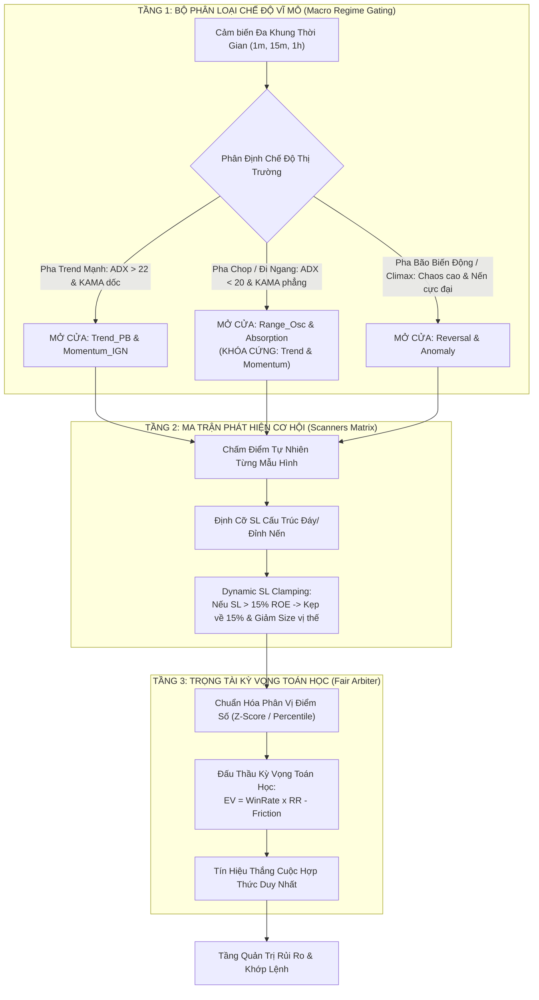

# GHI CHÚ NGHIÊN CỨU: KẾ HOẠCH TÁC CHIẾN 7 NGÀY & KIẾN TRÚC VẬN HÀNH 3 TẦNG (IN-PLACE REFACTOR TRÊN CORE V3)

> [!WARNING]
> **THÔNG BÁO QUAN TRỌNG VỀ TÍNH CHẤT TÀI LIỆU (RESEARCH NOTES ONLY):**  
> Toàn bộ nội dung trong tài liệu này (cũng như tất cả các tài liệu từ `01` đến `05` trong thư mục `05_systemic_stability_and_quant_architecture_flaws/`) **CHỈ LÀ GHI CHÚ, BẢN THẢO Ý TƯỞNG VÀ ĐỀ XUẤT NGHIÊN CỨU (RESEARCH NOTES & PROPOSALS)**.  
> Chúng **CHƯA PHẢI LÀ QUYẾT ĐỊNH THIẾT KẾ CUỐI CÙNG** và chưa được áp dụng vào mã nguồn thực tế. Tất cả đều đang trong quá trình mổ xẻ, phản biện toán học và thảo luận chi tiết giữa lập trình viên và AI.

---

## 🏛️ PHẦN 1: QUYẾT ĐỊNH VỀ PHIÊN BẢN (TẠI SAO KHÔNG TẠO VERSION 4?)

* **Vấn đề:** Việc tạo một phiên bản `core_v4` mới sẽ kéo theo:
  - Sao chép và duplicate hàng loạt structs cấu hình trong `config.rs`.
  - Phá vỡ toàn bộ các dependency hiện tại của `trading_bot` (đang gọi trực tiếp `use helios::strategy::core_v3::HeliosStrategyV3`).
  - Phải viết lại các wrapper, migration scripts và sửa đổi toàn bộ các ví dụ `examples/`.
  - Làm chậm tiến độ ít nhất 2 đến 3 tuần, đi ngược lại mục tiêu đưa app vào Demo trong 5-7 ngày.
* **Quyết định tối ưu (Occam's Razor):**
  - **KHÔNG TẠO CORE_V4**.
  - **Refactor In-Place trực tiếp trên Core V3 hiện tại:**
    + Giữ nguyên interface công khai `HeliosStrategyV3`.
    + Đóng gói / lưu trữ thư mục `core_v2` cũ vào `legacy/` để xóa bỏ nợ kỹ thuật.
    + Sắp xếp lại luồng nội bộ của V3 theo đúng **3 Tầng Vận Hành Chuẩn Mực**, bảo toàn 100% khả năng tương thích với `trading_bot` và `ferro_trade`.

---

## 🎯 PHẦN 2: BA NÚT THẮT QUYẾT ĐỊNH SỰ SỐNG CÒN ĐỂ VẬN HÀNH DEMO

Thay vì cố gắng sửa đổi hàng trăm chi tiết vụn vặt, chúng ta tập trung năng lượng vào đúng 3 nút thắt chí mạng đã được bóc tách từ log thực nghiệm:

1. **Nút Thắt 1: Cơ Chế Bảo Vệ Lợi Nhuận Tức Thì (Tiered Profit Lock & Ratchet)**
   - *Thực trạng trong log:* Các lệnh #0009, #0010, #0014 giá chạy lãi tới $+6.8\%$ ROE nhưng Trailing SL rớt lại đóng ở mức chỉ $+0.4\%$ ROE (hòa vốn ăn phí); trong khi lệnh thua cắn full SL $-5\% \sim -8\%$.
   - *Giải pháp:* Khóa lãi từng nấc (Đạt $+3.5\%$ ROE $\to$ dời SL lên $+1.6\%$ ROE bảo hiểm phí sàn; đạt $+6.0\%$ ROE $\to$ khóa tối thiểu $+3.0\%$ ROE).
2. **Nút Thắt 2: Tái Sinh Scanners Bị Tê Liệt & Chặn Đứng Dao Rơi (Scanner Precision)**
   - *Thực trạng trong log:* `Reversal` tê liệt vì bão volume bị gán điểm 0 và bẫy Catch-22 SL $> 15\%$ ROE bị Arbiter VETO 100%; `Absorption` bắt dao rơi thua 3/4 lệnh do không kiểm tra độ dốc KAMA.
   - *Giải pháp:* Xóa bỏ `sat_proximity` trong Reversal; triển khai **Dynamic SL Clamping** (kẹp SL $\le 15\%$ và giảm volume position); thêm Macro Adverse Slope cho Absorption.
3. **Nút Thắt 3: Bộ Phân Loại Chế Độ Vĩ Mô (Macro Regime Gating)**
   - *Thực trạng trong log:* Khi thị trường đi ngang Chop, các scanner Trend vẫn cố cào lệnh nến 1m và dính cắt lỗ bào mòn vốn.
   - *Giải pháp:* Nhận diện pha Chop qua KAMA Slope và ADX 15m/1h $\to$ Cấm tuyệt đối `Trend_PB` và `Momentum` vào lệnh vi mô (Sit on hands).

---

## 🏗️ PHẦN 3: BẢN THIẾT KẾ 3 TẦNG VẬN HÀNH (THE 3-TIER QUANT PIPELINE)

---

## 🗓️ PHẦN 4: KẾ HOẠCH TÁC CHIẾN 7 NGÀY ĐƯA BOT VÀO DEMO THỰC CHIẾN

* **NGÀY 1: Dọn Dẹp Cấu Trúc & Sửa Lỗi Lookahead Broker P0**
  - Đóng gói `core_v2` cũ vào `legacy/`.
  - Tách 1,500 dòng test cồng kềnh ra khỏi `core_v3/mod.rs` để file gọn gàng ~300 dòng.
  - Sửa lỗi Lookahead Margin Sizing trong `ferro_trade/src/broker/broker.rs` (dùng $Open[i]$ thay vì $Close[i]$).
* **NGÀY 2: Bảo Vệ Lợi Nhuận Tức Thì (Tiered Profit Lock & Ratchet)**
  - Cài đặt nấc khóa lãi trong `risk.rs` và `paper_trader.rs`: MFE $+3.5\%$ ROE $\to$ dời SL lên $+1.6\%$ ROE; MFE $+6.0\%$ ROE $\to$ khóa $+3.0\%$ ROE.
  - Khắc phục triệt để hiện tượng nến lãi $+6.8\%$ mà chỉ ăn được $+0.4\%$.
* **NGÀY 3: Tái Sinh Scanners & Dynamic SL Clamping**
  - Xóa bỏ bẫy `sat_proximity` trong `reversal.rs`.
  - Thêm chốt chặn Macro Adverse Slope cho `absorption.rs` chống bắt dao rơi.
  - Cài đặt Dynamic SL Clamping trong Arbiter (không VETO oan các nến lớn).
* **NGÀY 4: Triển Khai Macro Regime Gating (Tầng 1)**
  - Nhận diện pha Chop/Trend trên khung 15m/1h.
  - Khóa cào lệnh vi mô khi thị trường đi ngang.
* **NGÀY 5: Gia Cố Phòng Ngự Sàn & Bất Đồng Bộ Trong `trading_bot`**
  - Sửa `PanicCloseAll` phát lệnh Market Close thật trên Binance.
  - Thêm Watchdog WebSocket chống zombie stream rớt mạng ngầm.
  - Bọc truy vấn SQLite bằng `spawn_blocking` để Actor loop phản xạ dưới 1ms.
* **NGÀY 6: Cân Chỉnh Hàm Mục Tiêu GA & Walk-Forward Testing**
  - Bổ sung Turnover Penalty vào Fitness GA.
  - Chạy `walk_forward_smart_seed.rs` kiểm chứng 4 chu kỳ liên tiếp: đo lường Net PnL $> 0$.
* **NGÀY 7: Đóng Gói Release Candidate & Kích Hoạt Paper Demo 24/7**
  - Kết nối Desktop Client UI (Tauri v2) với Bot Engine.
  - Chạy Paper Trading liên tục 24/7 trên cặp ETHUSDT và BTCUSDT.
  - Đóng gói bàn giao hệ thống sẵn sàng vận hành.
