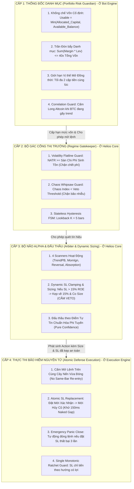

# Ghi Chú Kiểm Toán Định Lượng: Dung Hợp Hệ Sinh Thái, Rủi Ro Danh Mục Đa Cặp Tiền & Kiến Trúc Tinh Giản 4 Trụ Cột
## SYSTEMIC HARMONIZATION, PORTFOLIO RISK & OCCAM'S RAZOR ARCHITECTURE

> **Dự án:** Toàn bộ hệ sinh thái `ferro_trade`, `helios`, `trading_bot`  
> **Thư mục:** [`05_systemic_stability_and_quant_architecture_flaws/notes/`](file:///e:/Projects/Automations/trading_backtest/strategies_backtests/helios/docs/unfinished_tasks/05_systemic_stability_and_quant_architecture_flaws/notes/)  
> **Mã tài liệu:** `NOTE-14-SYSTEMIC-HARMONIZATION`  
> **Ngày lập:** 14/10/2026  
> **Trạng thái:** Báo cáo kiểm toán độc lập cấp cao (Line-by-line Verified)

---

## 🏛️ 1. TỔNG QUAN RANH GIỚI HỆ SINH THÁI (CROSS-PROJECT INTEGRATION)

Sự sống còn của một quỹ giao dịch định lượng không nằm ở việc một module đơn lẻ hoạt động hoàn hảo trong phòng thí nghiệm, mà nằm ở **tính nhất quán và toàn vẹn của dữ liệu xuyên suốt 3 tầng kiến trúc**:
1. **`ferro_trade` (Backtest Engine & GA Core):** Cung cấp mô hình khớp lệnh, tính toán chỉ số thống kê và không gian tối ưu hóa di truyền.
2. **`helios` (Strategy Intelligence):** Cảm biến, ma trận trạng thái, quét tín hiệu đa chế độ và quản trị rủi ro chiến thuật.
3. **`trading_bot` (Execution Engine & Orchestrator):** Điều phối Walk-Forward Smart Seeding, kết nối sàn Binance và quản lý tài khoản tiền thật.

> 💣 **KẾT LUẬN KIỂM TOÁN CHUNG:**  
> Hệ thống đang tồn tại 3 rủi ro hệ thống vượt ra ngoài phạm vi từng file đơn lẻ: **Thiếu vắng hoàn toàn tầng bảo vệ danh mục đa cặp tiền**, **Bẫy Zombie DNA bị kẹt vĩnh viễn khi thị trường đóng băng**, và **Mô hình kiểm tra rủi ro quá cồng kềnh (7 tầng, hơn 20 chốt chặn) tự bóp nghẹt cơ hội giao dịch**.

---

## 🚨 2. TỬ HUYỆT 1: THIẾU THỐNG ĐỐC RỦI RO DANH MỤC (ZERO PORTFOLIO RISK GUARDIAN)

* **Vị trí code:** [`trading_bot/bot_engine/src/controller/asset_actor.rs:68-99, 630-672`](file:///e:/Projects/Automations/trading_backtest/trading_bot/bot_engine/src/controller/asset_actor.rs#L68-L99).

### 2.1. Bản Chất Ốc Đảo Biệt Lập (Siloed Actors)
- Mỗi cặp tiền (ví dụ ETHUSDT, BTCUSDT, SOLUSDT, BNBUSDT) được vận hành bởi một `AssetActor` hoàn toàn độc lập theo mô hình Actor.
- Hoàn toàn **không tồn tại struct `PortfolioRiskManager`** hoặc bất kỳ cơ chế kiểm soát chia sẻ hạn mức rủi ro nào ở tầng Engine.
- Actor của ETH hoàn toàn không biết Actor của BTC hay SOL đang mở vị thế gì, rủi ro bao nhiêu.

### 2.2. Hiểm Họa Phóng Đại Đòn Bẩy Hệ Thống (Systemic Leverage Explosion)
1. **Hệ số tương quan cao trong Crypto ($\rho > 0.85$):** Khi thị trường có một cú giật mạnh toàn ngành (Systemic Shock), tất cả các cặp tiền đều biến động cùng chiều.
2. **Kịch bản thanh lý đồng loạt:**
   - Cả 4 Actor đồng loạt nhận diện setup và mở lệnh $20\text{x}$ với $25\%$ margin.
   - Tổng đòn bẩy thực tế của toàn bộ tài khoản bị phóng đại lên:
     $$\text{Total Portfolio Leverage} = 4 \times 20\text{x} \times 25\% = \mathbf{20\text{x Full Account}} \quad (\text{Notional Value} = \mathbf{80\text{x Vốn Cấp Cặp}})!$$
   - Khi đó, chỉ cần toàn bộ thị trường giật ngược **$1.2\%$** là toàn bộ tài khoản bị Margin Call thanh lý sạch sẽ!

### 2.3. Giải Pháp: Xây Dựng `PortfolioRiskManager` Tại Bot Engine
Thiết lập một Actor hoặc Shared Coordinator ở tầng Bot Engine với 3 chốt chặn bắt buộc:
1. **Trần Đòn Bẩy Danh Mục (Max Portfolio Exposure):**
   $$\sum_{k=1}^{M} \text{Position Margin}_k \times L_k \le \text{Max Portfolio Notional Cap (vd: 3.0x Tổng Vốn)}$$
2. **Giới Hạn Số Vị Thế Mở Đồng Thời:** Tối đa 2 vị thế cùng lúc trên toàn bộ hệ thống bot.
3. **Correlation Guard:** Nếu BTC đang cắm đầu rơi mạnh (Trend giảm 4h), cấm mở vị thế Long trên bất kỳ Altcoin nào.

---

## ⏳ 3. TỬ HUYỆT 2: BẪY "ZOMBIE DNA LOCK-IN" KHI WFE LIÊN TỤC REJECT

* **Vị trí code:** [`trading_bot/bot_engine/src/optimizer/prospector_runner.rs:412-440`](file:///e:/Projects/Automations/trading_backtest/trading_bot/bot_engine/src/optimizer/prospector_runner.rs#L412-L440).

### 3.1. Bản Chất Vấn Đề
Trong đợt test thực nghiệm 5 ngày vừa qua, chúng ta đã chứng kiến hiện tượng:
- Có tới **14 / 30 chu kỳ Re-Opt bị WFE Gate REJECT** (46.7%).
- Lý do: Thị trường rơi vào vùng Flatline nén biến động kéo dài 86.3 giờ, các candidate DNA mới cố trade trong 3 ngày này đều bị lỗ ròng do phí sàn $\implies$ WFE Gate chặn đứng.
- **HÀNH VI KHI REJECT:**
  ```rust
  // prospector_runner.rs:423-431
  warn!("🛡️ [WFE GATE: REJECTED] ... Preserving active Champion DNA in DB & Actor to protect capital!");
  return Ok(());
  ```

### 3.2. Hiểm Họa Zombie DNA
1. **Không có bộ đếm chu kỳ Reject liên tiếp (`consecutive_rejects`).**
2. **Không có cơ chế Decay hoặc Fallback:**
   - Nếu thị trường Flatline hoặc đổi chế độ kéo dài 10 chu kỳ (2.5 ngày), bot tiếp tục **giữ nguyên vĩnh viễn bộ DNA của 3 ngày trước**.
   - Bộ DNA cũ đó được tối ưu hóa cho điều kiện thị trường của tuần trước. Khi thị trường đột ngột bung nén bùng nổ, bộ DNA cũ đã bị "hóa đá (zombie)" và có thể phản xạ hoàn toàn sai lầm.

### 3.3. Giải Pháp: DNA Freshness & Staleness Watchdog
1. Đếm số chu kỳ Reject liên tiếp: `consecutive_reject_count`.
2. **Cơ chế phòng thủ bậc thang (Defensive Decay):**
   - Nếu $3 \le \text{consecutive\_rejects} < 6$: Thu hẹp $50\%$ quy mô vị thế (`size_multiplier = 0.50`), siết chặt đòn bẩy về $10\text{x}$.
   - Nếu $\text{consecutive\_rejects} \ge 6$ (hơn 24 giờ không tìm ra DNA thích ứng): Chuyển sang trạng thái **Defensive Hold** — Đứng ngoài thị trường hoàn toàn, ngừng mở lệnh mới cho đến khi có DNA mới vượt qua cửa ải OOS Validation!

---

## 🔎 4. TỬ HUYỆT 3: ĐIỂM MÙ TRƯỢT GIÁ TRONG PHÒNG THÍ NGHIỆM GA

* **Vị trí code:** [`trading_bot/bot_engine/src/optimizer/prospector_runner.rs:524-528`](file:///e:/Projects/Automations/trading_backtest/trading_bot/bot_engine/src/optimizer/prospector_runner.rs#L524-L528) & [`ferro_trade/src/broker/broker.rs:166, 479`](file:///e:/Projects/Automations/trading_backtest/ferro_trade/src/broker/broker.rs#L166).

### 4.1. Bản Chất Điểm Mù
Trong `prospector_runner.rs`:
```rust
pub fn calculate_enhanced_fitness_with_leverage(
    stats: &Stats,
    _leverage: f64,
    _cfg: &FitnessConfig,
) -> f64 {
    Self::calculate_enhanced_fitness(stats)
}
```
- Hai tham số cốt tử `_leverage` và `_cfg` (chứa cấu hình trừ chi phí trượt giá và ma sát đòn bẩy) **bị gán dấu gạch dưới và hoàn toàn không được sử dụng**!
- Trong `ferro_trade::Broker`: `BacktestBuilder` chạy GA với `spread = 0.0`.
- **HẬU QUẢ:** GA trong phòng thí nghiệm tiếp tục tối ưu hóa trên giả định **không có trượt giá**. Chỉ có cổng WFE Gate ở ngoài cùng mới trừ chi phí trượt giá ($0.80\%$ ROE/trade). Điều này giải thích tại sao GA liên tục sinh ra các cá thể trông rất đẹp trên In-Sample nhưng vừa bước ra cổng OOS là bị WFE Gate vả sấp mặt (Reject 46.7%)!

### 4.2. Lỗi Lookahead Bias Trong Sizing Margin (`ferro_trade::Broker`)
Tại `ferro_trade/src/broker/broker.rs:166, 479`:
- Khi khớp lệnh mở vị thế tại mức giá $Open[i]$ của cây nến hiện tại:
- Hàm tính toán sức mua `margin_available()` lại gọi `self.data.get_current_close()`, tức là **đọc mức giá $Close[i]$ của tương lai**!
- Trong các cây nến biến động lớn, việc dùng giá Close tương lai để tính Margin khả dụng tại thời điểm Open tạo ra một độ lệch Lookahead bias nhỏ làm sai lệch độ chính xác 1:1.

---

## 🏛️ 5. BẢN THIẾT KẾ TINH GIẢN HỆ THỐNG RỦI RO (THE 4-PILLAR RISK ARCHITECTURE)

Nhằm triệt tiêu căn bệnh "7 tầng kiểm tra với hơn 20 chốt chặn tự giẫm chân nhau", toàn bộ hệ thống Quản trị Rủi ro được tái cấu trúc tinh giản về **4 Cấp Quản trị Duy Nhất theo nguyên lý Occam's Razor**:



---

## 📋 6. DANH MỤC NHIỆM VỤ ĐỒNG BỘ HỆ SINH THÁI (ACTION ITEMS)

| Mã Hạng Mục | Phân Hệ | Vị Trí File | Hành Động Kỹ Thuật |
| :--- | :--- | :--- | :--- |
| **P0: HARMONY-01** | Bot Engine | `live_engine.rs:133` | Vá lỗ hổng phình to vốn sàn: `usable_capital = available_balance.min(allocated_capital)`. |
| **P0: HARMONY-02** | Execution | `order_executor.rs:233` | Vá lỗ hổng Silent Failure: Kích hoạt Market Close khẩn cấp nếu 3 lần retry đặt SL thất bại. |
| **P1: HARMONY-03** | Optimizer | `prospector_runner.rs:524` | Kích hoạt trừ trượt giá trong `calculate_enhanced_fitness_with_leverage` để GA không bị mù ma sát. |
| **P1: HARMONY-04** | Optimizer | `prospector_runner.rs:423` | Triển khai Staleness Watchdog: Đếm số lần Reject và chuyển sang Defensive Hold sau 6 lần. |
| **P1: HARMONY-05** | Strategy | `arbiter.rs:254-280` | Xóa bỏ Binary Veto khi SL $> 15\%$ ROE; tự động kẹp SL về trần và co giãn khối lượng (Dynamic Sizing). |
| **P2: HARMONY-06** | Controller | `bot_engine/src/controller/` | Thiết lập `PortfolioRiskManager` kiểm soát trần đòn bẩy danh mục và số lượng vị thế mở đồng thời. |
| **P2: HARMONY-07** | ferro_trade | `broker.rs:166, 479` | Sửa Lookahead bias: Dùng $Open[i]$ thay vì $Close[i]$ để tính Margin khả dụng tại thời điểm khớp lệnh. |
