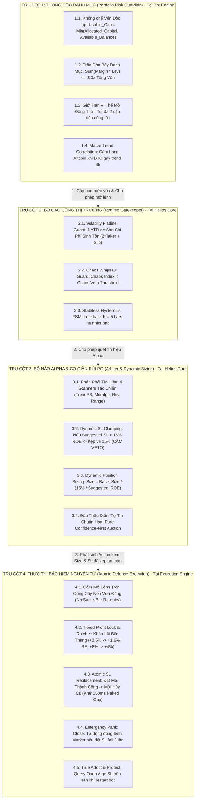

# BẢN THIẾT KẾ KIẾN TRÚC: HỆ THỐNG RỦI RO TINH GIẢN 4 TRỤ CỘT (THE 4-PILLAR OCCAM'S RAZOR RISK BLUEPRINT)

> **Dự án:** Hệ sinh thái Toàn diện `trading_backtest` (`helios`, `trading_bot`, `ferro_trade`)  
> **Thư mục:** [`05_systemic_stability_and_quant_architecture_flaws/notes/`](file:///e:/Projects/Automations/trading_backtest/strategies_backtests/helios/docs/unfinished_tasks/05_systemic_stability_and_quant_architecture_flaws/notes/)  
> **Mã tài liệu:** `NOTE-15-4-PILLAR-RISK-BLUEPRINT`  
> **Ngày lập:** 14/10/2026  
> **Trạng thái:** Bản thiết kế kiến trúc chuẩn mực (Architectural Blueprint)

---

## 🏛️ 1. NGUYÊN LÝ THIẾT KẾ CỐT LÕI (FIRST-PRINCIPLES & OCCAM'S RAZOR)

Hiện tại, hệ thống Quản trị Rủi ro đang bị phân mảnh trên **7 tầng kiểm tra với hơn 20 chốt chặn rời rạc**, gây ra hiện tượng:
- Tự ngáng chân nhau (Cross-blocking & Over-constraining).
- Bẫy Catch-22 (Chốt chặn này giết chết cơ hội của chốt chặn khác).
- Bóp nghẹt thị trường, tê liệt giao dịch trong các giai đoạn có sóng lớn.
- Phân liệt não (Split-Brain) giữa các tầng mô phỏng và thực tế.

**Triết lý Occam's Razor:**  
*"Không sinh thêm thực thể hoặc điều kiện nếu không thực sự cần thiết."*  
Toàn bộ hệ thống quản trị rủi ro được thu gọn về đúng **4 Cấp Quản trị Duy Nhất**, mỗi cấp có **duy nhất một trách nhiệm độc quyền (Single Responsibility Principle)**, không cấp nào giẫm chân lên cấp nào.

---

## 🏗️ 2. BẢN ĐỒ TOÀN CẢNH: HỆ THỐNG RỦI RO 4 TRỤ CỘT

---

## 🔬 3. ĐẶC TẢ CHI TIẾT TỪNG TRỤ CỘT

---

### 🏛️ TRỤ CỘT 1: THỐNG ĐỐC DANH MỤC (PORTFOLIO RISK GUARDIAN)
* **Vị trí cư ngụ:** Tầng Bot Engine (`trading_bot/bot_engine/src/controller/portfolio_guardian.rs`).
* **Trách nhiệm duy nhất:** Bảo vệ tổng tài sản ví người dùng, ngăn chặn cháy tài khoản do hiệu ứng domino đa cặp tiền.
* **Nguyên tắc vận hành:**
  1. **Khống Chế Vốn Sàn Độc Lập (Anti-Capital Breach):**
     $$\text{Usable Capital} = \min(\text{self.allocated\_capital},\ \text{self.account\_state.available\_balance})$$
     Triệt tiêu 100% lỗi dùng toàn bộ \$10,000 số dư ví Binance để tính khối lượng lệnh cho 1 cặp tiền \$60.
  2. **Trần Đòn Bẩy Danh Mục (Max Portfolio Exposure Cap):**
     $$\text{Total Notional Leverage} = \frac{\sum_{k=1}^{M} \text{Position Notional}_k}{\text{Total Account Equity}} \le 3.0\text{x}$$
     Nếu vượt quá $3.0\text{x}$, tự động VETO các yêu cầu mở lệnh mới từ bất kỳ cặp tiền nào.
  3. **Giới Hạn Vị Thế Mở Đồng Thời (Max Concurrent Positions):**
     Tối đa 2 vị thế mở cùng lúc trên toàn bộ hệ thống bot.
  4. **Tương Quan Vĩ Mô (Correlation Guard):**
     Khi BTC có xu hướng giảm mạnh trên khung 4h (`kama_slope_4h < -threshold`), cấm mở thêm vị thế Long trên tất cả các Altcoin.

---

### 🚪 TRỤ CỘT 2: BỘ GÁC CỔNG THỊ TRƯỜNG (REGIME GATEKEEPER)
* **Vị trí cư ngụ:** Tầng Chiến Lược Helios Core (`strategies_backtests/helios/src/strategy/core_v3/gatekeeper.rs`).
* **Trách nhiệm duy nhất:** Đóng cầu dao $O(1)$ ngắt toàn bộ hệ sinh thái khi thị trường rơi vào tử địa không thể giao dịch ($EV < 0$).
* **Nguyên tắc vận hành:**
  1. **Volatility Flatline Guard (Chặn Tử Địa Chết Phí Sàn):**
     $$\text{Required\_Min\_NATR} = (2 \times \text{TakerFee} + \text{SlippageAllowance}) + \text{min\_natr\_threshold}$$
     Nếu $\text{market\_natr} < \text{Required\_Min\_NATR} \implies$ Thoát sớm $O(1)$, bảo toàn $100\%$ vốn, từ chối nộp phí cho sàn.
  2. **Chaos Whipsaw Guard & Hysteresis FSM (Chặn Bão Nhiễu Quét 2 Đầu):**
     Nếu $\text{chaos\_index} \ge \text{chaos\_veto\_threshold} \implies$ Khóa cầu dao.
     Cơ chế trễ Hysteresis: Quét ngược $K = 5$ bars, chỉ mở khóa khi bão đã hạ nhiệt hoàn toàn dưới $\text{chaos\_veto\_threshold} - \Delta_{\text{hysteresis}}$.
  3. **Occam's Razor Gating:** Khi Gatekeeper đã thông qua, các Scanner bên trong **KHÔNG ĐƯỢC TỰ Ý CHẶN THÊM SQUEEZE CHOP** một cách dư thừa làm tê liệt giao dịch.

---

### 🧠 TRỤ CỘT 3: BỘ NÃO ALPHA & CO GIÃN RỦI RO (ARBITER & DYNAMIC SIZING)
* **Vị trí cư ngụ:** Tầng Chiến Lược Helios Core (`strategies_backtests/helios/src/strategy/core_v3/arbiter.rs`).
* **Trách nhiệm duy nhất:** Phát hiện cơ hội, đấu thầu tín hiệu công bằng và định cỡ vị thế co giãn thích ứng.
* **Nguyên tắc vận hành:**
  1. **Phá Vỡ Bẫy Catch-22 (Chuyển Từ VETO sang CLAMP & SCALE):**
     - Khi Scanner đề xuất một mức Stop Loss cấu trúc $\text{suggested\_sl}$ có $\text{suggested\_roe} > 15.0\%$ ROE:
     - **CẤM TUYỆT ĐỐI HÀNH VI VETO LOẠI BỎ PROPOSAL.**
     - Tự động kẹp mức SL về đúng trần an toàn $15\%$ ROE:
       $$\text{final\_sl} = \text{RiskManager::clamp\_sl\_price}(\text{price}, \text{suggested\_sl}, \text{is\_long}, 0.15, \text{leverage}, \dots)$$
     - Tự động co giãn kích thước vị thế theo tỷ lệ nghịch:
       $$\text{Scale Factor} = \frac{15.0\%}{\text{suggested\_roe}}, \quad \text{Order Size} = \text{Base Size} \times \text{Scale Factor}$$
     - *Kết quả:* Rủi ro danh nghĩa (\$ tối đa mất) không hề thay đổi, mà hệ thống không bỏ lỡ bất kỳ con sóng bùng nổ đẹp nào của thị trường!
  2. **Bổ Sung Kiểm Tra Chiều Giao Dịch (`is_long` Guard):**
     - Long: Bắt buộc $\text{final\_sl} < \text{Price} \times (1 - \text{min\_dist})$.
     - Short: Bắt buộc $\text{final\_sl} > \text{Price} \times (1 + \text{min\_dist})$.
     - Triệt tiêu $100\%$ lỗi Inverted SL.
  3. **Đấu Thầu Điểm Tự Tin Chuẩn Hóa (Confidence-First Auction):**
     Proposal có điểm tự tin cao nhất thắng cuộc và phát sinh `Action::OpenPosition`.

---

### ⚡ TRỤ CỘT 4: THỰC THI BẢO HIỂM NGUYÊN TỬ (ATOMIC DEFENSE EXECUTION)
* **Vị trí cư ngụ:** Tầng Thực Thi (`trading_bot/bot_engine/src/execution/`).
* **Trách nhiệm duy nhất:** Khớp lệnh chuẩn xác, dời Stop Loss một chiều an toàn và bảo vệ vị thế 24/7 trên sàn Binance Futures.
* **Nguyên tắc vận hành:**
  1. **Khóa Lãi Bậc Thang (Tiered Profit Lock & Break-Even Ratchet):**
     - $\text{MFE} \ge +3.5\%$ ROE $\implies$ Kéo SL lên $+1.6\%$ ROE (Bảo hiểm đủ $100\%$ phí sàn 2 chiều $20\text{x}$).
     - $\text{MFE} \ge +8.0\%$ ROE $\implies$ Khóa cứng tối thiểu $+4.0\%$ ROE.
     - $\text{MFE} \ge +15.0\%$ ROE $\implies$ Khóa cứng tối thiểu $+9.0\%$ ROE.
     - Triệt tiêu $100\%$ bẫy giãn ATR và không để lệnh thắng lớn rơi về hòa vốn.
  2. **Atomic SL Replacement (Khử Naked Window 150ms):**
     Đặt lệnh Algo SL mới trên Binance với định danh cụ thể $\to$ Nhận xác nhận trạng thái `NEW` từ sàn $\to$ Mới gửi lệnh hủy SL cũ.
  3. **Chốt Chặn Khẩn Cấp (Emergency Panic Close):**
     Nếu sau 3 lần retry đặt SL mới thất bại $\to$ lập tức kích hoạt lệnh Market Close toàn bộ vị thế (`reduce_only: true`), tuyệt đối không để vị thế mồ côi không SL trên thị trường.
  4. **True Adopt & Protect Khi Khởi Động Bot:**
     Xóa bỏ lệnh `force_close_all_positions`. Khi khởi động lại, query trực tiếp Open Algo Orders trên Binance để nạp mức SL đang sống vào cache và tiếp quản vị thế.
  5. **Một Nguồn Chân Lý Duy Nhất Cho Monotonic Ratchet:**
     Duy nhất `OrderExecutor` và `PaperTrader` đảm nhiệm chốt chặn dời SL một chiều tại tầng thực thi cuối cùng.

---

## 📊 4. BẢNG SO SÁNH HIỆU QUẢ: HỆ THỐNG CŨ VS. 4 TRỤ CỘT

| Tiêu Chí So Sánh | Hệ Thống Hiện Tại (Cồng Kềnh) | Hệ Thống Tinh Giản 4 Trụ Cột |
| :--- | :--- | :--- |
| **Số tầng kiểm tra rủi ro** | 7 tầng, hơn 20 chốt chặn rời rạc, giẫm chân nhau. | **4 Trụ Cột phân định ranh giới độc quyền rõ ràng.** |
| **Xử lý nến bùng nổ SL $> 15\%$ ROE** | Arbiter VETO binary $\to$ Giết chết $100\%$ cơ hội đẹp. | **Dynamic Clamping & Scaling $\to$ Kẹp SL & Co size an toàn.** |
| **Quản trị vốn sàn tiền thật** | Dùng toàn bộ ví Binance (\$10,000) $\to$ Nguy cơ cháy ví. | **Khống chế trần vốn cơ sở: $\min(\text{Allocated}, \text{Available})$.** |
| **Cơ chế dời Stop Loss** | Hủy cũ $\to$ Ngủ 150ms (Naked) $\to$ Đặt mới (Fail thì bỏ mặc). | **Atomic Replacement: Đặt mới OK $\to$ Hủy cũ; Fail $\to$ Panic Close.** |
| **Bảo vệ vị thế khi Restart** | Bán tháo vị thế hoặc tuột SL về entry ban đầu. | **True Adopt & Protect: Query Algo Orders kế thừa SL đang sống.** |
| **Khóa lợi nhuận Trailing** | Vùng chân không $+6\% \to +20\%$ ROE; ATR phình to nới rộng SL. | **Tiered Profit Lock 3 nấc: $+3.5\% \to +1.6\%$, $+8\% \to +4\%$, $+15\% \to +9\%$.** |
