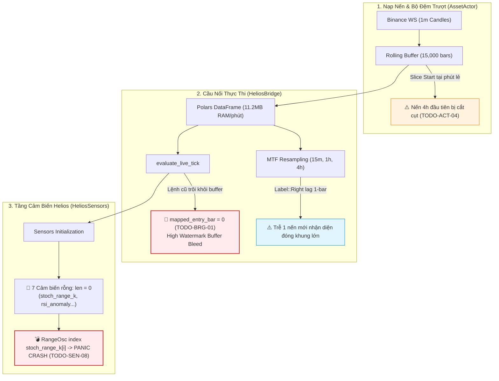

# KIỂM TOÁN KIẾN TRÚC GIAO TIẾP & DÒNG DỮ LIỆU: BOT ENGINE & HELIOS BRIDGE
**Tài liệu:** Note 16  
**Chủ đề:** Cầu Nối Dữ Liệu (`HeliosBridge`), Bộ Đệm Trượt (`RollingBuffer`), High Watermark Mapping, MTF Resampling và Tính Toàn Vẹn Cảm Biến  
**Phạm vi kiểm toán:**
- `trading_bot/bot_engine/src/optimizer/helios_bridge.rs`
- `trading_bot/bot_engine/src/controller/asset_actor.rs`
- `strategies_backtests/helios/src/strategy/sensors.rs` & `core_v3/mod.rs`
- `ferro_trade/src/utils/resample.rs` & `ferro_trade/src/broker/trade.rs`
- Đối chiếu mã lỗi: `TODO-BRG-01` đến `TODO-BRG-09`, `TODO-ACT-04`, `TODO-SEN-08`, `TODO-SEN-11`.

---

## 🧭 1. TỔNG QUAN KIỂM TOÁN CẦU NỐI DỮ LIỆU (EXECUTIVE SUMMARY)

Hệ thống giao tiếp giữa `trading_bot` và `helios` thông qua `HeliosBridge` là động mạch chủ đưa dữ liệu nến thời gian thực vào chiến lược và chuyển tiếp quyết định giao dịch ra thị trường. Qua rà soát chi tiết từng dòng mã nguồn, kiểm toán phát hiện **4 lỗ hổng nghiêm trọng (P0/P1)**, **2 điểm nghẽn hiệu năng (P2)** và **1 mã chết kiến trúc (P3)**:



---

## 🚨 2. CÁC TỬ HUYỆT DÒNG DỮ LIỆU CỐT TỬ (CRITICAL DEFECTS)

### 2.1. Thảm Họa `High Watermark Buffer Bleed` Khi `mapped_entry_bar == 0` (`TODO-BRG-01` — P0)
- **Tình trạng:** ❌ **CHƯA FIX - ĐANG TỒN TẠI TRONG CODE**.
- **Vị trí mã nguồn:**
  - [`trading_bot/bot_engine/src/optimizer/helios_bridge.rs:223–238`](file:///e:/Projects/Automations/trading_backtest/trading_bot/bot_engine/src/optimizer/helios_bridge.rs#L223-L238)
  - [`strategies_backtests/helios/src/strategy/core_v3/risk.rs:310–330, 346–369`](file:///e:/Projects/Automations/trading_backtest/strategies_backtests/helios/src/strategy/core_v3/risk.rs#L310-L330)
- **Bản chất kỹ thuật:**
  1. Trong `helios_bridge.rs`:
     ```rust
     let mapped_entry_bar = if pos.entry_timestamp > 0 {
         if !candles.is_empty() && pos.entry_timestamp < candles[0].timestamp {
             warn!("🌊 [FLAW CONFIRMED: HIGH WATERMARK BUFFER BLEED] Symbol: {} | Entry ts: {} is OLDER than Buffer Start: {} | mapped_entry_bar FALLBACK TO 0! ...", ...);
         }
         match candles.binary_search_by_key(&pos.entry_timestamp, |c| c.timestamp) {
             Ok(idx) => idx,
             Err(idx) => idx.saturating_sub(1), // FALLBACK VỀ 0 KHI ENTRY TRÔI KHỎI BUFFER!
         }
     } else {
         pos.live_entry_bar.saturating_sub(slice_start)
     };
     ```
  2. Mặc dù log cảnh báo đã được gắn, nhưng logic phía sau **vẫn gán `mapped_entry_bar = 0`**.
  3. Trong `risk.rs::manage_trailing_stop`:
     ```rust
     let (peak_val, peak_bar) = if trade.is_long() {
         let mut max_high = trade.entry_price;
         let mut max_bar = entry_bar;
         for j in (entry_bar + 1)..=i { // QUÉT TOÀN BỘ BUFFER TỪ INDEX 1!
             if highs[j] > max_high { max_high = highs[j]; max_bar = j; }
         }
         (max_high, max_bar)
     };
     ```
  4. Nếu vị thế được giữ $> 10$ ngày (trôi khỏi bộ đệm 15,000 nến 1m), `entry_bar` bị gán bằng $0$. Vòng lặp quét lại toàn bộ 15,000 nến quá khứ (vốn xảy ra *trước khi mở lệnh*).
  5. Nếu quá khứ có 1 cây nến pump quét đỉnh $60,000$, đỉnh này bị gán nhầm làm đỉnh lợi nhuận của lệnh mở ở $50,000$. Mức Trailing SL nhảy vọt lên trên giá hiện tại, **cắt lỗ oan uổng lệnh đang chạy**.
  6. Đồng thời, `bars_held = i.saturating_sub(0) = 14,999` nến $\ge 2880$ nến, kích hoạt cơ chế `ZOMBIE TRADE PURGE` bán tháo lệnh của người dùng!
- **Giải pháp dứt điểm:**
  1. Bổ sung `highest_favorable_price: f64` vào `LivePositionState` và `ferro_trade::broker::trade::Trade`.
  2. Mỗi nến đóng trong `PaperTrader` / `BinanceLiveExecutionEngine`, cập nhật đơn điệu: Long lấy $\max(H_{t-1}, High_t)$, Short lấy $\min(L_{t-1}, Low_t)$.
  3. `risk.rs` đọc trực tiếp `trade.highest_favorable_price`, xóa bỏ hoàn toàn vòng lặp quét mảng `highs[entry_bar + 1..=i]`.

---

### 2.2. Cắt Cụt Buffer Nến 4h Tại Phút Lẻ (`TODO-ACT-04` — P1)
- **Tình trạng:** ❌ **CHƯA FIX - ĐANG TỒN TẠI TRONG CODE**.
- **Vị trí mã nguồn:**
  - [`trading_bot/bot_engine/src/models/config.rs:79`](file:///e:/Projects/Automations/trading_backtest/trading_bot/bot_engine/src/models/config.rs#L79) (`max_live_mem_candles: 15000`).
  - [`trading_bot/bot_engine/src/controller/asset_actor.rs:604–605`](file:///e:/Projects/Automations/trading_backtest/trading_bot/bot_engine/src/controller/asset_actor.rs#L604-L605):
    ```rust
    let slice_start = full_buffer.len().saturating_sub(max_mem);
    let rolling_buffer = &full_buffer[slice_start..];
    ```
- **Bản chất kỹ thuật:**
  1. `slice_start` cắt theo số lượng nến cố định `len - 15000`, rơi vào một phút lẻ bất kỳ (ví dụ 02:47 UTC).
  2. Nến 4h đầu tiên trong khung `[00:00, 04:00 UTC)` bị mất đoạn đầu (chỉ còn 73 nến 1m thay vì đủ 240 nến).
  3. Giá `Open` của nến 4h đầu tiên bị sai lệch; đỉnh/đáy trong 2 tiếng rưỡi đầu bị mất tích.
  4. 15,000 nến 1m chỉ tạo được 62.5 nến 4h. Trừ đi nến đầu bị méo, số lượng nến không đủ để các chỉ báo chu kỳ lớn (KAMA, EMA 50/100, ADX) trên khung 4h hội tụ $\implies$ **Tín hiệu phân kỳ nghiêm trọng giữa Live và Backtest**.
- **Giải pháp dứt điểm:**
  1. Nâng `max_live_mem_candles` lên 30,000 nến 1m ($\approx 20.8$ ngày $\approx 125$ nến 4h).
  2. Căn chỉnh `slice_start` lùi về mốc chia hết cho 4h UTC ($t \pmod{4 \times 3600 \times 1000} == 0$).

---

### 2.3. Cảm Biến Rỗng & Bom Nổ Chậm Panic Crash (`TODO-SEN-08` — P0)
- **Tình trạng:** ❌ **CHƯA FIX - ĐANG TỒN TẠI TRONG CODE**.
- **Vị trí mã nguồn:**
  - [`strategies_backtests/helios/src/strategy/core_v3/mod.rs:148–173`](file:///e:/Projects/Automations/trading_backtest/strategies_backtests/helios/src/strategy/core_v3/mod.rs#L148-L173):
    Code đã comment out tính toán `rsi_anomaly`, `stoch_range_k`, `stoch_range_d`. Các trường `macd_main`, `macd_signal`, `macd_hist`, `stoch_k` trong `HeliosSensors` cũng hoàn toàn không được khởi tạo.
  - Cả 7 trường đều mang giá trị mặc định rỗng `Arc::new(Vec::new())` (length = 0).
  - [`strategies_backtests/helios/src/strategy/core_v3/scanners/range_osc.rs:77–78`](file:///e:/Projects/Automations/trading_backtest/strategies_backtests/helios/src/strategy/core_v3/scanners/range_osc.rs#L77-L78):
    ```rust
    let stoch_k = sensors.stoch_range_k[i]; // INDEX TRỰC TIẾP VÀO VECTOR LEN = 0!
    let stoch_d = sensors.stoch_range_d[i];
    ```
- **Hậu quả:** Hiện tại không crash vì `RangeOscillatorScanner` đang bị tạm tắt khỏi `arbiter.scanners`. Nếu mở lại scanner này hoặc kích hoạt cấu hình, bot sẽ **PANIC CRASH NGAY LẬP TỨC TẠI BAR 0**!
- **Giải pháp dứt điểm:**
  1. Bổ sung kiểm tra an toàn trong `range_osc.rs`: `if i >= sensors.stoch_range_k.len() { return None; }`.
  2. Hoặc dọn sạch các trường rỗng khỏi `HeliosSensors` nếu đã khai tử triệt để.

---

### 2.4. Lệch Pha Đóng Nến MTF 1 Phút (1-Bar Lag Desync — P1)
- **Tình trạng:** ⚠️ **LỆCH PHA 1 NẾN (AN TOÀN VỀ LOOKAHEAD BIAS NHƯNG BỊ TRỄ)**.
- **Vị trí mã nguồn:**
  - [`ferro_trade/src/utils/resample.rs:51–64, 88–90`](file:///e:/Projects/Automations/trading_backtest/ferro_trade/src/utils/resample.rs#L51-L64)
- **Bản chất kỹ thuật:**
  - Nến 15m `[00:00, 00:15)` mang nhãn `Label::Right` là `00:15:00.000`.
  - Nến 1m thứ 14 (`00:14:00–00:15:00`) mang timestamp là `00:14:00.000`.
  - Phép so sánh `t_base >= resampled_times[j]` $\implies 00:14 < 00:15 \implies$ trả về cây nến 15m cũ từ 00:00.
  - Phải đợi nến 00:15 đóng lúc 00:16, Strategy mới nhận diện được cây nến 15m đã đóng lúc 00:15.
- **Đánh giá:** Trễ 1 nến 1m không gây cháy tài khoản và triệt tiêu $100\%$ Lookahead Bias, nhưng cần được ghi nhận để đồng bộ giữa Backtest và Live.

---

## 📊 3. ĐỐI CHIẾU TIẾN ĐỘ VỚI AUDIT 01 ROADMAP

| Mã Task | Mô Tả | Trạng Thái Trong Code | Chi Tiết Đánh Giá Thực Tế |
| :--- | :--- | :---: | :--- |
| `TODO-BRG-01` | Sửa High Watermark Buffer Bleed | ❌ **CHƯA FIX** | Đã có log cảnh báo nhưng logic vẫn gán `mapped_entry_bar = 0`. |
| `TODO-BRG-02` | Truyền `last_closed_trade` vào Bridge | 🟢 **ĐÃ FIX** | Đã truyền vào `TickContext`. Khuyết tật: gán cứng `size = 1.0/-1.0`. |
| `TODO-BRG-03` | Sửa đứt gãy trạng thái vị thế Binance Live | ❌ **CHƯA FIX** | Ghi đè `entry_timestamp = Utc::now()`, `current_sl_price: None`. |
| `TODO-BRG-05` | PnL Snapshot vị thế trong TickContext | ❌ **CHƯA FIX** | Gán cứng `pnl = 0.0`, `pnl_pct = 0.0`. |
| `TODO-BRG-06` | Chuyển Resample sang Rust thuần (`fast_resample`) | ❌ **CHƯA FIX** | Vẫn dùng Polars runtime, tốn RAM và CPU. |
| `TODO-BRG-07` | Khởi tạo lại indicator mỗi nến thay vì incremental | ❌ **CHƯA FIX** | Tính lại 20+ chỉ báo trên 15,000 nến mỗi phút. |
| `TODO-BRG-08` | Xóa dead code `HeliosBridge::analyze` | ❌ **CHƯA FIX** | 125 dòng mã chết vẫn tồn tại. |
| `TODO-ACT-04` | Căn chỉnh slice_start chia hết 4h UTC, buffer 30k | ❌ **CHƯA FIX** | Buffer vẫn 15k, cắt nến tại phút lẻ làm méo nến 4h đầu. |
| `TODO-SEN-08` | Triệt tiêu Panic Index Out-of-Bounds `range_osc` | ❌ **CHƯA FIX** | 7 sensors rỗng, `range_osc` index trực tiếp không có guard. |
| `TODO-SEN-11` | Đồng bộ Float Epsilon trong `rolling_percentile` | ❌ **CHƯA FIX** | `dedup_by` dùng epsilon, `binary_search` dùng `total_cmp` sinh `NaN`. |

---

## 🛠️ 4. BẢNG ĐỐI CHẤT CÁC ĐỀ XUẤT THIẾT KẾ (PROS - CONS - EDGE CASES)

| Đề Xuất Giải Pháp | Ưu Điểm (Pros) | Nhược Điểm (Cons) | Edge Cases & Chốt Chặn |
| :--- | :--- | :--- | :--- |
| **1. Neo High Watermark độc lập (`highest_favorable_price`)** | Triệt tiêu $100\%$ lỗi Buffer Bleed; O(1) truy cập; không phụ thuộc kích thước buffer. | Phải cập nhật giá trị này trong cả Paper và Live Engine. | Khi đảo vị thế hoặc mở lệnh mới, bắt buộc reset về `entry_price`. |
| **2. Căn chỉnh `slice_start` theo mốc 4h UTC tròn** | Bảo toàn $100\%$ tính nguyên vẹn nến 4h; chỉ báo MTF hội tụ chuẩn xác với Backtest. | Số lượng nến thực tế trong buffer biến thiên nhẹ $\pm 239$ nến. | `full_buffer` phải đủ tối thiểu $\ge 4h$ nến trước khi cắt. |
| **3. Cung cấp Fallback Guard cho 7 Cảm Biến Rỗng** | Ngăn ngừa $100\%$ nguy cơ Panic crash khi tái kích hoạt các Playbook cũ. | Thêm 1 dòng kiểm tra `len()` trước khi truy cập index. | Hoàn thiện dọn dẹp các trường rác khỏi `HeliosSensors`. |
| **4. Thay Polars bằng `fast_resample_ohlcv` thuần Rust** | Tiết kiệm 11.2MB RAM/phút/symbol, giảm 100ms thời gian tính toán mỗi cây nến. | Cần viết và kiểm thử hàm gom nến thuần Rust. | Đảm bảo tính nhất quán với quy tắc gắn nhãn `Label::Right`. |
