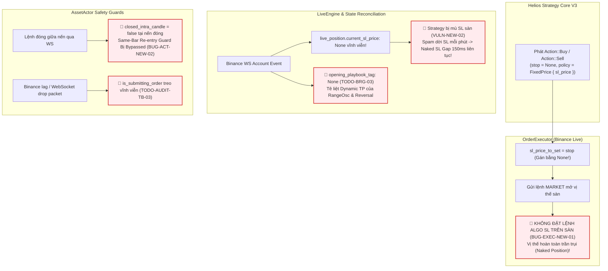

# KIỂM TOÁN KIẾN TRÚC VÒNG ĐỜI ACTOR, THỰC THI KHỚP LỆNH & ĐỒNG BỘ TRẠNG THÁI
**Tài liệu:** Note 17  
**Chủ đề:** Vòng Đời `AssetActor`, Luồng Thực Thi Quyết Định (`Action`), Khuyết Tật Khớp Lệnh Sàn Live, Treo Cờ Deadlock và Cơ Chế Đồng Bộ Trạng Thái  
**Phạm vi kiểm toán:**
- `trading_bot/bot_engine/src/controller/asset_actor.rs`
- `trading_bot/bot_engine/src/execution/order_executor.rs`
- `trading_bot/bot_engine/src/execution/live_engine.rs`
- `trading_bot/bot_engine/src/execution/paper_engine.rs`
- `trading_bot/bot_engine/src/execution/account_manager.rs`
- `strategies_backtests/helios/src/strategy/core_v3/mod.rs` & `risk.rs`
- Đối chiếu mã lỗi: `TODO-ACT-01` đến `TODO-ACT-08`, `TODO-EXEC-01` đến `TODO-EXEC-04`, `TODO-RECOV-01`, `TODO-RECOV-02`, `TODO-COR-01`.

---

## 🧭 1. TỔNG QUAN KIỂM TOÁN TẦNG THỰC THI (EXECUTIVE SUMMARY)

Tầng thực thi (`AssetActor` & `ExecutionEngine`) đóng vai trò là "chiến binh ngoài chiến trường", chuyển hóa các tín hiệu toán học trừu tượng của `HeliosStrategyV3` thành các lệnh giao dịch thực tế trên sàn Binance Futures. Rà soát chuyên sâu từng dòng mã nguồn phát hiện **5 lỗ hổng chí mạng (P0)** có thể dẫn đến **mất tiền thật ngay lập tức**:



---

## 🚨 2. CÁC TỬ HUYỆT THỰC THI & RỦI RO SÀN LIVE (CRITICAL VULNERABILITIES)

### 2.1. Khuyết Tật Mở Lệnh: Bỏ Quên Hard SL Ban Đầu Trên Sàn Live (`BUG-EXEC-NEW-01` — P0 MỚI)
- **Tình trạng:** 🔴 **LỖI MỚI PHÁT HIỆN — MỨC ĐỘ NGUY HIỂM TỐI CAO**.
- **Vị trí mã nguồn:**
  - [`strategies_backtests/helios/src/strategy/core_v3/mod.rs:374-383`](file:///e:/Projects/Automations/trading_backtest/strategies_backtests/helios/src/strategy/core_v3/mod.rs#L374-L383)
  - [`trading_bot/bot_engine/src/execution/order_executor.rs:240-262, 354`](file:///e:/Projects/Automations/trading_backtest/trading_bot/bot_engine/src/execution/order_executor.rs#L240-L262)
- **Bản chất kỹ thuật:**
  1. Trong `HeliosStrategyV3::next()`, khi phát tín hiệu mở lệnh Buy:
     ```rust
     let policy = Some(RiskPolicy::FixedPrice {
         sl_price: Some(initial_sl),
         tp_price: decision.final_tp,
     });
     if is_long {
         tick.buy(Some(size), None, None, policy, tag); // stop = None!
     }
     ```
     Mức giá dừng lỗ `initial_sl` được đóng gói bên trong `policy: Some(RiskPolicy::FixedPrice { sl_price, .. })`, trong khi đối số `stop` truyền vào là `None`.
  2. Tại `OrderExecutor::execute_action`:
     ```rust
     Action::Buy { size, stop, policy, .. } => {
         sl_price_to_set = stop; // BUG: stop LUÔN LÀ None!
         (NewOrderSideEnum::Buy, false, size)
     }
     ```
     `OrderExecutor` chỉ gán `sl_price_to_set = stop;` mà **hoàn toàn không bóc tách `sl_price` từ bên trong `policy`**!
  3. Đến dòng 354:
     ```rust
     if let Some(sl) = sl_price_to_set {
         // Đặt lệnh Algo STOP_MARKET trên Binance
     }
     ```
     Vì `sl_price_to_set` là `None`, khối logic đặt lệnh dừng lỗ trên Binance bị **BỎ QUA 100%**!
- **Hậu quả thực tế:** Khi có tín hiệu vào lệnh, bot gửi lệnh Market mở vị thế thành công trên Binance, nhưng **hoàn toàn không có bất kỳ lệnh Stop Loss nào được treo trên sàn**. Vị thế trần trụi (Naked Position). Nếu giá sập mạnh ngay sau khi vào lệnh, tài khoản có thể bị quét thanh lý (Margin Call) trước khi kịp sang cây nến tiếp theo!
- **Giải pháp dứt điểm:**
  ```rust
  let extracted_sl = stop.or_else(|| {
      if let Some(RiskPolicy::FixedPrice { sl_price, .. }) = &policy {
          *sl_price
      } else {
          None
      }
  });
  sl_price_to_set = extracted_sl;
  ```

---

### 2.2. Lỗi Rỗng SL Trên Live Engine (`VULN-NEW-02` / `TODO-BRG-03` — P0)
- **Tình trạng:** 🔴 **CHƯA FIX - ĐANG TỒN TẠI TRONG CODE**.
- **Vị trí mã nguồn:**
  - [`trading_bot/bot_engine/src/execution/live_engine.rs:204`](file:///e:/Projects/Automations/trading_backtest/trading_bot/bot_engine/src/execution/live_engine.rs#L204)
  - [`trading_bot/bot_engine/src/optimizer/helios_bridge.rs:248`](file:///e:/Projects/Automations/trading_backtest/trading_bot/bot_engine/src/optimizer/helios_bridge.rs#L248)
  - [`strategies_backtests/helios/src/strategy/core_v3/risk.rs:644-653`](file:///e:/Projects/Automations/trading_backtest/strategies_backtests/helios/src/strategy/core_v3/risk.rs#L644-L653)
- **Bản chất kỹ thuật:**
  1. `BinanceLiveExecutionEngine` khi nhận sự kiện `PositionUpdate` từ WebSocket gán cứng:
     ```rust
     self.live_position = Some(LivePositionState {
         ...
         current_sl_price: None, // Hardcoded None vĩnh viễn!
         ...
     });
     ```
  2. Mặc dù `OrderExecutor` có lưu `active_sl_prices: Arc<RwLock<HashMap<String, f64>>>`, nhưng giá trị này **không bao giờ được đồng bộ ngược về `live_position`**.
  3. `HeliosBridge` đọc `trade.sl_price = pos.current_sl_price;` $\implies$ luôn là `None`.
  4. Trong `RiskManager::manage_trailing_stop`:
     ```rust
     let sl_changed = if trade.is_long() {
         calculated_sl > trade.sl_price.unwrap_or(f64::NEG_INFINITY)
     } else { ... };
     ```
     Phép so sánh `calculated_sl > -inf` **LUÔN ĐÚNG TRÊN MỌI CÂY NẾN**!
- **Hậu quả kép:**
  1. **Spam API Weight:** Mỗi phút Strategy đều phát ra `Action::UpdateTradeSlTp`, tiêu tốn vô ích hạn ngạch API của Binance.
  2. **Tử huyệt Naked SL Gap 150ms:** Mỗi phút `OrderExecutor` đều hủy lệnh SL cũ, ngủ 150ms rồi mới đặt SL mới. Vị thế bị phơi trần 150ms không có bảo vệ 60 lần mỗi giờ!
- **Giải pháp dứt điểm:** Chia sẻ `active_sl_prices` sang `LiveExecutionEngine` và cập nhật `live_position.current_sl_price = self.executor.get_active_sl(&symbol).await`.

---

### 2.3. Lỗi Mất Tag Playbook Trên Môi Trường Live (`TODO-BRG-03` — P1)
- **Tình trạng:** 🔴 **CHƯA FIX - ĐANG TỒN TẠI TRONG CODE**.
- **Vị trí mã nguồn:**
  - [`trading_bot/bot_engine/src/execution/live_engine.rs:206`](file:///e:/Projects/Automations/trading_backtest/trading_bot/bot_engine/src/execution/live_engine.rs#L206)
  - [`strategies_backtests/helios/src/strategy/core_v3/risk.rs:290-302, 579`](file:///e:/Projects/Automations/trading_backtest/strategies_backtests/helios/src/strategy/core_v3/risk.rs#L290-L302)
- **Bản chất kỹ thuật:**
  1. `PaperExecutionEngine` có trích xuất `tag` từ `Action::Buy/Sell` và lưu vào vị thế. Nhưng `BinanceLiveExecutionEngine` **bỏ qua hoàn toàn `tag`** và gán `opening_playbook_tag: None`.
  2. Tại `risk.rs:579`:
     ```rust
     if tag_str == "RANGE_OSC" || tag_str == "REVERSAL" {
         // Dynamic Structural Take Profit theo BBands hoặc KAMA Mid
     }
     ```
     Vì `tag_str == ""`, **toàn bộ cơ chế chốt lời cấu trúc động của Range và Reversal bị tê liệt 100% trên Live**!
  3. Đồng thời, các Playbook bị mất cấu hình Trailing ATR riêng (`tsl_atr_loose`, `tsl_atr_tight`), luôn bị ép về fallback chung.
- **Giải pháp dứt điểm:** Lưu `self.pending_opening_tag` khi nhận `Action` và gán vào `live_position.opening_playbook_tag` khi `PositionUpdate` xác nhận vị thế mở.

---

### 2.4. Same-Bar Re-entry Guard Bị Bypassed Khi Lệnh Đóng Mid-Candle (`BUG-ACT-NEW-02` — P0 MỚI)
- **Tình trạng:** 🔴 **LỖI MỚI PHÁT HIỆN — MẤT PHANH CHỐNG CÀO LỆNH CÙNG NẾN**.
- **Vị trí mã nguồn:**
  - [`trading_bot/bot_engine/src/controller/asset_actor.rs:373-378, 608-610, 637-644`](file:///e:/Projects/Automations/trading_backtest/trading_bot/bot_engine/src/controller/asset_actor.rs#L373-L378)
- **Bản chất kỹ thuật:**
  1. `AssetActor` không lưu trữ `last_exit_candle_index`. Nó phụ thuộc vào cờ trả về từ `sync_and_handle_closed_positions` tại dòng 610 trong `on_new_candle`.
  2. Khi lệnh dính SL ở giữa nến (ví dụ giây thứ 25), sự kiện WebSocket `account_rx.recv()` kích hoạt ngay tại giây 25, xóa `self.previous_position` về `None`.
  3. Đến giây thứ 60 khi nến đóng, `sync_and_handle_closed_positions` chạy lại: vì `previous_position` lúc này đã là `None`, nó trả về `closed_intra_candle = false`!
  4. Chốt chặn Tầng 1 (`if closed_intra_candle`) nhận giá trị `false`, hoàn toàn bị vô hiệu hóa!
- **Hậu quả:** Ngay tại cây nến vừa dính SL, nếu Strategy phát tín hiệu mới, bot lập tức mở lệnh lại trên chính cây nến vừa cắt lỗ (vi phạm nguyên tắc Same-Bar Re-entry Guard).
- **Giải pháp dứt điểm:** Bổ sung `pub last_exit_bar_idx: Option<usize>` vào `AssetActor`. Gán `Some(current_bar_idx)` ngay khi vị thế đóng và chặn `if self.last_exit_bar_idx == Some(current_bar_idx) { continue; }`.

---

### 2.5. Cờ Lệnh `is_submitting_order` Treo Deadlock Vĩnh Viễn (`TODO-AUDIT-TB-03` — P0)
- **Tình trạng:** 🔴 **CHƯA FIX - ĐANG TỒN TẠI TRONG CODE**.
- **Vị trí mã nguồn:**
  - [`trading_bot/bot_engine/src/execution/live_engine.rs:23, 122, 140`](file:///e:/Projects/Automations/trading_backtest/trading_bot/bot_engine/src/execution/live_engine.rs#L23)
  - [`trading_bot/bot_engine/src/execution/order_executor.rs:152`](file:///e:/Projects/Automations/trading_backtest/trading_bot/bot_engine/src/execution/order_executor.rs#L152) (`.unwrap()` Decimal panic).
- **Bản chất kỹ thuật:**
  - `self.is_submitting_order = true;` bật khi gửi lệnh qua `tokio::spawn`.
  - Nếu task bị panic (ví dụ `.unwrap()` số thực `NaN`) hoặc Binance REST bị treo timeout (TCP blackhole) hoặc WebSocket drop bản tin phản hồi:
  - Cờ `is_submitting_order` không bao giờ được reset về `false`.
  - Tại dòng 122: `if position_amt > 0.0 || self.is_submitting_order { return Ok(()); }`
  - Mọi Action vào lệnh từ Strategy bị âm thầm nuốt chửng vĩnh viễn, bot bị tê liệt hoàn toàn cho tới khi restart.
- **Giải pháp dứt điểm:** Thêm Lease Timeout (10 giây): Nếu `submitting_since.elapsed() > 10s`, tự động giải phóng cờ và log cảnh báo `warn!`.

---

### 2.6. Lỗ Hổng Clean Slate Bán Tháo Khi Khởi Động (`TODO-RECOV-01` — P0)
- **Tình trạng:** 🔴 **CHƯA FIX - ĐANG TỒN TẠI TRONG CODE**.
- **Vị trí mã nguồn:**
  - [`trading_bot/bot_engine/src/execution/account_manager.rs:175-178`](file:///e:/Projects/Automations/trading_backtest/trading_bot/bot_engine/src/execution/account_manager.rs#L175-L178):
    ```rust
    // CLEAN SLATE: Dọn dẹp bàn cờ (hủy lệnh + đóng vị thế)
    let _ = self.cancel_all_orders(symbol).await;
    let _ = self.force_close_all_positions(symbol, position_amt).await;
    ```
- **Hậu quả:** Khi khởi động lại bot (restart sau update hoặc crash), nếu trên sàn đang có vị thế gồng lãi lớn (+50% ROE), hàm này tự động bán tháo lệnh ở giá thị trường, phá hủy toàn bộ thành quả giao dịch của người dùng!
- **Giải pháp dứt điểm:** Xóa bỏ cơ chế Clean Slate, chuyển sang triết lý **Adopt & Protect**: Query vị thế và lệnh Algo SL có sẵn từ sàn để Strategy tiếp tục bảo vệ và trailing stop.

---

## 📊 3. ĐỐI CHIẾU TIẾN ĐỘ VỚI AUDIT 01 ROADMAP

| Mã Task | Mô Tả | Trạng Thái Trong Code | Chi Tiết Đánh Giá Thực Tế |
| :--- | :--- | :---: | :--- |
| `TODO-ACT-01` | Sửa Cooldown Deadlock bão hòa buffer 43k | 🟢 **ĐÃ FIX** | Dùng `processed_candles_count` tăng đơn điệu, giải phóng Cooldown đúng hạn. |
| `TODO-ACT-02` | Đồng bộ đóng lệnh Binance vào CooldownGuard | 🟢 **ĐÃ FIX** | 2-Piece Assembler (`OrderTradeUpdate` + `PositionUpdate`) mang PnL thật. |
| `TODO-ACT-03` | Sửa Same-Side Price Guard Deadlock | 🟢 **ĐÃ FIX** | Tái cấu trúc sang Universal Pure TTL, tự mở khóa 100% khi hết nến phạt. |
| `TODO-COR-01` | Hóa giải Deadlock Cooldown trong Core V3 | 🟢 **ĐÃ FIX** | Xóa sạch `CooldownTracker` thừa khỏi Strategy, giao độc quyền cho Bot Engine. |
| `TODO-EXEC-03` | Đổi làm tròn size từ `.round()` sang `FLOOR` | ❌ **CHƯA FIX** | Nguy cơ làm tròn vượt ký quỹ bị sàn trả lỗi `-2019`. |
| `TODO-EXEC-04` | Gửi lệnh Algo TP lên Binance Futures tự động | ❌ **CHƯA FIX** | Hiện chỉ đặt Algo SL, bỏ qua Algo TP. |
| `TODO-RECOV-01` | Xóa bỏ Clean Slate — Triển khai Adopt & Protect | ❌ **CHƯA FIX** | Vẫn gọi `force_close_all_positions` khi start. |
| `TODO-RECOV-02` | Ngăn chặn SL Retraction sau Restart | ❌ **CHƯA FIX** | Chưa query Algo SL sàn khi khởi động lại. |
| `TODO-ACT-05` | Chặn bypass validation khi nhận DNA Hot-Swap | ❌ **CHƯA FIX** | Khi Flat gọi thẳng `update_from_dna` bỏ qua `apply_dna`. |

---

## 🛠️ 4. BẢNG ĐỐI CHẤT CÁC ĐỀ XUẤT THIẾT KẾ (PROS - CONS - EDGE CASES)

| Đề Xuất Giải Pháp | Ưu Điểm (Pros) | Nhược Điểm (Cons) | Edge Cases & Chốt Chặn |
| :--- | :--- | :--- | :--- |
| **1. Bóc tách `policy.sl_price` trong `OrderExecutor`** | Triệt tiêu $100\%$ rủi ro mở vị thế trần trụi (Naked Position) trên Binance Live. | Không có. | Xử lý cả 2 trường hợp: SL nằm ở `stop` hoặc nằm trong `policy`. |
| **2. Chia sẻ `active_sl_prices` sang `LiveExecutionEngine`** | Chấm dứt spam dời SL mỗi phút, triệt tiêu Naked SL Gap 150ms. | Cần truyền kênh tham chiếu giữa 2 component. | Phải xóa giá trị khi vị thế bị thanh lý hoặc khớp lệnh SL. |
| **3. Bổ sung `last_exit_bar_idx` cho Same-Bar Guard** | Đóng lệnh mid-candle hay end-candle đều được bảo vệ chống cào lệnh cùng nến $100\%$. | Thêm 1 trường `Option<usize>` trong Actor. | Tự động hết hiệu lực khi qua nến tiếp theo (`current > exit`). |
| **4. Thêm Lease Timeout 10s cho `is_submitting_order`** | Chống deadlock vĩnh viễn khi rớt mạng, lag HTTP hoặc task panic. | Nếu sàn lag quá 10s có thể có nguy cơ race condition nhỏ. | Query lại vị thế trước khi giải phóng cờ để đảm bảo an toàn. |
| **5. Chuẩn hóa `apply_dna` cho mọi nhánh Hot-Swap** | Chặn đứng $100\%$ nguy cơ Panic crash do sai số chiều DNA hoặc nhiễm `NaN`/`Inf`. | Từ chối nạp nếu DNA lỗi (giữ DNA cũ an toàn). | Ghi log `error!` để Re-Optimizer biết kết quả bị từ chối. |
