# KIỂM TOÁN KIẾN TRÚC TỐI ƯU HÓA TỊNH TIẾN, KÊNH CẬP NHẬT DNA VÀ BẤT ĐỒNG BỘ CONCURRENCY
**Tài liệu:** Note 18  
**Chủ đề:** Bộ Tối Ưu Hóa Tịnh Tiến (`ProspectorRunner`), Lỗ Hổng Tê Liệt GA Từ Chu Kỳ 2 (`NEW-OPT-01`), Thẩm Định OOS, Kênh Truyền Tin DNA Nóng và Concurrency  
**Phạm vi kiểm toán:**
- `trading_bot/bot_engine/src/optimizer/prospector_runner.rs`
- `trading_bot/bot_engine/src/data_engine/sqlite_impl.rs`
- `trading_bot/bot_engine/src/main.rs` & `controller/asset_actor.rs`
- `ferro_trade/src/optimizer/` (`prospector.rs`, `storage.rs`, `ga_worker.rs`)
- Đối chiếu mã lỗi: `TODO-PROS-01` đến `TODO-PROS-09`, `TODO-ACT-05`, `TODO-AUDIT-TB-01`, `TODO-AUDIT-TB-03`.

---

## 🧭 1. TỔNG QUAN KIỂM TOÁN TẦNG TỐI ƯU HÓA (EXECUTIVE SUMMARY)

`ProspectorRunner` là trái tim thích ứng sinh học (The Mahoraga Wheel) của hệ thống, chịu trách nhiệm chạy thuật toán di truyền ngầm định kỳ trên cửa sổ trượt 30 ngày (In-Sample), thẩm định chất lượng ngoài mẫu (OOS Validation Gate) và bắn bộ thông số DNA tối ưu sang `AssetActor` qua kênh `tokio::sync::watch`.

Kiểm toán đã phát hiện **1 lỗi logic kiến trúc cực kỳ nghiêm trọng khiến GA Optimizer bị tê liệt từ chu kỳ thứ 2 trở đi (`NEW-OPT-01`)**, cùng **3 lỗ hổng toán học và concurrency**:

```mermaid
flowchart TD
    subgraph PeriodicLoop ["Chu Trình Tối Ưu Hóa Định Kỳ (main.rs & ProspectorRunner)"]
        Cycle1["Chu Kỳ 1: Tạo DB storage/{strategy}_prospector.db<br>Khởi tạo Job #1 -> GA chạy 30 thế hệ -> Lưu Champions"]
        Cycle1 --> DBExist["DB đã tồn tại & get_max_job_id() > 0"]
        DBExist --> Cycle2["Chu Kỳ 2 (15 phút sau): Khởi động Re-Optimizer"]
        Cycle2 --> Bug["🔴 BỎ QUA KHỞI TẠO JOB (NEW-OPT-01)!<br>if !db_exists || max_job == 0 -> Bỏ qua add_initial_job"]
        Bug --> EmptyQueue["Hàng đợi rỗng -> GA thoát ngay sau 0.1s!"]
        EmptyQueue --> Stale["Đọc lại đúng Champion cũ của Chu Kỳ 1<br>Tê Liệt Khả Năng Thích Ứng Tiến Hóa!"]
    end

    subgraph Validation ["Thẩm Định Ngoài Mẫu (OOS Validation Gate)"]
        OOS["Tập Kiểm Định 3 Ngày OOS"]
        Contam["🔴 Gối đầu 5,760 nến In-Sample vào OOS (TODO-PROS-02)<br>Ô nhiễm dữ liệu huấn luyện làm sai lệch Gate!"]
    end

    subgraph Concurrency ["Runtime & Hot-Swap Concurrency"]
        Sync["Diagnostic Backtest & GA Rayon"] --> BlockTokio["🔴 Nghẽn luồng Tokio Worker Thread (TODO-TB-05)"]
        HotSwap["DNA Hot-Swap khi Flat"] --> DirectUpdate["🔴 Bypass apply_dna -> Nguy cơ Panic Crash (TODO-ACT-05)"]
    end

    style Bug fill:#ffebee,stroke:#d32f2f,stroke-width:2px
    style Stale fill:#ffebee,stroke:#d32f2f,stroke-width:2px
    style Contam fill:#fff3e0,stroke:#f57c00
    style BlockTokio fill:#fff3e0,stroke:#f57c00
    style DirectUpdate fill:#ffebee,stroke:#d32f2f,stroke-width:2px
```



---

## 🚨 2. CÁC TỬ HUYỆT TỐI ƯU HÓA & TIẾN HÓA DNA (CRITICAL VULNERABILITIES)

### 2.1. Lỗ Hổng Tê Liệt GA Optimizer Từ Chu Kỳ 2 Trở Đi (`NEW-OPT-01` — P0 MỚI)
- **Tình trạng:** 🔴 **LỖI MỚI PHÁT HIỆN — VÔ HIỆU HÓA BÁNH XE THÍCH ỨNG MAHORAGA**.
- **Vị trí mã nguồn:**
  - [`trading_bot/bot_engine/src/main.rs:104-125`](file:///e:/Projects/Automations/trading_backtest/trading_bot/bot_engine/src/main.rs#L104-L125)
  - [`trading_bot/bot_engine/src/optimizer/prospector_runner.rs:360-385`](file:///e:/Projects/Automations/trading_backtest/trading_bot/bot_engine/src/optimizer/prospector_runner.rs#L360-L385)
- **Bản chất kỹ thuật:**
  1. Trong `main.rs`, bot khởi chạy một task chạy nền định kỳ mỗi 15 phút để re-optimize:
     ```rust
     let runner = ProspectorRunner::new(config, data_engine, ...);
     loop {
         runner.run_optimization_cycle().await;
         tokio::time::sleep(Duration::from_secs(900)).await;
     }
     ```
  2. Tại `prospector_runner.rs:365–375`:
     ```rust
     let db_path = format!("storage/{}_prospector.db", self.strategy_name);
     let db_exists = std::path::Path::new(&db_path).exists();
     let storage = FitnessStorage::new(&db_path)?;
     
     // BUG CỐT TỬ:
     if !db_exists || storage.get_max_job_id()? == 0 {
         storage.add_initial_job(&initial_params)?;
         info!("Created initial job in DB");
     }
     ```
  3. **Kịch bản tê liệt:**
     - **Chu kỳ 1 (Khởi động bot):** File DB chưa tồn tại (`!db_exists == true`). Hàm tạo file DB, thêm `Job #1` vào hàng đợi. GA Engine (`prospector.rs`) lấy Job #1 ra xử lý, chạy 30 thế hệ, tìm ra cá thể tốt nhất và hoàn tất Job #1. File DB được lưu vào ổ cứng.
     - **Chu kỳ 2 (15 phút sau):** `run_optimization_cycle` chạy lại. Lúc này:
       - File `storage/{strategy}_prospector.db` **ĐÃ TỒN TẠI** (`db_exists == true`).
       - `storage.get_max_job_id()?` trả về `1` (`> 0`).
       - Điều kiện `if !db_exists || storage.get_max_job_id()? == 0` trả về **`false`**!
       - Khối tạo Job bị **BỎ QUA HOÀN TOÀN**! Không có bất kỳ Job mới nào được thêm vào database.
     - Khi `prospector.run()` khởi động: Nó quét hàng đợi tìm Job chưa xử lý. Vì hàng đợi rỗng, GA Engine **THOÁT NGAY LẬP TỨC TRONG 0.1 GIÂY** mà không đánh giá bất kỳ cá thể nào!
     - Sau đó, runner đọc cá thể Champion từ DB: Nó đọc lại đúng cá thể Champion đã tìm được từ Chu kỳ 1 (15 phút trước) và bắn lại cá thể cũ đó sang `AssetActor`!
- **Hậu quả thực tế:** Hệ thống hoàn toàn **NGỪNG TIẾN HÓA** từ chu kỳ thứ 2. Bot tưởng rằng nó đang liên tục tối ưu hóa mỗi 15 phút, nhưng thực chất chỉ đang "nhai lại" cấu hình DNA của chu kỳ đầu tiên. Toàn bộ triết lý thích ứng thời gian thực thích nghi với biến động mới của thị trường bị phá sản hoàn toàn!
- **Giải pháp dứt điểm:**
  1. Mỗi chu kỳ tối ưu hóa phải tạo một Job mới với cửa sổ thời gian mới:
     ```rust
     let new_job_id = storage.get_max_job_id()?.saturating_add(1);
     storage.add_job(new_job_id, &current_window_params)?;
     ```
  2. Hoặc sử dụng cơ sở dữ liệu In-Memory / Temporary Database cho mỗi chu kỳ Walk-Forward Rolling để đảm bảo tính cô lập và trong sạch.

---

### 2.2. Nhiễm Bẩn Dữ Liệu Huấn Luyện Vào Tập Thẩm Định WFE (`TODO-PROS-02` — P1)
- **Tình trạng:** ❌ **CHƯA FIX - ĐANG TỒN TẠI TRONG CODE**.
- **Vị trí mã nguồn:**
  - [`trading_bot/bot_engine/src/optimizer/prospector_runner.rs:410-435`](file:///e:/Projects/Automations/trading_backtest/trading_bot/bot_engine/src/optimizer/prospector_runner.rs#L410-L435)
- **Bản chất kỹ thuật:**
  1. Khi cắt dữ liệu cho tập kiểm định ngoài mẫu OOS (ví dụ 3 ngày = 4,320 nến 1m):
     Để các chỉ báo MTF (KAMA 4h, ATR 1h) có đủ dữ liệu warmup trên tập OOS, code lấy thêm 5,760 nến quá khứ gối đầu vào trước tập OOS.
  2. Tuy nhiên, khi chạy Backtest đánh giá hiệu suất OOS:
     Hàm `compute_stats` lại tính toán PnL, Drawdown và Số lệnh trên **TOÀN BỘ 10,080 NẾN** (bao gồm cả 5,760 nến warmup thuộc về tập In-Sample)!
  3. Lợi nhuận và các lệnh thắng của tập huấn luyện In-Sample bị tính gộp vào kết quả thẩm định ngoài mẫu OOS, biến thẩm định OOS thành "In-Sample giả dạng OOS".
- **Hậu quả:** Các cá thể bị quá khớp (Overfitted) nặng nề trên tập In-Sample vẫn dễ dàng vượt qua cửa ải WFE Gate do hưởng lợi từ các lệnh thắng trong 5,760 nến gối đầu, sau đó ra thị trường thật và thua lỗ.
- **Giải pháp dứt điểm:** Cắt lát tập OOS thuần khiết: Chỉ ghi nhận các giao dịch có `entry_bar >= warmup_offset` (mốc bắt đầu OOS thực sự) để tính toán các chỉ số WFE Gate.

---

### 2.3. Bẫy Khởi Động Lạnh Treo Tối Ưu Hóa 20 Giờ (`TODO-PROS-01` — P0)
- **Tình trạng:** ❌ **CHƯA FIX - ĐANG TỒN TẠI TRONG CODE**.
- **Vị trí mã nguồn:**
  - [`trading_bot/bot_engine/src/optimizer/prospector_runner.rs:450-475`](file:///e:/Projects/Automations/trading_backtest/trading_bot/bot_engine/src/optimizer/prospector_runner.rs#L450-L475)
- **Bản chất kỹ thuật:**
  1. Khi bot mới khởi động với database rỗng, chu kỳ GA đầu tiên chạy tối ưu hóa.
  2. Nếu thị trường trong 3 ngày qua rơi vào trạng thái flatline, cá thể Rank 1 tìm được có thể bị WFE Gate từ chối (REJECT).
  3. Khi bị từ chối, Runner thoát ra và không nạp bất kỳ DNA nào vào SQLite `champion_dnas`.
  4. Chu kỳ tiếp theo (theo cấu hình ban đầu 4–6 tiếng) lại tiếp tục lặp lại. Bot rơi vào trạng thái "đói hạt giống" (Seed Starvation) suốt 20–40 giờ, chạy với cấu hình mặc định rỗng không tối ưu.
- **Giải pháp dứt điểm:** Tích hợp cơ chế **Baseline Fallback Seed**: Nếu chu kỳ khởi động lạnh bị WFE Gate từ chối, tự động nạp cấu hình chuẩn từ file `helios_baseline_dna.json` để bot có thể giao dịch an toàn ngay lập tức.

---

### 2.4. Thiếu Bộ Đệm Top-K Champions Qua WFE Gate (`TODO-PROS-08` — P1)
- **Tình trạng:** ❌ **CHƯA FIX - ĐANG TỒN TẠI TRONG CODE**.
- **Vị trí mã nguồn:**
  - [`trading_bot/bot_engine/src/optimizer/prospector_runner.rs:395-408`](file:///e:/Projects/Automations/trading_backtest/trading_bot/bot_engine/src/optimizer/prospector_runner.rs#L395-L408)
- **Bản chất kỹ thuật:**
  - Runner hiện chỉ trích xuất duy nhất **1 cá thể Rank 1** từ quần thể In-Sample để đem đi thẩm định OOS.
  - Trong thực tế định lượng, cá thể Rank 1 trên tập In-Sample thường là cá thể tận dụng tối đa các đặc thù ngẫu nhiên (noise) của dữ liệu quá khứ $\implies$ tỷ lệ rớt OOS rất cao.
  - Các cá thể Rank 2, Rank 3 hoặc Rank 5 có đường cong vốn ổn định hơn (robust) lại bị bỏ qua hoàn toàn.
- **Giải pháp dứt điểm:** Triển khai **Top-K Candidate Waterfall ($K=5$)**: Trích xuất Top 5 cá thể In-Sample tốt nhất. Thẩm định lần lượt từng cá thể qua WFE Gate. Cá thể đầu tiên vượt qua sẽ được chọn làm Champion triển khai ra Live.

---

### 2.5. Nghẽn Luồng Async Tokio Do Diagnostic & GA Blocking (`TODO-TB-05` / `TODO-ACT-08` — P1)
- **Tình trạng:** ❌ **CHƯA FIX - ĐANG TỒN TẠI TRONG CODE**.
- **Vị trí mã nguồn:**
  - [`trading_bot/bot_engine/src/controller/asset_actor.rs:360`](file:///e:/Projects/Automations/trading_backtest/trading_bot/bot_engine/src/controller/asset_actor.rs#L360):
    ```rust
    match HeliosBridge::diagnostic_backtest(&candles_vec, &dna.dna) { ... }
    ```
  - [`trading_bot/bot_engine/src/optimizer/helios_bridge.rs:335`](file:///e:/Projects/Automations/trading_backtest/trading_bot/bot_engine/src/optimizer/helios_bridge.rs#L335):
    `static DIAGNOSTIC_LOCK: Lazy<Mutex<()>> = Lazy::new(|| Mutex::new(()));`
- **Bản chất kỹ thuật:**
  1. Khi nhận DNA mới, `AssetActor` gọi thẳng `HeliosBridge::diagnostic_backtest` ngay trên luồng async của Tokio.
  2. Hàm này convert DataFrame Polars, resample MTF, tính toán toàn bộ chỉ báo và mô phỏng 43,200 nến, tiêu tốn từ **2 đến 10 giây CPU**.
  3. Vì chạy đồng bộ (`sync`), nó **chiếm dụng hoàn toàn luồng worker của Tokio Runtime**.
  4. Trong thời gian 2–10 giây này, kênh WebSocket nạp nến bị nghẽn, dẫn đến lỗi `RecvError::Lagged(skipped)` làm mất nến của bot.
  5. Đồng thời, `static DIAGNOSTIC_LOCK` khóa toàn cục khiến nếu có 5 symbols cùng nhận DNA mới, chúng sẽ xếp hàng chờ nhau mất tới 50 giây!
- **Giải pháp dứt điểm:** Bọc trong `tokio::task::spawn_blocking`, loại bỏ khóa toàn cục `DIAGNOSTIC_LOCK` để mỗi symbol tự backtest độc lập trên thread pool riêng.

---

## 📊 3. ĐỐI CHIẾU TIẾN ĐỘ VỚI AUDIT 01 ROADMAP

| Mã Task | Mô Tả | Trạng Thái Trong Code | Chi Tiết Đánh Giá Thực Tế |
| :--- | :--- | :---: | :--- |
| `NEW-OPT-01` | Lỗ hổng tê liệt Re-Opt từ chu kỳ 2 | 🔴 **MỚI PHÁT HIỆN** | Bỏ qua tạo Job khi DB đã có dữ liệu $\implies$ GA thoát ngay sau 0.1s. |
| `TODO-PROS-01` | Fallback Baseline Seed chống đói 20h | ❌ **CHƯA FIX** | Chu kỳ 1 bị Reject thì bot không có DNA, chạy Default rỗng. |
| `TODO-PROS-02` | Khắc phục nhiễm bẩn dữ liệu vào tập WFE | ❌ **CHƯA FIX** | Gối đầu 5,760 nến In-Sample vào OOS làm méo kết quả thẩm định. |
| `TODO-PROS-03` | Nâng cấp tiêu chí WFE Gate ($N \ge 2$, $DD \le 10\%$) | ⚠️ **MỚI SỬA BƯỚC 1** | Đã nâng cấp WFE Gate Do-No-Harm, cần kiểm chứng bền bỉ. |
| `TODO-PROS-08` | Bộ đệm Top-K Champions ($K=3\sim 5$) | ❌ **CHƯA FIX** | Chỉ lấy duy nhất Rank 1 In-Sample, dễ bị bẫy Overfitting. |
| `TODO-PROS-09` | Cơ chế Tẩy Não Hạt Giống (Seed Retirement) | ❌ **CHƯA FIX** | Chưa có logic xóa hạt giống khi bị từ chối 3 chu kỳ liên tiếp. |
| `TODO-ACT-05` | Chặn bypass validation khi nhận DNA Hot-Swap | ❌ **CHƯA FIX** | Dòng 338, 515 gọi thẳng `update_from_dna` bỏ qua `apply_dna`. |
| `TODO-AUDIT-TB-01` | Rủi ro SQLite Lock đa luồng | ❌ **CHƯA FIX** | Chưa cấu hình WAL mode và connection pool riêng cho Runner. |
| `TODO-AUDIT-TB-03` | Nghẽn Tokio Worker do Diagnostic Backtest | ❌ **CHƯA FIX** | Chạy đồng bộ trên thread Tokio, khóa tĩnh `DIAGNOSTIC_LOCK`. |

---

## 🛠️ 4. BẢNG ĐỐI CHẤT CÁC ĐỀ XUẤT THIẾT KẾ (PROS - CONS - EDGE CASES)

| Đề Xuất Giải Pháp | Ưu Điểm (Pros) | Nhược Điểm (Cons) | Edge Cases & Chốt Chặn |
| :--- | :--- | :--- | :--- |
| **1. Khởi tạo Job mới mỗi chu kỳ Walk-Forward (`NEW-OPT-01`)** | Phục hồi $100\%$ khả năng thích ứng liên tục của GA; bánh xe Mahoraga hoạt động bình thường. | File DB sẽ tăng kích thước theo thời gian nếu lưu toàn bộ lịch sử. | Tự động dọn dẹp các Job cũ $> 7$ ngày hoặc dùng In-Memory DB cho mỗi chu kỳ. |
| **2. Cắt lát OOS thuần khiết từ `warmup_offset`** | Loại bỏ $100\%$ hiện tượng lây nhiễm In-Sample vào OOS; thẩm định trung thực. | Số lượng nến tính điểm OOS ít hơn (đúng bằng chiều dài OOS). | Phải đảm bảo số nến OOS đủ để xuất hiện tối thiểu cơ hội giao dịch. |
| **3. Cơ chế Top-K Champions Waterfall ($K=5$)** | Tăng tỷ lệ sống sót qua WFE Gate lên gấp $3\times$; chọn được cá thể bền bỉ nhất. | Tốn thêm một ít thời gian chạy backtest OOS cho 5 cá thể ($< 1$ giây). | Nếu cả 5 cá thể đều rớt, kích hoạt cơ chế Defensive Hold an toàn. |
| **4. Chuyển Diagnostic sang `tokio::task::spawn_blocking`** | Giải phóng hoàn toàn luồng async của Tokio; triệt tiêu $100\%$ lỗi rớt nến WebSocket. | Tiêu tốn thread trong blocking pool. | Đặt timeout tối đa 15s cho task backtest chẩn đoán. |
| **5. Triển khai Staleness Watchdog cho DNA** | Tránh bẫy Zombie DNA khi thị trường đi ngang kéo dài; tự động hạ rủi ro. | Bot sẽ giảm quy mô giao dịch nếu không có DNA mới. | Reset bộ đếm ngày khi có DNA mới vượt qua WFE Gate. |
