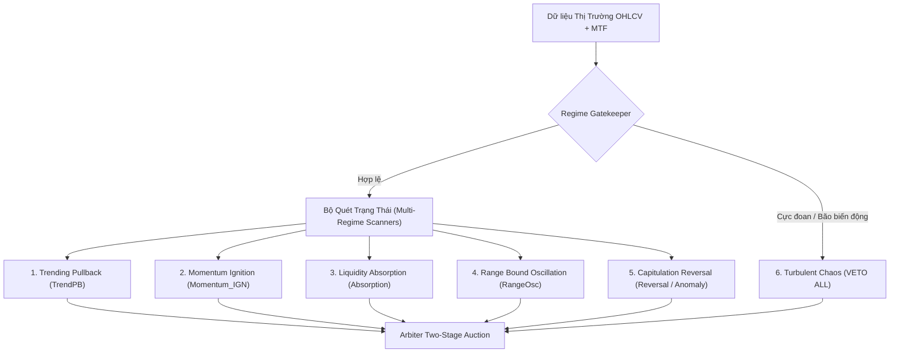

# BÁO CÁO PHÂN TÍCH ĐỊNH LƯỢNG: PHƯƠNG PHÁP LUẬN KHOA HỌC CHUẨN MỰC VỀ PHÂN TÍCH TRẠNG THÁI THỊ TRƯỜNG (MARKET REGIMES)
**File tài liệu:** `23_standard_quant_methodology_market_regimes.md`  
**Chuyên đề:** Phương pháp luận nghiên cứu định lượng (Standard Quant Methodology)  
**Trạng thái:** Hoàn thành tổng hợp lý thuyết nền tảng & Framework chuẩn mực  

---

## 🏛️ 1. Bản Chất Khoa Học Cốt Lõi: Tại Sao Phải Phân Tích Trạng Thái (Market Regimes)?

### 1.1. Bản chất Phi dừng (Non-stationarity) của Chuỗi Thời Gian Tài Chính
Trong toán tài chính và vật lý thống kê, chuỗi thời gian giá tài sản $P_t$ hoặc lợi suất $r_t = \ln(P_t / P_{t-1})$ là một quá trình ngẫu nhiên phi dừng (**Non-stationary Stochastic Process**):
- Kỳ vọng toán học $\mathbb{E}[r_t]$ (Drift $\mu_t$) và Phương sai $\text{Var}(r_t)$ (Volatility $\sigma_t$) không cố định mà biến thiên liên tục theo thời gian.
- **Hệ quả định lượng:** Một thuật toán hoặc chiến lược giao dịch tĩnh (Static Rule) có kỳ vọng toán học dương ($EV > 0$) trong môi trường xu hướng (Trending) chắc chắn sẽ bị phá hủy vốn ($EV \ll 0$) khi thị trường chuyển pha sang dao động hỗn loạn (Mean-reverting / Turbulent Chop).
- Không có một bộ tham số (DNA) duy nhất nào có thể chiến thắng trong mọi điều kiện thị trường.

### 1.2. Mục Tiêu của Phân Tích Trạng Thái (Regime Detection)
Phân tích trạng thái thị trường là quá trình giải bài toán **Phân đoạn chuỗi thời gian (Time Series Segmentation)** hoặc **Nhận dạng mẫu ẩn (Hidden State Identification)** nhằm:
1. Xác định phân phối xác suất hiện tại của thị trường: $\mathcal{D}_t \sim \mathcal{N}(\mu_s, \sigma_s^2)$.
2. Kích hoạt đúng cỗ máy chiến thuật (Tactical Playbook) tương thích với cấu trúc thị trường đó.
3. Điều chỉnh quy mô rủi ro và đòn bẩy phù hợp với mức độ nhiễu loạn của hệ thống.

---

## 📐 2. Các Phương Pháp Luận Chuẩn Mực Trong Quỹ Định Lượng (Standard Quant Methodologies)

Trong các quỹ đầu tư định lượng (Quant Funds) và giới học thuật tài chính, có 4 trụ cột toán học chuẩn mực được áp dụng:

### 2.1. Phương Pháp 1: Mô Hình Vi Phân Ngẫu Nhiên (Stochastic Differential Equations - SDE)
Mô hình hóa động lực học của giá qua phương trình vi phân ngẫu nhiên:
$$dP_t = \mu(P_t, t)\,dt + \sigma(P_t, t)\,dW_t$$
Trong đó:
- $\mu(P_t, t)\,dt$: Thành phần định hướng có trật tự (**Directional Drift**).
- $\sigma(P_t, t)\,dW_t$: Thành phần nhiễu ngẫu nhiên khuếch tán (**Diffusion / Brownian Motion**).
- **Signal-to-Noise Ratio (SNR):**
  $$\text{SNR}_t = \frac{|\mu_t|}{\sigma_t}$$
  - $\text{SNR} \gg 1$: Trạng thái xu hướng mạnh (Lực đẩy định hướng thắng thế hoàn toàn chuyển động nhiệt ngẫu nhiên).
  - $\text{SNR} \ll 1$: Trạng thái nhiễu loạn hỗn hợp (Random Walk / Chop).

### 2.2. Phương Pháp 2: Đo Lường Cấu Trúc Bộ Nhớ & Xu Hướng (Memory & Efficiency Dynamics)
1. **Hurst Exponent ($H$):**
   - $H \in [0.0, 1.0]$ đo lường tính chất tự tương quan dài hạn của chuỗi thời gian:
     - $H > 0.5$: Quá trình có trí nhớ dài, bền bỉ theo xu hướng (**Persistent / Trending**).
     - $H = 0.5$: Chuyển động Brown chuẩn, hoàn toàn ngẫu nhiên (**Pure Random Walk**).
     - $H < 0.5$: Quá trình tự đảo chiều về giá trị trung bình (**Anti-persistent / Mean-reverting**).
2. **Kaufman Efficiency Ratio ($KER$):**
   $$KER_t = \frac{|\Delta P_N|}{\sum_{i=1}^N |\Delta P_i|} = \frac{\text{Net Displacement}}{\text{Total Path Length}}$$
   - $KER \to 1.0$: Giá đi một đường thẳng tắp (Siêu xu hướng, ma sát đường đi cực thấp).
   - $KER \to 0.0$: Giá giật lên xuống liên tục nhưng không tiến về đâu (Chop / Hỗn loạn).

### 2.3. Phương Pháp 3: Mô Hình Xác Suất Chuyển Pha (Hidden Markov Models - HMM & GMM)
1. **Hidden Markov Model (HMM):**
   - Giả định thị trường luôn tồn tại một trạng thái ẩn $S_t \in \{1, 2, \dots, K\}$ không quan sát trực tiếp được.
   - Trạng thái này sinh ra các quan sát giá và khối lượng theo phân phối xác suất có điều kiện: $P(O_t \mid S_t)$.
   - Chuyển dịch giữa các trạng thái tuân theo ma trận xác suất chuyển pha $\mathbf{A} = [a_{ij}] = P(S_{t+1} = j \mid S_t = i)$.
2. **Gaussian Mixture Model (GMM):**
   - Phân cụm các vector đặc trưng $(r_t, \sigma_t, \text{Vol}_t)$ vào các cụm phân phối chuẩn đa biến để xác định trạng thái hiện tại theo xác suất tiên nghiệm.

### 2.4. Phương Pháp 4: Động Lực Học Sổ Lệnh & Vi Cấu Trúc (Market Microstructure & Order Flow)
1. **Kyle's Lambda ($\lambda$):**
   - Đo lường độ trượt giá trên một đơn vị khối lượng khớp lệnh: $\Delta P = \lambda \cdot Q$.
   - $\lambda$ tăng đột biến: Thanh khoản cạn kiệt, sổ lệnh mỏng, thị trường dễ tổn thương trước các cú sốc.
2. **Amihud Illiquidity Ratio:**
   $$\text{ILLIQ}_t = \frac{|r_t|}{\text{Volume}_t \cdot P_t}$$
   - Phản ánh phản ứng của giá đối với khối lượng giao dịch. Giúp phát hiện hiện tượng Hấp thụ (Absorption): Volume cực lớn nhưng $|r_t|$ cực nhỏ $\to$ Có dòng tiền lớn chặn thanh khoản.

---

## 🧭 3. Phân Loại Trạng Thái Thị Trường: Từ Lý Thuyết Đến Thực Chiến

### 3.1. Mô Hình 2 Trạng Thái Cơ Bản (Hamilton 1989 Switching Model)
- **Trạng thái 1 (Low Volatility Trend / Expansion):** Biến động thấp, drift có hướng dương hoặc âm rõ rệt, rủi ro sụt giảm đột ngột thấp.
- **Trạng thái 2 (High Volatility Turbulence / Contraction):** Biến động cao, drift ngẫu nhiên hoặc âm mạnh, đuôi phân phối dày (Fat Tails).

### 3.2. Mô Hình 4 Trạng Thái Trực Giao 2x2 (Chuẩn Công Nghiệp Quant)
Giao điểm giữa 2 trục độc lập: **Trục Hướng (Directional Drift $\mu$)** và **Trục Biến Động (Volatility $\sigma$)**:

| Biến Động ($\sigma$) \ Xu Hướng ($\mu$) | Xu Hướng Rõ Rệt ($|\mu| \gg 0$) | Không Có Xu Hướng ($\mu \approx 0$) |
| :--- | :--- | :--- |
| **Biến Động Thấp ($\sigma < \sigma_{\text{med}}$)** | **1. Stable Steady Trend** (Xu hướng bền vững, Pullback mượt) | **2. Low-Vol Range / Squeeze** (Vùng nén tích lũy, hấp thụ) |
| **Biến Động Cao ($\sigma > \sigma_{\text{med}}$)** | **3. Momentum Expansion / Breakout** (Bùng nổ xung lực, đẩy giá dốc) | **4. High-Vol Chaos / Whipsaw** (Bão biến động hỗn loạn, bẫy râu nến) |

### 3.3. Mô Hình 6 Trạng Thái Thực Chiến Của Hệ Sinh Thái Helios V3

Để áp dụng vào giao dịch phái sinh tiền mã hóa đòn bẩy cao, Helios V3 cụ thể hóa thành 6 trạng thái vật lý độc lập:

1. **State 1: Trending Pullback (`trend_pb.rs`):** Thị trường có xu hướng trung hạn rõ ràng ($KER > 0.45$, KAMA dốc), giá hồi quy kỹ thuật về dải Keltner/VWAP tạo điểm vào thuận xu hướng.
2. **State 2: Momentum Ignition (`momentum_ignition.rs`):** Xung lực nến đột phá mạnh phá vỡ cấu trúc tích lũy, khối lượng mở rộng, gia tốc giá cao.
3. **State 3: Liquidity Absorption (`absorption.rs`):** Dải Bollinger co thắt bên trong Keltner Channel ($BB \ll KC$), thanh khoản gom/xả lớn nhưng biến động giá bị nén nghẹt (Effort vs. Result divergence).
4. **State 4: Range-Bound Oscillation (`range_osc.rs`):** Giá đi ngang không xu hướng ($KER < 0.25$, KAMA phẳng), dao động tuần hoàn giữa hai biên hỗ trợ/kháng cự.
5. **State 5: Capitulation Reversal / Anomaly (`reversal.rs`, `anomaly.rs`):** Hiện tượng bán tháo hoảng loạn hoặc mua đuổi FOMO cực hạn ($Z\text{-score} > 3.0$), thanh lý hàng loạt tạo đáy/đỉnh đảo chiều V-shape.
6. **State 6: Turbulent Chaos (`gatekeeper.rs`):** Nhiễu loạn thanh khoản rỗng, spread giãn nở hoặc biến động vi mô không đủ bù đắp chi phí sàn $\to$ Chốt chặn Gatekeeper đóng cửa thị trường.

---

## ⚖️ 4. Bảng Đối Chất: Cách Tiếp Cận Chuẩn Mực vs. Bẫy Ngộ Nhận Thường Gặp

| Tiêu Chí | Chuẩn Mực Định Lượng Khoa Học | Bẫy Ngộ Nhận Phổ Thông (Retail Bias) | Hậu Quả Trong Helios Nếu Vi Phạm |
| :--- | :--- | :--- | :--- |
| **Tính Trực Giao Của Chỉ Báo** | Tách bạch hoàn toàn: Trend dùng $KER/\mu$, Volatility dùng ATR/BB, Liquidity dùng Volume/Spread. | Pha trộn lẩu thập cẩm: Nhét RSI vào đo Volatility, nhét Volume vào tính Trend. | Dữ liệu bị ô nhiễm chéo, các bộ lọc triệt tiêu nhau khiến tỷ lệ vào lệnh bị liệt. |
| **Độ Trễ Phân Loại (Lagging)** | Chấp nhận độ trễ có tính toán hoặc dùng Rolling SDE để bắt chuyển pha sớm. | Dùng MA chu kỳ quá dài (SMA 200 trên nến 1m) $\to$ Nhận ra xu hướng thì trend đã kết thúc. | Mở lệnh ngay đỉnh/đáy của nhịp hồi (Buy the Top, Sell the Bottom). |
| **Thang Đo Điểm Tự Tin (Confidence)** | Chuẩn hóa phi thứ nguyên qua phân vị (Percentile / Z-Score) hoặc sigmoid có hiệu chuẩn scale. | Dùng hàm $\tanh$ với hệ số khuếch đại quá lớn $\to$ Điểm luôn chạm trần $0.90 \sim 0.99$. | Một scanner độc quyền thầu, các scanner khác bị bỏ đói (Starvation). |
| **Phân Định Trách Nhiệm** | Scanner **chỉ phát hiện trạng thái**; Arbiter **phân xử xung đột**; Risk **quản lý SL/TP và kích thước lệnh**. | Scanner tự tính SL, tự VETO vì sợ thua, Arbiter tự ý dời SL. | Trùng lặp chốt chặn, nghịch lý Catch-22 khiến toàn hệ thống tê liệt. |

---

## 📌 5. Kết Luận & Kim Chỉ Nam Cho Việc Kiểm Toán Từng Scanner
1. Mọi Scanner trong Helios V3 phải phục vụ **duy nhất một trạng thái vật lý** trong 6 trạng thái trên.
2. Điểm số tự tin `raw_score` phát ra từ Scanner phải phản ánh xác suất xuất hiện trạng thái đó một cách trung thực, không được tự ý thổi phồng bằng các hệ số nhân tùy tiện.
3. Scanner không được làm thay việc của Risk Manager (không được tự ý co cụm SL quá hẹp chỉ để lách luật thầu).
