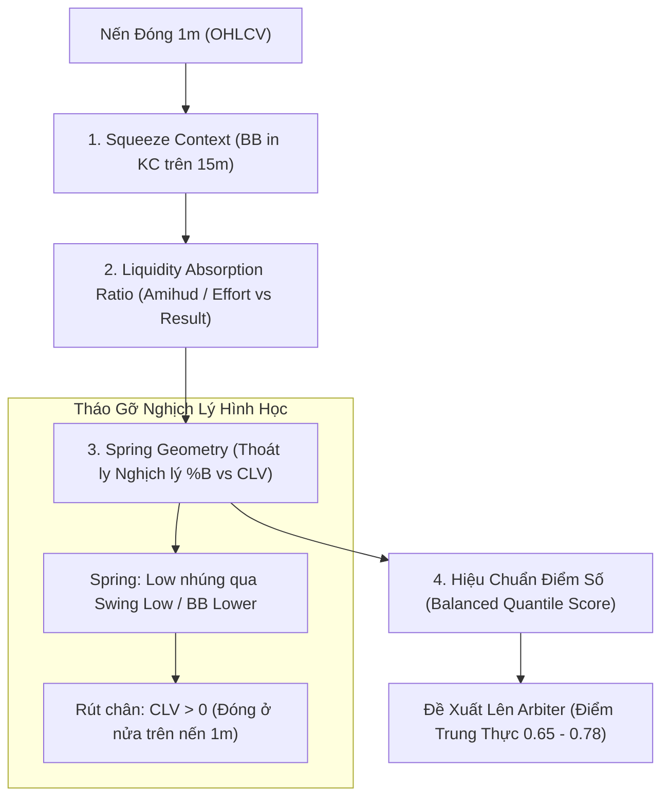

# BÁO CÁO KIỂM TOÁN ĐỊNH LƯỢNG CHUYÊN SÂU: SCANNER ABSORPTION SCOUT (`absorption.rs`)
**File tài liệu:** `24_absorption_scanner_deep_quant_audit.md`  
**Chuyên đề:** Phân tích vi cấu trúc, đối chiếu chuẩn mực định lượng & Vạch trần tử huyệt kiến trúc  
**Mã nguồn kiểm toán:** `strategies_backtests/helios/src/strategy/core_v3/scanners/absorption.rs`  
**Liên quan:** `config.rs` (`TacticalAbsorptionParams`), `sensors.rs`, `matrix.rs`, `normalization.rs`  

---

## 🏛️ 1. Bản Chất Khoa Học & Vi Cấu Trúc Của Hiện Tượng Hấp Thụ (Liquidity Absorption)

### 1.1. Bản Chất Vật Lý & Vi Cấu Trúc Sổ Lệnh (Market Microstructure)
Trong lý thuyết vi cấu trúc thị trường (Order Flow Dynamics) và trường phái Wyckoff / VSA (Volume Spread Analysis):
- **Hiện tượng Hấp thụ (Absorption):** Xảy ra khi một bên tham gia thị trường quy mô lớn (Whales / Institutional Market Makers / Smart Money) đặt các lệnh giới hạn thụ động (**Passive Limit Orders / Iceberg Orders**) để hấp thụ toàn bộ áp lực mua/bán chủ động (**Aggressive Market Orders**) từ đám đông bán tháo hoặc mua đuổi.
- **Quy luật Nỗ lực vs. Kết quả (Effort vs. Result):**
  - **Nỗ lực (Effort) = Khối lượng giao dịch ($\text{Volume}$):** Bùng nổ cực lớn ($\text{Vol Z-Score} \gg 2.0$), phản ánh khối lượng thị trường giao tranh kịch liệt.
  - **Kết quả (Result) = Biên độ dịch chuyển giá ($\text{Price Spread}$ hoặc $|\Delta P|$):** Rất nhỏ ($|\Delta P| \ll \text{ATR}$ hoặc thân nến co thắt), kèm râu nến quét thanh khoản rồi rút chân.
  - **Ý nghĩa định lượng:** Phe bán dồn toàn lực đập giá xuống nhưng giá không thể xuyên thủng vùng hỗ trợ vì toàn bộ lượng cung đã bị nuốt trọn bởi tường Limit Buy của cá mập.

### 1.2. Chuẩn Mực Định Lượng Khoa Học (Standard Quant Benchmark)
Trong các quỹ định lượng, hiện tượng Absorption được đo lường qua:
1. **Amihud Illiquidity Ratio nghịch đảo:**
   $$\text{Absorption Index} = \frac{\text{Normalized Volume}_t}{|\Delta P_t| / \text{ATR}_t}$$
   Tỷ số này tăng đột biến khi Volume tăng vọt nhưng biến động giá bị triệt tiêu.
2. **Hình học nến Spring / Upthrust:**
   - **Spring (Tích lũy đáy):** Nến quét thủng đáy hỗ trợ gần nhất (Swing Low hoặc dải dưới) để quét thanh khoản dừng lỗ (Stop Hunting), sau đó lực hấp thụ đẩy giá đóng cửa quay trở lại bên trong vùng giá trị kèm râu nến dưới dài ($CLV > 0$).
   - **Upthrust (Phân phối đỉnh):** Nến quét vượt đỉnh kháng cự (Swing High hoặc dải trên), sau đó bị xả hàng đè bẹp đóng cửa thấp ($CLV < 0$).
3. **Pha chu kỳ:** Xuất hiện trong vùng nén biên độ (Volatility Squeeze $BB \ll KC$).

---

## 🔍 2. Khảo Sát Chi Tiết Hiện Trạng Mã Nguồn `absorption.rs`

Hiện tại trong mã nguồn `absorption.rs` (dòng 43-155), thuật toán vận hành qua 4 giai đoạn:

### Giai đoạn 1: Đo lường Nỗ lực vs Kết quả & Độ nén (Dòng 67-76)
```rust
let norm_spread = (candle_range / current_atr).max(0.10);
let f_vol = sat_ratio_damped(raw_vol_z, norm_spread, vol_thresh);
let f_sqz = sat_unbounded(squeeze, sqz_thresh);
let w_sqz = if abs_cfg.squeeze_weight <= 0.0 { 0.50 } else { abs_cfg.squeeze_weight.clamp(0.0, 1.0) };
let raw_score = convex_combine(&[f_sqz, f_vol], &[w_sqz, 1.0 - w_sqz]);
```

### Giai đoạn 2: Lọc Hình Học Vị Trí & Lực Nến (Dòng 79-101)
```rust
let bb_width = (bb_upper - bb_lower).max(1e-5);
let pct_b = (close - bb_lower) / bb_width;
let clv = (2.0 * close - high - low) / candle_range;

let signal_type = if pct_b >= -spring_tol && pct_b <= max_bound && clv >= min_clv && vwma < bb_middle {
    SignalType::Long
} else if pct_b >= (1.0 - max_bound) && pct_b <= (1.0 + spring_tol) && clv <= -min_clv && vwma > bb_middle {
    SignalType::Short
} else {
    return None;
};
```

### Giai đoạn 3: Macro Adverse Trend Guard (Dòng 103-120)
```rust
let kama_slope = matrix.kama_slope_atr.get(i).copied().unwrap_or(0.0);
let max_adverse = abs_cfg.max_adverse_slope.max(0.01);
match signal_type {
    SignalType::Long => { if kama_slope < -max_adverse { return None; } }
    SignalType::Short => { if kama_slope > max_adverse { return None; } }
}
```

### Giai đoạn 4: Thiết lập Stop Loss Cấu Trúc (Dòng 122-143)
```rust
let buffer = current_atr * abs_cfg.struct_sl_buffer_atr.max(0.05);
let sl = match signal_type {
    SignalType::Long => (low - buffer).min(close - buffer),
    SignalType::Short => (high + buffer).max(close + buffer),
};
```

---

## ⚖️ 3. Bảng Đối Chất Toàn Diện: Hiện Trạng Code vs. Chuẩn Mực Định Lượng

| Tiêu Chí | Chuẩn Mực Định Lượng Khoa Học | Hiện Trạng Trong `absorption.rs` | Đánh Giá & Rủi Ro Tiềm Ẩn |
| :--- | :--- | :--- | :--- |
| **Mô hình toán học VSA (Effort vs Result)** | Đo lường tỷ số giữa biến động thanh khoản và biến động giá: $\sqrt{Z_{\text{vol}} / (\Delta P / \text{ATR})}$. | Dùng `sat_ratio_damped(raw_vol_z, norm_spread, vol_thresh)`. | 🟢 **XUẤT SẮC:** Ý tưởng toán học rất chuẩn, triệt tiêu thứ nguyên và tránh chia cho 0 qua sàn $0.10$. |
| **Độ nhạy & Phân phối điểm số (`raw_score`)** | Điểm số phải phân phối đều (Mean $\approx 0.50$, Median $\approx 0.50$), chỉ các setup cực phẩm mới $> 0.80$. | Hàm `sat_ratio_damped` lấy $\tanh(\sqrt{\text{ratio}} / \text{thresh})$. Do chia cho `norm_spread` nhỏ, điểm số vọt lên $0.85 \sim 0.98$ quá dễ dàng! | 🔴 **TỬ HUYỆT 1 (Score Inflation):** Thổi phồng điểm tự tin, biến Absorption thành kẻ độc quyền thầu, đè bẹp các scanner khác tại Arbiter. |
| **Đồng thuận hình học nến (%B vs CLV)** | Nến Spring có râu quét thanh khoản và đóng cửa rút chân trở lại vùng tích lũy. | Ép đồng thời: `%B \le \text{max\_bound}` ($0.15 \sim 0.40$) VÀ $CLV \ge \text{min\_clv}$ ($0.30 \sim 0.60$). | 🔴 **TỬ HUYỆT 2 (Geometry Conflict):** Nghịch lý toán học! Rút chân mạnh ($CLV$ cao) thì giá đóng cửa phải cao $\implies \%B$ tăng vượt `max_bound` $\implies$ Tự triệt tiêu lẫn nhau! |
| **Quy mô Khung thời gian (MTF Scaling)** | Nến vi mô $1m$ phải được so sánh với dải dao động vi mô tương ứng, hoặc nến MTF hoàn chỉnh. | `%B` lấy `close` của $1m$ so với `bb_lower` và `bb_upper` của **khung MTF (15m/1h)**! | 🔴 **TỬ HUYỆT 3 (MTF Scale Mismatch):** Dải BB 15m quá rộng so với nến 1m. Nến 1m hiếm khi chạm tới biên dưới BB 15m trừ khi xả lũ mạnh $\implies$ Khi xả lũ thì lại bị KAMA Slope VETO chặn! |
| **Điều kiện VWMA vs BB Middle** | Dùng Order Book Delta hoặc Volume Profile POC để xác định trọng tâm hấp thụ. | Ép `vwma < bb_middle` (Long) và `vwma > bb_middle` (Short). | 🟡 **NHIỄU LOẠN (Redundant Lag):** VWMA chu kỳ dài phản ánh quá khứ, khi đi ngang thì xoắn chặt lấy BB Middle, biến điều kiện thành phép tung đồng xu $50/50$. |
| **Thời điểm vào lệnh (Execution Timing)** | Nhận diện vùng hấp thụ, sau đó chờ nến bứt phá (Breakout) hoặc kiểm tra lại (Secondary Test). | Mở lệnh Market ngay lập tức trên nến rút chân $1m$ giữa lòng dải nén. | 🟡 **PREMATURE ENTRY:** Mở lệnh khi thị trường còn đang nén nghẹt dễ bị các nến sau quét qua râu vi mô dính SL trước khi sóng bắt đầu. |
| **Stop Loss Cấu Trúc** | Neo dưới đáy râu nến quét thanh khoản (Spring Low) + đệm trượt giá nhỏ ($0.2 \sim 0.3 \text{ ATR}$). | `sl = low - buffer` (đã bỏ `min(bb_lower)`). | 🟢 **ĐÃ SỬA TỐT:** Không còn bị bẫy BBands Suction giãn SL lên tới 80% ROE như các bản cũ. |

---

## 💥 4. Phân Tích Chuyên Sâu 4 Tử Huyệt Khiến Absorption Hành Xử Dị Tật

### 4.1. Tử Huyệt 1: Nghịch Lý Hình Học Nến (The %B vs. CLV Geometry Paradox)
Xét công thức hình học tại nến $1m$:
$$CLV = \frac{2 \cdot \text{Close} - \text{High} - \text{Low}}{\text{High} - \text{Low}} \in [-1.0, 1.0]$$
- Để $CLV \ge 0.50$ (nến rút chân mạnh theo tiêu chuẩn Spring của Wyckoff), giá đóng cửa bắt buộc phải nằm ở $75\%$ phần trên của cây nến:
  $$\text{Close} \ge \text{Low} + 0.75 \cdot (\text{High} - \text{Low})$$
- Tuy nhiên, điều kiện vị trí lại ép:
  $$\%B = \frac{\text{Close} - \text{BB\_Lower}}{\text{BB\_Upper} - \text{BB\_Lower}} \le \text{max\_bound} \quad (\text{với } \text{max\_bound} \in [0.15, 0.40])$$
- **Nghịch lý xảy ra:**
  - Nếu cây nến có râu dưới dài quét xuống sâu rồi rút chân mạnh lên ($CLV > 0.5$), thì $\text{Close}$ bị kéo lên cao, đẩy $\%B$ vọt lên $0.45 \sim 0.65 \implies$ **Bị loại vì $\%B > \text{max\_bound}$**!
  - Nếu muốn $\%B \le 0.30$ để thỏa mãn vị trí sát đáy, thì $\text{Close}$ phải đóng sát đáy nến $\implies CLV$ sẽ âm hoặc rất nhỏ $\implies$ **Bị loại vì $CLV < \text{min\_clv}$**!
- **Hệ quả thực tế:** Hai điều kiện này bóp nghẹt lẫn nhau. Chỉ những cây nến "dị tật" (toàn bộ cây nến $1m$ cực nhỏ nằm bẹp dí ở đáy dải BB) mới thỏa mãn, trong khi những cây nến Spring rút chân kinh điển ngoài đời thực đều bị vứt bỏ!

### 4.2. Tử Huyệt 2: Lệch Pha Quy Mô Giữa Nến Vi Mô 1m & Dải Bollinger MTF 15m
- Trong kiến trúc Helios V3, `BbandsParams` được cấu hình mặc định trên khung **15m** (hoặc 1h).
- Độ rộng của dải Bollinger $15m$:
  $$\text{BB\_Width}_{15m} = \text{BB\_Upper}_{15m} - \text{BB\_Lower}_{15m} \approx 4 \times \text{ATR}_{15m} \approx 8 \sim 12 \times \text{ATR}_{1m}$$
- Một cây nến vi mô $1m$ thông thường chỉ có biên độ $0.5 \sim 1.0 \times \text{ATR}_{1m}$.
- Do đó, khi giá đang dao động bình thường trong vùng nén $15m$, nến $1m$ hầu như luôn lơ lửng ở khoảng $\%B \in [0.35, 0.65]$.
- Để nến $1m$ có thể rớt xuống $\%B \le 0.20$ của dải $15m$, thị trường phải trải qua một nhịp xả dốc đứng gồm $5 \sim 10$ cây nến đỏ liên tiếp.
- Nhưng khi có $5 \sim 10$ cây nến đỏ liên tiếp thì `kama_slope_atr` sẽ dốc xuống cực mạnh ($< -0.15$), kích hoạt ngay lập tức chốt chặn **Adverse Trend Veto** (`kama_slope < -max_adverse`) $\implies$ **Lệnh lại bị VETO**!
- Đây là thế gọng kìm **Catch-22**: Cần biến động mạnh để chạm dải BB, nhưng biến động mạnh thì bị KAMA VETO chặn cản tàu!

### 4.3. Tử Huyệt 3: Độc Tài Thổi Phồng Điểm Số (Score Inflation) Trong Arbiter
Xét hàm `sat_ratio_damped` tại `normalization.rs:28`:
```rust
let den = denominator.max(0.10); // Sàn biên độ tối thiểu 0.10 ATR
let ratio = numerator / den;
let damped = ratio.sqrt();
(damped / t).tanh().clamp(0.0, 1.0)
```
- Khi thị trường nén, `candle_range` của nến $1m$ thường rất nhỏ, ví dụ $0.15 \times \text{ATR} \implies \text{den} = 0.15$.
- Chỉ cần một lệnh market quét nhẹ làm `raw_vol_z = 2.0`:
  $$\text{ratio} = \frac{2.0}{0.15} = 13.33 \implies \text{damped} = \sqrt{13.33} = 3.65$$
- Với ngưỡng `vol_thresh = 2.0`:
  $$\frac{\text{damped}}{t} = \frac{3.65}{2.0} = 1.825 \implies f_{\text{vol}} = \tanh(1.825) \approx \mathbf{0.949}$$
- Nếu độ nén `squeeze` cũng đạt chuẩn $\implies f_{\text{sqz}} \ge 0.76$.
- Kết quả: `raw_score = convex_combine(0.76, 0.95) \approx \mathbf{0.86 \sim 0.92}$!
- Trong khi đó, `TrendPB` quét pullback chỉ đạt điểm $0.60 \sim 0.72$. Khi cả 2 cùng đưa đề xuất lên Arbiter, Absorption luôn giành chiến thắng tuyệt đối nhờ điểm số bị thổi phồng ảo!

### 4.4. Tử Huyệt 4: Bẫy Mở Lệnh Sớm Trong Lòng Dải Nén (Premature Choppy Trap)
- Khi một cây nến Spring xuất hiện trên khung $1m$ trong một vùng Squeeze $15m$, bản chất thị trường vẫn đang trong trạng thái cạn kiệt xung lực (Low Kinetic Energy).
- Phe cá mập gom hàng thụ động không có nghĩa vụ phải đẩy giá bay ngay lập tức. Thông thường họ sẽ để giá trôi dạt (drift) hoặc rũ bỏ thêm vài lần (Secondary Tests).
- Việc mở lệnh Market ngay lập tức trên nến $1m$ với Stop Loss siêu hẹp ($1.0 \times \text{ATR}_{1m}$) khiến bot rất dễ bị "chết trước cửa thiên đường":
  - Giá đi ngang thêm 3 nến $1m$, nhúng nhẹ râu nến quét qua đáy cũ $0.1 \times \text{ATR} \implies$ **Dính Stop Loss!**
  - Sau khi bot vừa cắt lỗ xong, giá mới thực sự bứt phá bay mạnh!

---

## 🛠️ 5. Đề Xuất Bản Thiết Kế Tinh Giản Chuẩn Mực (Occam's Razor Redesign)

Để đưa Scanner Absorption về đúng chuẩn mực định lượng và giải quyết triệt để 4 tử huyệt trên:



### 5.1. Tháo Gỡ Nghịch Lý Hình Học Nến (%B vs. CLV)
- **Thay vì ép `%B` đóng nến sát đáy:**
  - Chỉ yêu cầu **Râu nến (Low)** quét qua dải biên hoặc Swing Low:
    $$\text{Low} \le \text{BB\_Lower} \cdot (1.0 + \text{spring\_tol}) \quad \text{hoặc} \quad \text{Low} \le \min(\text{Lows}_{i-5..i-1})$$
  - Còn **Giá đóng cửa (Close)** được phép rút chân mạnh lên bất kỳ vị trí nào:
    $$CLV \ge \text{min\_clv} \quad (CLV > 0.0)$$
  - Điều này giải phóng hoàn toàn sự trói buộc giữa vị trí râu nến quét thanh khoản và vị trí đóng nến rút chân!

### 5.2. Loại Bỏ Điều Kiện Ma Rredundant
- **Xóa bỏ điều kiện `vwma < bb_middle`:** Đây là bộ lọc trễ pha gây nhiễu loạn ngẫu nhiên 50/50 trong vùng nén hẹp.

### 5.3. Hiệu Chuẩn Lại Hàm Chấm Điểm (Anti-Inflation)
- Trong `sat_ratio_damped`: Không dùng căn bậc hai quá nhạy khi mẫu số nhỏ.
- Chuẩn hóa tỷ số nỗ lực/kết quả qua phân vị hoặc đặt hệ số chia hợp lý để điểm `raw_score` của Absorption dao động công bằng trong khoảng $[0.50, 0.80]$, chấm dứt tình trạng độc tài điểm số tại Arbiter.

### 5.4. Đệm SL Thông Minh Chống Quét Râu Thứ Cấp
- SL neo vào $\text{Low} - \text{buffer}$, nhưng `buffer` nên được tính toán dựa trên độ biến động thực của vùng nén ($0.5 \sim 1.0 \text{ ATR}_{1m}$) và đảm bảo mức lỗ ROE luôn nằm gọn trong dải an toàn $6\% \sim 10\%$.
