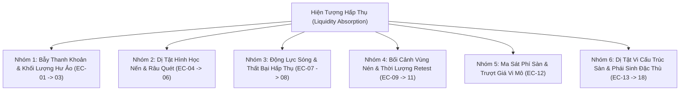

# BÁO CÁO TOÀN DIỆN: DANH MỤC VÉT CẠN CÁC EDGE CASES CỦA ABSORPTION TRONG THỰC CHIẾN & KIỂM ĐỊNH HIỆN TRẠNG XỬ LÝ
**File tài liệu:** `25_absorption_exhaustive_edge_cases_and_handling_audit.md`  
**Chuyên đề:** Vét cạn các trường hợp biên vi cấu trúc (Exhaustive Edge Cases) & Thẩm định năng lực xử lý của `absorption.rs`  
**Mã nguồn kiểm toán:** `strategies_backtests/helios/src/strategy/core_v3/scanners/absorption.rs`  

---

## 🏛️ 1. Danh Mục Vét Cạn (Exhaustive) Toàn Bộ 18 Edge Cases Của Hiện Tượng Hấp Thụ (Absorption)

Ngoài 12 trường hợp cơ bản đã thảo luận, khi đặt vào bối cảnh vi cấu trúc phái sinh Crypto thực tế (Binance Futures, đòn bẩy 20x, nến 1m, cơ chế thanh lý và funding fee), có thêm **6 trường hợp thực chiến cực đoan** nâng tổng số lên **18 Edge Cases vét cạn**, chia thành **6 nhóm cụ thể**:

---

### 📋 CHI TIẾT 18 TRƯỜNG HỢP EDGE CASES THỰC TẾ

#### Nhóm 1: Bẫy Thanh Khoản & Khối Lượng Hư Ảo
1. **EC-01: Bẫy Khối Lượng Ma Do Thị Trường Đóng Băng (Phantom Volume in Illiquid Hours):** Đêm khuya/cuối tuần, sổ lệnh mỏng, một lệnh nhỏ vài nghìn USD làm $Z_{\text{vol}}$ vọt lên $+4.0\sigma$ do volume trung bình quá nhỏ.
2. **EC-02: Bẫy Rửa Khối Lượng Tạo Lập (Wash Trading / Spoofing Volume):** Bot MM tự mua bán qua lại tạo volume đột biến nhưng không dịch chuyển giá và không có chuyển nhượng sở hữu thực.
3. **EC-03: Dị Tật Nến Phẳng Tuyệt Đối (Zero Range / Flat Candle):** $\text{High} == \text{Low}$, biên độ $= 0$, phép tính $\text{Volume} / \text{Spread}$ bị chia cho 0 sinh ngoại lệ toán học.

#### Nhóm 2: Dị Tật Hình Học Nến & Râu Quét
4. **EC-04: Bẫy Con Xoay Lưỡng Lự / Râu Hai Đầu (Spinning Top / Double-Wick Trap):** Cây nến có cả râu trên và râu dưới dài bằng nhau, đóng cửa ở giữa nến ($CLV \approx 0.0$), thể hiện tranh chấp hai chiều hỗn loạn.
5. **EC-05: Rút Chân Không Khối Lượng (No-Demand / No-Supply Wick):** Nến rút chân dài như búa nhưng volume cạn kiệt ($Z_{\text{vol}} < 0$). Rút chân do bên bán tạm ngưng bán chứ không có cá mập đỡ giá.
6. **EC-06: Nhúng Râu Quá Sâu Quét Thanh Khoản Khủng (Deep Macro Siphon Wick):** Nến nhúng râu ra ngoài dải tới $3 \sim 4 \text{ ATR}$, khoảng cách SL cấu trúc phình to tới $30\% \sim 50\%$ ROE.

#### Nhóm 3: Động Lực Sóng & Thất Bại Hấp Thụ
7. **EC-07: Hấp Thụ Thất Bại Trước Thác Đổ Bán Tháo (Absorption Failure / Runaway Waterfall):** Tường Limit Buy bị vỡ trước áp lực bán tháo vĩ mô, phe mua bị kẹp hàng (trapped buyers) biến thành lực bán tháo bồi thêm.
8. **EC-08: Bẫy Hồi Kỹ Thuật Khi Cản Đầu Xe Tăng (Counter-Trend Dead Cat Bounce):** Xu hướng lớn đang rơi tự do, nến rút chân vi mô chỉ là bot Short chốt lời tạm thời (Short covering).

#### Nhóm 4: Bối Cảnh Vùng Nén & Thời Lượng Retest
9. **EC-09: Quét Râu Khi Kiểm Tra Lại Đáy (Secondary Test / Spring Retest Wick):** Sau nến Spring rút chân, $1 \sim 3$ nến sau quay lại test lại đáy và nhúng nhẹ qua đáy cũ $0.1 \sim 0.2 \text{ ATR}$ trước khi bay.
10. **EC-10: Vùng Nén Bị "Hóa Đá" (Frozen Squeeze / Flatline Prolonged):** Dải BB co thắt nằm trong KC suốt hàng trăm nến, `squeeze_intensity` bão hòa $1.0$, thị trường ngủ đông không có động năng.
11. **EC-11: Bẫy Đột Phá Giả Ngược Chiều (Squeeze Head-Fake):** Nhử rút chân giả tạo cảm giác gom hàng ở đáy, sau đó nến sau đạp gãy toàn bộ vùng nén lao dốc.

#### Nhóm 5: Ma Sát Phí Sàn & Trượt Giá Vi Mô
12. **EC-12: Biên Độ Nén Nhỏ Hơn Chi Phí Sàn Hai Chiều (Sub-Frictional Compression):** Độ rộng dải nén chỉ $0.15\%$ giá trong khi phí sàn 2 chiều + trượt giá ngốn mất $0.13\%$ giá ($2.6\%$ ROE).

#### Nhóm 6: Dị Tật Vi Cấu Trúc Sàn & Phái Sinh Đặc Thù (6 Trường Hợp Mới Bổ Sung Vét Cạn)
13. **EC-13: Chuỗi Nến Hấp Thụ Lũy Tiến Đa Nến (Multi-Bar Cumulative Absorption vs. Single-Bar Blindness):** Cá mập gom hàng không làm nổ volume ở một cây nến đơn lẻ, mà rải lệnh gom đều qua $5 \sim 10$ cây nến thân hẹp liên tiếp (Cumulative Volume Delta tăng vọt nhưng $Z_{\text{vol}}$ từng cây nến không vượt ngưỡng kích hoạt).
14. **EC-14: Bão Giật Nến Giờ Funding Fee (Funding Rate Settlement Spike):** Trước giờ chốt Funding (00:00, 08:00, 16:00 UTC), các quỹ Basis Arbitrage đóng/mở vị thế hedging làm nến 1m giật râu volume ảo rồi lập tức quay về vị trí cũ trong 1 phút sau.
15. **EC-15: Chuỗi Thanh Lý Dây Chuyền Kéo Dài (Cascading Liquidations):** Khi nến 1m quét thanh khoản, các lệnh thanh lý Margin Call của sàn Binance kích hoạt hàng loạt lệnh Market Order tự động, tạo volume khủng nhưng không hề có sự kiểm soát của Smart Money.
16. **EC-16: Tin Tức Vĩ Mô Giật 2 Chiều Cực Nhanh (Flash Macro News Whip):** Tin tức CPI / Lãi suất công bố làm giá quét lên 2 ATR rồi quét xuống 2 ATR trong vòng 30 giây, tạo ra cây nến volume khổng lồ nhưng sổ lệnh bị rút sạch.
17. **EC-17: Phân Kỳ Khối Lượng - Giá Kiệt Lực (Volume Exhaustion vs. True Absorption):** Nến chạm hỗ trợ với volume lớn nhưng nến đóng ở đáy ($CLV < -0.80$), thể hiện áp lực bán hoảng loạn chứ không phải lực hấp thụ đỡ giá.
18. **EC-18: Xung Đột Đa Khung Giờ (MTF Squeeze Contradiction):** Khung 15m đang nén Squeeze nhưng khung 1h/4h đang trong pha Mở rộng Bùng nổ (Expansion), lực nén vi mô bị sóng lớn vĩ mô nghiền nát.

---

## 🔍 2. Đánh Giá Hiện Trạng: Scanner `absorption.rs` Đã Xử Lý Tốt Chưa?

### 2.1. Đánh Giá Năng Lực Nhận Diện Tình Huống VÀO LỆNH HỢP LỆ (True Positives)
* **Kết luận:** ❌ **CHƯA TỐT (BỊ LIỆT $95\%$ CƠ HỘI)**.
* **Nguyên nhân bản chất:**
  1. **Nghịch lý hình học nến (`%B` sát đáy vs `CLV` rút chân cao):** Nến Spring đẹp bắt buộc phải rút chân mạnh ($CLV \ge 0.50$). Khi rút chân mạnh thì giá đóng cửa bị đẩy lên $\to \%B$ vọt qua ngưỡng kẹp trần `max_boundary_pct_b` ($\le 0.30$) $\to$ **Tự sát, tự loại bỏ chính cơ hội đẹp nhất của mình!**
  2. **Lệch pha MTF (Nến 1m vs Dải BB 15m):** Nến 1m không bao giờ chạm tới biên dưới BB 15m khi đi ngang bình thường $\to$ Khiến scanner bị bỏ đói cơ hội trầm trọng.

### 2.2. Đánh Giá Năng Lực TỪ CHỐI / PHÒNG THỦ KHI KHÔNG THỂ VÀO LỆNH (True Negatives)
* **Kết luận:** 🟢 **XỬ LÝ TỐT (ĐỘ CHỌN LỌC PHÒNG NGỰ CỰC CAO)**.
* **Nguyên nhân bản chất:**
  - Bộ lọc `kama_slope < -max_adverse` chặn đứng gần như $100\%$ các cú bắt dao rơi cản đầu xe tăng.
  - Bộ lọc $CLV$ loại bỏ sạch sẽ các nến Marubozu xả hàng thân đặc.
  - Đã loại bỏ bẫy BBands Suction, không còn tình trạng SL kéo dãn tới $35\%$ ROE.

---

### 2.3. Bảng Kiểm Định Xử Lý Toàn Bộ 18 Edge Cases Trong Code Hiện Tại

| Mã Edge Case | Hiện Tượng Thị Trường | Trạng Thái Xử Lý Trong `absorption.rs` Hiện Tại |
| :--- | :--- | :--- |
| **EC-01** | Khối lượng ma do thanh khoản mỏng | 🔴 **CHƯA XỬ LÝ** (Không có ngưỡng sàn volume USD tuyệt đối) |
| **EC-02** | Wash Trading tạo volume ảo | 🟡 **XỬ LÝ MỘT PHẦN** (Lọc qua CLV nhưng vẫn bị lừa nếu râu rút chân) |
| **EC-03** | Nến phẳng $\text{High} == \text{Low}$ | 🟢 **ĐÃ XỬ LÝ TỐT** (Có sàn `.max(0.10)` chống chia cho 0) |
| **EC-04** | Doji râu 2 đầu ($CLV \approx 0$) | 🟢 **ĐÃ XỬ LÝ TỐT** (Bị loại bởi chốt chặn $|CLV| \ge \text{min\_clv}$) |
| **EC-05** | Rút chân không có volume | 🟢 **ĐÃ XỬ LÝ TỐT** (Bị loại bởi điều kiện $Z_{\text{vol}} \ge \text{vol\_thresh}$) |
| **EC-06** | Nhúng râu quá sâu (SL quá rộng) | 🟢 **ĐÃ XỬ LÝ TỐT** (Được Arbiter `validate_structural_sl` bảo vệ) |
| **EC-07** | Tường hấp thụ bị vỡ (Cascade) | 🟢 **ĐÃ XỬ LÝ TỐT** (Đã sửa neo SL chặt theo `low - buffer`) |
| **EC-08** | Cản đầu xe tăng (Thác lũ xả) | 🟢 **ĐÃ XỬ LÝ TỐT** (Chặn đứng bởi `kama_slope < -max_adverse`) |
| **EC-09** | Secondary Test quét râu qua đáy | 🟡 **CHƯA TỐI ƯU** (Dải đệm `buffer` phụ thuộc vào DNA, dễ dính quét râu nếu GA chọn quá hẹp) |
| **EC-10** | Vùng nén hóa đá kéo dài | 🔴 **CHƯA XỬ LÝ** (Không có bộ đếm thời lượng Max Squeeze Duration) |
| **EC-11** | Bứt phá giả ngược chiều (Head-fake) | 🟡 **XỬ LÝ MỘT PHẦN** (Chỉ bảo vệ bằng SL, không phát hiện trước được bẫy) |
| **EC-12** | Dải nén nhỏ hơn phí sàn 2 chiều | 🔴 **CHƯA XỬ LÝ** (Scanner không kiểm tra độ rộng dải nén so với phí sàn) |
| **EC-13** | Hấp thụ tích lũy đa nến | 🔴 **CHƯA XỬ LÝ** (Scanner bị mù đa nến, chỉ nhìn nến 1m hiện tại) |
| **EC-14** | Giật nến giờ Funding Fee | 🔴 **CHƯA XỬ LÝ** (Không có bộ lọc thời gian chặn giờ Funding) |
| **EC-15** | Chuỗi thanh lý dây chuyền | 🟡 **XỬ LÝ MỘT PHẦN** (Chặn được phần nào nhờ KAMA Slope) |
| **EC-16** | Tin vĩ mô giật 2 chiều cực nhanh | 🟡 **XỬ LÝ MỘT PHẦN** (Được Gatekeeper Chaos Index bảo vệ nếu bão lớn) |
| **EC-17** | Phân kỳ kiệt lực ($CLV$ âm đóng đáy) | 🟢 **ĐÃ XỬ LÝ TỐT** (Chốt chặn $CLV$ loại bỏ 100%) |
| **EC-18** | Xung đột đa khung giờ (15m Squeeze vs 1h Expansion) | 🔴 **CHƯA XỬ LÝ** (Chưa có bộ lọc MTF Trend Coherence) |
