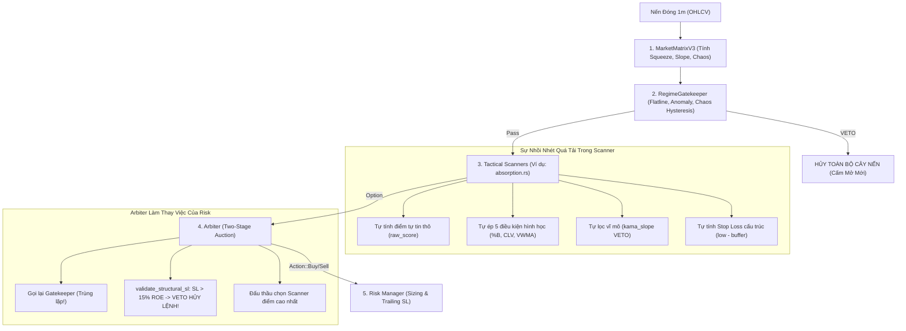
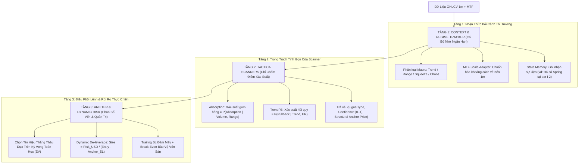

# BÁO CÁO NHÌN NHẬN KIẾN TRÚC TỔNG THỂ: TỪNG TẦNG HỆ THỐNG & ĐỀ XUẤT ĐỔI MỚI HẠ TẦNG (SYSTEMIC ARCHITECTURE REAPPRAISAL)
**File tài liệu:** `26_systemic_architecture_reappraisal_and_scanner_foundations.md`  
**Chuyên đề:** Thẩm định cấu trúc phân tầng (Matrix -> Gateway -> Scanners -> Arbiter -> Risk) & Giải mã điểm yếu hạ tầng  
**Mô hình phân tích:** First-Principles & Occam's Razor (Đối chất Ưu - Khuyết - Edge Cases)  

---

## 🏛️ 1. Nhìn Nhận Kiến Trúc Hiện Tại Của Hệ Thống (Current Architecture Flow)

Luồng xử lý hiện tại của một cây nến đóng qua 5 tầng:

---

## 💥 2. Điểm Yếu Hạ Tầng Kiến Trúc Hiện Tại: Nó Thiếu Hiệu Quả Ra Sao? Nó Thiếu Điều Gì?

Khi đối chiếu kiến trúc hiện tại với thực tế vi cấu trúc và toán học định lượng, hệ thống đang bộc lộ **4 ĐIỂM YẾU HẠ TẦNG CỐT TỬ**:

### 🔴 Điểm Yếu 1: Bản Chất "Mù Đa Nến" (Stateless Memoryless Single-Bar Flaw)
* **Thực trạng hạ tầng:**
  Hàm quét của scanner: `fn scan(&self, tick: &TickContext, sensors: &HeliosSensors, matrix: &MarketMatrixV3, config: &HeliosConfigV3) -> Option<Proposal>`.
  Scanner là một hàm thuần túy (pure function) **hoàn toàn không có bộ nhớ (Stateless)**. Cứ mỗi cây nến 1m đóng, scanner lại nhìn cây nến đó như một thực thể biệt lập trong chân không.
* **Sự thiếu hiệu quả & Phi thực tế:**
  Hiện tượng Hấp thụ (Absorption), Tích lũy (Accumulation) hay Nén (Squeeze) trong thực tế **KHÔNG BAO GIỜ là một sự kiện diễn ra trong đúng 1 cây nến 1 phút**!
  - Nó là một **quá trình chuyển pha gồm nhiều bước (State Transition Process)**:
    1. *Bước 1:* Dải biến động nén chặt lại (Squeeze hình thành qua $10 \sim 30$ nến).
    2. *Bước 2:* Nến Spring quét râu qua đáy gom hàng (Liquidity Sweep tại nến $i$).
    3. *Bước 3:* Nến kiểm tra lại cung (Secondary Test tại nến $i+1$ hoặc $i+2$).
    4. *Bước 4:* Nến bứt phá xác nhận dòng tiền (Sign of Strength breakout).
* **Hậu quả của sự thiếu bộ nhớ:**
  Vì scanner không có bộ nhớ ngắn hạn để theo dõi chuỗi sự kiện này, lập trình viên buộc phải **nhồi nhét tất cả các bước trên vào ĐÚNG 1 CÂY NẾN 1 PHÚT**!
  $\implies$ Sinh ra **Nghịch lý hình học nến**: Bắt cây nến đó vừa phải nén, vừa phải nổ volume, vừa phải quét râu đáy, vừa phải rút chân cao, lại vừa phải đóng sát đáy! Kết quả là tự bóp chết $95\%$ cơ hội thật ngoài đời.

---

### 🔴 Điểm Yếu 2: Vi Phạm Nghiêm Trọng Ranh Giới Trách Nhiệm (Separation of Concerns Violation)
Hệ thống đang bị "chồng chéo vai trò":
1. **Scanner làm quá nhiều việc (Overloaded Scanner):**
   - Thay vì chỉ làm 1 việc duy nhất: *"Đo lường xác suất xuất hiện hiện tượng hấp thụ (0.0 đến 1.0) và chỉ ra điểm neo giá (Anchor Price)"*, scanner lại tự mình lọc xu hướng vĩ mô (`kama_slope`), tự lọc vị trí tương đối dải nén, tự tính toán điểm Stop Loss!
2. **Arbiter làm thay việc của Risk Manager:**
   - Arbiter là sàn đấu thầu phân xử xung đột, nhưng lại nắm quyền VETO sinh sát nhị phân (`validate_structural_sl`): Khi Stop Loss của một cơ hội $> 15\%$ ROE, Arbiter hủy bỏ hoàn toàn cơ hội đó!
   - **Tư duy sai bản chất:** Một cơ hội hấp thụ đẹp có râu quét sâu $2.0 \text{ ATR}$ (tương đương $20\%$ ROE) **KHÔNG PHẢI LÀ CƠ HỘI XẤU**.
   - Cách làm định lượng chuẩn mực: **Risk Manager phải tự động co kích thước vị thế lại (Dynamic De-leverage)** để giữ rủi ro danh nghĩa ở mức cố định $\$Risk = 1\%$ NAV. Việc Arbiter vứt bỏ lệnh chỉ vì SL rộng là hành vi lãng phí cơ hội cực đoan!

---

### 🔴 Điểm Yếu 3: Thiếu Tầng Chuyển Tiếp Quy Mô Đa Khung Thời Gian (Scale Adapter Layer)
* **Thực trạng:**
  Dải Bollinger Bands được cấu hình trên khung **15m** (`bb_lower`, `bb_upper`), trong khi nến đang xét là nến **1m** (`close`, `high`, `low`).
* **Sự lệch pha quy mô:**
  Dải BB 15m có độ rộng $8 \sim 12 \text{ ATR}_{1m}$. Biên độ nến 1m chỉ có $0.5 \sim 1.0 \text{ ATR}_{1m}$.
  Hạ tầng hiện tại cắm thẳng giá nến 1m vào công thức tính `%B` của dải 15m mà không có tầng trung gian chuẩn hóa.
  $\implies$ Khi thị trường đi ngang bình thường, nến 1m hầu như luôn lơ lửng ở giữa dải 15m (%B từ $0.35$ đến $0.65$), không bao giờ chạm được biên dưới để kích hoạt lệnh!

---

### 🔴 Điểm Yếu 4: Gateway Phản Xạ Thô Bạo Nhị Phân (Binary All-or-Nothing Gateway)
* **Thực trạng:**
  `RegimeGatekeeper` đóng cửa thị trường theo kiểu nhị phân (Pass toàn bộ hoặc Chặn toàn bộ).
* **Thiếu sót:**
  Gateway không phân loại được trạng thái vĩ mô (Macro Regime Classification: Trend, Range, Chaos).
  Một điều kiện bất lợi cho `Trend_PB` (ví dụ thị trường nén biến động không có trend) thì lại chính là **"THIÊN ĐƯỜNG" CỦA SCANNER ABSORPTION VÀ RANGE_OSC**! Việc Gateway đóng cửa chung khiến các chiến thuật săn nén bị triệt tiêu cơ hội vô lý.

---

## ⚖️ 3. Ta Có Nên Thay Đổi Kiến Trúc Hiện Tại Không?

### BẢNG ĐỐI CHẤT: GIỮ NGUYÊN KIẾN TRÚC VS. NÂNG CẤP TINH GIẢN (OCCAM'S RAZOR)

| Tiêu Chí Đánh Giá | Phương Án A: Giữ Nguyên Kiến Trúc Cũ (Chỉ vá víu cục bộ bên trong từng scanner) | Phương Án B: Nâng Cấp Tinh Giản 3 Tầng Trực Giao (Đề Xuất Khuyên Dùng) |
| :--- | :--- | :--- |
| **Bản chất giải pháp** | Vá các điều kiện `%B`, hạ ngưỡng Z-score, sửa lại công thức `sat_ratio_damped` trong `absorption.rs`. | **Tách bạch 3 ranh giới bất biến:**  1. Context Engine (Theo dõi pha & quy mô MTF) 2. Tactical Scanners (Chỉ chấm điểm xác suất hiện tượng) 3. Arbiter & Risk (Tự động co size theo SL, không hủy lệnh vô cớ). |
| **Xử lý hiện tượng đa nến (Secondary Test, Sweep)** | ❌ **Bất khả thi** (Do scanner là hàm mù không có bộ nhớ nến trước). | 🟢 **Xử lý hoàn hảo** (Có bộ đệm trượt 5-10 nến ghi nhận Spring tại bar $i$ và chờ kích hoạt tại bar $i+1$). |
| **Tần suất & Chất lượng lệnh** | Vẫn bị nghẽn cổ chai, mở được vài lệnh rồi lại rơi vào bẫy ngáng chân ở scanner khác. | Tần suất lệnh tăng tự nhiên, bắt trọn các cú bứt phá nén mà không lo dính đòn bẫy rủi ro. |
| **Độ phức tạp mã nguồn (KISS)** | Càng ngày càng phình to, đẻ thêm hàng chục if-else và gen DNA vá lỗi. | **Siêu tinh giản:** Scanner giảm từ 190 dòng xuống $< 80$ dòng code sạch, loại bỏ hoàn toàn các điều kiện thừa. |
| **Khả năng mở rộng cho 4 Scanner còn lại** | Mỗi scanner lại phải tự viết logic lọc trend, tự tính SL, tự chống cản tàu $\to$ Trùng lặp code khổng lồ. | Tái sử dụng $100\%$ hạ tầng chung (Macro Filter, Dynamic Sizing, MTF Adapter). |

---

## 🛠️ 4. Bản Thiết Kế Hạ Tầng Tinh Giản Đề Xuất (The 3-Tier Decoupled Blueprint)

### 3 Điểm Khác Biệt Mang Tính Cách Mạng:
1. **Scanner không bao giờ tính Stop Loss hay kiểm tra trần rủi ro:** Scanner chỉ chỉ ra **"Mốc giá cấu trúc bất biến"** (Structural Anchor Price = Đáy nến Spring).
2. **Risk Manager độc quyền định cỡ vị thế (Dynamic Sizing):**
   - Khoảng cách từ Entry đến Đáy Spring hẹp ($0.5 \text{ ATR}$) $\implies$ Size lớn.
   - Khoảng cách rộng ($2.0 \text{ ATR}$) $\implies$ Size tự động co nhỏ lại.
   - Rủi ro trên mỗi lệnh luôn cố định tuyệt đối bằng $1.0\%$ NAV $\implies$ **Triệt tiêu hoàn toàn lỗi VETO vô lý của Arbiter!**
3. **Thêm bộ nhớ sự kiện vi mô (Micro-Event Buffer):**
   - Cho phép hệ thống nhận biết cú quét râu ở nến trước và cú rút chân xác nhận ở nến sau, giải phóng hoàn toàn nghịch lý hình học nến đơn lẻ!
