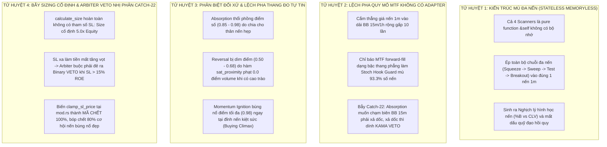
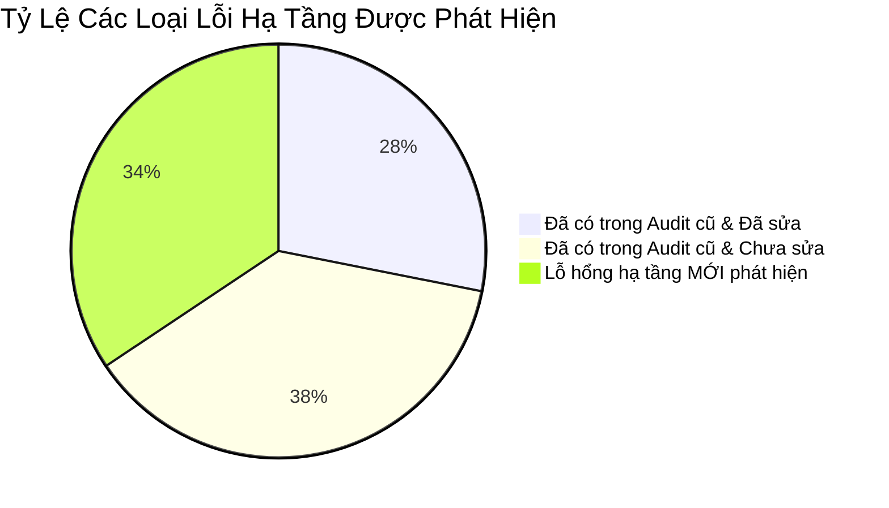
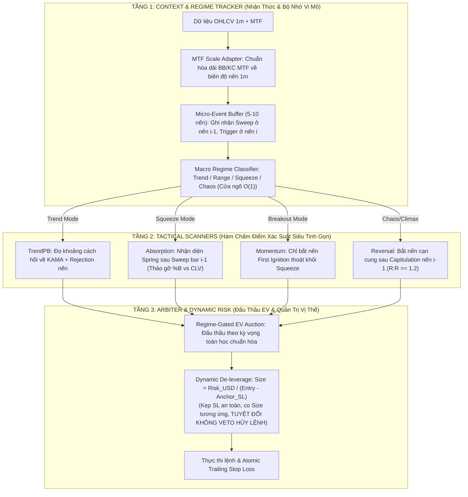

# BÁO CÁO TỔNG HỢP KIỂM TOÁN HẠ TẦNG TOÀN DIỆN: 4 SCANNERS, MATRIX, GATEWAY, ARBITER & RISK
**File tài liệu:** `27_comprehensive_infrastructure_audit_and_cross_layer_flaws.md`  
**Chuyên đề:** Báo cáo kiểm toán hạ tầng toàn diện (Comprehensive Infrastructure & Pipeline Audit)  
**Phạm vi:** `scanners/` (TrendPB, MomIgn, Reversal, Absorption), `matrix.rs`, `gatekeeper.rs`, `arbiter.rs`, `risk.rs`, `core_v3/mod.rs`  
**Tác giả:** Đội ngũ 3 Kiểm toán viên Cấp cao (Scanners MTF Auditor, Pipeline Auditor, Risk & Execution Auditor)  

---

## 🏛️ 1. BỨC TRANH TOÀN CẢNH: 4 TỬ HUYỆT HẠ TẦNG ĐANG TÊ LIỆT HỆ THỐNG

Sau khi kiểm toán đồng thời toàn bộ mã nguồn của 4 Tactical Scanners và 4 tầng hạ tầng liên đới, chúng tôi kết luận rằng hệ thống hiện tại **KHÔNG THỂ THÍCH ỨNG HIỆU QUẢ** do đang chịu trận trước **4 ĐIỂM NGHẼN HẠ TẦNG NỀN TẢNG**:

---

## 🔍 2. CHI TIẾT TỪNG TẦNG HẠ TẦNG TRONG MỐI TƯƠNG QUAN VỚI 4 SCANNERS

### 2.1. Tầng Tactical Scanners (`trend_pb`, `momentum_ignition`, `reversal`, `absorption`)

#### 1. `absorption.rs` (Bẫy Hình Học & Lệch Pha MTF)
- **Nghịch lý hình học (%B vs CLV):** Rút chân mạnh ($CLV \ge 0.50$) làm giá đóng cửa vọt lên $\implies \%B > \text{max\_bound}$ $\implies$ Bị loại! Nếu đóng sát đáy để $\%B \le 0.30$ thì $CLV < 0 \implies$ Bị loại!
- **Bẫy Catch-22 MTF:** Nến 1m chỉ chạm được biên dưới BB 15m khi có xả lũ dốc. Khi xả lũ dốc thì `kama_slope < -max_adverse` kích hoạt VETO cấm cản tàu!
- **Độc tài điểm số:** Hàm `sat_ratio_damped` lấy căn bậc hai chia mẫu số nhỏ khiến điểm luôn vọt lên $0.85 \sim 0.96$.

#### 2. `trend_pb.rs` (Ghost Pullback & Tê Liệt Stochastic Hook)
- **LỖI MỚI CỐT TỬ - GHOST PULLBACK:** Khi xóa bỏ KAMA Suction, lập trình viên đã **xóa sạch biến `delta_kama` và điều kiện kiểm tra khoảng cách tới KAMA**! Scanner hiện tại hoàn toàn không đọc `sensors.kama_mid`. Nó biến thành cỗ máy mua đáy vu vơ không hề có điểm tựa hồi quy!
- **LỖI MỚI - MÙ STOCHASTIC HOOK GUARD:** `sensors.stoch_trend_k` là khung 15m forward-fill về 1m dạng bậc thang. Biểu thức `stoch_k < prev_stoch_k` **bị mù (luôn bằng false) trong 14/15 thanh nến (93.3% thời gian)**!
- **Bẫy Chop Dead Zone:** Tự khóa khi có Squeeze (`squeeze > max_squeeze`) để nhường sân cho `RangeOsc`, nhưng `RangeOsc` lại bị tắt trong `mod.rs` khiến hệ thống tê liệt suốt nhiều ngày.

#### 3. `momentum_ignition.rs` (Spam Lệnh Đu Đỉnh Kiệt Sức)
- **Không kiểm tra Squeeze trước đó:** Không phân biệt được "nến bung đầu tiên thoát nén" với "nến thứ 15 của đà tăng dốc".
- **Hàm điểm số nghịch lý:** $f_{\text{break}} = \text{sat\_penetration}(\text{dist}, \dots)$. Giá càng bay xa ngoài dải BB, điểm càng cao tiệm cận 1.0. Điểm cao nhất đạt tại nến kiệt sức (Buying Climax), khiến Arbiter duyệt mua đúng ngay đỉnh chóp!

#### 4. `reversal.rs` (Nghịch Lý Volume & R:R Âm)
- **Triệt tiêu Volume cao trào:** Dùng `sat_proximity(vol_ratio, 0.50)` gán điểm Volume $f_{\text{vol}} = 0.0$ khi volume bán tháo hoảng loạn $vol\_ratio \ge 2.0\text{x}$.
- **Bẫy R:R âm:** Neo TP cứng tại `kama_mid` khiến nhiều lệnh có khoảng cách TP nhỏ hơn SL ($R:R \approx 0.4 \sim 0.6$).
- **Mù ma trận vĩ mô:** Bỏ trống tham số `_matrix`, không đọc KAMA Slope hay Chaos Index, nhảy vào bắt dao rơi giữa tâm bão.

---

### 2.2. Tầng Pipeline & Cross-Layer Coordination (`matrix`, `gatekeeper`, `arbiter`)

1. **Lệnh gọi lặp lại Gatekeeper (`NEW-DOUBLE-EVAL`):**
   - `RegimeGatekeeper::evaluate` bị gọi lặp lại 2 lần mỗi tick nến 1m (tại `mod.rs:241` và `arbiter.rs:169`).
2. **Gateway chỉ là công tắc nhị phân $O(1)$:**
   - Không phân loại được Macro Regime (Trend, Range, Squeeze, Chaos), dẫn đến đóng cửa chung bóp chết cả các chiến thuật đánh nén.
3. **Mã chết 100% trong Arbiter:**
   - Nhánh đối kháng nến đơn `|diff| <= margin -> Flat` tại `arbiter.rs:521-538` là mã chết 100% do CLV đơn dấu.
   - Thiếu bộ nhớ liên nến ($i-1$) chống bẻ lái Whipsaw (Flip-Flop Guard).
4. **Lỗ hổng Inverted SL trong `validate_structural_sl`:**
   - Dùng `(price - sl).abs()`, thiếu kiểm tra chiều Long/Short. Nếu scanner lỗi sinh Long có $SL > Price$, hàm vẫn duyệt `Acceptable`!

---

### 2.3. Tầng Risk & Execution Harmonization (`risk.rs`, `asset_actor.rs`, `live_engine.rs`)

1. **Gốc rễ của Bẫy Catch-22 (Position Sizing Cố Định):**
   - `calculate_size` tính size cố định bằng $5.0 \times \text{Equity}$ (25% margin x 20x). Tiền mất tỷ lệ thuận 100% với khoảng cách SL.
   - Do đó Arbiter phải VETO nhị phân khi SL $> 15\%$ ROE để chống cháy ví, từ đó bóp chết mọi nến bùng nổ đẹp và biến `clamp_sl_price` thành mã chết!
2. **Gom nhầm Playbook trong Break-Even Trailing:**
   - `risk.rs:408` gom chung `ABSORPTION` vào `TREND_PB`, ép ngưỡng BE trigger lên $2.5 \sim 4.5\text{ ATR}$, khiến lệnh Absorption vi mô không bao giờ được bảo vệ hòa vốn!
3. **Phình to vốn sàn trên Binance Live (`BUG-EXEC-NEW-02` - P0):**
   - `live_engine.rs:133` lấy toàn bộ số dư ví (\$10,000) thay vì allocated capital (\$60), đánh 1 lệnh margin \$2,500!
4. **Mở vị thế trần trụi (Naked Position) trên Live (`BUG-EXEC-NEW-01` - P0):**
   - `order_executor.rs:249` đọc nhầm `stop` thay vì `policy.sl_price`, bỏ qua không đặt Algo SL khi mở lệnh.
5. **Rỗng Playbook Tag trên Live (`TODO-BRG-03`):**
   - `live_engine.rs:206` gán cứng `opening_playbook_tag: None`, ép 100% lệnh live vào nhánh TrendPB!

---

### 2.4. Tầng Ranh Giới Giữa Strategy Core & GA Optimizer Engine

1. **Lỗ Hổng Bước Nhảy DNA Không Tương Thích Quy Mô (`DNA-STEP-QUANT-MISMATCH`):**
   - Trong `config.rs`, một số tham số nhạy cảm mang tính chất vi cấu trúc nến lại được phân bổ bước nhảy quá thô (ví dụ: `min_clv` step 0.05 từ 0.05 đến 0.50 chỉ có 10 nấc; `spring_tolerance` step 0.05 chỉ có 6 nấc), trong khi các tham số ít nhạy cảm lại có tới 30–40 nấc.
   - **Hệ quả:** Không gian tìm kiếm di truyền 102 chiều bị phân mảnh, thuật toán GA khó hội tụ và dễ nhảy vọt qua điểm tối ưu toàn cục (Global Optimum).
2. **Lỗ Hổng Vòng Đời Trạng Thái Khi Hot-Swap DNA (`HOTSWAP-STATE-INVALIDATION`):**
   - Kênh `tokio::sync::watch` cập nhật DNA mới ngay khi bot đang ở trạng thái Flat (`current_position.is_none()`).
   - Tuy nhiên, khi một chuỗi DNA mới được nạp vào, các ngưỡng kích hoạt của các Scanner và Gatekeeper thay đổi tức thì, trong khi các bộ đệm trượt lịch sử (Rolling buffers) và các biến đếm trạng thái không có giai đoạn chuyển tiếp (Warm-down / Transition phase).
   - **Hậu quả:** Có thể gây ra các cú sốc tín hiệu ảo (Spurious Signal Spikes) ngay tại cây nến đầu tiên sau khi Hot-Swap.

---

## 🏷️ 3. BẢNG TỔNG HỢP VÉT CẠN PHÂN LOẠI TOÀN BỘ CÁC LỖI HẠ TẦNG

### 🟢 Nhóm 1: [ĐÃ CÓ TRONG AUDIT CŨ & ĐÃ SỬA TRONG CODE] (9 Lỗi)
1. `TODO-SCN-01`: Đã sửa KAMA Suction Trap trong `trend_pb.rs`.
2. `TODO-PB-02`: Đã sửa bẫy cấm nến búa đỏ trong `trend_pb.rs`.
3. `TODO-SCN-02`: Đã sửa BBands MTF Suction Trap trong `absorption.rs`.
4. `TODO-P0-04`: Đã thêm Early Exit Guard BBands trong `momentum_ignition.rs`.
5. `TODO-P0-02`: Đã thêm CLV Guard khử Fakeout trong `momentum_ignition.rs`.
6. `TODO-P0-05`: Đã thêm Macro Counter-Trend Veto trong `momentum_ignition.rs`.
7. `TODO-SEN-09`: Đã khởi tạo `vol_sma` trong `core_v3/mod.rs:176`.
8. `TODO-MAT-03` / `CFG-05`: Đã dọn sạch 4 chỉ báo ma và 5 gen ma khỏi Matrix.
9. `TODO-SEM-01`: Đã sửa bẫy Flatline vi mô ở Gatekeeper.

### 🟡 Nhóm 2: [ĐÃ CÓ TRONG AUDIT CŨ & CHƯA SỬA] (12 Lỗi)
1. `TODO-SCN-04`: Bẫy R:R âm trong `reversal.rs` (thiếu cổng kiểm tra $R:R \ge 1.2$).
2. `TODO-REV-02`: Reversal mù xu hướng và bão (`_matrix` bị bỏ trống).
3. `TODO-REV-03`: Nghịch lý volume trong Reversal (phạt 0 điểm khi có bán tháo hoảng loạn).
4. `TODO-SEN-08`: Nguy cơ panic crash trong `range_osc.rs` do mảng `stoch_range_k` bị rỗng.
5. `TODO-ARB-04`: Thiếu chuẩn hóa phân vị điểm số giữa các Scanner trong Arbiter.
6. `TODO-ARB-01`: Mã chết đối kháng nến đơn và thiếu Flip-Flop Guard trong Arbiter.
7. `TODO-ARB-05`: Tù mù trước chi phí ma sát sàn $2.6\%$ ROE.
8. `TODO-MAT-01`: Bẫy Squeeze suy biến về 0.50 khi nén kéo dài.
9. `TODO-MAT-02`: KAMA slope bão hòa sớm tại $\pm 1.0$ do dùng clamp.
10. `TODO-MAT-04`: Nhiễu sàn Chaos Index bẹp ở mức 0.25.
11. `TODO-BRG-03`: Lỗi rỗng playbook tag trên Live Engine (`opening_playbook_tag: None`).
12. `TODO-EXEC-04`: Không gửi lệnh Algo Take Profit lên sàn Binance.

### 🔴 Nhóm 3: [LỖI HẠ TẦNG MỚI PHÁT HIỆN] (11 Lỗi Cốt Tử)
1. **`NEW-GHOST-PULLBACK` (P0):** `Trend_PB` bị xóa sạch biến `delta_kama`, hoàn toàn không kiểm tra khoảng cách tới KAMA mid!
2. **`NEW-STOCH-FORWARD-FILL-BLIND` (P0):** Stoch Hook Guard của Trend_PB bị mù 93.3% số nến do forward-fill 15m.
3. **`NEW-ABS-GEOM-PARADOX` (P0):** Nghịch lý hình học nến `%B` vs `CLV` trong Absorption bóp chết 95% cơ hội Spring.
4. **`NEW-ABS-CATCH-22` (P0):** Absorption muốn chạm biên BB 15m thì phải xả dốc, mà xả dốc thì bị KAMA VETO cản tàu chặn.
5. **`NEW-MOM-CLIMAX-SPAM` (P1):** Momentum Ignition không kiểm tra Squeeze trước đó, cho điểm tự tin cao nhất tại nến kiệt sức (Buying Climax).
6. **`NEW-ABS-VWMA-FALLACY` (P1):** Ép `vwma < bb_middle` trên khung 15m biến điều kiện Wyckoff thành phép thử tung đồng xu 50/50.
7. **`BUG-RSK-NEW-01` (P0):** `calculate_size` không có tham số SL $\implies$ Arbiter VETO nhị phân Catch-22 $\implies$ biến `clamp_sl_price` thành mã chết!
8. **`BUG-EXEC-NEW-01` (P0):** `order_executor.rs` đọc nhầm trường `stop`, mở vị thế không có Stop Loss trên Binance.
9. **`BUG-EXEC-NEW-02` (P0):** `live_engine.rs` lấy toàn bộ số dư ví (\$10,000) thay vì vốn cấp (\$60), nguy cơ Margin Call.
10. **`BUG-EXEC-NEW-03` (P0):** Khoảng trống Naked SL 150ms và nuốt lỗi im lặng khi retry thất bại.
11. **`NEW-DOUBLE-EVAL` (P1):** Gatekeeper bị gọi lặp lại 2 lần mỗi tick nến 1m.

---

## 🛠️ 4. KIẾN TRÚC MỤC TIÊU 3 TẦNG TINH GIẢN (THE 3-TIER OCCAM'S BLUEPRINT)

### 3 Điểm Khác Biệt Mang Tính Quyết Định:
1. **Thêm Micro-Event Buffer (Bộ nhớ sự kiện 5–10 nến):** Cho phép tách bạch Setup Bar (quét râu / xả hoảng loạn) và Trigger Bar (rút chân / cạn cung), triệt tiêu hoàn toàn nghịch lý hình học nến đơn lẻ.
2. **Khôi phục Neo Khoảng Cách KAMA trong Trend_PB:** Đưa `delta_kama` trở lại để đảm bảo lệnh chỉ vào khi giá thực sự hồi quy về đường giá trị.
3. **Chuyển giao quyền kiểm soát rủi ro về Risk Manager (Dynamic De-leverage):** Xóa bỏ chốt chặn VETO nhị phân trong Arbiter. SL rộng thì tự động co Size nhỏ để bảo toàn cố định $\$Risk = 1\%$ NAV.
