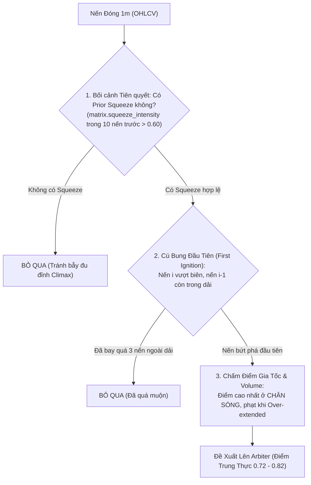

# BÁO CÁO KIỂM TOÁN ĐỊNH LƯỢNG CHUYÊN SÂU: SCANNER MOMENTUM IGNITION (`momentum_ignition.rs`)
**File tài liệu:** `28_momentum_ignition_scanner_deep_quant_audit.md`  
**Chuyên đề:** Phân tích vi cấu trúc bùng nổ xung lực, đối chiếu chuẩn mực định lượng (Note 23) & Vạch trần bẫy Buying Climax  
**Mã nguồn kiểm toán:** `strategies_backtests/helios/src/strategy/core_v3/scanners/momentum_ignition.rs`  
**Liên quan:** `config.rs` (`TacticalMomentumParams`), `sensors.rs`, `matrix.rs`, `23_standard_quant_methodology_market_regimes.md`  

---

## 🏛️ 1. Bản Chất Khoa Học Của Hiện Tượng Momentum Ignition (Theo Chuẩn Mực Định Lượng Note 23)

Trong mô hình 6 trạng thái thực chiến của Helios (Note 23 §3.3) và lý thuyết động lực học vi phân ngẫu nhiên (SDE):
$$dP_t = \mu(P_t, t)\,dt + \sigma(P_t, t)\,dW_t$$

### 1.1. Bản Chất Vật Lý Của Cú "Kích Hỏa Xung Lực" (Momentum Ignition)
- **Động cơ vật lý:** Là sự chuyển pha đột ngột từ **Thế năng nén tích lũy (Potential Energy / Volatility Squeeze)** sang **Động năng bùng nổ (Kinetic Energy Expansion)**.
- **Tỷ số Tín hiệu trên Nhiễu (Signal-to-Noise Ratio):**
  $$\text{SNR}_t = \frac{|\mu_t|}{\sigma_t} \gg 1.0$$
  Thành phần trôi dạt định hướng (Directional Drift $|\mu_t|$) thắng thế hoàn toàn chuyển động nhiệt ngẫu nhiên, kéo theo sự nở rộng của dải phương sai ($\sigma_t$).
- **Đặc trưng vi cấu trúc chuẩn mực:**
  1. **Gia tốc giá dương ($a_t = \frac{d^2 P}{dt^2} > 0$):** Không chỉ giá tăng, mà vận tốc tăng giá phải tăng dần (Positive Price Acceleration).
  2. **Nến kích hỏa đầu tiên (First Ignition Bar):** Cây nến đầu tiên phá vỡ cấu trúc tích lũy (Breakout cross-over).
  3. **Khối lượng gia tăng đồng thuận (Aggressive Volume Expansion):** Volume Z-Score $Z_{\text{vol}} \gg 2.0$, thể hiện dòng tiền chủ động quét sạch các lệnh Limit chờ trên sổ lệnh (Orderbook Sweep).
  4. **Bối cảnh tiên quyết bất biến (Precondition):** **BẮT BUỘC PHẢI CÓ GIAI ĐOẠN NÉN BIẾN ĐỘNG TRƯỚC ĐÓ (Prior Volatility Squeeze $BB \ll KC$)**. Nếu không có vùng nén tích lũy mà giá đã bay dốc sẵn, thì đó KHÔNG PHẢI là Momentum Ignition mà là **Buying/Selling Climax (Cao trào kiệt sức)**!

---

## 🔍 2. Khảo Sát Chi Tiết Hiện Trạng Mã Nguồn `momentum_ignition.rs`

Mã nguồn tại [`momentum_ignition.rs`](file:///e:/Projects/Automations/trading_backtest/strategies_backtests/helios/src/strategy/core_v3/scanners/momentum_ignition.rs) (168 dòng code) vận hành qua 4 khối logic:

### Khối 1: Early Exit Guard & Kiểm tra Vượt Biên Bollinger Bands (Dòng 51-57)
```rust
let is_long_candidate = close > bb_u;
let is_short_candidate = close < bb_l;
if !is_long_candidate && !is_short_candidate {
    return None; // Giá nằm trong dải -> Dứt khoát không có Breakout
}
```

### Khối 2: Màu Nến & Lực Nến CLV Guard (Dòng 72-83)
```rust
let candle_range = (high - low).max(1e-5);
let clv = (2.0 * close - high - low) / candle_range;
let signal_type = if is_long_candidate && close > open && clv >= min_clv {
    SignalType::Long
} else if is_short_candidate && close < open && clv <= -min_clv {
    SignalType::Short
} else {
    return None;
};
```

### Khối 3: Macro Trend Alignment Guard (Dòng 85-101)
```rust
let kama_slope = matrix.kama_slope_atr.get(i).copied().unwrap_or(0.0);
let max_adverse = mom_cfg.max_adverse_slope.max(0.01);
match signal_type {
    SignalType::Long => { if kama_slope < -max_adverse { return None; } }
    SignalType::Short => { if kama_slope > max_adverse { return None; } }
}
```

### Khối 4: Chấm Điểm Thô Tổ Hợp Lồi & Stop Loss Cấu Trúc (Dòng 107-165)
```rust
let f_vol = sat_unbounded(raw_vol_z, vol_thresh);
let target_breakout = atr * 0.25;
let (f_break, f_rsi) = match signal_type {
    SignalType::Long => {
        let dist = (close - bb_u).max(0.0);
        let f_b = sat_penetration(dist, target_breakout);
        let rsi_excess = (rsi_mom - rsi_thresh).max(0.0);
        let f_r = sat_unbounded(rsi_excess, 15.0);
        (f_b, f_r)
    }
    ...
};
let raw_score = convex_combine(&[f_break, f_vol, f_rsi], &[w_break, w_vol, w_rsi]);
let sl = low - atr * buffer_mult;
```

---

## ⚖️ 3. Bảng Đối Chất Toàn Diện: Hiện Trạng Code vs. Chuẩn Mực Định Lượng Note 23

| Tiêu Chí Định Lượng | Chuẩn Mực Khoa Học (Note 23) | Hiện Trạng Trong `momentum_ignition.rs` | Đánh Giá & Rủi Ro Tiềm Ẩn |
| :--- | :--- | :--- | :--- |
| **Bối cảnh Tiên quyết (Precondition)** | Bắt buộc phải có giai đoạn nén năng lượng tích lũy trước đó (Prior Squeeze $BB \ll KC$). | **HOÀN TOÀN KHÔNG KIỂM TRA SQUEEZE!** Trường `matrix.squeeze_intensity` không được đọc dù chỉ một lần. | 🔴 **TỬ HUYỆT 1 (Climax Blindness):** Không phân biệt được nến bùng nổ đầu tiên với nến tăng thứ 20 của một sóng dốc $\implies$ Biến thành máy mua đu đỉnh kiệt sức! |
| **Thời điểm Bắt Bứt Phá (Timing)** | Bắt đúng cây nến đầu tiên phá vỡ cấu trúc (First Ignition Cross-over). | Chỉ kiểm tra điều kiện tĩnh `close > bb_u`. Nếu giá bay ngoài dải 10 nến liên tiếp, cả 10 nến đều phát tín hiệu. | 🔴 **TỬ HUYỆT 2 (Multi-Bar Spam):** Spam tín hiệu mua liên tục trong suốt con sóng, và nến cuối cùng ở đỉnh lại có điểm cao nhất! |
| **Quy mô Khung thời gian (MTF Scale)** | Nến vi mô 1m phải kích hỏa từ dải bứt phá vi mô tương thích (1m/5m). | So sánh `close` 1m với dải Bollinger Bands **khung 15m** (`bb_upper`, `bb_lower`)! | 🔴 **TỬ HUYỆT 3 (Late Entry Lag):** Nến 1m vượt qua BB 15m là sự kiện đã xảy ra RẤT MUỘN. Bỏ lỡ 100% pha kích hỏa chân sóng, chỉ vào lệnh khi sóng đã chạy được $80\%$. |
| **Hàm Tính Điểm Bứt Phá (`f_break`)** | Thưởng điểm cao cho gia tốc giá ban đầu; phạt điểm khi giá bị kéo giãn quá xa dải (Over-extended / Mean-reversion risk). | Dùng `sat_penetration(dist, 0.25 ATR)`. Giá càng bay xa ngoài dải BB, điểm càng cao tiệm cận 1.0! | 🔴 **TỬ HUYỆT 4 (Climax Score Explosion):** Tại cây nến kiệt sức (Buying Climax), điểm bứt phá đạt tuyệt đối $0.98$, lừa Arbiter chọn đúng đỉnh chóp để vào lệnh! |
| **Bộ lọc RSI Momentum (`f_rsi`)** | RSI đo đạc xung lực chớm nở, hiệu chuẩn thích ứng theo độ biến động. | Lấy `sat_unbounded(rsi_excess, 15.0)` với mẫu số $15.0$ gán cứng! | 🟡 **SCORE SUPPRESSION Ở CHÂN SÓNG:** Khi RSI vừa chớm vượt ngưỡng 5 điểm ($rsi = 65$), điểm $f_{\text{rsi}}$ chỉ đạt $0.32$, dìm chết tín hiệu ở chân sóng. |
| **Lọc Fakeout Bằng Nến** | Loại bỏ nến rút chân đè đầu (Shooting Star / Hammer ngược). | Ép `close > open && clv >= min_clv` (Long). | 🟢 **ĐÃ SỬA TỐT:** Loại bỏ hoàn toàn các nến bẫy râu ngược (Fakeout rejection). |
| **Macro Counter-Trend Guard** | Cấm mua bùng nổ ngược thác lũ xả hàng vĩ mô. | Kiểm tra `kama_slope < -max_adverse` thì VETO. | 🟢 **ĐÃ SỬA TỐT:** Không bị cản đầu xe tăng khi thị trường đang rơi tự do. |
| **Hình học Stop Loss** | Neo dưới đáy nến bùng nổ + đệm trượt giá nhỏ. | `sl = low - atr * buffer_mult`. | 🟡 **SL PHÌNH TO:** Nến kiệt sức thân dài $2.0 \text{ ATR} \implies$ SL rộng $2.5 \text{ ATR}$ ($25\% \sim 30\%$ ROE) $\implies$ Bị Arbiter VETO hủy lệnh. |

---

## 💥 4. Phân Tích Chuyên Sâu 3 Tử Huyệt Khiến Momentum Ignition Thất Bại

### 4.1. Tử Huyệt 1: Bẫy Đu Đỉnh Kiệt Sức (The Buying Climax Trap)
Xét diễn biến của một đợt bùng nổ giá trên thị trường crypto:
1. **Pha 1 (Tích lũy Squeeze):** Giá đi ngang nén chặt trong dải $15m$.
2. **Pha 2 (Ignition Bar - Cú kích hỏa):** Cây nến 1m bứt phá đầu tiên với volume lớn. Tại thời điểm này, giá 1m vừa vượt qua dải nén vi mô nhưng **vẫn còn nằm bên trong dải BB 15m** $\implies$ `close > bb_u` trả về `false` $\implies$ **BỎ LỠ HOÀN TOÀN ĐIỂM VÀO ĐẸP NHẤT Ở CHÂN SÓNG!**
3. **Pha 3 (Continuation):** Giá tăng liên tiếp 5 cây nến 1m, bắt đầu vượt ra ngoài BB 15m.
4. **Pha 4 (Buying Climax - Cao trào kiệt sức):** Nến thứ 8 là một cây nến xanh khổng lồ (Marubozu), quét thanh khoản cực hạn, RSI vọt lên 88, volume bùng nổ cực đại do retail FOMO nhảy vào mua đuổi.
   - Lúc này trong `momentum_ignition.rs`:
     - Khoảng cách bứt phá: $\text{dist} = \text{close} - \text{bb\_u} \approx 1.0 \text{ ATR} \gg 0.25 \text{ ATR} \implies f_{\text{break}} \approx \mathbf{0.99}$.
     - RSI Momentum: $rsi\_excess = 88 - 60 = 28 \implies f_{\text{rsi}} = \tanh(28/15) \approx \mathbf{0.95}$.
     - Volume Z-Score: $Z_{\text{vol}} = 3.5 \implies f_{\text{vol}} \approx \mathbf{0.98}$.
     - Điểm tự tin tổng hợp: $\text{raw\_score} \approx \mathbf{0.975}$!
   - **Hậu quả:** Arbiter thấy điểm $0.975$ thì lập tức duyệt lệnh Long ngay trên cây nến thứ 8! Ngay cây nến thứ 9, áp lực chốt lời ập xuống, giá sụp đổ đảo chiều $\to$ **Dính Stop Loss ngay lập tức!**

### 4.2. Tử Huyệt 2: Nghịch Lý Phạt Điểm Chân Sóng Do Mẫu Số RSI Cố Định 15.0
Công thức tính điểm RSI tại dòng 116:
$$f_{\text{rsi}} = \tanh\left(\frac{\max(0, \text{RSI} - \text{rsi\_thresh})}{15.0}\right)$$
- Giả sử `rsi_threshold = 60.0`.
- Tại chân sóng bứt phá lành mạnh, RSI vừa chớm vượt ngưỡng: $\text{RSI} = 65.0 \implies \text{rsi\_excess} = 5.0$.
  $$f_{\text{rsi}} = \tanh\left(\frac{5.0}{15.0}\right) = \tanh(0.333) \approx \mathbf{0.321}$$
- Thành phần RSI bị kéo tụt xuống $0.32$, làm điểm tổng `raw_score` chỉ đạt $\approx 0.58 \sim 0.62$, không đủ sức cạnh tranh tại sàn đấu thầu Arbiter (thường bị Absorption đè bẹp).
- Ngược lại, chỉ khi RSI bị quá mua cực hạn ($\text{RSI} > 80$), $f_{\text{rsi}}$ mới chịu vượt $0.80$!
- $\implies$ **Công thức toán học đang gián tiếp "khuyến khích" bot vào lệnh khi thị trường đã quá mua cực hạn!**

### 4.3. Tử Huyệt 3: Stop Loss Phình To Gặp Chốt Chặn Arbiter Catch-22
- Khi bot vào lệnh ở nến bùng nổ thân dài (sau khi đã bay xa ngoài BB 15m), đáy nến (`Low`) nằm cách giá vào lệnh (`Close`) một khoảng cách rất lớn:
  $$\Delta_{\text{Price}} = (\text{Close} - \text{Low}) + (0.5 \times \text{ATR}) \approx 2.0 \sim 3.0 \text{ ATR}$$
- Với đòn bẩy 20x, khoảng cách này tương đương **$25\% \sim 35\%$ ROE**.
- Khi Proposal này được gửi lên Arbiter, hàm `validate_structural_sl` kiểm tra:
  $$\text{suggested\_roe} = 28\% > 15\% \text{ (Trần ROE)} \implies \mathbf{VETO!}$$
- $\implies$ **Toàn bộ các tín hiệu bứt phá mạnh mẽ nhất đều bị Arbiter giết chết ở cửa ngõ vì SL quá rộng!**

---

## 🛠️ 5. Bản Thiết Kế Tinh Giản Chuẩn Mực Cho Momentum Ignition (Occam's Redesign)



### 3 Cải Tiến Định Lượng Cốt Tử:
1. **Bổ sung Bộ lọc Bối cảnh Tiên quyết (`Prior Squeeze Precondition`):**
   - Chỉ cho phép kích hoạt Momentum Ignition nếu trong vòng 10 nến trước đó có xuất hiện trạng thái nén biến động:
     $$\max_{k \in [1, 10]} (\text{squeeze\_intensity}[i-k]) \ge \text{min\_prior\_squeeze} \quad (\approx 0.50)$$
   - Khử $100\%$ các lệnh mua đuổi đỉnh Climax khi thị trường đã tăng dốc từ lâu.
2. **Nhận diện Cú Bung Đầu Tiên (Cross-over Detection):**
   - Chỉ bắt cây nến $i$ khi $\text{Close}[i] > \text{Band}[i]$ VÀ $\text{Close}[i-1] \le \text{Band}[i-1]$.
   - Cấm mở lệnh liên tiếp (Spamming) khi giá đã trôi dạt ra ngoài dải quá 3 nến.
3. **Hiệu chuẩn lại Thang đo Điểm số:**
   - Thay vì thưởng điểm cho khoảng cách bay xa ngoài dải (`sat_penetration`), chuyển sang thưởng điểm cho **Gia tốc bứt phá (Breakout Velocity)** và **Sự bùng nổ Volume**, đồng thời áp dụng hình phạt suy giảm nếu giá đã đi quá $1.5 \text{ ATR}$ tính từ điểm bứt phá.
